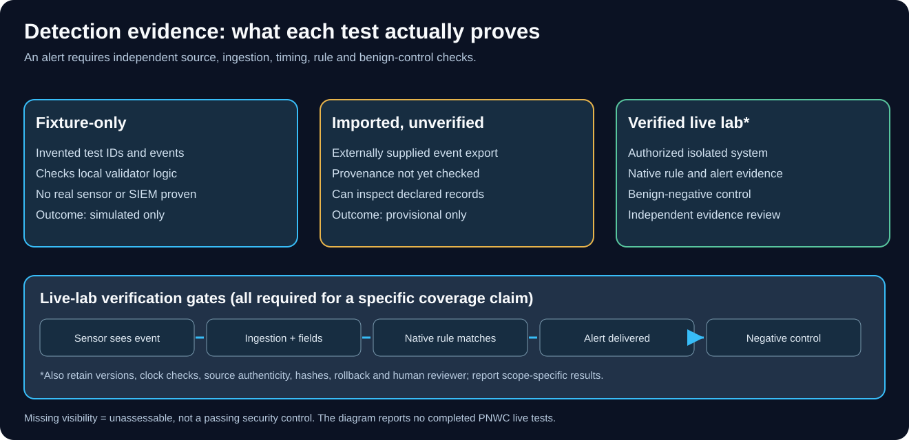

# Detection Engineering: Sigma, Elastic and Wazuh

_Last reviewed: 2026-11-24 (source mapping; no rules deployed)_

**Prerequisites:** [SIEM index](README.md) · [Endpoint visibility](../Endpoint-Visibility/README.md) · [Purple Team exercises](../../PlayBooks/purple-team-detection-validation.md).

## Sources by role

| Project | Reference application |
| --- | --- |
| [SigmaHQ/sigma](https://github.com/SigmaHQ/sigma) | Portable detection logic, logsource definitions, rule IDs, metadata and ATT&CK tags; validate backend support |
| [Elastic detection-rules](https://github.com/elastic/detection-rules) | Elastic-specific query implementations and testing conventions |
| [osquery defense kit](https://github.com/chainguard-dev/osquery-defense-kit) | Defensive endpoint queries; verify performance, privileges and OS compatibility |
| [Falco rules](https://github.com/falcosecurity/rules) | Container/runtime threat signals, not native Wazuh or Sigma rules |
| [MITRE ATT&CK](https://attack.mitre.org/) | Behavior and technique mapping. Use current [Detection Strategies](https://attack.mitre.org/detectionstrategies/) and [Data Components](https://attack.mitre.org/datacomponents/) for detection guidance; mapping does not prove coverage |

## Detection Evidence & Validation Boundaries

*Evidence-level comparison, not a claim that a rule was deployed.* The live-lab gates are shown in sequence from sensor visibility through ingestion, native-rule matching and alert delivery, with a benign negative control. A synthetic positive/negative sample can test rule logic; it does not establish sensor delivery, product integration, or production coverage. Review the [offline canary validator](../../Documentation/CANARY-DETECTION-VALIDATOR.md) and [live verification matrix](../../Documentation/LAB-VERIFICATION-MATRIX.md) before reporting results.

## Repeatable test and promotion workflow

1. Define the malicious or suspicious behavior, required sensors and minimum observable event fields.
2. Pin upstream repository commit/rule UUID and inspect applicable license, prerequisites, exclusions and known false positives.
3. Confirm the field names and logs **actually ingested** by your platform. Wazuh decoder/rule XML, Elastic EQL/KQL, Splunk SPL and Sigma YAML are not interchangeable.
4. Convert or reimplement logic for the supported backend; review comparisons, regex, case, time window and aggregation semantics.
5. Test with sanitized positive and negative samples in a dedicated lab. Validate expected parser/normalization (a Wazuh decoder where applicable), alert level, service integration and timestamps.
6. Simulate missing fields or agent disconnection; record as **not observable**, not secure.
7. Adjust sensitivity, suppression and severity with written rationale, peer review and regression tests; version native rules and keep rollback.
8. Document detection coverage, evidence and owner. Link remediation to [findings management](../../PlayBooks/assessment-findings-lifecycle.md).

| Test | Pass criteria |
| --- | --- |
| Positive event | Correct parser/normalization (Wazuh decoder where applicable) and intended alert fires |
| Negative/benign event | No incorrect high-priority alert |
| Missing field | Predictable failure, gap documented |
| Sensor offline | Health alert or acknowledged loss of visibility |
| Correlation | Correct timestamps, event identity and confidence |

## PNWC sensor integration

Treat [Snort](../IDS%26IPS/snort.md), [Kismet](../IDS%26IPS/kismet-wazuh-wireless-lab.md), [nzyme](../IDS%26IPS/nzyme-wazuh-integration.md), [Wazuh](wazuh.md) and [honeypots](../HoneyPot/wazuh-honeypot-integration.md) as separate producers. Record normalization and time-skew assumptions before correlating. A VM on an unmanaged switch does not automatically see all LAN traffic without SPAN/TAP/router mirroring.

## Provenance

The [SigmaHQ repository content is released under DRL 1.1](https://github.com/SigmaHQ/sigma#licenses). The [Elastic detection-rules repository uses Elastic License v2](https://github.com/elastic/detection-rules#licensing), including rules and code; its README describes notices and treatment for some imported upstream components. Review the exact revision and notices before copying content into another project. [Falco rules](https://github.com/falcosecurity/rules) and [osquery defense kit](https://github.com/chainguard-dev/osquery-defense-kit) provide Apache-2.0 components. This guide does not import or deploy any rule.

**Visual provenance:** The figure is an original static teaching diagram. It reports no completed PNWC live tests and no rules were deployed.

---

[SIEM index](README.md) · [Main guide](../../README.md) · [Legal terms](../../LEGAL.md)
