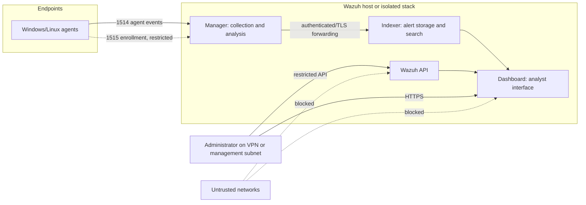

# 🦁 Wazuh Deployment Guide

**Wireless monitoring integration:** For a practical end-to-end Kismet WIDS → Wazuh agent → custom severity rules → dashboards lab, see the [Kismet + Wazuh Wireless IDS Lab](../IDS%26IPS/kismet-wazuh-wireless-lab.md). It includes example scripts, JSON log paths and correlation tests; a wired VM interface cannot directly capture Wi-Fi management frames. For a complementary nzyme wireless sensor with native webhook forwarding, custom Wazuh rules and shared dashboards, see [nzyme + Wazuh Integration](../IDS%26IPS/nzyme-wazuh-integration.md).

**Deception sensor integration:** [OpenCanary/Cowrie/DIY → Wazuh](../HoneyPot/wazuh-honeypot-integration.md) supplies native JSON log sources, custom severity rules and dashboard guidance. Includes [Pi](../HoneyPot/raspberry-pi-honeypot-lab.md), [Proxmox](../HoneyPot/proxmox-vm-honeynet.md), and [ESP32-S3](../HoneyPot/esp32-s3-honeypots.md) deployment options. Correlate with wireless Kismet/nzyme using independent AP/client evidence.

## 🎯 Purpose
Wazuh SIEM and XDR deployment guide - covering Wazuh manager installation, agent deployment across Windows/Linux, built-in detection rules, vulnerability assessment, compliance modules, and integration with ELK/OpenSearch.

## ⚙️ Function
Covers the Wazuh 4.14 Docker stack, agent enrollment, log collection and file integrity monitoring (FIM) checks, troubleshooting, and deployment hardening.

## 🏆 Goal
Deploy Wazuh as a unified SIEM/XDR platform that combines log management, endpoint detection, vulnerability assessment, and compliance monitoring in a single open-source solution.

## 📋 When to Use
- Building a comprehensive SIEM/XDR stack for a homelab or small organization
- Needing compliance monitoring (PCI-DSS, CIS, GDPR) alongside threat detection
- Setting up endpoint agent-based monitoring across mixed Windows/Linux environments
- Purple team exercises requiring EDR-style endpoint telemetry

**Wazuh** is an open-source security platform providing unified XDR (Extended Detection and Response) and SIEM (Security Information and Event Management) capabilities. It monitors endpoints, detects threats, identifies vulnerabilities, and ensures compliance across your infrastructure.

This guide covers deploying the Wazuh Manager using Docker and installing agents on Windows and Linux endpoints.

---

## 📋 Prerequisites

### Server Requirements

| Component | Minimum | Recommended |
|-----------|---------|-------------|
| Docker host | Linux, or Windows with Docker Desktop and WSL 2 | Use a currently supported Docker host |
| Architecture | AMD64 (x86_64) or ARM64 (AARCH64) | Match the selected image and host support |
| CPU | 4 cores minimum | Add capacity for ingest and query load |
| RAM | 8 GB minimum | Add capacity for endpoint count and indexing |
| Storage | 50 GB minimum | Size for ingest rate and retention; 100 GB+ is a starting point, not a universal target |

### Software Requirements

- Docker Engine (Linux) or Docker Desktop with WSL 2 (Windows); use a supported current release
- Docker Compose, current stable release
- Git for cloning the versioned Wazuh Docker repository

### Network Requirements

The [pinned Compose file](https://github.com/wazuh/wazuh-docker/blob/v4.14.10/single-node/docker-compose.yml) publishes these ports before local changes. Review the bindings before starting the stack.

| Port | Protocol | Purpose |
|------|----------|---------|
| 443 | TCP | Dashboard HTTPS, forwarded to container port 5601 |
| 1514 | TCP | Agent communication |
| 1515 | TCP | Agent enrollment |
| 55000 | TCP | Manager API. Keep on the Compose network unless an approved client needs host access. |
| 9200 | TCP | Indexer API. Keep on the Compose network for the example. |
| 514 | UDP | Optional Syslog collector. Remove the host mapping when unused. |

---

## Current Version Selection & Security Architecture (2026-11-21)

The existing installation walkthrough provides a **Docker-oriented Wazuh 4.x deployment reference**. Official [Wazuh 4.x release notes](https://documentation.wazuh.com/current/release-notes/index-4x.html) list **4.14.10 (2026-11-05)**; Wazuh **5.0 prereleases** have appeared but are **not interchangeable** with 4.x manager/agent rules, configuration or container layouts. Pin a tested release family and image tags rather than mixing `latest` packages. Confirm the actual stable status before any new installation.

| Component | Function | Visibility & Trust Requirements |
|---|---|---|
| Wazuh manager | Agent enrollment, decoders, rules, correlation | Restrict agent connections and enrollment to management/endpoint networks |
| Wazuh indexer | Searchable alert/event storage | Protected TLS, credentials, disk, backups and retention |
| Wazuh dashboard & API | Analyst access and administrative actions | Management/VPN only, identity policy and certificate validation |
| Windows/Linux/macOS agents | Host logs, inventory, file integrity/security state (OS support varies) | Version-compatible agent, minimal monitored paths and valid time |
| Kismet/nzyme collector | RF-derived event metadata | Needs an **actual** supported monitor radio & channel coverage |
| Snort/Suricata collector | Wired IDS alerts | Needs real TAP/SPAN/vSwitch mirror traffic; ordinary VM NIC is insufficient |
| NetAlertX | Device inventory & arrival/departure observations | Same-L2 ARP or multi-VLAN imports/collectors; not a packet IDS |

### Deployment & Exposure Checklist

1. Record exact OS/kernel/CPU architecture and **Wazuh 4.x or 5.x** target. Do not apply 4.x-only rules or file paths to 5.x without a separate validation.
2. Size storage for alert indexing, FIM changes, vulnerability data and retention. Configure NTP and restricted DNS.
3. Pin Docker images or official repository commits. Validate Compose with `docker compose config --quiet` and review port bindings and credentials before starting the stack.
4. Restrict agent transport (commonly TCP `1514` in 4.x), enrollment (commonly TCP `1515`), dashboard and API to explicit trusted subnets; review release-specific ports/certificates.
5. Verify generated certificates, dashboard credentials, log rotation, health, snapshots and restoration **before agents are deployed**.
6. Configure agents with narrowly scoped `<localfile>` JSON event sources; redacted lab events should be tested first.
7. Use **manual triage** before any active response. Never have a speculative NetAlertX or RF alert automatically block a switch port, disable a user or deauthenticate a client.
8. Validate manager rules on the installed engine using [Synthetic Rule Validation](../../Documentation/WAZUH-SYNTHETIC-RULE-VALIDATION.md), not only XML parsing.

### Cross-Source JSON Event Flow

```text
NetAlertX presence -----------\
Kismet/nzyme radio alerts ------> protected JSONL or supported collector
Snort 3 packet signatures -----/        |
                                          v
                         Wazuh agent (localfile json)
                                          |
                                 Manager decode/rules
                                          |
                        Indexer -> analyst dashboard
                                          |
                              reviewed incident action
```

On a Wazuh 4.x-compatible agent the following **example** instructs the log collector to read a protected newline-delimited JSON file produced by an approved integration; **it does not create that integration or an alert rule**:

```xml
<localfile>
  <log_format>json</log_format>
  <location>/var/log/pnwc-security-events.jsonl</location>
</localfile>
```

The path must exist and be readable by the agent. A JSON record may be collected without producing a matched alert; add and validate decoder/rule logic after confirming the actual event schema. For a **fictional** event:

```json
{"source":"netalertx","event_type":"lab_device_seen","asset":"synthetic-device-01","site":"test","vlan":"30","timestamp":"2026-11-21T12:00:00Z"}
```

Verify permitted logs reach the agent, manager and dashboard *separately*. Use [Wazuh log collection reference](https://documentation.wazuh.com/current/user-manual/reference/ossec-conf/localfile.html), [Wazuh agent guide](https://documentation.wazuh.com/current/user-manual/agent/index.html) and [Wazuh architecture](https://documentation.wazuh.com/current/getting-started/architecture.html).

### Coverage & Reporting Matrix

| Signal | Evidence | Independent Corroboration |
|---|---|---|
| Device appears on management VLAN | NetAlertX + switch/NAC log | Approved asset, switch port, authenticated user/device ID |
| Host's monitored file changes | Wazuh FIM event | Authorized change ticket and endpoint owner |
| New rogue SSID or deauth burst | nzyme/Kismet alert | AP controller, Wireshark monitor capture, PMF state |
| Signature detection from Snort | IDS alert with rule SID / packet or flow | Packet PCAP, host logs and allowed maintenance |
| Unexpected DNS response | DNS/Zeek/Wireshark + resolver log | CDNs, split DNS and DNSSEC validation |

**Full companion guides:** [NetAlertX](../../Documentation/netalertx-device-discovery-monitoring.md), [Snort 3](../IDS%26IPS/snort.md), [nzyme](../IDS%26IPS/nzyme_wids.md), [Wireshark Casework](../../Documentation/wireshark-defensive-investigations.md), [Segmentation & SPAN](../../Documentation/network-segmentation-dmz-acl-vlan.md).

## 🛠️ Part 1: Preparing the Server

### Step 1.1: Prepare the host

Apply the host's approved security updates and record its kernel and architecture. On Windows with Docker Desktop, use the WSL 2 backend.

### Step 1.2: Install Docker

Follow [Docker Engine's install instructions for your Linux distribution](https://docs.docker.com/engine/install/) or the [Docker Desktop instructions for Windows](https://docs.docker.com/desktop/setup/install/windows-install/). Make sure the Compose v2 plugin is available. Run Docker commands with the privileges required by your host. The Linux `docker` group grants root-equivalent access to a rootful Docker daemon.

### Step 1.3: Verify Docker Installation

```bash
docker --version
docker compose version
```

---

## 🚀 Part 2: Deploying the Wazuh Manager (Docker)

> [!NOTE]
> This guide pins the single-node Docker example to Wazuh `4.14.10`, with matching agent packages, using the [official Docker tag](https://github.com/wazuh/wazuh-docker/tree/v4.14.10/single-node). Check the [official release list](https://github.com/wazuh/wazuh/releases) and [Docker deployment requirements](https://documentation.wazuh.com/4.14/deployment-options/docker/wazuh-container.html) before deploying; newer releases can change compose files and defaults. Treat prereleases as evaluation builds.

### Step 2.1: Clone the Wazuh Docker Repository

```bash
git clone https://github.com/wazuh/wazuh-docker.git --branch v4.14.10 --single-branch
cd wazuh-docker/single-node
```

> Keep the server components on one matching release. Use the selected release's checked-in deployment files; do not update only one component in the compose stack.

### Step 2.2: Check vm.max_map_count

On the Linux host running Docker Engine, inspect the kernel setting:

```bash
sysctl vm.max_map_count
```

The Wazuh Indexer requires a value of at least `262144` for this deployment. Record the existing value and raise it only if lower. Persist the target value through the host's managed sysctl configuration. For Docker Desktop, use the WSL 2 host procedure in the [Wazuh deployment prerequisites](https://documentation.wazuh.com/4.14/deployment-options/docker/wazuh-container.html#docker-host-requirements).

### Step 2.3: Generate SSL Certificates

```bash
docker compose -f generate-indexer-certs.yml run --rm generator
```

The generator writes certificates and private keys under `config/wazuh_indexer_ssl_certs/`. Keep those files private and retain the CA separately from the Compose checkout.

### Step 2.4: Start the Wazuh Stack

Before starting the stack, apply the [port restrictions below](#-part-3-firewall-configuration) and prepare the [release-specific credential changes](https://documentation.wazuh.com/4.14/deployment-options/docker/changing-default-password.html). Start on an isolated host that is reachable only by the administrator during setup.

```bash
docker compose config --quiet && docker compose up -d
```

### Step 2.5: Verify the services

```bash
docker compose ps
docker compose logs --tail=80 wazuh.manager wazuh.indexer wazuh.dashboard
```

Look for the `wazuh.manager`, `wazuh.indexer` and `wazuh.dashboard` services. Container names depend on the Compose project name. Confirm that the dashboard starts and can reach both the indexer and manager API. Check logs for initialization errors, failed authentication, or certificate errors. A running container alone only confirms that its process started.

### Step 2.6: Access the Dashboard

Open your browser and navigate to:

```
https://<SERVER-IP>
```

**Bootstrap credentials:** Use the credentials generated or documented for the exact Wazuh release and installation method; do not reuse a sample password. Rotate them before making the dashboard reachable beyond the isolated setup host, then store them in the approved secrets manager. The dashboard and API should be restricted to an administrative VPN/subnet.

---

## 🔥 Part 3: Firewall Configuration

Before running Compose, remove unused host port publications and bind necessary ports to the intended host addresses. Keep indexer traffic on the Compose network. Limit dashboard access to the administrator network and agent traffic to approved endpoint networks. Apply the same scope at the upstream network firewall.

On Linux, [Docker's published-port rules](https://docs.docker.com/engine/network/packet-filtering-firewalls/) can bypass UFW intake rules. Apply restrictions at a control point that sees forwarded container traffic, and verify both allowed and denied paths using approved administrative test hosts. Keep console access for firewall recovery.

---

## 🖥️ Part 4: Windows Agent Deployment

### Method 1: Dashboard-Generated Command (Recommended)

1. Log into the Wazuh Dashboard
2. Navigate to **Agents → Deploy new agent**
3. Select **Windows** as the operating system
4. Enter your Wazuh Manager IP address
5. Optionally assign an agent name and group
6. Copy the generated PowerShell command

### Method 2: Manual Installation

#### Step 4.1: Download the Agent

Download from an elevated PowerShell prompt. Before installation, compare the downloaded MSI's SHA-512 hash with the pinned package entry in the [official Wazuh package list](https://documentation.wazuh.com/current/installation-guide/packages-list.html#wazuh-agent); stop if it differs.

```powershell
$wazuhAgentMsi = Join-Path $env:TEMP 'wazuh-agent-4.14.10-1.msi'
Invoke-WebRequest -Uri 'https://packages.wazuh.com/4.x/windows/wazuh-agent-4.14.10-1.msi' -OutFile $wazuhAgentMsi
Get-FileHash -LiteralPath $wazuhAgentMsi -Algorithm SHA512
```

#### Step 4.2: Install with Configuration

```powershell
$wazuhInstallArgs = '/i "{0}" /qn /norestart WAZUH_MANAGER="<MANAGER-IP>" WAZUH_REGISTRATION_SERVER="<MANAGER-IP>" WAZUH_AGENT_NAME="<HOSTNAME>"' -f $wazuhAgentMsi
$wazuhInstall = Start-Process -FilePath 'msiexec.exe' -ArgumentList $wazuhInstallArgs -Wait -PassThru
$wazuhInstall.ExitCode
```

Use the same elevated PowerShell session after verifying the hash. Replace `<MANAGER-IP>` with the manager address and `<HOSTNAME>` with a unique agent name. Exit code `0` means success. Follow the endpoint restart policy if Windows Installer returns `3010` (success, restart required). Investigate other exit codes before enabling the service.

#### Step 4.3: Start the Wazuh Service

```powershell
NET START WazuhSvc
```

#### Step 4.4: Verify Service Status

```powershell
Get-Service WazuhSvc
```

### Windows Agent File Locations

| Item | Path |
|------|------|
| Installation Directory | `C:\Program Files (x86)\ossec-agent\` |
| Configuration File | `C:\Program Files (x86)\ossec-agent\ossec.conf` |
| Log File | `C:\Program Files (x86)\ossec-agent\ossec.log` |

---

## 🐧 Part 5: Linux Agent Deployment

### Step 5.1: Add the Wazuh Repository

Use the signed package repository for the endpoint's distribution. Follow the repository setup in the [Wazuh 4.14 Linux agent documentation](https://documentation.wazuh.com/4.14/installation-guide/wazuh-agent/wazuh-agent-package-linux.html). Use the package version shown below on supported Debian/Ubuntu or DNF-based systems once the repository is configured.

### Step 5.2: Install the Agent

**Debian/Ubuntu:**

```bash
sudo WAZUH_MANAGER="<MANAGER-IP>" apt install -y wazuh-agent=4.14.10-1
```

**RHEL/CentOS:**

```bash
sudo WAZUH_MANAGER="<MANAGER-IP>" dnf install wazuh-agent-4.14.10-1
```

### Step 5.3: Enable and Start the Service

```bash
sudo systemctl daemon-reload
sudo systemctl enable --now wazuh-agent
```

### Step 5.4: Verify Agent Status

```bash
systemctl status wazuh-agent
```

### Linux Agent File Locations

| Item | Path |
|------|------|
| Installation Directory | `/var/ossec/` |
| Configuration File | `/var/ossec/etc/ossec.conf` |
| Log File | `/var/ossec/logs/ossec.log` |

---

## 🔍 Part 6: Verification and Testing

### Check Agent Status in Dashboard

1. Log into the Wazuh Dashboard
2. Navigate to **Agents**
3. Verify your agent appears with status **Active**

### Generate a Test Alert

On the Windows agent, trigger a test alert by creating a test file:

```powershell
# File-integrity smoke test only: not the EICAR test string; it may not trigger an alert. Use only if this path is monitored.
$wazuhSmokePath = Join-Path $env:PUBLIC ("fim-smoke-$([guid]::NewGuid()).txt")
Set-Content -LiteralPath $wazuhSmokePath -Value 'Synthetic file-integrity smoke test'
```

On Linux:

```bash
# Log-collection smoke test only: this creates a syslog message; it is not an SSH authentication event.
logger -t wazuh-smoke-test "Synthetic log-pipeline validation"
```

Check the configured collection path for the test file or log message. Raw events are searchable only when the corresponding archiving and indexing are enabled. After recording the FIM result, remove the temporary file you created with `Remove-Item -LiteralPath $wazuhSmokePath`. Use the [synthetic-rule validation procedure](../../Documentation/WAZUH-SYNTHETIC-RULE-VALIDATION.md) to verify alert logic and delivery.

---

## 🔧 Part 7: Common Configuration Tasks

### Changing the Admin Password

Use the [Wazuh 4.14 Docker password rotation procedure](https://documentation.wazuh.com/4.14/deployment-options/docker/changing-default-password.html). Keep indexer-user credentials, credentials used by dependent services, and manager API user credentials synchronized with the deployed configuration. Verify dashboard sign-in and inter-service authentication after each change.

### Adding Agent Groups

Groups allow you to apply specific configurations to sets of agents:

1. Navigate to **Management → Groups**
2. Click **Add new group**
3. Name the group (e.g., `windows-servers`, `linux-workstations`)
4. Assign agents to groups during deployment or via the dashboard

### Modifying Agent Configuration

Edit the `ossec.conf` file on the agent to customize:
- Log collection sources
- File integrity monitoring paths
- Active response settings

After changes, restart the agent service.

---

## ❗ Part 8: Troubleshooting

### Agent Not Connecting

**Check agent logs:**

Windows:
```powershell
Get-Content "C:\Program Files (x86)\ossec-agent\ossec.log" -Tail 50
```

Linux:
```bash
tail -n 50 /var/ossec/logs/ossec.log
```

**Common issues:**
- Firewall blocking ports 1514/1515
- Incorrect manager IP in agent configuration
- Certificate/enrollment issues

### Agent Shows "Disconnected"

1. Confirm the manager hostname and communication port from the agent configuration.
2. Check agent and manager logs for the actual connection error. On the Compose host, use `docker compose logs wazuh.manager`.
3. From the approved endpoint network, verify access to the configured agent transport port. Check enrollment access separately if enrolling.
4. Retest the agent connection after correcting the diagnosed issue.

### Dashboard Not Loading

```bash
# Check container status
docker compose ps

# View dashboard logs
docker compose logs wazuh.dashboard

# Restart the stack if needed
docker compose restart
```

### Re-enrolling an Agent

Diagnose connectivity, duplicate identity and certificate errors with the [Wazuh enrollment troubleshooting guidance](https://documentation.wazuh.com/4.14/user-manual/agent/agent-enrollment/troubleshooting.html). Before changing an agent's identity, preserve the existing endpoint and manager records in restricted storage and plan the association with historical alerts. Use the enrollment procedure for the diagnosed condition and verify that the endpoint reconnects under the intended identity.

---

## 🛡️ Part 9: Security Hardening

### Change Default Passwords

Identify seeded indexer and API users for the selected release and rotate default credentials with the Docker procedure above. Keep credentials and hashes out of public repositories and evidence exports.

### Enable HTTPS Certificate Validation

For production, replace self-signed certificates with certificates from a trusted CA or your internal PKI.

### Restrict API Access

Keep the API on the internal Compose network for dashboard use. If an approved API client requires host access, restrict the listener and source network, validate TLS and assign that client a limited API role.

### Regular Updates

Select a supported target release. Review [Wazuh's Docker upgrade instructions](https://documentation.wazuh.com/4.14/deployment-options/docker/upgrading-wazuh-docker.html), take a recoverable backup and stage the target release's Compose and configuration changes together. Pulling existing pinned tags retrieves those same versions. Verify agent connectivity, indexing, dashboard access and restore readiness before closing the change.

---

## 📚 Additional Resources

- [Wazuh Documentation](https://documentation.wazuh.com/)
- [Wazuh GitHub Repository](https://github.com/wazuh/wazuh)
- [Wazuh Ruleset](https://github.com/wazuh/wazuh/tree/main/ruleset) *(the standalone `wazuh-ruleset` repo is archived; rules now ship in the main repo)*
- [Wazuh Slack Community](https://wazuh.com/community/join-us-on-slack/)

---

## 🗂️ Quick Reference

### Docker Commands

| Command | Purpose |
|---------|---------|
| `docker compose up -d` | Start the stack |
| `docker compose down` | Stop the stack |
| `docker compose restart` | Restart all containers |
| `docker compose logs -f` | Follow all logs |
| `docker compose ps` | Show container status |

### Agent Service Commands

| OS | Start | Stop | Status |
|----|-------|------|--------|
| Windows | `NET START WazuhSvc` | `NET STOP WazuhSvc` | `Get-Service WazuhSvc` |
| Linux | `systemctl start wazuh-agent` | `systemctl stop wazuh-agent` | `systemctl status wazuh-agent` |

---

*Part of the Incident Response & Log Aggregation Branch*

## Related Files
- [../README.md](../README.md) - IncidentResponse section index
- [elk_stack.md](elk_stack.md) - separate Elastic Stack deployment reference
- [splunk.md](splunk.md) - Splunk as Wazuh SIEM alternative
- [graylog.md](graylog.md) - Graylog alternative
- [../Endpoint-Visibility/Windows/sysmon.md](../Endpoint-Visibility/Windows/sysmon.md) - Sysmon data source for Wazuh agents

## Data Flow & Trust Boundaries

This logical view shows the three components on one Docker host in the example named `single-node` by the Wazuh Docker repository. Restrict enrollment, agent, API, and dashboard access to their intended endpoint or administrator networks, and use the release-specific TLS configuration.


