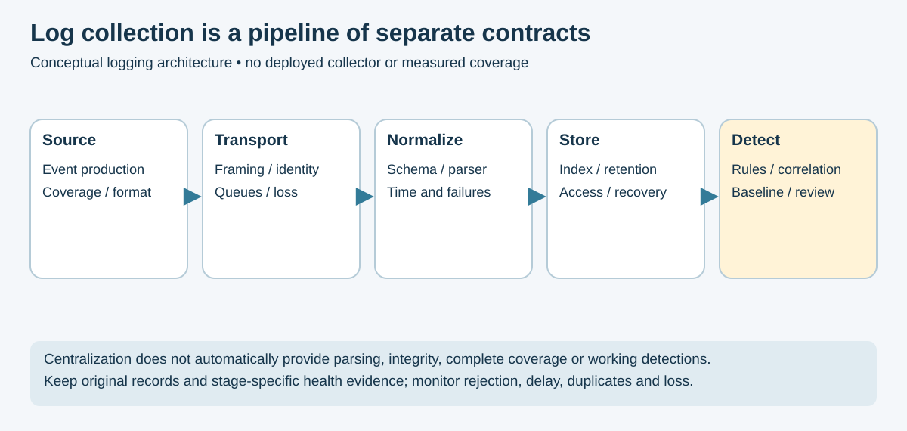
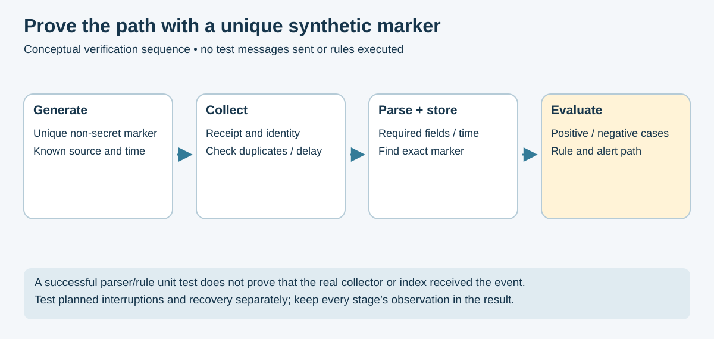
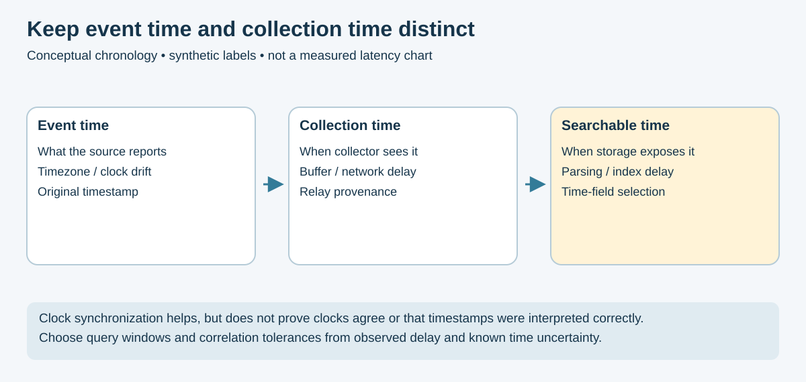
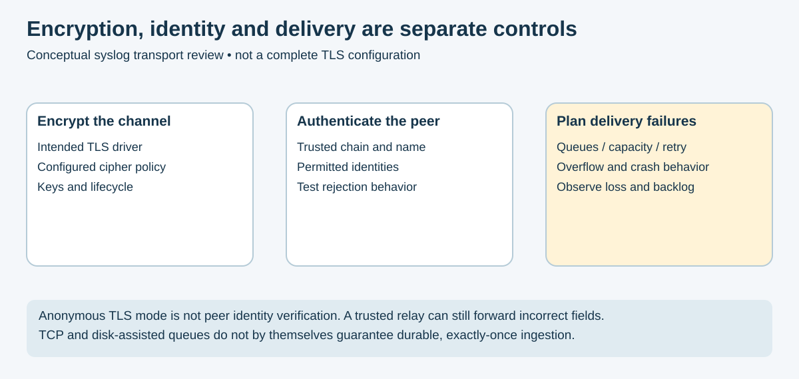

# 📊 Log Aggregation & Visibility Guide

**Source and visual review:** November 17, 2026. No source logs read, services configured, packets sent, listeners started or SIEM rules executed. Examples require version-specific validation and an approved deployment plan.

## 🎯 Purpose
Centralized logging reference for wireless sensors, DHCP, RADIUS/NAC, switches, firewalls, DNS, rsyslog and selected SIEM integration points.

## ⚙️ Function
Twelve parts cover architecture, source collection, rsyslog receiving, SIEM adapters, verification, troubleshooting and security. Examples illustrate selected rsyslog, Windows and product-specific integration points; this is not a complete syslog-ng, Windows Event Forwarding or cloud-logging deployment. Paths, parsers, permissions and transport settings require validation for the selected release.

## 🏆 Goal
Build a documented collection and investigation pipeline with known source coverage, parsing, time and retention limits. Centralization supports correlation but does not guarantee complete visibility or automatic incident detection.

## 📋 When to Use
- Setting up a new homelab SIEM or IR environment from scratch
- Adding a new device type (pfSense, Windows DC, Apache) to an existing log pipeline
- Troubleshooting missing log sources when an incident reveals a visibility gap
- Validating end-to-end log flow before declaring IR readiness

**Effective incident response begins long before an incident occurs.** This guide covers establishing the logging infrastructure and visibility required to detect, investigate, and respond to security events. Without proper log aggregation, you're flying blind.

This guide focuses on configuring critical log sources to feed into your SIEM (Wazuh, ELK Stack, Splunk, or similar).

---

## 🎯 Why Log Aggregation Matters

| Without Centralized Logging | With Centralized Logging |
|-----------------------------|--------------------------|
| Logs scattered across devices | Search across the sources actually collected |
| Manual correlation required | Correlation rules can be built and tested |
| Evidence lost due to rotation | Configured retention and recoverability |
| Attackers can clear local logs | Separate storage can reduce shared failure; integrity needs its own controls |
| Reactive incident discovery | Detection opportunities if relevant events and rules exist |

---

## 📋 Required Log Sources Overview

| Source | Log Type | What We're Looking For |
|--------|----------|------------------------|
| Wireless sensor / WIDS (for example Kismet) | Version-specific alerts and radio records | Candidate BSSID/SSID/channel changes; document radio and channel coverage. Zeek adds protocol context only where its capture path has visibility. |
| DHCP Server | Actual server lease/audit records | Time-bounded address assignment; client-supplied names are not authenticated identities. |
| RADIUS / NAC | Product authentication/accounting records | Access result and policy, correlated identity and endpoint; not automatic proof of MAC spoofing. |
| Network Switches | SNMP / Syslog | Port status changes; Port security violations; Unknown MACs |
| Firewalls | traffic / threat | Denied connections; IPS alerts; Geo-anomalies |
| DNS Servers | query logs | Unusual queries; Known-bad domains; High-entropy names (DGA) |
| Active Directory | Security Event Log | Authentication events; Group changes; Privilege escalation |
| Endpoints (Sysmon) | Sysmon Operational | Process creation; Network connections; File/Registry changes |

---

## 🏗️ Part 1: Architecture Overview



*Figure 1 — Original conceptual pipeline; no product configuration is implied. Compare [rsyslog input/ruleset/action guidance](https://docs.rsyslog.com/doc/configuration/modules/omfwd.html) and [Elastic schema documentation](https://www.elastic.co/guide/en/ecs/current/index.html).*

### Typical Log Flow

```
┌─────────────────┐     ┌─────────────────┐     ┌─────────────────┐
│   Log Sources   │────▶│   Aggregation   │────▶│      SIEM       │
│                 │     │     Layer       │     │                 │
│ • Switches      │     │                 │     │ • Wazuh         │
│ • Firewalls     │     │ • Rsyslog       │     │ • ELK Stack     │
│ • DHCP/DNS      │     │ • Logstash      │     │ • Splunk        │
│ • Wireless IDS  │     │ • Filebeat      │     │ • Graylog       │
│ • Endpoints     │     │ • Fluentd       │     │                 │
└─────────────────┘     └─────────────────┘     └─────────────────┘
```

### Network Considerations

| Component | Recommended Placement |
|-----------|----------------------|
| SIEM Server | Management VLAN, isolated segment |
| Log Collectors | Each network segment/site |
| Listening Stations | Strategic locations (wireless coverage) |

### Port Requirements

These are common defaults, not a firewall policy or proof a listener exists. Verify transport, bind address and selected configuration. The product receiver examples below are alternatives: do not bind several daemons to the same address/port.

| Protocol | Port | Purpose |
|----------|------|---------|
| Syslog (UDP) | 514 | Traditional syslog |
| Syslog (TCP) | Commonly 514 | Ordered transport; not by itself durable delivery, encryption or identity verification |
| Syslog (TLS) | Commonly 6514 | Encryption and configured peer verification; the port alone does not enable TLS |
| Beats | 5044 | Filebeat/Winlogbeat to Logstash |
| Wazuh Agent | Typically 1514/TCP | Agent protocol; distinct from the optional syslog listener |
| SNMP Traps | 162 | Network device alerts |

---

## 📡 Part 2: Wireless IDS (Kismet)

Kismet provides passive wireless monitoring to detect rogue access points, deauthentication attacks, and unauthorized devices.

### Deployment Scenario

A Raspberry Pi running Kismet positioned to monitor your wireless environment, forwarding alerts to your SIEM.

### Hardware Requirements

| Component | Specification |
|-----------|---------------|
| Device | Raspberry Pi 4 (2GB+ RAM) |
| WiFi Adapter | Monitor mode capable (Alfa AWUS036ACH recommended) |
| Storage | 32GB+ SD card |
| Power | PoE HAT or standard power supply |

### Step 2.1: Install Kismet on Raspberry Pi

Use [Kismet's current installation guidance](https://www.kismetwireless.net/docs/readme/installing/)
for the exact OS, architecture and repository. Do not construct a repository URL
from a codename that may not be supported. Group membership and packet-capture
privileges require a deliberate access review.

### Step 2.2: Configure Kismet

Identify the actual capture interface and supported log types from the installed
release. Use a local override configuration rather than replacing packaged defaults.
Record the sensor, channel plan, hopping gaps, time source and retention policy.
A monitor-mode claim does not guarantee adapter/driver compatibility.

### Step 2.3: Configure Kismet Alert Forwarding

Choose a documented database/export, API or event-integration path. A Kismet
database is not syslog text. The former `alertsyslog` and bare alert-directive
examples were not verified for a current build and are not a supported recipe.
Preserve original alert records and map fields explicitly.

### Step 2.4: Forward Kismet Alerts via Rsyslog

Feed only the validated export into a scoped collector input. Select framing,
parser and transport for that representation; a `local5` facility is a site choice,
not a Kismet identity guarantee. Confirm delivery and parser behavior with fixtures.

### Step 2.5: Create Kismet Systemd Service

Inspect the package's service unit and runtime-user model before adding a custom
unit. Do not overwrite the packaged unit or assume `User=kismet` exists. Validate
paths, config, privileges, writable directories and service behavior in the lab.

Primary reference: [Kismet logging](https://www.kismetwireless.net/docs/readme/logging/logging/).

### Key Kismet Alerts to Monitor

| Alert | Indication |
|-------|------------|
| Spoof/baseline alert supported by the build | Candidate inventory mismatch; corroborate with controller and endpoint records |
| `DEAUTHFLOOD` when supported | Management-frame rate anomaly, not automatic actor intent |
| Timestamp anomaly | Possible clock/reset/spoofing behavior requiring investigation |
| Channel change | Could be authorized channel selection or an anomaly |
| Ad-hoc conflict alert when supported | Compare actual alert definition, baseline and capture quality |

---

## 🌐 Part 3: DHCP Server Logging

DHCP logs show server-observed lease activity. Static addresses, IPv6 methods, missing logs and spoofed/client-supplied identifiers limit coverage and attribution.

### ISC DHCP Server (Linux)

#### Step 3.1: Enable Verbose Logging

**Historical ISC DHCP:** upstream maintenance ended in 2022; use this only when
maintaining an existing deployment and plan migration. `log-facility local7;`
selects a facility; it does not turn on a universal verbose mode. Do not add or
change subnet pools merely to enable logging. See [ISC status](https://www.isc.org/dhcp/).

#### Step 3.2: Configure Rsyslog for DHCP

Route the actual server's events to an approved local file or collector. Facilities
can collide across programs; use source/application metadata and retain originals.
Choose the authenticated forwarding design in Part 12 rather than a wildcard UDP
destination. Validate before a separately planned service reload or restart.

### Windows DHCP Server

#### Enable DHCP Audit Logging

```powershell
# Enable audit logging via PowerShell
Set-DhcpServerAuditLog -Enable $true -Path "C:\Windows\System32\dhcp"

# Or via DHCP Management Console:
# Right-click server → Properties → General → Enable DHCP audit logging
```

#### Forward Windows DHCP Logs

Select the configured audit-file path or the relevant supported Windows Event
channels. DHCP audit text has a structured record format; declaring
`log_format=syslog` in an agent does not prove correct field extraction.
Build and test a decoder with sample records, including headers and rotation.
Use [Microsoft's audit-log settings](https://learn.microsoft.com/en-us/powershell/module/dhcpserver/set-dhcpserverauditlog)
and [Wazuh localfile documentation](https://documentation.wazuh.com/current/user-manual/reference/ossec-conf/localfile.html).
The former unauthenticated NXLog UDP example is not a production deployment.

### Suspicious DHCP Hostnames to Alert On

The following strings can be low-confidence inventory clues only. They neither identify an OS reliably nor establish malicious intent. Apply baseline exceptions and correlate authorized labs, DHCP/NAC and endpoint evidence.

| Pattern | Indication |
|---------|------------|
| `kali*` | Kali Linux |
| `parrot*` | Parrot Security OS |
| `blackarch*` | BlackArch Linux |
| `pentoo*` | Pentoo Linux |
| `commando*` | Commando VM |
| `flare*` | FLARE VM |
| `remnux*` | REMnux |
| `attack*` | Generic attack system |

---

## 🔐 Part 4: RADIUS / NAC Logging

RADIUS/NAC records provide access-decision and accounting context. A MAC or username mismatch can have benign causes and needs correlated policy, device and time evidence.

### FreeRADIUS Configuration

#### Step 4.1: Enable Detailed Logging

Illustrative FreeRADIUS 3.x fragment, not a whole configuration. Confirm installed paths/options. Keep password logging disabled, including debug-session handling. [Upstream configuration](https://github.com/FreeRADIUS/freeradius-server/blob/v3.2.x/raddb/radiusd.conf.in).

Edit `/etc/freeradius/3.0/radiusd.conf`:

```conf
log {
    destination = syslog
    syslog_facility = local6
    
    # Log authentication outcomes; review identity/privacy exposure
    auth = yes
    auth_badpass = no
    auth_goodpass = no
    
    # Use version-supported result/reason fields; do not log passwords.
}
```

#### Step 4.2: Configure Syslog Forwarding

Route the selected FreeRADIUS events without forwarding password/debug material.
Use a restricted file and authenticated collector connection. Configure service
reloads/restarts through the platform's change procedure after validation; do not
apply a generic restart during an active authentication service without impact review.

### Cisco ISE Syslog Configuration

UI labels vary by release; verify the exact ISE administration guide and authorized logging categories before applying this illustrative navigation. Choose transport and peer validation explicitly.

Configure remote syslog targets via the ISE admin console:

1. Navigate to **Administration → System → Logging → Remote Logging Targets**
2. Add your SIEM server IP and port
3. Configure log categories:
   - Failed Attempts
   - Passed Authentications
   - RADIUS Diagnostics
   - Posture and Client Provisioning

### Windows NPS (Network Policy Server)

#### Enable NPS Logging

Use the NPS **Accounting Configuration** wizard and log-file properties to choose
event, text or SQL accounting and the behavior when logging fails.
The former `Set-NpsAccountingConfiguration` examples were not a documented
deployment procedure and are removed.

#### Forward NPS Logs

Collect the selected file or supported event channel with an appropriate parser;
a generic syslog label does not decode every NPS file format. Keep authentication
outcomes distinct from accounting and validate path, encoding and rotation.
See [Microsoft NPS accounting](https://learn.microsoft.com/en-us/windows-server/networking/technologies/nps/nps-accounting-configure).

### Key RADIUS Events to Monitor

| Event | Indication |
|-------|------------|
| Multiple failed auths (same MAC) | Possible guessing, client retry or configuration error |
| Successful auth after failures | Possible credential compromise |
| MAC not in database | Unknown device |
| MAC/User mismatch | Potential MAC spoofing |
| Auth from unusual location | Candidate anomaly; verify location, timing and identity |

---

## 🔌 Part 5: Network Switch Logging

Switch logs provide visibility into physical network changes, port security violations, and potential unauthorized device connections.

### Cisco IOS Configuration

For the exact IOS/IOS-XE platform, select syslog destination, source interface,
severity, timestamps and a supported secure transport. Validate the collector
parser with actual message families. Logging changes must not silently change
port-security enforcement or shut down ports.

### HP/Aruba ProCurve Configuration

Use documentation for the actual ArubaOS-Switch/ProCurve or ArubaOS-CX family.
Their syntax and security models differ. Select logging destinations and event
coverage without copying a generic port-range security policy.

### Juniper EX Series Configuration

Use the exact Junos/ELS syntax and platform documentation. Logging configuration
is distinct from secure-access-port or MAC-limit policy. The former cross-version
enforcement snippets are not a safe generic logging setup.

Use authenticated SNMPv3 where supported and appropriate; the former shared
`public` SNMPv2 community example should not be used as a default. Syslog and traps
have different formats, reliability and parser requirements.

### Key Switch Events to Monitor

Message identifiers and trap support depend on platform and enabled features; these are event classes to map, not portable parser rules.

| Event | OID/Log Message | Indication |
|-------|-----------------|------------|
| Port Security Violation | Platform-specific message | Investigate a policy violation; not necessarily malicious |
| Link Up/Down | `IF-MIB::linkDown` | Physical connection change |
| MAC Move | Platform-specific MAC-move event | Could reflect mobility, topology, duplication or spoofing; investigate |
| STP Topology Change | Platform-specific STP event | Compare approved topology and change records |
| VLAN Change | Platform-specific configuration/audit event | Verify actual committed configuration and operator identity |

---

## 🔥 Part 6: Firewall Logging

Firewall logs provide perimeter visibility and are essential for detecting external attacks and data exfiltration.

### pfSense / OPNsense

#### Configure Remote Syslog

Use the installed appliance's supported remote-logging configuration; pfSense and
OPNsense menus and daemon behavior differ. Check transport, source address,
categories and parser fixtures. Do not edit a generated syslog file directly and
expect the UI to preserve it.

### iptables/nftables (Linux)

#### Enable Logging for Dropped Packets

Add logging only at the intended existing policy decision point, with appropriate
rate limits and counters. A logging guide must not append unconditional INPUT
DROP rules. Logging is not itself a DROP verdict; an nftables `log` statement and
a terminating verdict are separate rule behavior.

#### Configure Rsyslog for Firewall Logs

Match the actual kernel/firewall prefix or structured fields and route the result
through an approved collector action. Test quoting, rate limits and duplicates;
a string prefix alone is not an authenticated source identity.

### Windows Firewall

#### Enable Firewall Logging

```powershell
# Enable logging for dropped and successful connections
Set-NetFirewallProfile -Profile Domain,Public,Private -LogBlocked True -LogAllowed True -LogFileName "%systemroot%\system32\LogFiles\Firewall\pfirewall.log" -LogMaxSizeKilobytes 32768
```

#### Forward via Wazuh Agent

This collects lines only where supported; a Windows firewall log is not automatically decoded because it uses `log_format=syslog`. Test headers, fields, rotation and parser errors with actual sample records.

Add to `ossec.conf`:

```xml
<localfile>
    <location>C:\Windows\System32\LogFiles\Firewall\pfirewall.log</location>
    <log_format>syslog</log_format>
</localfile>
```

---

## 🖥️ Part 7: DNS Server Logging

DNS records can support investigation of unusual resolution activity, but do not by themselves identify malicious intent or cover traffic bypassing the observed resolver.

### BIND DNS Server

#### Enable Query Logging

Add the following as a top-level `logging` statement in the effective BIND configuration, not inside an `options` block. Verify include structure, daemon permissions, rotation and confinement policy for these illustrative paths:

```conf
logging {
    channel query_log {
        file "/var/log/bind/query.log" versions 3 size 50m;
        severity info;
        print-time yes;
        print-category yes;
        print-severity yes;
    };
    
    channel security_log {
        file "/var/log/bind/security.log" versions 3 size 50m;
        severity dynamic;
        print-time yes;
    };
    
    category queries { query_log; };
    category security { security_log; };
};
```

#### Forward DNS Logs via Rsyslog

Create `/etc/rsyslog.d/55-dns.conf`:

```conf
# DNS query logs
module(load="imfile")
input(type="imfile" File="/var/log/bind/query.log" Tag="dns-query" Facility="local3")

# Add only the separately reviewed forwarding action for this source.
# No default unauthenticated UDP destination is configured here.
```

### Windows DNS Server

#### Enable DNS Debug Logging

Windows DNS audit, analytic ETW and debug-file logging serve different purposes.
Select required events rather than enabling every diagnostic option. Analytic
query-event collection and Wazuh/Windows event-channel compatibility must be
validated for the actual capture path; enabling a plugin diagnostic flag is not
equivalent to enabling the analytic channel.

#### Forward via Wazuh

Choose a supported event channel or exported file path with the correct log format
and parser. Verify event production and the collector's ability to read it,
including channel permissions and volume impact.
See [Microsoft DNS logging and diagnostics](https://learn.microsoft.com/en-us/windows-server/networking/dns/dns-logging-and-diagnostics).

### Suspicious DNS Patterns to Alert On

| Pattern | Indication |
|---------|------------|
| High-entropy subdomains | Candidate tunneling/DGA or legitimate service identifiers |
| TXT record queries to unusual domains | Candidate anomaly; legitimate TXT usage is common |
| Queries to known-bad domains | Malware callback |
| High query volume from single host | Candidate anomaly, retry, load or possible exfiltration |
| Queries for special-use or alternative names | Application/resolver behavior; not proof of Tor use |

---

## 🔄 Part 8: Central Rsyslog Server Configuration

Set up a central rsyslog server to receive logs from all sources before forwarding to your SIEM.

### Step 8.1: Install Rsyslog

Debian/Ubuntu package illustration; package names, service defaults and TLS driver
availability vary by distribution and release. Inspect the effective configuration
before any separately approved installation or service change.

```bash
sudo apt update
sudo apt install -y rsyslog rsyslog-gnutls
```

### Step 8.2: Configure Rsyslog to Receive Remote Logs

**Local plaintext illustration only:** this loopback TCP input demonstrates an
input bound to a dedicated ruleset; it is not a remote secure receiver. Load a
module only once in the effective configuration. Prepare file permissions and
validate the whole configuration before any separately approved deployment.

```conf
module(load="imtcp")

ruleset(name="remote_ingress") {
    action(type="omfile" file="/var/log/remote/received.log")
}

input(type="imtcp" address="127.0.0.1" port="5514" ruleset="remote_ingress")
```

Reference: [imtcp input](https://docs.rsyslog.com/doc/configuration/modules/imtcp.html).
A listener proves neither authenticated clients nor durable indexing.

### Step 8.3: Create Log Sorting Rules

Keep remote inputs in explicit rulesets and use fixed or safely encoded file
paths. Message-supplied hostname/program fields are not trusted filesystem path
components or authenticated identities. The former raw dynamic path and wildcard
forward-all action risked unsafe naming, duplicates or forwarding loops.
If forwarding is required, define a separate approved action and collector
endpoint; do not point it back to the same receiver.

Choose queue limits, disk/spool access, retry and overflow behavior, and observe
suspension/drop metrics. TCP alone is not durable delivery. Disk assistance and
`saveOnShutdown` do not guarantee survival of a crash or power loss. See
[rsyslog queue behavior](https://docs.rsyslog.com/doc/concepts/queues.html).

### Step 8.4: Configure Log Rotation

Rotate according to the actual paths, writer, service user and distribution
integration. A package-specific rotation helper is not portable across platforms.
Test reopen behavior, permissions, compression and the reader's handling of
renamed/truncated files. Local rotation and SIEM index retention are independent
policies; neither is a backup.

### Step 8.5: Start and Enable Rsyslog

Use a separately approved deployment sequence after an offline configuration
check, for example `rsyslogd -N1` with the installed binary and intended
configuration. A syntax check does not establish certificate trust, reachability,
permissions or delivery. Avoid assuming that a service restart is harmless to
buffered or in-flight events. Inspect actual bind addresses and ports after deployment.

## 📈 Part 9: SIEM-Specific Configuration

### Wazuh Manager

Wazuh can accept syslog with a configured remote input. The following is a restricted-network UDP illustration, not TLS or agent enrollment; validate the network boundary, allowlist and installed schema. Do not duplicate a port already used by another receiver:

```xml
<ossec_config>
    <remote>
        <connection>syslog</connection>
        <port>514</port>
        <protocol>udp</protocol>
        <allowed-ips>192.168.1.0/24</allowed-ips>
    </remote>
</ossec_config>
```

Validate the complete configuration and apply changes through the approved manager procedure. [Wazuh remote input](https://documentation.wazuh.com/current/user-manual/reference/ossec-conf/remote.html). Agent transport and raw syslog have different authentication and collection behavior.

### ELK Stack (Logstash)

Choose a version-matched input/parser and explicit ECS behavior. The syslog input
already parses its expected syslog form; do not blindly parse the whole event
again with an incompatible second grok expression. Preserve original text and
route parse/date failures for review.

The following is an **isolated loopback diagnostic illustration**, not production
Elasticsearch ingestion or TLS. It starts both TCP and UDP listeners when deployed.

```ruby
input {
    syslog {
        host => "127.0.0.1"
        port => 5515
        ecs_compatibility => "v8"
    }
}
output {
    stdout { codec => rubydebug }
}
```

Use authenticated, verified output settings for the actual indexer and map the
source timezone/year explicitly where absent. See the
[Logstash syslog input](https://www.elastic.co/docs/reference/logstash/plugins/plugins-inputs-syslog).

### Splunk

Reference: [Splunk inputs.conf](https://help.splunk.com/en/data-management/splunk-enterprise-admin-manual/9.1/configuration-file-reference/9.1.10-configuration-file-reference/inputs.conf); verify the reference for the installed version.

Illustrative restricted-network plaintext inputs only; bind/transport controls and the site's input/retention policy must be verified. DNS-derived connection names are not authenticated source identities:

```ini
[udp://514]
connection_host = dns
sourcetype = syslog
index = network

[tcp://514]
connection_host = dns
sourcetype = syslog
index = network
```

### Graylog

Reference: [Graylog syslog inputs](https://go2docs.graylog.org/current/getting_in_log_data/syslog_inputs.html).

Choose the installed Graylog version's supported input and secure transport. The following describes an isolated UDP lab example, not authenticated production collection:

1. Navigate to **System → Inputs**
2. Select **Syslog UDP** from the dropdown
3. Configure:
   - Bind address: the approved collector interface; do not expose all interfaces by default
   - Port: `514`
   - Store full message: Yes

---

## ✅ Part 10: Verification and Testing

### Verify Log Flow



*Figure 2 — Original conceptual validation plan. [Wazuh logtest](https://documentation.wazuh.com/current/user-manual/reference/tools/wazuh-logtest.html) evaluates decoder/rule behavior, not the entire collection path. No test message or rule was executed.*

These are examples for a separately authorized test, not commands run during this review. Use a unique synthetic marker without secrets, verify each stage and delete/retain test artifacts according to policy. A socket check, local parse test or a fixed wait does not establish end-to-end delivery.

#### Test Syslog from Linux Host

```bash
# Send a test message
logger --udp -n 192.0.2.50 -P 514 -t LOG_FLOW_TEST "synthetic-marker-001"
```

`192.0.2.50` is a documentation address; substitute an explicitly in-scope configured lab receiver and match its actual transport/port. The example sends UDP and cannot confirm receipt by itself.

#### Test from Network Device

Use the installed platform and release documentation to generate an approved
synthetic log event. Test commands and severity syntax differ across IOS, IOS XE,
NX-OS and other vendors; do not assume a generic `send log` example is portable.
Record the unique marker and verify the configured destination and severity filter.

#### Check Reception on Central Server

For the fixed-file loopback example in Part 8, inspect that exact destination:

```bash
# Search the configured file for the exact synthetic marker.
grep -F "synthetic-marker-001" /var/log/remote/received.log
```

To watch new records arrive interactively, run this separately; it stays open
until interrupted and will prevent later commands in the same shell from running:

```bash
tail -f /var/log/remote/received.log
```

Other collectors can use different files or storage backends. A local file match
proves that stage only; record transport peer metadata separately from message fields.

### Verify SIEM Ingestion

#### Wazuh


```bash
# Offline decoder/rule evaluation of a provided sample; not an ingestion query.
/var/ossec/bin/wazuh-logtest < sample-log.txt
```

Check actual collector/agent/manager status and search the configured archive or
alert/index path for the unique marker separately. A received event need not
produce an alert, and archiving/indexing depends on configuration.
See [wazuh-logtest scope](https://documentation.wazuh.com/current/user-manual/reference/tools/wazuh-logtest.html).

#### ELK Stack

Use the actual authenticated HTTPS endpoint, CA verification and appropriate
read-only credentials. Search the intended data stream/index and time field for
the exact marker. The former generic unauthenticated HTTP query was not a current
deployment recipe; finding arbitrary recent events would not prove the test
event reached the intended path.

### End-to-End Test Script

A send-and-sleep script is a smoke stimulus, not an end-to-end assertion.
Record the synthetic marker and verify:

1. Source generation and local serialization.
2. Collector receipt, peer identity and source metadata.
3. Parser success plus required fields and timestamp interpretation.
4. Searchable storage and expected retention.
5. Expected positive and negative rule results, when detection is in scope.
6. Recovery from a planned interruption, including backlog, duplicates and drops.

Time budgets must come from the pipeline's measured behavior, not an arbitrary
ten-second delay.

## ❗ Part 11: Troubleshooting

### Logs Not Arriving

**Check network connectivity:**

Match tests to the intended transport. A UDP send or `nc -zvu` result cannot
prove that a syslog listener accepted, parsed or indexed an event. A TCP handshake
proves only that stage; TLS also needs trust/name validation. Any active probe
requires separate authorization and should use an in-scope endpoint.

**Verify firewall rules:**
```bash
# On SIEM server
sudo ufw status
sudo iptables -L -n | grep 514
```

**Check rsyslog is listening:**
```bash
sudo ss -tulnp | grep rsyslog
```

**Review rsyslog errors:**
```bash
sudo journalctl -u rsyslog -f
```

### High Log Volume Issues

**Identify top talkers:**

Use parsed, validated source fields or trusted transport metadata over a defined
window. A fixed whitespace column in mixed syslog formats is not a reliable
source counter. Preserve NAT/relay distinctions and compare event versus byte rates.

**Routing versus rate limiting:** Writing one source to a file and calling
`stop` changes routing; it does not rate-limit messages. Define source-appropriate
limits, overflow handling and loss metrics explicitly. Throttling may remove
security-relevant evidence, so test it with both expected and burst cases.

### Log Parsing Failures

**Test log format:**
```bash
# Wazuh log testing
/var/ossec/bin/wazuh-logtest < sample-log.txt

# Logstash local input/codec smoke check; it does NOT test the production filters.
/usr/share/logstash/bin/logstash -e 'input { stdin {} } output { stdout { codec => rubydebug } }' < sample-log.txt
```

### Time Synchronization Issues



*Figure 3 — Original conceptual chronology, not a measured latency chart. Field selection and parser behavior must be checked in the actual pipeline; preserve original timestamp and timezone evidence.*

Record event time, collection time and timezone separately. Use a managed time source and monitor drift; enabling time synchronization alone does not prove clocks agree. Examples below require OS/platform-specific review:

```bash
# Check NTP status
timedatectl status

# Configure NTP
sudo timedatectl set-ntp true
```

On network devices:
```cisco
! Cisco IOS
ntp server 192.168.1.10
clock timezone UTC 0
service timestamps log datetime msec localtime show-timezone
```

---

## 🛡️ Part 12: Security Considerations

### Encrypt Log Transport



*Figure 4 — Original conceptual review model based on [rsyslog TLS guidance](https://docs.rsyslog.com/doc/tutorials/tls_cert_summary.html), [gtls modes](https://docs.rsyslog.com/doc/concepts/ns_gtls.html) and [queue behavior](https://docs.rsyslog.com/doc/concepts/queues.html). No listener or certificate configuration was deployed.*

TLS needs encryption **and** peer authentication. The former `anon` mode examples
did not authenticate certificate identity and were not a secure default.
Use the exact installed driver's documented configuration, trusted CA/certificates,
peer-name constraints, certificate/key permissions and renewal handling.
See [rsyslog TLS examples](https://docs.rsyslog.com/doc/tutorials/tls_cert_summary.html)
and [gtls authentication modes](https://docs.rsyslog.com/doc/concepts/ns_gtls.html).

| Separate Control | What To Verify |
|---|---|
| TLS encryption | The effective listener/action uses the intended encrypted transport. |
| Peer authentication | Chain, name/identity constraints, permitted senders and failure behavior. |
| Delivery resilience | Queues, capacity, retries, overflow, restart/crash behavior and loss metrics. |
| Content provenance | Authenticated relay identity does not by itself authenticate every message field. |

### Protect Log Integrity

`chattr +a` sets **append-only**, not the immutable `+i` flag. Privileged actors
may change filesystem attributes, and either flag can interact with rotation or
writers. Do not treat this as WORM storage or blindly apply it to live log paths.
See the [chattr manual](https://man7.org/linux/man-pages/man1/chattr.1.html).

Use independent access boundaries, protected retention/backup, integrity monitoring
and an appropriate storage-retention design. A hash can detect changes relative
to a protected baseline; it does not establish that the original event was true.

### Access Control

Restrict access to log servers and files:

Use the actual service account, required reader group and directory/file modes
for the installed distribution and service confinement. `syslog:adm` is not a
portable ownership assumption. Check parent-directory access, rotation ownership
and agent permissions together; do not broaden access merely to make collection work.

---

**Review boundary:** The four conceptual diagrams and source-reviewed examples are not a deployment certification. No listener, service, synthetic log, rule or network probe was executed. Verify version-specific behavior and source coverage before operational use.

## 📚 Additional Resources

- [Rsyslog Documentation](https://www.rsyslog.com/doc/)
- [Wazuh Log Collection](https://documentation.wazuh.com/current/user-manual/capabilities/log-data-collection/)
- [Elastic Common Schema](https://www.elastic.co/guide/en/ecs/current/index.html)
- [NIST SP 800-92 — Guide to Computer Security Log Management](https://csrc.nist.gov/pubs/sp/800/92/final)

---

## 🗂️ Quick Reference

### Log Source Summary

These facilities are **site-selected routing examples**, not universal source identifiers. Actual collectors may use agents, files, APIs or product protocols instead of syslog; verify every source path.

| Source | Port | Protocol | Facility |
|--------|------|----------|----------|
| Kismet (Wireless IDS) | 514 | UDP/TCP | local5 |
| DHCP Server | 514 | UDP/TCP | local7 |
| RADIUS | 514 | UDP/TCP | local6 |
| Network Switches | 514 | UDP/TCP | local4 |
| Firewalls | 514 | UDP/TCP | local0 |
| DNS Servers | 514 | UDP/TCP | local3 |

### Rsyslog Quick Commands

| Command | Purpose |
|---------|---------|
| `systemctl restart rsyslog` | Restart rsyslog service |
| `rsyslogd -N1` | Check configuration syntax |
| `logger --udp -n <approved-receiver> -P <configured-port> "synthetic-marker"` | Send UDP stimulus; receipt is unconfirmed |
| `tcpdump -i <approved-interface> port <configured-port>` | Capture only on an authorized interface; traffic does not prove parsing/indexing |

### Verification Checklist

- [ ] Required sources inventoried with explicit collector/export path and known coverage gaps
- [ ] Central rsyslog server receiving logs
- [ ] Unique synthetic marker verified at each stage, including parser and searchable storage
- [ ] Parsing rules validated
- [ ] Time synchronization confirmed
- [ ] Log retention policy implemented
- [ ] Positive/negative detection fixtures and false-positive baselines checked
- [ ] Required encryption, peer identity and delivery-failure behavior validated

## Related Files
- [README.md](README.md) - IncidentResponse section index: all IR and forensics guides
- [network_intrusion.md](network_intrusion.md) - Network intrusion IR playbook: the log sources configured here are what feeds that detection
- [../Documentation/wireshark.md](../Documentation/wireshark.md) - Wireshark complements log aggregation: captures what syslog misses at the packet level
- [../Homelab/](../Homelab/) - Homelab build: the hardware platform where this log aggregation infrastructure runs

---

*Part of the Incident Response & Log Aggregation Branch*
