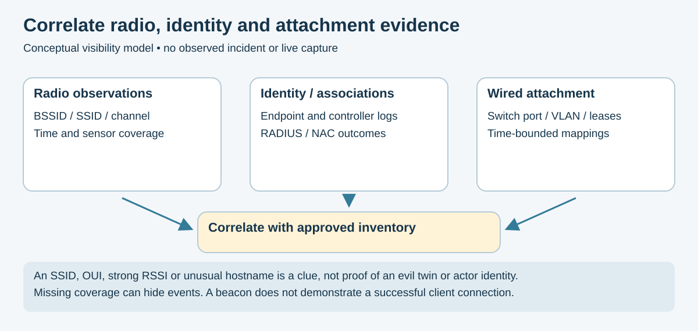
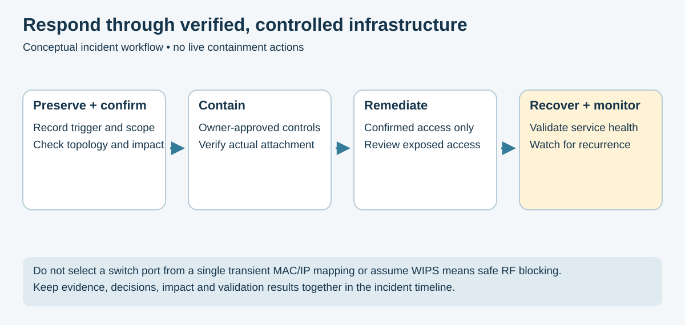
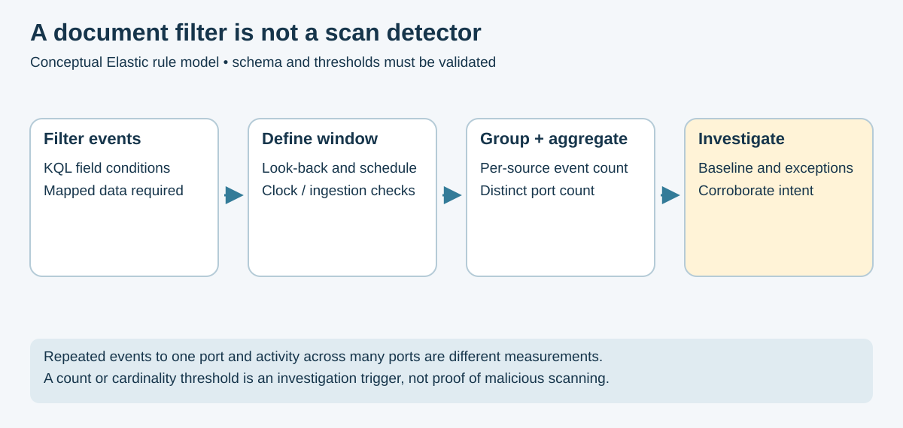

# 📖 Wireless Intrusion & Unauthorized Network Access

**Source and visual review:** November 17, 2026. Conceptual response guidance; no live capture, probes, SIEM queries, switch changes or containment actions performed.

## 🎯 Purpose
Incident response playbook for wireless intrusion scenarios - specifically detecting and responding to a Rogue Access Point (Evil Twin) broadcasting your SSID, or a physical plant device (LAN Turtle, Raspberry Pi, Bjorn Pi) plugged into a wall port.

## ⚙️ Function
Organizes preparation, detection and triage, controlled containment/recovery, and post-incident review. Connects wireless, identity and wired-attachment evidence to schema-explicit KQL examples, aggregation requirements and artifact preservation.

## 🏆 Goal
Investigate suspected unauthorized access, limit exposure, establish whether credentials or systems were affected, and preserve evidence through recovery. Detection does not guarantee that prior credential theft or lateral movement was prevented.

## 📋 When to Use
- Active incident: unknown BSSID broadcasting your SSID, or suspicious device found on a wall port
- Purple team exercise: testing wireless intrusion detection and response capabilities
- SIEM rule validation: verifying your alerting fires on Evil Twin or deauth frame patterns

**Scenario ID:** IR-NET-001
**Severity:** Provisional; assign using confirmed access, asset criticality and observed impact.
**Context:** An unrecognized AP advertises a protected SSID, or a device is found on an unexpected wired port. These are investigation triggers, not proof of an evil twin, a particular hardware tool or unauthorized access.

## 1. 🏗️ Log Aggregation & Visibility (Preparation)



*Figure 1 — Original conceptual evidence model informed by [Kismet's alerts documentation](https://www.kismetwireless.net/docs/readme/alerts/alerts/). No sensor coverage, client association or incident has been measured.*

Before you can respond, you must ensure the correct data is flowing into your SIEM (ELK/Wazuh/Splunk).

### Required Log Sources

| Source | Log Type | What we are looking for |
| :--- | :--- | :--- |
| **Wireless sensor / WIDS (for example Kismet)** | Version- and integration-specific alerts and radio observations | Candidate BSSID/SSID, channel, time, security capabilities and management-frame anomalies; sensor channel coverage matters. |
| **DHCP server / NAC** | Lease and access records | Time-bounded IP/MAC/VLAN mappings and access decisions. Hostnames and vendor strings are clues, not identities. |
| **RADIUS / NAC / WLAN controller** | Actual product authentication and association events | Identity, endpoint, BSSID, result, policy and time; distinguish an attempted association from authenticated access. |
| **Network switches** | Port, forwarding-table, VLAN and access-control events | Port transitions and current/historical endpoint attachment, checked against inventory and uplink topology. |

### Aggregation Configuration (Example: Rsyslog to SIEM)

Use the supported exporter or collector for each source; Kismet's database/packet
logs are not automatically converted into syslog events. Zeek can add relevant
network-protocol context when its capture path has visibility, but it is not a
drop-in 802.11 WIDS on a normal Ethernet mirror.

Define a scoped schema, clocks/time zones, retention and buffering. Prefer
authenticated encrypted transport where supported, test delivery and monitor gaps.
The former wildcard UDP syslog example provided neither authenticated transport
nor assurance that the expected wireless records were exported. See the
[log aggregation guide](log_agg.md) and [Kismet documentation](https://www.kismetwireless.net/docs/readme/alerts/alerts/).

## 2. 🕵️ Detection & Triage

**Trigger:** An alert fires in the SIEM indicating a "New BSSID" or "Unauthorized MAC."

### Step 1: Verification (Is it real?)

1. **Compare with authoritative inventory:** Include authorized BSSIDs, virtual APs,
   mesh/extender deployments, approved changes, SSID/security configuration and
   controller records. OUI lookup is only a clue: MACs can be spoofed or locally
   assigned, and a vendor match does not authenticate an AP.
2. **Correlate independent records:** Compare wireless observations with endpoint
   association history, controller/RADIUS/NAC logs, DHCP and switch attachment
   evidence. An SSID match alone does not show that a client connected.
3. **Treat RF observations as conditional:** RSSI depends on transmit power,
   antennas, obstacles and sensor placement. A strong signal does not prove local
   malicious hardware or provide distance. Unexpected channels can also result
   from approved channel changes.
4. **Confirm sensor coverage and time:** Channel hopping and missing frames create
   gaps. Record uncertainties and distinguish a newly observed device from a
   newly installed one.

## 3. 🛡️ Response & Containment



*Figure 2 — Original conceptual response workflow, aligned with the broad response/recovery considerations in [NIST SP 800-61 Rev. 3](https://csrc.nist.gov/pubs/sp/800/61/r3/final); not a tested containment runbook for a particular network.*

**Objective:** Prevent users from connecting to the rogue device and locate the hardware.

### Immediate Actions

1. **Preserve and coordinate:** Record the triggering evidence, current topology
   and affected users; use the incident lead and network owner to choose the
   least disruptive effective action.
2. **Contain through controlled infrastructure:** Where supported, quarantine
   confirmed endpoints via NAC or managed endpoint controls. For a confirmed
   wired attachment, verify the switch, port, VLAN and downstream devices before
   a model-specific quarantine or shutdown. A CAM/ARP entry can be transient or
   spoofed and is not sufficient to select a port on its own.
3. **Avoid automatic RF disruption:** A WIPS list may alert, deny managed access
   or initiate active containment depending on the product. Do not assume that
   adding a BSSID blocks all associations. This playbook does not prescribe
   deauthentication transmission or interference; system-owner permission alone
   does not settle applicable RF restrictions. See the [FCC's Wi-Fi blocking advisory](https://docs.fcc.gov/public/attachments/DA-15-113A1_Rcd.pdf) for U.S. context.
4. **Locate with corroboration:** Use authorized passive surveys, physical
   inspection and infrastructure records. Directional/RSSI observations guide
   a search; they are not guaranteed triangulation or a device identity.

### Eradication & Recovery

Preserve photographs, cabling and volatile evidence before removal where the
incident conditions permit. Remove or remediate only confirmed in-scope devices,
revoke exposed access as warranted, restore approved configuration and validate
normal connectivity. Monitor for recurrence and document remaining gaps. A removed
AP does not establish that affected credentials or endpoints are clean.

## 4. 🔬 Log Review & Post-Mortem

After the threat is neutralized, analyze the logs to understand the scope.

### SIEM Queries (Review Process)



*Figure 3 — Original conceptual Elastic model based on [KQL](https://www.elastic.co/docs/reference/query-languages/kql) and [threshold rules](https://www.elastic.co/docs/solutions/security/detect-and-alert/threshold). It is not an installed rule or validated alert threshold.*

**Query 1: Candidate observations outside the approved BSSID baseline**

This is **Kibana Query Language**, not Microsoft Kusto. The `pnwc.wireless.*`
fields below are proposed custom keyword mappings, not guaranteed built-in
Elastic or Kismet fields. Replace the synthetic values and maintain the actual
site baseline. Missing fields and missing sensor coverage require separate checks.

```kql
pnwc.wireless.ssid: "Corporate-Wifi" AND pnwc.wireless.bssid: * AND NOT (pnwc.wireless.bssid: "02:00:00:00:00:01" OR pnwc.wireless.bssid: "02:00:00:00:00:02")
```

This filters candidate observations; it does not identify clients that connected.
Investigate endpoint, association and authentication records for that question.

**Query 2: Network events involving a suspect source**

```kql
source.ip: "192.0.2.105"
```

The address is a documentation example. Establish the time-bounded IP assignment
and capture visibility first; NAT and reassignment can complicate attribution.

**Aggregation boundary:** A KQL document filter cannot count scans. In an Elastic
threshold rule, grouping by `source.ip` counts events for each source; adding a
cardinality condition on `destination.port` can test distinct ports over a defined
look-back window. Grouping by source *and* destination port counts per pair and is
not a unique-port test. Choose thresholds from the environment, exclude authorized
scanners carefully, and test benign/negative fixtures. Neither high count nor high
cardinality alone proves malicious scanning.

Sources: [KQL reference](https://www.elastic.co/docs/reference/query-languages/kql)
and [Elastic threshold rule guidance](https://www.elastic.co/docs/solutions/security/detect-and-alert/threshold).

### Artifact Collection

* **PCAP:** Preserve authorized relevant frames with sensor identity, channel coverage, capture settings, time basis, original file hash and evidence-handling record. Beacons demonstrate advertised attributes, not by themselves a confirmed evil twin or successful association.
* **Photos and infrastructure records:** Document device location/cabling before authorized removal; preserve switch/NAC/controller events and the timeline. Treat model appearance as a clue, not actor attribution.

**Response framework:** [NIST SP 800-61 Rev. 3](https://csrc.nist.gov/pubs/sp/800/61/r3/final). The four numbered sections are a local operational layout, not a claim that this reproduces every part of that framework.

## Related Files
- [README.md](README.md) - IncidentResponse section index: all IR and forensics guides
- [log_agg.md](log_agg.md) - Log aggregation setup: configure the log sources required by this playbook before an incident occurs
- [../Documentation/wireshark.md](../Documentation/wireshark.md) - Wireshark filters for analyzing the PCAP captures referenced in the Artifact Collection section
- [../Documentation/bjorn_pi.md](../Documentation/bjorn_pi.md) - Bjorn Pi: context for investigating an unexpected wired device; appearance alone does not establish identity or intent
- [../Documentation/evil_m5.md](../Documentation/evil_m5.md) - Evil-M5: related capability background; actual visibility and detection need validation

---
*Part of the [Pnwcomputers/ULTIMATE-CYBERSECURITY-MASTER-GUIDE](https://github.com/Pnwcomputers/ULTIMATE-CYBERSECURITY-MASTER-GUIDE)*
