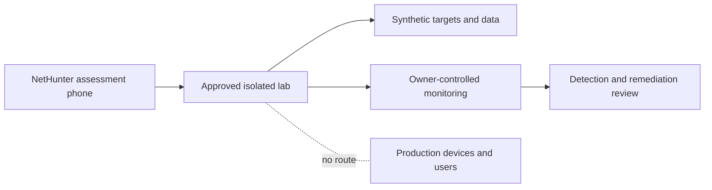

# Kali NetHunter - Standard Operating Procedures

## 🎯 Purpose
Field reference for safely preparing and using the OnePlus 6 as an assessment device, with emphasis on passive review, defensive validation, and evidence handling.

## ⚙️ Function
Device setup, authorized scope checks, passive diagnostics, defensive configuration review, safe vulnerability research, and post-engagement evidence handling. Offensive-capable features are documented only as risks and detection topics; this guide does not provide payload, credential-harvesting, or disruption procedures.

## 🏆 Goal
Ensure assessments stay within written scope, minimize data collection, preserve evidence, and leave the device in a known-good state.

## 📋 When to Use
- Before any engagement using the NetHunter device (RoE and pre-engagement checklist)
- During authorized work as a defensive checklist for configuration review and passive observation
- At teardown for evidence handling, MAC restoration, and device cleanup

---

**Platform:** OnePlus 6 (`enchilada`, model A6000/A6003) - Full NetHunter Edition (custom kernel)
**Maintained by:** Pacific Northwest Computers (PNWC)
**Version:** 1.0
**Classification:** Internal - Field Operations Reference

---

## 0. Authorization & Rules of Engagement (READ FIRST)

> These SOPs cover offensive-capable tooling. **Do not run any active/attack procedure without written authorization.**

Before any engagement, confirm and file:

- [ ] Signed **Statement of Work / Rules of Engagement (RoE)** naming the client, scope, and authorized target ranges (IP/SSID/BSSID/asset list).
- [ ] Explicit **in-scope wireless SSIDs/BSSIDs** and MAC allow-list. Wireless and RF attacks bleed easily into out-of-scope airspace - document exclusions.
- [ ] **Time window** for testing and any blackout periods.
- [ ] **Emergency stop contact** on the client side.
- [ ] Physical-access authorization (badge, escort, or written consent) if HID/BadUSB is in scope.
- [ ] Confirmation that RF activity (Evil AP, deauth, Bluetooth injection) is legal at the test location and will not disrupt safety-critical systems.

**Golden rule:** if a procedure could touch a device, network, or person outside the signed scope, stop and re-confirm scope before proceeding.

---

## 1. Platform Baseline & Verification

Perform once per device, and re-verify after any NetHunter/kernel update.

### 1.1 Confirm edition and kernel features
1. Open the **NetHunter** app → **Home**. Confirm chroot is detected and shows a Kali version.
2. Open **NetHunter Terminal** → `KALI` session → run:
   ```bash
   uname -a          # confirm NetHunter kernel string
   id                # confirm root inside chroot
   ip a              # confirm interfaces
   ```
3. Verify kernel capabilities expected on the OnePlus 6 full edition:
   - **HID / USB gadget** (for HID + BadUSB)
   - **OTG wireless** (external adapter support)
   - **Monitor mode / injection** (internal chipset is limited - see Appendix A; use an external adapter for reliable injection)

### 1.2 Update the chroot
```bash
sudo apt update && sudo apt full-upgrade -y
# Optional, if storage allows:
sudo apt install -y kali-linux-default
```

### 1.3 Backup the rootfs (do before major changes)
From a **Termux** session (not inside chroot), stop all NetHunter sessions first, then:
```bash
tar -cJf kali-arm64.tar.xz kali-arm64 && mv kali-arm64.tar.xz storage/downloads
```

### 1.4 Housekeeping
- [ ] Hacker's Keyboard installed (needed for terminal/HID layouts).
- [ ] NetHunter Store reachable; apps updated.
- [ ] External Wi-Fi adapter(s) tested (Appendix A).
- [ ] Device battery > 50% or Y-cable/power bank staged for long ops.

---

## 2. Pre-Engagement Checklist (every job)

- [ ] RoE confirmed (Section 0).
- [ ] Device time/zone correct (matters for logs/evidence).
- [ ] Clean working directory created for the engagement: `~/engagements/<client>-<YYYYMMDD>/`.
- [ ] MAC randomized if operating covertly (Section 8).
- [ ] Airplane mode + selective radios as needed to avoid stray connections.
- [ ] Evidence capture plan (where captures/logs are written, how they're exfiltrated).

---

## 3. NetHunter App - Home, Chroot Manager & Services

**Purpose:** Central control for the Kali chroot and background services.

**Procedure**
1. **Home** - status dashboard. Confirm chroot present and IP shown.
2. **Kali Chroot Manager** - install/remove/update the chroot; switch minimal ↔ full; re-run `apt` from here or terminal.
3. **Kali Services** - toggle services (SSH, PostgreSQL for Metasploit DB, Apache, VNC, etc.). Start only what the task needs; stop them at teardown.

**Verification:** started services appear active; `ss -tlnp` in terminal shows expected listeners.

**Cleanup:** stop all services you enabled. Leaving SSH/Apache running is an exposure risk.

---

## 4. NetHunter Terminal

**Purpose:** Shell access to Kali (`KALI`), Android (`ANDROID`), and root Android sessions.

**Procedure**
- Launch **NetHunter Terminal** → pick session type.
- `KALI` session = full Kali toolset. This is your primary workspace for Nmap, Metasploit, aircrack-ng suite, etc.
- Use `tmux` for long-running captures so a dropped session doesn't kill the job:
  ```bash
  tmux new -s eng
  # detach: Ctrl-b d   |   reattach: tmux attach -t eng
  ```

**Notes:** On non-root/rootless setups some tools (e.g., `top`) misbehave - full edition on the OnePlus 6 avoids most of these.

---

## 5. Custom Commands

**Purpose:** Pin frequently used commands/scripts to the NetHunter menu for one-tap launch in the field.

**Procedure**
1. NetHunter app → **Custom Commands** → add entry.
2. Provide a label and the full command (absolute paths; specify the session/user context).
3. Save; launch from the menu.

**Use cases:** start a scoped Nmap sweep, launch a capture into the engagement folder, spin up a KeX session, kick off a recon script.

---

## 6. Kali NetHunter Desktop Experience (KeX Manager)

**Purpose:** Full Kali desktop over VNC - HDMI/wireless casting for tools that need a GUI (Wireshark, Burp).

**Procedure**
1. NetHunter app → **KeX Manager** → set a VNC password (first run).
2. **Start Server**, then connect with the KeX client (local loopback) or external VNC.
3. For HDMI/monitor output, connect via USB-C → HDMI and mirror.
4. Stop the server when done.

**Verification:** desktop renders; clipboard/keyboard functional.

**Cleanup:** stop KeX; clear/rotate the VNC password if the device leaves your control.

---

## 7. USB Peripheral Security Review

Review the host's removable-device policy, approved-device inventory, lock screen, and endpoint alerts. Use vendor documentation and configuration exports. Do not emulate keyboards, network adapters, or storage devices against client systems.

## 8. Device Identity and Privacy

Use the engagement-specific device identity assigned by the owner. Do not spoof addresses to evade monitoring or attribute activity to another device. Record any authorized test-device identifier in the scope document and restore its baseline configuration afterward.

## 9. HID and Keystroke-Injection Risk

Treat programmable keyboards and HID emulators as untrusted peripherals. Review device-control policies, workstation locking, application allowlisting, and alerts for unexpected command interpreters. Validate controls only with benign owner-approved test events and synthetic accounts.

## 10. HID Compatibility and Detection

For awareness exercises, use a tabletop or vendor-supplied simulation that does not inject keystrokes into a live endpoint. Document the expected alert, owner, and response path. Do not use payload files or execute test scripts on a user's computer.

## 11. USB Network Adapter and Bridging Controls

Review whether endpoints permit unapproved USB network adapters or network bridging. Confirm that wired, wireless, and management segments remain separated. Do not insert a bridge or capture client traffic during a generic assessment.

## 12. Unauthorized Access Point Detection

Review wireless controller inventories and approved passive monitoring for unknown BSSIDs, lookalike SSIDs, unexpected DHCP services, and unusual client associations. Do not create an evil twin, captive portal, or credential collection page.

## 13. WPS Configuration

Check WPS status through the access point's administrative interface or documented configuration export. Disable WPS where it is not required and verify vendor firmware support. Do not perform PIN guessing or exploit attempts.

## 14. Bluetooth Security Review

Inventory paired devices, discoverability settings, supported protocols, firmware, and access permissions. Remove unused pairings and apply vendor updates. Review logs for unexpected pairing attempts; do not spoof, inject, or capture third-party Bluetooth communications.

## 15. Social-Engineering Simulation Governance

Conduct awareness exercises through the organization's approved training platform, with synthetic credentials and privacy review. Measure reporting and response outcomes, not password submission. Do not collect real passwords, session tokens, or personal messages.

## 16. Authorized Network Inventory

Use the asset owner's inventory and approved monitoring systems first. Any active discovery must be separately scoped, rate-limited, coordinated with the service owner, and stopped if it affects availability. This reference intentionally omits scan commands and target lists.

## 17. Malware and Payload Risk Review

Do not generate, deliver, or execute payloads from this field guide. For an approved malware-analysis lesson, use a dedicated offline detonation environment with disposable snapshots and no shared folders, clipboard, host credentials, or routed network access. Prefer static analysis and vendor-provided benign samples.

## 18. Vulnerability Research and Patch Validation

Use vendor advisories, affected-version inventories, and supported configuration checks to evaluate exposure. Verify mitigations in a staging copy or disposable lab. Do not execute public exploit code on a production device as a routine validation method.



## 19. Wardriving

**Purpose:** Passive survey of nearby Wi-Fi (and optionally cell/BT) for authorized site assessment.

**Prerequisites:** External adapter + GPS (your SenseCAP/GPS kit or a USB GPS puck).

**Procedure**
1. Attach adapter + GPS; confirm fix.
2. NetHunter app → **Wardriving** → start passive capture.
3. Export results (Kismet/CSV) into the engagement folder for mapping.

**Notes:** Passive only by default - keep it passive unless active testing is separately authorized.

---

## 20. CARsenal (Automotive)

**Purpose:** CAN-bus / automotive security testing (can-utils, etc.).

**Prerequisites:** Compatible CAN interface hardware; **written vehicle-owner authorization**; test in a safe, controlled setting.

**Procedure**
1. Connect CAN adapter; bring up the interface.
2. NetHunter app → **CARsenal** → select tool (candump, cansend, cansniffer…).
3. Capture/replay only against the authorized vehicle/bench.

**Safety:** Never inject on a moving vehicle or any safety-critical live system.

---

## 21. Pineapple Connector

**Purpose:** Share the phone's internet to a **Hak5 WiFi Pineapple** over USB (you run a Pineapple already).

**Procedure**
1. Connect the Pineapple via USB/OTG.
2. NetHunter app → **Pineapple Connector** → enable internet sharing.
3. Manage the Pineapple from its own web UI as normal.

---

## 22. NetHunter Store

**Purpose:** Install/update purpose-built security apps (telemetry-stripped F-Droid fork).

**Procedure**
1. Open the **NetHunter Store** client → search/install (e.g., cSploit, Shodan, Router Keygen, RF tools).
2. Update installed apps before each engagement.

**Note:** The store button may not flip to "installed" - ignore the cosmetic bug.

---

## 23. Post-Engagement Teardown & Evidence Handling

- [ ] Stop **all** services (Kali Services), APs (WifiPumpkin), captures, and KeX.
- [ ] Revert **USB Arsenal** to a benign gadget mode.
- [ ] Restore original **MAC** if spoofed.
- [ ] Collect and hash all artifacts (captures, payloads, logs):
  ```bash
  cd ~/engagements/<client>-<date>/ && sha256sum * > SHA256SUMS
  ```
- [ ] Encrypt and exfil the engagement folder to your reporting box; **delete payloads/creds from the phone** per data-handling policy.
- [ ] Note any spoofed MACs, SSIDs/BSSIDs, and PINs/keys recovered in the report.
- [ ] Power down radios; return device to a clean baseline.

---

## 24. Troubleshooting Quick Reference

| Symptom | First checks |
|---|---|
| HID/BadUSB does nothing | Wrong **USB Arsenal** gadget mode; wrong keyboard layout; cable is charge-only |
| No monitor mode / injection | Internal chipset limits - use external adapter; verify with `airmon-ng`, `iw dev` |
| Chroot won't start | Re-open Chroot Manager; check storage; reboot; verify kernel string with `uname -a` |
| Metasploit DB errors | Start **PostgreSQL** in Kali Services; `msfdb init` |
| KeX black screen | Restart KeX server; re-enter VNC password; check resolution setting |
| Adapter not detected | Reseat OTG; check power (use Y-cable); `dmesg \| tail` for USB errors |
| Tools slow / OOM | Close KeX/background sessions; use `tmux`; watch battery/thermals |

---

## Appendix A - External Wi-Fi Adapters (recommended for injection)

Internal OnePlus 6 Wi-Fi injection is limited/inconsistent. For reliable monitor mode + injection, use a known-good external adapter over OTG:

- **Atheros AR9271** (2.4 GHz) - rock-solid, widely supported.
- **Realtek RTL8812AU / RTL8811AU** (2.4/5 GHz) - needs the `8812au` driver; good dual-band.
- **MediaTek MT7612U / MT7610U** - strong 5 GHz support.
- **RT3070/RT5370** - reliable 2.4 GHz budget option.

Power draw matters on a phone - use a powered OTG/Y-cable for high-power adapters or long ops.

## Appendix B - Engagement Folder Layout (suggested)

```
~/engagements/<client>-<YYYYMMDD>/
├── RoE.pdf
├── scope.txt              # in-scope IPs / SSIDs / BSSIDs / MACs
├── nmap/
├── captures/              # pcap, hashes
├── payloads/
├── loot/                  # creds, keys (encrypt!)
├── notes.md
└── SHA256SUMS
```

---

*End of document - v1.0. Update the version and re-verify Section 1 after any NetHunter or kernel update.*

## Related Files
- [Rooting.md](Rooting.md) - Prerequisite: bootloader unlock, LineageOS, TWRP, and Magisk root setup
- [Kali_NetHunter.md](Kali_NetHunter.md) - NetHunter installation guide this SOP builds on
- [../README.md](../README.md) - Mobile section index
- [../../Scripts/Bash/BashBunny/README.md](../../Scripts/Bash/BashBunny/README.md) - Bash Bunny payloads (DuckHunter-compatible DuckyScript)
- [../../Tradecraft/c2-frameworks.md](../../Tradecraft/c2-frameworks.md) - C2 frameworks for post-exploitation after NetHunter initial access
