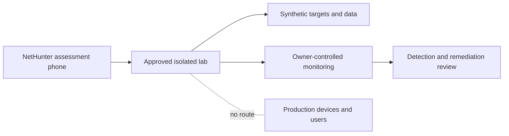

# Kali NetHunter - Standard Operating Procedures

## 🎯 Purpose
Field reference for safely preparing and using the OnePlus 6 as an assessment device, with emphasis on passive review, defensive validation, and evidence handling.

## ⚙️ Function
Device setup, authorized scope checks, passive diagnostics, defensive configuration review, safe vulnerability research, and post-engagement evidence handling. Offensive-capable features are documented only as risks and detection topics; this guide does not provide payload, credential-harvesting, or disruption procedures.

## 🏆 Goal
Ensure assessments stay within written scope, minimize data collection, preserve evidence, and leave the device in a known-good state.

## 📋 When to Use
- Before any engagement using the NetHunter device (RoE and pre-engagement checklist)
- During authorized work as a defensive checklist for configuration review and passive observation
- At teardown for evidence handling, MAC restoration, and device cleanup

---

**Platform:** OnePlus 6 (`enchilada`, model A6000/A6003) - Full NetHunter Edition (custom kernel)
**Maintained by:** Pacific Northwest Computers (PNWC)
**Version:** 1.0
**Classification:** Internal - Field Operations Reference

---

## 0. Authorization & Rules of Engagement (READ FIRST)

> NetHunter may include offensive-capable apps. Their presence is not authorization. This SOP covers safe device administration and defensive review only; use the least intrusive owner-approved method.

Before any engagement, confirm and file:

- [ ] Signed **Statement of Work / Rules of Engagement (RoE)** naming the client, scope, and authorized target ranges (IP/SSID/BSSID/asset list).
- [ ] Explicitly list any approved wireless collection or testing area, and exclude neighboring networks and bystanders. Do not spoof device identity.
- [ ] **Time window** for testing and any blackout periods.
- [ ] **Emergency stop contact** on the client side.
- [ ] Physical-access authorization (badge, escort, or written consent) if HID/BadUSB is in scope.
- [ ] Written owner approval and a safety review for any separately planned radio-frequency collection or transmission; stop if it could affect bystanders or safety-critical systems.

**Golden rule:** if a procedure could touch a device, network, or person outside the signed scope, stop and re-confirm scope before proceeding.

---

## 1. Platform Baseline & Verification

Recheck after any operating-system, kernel, or NetHunter update.

### 1.1 Device health

1. Confirm the device model and supported Android/NetHunter version from the maintained project documentation.
2. Review patch level, device encryption, screen lock, application permissions, and management state.
3. Confirm only the interfaces required for the approved review are enabled.
4. Do not enable HID emulation, packet injection, traffic interception, or payload features as part of routine preparation.

### 1.2 Updates

Install supported updates through the project's trusted distribution channel. Review release notes and test major changes on a spare device before an engagement. Avoid large untested updates immediately before field work.

### 1.3 Backup and recovery

Keep a verified, encrypted backup in an approved location. Do not store client evidence, passwords, or access tokens in the system backup. Record the recovery method and confirm it does not expose shared folders or credentials to a test environment.

### 1.4 Housekeeping

- [ ] Remove unneeded apps and revoke unused permissions.
- [ ] Confirm device encryption and a strong screen lock.
- [ ] Check battery and storage capacity.
- [ ] Confirm trusted update sources and application inventory.
- [ ] Keep optional adapters disconnected unless an approved lab review requires them.

---

## 2. Pre-Engagement Checklist

- [ ] Written scope and owner contact are available.
- [ ] Device time zone and clock are correct.
- [ ] A minimized evidence folder is prepared with access limited to the engagement team.
- [ ] Preserve the device's normal network identity; do not spoof addresses to evade monitoring.
- [ ] Keep radios and network interfaces disabled unless specifically needed for an approved check.
- [ ] The evidence manifest and retention location are approved.
- [ ] Stop conditions and incident contacts are known.

---

## 3. NetHunter App - Home, Chroot Manager & Services

Use the app to review device health, software version, and service status. Leave background services stopped by default. Start only a documented service required for an approved local task, restrict it to loopback where supported, and stop it immediately afterward.

Review local listeners and permissions before the device leaves your control. Do not expose SSH, web, database, or remote-desktop services to a client or public network.

---

## 4. NetHunter Terminal

Use the terminal for local device administration and approved evidence review. Treat the chroot as a potentially privileged environment and avoid storing credentials or customer data there unnecessarily.

Safe local checks include:

    uname -a
    ip address
    ss -lnt

Do not use this field guide to run scans, capture network traffic, execute payloads, or access systems outside the device owner's approved process.

---

## 5. Custom Commands

Use custom menu entries only for reviewed, read-only status checks or local documentation shortcuts. Inspect the exact command and its permissions before saving it. Do not add unattended scans, credential collection, network listeners, file upload/download jobs, or payload launchers.

---

## 6. Kali NetHunter Desktop Experience (KeX Manager)

If a desktop session is needed for report preparation or sanitized artifact review, use a strong, unique VNC password and bind access to the local device where possible. Do not expose the VNC service on a client, public, or shared network. Stop the server after use, verify it is no longer listening, and rotate the password if the device may have been observed or shared.

## 7. USB Peripheral Security Review

Review the host's removable-device policy, approved-device inventory, lock screen, and endpoint alerts. Use vendor documentation and configuration exports. Do not emulate keyboards, network adapters, or storage devices against client systems.

## 8. Device Identity and Privacy

Use the engagement-specific device identity assigned by the owner. Do not spoof addresses to evade monitoring or attribute activity to another device. Record any authorized test-device identifier in the scope document and restore its baseline configuration afterward.

## 9. HID and Keystroke-Injection Risk

Treat programmable keyboards and HID emulators as untrusted peripherals. Review device-control policies, workstation locking, application allowlisting, and alerts for unexpected command interpreters. Validate controls only with benign owner-approved test events and synthetic accounts.

## 10. HID Compatibility and Detection

For awareness exercises, use a tabletop or vendor-supplied simulation that does not inject keystrokes into a live endpoint. Document the expected alert, owner, and response path. Do not use payload files or execute test scripts on a user's computer.

## 11. USB Network Adapter and Bridging Controls

Review whether endpoints permit unapproved USB network adapters or network bridging. Confirm that wired, wireless, and management segments remain separated. Do not insert a bridge or capture client traffic during a generic assessment.

## 12. Unauthorized Access Point Detection

Review wireless controller inventories and approved passive monitoring for unknown BSSIDs, lookalike SSIDs, unexpected DHCP services, and unusual client associations. Do not create an evil twin, captive portal, or credential collection page.

## 13. WPS Configuration

Check WPS status through the access point's administrative interface or documented configuration export. Disable WPS where it is not required and verify vendor firmware support. Do not perform PIN guessing or exploit attempts.

## 14. Bluetooth Security Review

Inventory paired devices, discoverability settings, supported protocols, firmware, and access permissions. Remove unused pairings and apply vendor updates. Review logs for unexpected pairing attempts; do not spoof, inject, or capture third-party Bluetooth communications.

## 15. Social-Engineering Simulation Governance

Conduct awareness exercises through the organization's approved training platform, with synthetic credentials and privacy review. Measure reporting and response outcomes, not password submission. Do not collect real passwords, session tokens, or personal messages.

## 16. Authorized Network Inventory

Use the asset owner's inventory and approved monitoring systems first. Any active discovery must be separately scoped, rate-limited, coordinated with the service owner, and stopped if it affects availability. This reference intentionally omits scan commands and target lists.

## 17. Malware and Payload Risk Review

Do not generate, deliver, or execute payloads from this field guide. For an approved malware-analysis lesson, use a dedicated offline detonation environment with disposable snapshots and no shared folders, clipboard, host credentials, or routed network access. Prefer static analysis and vendor-provided benign samples.

## 18. Vulnerability Research and Patch Validation

Use vendor advisories, affected-version inventories, and supported configuration checks to evaluate exposure. Verify mitigations in a staging copy or disposable lab. Do not execute public exploit code on a production device as a routine validation method.



## 19. Passive Wireless Site Review

Limit passive observation to areas, networks, and time windows explicitly authorized by the owner. Avoid collecting client identifiers or GPS trails unless strictly required and approved. Minimize retention and redact nearby third-party networks from notes and reports.

Review the owner's access-point inventory and controller telemetry first. Record any observed configuration gap with a redacted identifier and a remediation recommendation.

## 20. Automotive Network Safety Review

Vehicle networks are safety-critical. This guide supports inventory and documentation review only; it does not authorize connecting to a vehicle bus, transmitting frames, replaying traffic, or changing vehicle state.

For an approved research project, use a dedicated bench harness and isolated, owner-supplied test equipment under a documented safety plan. Do not connect to a moving vehicle or road-going vehicle.

## 21. Network Tethering and Bridge Risk

Treat phone tethering and USB networking as network bridges that can bypass intended segmentation. Keep them disabled during client work unless the network owner has approved a specific, isolated lab design. Confirm the phone cannot route between the lab and corporate or public networks.

## 22. NetHunter Store and Software Provenance

Install only maintained applications from a trusted distribution source after reviewing publisher, permissions, version, and update status. Do not install credential recovery, rogue access-point, payload, or surveillance applications on an engagement device. Keep the device's software inventory with the engagement record.


---

## 23. Post-Engagement Teardown & Evidence Handling

- [ ] Stop authorized monitoring or test services and confirm no capture remains active.
- [ ] Restore the assessment phone's approved network, radio, and device-management settings.
- [ ] Preserve only artifacts listed in the reviewed evidence manifest.
- [ ] Have the receiving owner verify transfer and checksums before removing approved temporary copies.
- [ ] Do not delete evidence, logs, or broad directory trees as routine cleanup.
- [ ] Record remaining retention obligations and chain-of-custody information.
- [ ] Confirm the device is in a known-good state before returning it to service.


---

## 24. Device Health Troubleshooting

| Symptom | First checks |
|---|---|
| USB device is not recognized | Review device permissions, cable quality, and vendor diagnostics using a benign accessory |
| Wireless review unavailable | Use owner-provided controller reports; avoid enabling transmission or capture features |
| Chroot won't start | Re-open Chroot Manager; check storage; reboot; verify kernel string with `uname -a` |
| Unexpected local listener | Stop the related service, verify it is no longer listening, and review the approved device baseline |
| KeX black screen | Restart KeX server; re-enter VNC password; check resolution setting |
| Approved accessory not recognized | Disconnect it and use vendor-supported diagnostics; do not enable radio transmission features |
| Device runs slowly or overheats | Stop optional services, close desktop sessions, allow the device to cool, and preserve battery health |

---

## Appendix A - External Wi-Fi Adapters (passive compatibility only)

The internal radio may not expose every passive diagnostic capability. Check manufacturer documentation and the adapter's supported receive-only features before use:

- Choose only hardware supported by the device vendor and the assessment platform.
- Confirm the device can be configured for receive-only diagnostics if required.
- Do not enable packet injection or active transmission for routine review.

Power draw matters on a phone - use a powered OTG/Y-cable for high-power adapters or long ops.

## Appendix B - Minimized Evidence Folder Layout (suggested)

```
~/engagements/<client>-<YYYYMMDD>/
├── scope-reference.txt   # access-controlled; avoid listing unnecessary identifiers
├── approved-evidence/
├── redacted-screenshots/
├── notes/
├── evidence-manifest.txt
└── SHA256SUMS
```

---

*End of document - v1.0. Update the version and re-verify Section 1 after any NetHunter or kernel update.*

## Related Files
- [Rooting.md](Rooting.md) - Prerequisite: bootloader unlock, LineageOS, TWRP, and Magisk root setup
- [Kali_NetHunter.md](Kali_NetHunter.md) - NetHunter installation guide this SOP builds on
- [../README.md](../README.md) - Mobile section index
- [../../Scripts/Bash/BashBunny/README.md](../../Scripts/Bash/BashBunny/README.md) - archived device security notes and safety guidance
- [../../Tradecraft/c2-frameworks.md](../../Tradecraft/c2-frameworks.md) - command-and-control detection and response guidance
