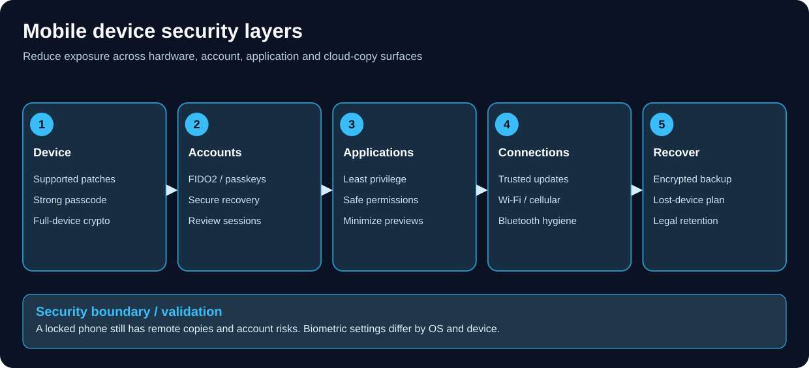
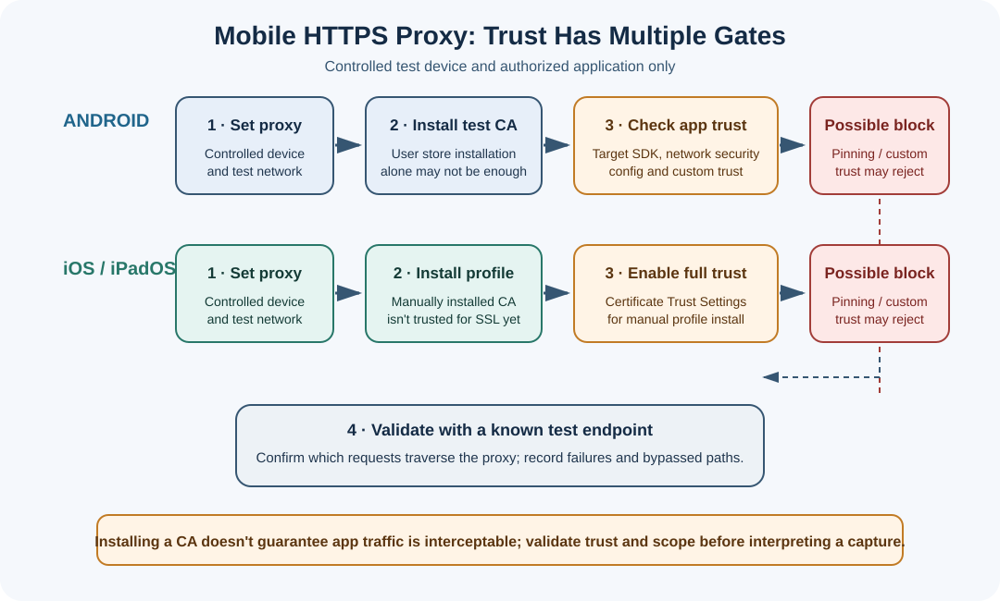

# 📱 Mobile Security

<div align="center">

**Mobile penetration testing, device security, forensics, and authorized attack platforms**

*Part of the [ULTIMATE CYBERSECURITY MASTER GUIDE](../README.md)*


</div>

---

**Other mobile security references:** [Android Security](https://github.com/ashishb/android-security-awesome), [OSX and iOS Security](https://github.com/ashishb/osx-and-ios-security-awesome), and [curated source map](../Documentation/awesome-hacking-collections-integration.md).


**Linux-on-Android companion:** [UserLAnd Setup & Operations](UserLAnd/readme.md) explains userspace Linux on Android, scope and platform limitations.

**Forensic triage companion:** [MVT mobile verification workflow](mvt-forensic-triage.md) addresses owner consent, iOS/Android backup/artifact limitations and uncertainty; it does not guarantee spyware detection.

## 🎯 Purpose
Mobile security reference covering device preparation (rooting, custom ROM), the Kali NetHunter platform, Android/iOS app security assessment, mobile forensics, and device OSINT. The OnePlus 6 A6003 is a device-specific setup example; capabilities depend on the exact build, kernel, adapters, and current upstream support.

## ⚙️ Function
Covers: OnePlus 6 rooting and NetHunter setup, defensive device and configuration review, scoped wireless surveys, Android APK assessment, iOS backup forensics, and mobile device OSINT. Offensive-capable modules are identified as risks and detection topics; their presence does not authorize their use.

## 🏆 Goal
Help practitioners prepare an authorized mobile assessment, review platform capabilities and limits, assess Android/iOS apps, and perform consent-based forensic or OSINT work.

## 📋 When To Use
- Setting up or maintaining the OnePlus 6 NetHunter device
- Reviewing a NetHunter device configuration or conducting a separately authorized, bounded wireless survey
- Conducting an authorized Android or iOS app penetration test
- Performing iOS backup forensics or mobile device OSINT

---

## 📋 Table Of Contents

- [Overview](#-overview)
- [Current Content](#-current-content)
- [Mobile Pentesting Toolchain](#️-mobile-pentesting-toolchain)
- [Mobile HTTPS Proxy Trust Flow](#-mobile-https-proxy-trust-flow)
- [Testing Methodology Overview](#-testing-methodology-overview)
- [Suggested Future Content](#-suggested-future-content)
- [Security & Legal Disclaimer](#️-security--legal-disclaimer)
- [Contributing](#-contributing)
- [Resources](#-resources)

---

## 🎯 Overview



*Mobile device security varies by OS model and account backup settings.*

This directory contains **mobile security resources for penetration testers, forensic investigators, and security researchers** - from device preparation and platform setup through defensive assessment, app security review, and forensic analysis.

**What You'll Find Here:**
- 📱 OnePlus 6 rooting and custom ROM installation guides
- 🐉 Kali NetHunter setup, configuration, and field SOPs
- 🤖 Android application security assessment checklists
- 🍎 iOS backup forensics scripts
- 📡 Consent-based mobile OSINT workflows; the former personal-device scanner is retired
- 🔧 Mobile pentesting toolchain reference (MobSF, Frida, Objection, APKTool)
- 📋 Assessment methodology for Android and iOS apps (OWASP MASTG-aligned)

---

## 📂 Current Content

### Engagement Sops

| File | Description | Status |
|------|-------------|--------|
| **[mobile_pentest_sop.md](mobile_pentest_sop.md)** | Engagement-level mobile assessment planning, passive review, authorized asset review, defensive validation, detection, minimized evidence, teardown, and reporting | ✅ Complete |
| **[Nethunter_SOP.md](OnePlus_A6003/Nethunter_SOP.md)** | OnePlus 6 device setup, scope confirmation, passive diagnostics, defensive configuration review, evidence handling, and teardown; offensive features are discussed only as risks and detection topics | ✅ Complete |

### Oneplus 6 / Kali Nethunter (Device-specific)

| File | Description | Status |
|------|-------------|--------|
| **[OnePlus_A6003/Rooting.md](OnePlus_A6003/Rooting.md)** | Phase-by-phase: bootloader unlock, dtbo flash, LineageOS 22.2 install via sideload, TWRP install (temporary-boot method), and Magisk root via boot image patching | ✅ Complete |
| **[OnePlus_A6003/Kali_NetHunter.md](OnePlus_A6003/Kali_NetHunter.md)** | NetHunter install (Magisk module or TWRP), LineageOS prerequisite, post-install config, metapackage and app selection, chroot management | ✅ Complete |
| **[OnePlus_A6003/Nethunter_SOP.md](OnePlus_A6003/Nethunter_SOP.md)** | Device administration and defensive review checklist for NetHunter; see the guide for scope limits and excluded payload, harvesting, scanning, and disruption procedures | ✅ Complete |

### Checklists

| File | Description | Status |
|------|-------------|--------|
| **[Checklists/Android-Applications-Checklist.md](../Checklists/Android-Applications-Checklist.md)** | 8-item Android APK triage: manifest review, WebView, certificate pinning, rooting detection, obfuscation, payload injection. OWASP MASTG-aligned. | ✅ Complete |

### Scripts

| File | Description | Status |
|------|-------------|--------|
| **[Scripts/Python/iphone_messages.py](../Scripts/Python/iphone_messages.py)** | Retired, inert tombstone; performs no backup extraction | ⚫ Retired |
| **[Scripts/Python/iphone_finder.py](../Scripts/Python/iphone_finder.py)** | Retired, inert tombstone; performs no radio scan or device tracking | ⚫ Retired |

---

## 🗺️ Mobile Pentesting Toolchain

### Android
| Tool | Purpose | Install |
|------|---------|---------|
| [MobSF](https://github.com/MobSF/Mobile-Security-Framework-MobSF) | Automated static + dynamic analysis framework | `docker run --rm -it -p 127.0.0.1:8000:8000 opensecurity/mobile-security-framework-mobsf:latest` |
| [APKTool](https://apktool.org/) | Decompile/recompile APKs | `sudo apt install apktool` |
| [jadx](https://github.com/skylot/jadx) | APK to Java source decompiler | `sudo apt install jadx` |
| [Frida](https://frida.re/) | Dynamic instrumentation toolkit | `pip install frida-tools` |
| [Objection](https://github.com/sensepost/objection) | Runtime mobile exploration (Frida-based) | `pip install objection` |
| [Drozer](https://github.com/WithSecureLabs/drozer) | Android attack surface analyzer | `pip install drozer` |
| [Burp Suite](https://portswigger.net/burp) | HTTP/HTTPS proxy for authorized testing | Android user-CA trust depends on target SDK and Network Security Configuration: API 24+ defaults to system CAs, while API 23 and lower also trust user-added CAs by default. Custom trust or pinning may still reject the proxy. |
| [apksigner](https://developer.android.com/tools/apksigner) | Sign repackaged APKs | Included in Android SDK build-tools |

> [!CAUTION]
> The loopback binding keeps the web interface on the local host. MobSF documents
> default credentials `mobsf/mobsf`; do not publish this service to a shared or
> untrusted network. Treat uploaded APKs, reports, and retained analysis data as
> sensitive. See the [MobSF Docker guide](https://github.com/MobSF/docs/blob/master/running_mobsf_docker.md)
> and [Docker port-publishing behavior](https://docs.docker.com/engine/network/port-publishing/).

### iOS
| Tool | Purpose | Notes |
|------|---------|-------|
| [libimobiledevice](https://libimobiledevice.org/) | Interact with iOS devices over USB | `sudo apt install libimobiledevice-utils` |
| [idevicebackup2](https://man.archlinux.org/man/idevicebackup2.1) | Create/restore iOS backups | Part of libimobiledevice |
| [Frida on iOS](https://frida.re/docs/ios/) | Dynamic instrumentation (requires jailbreak or sideload) | Works with checkra1n/palera1n |
| [Burp Suite on iOS](https://portswigger.net/burp/documentation/desktop/mobile) | HTTPS proxy for authorized testing | A manually installed CA profile must be enabled under Settings → General → About → Certificate Trust Settings for SSL/TLS; app-specific trust or pinning may still reject it. |
| [SSL Kill Switch 2](https://github.com/nabla-c0d3/ssl-kill-switch2) | Legacy iOS jailbreak test tweak | Compatibility varies by iOS and app trust implementation; it does not guarantee interception of every app. |

---

## 📊 Mobile HTTPS Proxy Trust Flow

Use a controlled test device and authorized application. Installing a proxy CA is only one trust step; platform defaults and app-specific trust policy determine whether HTTPS traffic can be inspected.



*Conceptual comparison. Android trust depends on the app's target SDK and network security configuration. Manually installed iOS certificate profiles require full trust to be enabled for SSL/TLS. App pinning or custom trust can still reject the proxy.*

References: [Android Network Security Configuration](https://developer.android.com/privacy-and-security/security-config) · [Apple certificate trust for manually installed profiles](https://support.apple.com/en-us/102390) · [Burp mobile configuration](https://portswigger.net/burp/documentation/desktop/mobile)

## 🔬 Testing Methodology Overview

### Android App Assessment (OWASP Mastg Order)

```
1. Reconnaissance
   - Download APK (APK Mirror, Google Play via gplaydl, direct from device)
   - Identify app version, permissions, target SDK

2. Static Analysis
   - apktool d target.apk          # Decompile resources + smali
   - jadx -d output/ target.apk    # Java source decompile
   - Review AndroidManifest.xml    # Permissions, exported components, debuggable flag
   - grep -r "http://" ./          # Plaintext URLs
   - grep -r "api_key\|secret\|password" ./  # Hardcoded secrets

3. Dynamic Analysis (rooted device or emulator)
   - adb install target.apk
   - objection -g com.target.app explore
   - Review target SDK and Network Security Configuration; use an approved test/debug build for trust-policy testing rather than assuming a user CA will be accepted.
   - objection > android hooking list classes

4. Network Traffic
   - Configure Burp Suite proxy on device
   - Install Burp CA certificate
   - Validate the proxy with a known test endpoint; record which requests are visible and whether app-specific trust or pinning rejects interception.
   - Intercept or modify traffic only within the written assessment scope.

5. Report
   - Map findings to OWASP MASVS controls
   - Provide PoC screenshots/Burp captures
```

### iOS App Assessment (OWASP Mastg Order)

```
1. Reconnaissance
   - Obtain IPA (from device with ipainstaller, from developer, or via Frida dump)
   - unzip target.ipa && cd Payload/target.app

2. Static Analysis
   - otool -L target_binary        # Linked frameworks
   - strings target_binary | grep -i "key\|secret\|api\|http"
   - class-dump target_binary      # Objective-C class headers
   - Check Info.plist: NSAppTransportSecurity, permissions

3. Dynamic Analysis (jailbroken device)
   - objection -g com.target.app explore
   - Review the app's trust behavior in an authorized test build; instrumentation and network capture results vary by iOS and app implementation.
   - objection > ios hooking list classes

4. Network Traffic
   - Configure the proxy on the controlled test device/network.
   - Install the test CA profile; for a manually installed profile, enable full trust in Settings -> General -> About -> Certificate Trust Settings.
   - Validate with a known test endpoint. App-specific trust or pinning may still reject interception; document the limit and use an approved test build for policy testing.
   - Remove the test CA and proxy settings when testing is complete.

5. Report
   - Map to OWASP MASVS controls
```

---

## 📋 Suggested Future Content

The following files would round out this section:

### High Priority
| File | Content |
|------|---------|
| `Mobile/android_pentest.md` | Full Android assessment guide: APKTool workflow, Frida/Objection cheat sheet, Drozer module commands, Burp + Android proxy setup, emulator setup (AVD + root), common vulnerability PoCs (exported activities, content providers, deeplinks) |
| `Mobile/ios_pentest.md` | Full iOS assessment guide: IPA extraction, class-dump, Frida on iOS, SSL pinning bypass techniques, Keychain dumping, jailbreak options (palera1n, checkra1n) |
| `Mobile/mobile_forensics.md` | iOS and Android forensics: iOS backup structure and key SQLite files (SMS, call history, locations, app data), Android ADB extraction, timeline reconstruction |

### Medium Priority
| File | Content |
|------|---------|
| `Mobile/mobile_opsec.md` | Mobile OPSEC: GrapheneOS/CalyxOS for operational security, airplane mode vs. Faraday bag, location data risks (cell towers, WiFi geolocation, Bluetooth), Signal configuration |
| `Mobile/mdm_security.md` | MDM security: enrollment bypass, profile inspection, MDM command interception, detecting over-privileged MDM profiles |
| `Mobile/mobile_malware.md` | Mobile malware analysis: Android APK static workflow, common families (banking trojans, stalkerware), deobfuscation of packed APKs |

### Lower Priority / Future
| File | Content |
|------|---------|
| `Mobile/bluetooth_attacks.md` | Bluetooth attack reference: BLE sniffing (Wireshark + nRF52840), BLUFFS/BIAS/KNOB attacks, BLE GATT enumeration with gatttool/gattacker |
| `Mobile/android_checklist_extended.md` | Extended Android checklist: full OWASP MASTG test cases organized by MASVS category (MASVS-STORAGE, MASVS-NETWORK, MASVS-AUTH, MASVS-CODE, MASVS-RESILIENCE) |

---

## 🤝 Contributing

To contribute to the Mobile section:

1. Follow the 4-header standard: `## 🎯 Purpose`, `## ⚙️ Function`, `## 🏆 Goal`, `## 📋 When to Use` after every H1
2. Add a `## Related Files` section at the bottom with bidirectional links
3. Use hyphens (-) not em-dashes
4. Verify all commands against the current tool version before adding
5. Include written authorization reminders for any offensive technique
6. For device-specific guides, note the exact firmware/OS version tested against

---

## 📚 Resources

### Official Documentation
- [Kali NetHunter Documentation](https://www.kali.org/docs/nethunter/)
- [OWASP Mobile Application Security (MASTG)](https://mas.owasp.org/MASTG/)
- [OWASP MASVS Controls](https://mas.owasp.org/MASVS/)
- [LineageOS Wiki - enchilada](https://wiki.lineageos.org/devices/enchilada/)
- [TWRP for OnePlus 6](https://twrp.me/oneplus/oneplus6.html)
- [Magisk Installation Guide](https://topjohnwu.github.io/Magisk/install.html)

### Mobile Pentesting Tools
- [MobSF](https://github.com/MobSF/Mobile-Security-Framework-MobSF) - Mobile Security Framework
- [Frida](https://frida.re/) - Dynamic instrumentation toolkit
- [Objection](https://github.com/sensepost/objection) - Runtime mobile exploration
- [APKTool](https://apktool.org/) - APK reverse engineering
- [jadx](https://github.com/skylot/jadx) - Java decompiler for APKs
- [Drozer](https://github.com/WithSecureLabs/drozer) - Android attack surface analyzer

### Learning Resources
- [OWASP MASTG Test Cases](https://mas.owasp.org/MASTG/tests/) - Comprehensive mobile test methodology
- [HackTricks - Android](https://book.hacktricks.xyz/mobile-pentesting/android-app-pentesting) - Android pentesting reference
- [HackTricks - iOS](https://book.hacktricks.xyz/mobile-pentesting/ios-pentesting) - iOS pentesting reference
- [NetHunter App Store](https://store.nethunter.com/) - NetHunter-specific app repository

---

## Related Files
- [../Checklists/Android-Applications-Checklist.md](../Checklists/Android-Applications-Checklist.md) - Android APK triage checklist
- [../Checklists/README.md](../Checklists/README.md) - Checklists section index
- [../Scripts/Python/iphone_messages.py](../Scripts/Python/iphone_messages.py) - iOS backup message extractor
- [../Scripts/Python/iphone_finder.py](../Scripts/Python/iphone_finder.py) - iPhone WiFi/Bluetooth detection script
- [../OPSEC/OPSEC_guide.md](../OPSEC/OPSEC_guide.md) - OPSEC practices relevant to mobile usage
- [../OPSEC/press-freedom/device-network-protection.md](../OPSEC/press-freedom/device-network-protection.md) - protective mobile and laptop settings for journalists and confidential sources
- [../OPSEC/press-freedom/duress-seizure-response.md](../OPSEC/press-freedom/duress-seizure-response.md) - safe preparation for detention, device seizure and loss
- [../HardwareHacking/README.md](../HardwareHacking/README.md) - Hardware hacking (overlaps with mobile hardware attacks)
- [../CAD/README.md](../CAD/README.md) - CAD & 3D printing: design printed phone cases, adapter and USB-hub holders, and antenna mounts for mobile field kits
- [../Documentation/wireshark.md](../Documentation/wireshark.md) - Wireshark for Bluetooth/WiFi capture used in mobile testing
- [../Scripts/Bash/BashBunny/README.md](../Scripts/Bash/BashBunny/README.md) - Bash Bunny / DuckyScript payloads (DuckHunter-compatible)

---

## ⚠️ Security & Legal Disclaimer

### 🔴 Critical: Authorized Use Only

```
⚠️ LEGAL AND ETHICAL USE ONLY ⚠️

This section contains attack techniques and tools for:

✅ AUTHORIZED USES:
   - Penetration testing with explicit written authorization
   - Mobile device security assessments with client permission
   - Red team operations with organizational approval
   - Forensic investigations with proper legal authority
   - Security research in isolated lab environments
   - Blue team training and detection development
   - CTF competitions and authorized challenges
   - Educational purposes with proper supervision

🚫 STRICTLY PROHIBITED:
   - Attacking devices, apps, or networks without explicit written permission
   - Intercepting wireless communications without authorization
   - Installing unauthorized software on devices you don't own
   - Exceeding authorized scope of engagement
   - Using attack techniques for malicious purposes
   - Any illegal or unethical activities
```

---

### Legal Requirements For Mobile Security Testing

#### Scope and authorization planning

Before testing systems or devices you do not own or administer, confirm authority, targets, permitted methods, timing, stop conditions, data handling, and recovery steps. Documenting scope in writing is good practice and may be required by law, contract, or organizational policy.
- Specific devices, apps, networks, and SSIDs in scope
- Testing methodology and techniques approved
- Time windows for testing activities
- Out-of-scope systems and explicit restrictions
- Emergency contact information and escalation procedures
- Data handling and confidentiality requirements
- Physical access authorization if HID/BadUSB is in scope
- RF activity authorization if Evil AP or deauth attacks are in scope

#### Applicable Laws

Mobile security testing intersects multiple legal frameworks:

- **Computer Fraud and Abuse Act (CFAA)** - unauthorized access to computers and networks
- **Electronic Communications Privacy Act (ECPA)** - some interception or access to stored or in-transit communications may implicate federal or state privacy laws; applicability depends on the facts and jurisdiction.
- **FCC Regulations** - RF transmissions and interference with licensed spectrum
- **State/Local Laws** - vary by jurisdiction; some states have stricter computer crime laws
- **International Laws** - GDPR (EU), Computer Misuse Act (UK), and equivalents apply when testing crosses borders

```
✅ IN SCOPE (With Explicit Authorization):
   - Devices and apps explicitly listed in engagement letter
   - Networks and SSIDs defined in written agreement
   - Specific techniques approved by client/device owner
   - Testing within authorized time windows

🚫 OUT OF SCOPE (Always):
   - Devices or networks not explicitly in scope
   - Production systems without change-window approval
   - RF attacks that could disrupt safety-critical systems
   - Any technique that could affect bystander devices
```

---

<div align="center">

**📖 Use These Resources Responsibly: Authorization is MANDATORY**

*Attack techniques are powerful - use them ethically and legally.*

**Repository**: [ULTIMATE CYBERSECURITY MASTER GUIDE](https://github.com/Pnwcomputers/ULTIMATE-CYBERSECURITY-MASTER-GUIDE)

**Maintained by**: [Pacific Northwest Computers](https://github.com/Pnwcomputers)

---

⚠️ **Authorized testing only: confirm authority and scope before active testing.** ⚠️

⚠️ **Legal consequences depend on the conduct and applicable law; see [18 U.S.C. §1030](https://uscode.house.gov/us/usc/119-134/t18/s1030/), [18 U.S.C. §2511](https://uscode.house.gov/us/usc/t18/s2511/), and [DOJ CFAA charging policy](https://www.justice.gov/jm/jm-9-48000-computer-fraud).** ⚠️

⚠️ **For systems you do not own or administer, confirm authorization in advance and document scope in writing where policy, law, or contract requires it.** ⚠️

⭐ **Star this repo if you find it useful!** ⭐

</div>
