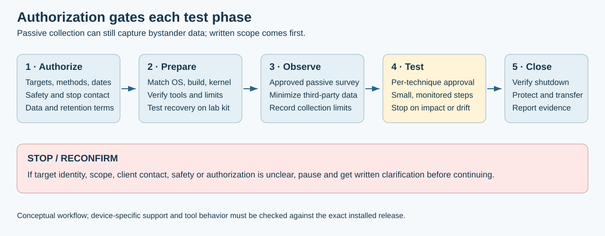
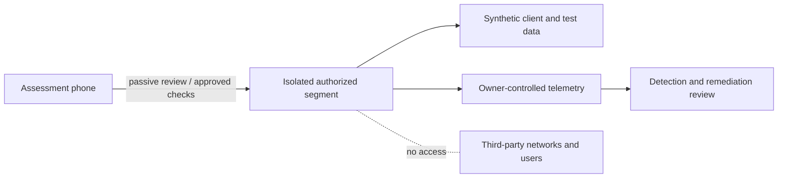
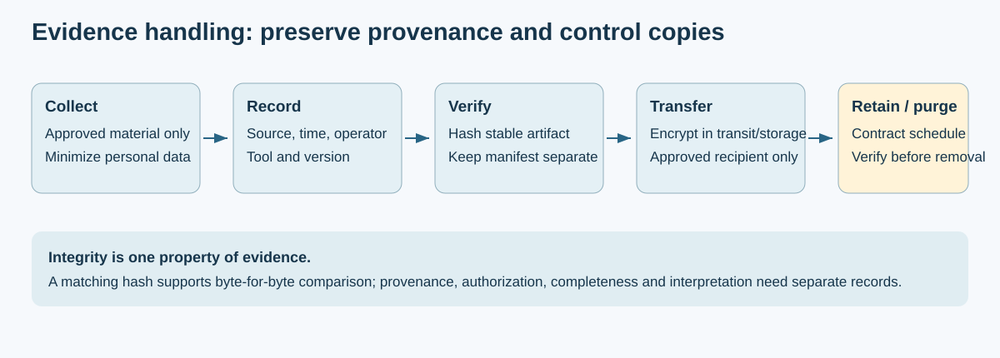
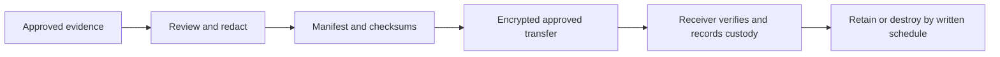

# 📱 SOP: Mobile Platform Penetration Testing

#### *Part of the [ULTIMATE CYBERSECURITY MASTER GUIDE](../README.md)*

### **Example platform:** Kali NetHunter on OnePlus 6 (A6003)

Treat this as a device-specific example, not a claim that every OnePlus 6 build supports every feature below. Check the current [NetHunter image list](https://nethunter.kali.org/images.html), [kernel capability list](https://nethunter.kali.org/kernels.html), Android build, kernel, adapters and installed app/tool versions before planning the engagement. Capabilities differ by build and external adapter.

**Separate device forensics:** [MVT mobile verification](mvt-forensic-triage.md) requires device-owner approval, backup integrity and supported analysis procedures; do not confuse this with active NetHunter testing.

## 🎯 Purpose
Engagement-level SOP for conducting an authorized penetration test using the OnePlus 6 NetHunter device as the primary attack platform - from client arrival through evidence handoff. Covers the full lifecycle: pre-engagement device prep, passive and active recon, wireless and physical access attacks, network exploitation, evidence collection, and teardown.

## ⚙️ Function
Eight sections organized around authorization, defensive review, detection, evidence, and reporting. Sections 1-2 prepare the device and confirm scope; sections 3-6 guide low-impact observation and response; sections 7-8 cover minimized evidence and teardown. [Nethunter_SOP.md](OnePlus_A6003/Nethunter_SOP.md) provides device-safety and defensive configuration guidance, not attack procedures.

## 🏆 Goal
Produce a scoped, traceable mobile-platform security assessment record with documented evidence, limitations and handoff steps. This SOP cannot guarantee legal defensibility or complete evidence; those depend on authority, method, platform limits and case facts.



## 📋 When to Use
- Reviewing wireless, Bluetooth, or mobile-device security with the owner
- Performing a passive configuration and monitoring review
- Practicing detection and response using synthetic lab data

---

## TABLE OF CONTENTS

1. [Pre-Engagement: Legal & Scope Verification](#section-1-pre-engagement-legal--scope-verification)
2. [Pre-Engagement: Device & Tool Preparation](#section-2-pre-engagement-device--tool-preparation)
3. [Phase 1 - Passive Reconnaissance](#section-3-phase-1---passive-reconnaissance)
4. [Phase 2 - Active Reconnaissance](#section-4-phase-2---active-reconnaissance)
5. [Phase 3 - Defensive Validation](#section-5-phase-3---defensive-validation)
6. [Phase 4 - Detection and Response](#section-6-phase-4---detection-and-response)
7. [Evidence Collection & Handling](#section-7-evidence-collection--handling)
8. [Post-Engagement Teardown & Reporting](#section-8-post-engagement-teardown--reporting)
9. [Tool Reference](#section-9-tool-reference)

---

## SECTION 1: Pre-Engagement: Legal & Scope Verification

**Complete before leaving the office. Do not drive to the client site without this.**

### 1.1 Required Legal Documentation

- [ ] Signed **Statement of Work (SOW)** naming the client, engagement type, and dates
- [ ] Signed **Rules of Engagement (RoE)** with:
  - [ ] In-scope IP ranges, SSIDs, BSSIDs, and MAC addresses
  - [ ] In-scope physical locations and buildings
  - [ ] Explicitly listed out-of-scope systems and adjacent tenant/neighbor networks
  - [ ] Authorized testing window (start/end time, blackout periods)
  - [ ] Authorized attack types (wireless only? physical access? HID? Bluetooth?)
- [ ] Client **emergency stop contact** (name, cell number, on-call escalation)
- [ ] Physical access authorization if HID/BadUSB is in scope (badge, escort, or written consent)
- [ ] Written authorization for any RF transmission, with affected systems, safety controls and stop conditions identified; authorization does not replace applicable RF rules
- [ ] Any NDA, data-processing terms or liability provisions required by the engagement are executed

### 1.2 Scope Confirmation Checklist

Before any active testing, confirm in writing:

```
IN SCOPE - verify each is explicitly listed in RoE:
  [ ] Target SSIDs/BSSIDs
  [ ] Target building(s) / floor(s) / rooms
  [ ] Target IP subnets
  [ ] Physical access targets (specific workstations, badge readers, server rooms)
  [ ] Any intrusive or disruptive technique (requires a separate written plan, owner approval, test window, stop conditions, and isolated target)

OUT OF SCOPE - document explicitly:
  [ ] Neighboring tenants' WiFi networks in the same building
  [ ] Public networks
  [ ] Safety systems (medical, industrial, emergency)
  [ ] Any system NOT listed in the SOW
```

**Golden rule:** if a target is not explicitly named in the RoE, it is out of scope. Stop and re-confirm before touching it.

---

## SECTION 2: Pre-Engagement: Device & Tool Preparation

**Complete the evening before the engagement. Verify again morning-of.**

### 2.1 Device Baseline Check

- [ ] Phone charged to 100%; external battery pack charged and packed
- [ ] NetHunter chroot starts cleanly (open NetHunter app → Home → confirm Kali version shown)
- [ ] Root confirmed: `id` in KALI terminal returns `uid=0(root)`
- [ ] All interfaces visible: `ip a` shows expected interfaces
- [ ] Kernel capabilities verified: `uname -a` shows NetHunter kernel string

### 2.2 Update the Chroot

```bash
sudo apt update && sudo apt full-upgrade -y
```

Confirm no broken packages before the engagement. Don't run upgrades day-of if there isn't time to test.

### 2.3 Tool Verification

| Tool | Verify Command | Expected Result |
|------|---------------|-----------------|
| Nmap | `nmap --version` | Version string, no errors |
| Metasploit | `msfconsole -q -x exit` | Exits cleanly |
| aircrack-ng | `airmon-ng` | Lists wireless interfaces |
| Wireshark/tshark | `tshark --version` | Version string |
| Responder | `responder -h` | Help output |
| NetExec (successor to CrackMapExec) | `nxc --version` | Version string; confirm installed syntax with `nxc --help` |
| SearchSploit | `searchsploit -u` | Updates Exploit-DB |

### 2.4 External Adapter Check

If wireless injection is in scope, internal OnePlus 6 chipset is limited - use an external adapter:

- [ ] Adapter connected via OTG; confirmed with `iw dev`
- [ ] Monitor mode works: `airmon-ng start <iface>` → `iwconfig` shows Mode:Monitor
- [ ] Packet injection test: `aireplay-ng --test <iface-mon>` returns injection OK
- [ ] Y-cable / powered OTG staged if adapter draws significant power

### 2.5 Engagement Folder Setup

```bash
mkdir -p ~/engagements/<client>-<YYYYMMDD>/{approved-evidence,redacted-screenshots,notes}
cd ~/engagements/<client>-<YYYYMMDD>/
echo "Engagement: <client>" > notes/scope.txt
echo "Date: $(date)" >> notes/scope.txt
echo "Tester: PNWC" >> notes/scope.txt
# Paste in-scope SSIDs/IPs/BSSIDs into scope.txt
```

### 2.6 MAC Address Plan

- [ ] Document the device's natural MAC addresses (WiFi, BT) for the engagement record
- [ ] Change a MAC address only when expressly authorized and compatible with client allowlists; record original and assigned values securely
- [ ] Record any spoofed MAC in notes/scope.txt

### 2.7 Pre-Deployment Pack List

- [ ] OnePlus 6 (NetHunter) + charging cable
- [ ] External battery pack
- [ ] External WiFi adapter + OTG Y-cable
- [ ] USB-C OTG adapter for HID/BadUSB targets (if in scope)
- [ ] Hacker's Keyboard installed and configured
- [ ] Laptop for KeX remote desktop (optional but useful for Burp/Wireshark GUI)

---

## SECTION 3: Phase 1 - Passive Review

**Do not collect radio or traffic data by default.** Start with the owner's network controller, asset inventory, and approved monitoring. Passive observation can expose bystander identifiers and location data; obtain explicit collection authority, minimize what is recorded, and stop if scope or privacy boundaries are unclear.

### 3.1 Wireless Configuration

- Review approved SSIDs, encryption settings, protected management frames, WPS state, firmware, and guest isolation from owner-provided reports.
- Do not perform continuous wardriving or record GPS trails in generic assessments.
- Redact nearby networks and client identifiers from notes.

### 3.2 Bluetooth Policy

- Review the managed-device inventory, pairing policy, firmware, and alerts for unexpected pairing activity.
- Avoid scanning or capturing communications from nearby devices that are not in scope.

### 3.3 Physical Environment

- Confirm site access, escort requirements, approved test locations, and bystander protections with the owner.
- Do not photograph people, badges, screens, or vehicle identifiers unless specifically authorized and necessary.

### 3.4 Network Baseline

- Use existing owner-controlled telemetry to review protocol usage and authentication trends.
- Prefer aggregate counts and sanitized events over raw packet captures.
- Preserve only the minimum evidence needed to substantiate a finding.

---

## SECTION 4: Phase 2 - Authorized Asset Review

Consult the signed scope and asset owner's inventory before any active check. For a routine assessment, review configuration exports, vulnerability-management results, and approved monitoring first. Active network probing requires its own written scope, owner coordination, defined rate limits, and stop conditions; this SOP does not provide generic scan or credential-enumeration commands.

### 4.1 Wireless Asset Review

- Compare controller-reported access points and clients with the approved inventory.
- Review encryption, firmware, guest isolation, and unexpected association alerts.
- Do not force reconnects, collect handshakes, or reveal hidden network names.

### 4.2 Network Inventory

- Review the owner's CMDB, DHCP, DNS, firewall, and switch records for unrecognized devices.
- Validate suspected exposures using approved vendor configuration checks or a staging environment.
- Stop and contact the owner if an asset appears outside the signed scope.

### 4.3 Directory and File-Service Review

- Review approved identity-provider reports for privileged accounts, stale accounts, and policy gaps.
- Do not use collected or shared credentials to enumerate systems; do not export user lists or password material.
- Record only sanitized identifiers required to explain a finding.

### 4.4 Name-Resolution and Authentication Monitoring

- Check whether legacy protocols are disabled where unnecessary using owner configuration and SIEM data.
- Use synthetic events or vendor-provided telemetry to confirm alert routing.
- Never poison name-resolution traffic or capture authentication exchanges.

---

## SECTION 5: Phase 3 - Defensive Validation

Use non-destructive checks and synthetic test data. This section does not authorize credential capture, password cracking, client deauthentication, rogue access points, keystroke injection, or payload deployment. If a requested test requires those actions, stop and replace it with an approved lab simulation or configuration review.

### 5.1 Wireless Configuration Review

- Confirm encryption mode, protected management-frame settings, WPS state, firmware level, and guest-network isolation with the network owner.
- Review controller exports or approved passive telemetry for unauthorized access points, unexpected associations, and authentication failures.
- Avoid collecting user traffic or forcing client reconnects.

### 5.2 Authentication and Name-Resolution Review

- Verify that legacy name-resolution protocols are disabled where they are not required.
- Use synthetic events or vendor-provided telemetry to confirm that detection rules identify suspicious broadcasts and authentication patterns.
- Do not collect, export, crack, or reuse passwords, hashes, tokens, or responder capture files.

### 5.3 Physical and Peripheral Controls

- Review device-lock policies, removable-media controls, endpoint alerts, and USB device allowlists.
- Validate controls with a benign, pre-approved test event and a synthetic account.
- Do not inject keystrokes, install a network bridge, or capture traffic from a client device.

### 5.4 Application and Network Review

- Confirm target addresses and applications against the signed scope before any active check.
- Prefer a staging copy and documented non-destructive checks. Use rate limits agreed with the service owner.
- Record the observed configuration and evidence of the control; avoid collecting unrelated data.




---

## SECTION 6: Phase 4 - Detection and Response

Treat any confirmed access, exposed secret, or unexpected control change as a finding to contain and report. This SOP does not authorize credential dumping, password reuse, Kerberoasting, lateral movement, persistence, or privilege-escalation attempts.

### 6.1 Local Security Review

- Review device security posture, installed applications, patch level, lock state, and management enrollment.
- Record only the minimum device identifiers required by the scope.
- Confirm that endpoint protections, logging, and device-management policies remain enabled.

### 6.2 Alert Triage

- Correlate timestamps, device identifiers, network segment, and approved test activity.
- Preserve relevant alerts and configuration evidence; redact personal data and secrets.
- Coordinate containment with the system owner and use the emergency stop contact if testing affects availability.

### 6.3 Reporting

For each finding, record the affected control, expected behavior, observed evidence, impact, confidence, remediation, owner, and retest method. Do not include password material, session tokens, or unrelated user data in the report.


---

## SECTION 7: Evidence Collection & Handling



### 7.1 Minimize and Hash Approved Artifacts

Collect only artifacts explicitly permitted by the engagement scope. Use synthetic or redacted evidence where possible. Store a reviewed artifact manifest alongside the files; record source, time, collector, purpose, retention owner, and redaction status.

For one approved regular file, a checksum can be recorded without shell placeholder syntax:

    sha256sum -- "./evidence/report-screenshot-01.png"

Do not hash broad wildcards or entire engagement directories. Keep customer credentials, authentication captures, and real hash inventories out of this public repository.

### 7.2 Transfer and Verify

Use the customer's approved encrypted transfer service. Transfer only files listed in the reviewed manifest. Have the receiving owner confirm the manifest and checksums, access permissions, and retention location before removing working copies.

### 7.3 Retention and Destruction

Follow the contract and retention schedule. Preserve the authoritative evidence copy and chain-of-custody record. Remove only explicitly approved temporary copies after the receiver confirms successful transfer and retention; do not use broad recursive deletion as routine teardown.

### 7.4 Evidence Inventory

These are column examples, not engagement observations. Use redacted filenames and provenance details; mark items not collected as such.

| Artifact | Sanitized file ID | SHA256 | Provenance / retention |
|----------|-------------------|--------|------------------------|
| Configuration export | config-review-01 | recorded in controlled manifest | Owner-approved, redacted |
| Screenshot | report-screenshot-01.png | recorded in controlled manifest | No personal data |
| Not collected | n/a | n/a | Explain scope or safety reason |



## SECTION 8: Post-Engagement Teardown & Reporting

### 8.1 On-Site Teardown Checklist

Before leaving the client premises:

- [ ] Stop all NetHunter services (Kali Services → stop all)
- [ ] Kill all Evil APs / WifiPumpkin sessions
- [ ] Stop all packet captures and close Responder
- [ ] Revert USB Arsenal to benign mode
- [ ] Restore original MAC address (MAC Changer → restore)
- [ ] Remove any physical devices placed during the engagement
- [ ] Confirm with client POC that testing window is closed
- [ ] Document any unexpected issues or out-of-scope contacts that occurred

### 8.2 Device Clean State Verification

```bash
# Verify no listeners running
ss -tlnp

# Verify no rogue processes
ps aux | grep -E "responder|wifipumpkin|airbase|hostapd"

# Verify MAC restored
ip link show | grep ether
```

### 8.3 Report Structure

The engagement report should include:

```
1. Executive Summary
   - Engagement scope and dates
   - Number and severity of findings
   - Key business risk narrative (no technical jargon)

2. Methodology
   - Tools used (reference this SOP)
   - Phases executed
   - Techniques attempted vs. successful

3. Findings (one section per finding)
   - Finding ID, Title, Severity (Critical/High/Medium/Low/Info)
   - Affected system(s)
   - Description and business impact
   - Evidence (screenshots, captured output, hashes)
   - Remediation recommendation
   - CVSS score if applicable

4. Attack Path Narrative
   - Step-by-step walkthrough of how far access was obtained
   - Decision points where a defender could have stopped the chain

5. Remediation Priority Matrix
   - Quick wins (patch/config change, low effort)
   - Medium-term (requires planning)
   - Strategic (architecture-level changes)

6. Appendices
   - Raw tool output
   - SHA256 hashes of all artifacts
   - Full command history
   - Scope confirmation documentation
```

### 8.4 Retention & Destruction

- Retain encrypted engagement archive per client contract terms (typically 90 days)
- After retention period: securely wipe; document destruction date
- Never retain plaintext credentials, hashes, or payloads beyond the engagement period

---

## SECTION 9: Tool Reference

Use the least intrusive source that answers the assessment question. Confirm the tool version and data-handling behavior before collection.

| Source | Location | Safe use in this SOP |
|---------|----------|----------------------|
| Device settings and management console | NetHunter / owner console | Review OS version, encryption, lock state, permissions, and policy status |
| Wireless controller reports | Owner-managed console | Review approved SSIDs, encryption, firmware, and association alerts |
| Bluetooth device inventory | Owner-managed console | Review paired-device policy and unexpected pairing events |
| Approved SIEM or endpoint telemetry | Owner-managed system | Review synthetic or authorized test events; avoid collecting unrelated traffic |
| Wireshark | KALI desktop | Inspect only owner-provided, sanitized sample captures |
| `sha256sum` | KALI terminal | Record the checksum of one approved regular evidence file |
| KeX | NetHunter app | Local desktop for report preparation and sanitized artifact review |

---

## Related Files
- [OnePlus_A6003/Nethunter_SOP.md](OnePlus_A6003/Nethunter_SOP.md) - device setup, safe configuration checks, and evidence handling
- [OnePlus_A6003/Kali_NetHunter.md](OnePlus_A6003/Kali_NetHunter.md) - NetHunter installation and configuration
- [OnePlus_A6003/Rooting.md](OnePlus_A6003/Rooting.md) - Device preparation (prerequisite)
- [README.md](README.md) - Mobile section index
- [../PlayBooks/NetworkAuditPlayBook.md](../PlayBooks/NetworkAuditPlayBook.md) - Wireless/network audit playbook (laptop-based companion)
- [../Tradecraft/active-directory.md](../Tradecraft/active-directory.md) - Active Directory hardening, monitoring, and detection
- [../Tradecraft/c2-frameworks.md](../Tradecraft/c2-frameworks.md) - command-and-control detection and response
- [../OPSEC/OPSEC_guide.md](../OPSEC/OPSEC_guide.md) - OPSEC practices for field operations

---

## ⚠️ Security & Legal Disclaimer

### 🔴 CRITICAL: Authorized Use Only

```
⚠️ LEGAL AND ETHICAL USE ONLY ⚠️

This section contains attack techniques and tools for:

✅ AUTHORIZED USES:
   - Penetration testing with explicit written authorization
   - Mobile device security assessments with client permission
   - Red team operations with organizational approval
   - Forensic investigations with proper legal authority
   - Security research in isolated lab environments
   - Blue team training and detection development
   - CTF competitions and authorized challenges
   - Educational purposes with proper supervision

🚫 STRICTLY PROHIBITED:
   - Attacking devices, apps, or networks without explicit written permission
   - Intercepting wireless communications without authorization
   - Installing unauthorized software on devices you don't own
   - Exceeding authorized scope of engagement
   - Using attack techniques for malicious purposes
   - Any illegal or unethical activities
```

---

### Legal Requirements for Mobile Security Testing

#### Written Authorization Requirements

**CRITICAL: ALWAYS obtain written authorization that explicitly includes:**
- Specific devices, apps, networks, and SSIDs in scope
- Testing methodology and techniques approved
- Time windows for testing activities
- Out-of-scope systems and explicit restrictions
- Emergency contact information and escalation procedures
- Data handling and confidentiality requirements
- Physical access authorization if HID/BadUSB is in scope
- RF activity authorization if Evil AP or deauth attacks are in scope

#### Applicable Laws

Mobile security testing intersects multiple legal frameworks:

- **Computer Fraud and Abuse Act (CFAA)** - unauthorized access to computers and networks
- **Electronic Communications Privacy Act (ECPA)** - interception of wireless communications
- **FCC Regulations** - RF transmissions and interference with licensed spectrum
- **State/Local Laws** - vary by jurisdiction; some states have stricter computer crime laws
- **International Laws** - GDPR (EU), Computer Misuse Act (UK), and equivalents apply when testing crosses borders

```
✅ IN SCOPE (With Explicit Authorization):
   - Devices and apps explicitly listed in engagement letter
   - Networks and SSIDs defined in written agreement
   - Specific techniques approved by client/device owner
   - Testing within authorized time windows

🚫 OUT OF SCOPE (Always):
   - Devices or networks not explicitly in scope
   - Production systems without change-window approval
   - RF attacks that could disrupt safety-critical systems
   - Any technique that could affect bystander devices
```

---

<div align="center">

**📖 Use These Resources Responsibly: Authorization is MANDATORY**

*Attack techniques are powerful - use them ethically and legally.*

**Repository**: [ULTIMATE CYBERSECURITY MASTER GUIDE](https://github.com/Pnwcomputers/ULTIMATE-CYBERSECURITY-MASTER-GUIDE)

**Maintained by**: [Pacific Northwest Computers](https://github.com/Pnwcomputers)

---

⚠️ **CRITICAL: These are ATTACK TECHNIQUES - Written authorization is REQUIRED** ⚠️

⚠️ **Potential legal consequences depend on the conduct, facts and jurisdiction; obtain appropriate legal authorization and advice.** ⚠️

⚠️ **ALWAYS obtain explicit written authorization before using any technique** ⚠️

⭐ **Star this repo if you find it useful!** ⭐

</div>
