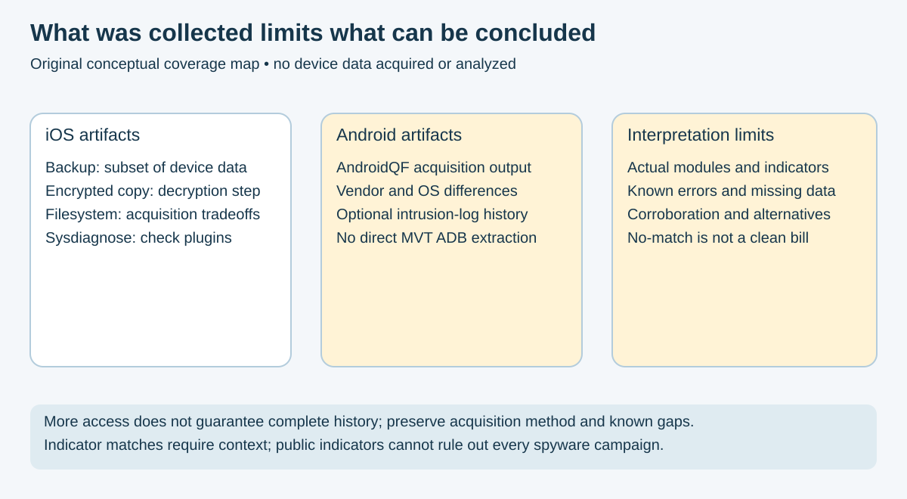
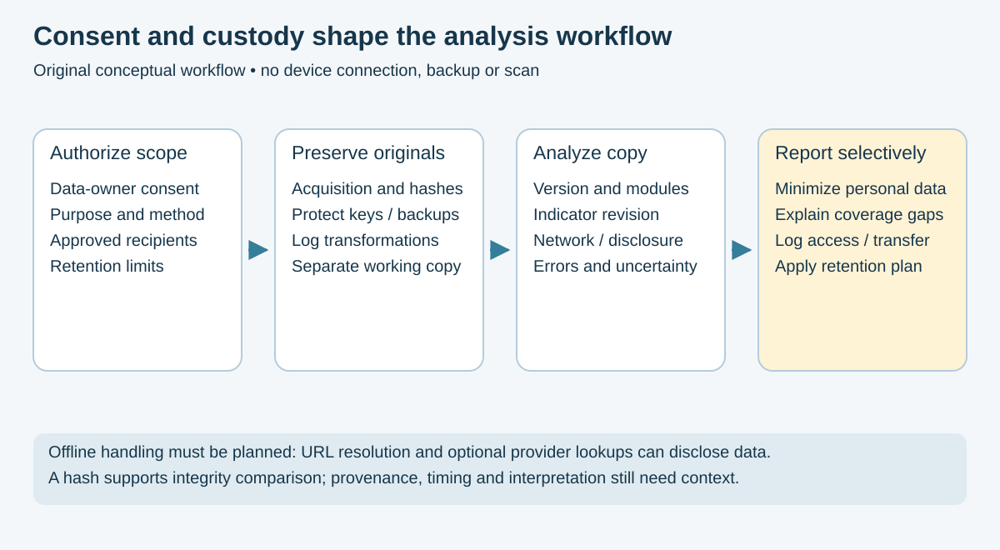

# Mobile Verification Toolkit (MVT): Authorized Forensic Triage

_Last reviewed: 2026-11-17 (source/docs and visual review only; no device, backup or personal data analyzed)_

> [!CAUTION]
> Mobile forensic analysis can reveal personal photos, communications,
> location records and confidential sources. Secure informed authorization,
> preserve originals and handle outputs as sensitive evidence.
> See [legal terms](../LEGAL.md).

**Prerequisites:** [Mobile assessment SOP](mobile_pentest_sop.md) · [Mobile security](README.md) · [Press and source safety](../OPSEC/press-freedom/README.md).

## What MVT can and cannot do

[Mobile Verification Toolkit](https://github.com/mvt-project/mvt) is an analysis toolkit for supported iOS/Android forensic artifacts and potential indicators of compromise, with [version-specific official docs](https://docs.mvt.re/). It is **not** a universal spyware detector: available artifacts and collection paths depend on device OS, platform restrictions, backup format and permissions. No finding does not prove a device is safe.

The [upstream README](https://github.com/mvt-project/mvt) describes MVT as a
research tool for trained investigators rather than an end-user self-assessment.
Its v3 changes can break older output-processing scripts. Record the exact
release and enabled modules/plugins; a completed command is not proof that all
relevant artifacts were available or checked.

### Artifact paths and coverage

*Figure 1 — Original conceptual coverage map based on [iOS methodology](https://docs.mvt.re/en/latest/ios/methodology/), [Android methodology](https://docs.mvt.re/en/latest/android/methodology/) and [indicator documentation](https://docs.mvt.re/en/latest/iocs/). It shows constraints, not a collected device or scanner result.*

| Input/method | What to check before interpreting it |
| --- | --- |
| iOS backup | It contains a subset of device data. Encrypted backups can include additional relevant records; [decrypt an authorized working copy before the documented backup analysis](https://docs.mvt.re/en/latest/ios/backup/check/). Protect passwords, key files and decrypted data separately. |
| iOS filesystem acquisition | Greater access is not guaranteed. Acquisition changes such as jailbreaking can alter records or device behavior; choose methods with a specialist and preserve earlier acquisitions. |
| iOS sysdiagnose | [Current docs](https://docs.mvt.re/en/latest/ios/sysdiagnose/) require suitable plugin modules for forensic checks; recording device/archive metadata alone is not a clean analysis. |
| Android acquisition | [Current guidance](https://docs.mvt.re/en/latest/android/methodology/) separates AndroidQF acquisition from MVT analysis. Direct MVT ADB extraction was removed; old `check-adb` recipes should not be assumed supported. Artifacts vary by OS/vendor and acquisition. |
| Android intrusion logs | [Logs cover the period when optional logging was enabled](https://docs.mvt.re/en/latest/android/intrusion_logs/); MVT reads acquired logs and does not retroactively enable or reconstruct missing history. |

### Network and indicator limits

[Indicator checks](https://docs.mvt.re/en/latest/iocs/) support only a subset
of STIX2 types/expressions. A file being valid STIX2 does not mean every pattern
is supported or relevant to an available artifact. Record indicator source,
revision/hash and the actual modules used.

Do not assume analysis is offline by default: the documented shortened-URL
resolution can send HTTP requests. `MVT_NETWORK_ACCESS_ALLOWED=false` controls
that behavior in the described implementation; it is not a system-wide network
isolation guarantee. Review plugins, updates, indicator downloads and other
options separately. [Optional VirusTotal package-hash lookups](https://docs.mvt.re/en/latest/android/methodology/)
send hashes to that provider and need a separate disclosure decision. No such
lookups or downloads were performed for this guide.

## Consent-first workflow

*Figure 2 — Original conceptual consent/custody workflow. The [MVT license](https://docs.mvt.re/en/latest/license/) specifically restricts use to consensual analysis; owner possession alone is not a substitute for the required consent. No device connection or acquisition is depicted.*

1. Record the relevant data owner's explicit consent, purpose, collection methods, intended recipients and retention limits, plus device/OS and investigator. MVT's modified license contains a consensual-use restriction; a device custodian's permission alone may not satisfy that requirement.
2. Review the exact MVT release, platform method, plugins and dependencies. Validate any output-parsing script against that release; do not reuse a different version's command or schema blindly.
3. Learn on a separate test device/backup containing only deliberately created, authorized test data. Label expected results as predictions until actually validated; no test device was used in this review.
4. Preserve and hash original acquisitions and custody context; create a distinct working copy. For encrypted iOS backups, follow the documented decryption step on the copy. Protect key material and decrypted outputs, record transformations and plan separately for volatile evidence.
5. Record trusted indicator feeds and release dates; indicators are investigative leads, not independent proof.
6. Before a future approved run, choose network/disclosure controls and explicit output storage. Record modules/plugins, skipped/error states, MVT version, parameters, indicator revision, timestamps/time zone and hashes of outputs. Keep logs and sensitive paths out of public reports.
7. Correlate matches with OS behavior, security advisories, independent artifacts and false-positive possibilities.
8. Explain confidence, collection gaps, possible alternatives, risk-reduction measures and specialist referral when appropriate. Protect raw sensitive data and follow retention rules.

| Report field | What to preserve |
| --- | --- |
| Consent and custody | Case, owner authorization, investigator and handlers |
| Device | OS/build, backup type, encryption state |
| Processing | MVT version, acquisition method, modules/plugins, indicator revision/hash, network choices and errors |
| Integrity | Original/derived hashes and transformations; hashes establish byte comparisons, not capture time or authenticity by themselves |
| Finding | Exact artifact/match and timestamps, corroboration, alternative explanations, gaps and confidence |
| Outcome | Redacted report, handling and retention decision |

### Interpret the outcome

| Outcome | Supported statement |
| --- | --- |
| Indicator match | A retained artifact matched the selected indicator; review provenance, timing, context and alternative causes before asserting compromise or attribution. |
| Completed analysis with no matches | No matches were found in the acquired artifacts with those modules/indicators/settings; this does not establish a clean device. |
| Missing data, skipped module, parser error or incomplete run | Coverage is incomplete or uncertain. Retain diagnostics and resolve the limitation; do not count it as a negative finding. |

If the concern exceeds the available evidence or operator expertise, refer through
a verified specialist route with the person's consent. Do not upload raw backups,
communications or location histories to public scanning/archive services.

## References

- [MVT GitHub](https://github.com/mvt-project/mvt), [official docs](https://docs.mvt.re/) and [consensual-use license](https://docs.mvt.re/en/latest/license/).
- [Mobile Security index](README.md), [Mobile pentest SOP](mobile_pentest_sop.md) and [Digital Forensics](../IncidentResponse/Digital-Forensics/README.md).

**Status:** source-reviewed process and original conceptual diagrams only; no installation, device connection, acquisition, backup decryption, scan, indicator download or third-party submission. Runtime and platform compatibility were not tested.

---

[Mobile hub](README.md) · [Main README](../README.md) · [Legal terms](../LEGAL.md)
