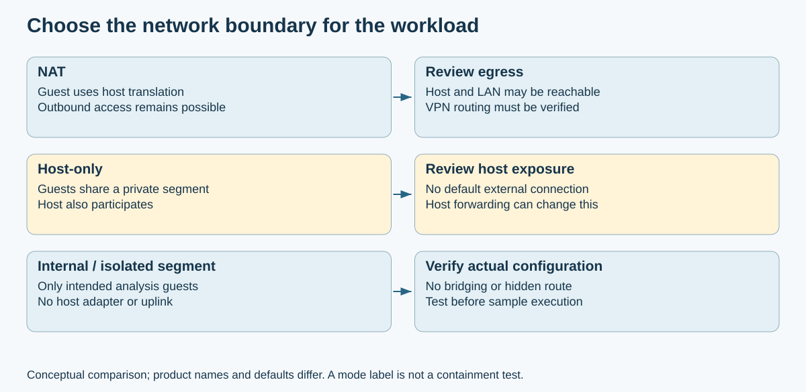

# Cybersecurity OPSEC Guide

_Last reviewed: 2026-11-17 (documentation and architecture review; no lab containment or anonymity testing performed)._

**Proxy risk companion:** [Proxy types, leak checks and Froxy research](./proxy-reference-froxy.md). Public proxies are untrusted intermediaries; prefer explicit, approved network routing and Tor/Whonix where appropriate for the threat model.

## 🎯 Purpose
Practical OPSEC guide for cybersecurity professionals - covering the specific virtualized environment setup, identity management, and operational discipline needed for pentesting, malware research, and privacy-sensitive security work.

## ⚙️ Function
Documents planning considerations for a virtualized security research setup: supported hosts and hypervisors, VM compartmentalization, network boundaries, identity separation, storage, and communications. VPN/Tor combinations are treated as task-specific exceptions, not a default chain.

## 🏆 Goal
Plan a repeatable research environment with explicit host, network, identity, and evidence boundaries for authorized work. These controls reduce some accidental cross-use; they cannot guarantee anonymity or prevent attribution.

## 📋 When to Use
- Initial setup of a new security research workstation
- Auditing your current OPSEC posture for gaps
- Preparing for an engagement requiring high-confidentiality operational security
- Training yourself or a team on professional OPSEC practices

## Professional Virtualized Setup for Pentesting, Malware Research, and Privacy

---

# Table of Contents
1. [Executive Overview](#executive-overview)
2. [Host OS Setup](#host-os-setup)
3. [Hypervisor Layer](#hypervisor-layer)
4. [Network Architecture](#network-architecture)
5. [VM Architecture](#vm-architecture)
6. [OPSEC Rules](#opsec-rules)
7. [High-Security Configurations](#high-security-configurations)
8. [Field Edition (Portable OPSEC)](#field-edition-portable-opsec)
9. [Home Lab Edition (Persistent Setup)](#home-lab-edition-persistent-setup)
10. [Recommended Tools](#recommended-tools)
11. [Appendix: VM Folder Structure](#appendix-vm-folder-structure)

---

# Executive Overview

This guide outlines workload separation for a cybersecurity environment. Suitability depends on the host, hypervisor, routing, and handling procedures; VM labels alone do not enforce separation. This is a planning reference, not a validated host configuration. Workloads include:

- Pentesting  
- OSINT & reconnaissance  
- Malware analysis  
- Defensive research (IDS, SIEM, packet capture)  
- Privacy and anonymity  
- Secure red-team/blue-team workflows  

Two modes are provided:

- **Field Use Mode** → portable, encrypted storage with an explicit evidence-retention plan  
- **Home Lab Mode** → fully virtualized infrastructure with VLANs, IDS/IPS, SIEM

---

# Host OS Setup

Your host operating system and hypervisor are part of the trusted control plane. A compromised host can undermine every guest; higher-risk malware work may require a separate physical machine.

## Choose a host OS and hypervisor

The host OS, firmware, hypervisor, and management network are part of the trusted control plane. A guest compromise may affect shared services, devices, or data; a host or hypervisor compromise can undermine every guest. For malware work with consequential risk, consider a dedicated physical analysis host and specialist review.

| Decision | Review before choosing |
|---|---|
| Host operating system | Is it supported and patched? Can disk encryption, endpoint protection, secure boot, and recovery be managed under policy? |
| Hypervisor | Does the current release support the host and guest architectures? What are the update channel, licensing terms, device-sharing defaults, and network controls? |
| Hardware | Does firmware expose required virtualization and IOMMU features? Are the relevant guest OS releases supported? |
| Management | Can administration be restricted to a trusted network and account? Are backups and recovery paths protected? |

Examples include desktop hypervisors on supported Windows or Linux hosts and server-oriented platforms such as Proxmox VE. These are choices, not security guarantees; verify current upstream compatibility and licensing rather than relying on a fixed product/version recipe.

On Windows, keep supported security features enabled where hardware, policy, and hypervisor compatibility allow. [Microsoft's memory integrity guidance](https://learn.microsoft.com/en-us/windows/security/hardware-security/enable-virtualization-based-protection-of-code-integrity) explains that Memory Integrity uses virtualization-based security. Do not disable the Windows hypervisor while expecting VBS protections that depend on it to remain active.

For multi-VM platforms, protect the management plane separately from guest and analysis networks. Storage options such as ZFS can help with integrity and snapshots when configured and maintained correctly; they are not required for every deployment and do not replace backups or access controls.

---

# Network Architecture

## Baseline Routing Model

```
Research VM → virtual NAT → host routing/firewall → optional VPN → destination
```

- A host VPN is optional and task-dependent; verify that the guest's actual IPv4, IPv6, DNS, and failure paths follow the intended policy  
- NAT permits outbound communication and may expose host or LAN services; it does **not** establish malware containment  
- Malware execution starts on an isolated virtual segment or with its network adapter disconnected; block host, management, LAN, and uncontrolled Internet access

---



*Networking comparison: [VMware's network definitions](https://knowledge.broadcom.com/external/article?legacyId=1006480) explain why NAT and host-only are not synonyms for an isolated malware network. Other hypervisors have different names and defaults; inspect actual adapters, forwarding, and firewall rules.*

# VM Architecture

## Recommended VM Set

| Category | VM | Purpose |
|---------|----|---------|
| Offensive | Kali / Parrot | Pentesting + exploitation |
| Defensive | ELK / Wazuh | SIEM + threat detection |
| Network | Zeek / Suricata | Packet analysis IDS/IPS |
| Research | Debian/Ubuntu OSINT | Recon, OSINT, documentation |
| Malware | Win10/Win11 + REMnux | Malware detonation + reversing |
| Tor-routed workload | Whonix Gateway + Workstation | Tor-routed applications with explicit limits; see upstream threat model |
| Utility | Windows Admin VM | Windows-only tools |

---

# OPSEC Rules

## Critical VM Configuration Rules

- **Clipboard sharing: OFF**  
- **Drag-and-drop: OFF**  
- **Shared folders: OFF**  
- **USB passthrough: Avoid for malware VMs**  
- **Known-clean snapshots and separate backups**, with sensitive snapshot files protected  
- **Choose networking per workload**; NAT, host-only, and internal networks have different trust boundaries  
- **Bridged mode only for explicitly scoped LAN work**; no bridging of the malware segment  

**Whonix exception:** Workstation must use only the supplied private network to Gateway; do not apply the generic NAT/bridged advice to it. Use the [Whonix + Kicksecure guide](./whonix-kicksecure-usb-guide.md#hypervisor-selection) for the VirtualBox baseline and the separate KVM/libvirt installation route.

## Network OPSEC

Choose a network route from written scope and the task's threat model. A host VPN is optional and can change the source address, resolver path, and client allowlist behavior. See the [VPN guide](../Documentation/VPN.md) for trust-boundary limits.

For Whonix, keep the Workstation attached only to the supported private network to its Gateway and follow the [Whonix tunnel guidance](https://www.whonix.org/wiki/Tunnels/Introduction) before adding any other tunnel. Do not treat VPN/Tor stacking as a default privacy improvement.

Compartmentalization can reduce accidental cross-use. Personal logins, browser behavior, shared files, endpoint telemetry, timing, and provider records can still link activity. Neither Tor nor a VPN guarantees anonymity.

## Identity Separation

- Define the identities and data that must be separated before choosing controls.
- Use distinct accounts, browser profiles, devices, or VMs only where the workflow requires them; sharing a host does not create independent identities.
- Do not log into personal accounts in a work profile when identity separation matters.
- Document the required network route and evidence handling. A different VPN exit IP alone does not prevent correlation.
- Review reused usernames, recovery addresses, cookies, device identifiers, time patterns, and uploaded documents for cross-links.  

---

# High Security Configurations

## Malware Lab Isolation (Proxmox)


*Containment design: simulated services can support observation without real Internet access. This is a conceptual target architecture, not a verified Proxmox configuration. An IDS in monitor mode observes traffic; it does not block it.*

Rules:

- Keep the sample-analysis segment off physical uplinks and management/LAN bridges; verify that no default route reaches production or the public internet.
- Use controlled simulation services when network behavior must be observed. Treat any gateway or second adapter as a high-risk exception with explicit egress rules and monitoring.
- Permit any external access only through a separately designed, logged, destination-restricted gateway under the lab owner's policy.
- Disable unnecessary shared folders, clipboard, USB and PCI passthrough. Virtual drivers and RAM settings are compatibility/resource decisions, not proof of isolation.
- Test boundaries with benign traffic before introducing a sample; snapshots restore guest state but cannot undo host compromise or external communication.  

---

# Field Edition (Portable OPSEC)

This mode is for **authorized work on the go**, at client sites, or during travel. Encryption and an ephemeral guest do not guarantee deniability or removal of host, provider, or service records.

## Principles

- Store sensitive working data in an encrypted volume; keep separately protected recovery material and backups  
- Use a patched laptop and a supported, installed hypervisor; an external VM image does not make the hypervisor portable  
- Use disposable guests where appropriate, while preserving required engagement records outside the guest  
- Use approved research identities without mixing personal accounts or credentials  
- Restrict LAN access explicitly; a VPN may retain local routes or bypass paths  

## Setup

### Host:
- A currently supported operating system with policy-approved storage encryption and recovery procedures.
- Verify the selected hypervisor and VPN against current host security features and policy.
- Restrict management access and document which local networks are reachable.  

### VMs:
- 1 × OSINT VM (Debian minimal)  
- 1 × Kali/Parrot  
- 1 × Whonix-Gateway **and** 1 × Whonix-Workstation (LXQt build flavors: `whonix-gateway-lxqt` and `whonix-workstation-lxqt`); see [installation and naming](./whonix-kicksecure-usb-guide.md#guest-names).
- (Optional) 1 × Windows Malware VM  

### Storage:

An encrypted container protects stored contents while locked, within its threat model. Mounted data, RAM, swap, hibernation, host logs, and backups may remain exposed. Follow [VeraCrypt's security requirements](https://veracrypt.io/en/Security%20Requirements%20and%20Precautions.html); container use alone does not establish deniability.

- External SSD with **VeraCrypt container**  
- Minimize unnecessary personal data; retain the logs and evidence required by the engagement  
- Preserve necessary results, then restore a known-clean guest state; rollback does not erase external records  

### Do Not:
- Execute malware on a shared field laptop; use a dedicated lab and verify containment before any execution  
- Mix personal accounts, shared browser synchronization, or personal credentials into research guests  
- Use bridged networking  

---

# Home Lab Edition (Persistent Setup)

This mode is for **full home lab deployments**, learning, testing networks, SOC practice, and running a personal cyber range.

## Recommended Architecture

### Proxmox Node
- Confirm current Proxmox VE hardware and firmware requirements from upstream documentation.
- Size CPU, memory, and storage for the selected guest count, packet-capture volume, and analysis tools; leave capacity for the host.
- Select a supported storage layout and keep separate protected backups; ZFS is one option, not a universal requirement.

### VM Layout

```
/proxmox
 ├── offensive/
 ├── defensive/
 ├── anonymity/
 ├── research/
 ├── malware/
 └── shared-images/
```

### Networking

These are **roles**, not security properties of bridge names. A Linux bridge behaves like a virtual switch; review physical ports, host addresses, VLAN tags, guest adapters, and forwarding rules. See the [Proxmox network documentation source](https://github.com/proxmox/pve-docs/blob/master/pve-network.adoc).


- Example role: management/LAN bridge, restricted to trusted administrative access  
- Example role: isolated malware segment with no physical uplink or unapproved routing  
- Example role: blue-team test segment with deliberately configured routing and monitoring  

### Defensive Stack VMs:
- Zeek sensor  
- Suricata IDS (inline or monitor mode)  
- Wazuh Manager  
- Elastic Stack (SIEM)  
- pfSense router/firewall  

### Offensive Stack VMs:
- Kali, Parrot, CommandoVM  
- Sliver / Cobalt Strike lab  
- AD attack lab with Windows DC + clients  

---

# Recommended Tools

## Host Tools
- A VPN service only when required by policy or threat model; compare current provider claims and trust boundaries in the [VPN guide](../Documentation/VPN.md).
- [VeraCrypt](https://veracrypt.io/en/)
- [KeepassXC](https://keepassxc.org/)
- USB data-blocking adapters (check the exact connector and power/data behavior; these do not secure the endpoint)
- [Wireshark](https://www.wireshark.org/faq) — capture only at approved interfaces and account for host traffic visibility.

## Offensive Tools
- [Kali Linux tools](https://www.kali.org/tools/)
- [ParrotOS tools](https://parrotsec.org/docs/tools/)
- [Proxychains-ng](https://github.com/rofl0r/proxychains-ng)
- [Evilginx](https://evilginx.com/) / [Responder](https://github.com/SpiderLabs/Responder) / [Impacket](https://github.com/fortra/impacket)  
- [Sliver C2](https://github.com/BishopFox/sliver)

## Defensive Tools
- [Wazuh](https://wazuh.com/)
- [Zeek](https://zeek.org/)
- [Suricata](https://suricata.io/)
- [Sysmon](https://learn.microsoft.com/en-us/sysinternals/downloads/sysmon)
- [ELK Stack](https://www.elastic.co/elastic-stack)

## Malware Tools
- [REMnux](https://remnux.org/)
- [Flare-VM](https://github.com/mandiant/flare-vm)
- [Ghidra](https://github.com/NationalSecurityAgency/ghidra)
- [Cuckoo Sandbox documentation](https://cuckoo.readthedocs.io/en/latest/) (legacy/version-specific reference; validate current maintenance and platform support before choosing a sandbox)

---

# Appendix: VM Folder Structure

```
/VMs
 ├── offensive/
 │    ├── kali/
 │    └── parrot/
 ├── defensive/
 │    ├── elastic/
 │    ├── suricata/
 │    ├── zeek/
 │    └── wazuh/
 ├── anonymity/
 │    ├── whonix-gw/
 │    └── whonix-ws/
 ├── malware/
 │    ├── windows-analysis-guest/
 │    └── remnux/
 ├── research/
 │    ├── ubuntu-osint/
 │    └── windows-analysis/
 └── shared/
      └── qcow2-base-images/
```


## Sources and review limits

- [Microsoft: memory integrity and VBS](https://learn.microsoft.com/en-us/windows/security/hardware-security/enable-virtualization-based-protection-of-code-integrity)
- [Broadcom: hosted VM networking types](https://knowledge.broadcom.com/external/article?legacyId=1006480)
- [Proxmox: network configuration source](https://github.com/proxmox/pve-docs/blob/master/pve-network.adoc)
- [REMnux documentation](https://docs.remnux.org/) — verify current analysis environment and network-isolation guidance for the selected workflow.
- [Whonix: supported VirtualBox baseline](https://www.whonix.org/wiki/VirtualBox/Recommended_Version)
- [VeraCrypt: security requirements and precautions](https://veracrypt.io/en/Security%20Requirements%20and%20Precautions.html)

This revision checks documentation and explains trust boundaries. It does not certify a host, prove anonymity, or validate a running malware lab.

## Related Files
- [README.md](README.md) - OPSEC section index
- [../Documentation/VPN.md](../Documentation/VPN.md) - VPN trust boundaries and task-dependent routing
- [../Documentation/TOR.md](../Documentation/TOR.md) - Tor Browser, explicit app routing, and anonymity limits
- [../Documentation/virtualmachines.md](../Documentation/virtualmachines.md) - VM compartmentalization setup
- [press-freedom/README.md](press-freedom/README.md) - journalists, confidential-source protection, device seizure and duress planning
- [../Cryptography/encrypted-storage.md](../Cryptography/encrypted-storage.md) - portable drive encryption and recovery
- [../Cryptography/security-keys-passkeys.md](../Cryptography/security-keys-passkeys.md) - FIDO2/passkey account safeguards
- [../Mobile/README.md](../Mobile/README.md) - Mobile security section (mobile OPSEC, device hardening)
- [../Mobile/mobile_pentest_sop.md](../Mobile/mobile_pentest_sop.md) - Mobile pentest SOP (MAC randomization, covert operation procedures)
