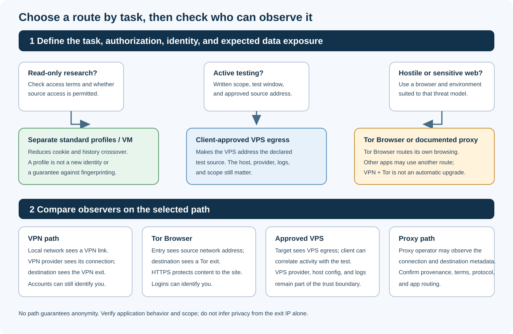

# Anonymity Layering for OSINT & Active Engagements

_Last reviewed: 2026-10-09_

**Proxy and Froxy research companion:** [Proxy types, DNS leaks and Froxy](./proxy-reference-froxy.md) explains why free public lists should not be treated as a trusted anonymity layer. The Froxy package is documented for isolated research only, not as an engagement egress.

> [!CAUTION]
> **Authorized use only.** The techniques below are for authorized security
> testing, education, and defensive research. Using them against systems you do
> not own or lack explicit written permission to test is illegal. See
> [LEGAL.md](../LEGAL.md).

**Prerequisites:** A working baseline VPN and VM compartmentalization. See the
[General OPSEC Guide](./OPSEC_guide.md), [VPN setup](../Documentation/VPN.md), and
[Tor Browser](../Documentation/TOR.md) for the fundamentals this guide builds on.

## 🎯 Purpose

Choose network paths and browser compartments that fit a defined OSINT or authorized-testing task. A VPN, Tor, proxy, or separate VM changes specific observers and risks; none guarantees anonymity or prevents identity disclosure.

## ⚙️ Function

Frames privacy as **compartmentalization and attribution management**, maps each option to what it changes and who may observe it, and gives examples for an authorized, client-approved VPS egress and for evaluating a residential proxy contract.

## 🏆 Goal

Match egress and isolation to the task, document the expected route, and validate it in a controlled environment. A configuration check can reduce accidental exposure; it cannot prove that an operator is anonymous or prevent identity disclosure.

## 📋 When to Use

- Planning egress for an OSINT investigation or an authorized engagement.
- A target geofences or blocks VPN/datacenter IPs and you need residential egress.
- You need an attributable, client-whitelisted exit for active scanning.
- Auditing an existing anonymity stack for leaks or over-engineering.

---



*Conceptual decision aid; it does not verify a live route, provider practices, permission, or anonymity. Confirm scope and the behavior of the specific apps and services you use.*

## Threat Model First

> [!IMPORTANT]
> "More anonymity" is not one thing. Decide what you're defeating **before** you add
> a layer. What actually burns investigators is rarely the exit IP — it's
> correlation: a reused username, a browser fingerprint, a leaked DNS query, or a
> login that ties the research box to the real you. Prioritize **separation** over
> adding hops.

| Scenario | Real objective | Right tool |
|---|---|---|
| Passive OSINT (looking, not touching) | Non-attribution; no correlation between you and the target | Dedicated VM + hardened browser; residential egress only when blocked |
| Separate research identities | Reduce accidental cookie and history crossover | Separate standard browser profiles and clearly scoped accounts; profiles do not make identities anonymous |
| Active authorized testing (scan, auth'd) | **Attribution management + scope compliance**, not anonymity | Your own VPS exit, whitelisted by the client |
| Viewing a hostile/sketchy site | Defeat the site operator identifying you | Tor Browser (or [Whonix](./whonix-kicksecure-usb-guide.md)) |

---

## Baseline: What a Good VPN Already Gives You

Before paying for a second anonymity layer, confirm you're using what you have.
A correctly configured VPN can hide destinations from the local network and replace the public IP address seen by destination sites with a VPN exit address. It moves trust to the VPN provider and does not protect identity-bearing logins, browser fingerprints, or traffic from apps outside the tunnel. Provider features, server availability, and settings change; consult the provider's current documentation. [Mullvad's current app guide](https://mullvad.net/en/help/using-mullvad-vpn-app) documents its own options, including DAITA and multihop, with configuration and availability caveats.

> [!WARNING]
> Mullvad **dropped port forwarding** — relevant if you ever need reverse
> connections. Adding a second *commercial* VPN on top of this buys almost nothing
> and just adds another logging party.

---

## Layer by Task

### Passive OSINT

- **One VM per investigation**, snapshotted and rolled back. Prevents
  cookie/history/fingerprint bleed between targets and between a target and your
  real life. This matters more than the exit IP.
- **Browser compartmentalization.** Use separate standard browser profiles or disposable VMs when the task requires separate cookie and history stores. A profile does not conceal identity or guarantee a distinct fingerprint. Mullvad Browser is one privacy-focused option developed with the Tor Project; it is designed to reduce tracking and fingerprinting and is intended for use with a VPN, but it does not make a user anonymous. See [Mullvad Browser](https://mullvad.net/en/browser) and the [Tor Project's fingerprinting guidance](https://support.torproject.org/tor-browser/features/fingerprinting-protections/).
- **Residential/mobile egress** only when the target geofences or blocks datacenter
  IPs. Use a **paid, contracted** provider — never scraped free lists. See
  [Build #2](#build-2--paid-residential-proxy-contract).

### Active Engagements

- Anonymity usually isn't the goal — **attribution management and scope compliance**
  are. Use a known, stable egress the client has whitelisted (your own VPS), not a
  rotating anonymizing layer.
- Tor and random proxies through active tooling are slow, leaky (many tools ignore
  proxy settings and leak real IP/DNS), and make engagements non-reproducible. See
  [Build #4](#build-4--your-own-vps-exit-do-this-first).

### Tor's Place

- Tor Browser routes its own browsing through Tor; installing it does not route other apps. It can reduce the destination site's view of the user's network address, but signing in or submitting identifying details still identifies the user. Tor Browser's protections can also be affected by unsafe files, add-ons, or configuration changes. [Tor Browser safety guidance](https://support.torproject.org/tor-browser/security/using-tb-safely/).
- Adding a VPN to Tor is not an automatic privacy improvement. The Tor Project generally does not recommend combining them unless the user understands the configuration and tradeoffs. See [Tor Project guidance on VPNs with Tor](https://support.torproject.org/tor-browser/general/vpn-with-tor/).

### OS-Level, If Going Further

- **[Whonix](./whonix-kicksecure-usb-guide.md)** — configures Workstation networking to use a Gateway VM running Tor. Confirm the installed VM adapters and keep the host and hypervisor trusted; VM isolation does not prevent identity disclosure or every host-level risk. [Whonix Workstation overview](https://www.whonix.org/wiki/Whonix-Workstation).
- **[Tails](./tails-usb-setup-guide.md)** — an amnesic-by-default live system with optional encrypted Persistent Storage. A live session does not erase every possible trace from hardware, firmware, or externally stored data.
- **Qubes OS** — uses Xen-based virtualization to separate security domains. Compartments reduce some cross-activity risks but do not make apps within a compartment safe or provide anonymity. [Qubes OS security design](https://doc.qubes-os.org/en/latest/developer/system/security-design-goals.html).

---

## Priority Order (What to Add First)

1. Define the investigation's identity, account, and network boundary; use separate browser profiles or a disposable VM when useful. These controls reduce crossover but do not provide anonymity.
2. A paid residential proxy contract for the few OSINT cases needing non-datacenter
   egress.
3. Whonix (or Qubes) if OSINT work gets sensitive enough that one tool leak is a real
   problem.
4. Your own VPS exits for active engagements — never free proxies.

---

<a id="build-4--your-own-vps-exit-do-this-first"></a>
## Build #4 — Your Own VPS Exit (Do This First)

Cleanest approach: a plain VPS + an SSH dynamic tunnel + proxychains-ng. No proxy
software on the server at all.

### Stand Up the Exit

- Pick a provider/region that fits the engagement. Use a **fresh instance per
  client** so egress is attributable to one engagement.
- Harden it: key-only SSH, no password auth, firewall down to port 22 plus whatever
  the engagement needs. This box's IP goes in the client's allowlist — treat it as
  part of the deliverable.

### Open the SOCKS Tunnel From Your Workstation

```bash
# -D 1080: SSH acts as a local SOCKS5 proxy on 127.0.0.1:1080
# -N: no remote shell, just forward
ssh -N -D 1080 user@your-vps-ip

# Resilient version (auto-reconnect):
autossh -M 0 -N -D 1080 user@your-vps-ip
```

### Point proxychains-ng at It

Install (`sudo apt install proxychains-ng`; the binary is `proxychains4`). Edit
`/etc/proxychains4.conf`:

```conf
strict_chain
proxy_dns
remote_dns_subnet 224
tcp_read_time_out 15000
tcp_connect_time_out 8000

[ProxyList]
socks5 127.0.0.1 1080
```

Run tools prefixed:

```bash
proxychains4 curl https://api.myip.com/
```

### Leak Traps That Matter

> [!CAUTION]
> **Name resolution and routing.** `proxy_dns` is a Proxychains-NG feature, not proof that every DNS request from the system or application is proxied. Proxychains-NG intercepts supported dynamically linked calls; unsupported code paths, other protocols, or apps that bypass those hooks can use another route. Its documentation describes the scope and known problems. Prefer a tool's native SOCKS support where available, and validate on a controlled endpoint before any authorized test. [Proxychains-NG documentation](https://github.com/rofl0r/proxychains-ng).

- Proxychains-NG is not a system-wide tunnel. Do not assume a tool is proxied because a wrapper launches it. Its maintainers document limitations and Nmap-specific issues; the guide's earlier blanket `-sS` versus `-sT` distinction was too broad.
- For a client-approved test, use a dedicated environment with outbound traffic restricted to the approved route, and corroborate egress using a controlled endpoint or client-side logs. Packet capture alone is not proof that no other path exists.

> **Alternative:** run an approved tool on the VPS over SSH when the client has authorized that source address and the host has been configured for the test. This avoids local proxy-hook behavior; it does not remove DNS, host configuration, provider, logging, or scope risks. Verify the command's egress and disclose the VPS as the test source.

---

<a id="build-2--paid-residential-proxy-contract"></a>
## Build #2 — Paid Residential Proxy Contract

For passive OSINT where a target geofences or flags VPS/VPN ranges.

> [!WARNING]
> **Do not** use this for active testing against a client — that's
> [Build #4](#build-4--your-own-vps-exit-do-this-first). Residential pools are for
> looking, not touching.

**What you're buying:** access to a pool of residential/mobile IPs via a gateway
endpoint. You connect to one `host:port` with credentials; the provider rotates the
exit IP (per-request, or a sticky session held for N minutes).

### Choosing a Provider

- Evaluate providers using current primary documentation and contract terms. A registration or KYC process is not proof that addresses were collected with informed consent or that a pool is appropriate for your use.
- Verify how end-user participation and consent work, how addresses are sourced, what traffic is allowed, how abuse and complaints are handled, how credentials and logs are protected, and which jurisdictions and subcontractors are involved.
- Do not use an endpoint if its provenance, authorization, or terms are unclear. Never treat a residential IP as evidence of a real person's identity or consent.

### Contract Checklist

- Confirm the billing model, session behavior, protocol support, geographic scope, retention/logging practices, security contact, abuse process, data-processing terms, and cancellation procedure.
- Use sticky sessions only when the task legitimately needs a stable connection. A stable IP does not prevent account linkage or browser fingerprinting.
- Store credentials in a protected secret store or user-only configuration; avoid shared system-wide files and shell history.

### Wiring It In

Same proxychains config, swap the proxy line:

```conf
[ProxyList]
socks5 gateway.provider.com 7777 your-username your-password
```

Use only a browser or client that documents support for the selected proxy protocol. Keep identities and credentials within the authorized scope; a proxy and sticky session do not hide a logged-in identity or guarantee a separate browser fingerprint.

### Stacking With the VPN

If a documented workflow combines a VPN and a proxy, map which party observes the connection and destination, then validate the actual route. A VPN may hide the proxy connection from the local network while the proxy provider can still observe requests routed through it; this does not create anonymity. Tor/VPN combinations have separate tradeoffs; follow the [Tor Project guidance](https://support.torproject.org/tor-browser/general/vpn-with-tor/) instead of stacking services by default.

---

## Legal / Ethical Note for Professional Work

> [!CAUTION]
> Strong anonymity shrinks **your own** forensic trail, which cuts both ways in
> client work. For authorized engagements, keep **attributable, logged** egress on
> the active side — it protects you when the client asks "was that you or a real
> attacker?" Save the heavy anonymity stack for OSINT and recon where
> non-attribution is the actual objective. See [LEGAL.md](../LEGAL.md).

---

## Quick Decision Gut-Check

- Read-only source blocks your ordinary egress → first check the source's terms and choose an authorized network path; a proxy is not a way around access restrictions.
- Authorized active work → use only client-approved, documented egress with an explicit scope and test window.
- General browsing → use a maintained browser and network configuration appropriate to the threat model; add layers only for a defined reason.

---

## Further Reading

- [Tor Project: VPNs with Tor](https://support.torproject.org/tor-browser/general/vpn-with-tor/) — configuration tradeoffs.
- [Tor Browser safety guidance](https://support.torproject.org/tor-browser/security/using-tb-safely/) and [fingerprinting protections](https://support.torproject.org/tor-browser/features/fingerprinting-protections/).
- [Proxychains-NG documentation](https://github.com/rofl0r/proxychains-ng) — supported behavior and known limitations.
- [Mullvad VPN app guide](https://mullvad.net/en/help/using-mullvad-vpn-app) and [Mullvad Browser](https://mullvad.net/en/browser) — provider-specific behavior.
- [Whonix Workstation](https://www.whonix.org/wiki/Whonix-Workstation) and [Qubes OS security design](https://doc.qubes-os.org/en/latest/developer/system/security-design-goals.html).

## See also

- [General OPSEC Guide](./OPSEC_guide.md) — host hardening, VM architecture, network segmentation
- [Whonix + Kicksecure USB Setup Guide](./whonix-kicksecure-usb-guide.md) — Tor-gateway isolation for high-sensitivity OSINT
- [Tails USB Setup Guide](./tails-usb-setup-guide.md) — amnesiac sessions
- [VPN setup](../Documentation/VPN.md) and [Tor Browser](../Documentation/TOR.md)
- [OSINT section](../OSINT/README.md)

---
[⬅️ Back to Master Index](../README.md) | [🎯 Role Navigation](../START_HERE.md) | [Legal Notice](../LEGAL.md)
