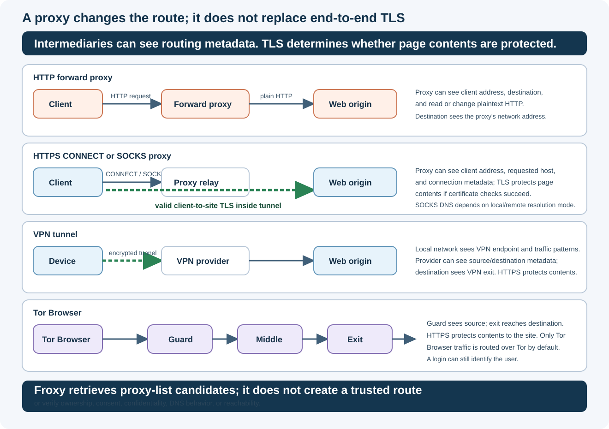

# Proxy Types, DNS Leaks and Froxy Research Reference

_Last reviewed: 2026-11-18 (official project docs and protocol references checked; no third-party proxy was tested)_

> [!CAUTION]
> **Authorized use only.** This reference is for owned lab environments,
> permitted OSINT research and assessing the confidentiality of your own
> network clients. **Never route sensitive client data, credentials, browser
> sessions, incident artifacts, or journalists' source material through
> anonymous public proxies.** A proxy is not an anonymity guarantee.
> See [Legal terms](../LEGAL.md).

**Prerequisites:** [OPSEC overview](README.md) ·
[Anonymity layering](anonymity-layering.md) ·
[VPN guide](../Documentation/VPN.md) ·
[Tor guide](../Documentation/TOR.md).

## What Froxy actually does

[Froxy](https://github.com/matheusfelipeog/froxy) is an MIT-licensed Python
package for retrieving/filtering listings of **free public proxies**. Its
upstream README says it consumes the
[clarketm/proxy-list](https://github.com/clarketm/proxy-list) feed. It
provides filtering by country, claimed anonymity class, protocol and whether
a proxy passed a Google-specific check. Its documentation also warns that many
returned addresses do not work.

**This is a proxy *discovery library*, not a VPN service, a Tor client, a
secure managed proxy provider, a security audit or a validated anonymity
mechanism.** The source's `N / A / H` categories and `HTTP/HTTPS` labels
describe metadata in the public list; they do **not** prove confidentiality,
lack of logging, trusted ownership, TLS correctness or that your real identity
cannot be correlated.

Use case: learning about open-proxy inventories in a **disposable lab**,
studying proxy-list reliability, or building a list-quality experiment with
synthetic requests to hosts you control. This repository does not endorse
Froxy for source protection, engagement infrastructure, credentials or
production scraping.

## Compare the layers

| Layer | What it may do | Critical limitation / correct use |
| --- | --- | --- |
| HTTP forward proxy | Relay HTTP requests; may use CONNECT for HTTPS | Plain HTTP content is visible to the proxy. With CONNECT to a TLS site, it still sees the client address, requested host, and connection metadata; valid end-to-end TLS protects the page contents unless an interception certificate is trusted. |
| HTTPS proxy | Protect the client-to-proxy hop with TLS | The proxy still sees connection and destination metadata. A CONNECT tunnel can carry separate client-to-site TLS; verify the destination certificate and understand any TLS interception. |
| SOCKS5 proxy | Relay supported TCP connections; SOCKS5 also defines UDP association | SOCKS does not encrypt application data. DNS location depends on the client mode (`socks5h` sends the hostname to the proxy); use destination TLS separately. |
| SSH dynamic tunnel | Forward supported client connections through an authenticated SSH session | The local-to-server hop is protected by SSH. The VPS still sees destination metadata and any non-TLS content; enforce client scope and egress logging for active testing. |
| VPN | Tunnel traffic selected by the device or app configuration to the VPN operator | The local network sees the VPN endpoint and traffic patterns; the provider may see source and destination metadata. Apps outside the tunnel may bypass it; destination TLS remains separate. |
| Tor Browser / Whonix | Route Tor Browser traffic or configured Workstation traffic through Tor | The guard sees the source network address; the exit reaches the destination. HTTPS separately protects page contents. Other apps are not automatically covered by Tor Browser; use documented architecture. |



*Conceptual routes only: actual visibility depends on client and server configuration. A valid TLS connection protects application contents to the destination; intermediaries can still see some routing metadata.*

**Priority:** trusted system design and task separation first. A chain
of arbitrary free proxies can **increase**, not reduce, the number of
untrusted parties who can observe traffic.

## Proxy choice for PNWC workflows

- **Client-authorized active assessment:** use a fixed, agreed egress
  (such as an allowlisted VPS / VPN gateway) with an audit trail. Do not
  rotate public proxies; authorization and customer logs matter.
- **Passive OSINT:** prefer a separately managed research VM and a vetted
  VPN or, where appropriate, Tor Browser. If a contracted residential
  proxy is authorized, verify sourcing, jurisdiction, access logs and
  data-processing terms.
- **Journalist, whistleblower or confidential-source workflow:** use
  trusted, well-documented privacy tools and independent threat modeling,
  not Froxy or anonymous public proxy lists.
- **Safe network lab:** local HTTP proxy for app behavior testing, or a
  trusted SSH SOCKS proxy to an **owned** host. Keep all test data synthetic.

## Read-only test commands for a trusted local proxy

These examples **do not discover or select public proxies**. Replace
`approved-gateway.example` with an SSH server you operate. The SSH
command opens a local SOCKS listener and stays running; stop it when the
lab ends. Do not assume every application uses the proxy.

```bash
# Create a SOCKS5 proxy on local loopback via a gateway you administer.
ssh -N -D 127.0.0.1:1080 analyst@approved-gateway.example

# In a separate terminal: remote DNS resolution through SOCKS.
curl --max-time 15 --fail --silent --show-error \
  --socks5-hostname 127.0.0.1:1080 \
  https://example.com/ -o /dev/null

# Tor daemon example ONLY when Tor has been installed/configured.
curl --max-time 15 --fail --silent --show-error \
  --socks5-hostname 127.0.0.1:9050 \
  https://check.torproject.org/api/ip
```

The `--socks5-hostname` option sends hostname resolution through the proxy
rather than resolving locally. The exit-IP response, if any, proves only
that **one request** used a certain route, not that DNS, UDP, WebRTC,
raw-socket scanners or another process cannot leak.

If your workflow uses Python `requests`, the
[Requests proxy documentation](https://requests.readthedocs.io/en/latest/user/advanced/#proxies)
and `requests[socks]` extras explain SOCKS support; `socks5h://`
requests remote DNS, while `socks5://` resolves locally. Do not disable
TLS verification to force a proxy to work. Note that environment proxy
variables, `NO_PROXY` rules and application-specific behavior can override
your intended network path.

## Froxy interface: documentation-only illustration

The upstream project documents a public-list discovery interface:

```python
from froxy import Froxy

# Research only, in a disposable VM; may fetch an external public list.
inventory = Froxy()
https_candidates = inventory.https()
us_candidates = inventory.country("US")
claimed_high_anonymity = inventory.anonymity("H")

# Do NOT automatically select or connect through these proxies.
print("Candidate count:", len(https_candidates))
```

The above is adapted as an **illustrative API usage sketch**, not a
runtime-tested integration. Fetching a public list leaks your IP to the
feed host and the values may be outdated, malicious, malformed or
inaccessible. Do not treat `.https()` or `.anonymity("H")` as a security
control. Froxy's PyPI package and source may have changed since its README
examples; examine dependencies, provenance and installed API before use.
No package or proxy has been installed or configured in this repo.

## Validation and leak-prevention checklist

- Confirm the proxy belongs to a trusted party, its protocol, egress IP,
  credentials, logging and retention agreement.
- Verify **TLS certificate validation** stays enabled; never bypass errors
  simply to route through a proxy.
- Inspect resolver behavior and confirm whether DNS goes through the
  proxy (for SOCKS, check the hostname-resolution mode).
- Test IPv4 and IPv6, browser WebRTC and non-HTTP traffic separately.
  A SOCKS proxy does not transparently catch UDP, raw packets or
  arbitrary binaries.
- Avoid proxy credentials in shell history, debug logs, process listings
  and committed configuration.
- Use a dedicated lab profile/VM for experimental proxy traffic; never
  share cookies or client credentials with that environment.
- Verify target scope, terms and permission. Do not bypass access controls
  or terms by rotating public exit addresses.
- Log the stable, client-approved exit for authorized active tests and
  distinguish failures/timeouts from successful routing.

## Sources and related guides

- [Froxy source and documentation](https://github.com/matheusfelipeog/froxy)
  ([MIT license](https://github.com/matheusfelipeog/froxy/blob/master/LICENSE)).
- [clarketm/proxy-list](https://github.com/clarketm/proxy-list)
  (upstream feed; list health is unverified here).
- [RFC 9110, CONNECT method](https://www.rfc-editor.org/rfc/rfc9110.html#name-connect) and [RFC 1928, SOCKS5](https://datatracker.ietf.org/doc/rfc1928/) — proxy tunneling protocols.
- [Tor Browser traffic scope](https://support.torproject.org/tor-browser/features/managing-identities/) — only Tor Browser traffic is routed over Tor by default.
- [RFC 9110, CONNECT method](https://www.rfc-editor.org/rfc/rfc9110.html#name-connect) and [RFC 1928, SOCKS5](https://datatracker.ietf.org/doc/rfc1928/) — proxy tunneling protocols.
- [Tor Browser traffic scope](https://support.torproject.org/tor-browser/features/managing-identities/) — only Tor Browser traffic is routed over Tor by default.
- [curl proxy options](https://curl.se/docs/manpage.html).
- [Python Requests proxy guide](https://requests.readthedocs.io/en/latest/user/advanced/#proxies).
- [Tor documentation](https://support.torproject.org/) and
  [Whonix documentation](https://www.whonix.org/wiki/Documentation).
- [Anonymity-layering decision guide](anonymity-layering.md) ·
  [Tor/Proxychains guide](../Documentation/TOR.md) ·
  [VPN guide](../Documentation/VPN.md) ·
  [OSINT section](../OSINT/README.md) ·
  [Press and source safety](press-freedom/device-network-protection.md).

---

[OPSEC index](README.md) · [Main guide](../README.md) ·
[Legal notice](../LEGAL.md)
