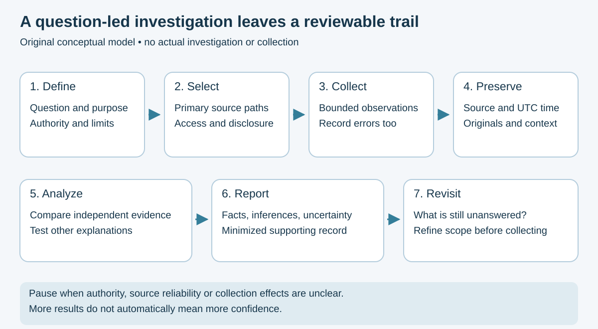
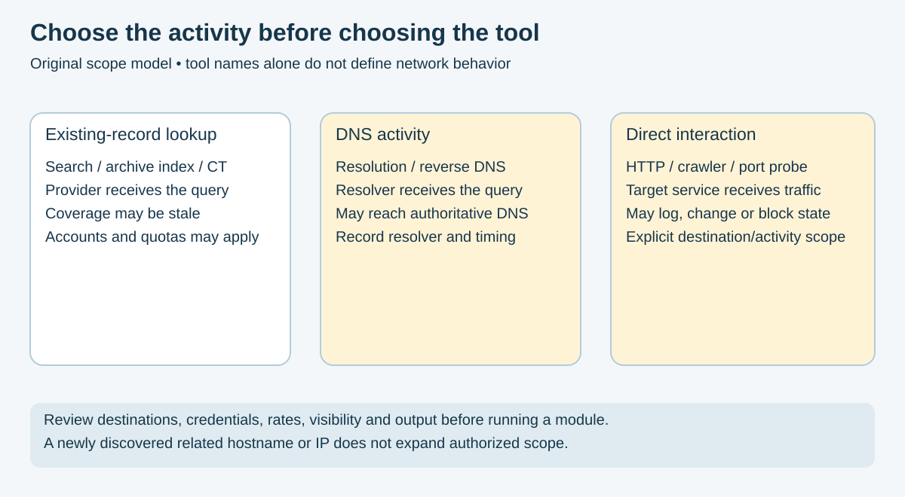
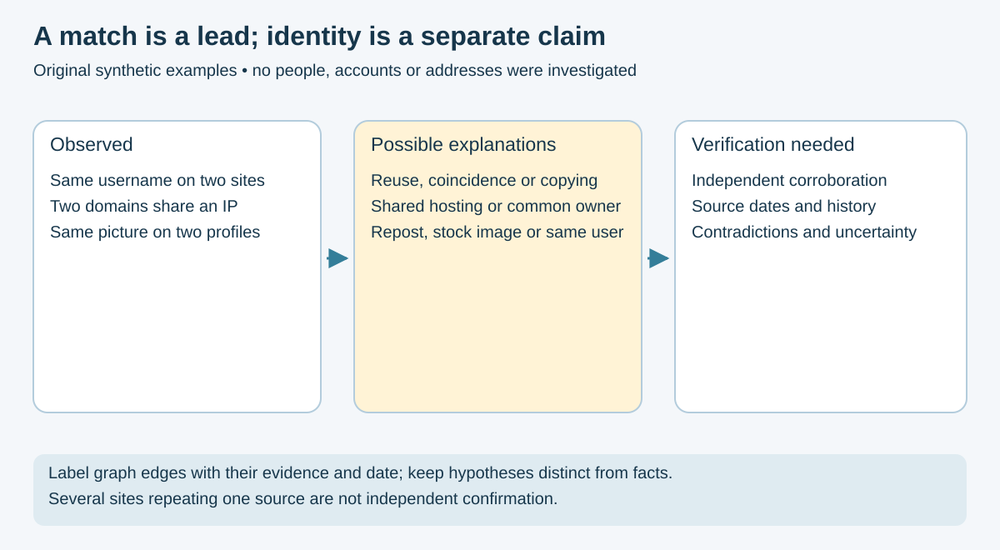
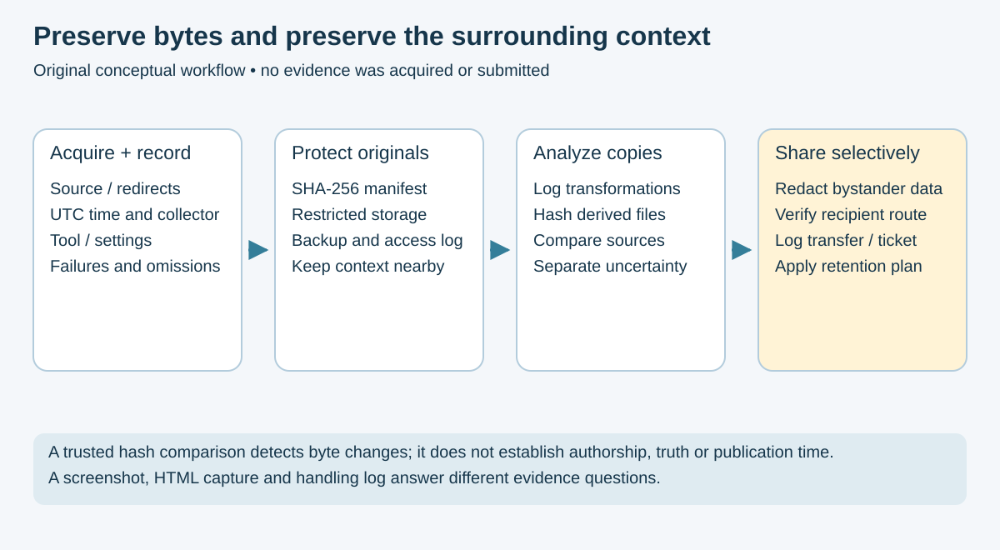
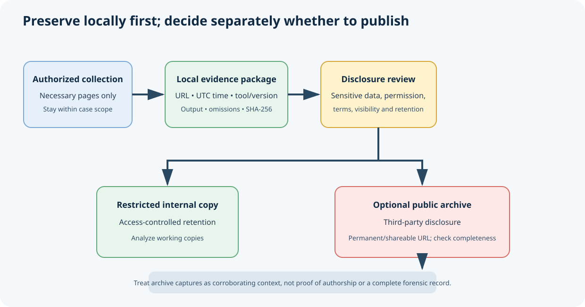

# OSINT (Open Source Intelligence) Basic/General Guide

**Source and visual review:** November 17, 2026. This is a source-reviewed reference, not an executed investigation. No tools were installed, accounts created, targets contacted, identifier APIs queried or reports submitted. Check installed versions and provider terms before use.

### [Click Here For The Advanced OSINT Guide](../Tradecraft/osint-threat-intel.md) 

**Companion directory:** [Curated Awesome OSINT List](awesome-osint-list-curated.md) maps additional public-record, imagery, geographic, transport and evidence services into scoped investigation workflows.

## 🎯 Purpose

Master reference for OSINT - methodology, a categorized tool reference, investigation VM setup, per-identifier investigation procedures, evidence handling, and legal/OPSEC guidance. This is the foundational/general guide; [../Tradecraft/osint-threat-intel.md](../Tradecraft/osint-threat-intel.md) (linked above) is the advanced, threat-intelligence-focused counterpart. Within this folder, [OSINT_CHEATSHEET.md](OSINT_CHEATSHEET.md) is the condensed command-only version of this same material.

## ⚙️ Function

Twelve sections moving from OSINT theory (the intelligence cycle, framework categories) through tool reference (organized by identifier type: email, username, domain, phone), VM setup (Buscador, Trace Labs, Tsurugi), per-identifier investigation procedures and full workflows, then evidence preservation, abuse reporting, OPSEC, and legal considerations - ending in a quick-reference cheat sheet.

## 🏆 Goal

Plan scoped research, select sources, distinguish leads from verified findings and report evidence with its limitations. No single tool covers every identifier or jurisdiction.

## 📋 When to Use

- Learning OSINT methodology and the intelligence cycle for the first time
- Setting up an OSINT investigation VM or looking up which tool covers a given identifier type
- Reference for legal/OPSEC requirements before starting any investigation

## Table of Contents

1. [Introduction to OSINT](#introduction-to-osint)
2. [OSINT Methodology & Framework](#osint-methodology--framework)
3. [Core OSINT Tools](#core-osint-tools)
4. [OSINT by Category](#osint-by-category)
5. [OSINT VM Setup](#osint-vm-setup)
6. [Investigation Procedures by Identifier Type](#investigation-procedures-by-identifier-type)
7. [Investigation Workflows](#investigation-workflows)
8. [Evidence Preservation & Chain of Custody](#evidence-preservation--chain-of-custody)
9. [Abuse Reporting Workflow](#abuse-reporting-workflow)
10. [OSINT Best Practices & OPSEC](#osint-best-practices--opsec)
11. [Legal & Ethical Considerations](#legal--ethical-considerations)
12. [Resources & Learning](#resources--learning)

---

## Introduction to OSINT

**Open Source Intelligence (OSINT)** refers to the collection and analysis of information gathered from publicly available sources. OSINT is used across multiple domains including:

- **Cybersecurity**: Threat intelligence, vulnerability research, and attack surface mapping
- **Law Enforcement**: Investigations, missing persons cases, and criminal intelligence
- **Corporate Security**: Competitor analysis, due diligence, and brand protection
- **Journalism**: Investigative reporting and fact-checking
- **Personal Security**: Background checks and reputation monitoring

### What Makes Intelligence "Open Source"?

- **Publicly accessible data** from the internet, social media, public records
- Public availability describes access; it does not establish accuracy, consent, lawful processing or permission to republish.
- Collect within documented authority, purpose and retention limits; do not bypass access controls.
- Distinguish existing-record lookups, DNS requests and direct target interaction.

---

## OSINT Methodology & Framework

### The OSINT Cycle

*Figure 1 — Original conceptual cycle based on [Bellingcat's toolkit](https://bellingcat.gitbook.io/toolkit/) and the [source-verification guide](bellingcat-source-verification.md); no real investigation is depicted.*

~~~
1. Requirements Definition
   └─> Define objectives and intelligence questions

2. Source Identification  
   └─> Identify relevant data sources

3. Data Collection
   └─> Gather information from sources

4. Data Processing
   └─> Organize, filter, and prepare data

5. Analysis
   └─> Connect dots, identify patterns

6. Dissemination
   └─> Present findings in actionable format

7. Feedback
   └─> Refine approach based on results
~~~

### OSINT Framework Structure

The OSINT Framework categorizes investigations by:
- **Username** - Social media presence, online accounts
- **Email Address** - Account enumeration, breach data
- **Domain Name** - DNS records, WHOIS, website info
- **IP Address** - Geolocation, network information
- **Phone Number** - Carrier lookup, social media links
- **Person** - Public records, social profiles
- **Company** - Corporate records, employees, infrastructure
- **Cryptocurrency** - Wallet tracing, scam database lookups

---

## Core OSINT Tools

*Figure 2 — Original scope model informed by [theHarvester's activity definitions](https://github.com/laramies/theHarvester#activity-and-scope). Querying a provider still discloses the query to it; classification depends on selected options and modules.*

Examples are illustrative. `example.test`, `example.invalid` and documentation IPs are placeholders; replace them only with an approved target for the specific activity. A discovered related asset is not automatically in scope. Record exact versions, settings, outcomes and errors. No network examples were executed.

### Email & Username Investigation

#### **theHarvester**

~~~bash
# Inspect installed options and available sources first.
theHarvester -h
# Bounded provider lookup; placeholder requires an approved replacement.
theHarvester -d example.test -l 50 -b crtsh,certspotter
~~~

- **Use Case**: Domain-related leads from provider datasets. DNS and direct actions require separate scope.
- **Version note**: [Current upstream](https://github.com/laramies/theHarvester) uses Python 3.14 and `uv`; packaged versions can differ. Old hard-coded `google`, LinkedIn and Twitter source assumptions are unreliable. Use the installed catalog and source outcome records.
- **Limit**: A source error, partial result and successful zero-result query are different outcomes.

#### **Sherlock**

~~~bash
# Search for username across social media platforms
sherlock username

# Export results to file
sherlock username -o results.txt

# Search specific sites
sherlock username --site GitHub
~~~

- **Use Case**: Candidate profiles from the installed site database. Coverage and false positives change; a username match is not identity verification.
- **GitHub**: https://github.com/sherlock-project/sherlock

#### **Maigret**

~~~bash
# Candidate profile discovery; compare coverage and errors
maigret username

# Username permutations; may expand collection scope
maigret username --permute

# Full export with reports
maigret username --pdf --html --folderoutput ./username_results/
~~~

- **Use Case**: Candidate profiles and public profile data; site coverage changes.
- **Flags**: [The option reference](https://github.com/soxoj/maigret/blob/main/docs/source/command-line-options.rst) distinguishes `--permute` from `--use-disabled-sites`; the latter enables disabled definitions and may increase false positives.
- **GitHub**: https://github.com/soxoj/maigret

#### **Blackbird**

~~~bash
# Username enumeration - alternative/complement to Sherlock & Maigret
python blackbird.py --username username
~~~

- **Use Case**: Candidate username/email profiles; coverage overlaps other tools.
- **Identity/launch**: The old p1ngul1n0 URL redirects to antoniaci/blackbird. Source instructions use `python blackbird.py`; a global `blackbird` wrapper is not assumed. Review optional AI/export data flows before enabling them.
- **GitHub**: https://github.com/antoniaci/blackbird

#### **H8mail**

~~~bash
# Email OSINT & breach hunting
h8mail -t research@example.invalid

# Provider keys use named configuration fields, not a universal bare key.
h8mail -t research@example.invalid -c /path/to/protected-h8mail-config.ini

# Export results to CSV
h8mail -t research@example.invalid -o breach_results.csv
~~~

- **Use Case**: Authorized breach-exposure review. Provider support and permitted use vary; minimize secrets collected or exported. A hit does not prove current compromise.
- **GitHub**: https://github.com/khast3x/h8mail

#### **Holehe**

~~~bash
# Check if email is used on different sites
holehe research@example.invalid

# Filter positive service responses; errors and false positives remain possible
holehe research@example.invalid --only-used
~~~

- **Use Case**: Possible registration inferred from service responses, not authoritative ownership. This directly interacts with services; review scope and request effects.
- **GitHub**: https://github.com/megadose/holehe

### Phone Number Intelligence

#### **PhoneInfoga**

~~~bash
# Phone number OSINT
phoneinfoga scan -n +1234567890
~~~

- **Use Case**: Number-format, carrier and external-source leads; scanners require configuration.
- **Status**: [Upstream](https://github.com/sundowndev/phoneinfoga) declares the project stable but unmaintained. Provider compatibility is unverified.
- **Limit**: No precise device location or guaranteed owner/social-account identification.
- **GitHub**: https://github.com/sundowndev/phoneinfoga

### Domain & Network Reconnaissance

#### **Recon-ng**

~~~bash
# Full-featured web reconnaissance framework
recon-ng
[recon-ng][default] > workspaces create target_company
[recon-ng][target_company] > marketplace search
# Inspect a selected module's behavior and dependencies before installing.
[recon-ng][target_company] > modules search
~~~

- **Use Case**: Comprehensive reconnaissance automation
- **Modules**: DNS, WHOIS, breaches, social media, more
- **GitHub**: https://github.com/lanmaster53/recon-ng

#### **Amass**

~~~bash
# Review the selected major version's help before constructing a run.
amass -h
~~~

- **Use Case**: Asset discovery using provider information and active reconnaissance.
- **Version note**: [Current source](https://github.com/owasp-amass/amass) uses module path `github.com/owasp-amass/amass/v5`. Match [the documentation](https://owasp-amass.github.io/docs/) to the installed release; old v4 install lines and historic `enum -passive`/`-brute` recipes are not universal.
- **Scope**: Review DNS behavior, sources and direct actions. Passive provider queries still disclose the target string.

#### **Subfinder**

~~~bash
# Fast subdomain discovery
subfinder -d example.test

# With specific sources
subfinder -d example.test -sources virustotal,shodan

# Silent output for piping
subfinder -d example.test -silent
~~~

- **Use Case**: Subdomain enumeration for attack surface mapping
- **GitHub**: https://github.com/projectdiscovery/subfinder

#### **httpx (ProjectDiscovery)**

Use the [ProjectDiscovery binary/documentation](https://github.com/projectdiscovery/httpx), which is distinct from the Python HTTPX library. These probes contact targets directly; technology labels are heuristic and do not prove vulnerabilities.

~~~bash
# Probe live hosts and fingerprint web stack
httpx -l subdomains.txt -td -server -title -asn -status-code

# Single target with technology detection
echo example.test | httpx -td -server -title

# Pipeline: subfinder → httpx
subfinder -d example.test -silent | httpx -td -server -title -asn
~~~

- **Use Case**: Live host probing, tech stack fingerprinting, ASN lookup
- **Pairs With**: subfinder → httpx pipeline for attack surface mapping
- **GitHub**: https://github.com/projectdiscovery/httpx

#### **waybackurls**

~~~bash
# Retrieve archive-index URL candidates; not a complete history
echo example.test | waybackurls > historical_urls.txt

# Combined with subfinder for full historical surface
subfinder -d example.test -silent | waybackurls | sort -u
~~~

- **Use Case**: Historical URL candidates, with incomplete coverage. An archived URL does not establish current availability or permission to request it.
- **GitHub**: https://github.com/tomnomnom/waybackurls

#### **asn (CLI Tool)**

~~~bash
# One-shot ASN, network range, and abuse contact lookup
asn 8.8.8.8
asn example.test
~~~

- **Use Case**: Quick ASN identification, abuse email discovery for reporting
- **GitHub**: https://github.com/nitefood/asn

### Web Crawling & Analysis

#### **Photon**

~~~bash
# Incredibly fast web crawler for OSINT
python photon.py -u https://example.test -o output -l 1 -t 2

# Extract specific data types
python photon.py -u https://example.test --dns --keys
~~~

- **Use Case**: URL extraction, JavaScript files, endpoint discovery
- **Scope**: Crawling contacts target resources; bound depth, concurrency and destinations. The inspected parser has no `--emails` option; extraction is part of its behavior.
- **GitHub**: https://github.com/s0md3v/Photon

#### **SpiderFoot**

~~~bash
# Automated OSINT collection
python3 sf.py -h
~~~

- **Use Case**: Module-based collection; modules can be passive or active and may require keys.
- **Launch**: [Source instructions](https://github.com/smicallef/spiderfoot) use `python3 ./sf.py -l 127.0.0.1:5001` for a local UI. Inspect selected modules before scanning; a global `spiderfoot` wrapper is distribution-specific.
- **GitHub**: https://github.com/smicallef/spiderfoot

### Evidence Capture & Archival

#### **Monolith**

~~~bash
# Archive a webpage as a single self-contained HTML file (evidence preservation)
monolith https://example.test -o evidence_$(date -u +%Y%m%dT%H%M%SZ).html

# Remove scripts from the saved document; -j does not execute JavaScript.
monolith -j https://example.test -o archived.html
~~~

- **Use Case**: Single-file capture with omissions/transformations to document. [Monolith](https://github.com/Y2Z/monolith) has no built-in JavaScript engine; current source offers optional browser-assisted `-B`, which is version-specific and can make additional requests. Capture is not automatically complete or authenticated.
- **GitHub**: https://github.com/Y2Z/monolith

#### **CutyCapt**

~~~bash
# CLI screenshot capture for evidence
cutycapt --url=https://example.test --out=screenshot_$(date +%Y%m%d_%H%M%S).png
~~~

- **Use Case**: Headless screenshot capture, evidence documentation

#### **WaybackPy**

~~~bash
# Submit pages to the Wayback Machine for archiving
waybackpy --url "https://example.test" --save
~~~

- **Use Case**: Archive submission discloses the URL and may publish page content. Review disclosure/approval first. Archive copies corroborate context, not authorship or truth.
- **GitHub**: https://github.com/akamhy/waybackpy

### Link Analysis & Data Mining

#### **Maltego**

- **Use Case**: Visual link analysis, relationship mapping
- **Features**: Provider-dependent transforms; identifiers may be sent to external services.
- **Data Sources**: DNS, WHOIS, social media, public records
- **Plans**: Check [current Maltego plans](https://www.maltego.com/pricing/); legacy Classic/XL labels are not current purchase guidance.
- **Website**: https://www.maltego.com

### Additional Essential Tools

#### **Metagoofil**

- **Use Case**: [The maintained opsdisk fork](https://github.com/opsdisk/metagoofil) discovers and optionally downloads public documents. It delegates metadata analysis to other tools; the old `-f results.html` recipe describes a different implementation.

~~~bash
# Analyze already acquired local documents without uploading them.
exiftool -r ./approved-documents/
~~~

- **Limit**: Editable author/software/path fields may describe a template or processing system rather than a creator.

#### **WhatWeb**

~~~bash
# Website fingerprinting
whatweb example.test

# Aggressive mode
whatweb example.test -a 3
~~~

- **Use Case**: Identify web technologies, CMS, frameworks

---

## OSINT by Category

### Search Engines & Dorking

#### **Google Dorking**

~~~
site:example.test filetype:pdf
site:example.test inurl:admin
site:example.test intitle:"index of"
"@example.test" site:pastebin.com
site:*.example.test -www
~~~

#### **Specialized Search Engines**

- **Shodan** (https://shodan.io) - Search engine for Internet-connected devices
- **Censys** (https://censys.com) - Internet-wide scanning and analysis
- **GreyNoise** (https://greynoise.io) - Internet background noise intelligence
- **Hunter.io** (https://hunter.io) - Email finder and verification
- **Have I Been Pwned** (https://haveibeenpwned.com) - Breach notification service

#### **Additional Intelligence Platforms**

- **CriminalIP** (https://www.criminalip.io) - Cyber threat intelligence with IP/domain reputation
- **Netlas** (https://netlas.io) - Internet-wide scanning, similar to Shodan/Censys
- **FullHunt** (https://fullhunt.io) - Attack surface discovery and monitoring
- **ZoomEye** (https://www.zoomeye.ai) - Cyberspace search engine; coverage and access are provider-dependent.
- **AbuseIPDB** (https://www.abuseipdb.com) - Crowdsourced IP abuse database
- **SecurityTrails** (https://securitytrails.com) - DNS history, passive DNS, subdomain data
- **WhoisXML API** (https://whoisxmlapi.com) - WHOIS data + DNS intelligence
- **DNSDumpster** (https://dnsdumpster.com) - Free DNS recon and research
- **urlscan.io** (https://urlscan.io) - [Search existing scans or submit new ones](https://docs.urlscan.io/pages/api-intro). Submission visits the URL; visibility settings affect disclosure. Do not submit private/tokenized URLs without approval.
- **crt.sh** (https://crt.sh) - Certificate transparency log search

~~~bash
# Certificate transparency - find related domains via shared certs
curl -s "https://crt.sh/?q=%25.example.test&output=json" | jq '.[].name_value' | sort -u
~~~

### Social Media OSINT

#### **Tools**

- **Sherlock** - Username search across platforms
- **Social-Analyzer** - Profile analysis across social networks
- **X/social-platform interfaces** - Verify current official search/export/API access; old TweetDeck/TweetBeaver workflows are not a verified current collection path.
- **Instagram OSINT** tools (various)
- **LinkedIn** - Review permitted access and automation limits; do not assume scraping is allowed.

#### **Techniques**

- Username correlation across platforms
- Profile picture reverse image search
- Connection mapping and network analysis
- Metadata extraction from posts
- Geolocation from photos and posts

### Geolocation & Imagery

#### **Tools**

- **Google Earth Pro** - Historical imagery, elevation data
- **Google Street View** - Ground-level imagery
- **Yandex Maps** - Alternative mapping (strong in Russia/Eastern Europe)
- **Baidu Maps** - China-focused mapping
- **Bing Maps** - Microsoft's mapping service
- **EXIF data extractors** - Photo metadata analysis

#### **Techniques**

- Reverse image search (Google, Yandex, TinEye)
- Shadow analysis for time/location verification
- Landmark identification
- EXIF GPS coordinate extraction
- Cross-referencing multiple map sources

### Dark Web & Deep Web OSINT

#### **Access Tools**

- **Tor Browser** - Access .onion sites
- **I2P** - Alternative anonymous network
- **Tails OS** - Privacy-focused live operating system

#### **Search & Discovery**

- **Ahmia.fi** - .onion search engine
- Index coverage and service status vary. Check the operator's current documentation and approved environment; no search index is complete.
- **Hunchly** - Web capture tool, not a dark-web search engine.

### Company & Business Intelligence

#### **Sources**

- **Company registries** (state/national business databases)
- **SEC EDGAR** - US public company filings
- **LinkedIn** - Employee enumeration
- **Glassdoor** / **Indeed** - Company reviews, salaries
- **Crunchbase** - Startup and investment data
- **ZoomInfo** / **RocketReach** - Contact information databases

### Public Records & Government Data

#### **US Sources**

- **PACER** - Federal court records
- **State court systems** - Civil and criminal records
- **Property records** - County assessor databases
- **Corporate registrations** - Secretary of State databases
- **Professional licenses** - State licensing boards

### Breach Data & Leaked Information

#### **Tools & Databases**

- **Have I Been Pwned** - Email breach notification
- **DeHashed** - Breach search engine (paid)
- **LeakPeek** / **Snusbase** - Breach databases
- **IntelX** - Data breach search
- **Leak-Lookup** - Breach search engine
- **Pastebin monitoring** - Automated paste site scanning

### Cryptocurrency Intelligence

#### **Scam Databases**

- **ChainAbuse** (https://www.chainabuse.com) - Public reports to corroborate; allegations do not establish fraud or address ownership.
- **CryptoScamDB** (https://cryptoscamdb.org) - Known crypto scams and malicious addresses

#### **Blockchain Explorers**

- **blockchain.info** - Bitcoin blockchain explorer
- **Etherscan** (https://etherscan.io) - Ethereum blockchain explorer
- **BlockCypher** - Multi-chain explorer
- **OXT** / **Breadcrumbs** - Bitcoin cluster analysis tools

---

## OSINT VM Setup

### Recommended OSINT Distributions

#### **Buscador VM**

- **Creator**: Michael Bazzell (IntelTechniques)
- **Based on**: Ubuntu
- **Status**: Historical distribution; do not rely on unsupported images for current live work.
- **Use Case**: General OSINT investigations
- **Download**: Buscador was discontinued by IntelTechniques; no longer available. Consider Trace Labs OSINT VM or Tsurugi Linux as alternatives.

#### **Trace Labs OSINT VM**

- **Purpose**: Search and rescue operations
- **Tools**: Curated set for finding missing persons
- **Community**: Active Trace Labs community
- **Download**: https://docs.tracelabs.org/vm/vm-introduction

#### **CSI Linux**

- **Focus**: Digital forensics and OSINT
- **Features**: DFIR/OSINT tooling; verify the selected image and installed versions rather than assuming an update cadence.
- **Website**: https://csilinux.com

#### **Tsurugi Linux**

- **Focus**: DFIR (Digital Forensics and Incident Response), with a dedicated OSINT profile
- **Documented release (checked 2026-11-17)**: LAB 26.03, based on Ubuntu 24.04.3 LTS
- **OSINT Tools**: Comprehensive suite included; confirm the current installed versions before use
- **Website**: https://tsurugi-linux.org; verify [release downloads](https://tsurugi-linux.org/downloads.php/index.php) and [platform documentation](https://tsurugi-linux.org/documentation_tsurugi_linux_1.php).
- **Platform-specific setup and practical workflows**: [Tsurugi Linux OSINT Guide](TSURUGI_LINUX_OSINT_GUIDE.md)

### DIY OSINT VM Build

#### **Base System**

Use a supported guest/host release, verify the image through publisher checksums/signatures and record snapshot date and network mode. A snapshot aids recovery, not anonymity or evidence authentication.

Minimal Debian/Ubuntu starting packages, subject to the selected release:

~~~bash
sudo apt update
sudo apt install python3 python3-venv pipx git curl jq
~~~

OS upgrades and native build dependencies belong in an approved maintenance plan rather than a blind investigation setup.

#### **Install Core OSINT Tools**

Install one selected tool at a time using a publisher package, dedicated venv, `pipx` or reviewed container as supported upstream. Do not force system-wide pip changes in [externally managed environments](https://packaging.python.org/en/latest/specifications/externally-managed-environments/).

| Tool | Primary installation reference |
|------|--------------------------------|
| theHarvester | [README](https://github.com/laramies/theHarvester): current source uses `uv sync`; check the required Python and `uv run theHarvester -h`. |
| Sherlock | [Upstream](https://github.com/sherlock-project/sherlock) documents `pipx install sherlock-project`; verify `sherlock --help`. |
| Recon-ng | [Project/wiki](https://github.com/lanmaster53/recon-ng); do not assume a similarly named PyPI package is official. |
| SpiderFoot | [Source instructions](https://github.com/smicallef/spiderfoot); separate its environment and inspect modules. |
| Amass | [Current documentation](https://owasp-amass.github.io/docs/) must match the major version. |
| Photon, Maigret, h8mail, Holehe | Follow the source links above and record dependencies/provider configuration. |
| PhoneInfoga | [Unmaintained project](https://github.com/sundowndev/phoneinfoga); current compatibility is unverified. |

Record version/revision, environment and installation results. Directly invoking a venv interpreter makes activation optional. A venv separates packages; it does not sandbox untrusted code.

#### **Evidence & Archival Tools**

Follow [Monolith](https://github.com/Y2Z/monolith), [CutyCapt](https://cutycapt.sourceforge.net/) and [WaybackPy](https://github.com/akamhy/waybackpy) instructions matching the selected version. Record renderer/browser versions and output limitations. Install Python clients in their own environment. Local capture and public archive submission have different disclosure effects.

#### **Additional Utilities**

Select DNS/RDAP clients, `curl`, `jq`, ExifTool, media tools and hash utilities according to the plan. Verify distribution package names. Port scanners, high-speed network scanners and recursive crawlers are active tools, not requirements for reading public records.

### Automation Script

The former bulk installer mixed system pip changes, nested checkouts and unpinned releases, then printed success without verifying tools. Use a reviewed installation manifest:

| Record | Required context |
|--------|------------------|
| Identity | Canonical publisher/repository |
| Selected build | Release tag or full commit |
| Environment | OS, runtime and dependency lock/record |
| Method | Publisher package / venv / reviewed container |
| Local check | Version/help/import results, including errors |
| Approved behavior | Modules, destinations, limits and output path |

Automate only after one tool's setup works on the chosen platform. A successful `--help` does not establish reliable results or software security.

---

## Investigation Procedures by Identifier Type

*Figure 3 — Original synthetic entity-resolution model; see the [source-verification guide](bellingcat-source-verification.md). No real identities or personal records are depicted.*

### Email Investigation Procedure

#### Step 1: Account Discovery

~~~bash
# Find services where this email is registered
holehe research@example.invalid --only-used
~~~

#### Step 2: Breach Database Search

Use only accounts/data you are authorized to assess. [HIBP API v3](https://haveibeenpwned.com/API/v3) email search requires an appropriate key/subscription, descriptive user agent and rate-limit/error handling. URL-encode identifiers and protect keys from shell history/logs. Empty results and request failures do not establish no exposure.

`h8mail` may query providers or local data when configured; its ordinary target invocation is not inherently local-only. Do not test recovered credentials.

#### Step 3: Email Verification

[Hunter's verifier documentation](https://hunter.io/api-documentation/v2#email-verifier) describes provider output and limits. Verification can interact with mail servers; it does not prove a person's ownership or that a message was read. Minimize identifiers shared with third parties. No test email is required by this guide.

#### Step 4: Email Header Analysis

If you have the original email source:

1. Extract full headers from your email client
2. Analyze the `Received:` chain for routing path
3. Start with headers added by the receiving system you trust, then walk toward earlier hops only while the trust boundary is supported. The bottom-most `Received` line may be forged; it is not automatically the sender's IP.
4. Review receiver-generated **SPF / DKIM / DMARC** results and alignment; success does not establish content safety or an individual author.
5. Consider forwarding, mailing lists and legitimate envelope/header differences before treating a mismatch as spoofing proof.

**Primary references**: [SMTP trace fields, RFC 5321 §4.4](https://www.rfc-editor.org/rfc/rfc5321.html#section-4.4) and [Authentication-Results trust boundaries, RFC 8601](https://www.rfc-editor.org/rfc/rfc8601). Preserve the original message; avoid uploading private headers.

**Tools**: Prefer approved local analysis. Third-party analyzers receive what you upload.

#### Step 5: Domain Extraction

Extract the email's domain and proceed to the Domain Investigation Procedure.

---

### IP Address Investigation Procedure

#### Step 1: ASN and Abuse Contact

~~~bash
# One-shot ASN, network range, and abuse contact
asn 192.0.2.10
~~~

#### Step 2: Network Registration & Approximate Geolocation

Use these as **distinct** sources: RDAP is registration/allocation metadata; any commercial geolocation provider supplies an **estimate**, not a device's physical location. These examples use a public demonstration IP, not a customer asset.

~~~bash
# RDAP registration information; HTTPS bootstrap redirects, not geolocation.
curl --fail --silent --show-error --location \
  --proto '=https' --proto-redir '=https' --max-redirs 5 --max-time 30 \
  'https://rdap.org/ip/8.8.8.8' | jq

# Optional provider geolocation estimate; access, quotas, license and fields may vary.
# The queried address is disclosed to the provider.
curl --fail --silent --show-error --max-time 30 \
  'https://ipinfo.io/8.8.8.8/json' | jq
~~~

If a lookup fails or returns no result, record the error as **unverified**, not "no registration" or "no location". Check vendor terms before client use, and enable Bash `pipefail` when adapting these pipelines into automated evidence collection.

#### Step 3: Reputation Check

~~~bash
# AbuseIPDB
curl -s "https://api.abuseipdb.com/api/v2/check?ipAddress=192.0.2.10&maxAgeInDays=90" \
  -H "Key: YOUR_KEY" -H "Accept: application/json" | jq

# Shodan host details
curl -s "https://api.shodan.io/shodan/host/192.0.2.10?key=YOUR_KEY" | jq
~~~

#### Step 4: Reverse DNS & Port Discovery

~~~bash
# Resolver request about a documentation IP, not ownership/geolocation proof.
dig -x 192.0.2.10 +short
~~~

Port discovery contacts a destination. Use a separate active-assessment plan with explicit hosts, rates and timing; a public-record lookup does not authorize scanning. Record ASN, source/date, uncertainty and contact roles without equating allocation with the responsible person.

---

### Domain Investigation Procedure

#### Step 1: WHOIS & Registrar Identification

Start with authoritative RDAP and the registrar's verified abuse channel. [ICANN explains RDAP's replacement of WHOIS](https://www.icann.org/rdap); WHOIS availability varies. Registration, hosting and content responsibility are different roles. Redacted registration is not evidence of wrongdoing.

Record query source/time, registrar and its advertised reporting channel; verify that provider's reporting requirements.

#### Step 2: DNS Record Collection

~~~bash
dig +short example.test A
dig +short example.test MX
dig +short example.test TXT
dig +short example.test NS
~~~

#### Step 3: Subdomain Enumeration + Live Probe

~~~bash
subfinder -d example.test -silent -o subs.txt
cat subs.txt | httpx -td -server -title -asn
~~~

#### Step 4: Historical Analysis

~~~bash
# Historical URLs
echo example.test | waybackurls > historical_urls.txt

# Certificate transparency - find related domains
curl -s "https://crt.sh/?q=%25.example.test&output=json" | jq
~~~

#### Step 5: Tech Stack & Content Discovery

~~~bash
whatweb https://example.test
~~~

---

### Cryptocurrency Investigation Procedure

#### Step 1: Address Type Identification

Prefixes below are **non-exhaustive hints**, not validators or proof of chain/owner. Validate the full address and checksum using chain-specific documentation. EVM addresses can occur on multiple chains; record network and asset explicitly.

| Cryptocurrency | Address Format |
|----------------|----------------|
| **Bitcoin** | Starts with `1`, `3`, or `bc1` |
| **Ethereum** | Starts with `0x` followed by 40 hex chars |
| **Litecoin** | Legacy `L`/`M` and SegWit `ltc1`; historical formats can overlap other chains |
| **Monero** | Standard/subaddress hints `4`/`8`; integrated/network-specific forms differ |
| **Solana** | Base58-encoded 32-byte account address (public key or PDA); length alone is not validation |

Primary format references: [Litecoin addresses](https://litecoin.info/docs/key-concepts/addresses-prefixes), [Monero address forms](https://www.getmonero.org/resources/moneropedia/address.html), [Solana accounts](https://solana.com/docs/core/accounts). These describe encoding, not identity.

#### Step 2: Scam Database Lookups

Public reports supply leads, including mistaken/stale claims. Absence of a report does not clear an address.
- **ChainAbuse**: https://www.chainabuse.com/address/ADDRESS
- **CryptoScamDB**: https://cryptoscamdb.org/search

#### Step 3: Blockchain Explorer Analysis

**Bitcoin:**

~~~bash
curl -s "https://blockchain.info/rawaddr/ADDRESS?limit=50" | jq
~~~

**Ethereum (Etherscan API):** [v2 transaction endpoint](https://docs.etherscan.io/api-reference/endpoint/txlist). This normal-transaction query is not every possible activity type; check pagination and token/internal endpoints.

~~~bash
# Etherscan v2 uses chainid (1 = Ethereum mainnet); review access, pagination and response status.
curl -s "https://api.etherscan.io/v2/api?chainid=1&module=account&action=txlist&address=ADDRESS&apikey=YOUR_KEY" | jq
~~~

**Examine:**
- Total received / sent
- Number of transactions
- First and last transaction timestamps
- Current balance
- Linked addresses (transaction graph)

#### Step 4: Transaction Tracing

For significant addresses:
1. Record observed transactions with chain, hash, block, time and confirmation state.
2. Distinguish native transfers, tokens, fees and contract/internal activity; paginate before claiming totals.
3. Treat exchange labels and clustering as provider claims with source/date, not established identities.
4. Consider custodial wallets, CoinJoin, contract routers and alternative explanations. A transaction edge does not prove common ownership.

#### Step 5: Documentation

Record:
- Full address (case-sensitive for some chains)
- Blockchain type and explorer URL
- Total value transacted (in crypto and approx. fiat)
- Scam database results (with screenshots)
- Transaction screenshots with timestamps

---

### Phone Number Investigation Procedure

#### Step 1: Number Validation & Carrier

~~~bash
phoneinfoga scan -n "+12025550123"
~~~

#### Step 2: Programmatic Carrier Lookup

The [local library](https://github.com/daviddrysdale/python-phonenumbers) parses numbering-plan metadata, not current subscribers or devices. [libphonenumber's FAQ](https://github.com/google/libphonenumber/blob/master/FAQ.md) distinguishes validity from assignment/reachability and explains portability limits.

~~~python
import phonenumbers
from phonenumbers import carrier, geocoder

pn = phonenumbers.parse("+12025550123")
print(carrier.name_for_number(pn, 'en'))
print(geocoder.description_for_number(pn, 'en'))
~~~

#### Step 3: VoIP Detection

Line-type/carrier labels may be stale or incomplete, particularly after number portability. VoIP has legitimate uses and does not establish fraud. Scanner results need provider context; no universal VoIP or owner-detection guarantee applies.

#### Step 4: Social Media Cross-Reference

- Search the number on major social platforms (some allow phone search)
- Truecaller (manual web check)
- Reverse phone lookup services

---

### Username Investigation Procedure

#### Step 1: Wide Net - Maigret (2500+ sites)

The numeric heading is retained for navigation; it is historical, not guaranteed coverage. Choose a bounded approved site set.

~~~bash
maigret target_username --pdf --html --folderoutput ./username_results/
~~~

#### Step 2: Fast Verification - Sherlock (400+ sites)

The numeric heading is historical. Enumeration supplies candidate matches, not identity verification.

~~~bash
sherlock target_username --csv
~~~

#### Step 3: Additional Coverage - Blackbird

~~~bash
python blackbird.py --username target_username
~~~

#### Step 4: Manual Profile Verification

For each discovered profile:
1. **Bio/Description**: contact info, links, claims
2. **Profile Photo**: reverse image search (Google, Yandex, TinEye)
3. **Post History**: timeline, posting patterns, time zones
4. **Connections**: friends, followers, group memberships
5. **Activity**: frequency, language patterns, devices

---

## Investigation Workflows

### Workflow 1: Person Investigation

Document legitimate purpose and authority/consent, minimize bystander data and define access/retention limits. Username reuse, names, photos and timestamps can mislead. Annotate relationships with supporting evidence and alternative explanations.

~~~
1. Start with Known Information
   └─> Name, email, username, location

2. Username Enumeration
   └─> Sherlock / Maigret / Blackbird across social platforms

3. Email Investigation
   └─> Holehe (potential registration indicators)
   └─> H8mail (breach data)
   └─> theHarvester (associated domains)

4. Social Media Deep Dive
   └─> Profile analysis
   └─> Connection mapping
   └─> Content timeline review

5. Phone Number (if available)
   └─> PhoneInfoga for carrier/validation
   └─> Social media association

6. Geolocation Analysis
   └─> Photo EXIF data
   └─> Check-ins and tagged locations
   └─> Google Maps / Street View verification

7. Compile Timeline
   └─> Chronological activity mapping
   └─> Pattern identification

8. Report Generation
   └─> Document findings
   └─> Visualize relationships (Maltego)
~~~

### Workflow 2: Domain/Company Investigation

~~~
1. Initial Reconnaissance
   └─> Authoritative RDAP / available WHOIS context
   └─> DNS enumeration

2. Subdomain Discovery
   └─> Amass (comprehensive)
   └─> Subfinder (provider-backed discovery)
   └─> Certificate transparency logs (crt.sh)

3. Live Host Probing
   └─> httpx (tech stack + ASN)
   └─> WhatWeb (technology fingerprint)

4. Email Harvesting
   └─> theHarvester (emails from domain)
   └─> LinkedIn (employee enumeration)

5. Web Application Analysis
   └─> Photon (crawling & endpoint discovery)
   └─> waybackurls (historical data)
   └─> Wayback Machine (page history)

6. Employee Enumeration
   └─> Permitted public/company records within access rules
   └─> Email pattern identification
   └─> Social media presence

7. Infrastructure Mapping
   └─> Shodan / Censys (exposed assets)
   └─> IP ranges and netblocks
   └─> Cloud service identification

8. Breach Data Review
   └─> Have I Been Pwned
   └─> DeHashed / breach databases
   └─> Pastebin monitoring

9. Report & Visualization
   └─> Attack surface map
   └─> Risk assessment
   └─> Maltego relationship diagram
~~~

### Workflow 3: Threat Intelligence Gathering

~~~
1. IOC (Indicator of Compromise) Collection
   └─> IP addresses, domains, hashes

2. Passive DNS Analysis
   └─> Historical resolution data
   └─> Related infrastructure

3. Malware Analysis Research
   └─> Sandbox reports (ANY.RUN, Hybrid Analysis)
   └─> VirusTotal intelligence

4. Attribution Hypotheses (not established identities)
   └─> Dark web forums
   └─> Paste sites
   └─> Social media monitoring

5. Vulnerability Intelligence
   └─> CVE databases
   └─> Exploit-DB
   └─> GitHub repository searches

6. Infrastructure Correlation
   └─> Shared hosting analysis
   └─> SSL certificate tracking (crt.sh)
   └─> Registration context; privacy services alone do not attribute actors

7. Reporting & Sharing
   └─> IOC feeds
   └─> Threat reports
   └─> MISP/STIX format sharing
~~~

### Workflow 4: Scam / Fraud Investigation

~~~
1. Triage & Authorization
   └─> Document the complaint
   └─> Verify legal authority to investigate
   └─> Assign case ID (YYYY-NNN-TYPE)

2. Initial Identifier Collection
   └─> Email addresses, phone numbers, domains, URLs
   └─> Crypto wallet addresses
   └─> Social media handles
   └─> Bank account / payment processor info (if applicable)

3. Per-Identifier Investigation (parallel)
   ├─> Emails → holehe, h8mail, HIBP
   ├─> Phones → phoneinfoga, carrier lookup
   ├─> Domains → whois, dig, subfinder + httpx, waybackurls
   ├─> IPs → asn, geolocation, AbuseIPDB
   ├─> Usernames → maigret, sherlock, blackbird
   └─> Crypto → scam databases, blockchain explorers

4. Infrastructure Correlation
   └─> Shared hosting, SSL certs (crt.sh)
   └─> Common WHOIS data
   └─> Reused images / templates
   └─> Cross-referenced indicators

5. Evidence Preservation
   └─> Capture necessary pages and document omissions
   └─> Capture relevant views, minimizing bystander data
   └─> Hash retained originals and log handling
   └─> Public archive submission only after disclosure review

6. Report Generation
   └─> Executive summary
   └─> Per-identifier findings
   └─> Evidence inventory with hashes
   └─> Abuse contacts compiled

7. Abuse Reporting
   └─> Registrar takedown request
   └─> Hosting provider notification
   └─> Email/social platform reports
   └─> IC3 submission (if applicable)

8. Follow-Up & Closure
   └─> Track response from each report
   └─> Re-verify takedowns
   └─> Update case file
   └─> Archive case
~~~

---

## Evidence Preservation & Chain of Custody

### Golden Rules

1. Preserve necessary original acquisitions and hash them promptly with SHA-256.
2. Record collector, source URL/identifier, UTC time, time source, tool/version, options, access context, request failures and omissions.
3. Log every transfer, access and transformation; work on copies and hash derived outputs separately.
4. Store protected originals and backups with access controls and encryption appropriate to sensitivity.
5. Recheck integrity against a trusted manifest. A hash detects byte changes relative to that manifest; it does not prove when, where or by whom content was published.

*Figure 4 — Original conceptual handling model, informed by [NIST's Secure Hash Standard](https://csrc.nist.gov/pubs/fips/180-4/upd1/final) and [source verification](bellingcat-source-verification.md). Hashes support integrity comparisons; provenance and interpretation require additional evidence.*

### Web Page Archival Procedure

Capture only necessary authorized material. HTML and screenshots are complementary views, not complete replicas of every interaction. Keep the original URL, redirects, capture timestamps, renderer/version and known missing resources with the files. Use UTC file naming:

~~~bash
# Illustrative network capture: requires approved destination and disclosure scope.
stamp=$(date -u +%Y%m%dT%H%M%SZ)
monolith https://example.test -o "evidence_${stamp}.html"
cutycapt --url=https://example.test --out="screenshot_${stamp}.png"

# Local hash manifest; inspect that the intended files exist first.
sha256sum "evidence_${stamp}.html" "screenshot_${stamp}.png" > "hashes_${stamp}.txt"
~~~

Review output and exit status; preserve partial/failure states separately. Protected storage and custody records must protect the hash manifest too. A screenshot alone does not establish the original publication time.

Preserve a local, access-controlled capture first, and record the requested URL, redirects, UTC capture time, collector/tool version, result, known omissions and SHA-256. Review the content for personal or restricted data, client rules, terms and authorization before any third-party submission. Use a public archive only when its visibility, retention and disclosure risks are acceptable and authorized. Public saves may create permanent, shareable URLs; dynamic, authenticated or blocked content can be incomplete. Screenshots and HTML captures preserve different views, and neither guarantees a complete reproduction. Treat archive availability as corroborating context, not forensic certification or proof of authorship.

*Public archive submission is a separate disclosure decision; verify capture completeness and preserve the original local capture and its handling record.*

### Suggested Case Structure

A consistent directory structure for each investigation:

~~~
~/OSINT_Cases/
└── CASE-ID/
    ├── case_info.md              # Metadata, objectives, authorization
    ├── case_notes.md             # Investigation notes, timeline
    ├── evidence_log.md           # Chain of custody table
    ├── evidence/
    │   ├── screenshots/
    │   ├── archives/             # monolith HTML, wget mirrors
    │   ├── files/                # downloaded artifacts
    │   └── hashes/               # SHA256 manifests
    ├── reports/
    │   ├── interim/
    │   ├── final/
    │   └── abuse_reports/
    └── raw_data/
        ├── email/
        ├── domain/
        ├── ip/
        ├── phone/
        ├── username/
        └── crypto/
~~~

### Suggested Case ID Format

~~~
YYYY-NNN-TYPE

Examples:
- 2025-001-PHISHING
- 2025-002-INVESTMENT_FRAUD
- 2025-003-TECH_SUPPORT_SCAM
- 2025-004-ROMANCE_SCAM
~~~

### Evidence Log Entry Format

The following rows are synthetic layout examples. Truncated strings are not valid SHA-256 values; actual manifests need full 64-character hexadecimal digests and a reference to the protected source record.

| Timestamp (UTC)         | Type       | Description           | SHA256        | Source/Tool |
|-------------------------|------------|-----------------------|---------------|-------------|
| 2025-01-15 10:30:00 UTC | Archive    | Scam homepage capture | abc123def...  | monolith    |
| 2025-01-15 10:31:42 UTC | Screenshot | Login page            | 9f8e7d6...    | cutycapt    |

---

## Abuse Reporting Workflow

When evidence supports a report, use the responsible provider's published process. Separate observed facts from suspicion and request review rather than promising a takedown. Reports may disclose sources, identities or sensitive content; minimize and approve the information shared.

### Step 1: Identify Responsible Parties

From your investigation, compile contacts for:
- **Domain registrar** published abuse channel, checked against authoritative RDAP and the provider's site
- **Hosting/content provider** verified abuse process; an ASN allocation or CDN address alone does not identify the responsible origin
- **Email provider** abuse address (Gmail, Outlook, Proton, etc.)
- **Upstream ISP** (if identifiable separately from hosting)
- **Social media platform** abuse/trust & safety contacts
- **Payment processor** (if money is involved - Stripe, PayPal, crypto exchange)

### Step 2: Prepare the Report

Each report should include:

~~~
✅ Observed incident type, clearly separating facts from allegations
✅ Specific URLs, IPs, and domains
✅ Timeline of observed activity (with UTC timestamps)
✅ Evidence excerpts/references in the format the recipient requests; a hash alone is not usable incident content
✅ Your contact information for follow-up
✅ Statement that you are reporting in good faith
~~~

### Step 3: Submission Channels

| Recipient Type | Channel |
|----------------|---------|
| Domain Registrar | Verified official reporting portal/address; do not guess an abuse mailbox |
| Hosting Provider | Verified provider reporting channel, with service role documented |
| Email Provider | Provider's abuse form (Gmail: https://support.google.com/mail/contact/abuse) |
| Social Media | Platform-specific reporting flow |
| Cloudflare-fronted | https://www.cloudflare.com/abuse/form |

### Step 4: Document Submissions

In your case file, record:
- Date/time submitted (UTC)
- Recipient
- Method (email, web form, API)
- Reference/ticket number returned
- Files referenced or attached
- Follow-up date based on the recipient's published process

### Step 5: Follow Up

- Follow published response expectations; 48–72 hours is not a universal service commitment.
- Use a concise follow-up through the same official channel, referencing the ticket.
- Escalate according to that provider's process; registrar, registry, host and CDN have different powers.
- For CDN-fronted content, submit the relevant URL and supported evidence without assuming the CDN is the origin. No attempt to uncover/bypass an origin is required.

### IC3 Submission (FBI Internet Crime Complaint Center)

Follow the official [IC3 FAQ](https://www.ic3.gov/home/faq) and current complaint form at https://www.ic3.gov/. Include accurate identifiers, incident chronology, payment details/losses and victim information as requested and permitted.

**IC3 does not accept attachments or collect supporting evidence through the complaint form.** Retain original records securely; a PDF report/hash-manifest upload is not a required submission step. Save the submitted complaint/confirmation when offered. Filing does not guarantee contact, investigation or recovery.

### International Equivalents

Verify the official jurisdiction and current route before submitting personal data.

| Location | Reporting route |
|----------|-----------------|
| USA | [IC3](https://www.ic3.gov/) and [FTC ReportFraud](https://reportfraud.ftc.gov/) according to incident type |
| England, Wales, Northern Ireland | [Report Fraud](https://www.reportfraud.police.uk/news/report-fraud-service-goes-live/) replaced Action Fraud on December 4, 2025 |
| Scotland | Police Scotland; the Report Fraud announcement directs Scottish reports there |
| Canada | [Canadian Anti-Fraud Centre](https://antifraudcentre-centreantifraude.ca/) |
| Australia | [Scamwatch](https://www.scamwatch.gov.au/) for scam reporting; check incident-specific police/cybercrime channels |
| EU countries | Local/national police. [Europol says it does not take public crime reports directly](https://www.europol.europa.eu/report-a-crime); a CERT is a different incident-response role |

---

## OSINT Best Practices & OPSEC

### Operational Security (OPSEC)

#### **Network Isolation**

Choose network controls from the threat model and organizational policy. A VPN shifts trust to its operator; Tor protects only applications configured to use it. Neither guarantees anonymity or makes out-of-scope requests acceptable. Do not rotate addresses to evade rate limits or access restrictions. Keep the guest/host patched and separate case data from personal activity.

#### **Browser Security**

Use an approved dedicated profile or isolated environment. Review extensions, downloads, scripts and active content according to the task. Changes can break rendering and affect evidence; record them. Tor Browser's [publisher guidance](https://support.torproject.org/tor-browser/security/using-tb-safely/) warns that external apps and plugins can bypass its protections.

#### **Account Management**

Use only approved accounts and access methods allowed by the platform and engagement. Avoid personal-account contamination. Do not assume invented personas, virtual numbers or burner accounts are permitted or conceal an operator. No account creation, impersonation or contact with people is required here.

#### **Identity Protection**

There is no universal “VPN + Tor = maximum anonymity” recipe. Login identity, query strings, document callbacks and reporting contact details can reveal context even when network routing is protected. Decide what each recipient may receive and retain; minimize identifiers and do not upload confidential evidence to arbitrary tools.

### Data Management

#### **Organization**

~~~
✅ Use consistent folder/file naming conventions
✅ Timestamp all collected data
✅ Maintain chain of custody for evidence
✅ Document sources for all information
✅ Use tools like Hunchly or Maltego for case management
~~~

#### **Documentation**

~~~
✅ Capture necessary views with context and timestamps; minimize irrelevant personal data
✅ Capture locally first; public archive submission requires a separate disclosure decision
✅ Record video for dynamic content
✅ Log all commands and queries used
✅ Maintain detailed investigation notes
~~~

#### **Evidence Preservation**

~~~
✅ Use write-blockers where applicable to physical media acquisition; they do not authenticate an online page
✅ Calculate and verify file hashes
✅ Store multiple copies in different locations
✅ Encrypt sensitive investigation data
✅ Follow proper chain of custody procedures
~~~

### Verification & Validation

~~~
✅ Cross-reference information from multiple sources
✅ Verify with primary sources when possible
✅ Be aware of misinformation and fake profiles
✅ Check dates and timestamps for relevance
✅ Consider cultural and linguistic context
✅ Document confidence levels for findings
~~~

---

## Legal & Ethical Considerations

### Legal Framework

#### **Computer Fraud and Abuse Act (CFAA) - US**

- The [CFAA statute and DOJ charging policy](https://www.justice.gov/jm/jm-9-48000-computer-fraud) concern unauthorized computer access and related conduct; public availability is not blanket legal permission.
- Keep access within authorized scope and do not bypass authentication or access controls.
- DOJ charging policy guides federal prosecutors; it is not immunity from civil claims, other laws or other jurisdictions.

#### **General Data Protection Regulation (GDPR) - EU**

- The [GDPR text](https://eur-lex.europa.eu/eli/reg/2016/679/oj) governs applicable personal-data processing, including some public-source data.
- Territorial scope under Article 3 depends on establishment and specified offering/monitoring activities, not simply every EU resident's data everywhere.
- Assess lawful basis, minimization, retention, security and rights/exceptions in context (including Articles 5, 6 and 17); erasure is not an unconditional rule to delete all evidence.

#### **Terms of Service (ToS)**

- Respect website terms of service
- Many sites prohibit scraping or automated collection
- Terms, technical restrictions and law are separate questions. Review the applicable contract/access rules; no universal claim that every ToS breach is a CFAA crime follows.

### Ethical Guidelines

#### **Core Principles**

1. **Respect Privacy**: Don't collect information beyond investigation scope
2. **Do No Harm**: Consider potential consequences of your investigation
3. **Be Transparent**: Understand who you're working for and why
4. **Legal Compliance**: Follow all applicable laws and regulations
5. **Professional Standards**: Maintain objectivity and accuracy

#### **Red Lines - Never Cross**

~~~
🚫 Hacking or unauthorized access to systems
🚫 Social engineering or pretexting
🚫 Doxxing or harassment
🚫 Accessing private/protected information
🚫 Circumventing security measures
🚫 Impersonation for malicious purposes
🚫 Sharing intelligence for illegal purposes
~~~

### Use Cases & Justification

#### **Legitimate Use Cases**

✅ Cybersecurity threat intelligence
✅ Law enforcement investigations (with proper authority)
✅ Corporate due diligence
✅ Investigative journalism
✅ Academic research
✅ Missing persons cases (authorized)
✅ Fraud prevention
✅ Background checks (with consent)

#### **Prohibited Use Cases**

🚫 Stalking or harassment
🚫 Identity theft
🚫 Corporate espionage (illegal methods)
🚫 Blackmail or extortion
🚫 Unauthorized private investigation
🚫 Doxxing for retaliation
🚫 Invasion of privacy without justification

---

## Resources & Learning

Resource links are starting points, not endorsements or guarantees of live availability, pricing or legal suitability. No course, service or commercial subscription was purchased or evaluated during this review.

### Training & Certifications

#### **Michael Bazzell - IntelTechniques**

- Website: https://inteltechniques.com
- Books: "Open Source Intelligence Techniques" series
- Training: Online courses and workshops
- Podcast: "The Privacy, Security, & OSINT Show"

#### **Trace Labs**

- Website: https://www.tracelabs.org
- Focus: OSINT for missing persons
- Competitions: CTF-style OSINT challenges
- Community: Active Discord and forums

#### **SANS Institute**

- **SEC487**: Open Source Intelligence Gathering and Analysis
- Focus: Professional OSINT techniques
- Certification: GOSI (GIAC Open Source Intelligence)

#### **Other Training Platforms**

- **Udemy**: Various OSINT courses
- **Cybrary**: Free cybersecurity training including OSINT
- **TCM Security**: Practical OSINT courses
- **TryHackMe**: OSINT learning paths and challenges

### Books & Publications

1. **"Open Source Intelligence Techniques" by Michael Bazzell**
   - Check the publisher's current edition; older tool instructions can age.

2. **"OSINT Handbook" by i-intelligence**
   - Free resource from i-intelligence, a Switzerland-based private OSINT training firm (not a government intelligence agency, despite the name)
   - Practical methodologies and tools - current edition at [osinthandbook.com](https://www.osinthandbook.com/)

3. **"Social Engineering: The Science of Human Hacking" by Christopher Hadnagy**
   - Relevant for understanding social OSINT

4. **"The Art of Invisibility" by Kevin Mitnick**
   - Privacy and anonymity techniques

### Communities & Forums

- **Reddit**: r/OSINT, r/SocialEngineering
- **Discord**: Trace Labs, OSINT Curious, various security servers
- **Twitter**: #OSINT hashtag, follow practitioners
- **Sector035.nl**: OSINT articles and weekly newsletter
- **OSINT Framework**: https://osintframework.com

### Practice & CTF Challenges

#### **OSINT Challenges**

- **TraceLabs CTF**: Missing persons OSINT competitions
- **Sector035**: Regular OSINT exercises and quizzes
- **Bellingcat's Online Investigation Toolkit**: Tool reviews and guides; inclusion is not endorsement
- **Geolocating Images**: Various challenge sites
- **OSINTQuiz**: Twitter-based challenges

#### **Hands-On Practice Sites**

- **OSINT Exercises (Gralhix)**: https://gralhix.com/list-of-osint-exercises/
- **CTFtime.org**: OSINT categories in CTF competitions
- **HackTheBox**: Some machines include OSINT elements
- **TryHackMe**: Dedicated OSINT rooms

### Blogs & News Sources

- **Bellingcat**: https://www.bellingcat.com
- **IntelTechniques by Michael Bazzell**: https://inteltechniques.com/blog
- **Sector035**: https://sector035.nl
- **OSINT Curious**: https://osintcurio.us
- **Aware Online**: https://www.aware-online.com

### Essential Bookmarks

#### **OSINT Frameworks & Collections**

- **OSINT Framework**: https://osintframework.com
- **Awesome OSINT**: https://github.com/jivoi/awesome-osint
- **Bellingcat resources/toolkit**: https://bellingcat.gitbook.io/toolkit/

#### **Verification Tools**

- **InVID Verification Plugin**: Video verification
- **FotoForensics**: Image forensics and analysis
- **Jeffrey's Exif Viewer**: EXIF data extraction
- **TinEye**: Reverse image search

#### **Archive Services**

- **Internet Archive / Wayback Machine**: https://archive.org
- **Archive.today**: https://archive.is
- **Perma.cc**: https://perma.cc

---

## Quick Reference: OSINT Tool Cheat Sheet

Apply the version, scope, privacy and evidence qualifications in the full sections above. These examples are separate operations, not a run-all script. 

### Email Investigation

~~~bash
# theHarvester - Email harvesting
theHarvester -d example.test -l 50 -b crtsh,certspotter

# Holehe - Email registration check
holehe research@example.invalid --only-used

# H8mail - Breach hunting
h8mail -t research@example.invalid
~~~

### Username Investigation

~~~bash
# Sherlock - Username search
sherlock username

# Maigret - Advanced username OSINT
maigret username

# Blackbird - Additional coverage
python blackbird.py --username username
~~~

### Domain Reconnaissance

~~~bash
# Amass - inspect installed major version before using its workflow
amass -h

# Subfinder - Fast subdomain discovery  
subfinder -d example.test

# Subfinder → httpx pipeline
subfinder -d example.test -silent | httpx -td -server -title -asn

# theHarvester - Domain emails & subdomains
theHarvester -d example.test -l 50 -b crtsh,certspotter

# crt.sh - Certificate transparency
curl -s "https://crt.sh/?q=%25.example.test&output=json" | jq '.[].name_value' | sort -u
~~~

### IP Investigation

~~~bash
# ASN + abuse contact
asn 192.0.2.10

# Provider estimate, not a device/person location; query is disclosed.
curl --fail --silent --show-error "https://ipinfo.io/192.0.2.10/json" | jq

# Reverse DNS
dig -x 192.0.2.10 +short
~~~

### Web Crawling & Historical Analysis

~~~bash
# Photon - Fast web crawler
python photon.py -u https://example.test

# waybackurls - Historical URL discovery
echo example.test | waybackurls

# Wget - Website mirroring
wget -r -l 2 -P output/ https://example.test
~~~

### Evidence Preservation

~~~bash
# Selected-page capture; inspect output and preserve source context
monolith https://example.test -o evidence_$(date +%Y%m%d_%H%M%S).html

# Screenshot
cutycapt --url=https://example.test --out=screenshot.png

# Public archive submission is a separate disclosure decision; see procedure.

# Hash manifest
sha256sum evidence_*.html screenshot_*.png > evidence_hashes.txt
~~~

### Automation

~~~bash
# Recon-ng - Framework
recon-ng
workspaces create target
marketplace search
modules search

# SpiderFoot - Auto OSINT
python3 sf.py -h
~~~

---

## Review Sources & Validation Limits

Primary references are linked beside corrected behavior and diagrams. Tool/provider commands were checked against public documentation and source, not installed or exercised. Interfaces, dependencies, supported sources, rate limits and plans can change independently; retain the selected release/revision with any future record.

This review does not certify runtime compatibility, exhaust every external link, establish legal authority for a particular investigation or guarantee evidentiary admissibility. Account matches, geolocation estimates, reputation labels, certificate/DNS links, metadata and blockchain clusters require corroboration. Repeated mirrors of one underlying record are not independent sources.

## Credits & Acknowledgments

This OSINT guide incorporates knowledge, tools, and methodologies from the following individuals and organizations:

### Key Contributors

#### **Michael Bazzell**

- IntelTechniques OSINT resources
- Buscador VM
- Open Source Intelligence Techniques book series

#### **Trace Labs**

- OSINT VM for search & rescue
- Community-driven OSINT competitions

#### **Tool Developers**

- **Christian Martorella** - theHarvester
- **Sherlock Project Team** - Sherlock
- **Steve Micallef** - SpiderFoot
- **Tim Tomes** - Recon-ng
- **OWASP Team** - Amass
- **s0md3v** - Photon
- **ProjectDiscovery Team** - Subfinder, Nuclei, httpx
- **Soxoj** - Maigret
- **Blackbird contributors** - project currently hosted at antoniaci/blackbird
- **khast3x** - H8mail
- **megadose** - Holehe
- **sundowndev** - PhoneInfoga
- **tomnomnom** - waybackurls
- **nitefood** - asn CLI tool
- **Y2Z** - Monolith
- **akamhy** - WaybackPy

#### **Organizations**

- **Bellingcat** - Open source investigative journalism
- **OWASP** - Open Web Application Security Project
- **Paterva** - Maltego development
- **Sector035** - OSINT education and resources

### Additional Resources

- **OSINT Framework**: Comprehensive tool directory
- **Awesome OSINT**: Curated list on GitHub
- **OSINT Curious**: Community project and podcast

---

## Legal Disclaimer

~~~
⚠️ IMPORTANT: Legal and Ethical Use Only

This OSINT guide is provided for:
✅ Educational purposes
✅ Authorized security research
✅ Legal investigations with proper authority
✅ Ethical intelligence gathering

PROHIBITED USES:
🚫 Stalking, harassment, or doxxing
🚫 Unauthorized access to systems or data
🚫 Violations of privacy laws or regulations
🚫 Any illegal activities

ALWAYS:
- Obtain proper authorization before conducting investigations
- Respect privacy and data protection laws
- Follow website terms of service
- Act ethically and responsibly
- Consider the impact of your investigations

The authors and contributors of this guide assume no liability
for misuse of the information or tools described herein.

When in doubt, consult with legal counsel.
~~~

---

## Contributing to This Guide

This OSINT guide is part of the **ULTIMATE CYBERSECURITY MASTER GUIDE** maintained by Pacific Northwest Computers (PNWC). 

To contribute:
1. Submit issues or pull requests on GitHub
2. Share new tools, techniques, or resources
3. Provide feedback on existing content
4. Help maintain tool links and accuracy

**Repository**: https://github.com/Pnwcomputers/ULTIMATE-CYBERSECURITY-MASTER-GUIDE

---

**Last Updated**: November 17, 2026  
**Maintained by**: Pacific Northwest Computers (PNWC)

*Use this knowledge responsibly and ethically.*

## Related Files

- [README.md](README.md) - OSINT section index
- [OSINT_CHEATSHEET.md](OSINT_CHEATSHEET.md) - Quick-reference companion
- [../Tradecraft/osint-threat-intel.md](../Tradecraft/osint-threat-intel.md) - Advanced OSINT and threat intel
- [Playbook/README.md](Playbook/README.md) - Structured investigation workflows
- [../OPSEC/OPSEC_guide.md](../OPSEC/OPSEC_guide.md) - OPSEC practices for OSINT investigators
