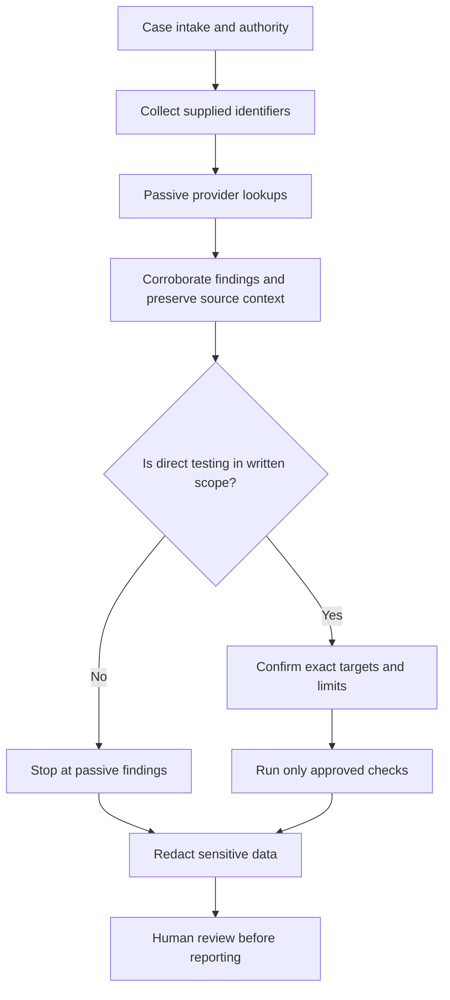
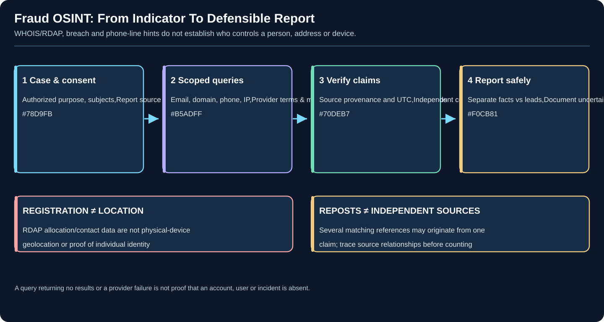

# OSINT Investigation Procedures Guide

This guide provides step-by-step procedures for conducting thorough OSINT investigations on scam and fraud cases.

## Investigation flow



## 🎯 Purpose
Step-by-step scam/fraud investigation procedures (email, phone, domain, IP, username, cryptocurrency) built around the `osint_investigator.sh` toolkit referenced throughout, ending in evidence preservation and abuse/IC3 reporting workflows. Distinct from [../OSINT_CHEATSHEET.md](../OSINT_CHEATSHEET.md) (generic command reference) and [../OSINT_GUIDE.md](../OSINT_GUIDE.md) (methodology/background) - this is specifically the scam-investigation playbook with a defined case workflow from intake to law enforcement referral.

## ⚙️ Function
Ten sections following a single investigation from pre-investigation checklist through six identifier-specific procedures (email/phone/domain/IP/username/crypto), then evidence preservation, report generation, abuse reporting, and an IC3 submission checklist.

## 🏆 Goal
Prepare a well-supported scam/fraud complaint from intake through evidence preservation to a **human-reviewed** abuse or IC3 report when appropriate. Hashes and timestamps help document integrity but do **not** establish full chain of custody, authorship or attribution on their own; an actual submission requires operator action and a service receipt.

## 📋 When to Use
- Investigating a specific scam/fraud case (phishing, romance scam, tech support scam, investment fraud) end-to-end
- Needing the exact abuse-reporting workflow (registrar/hosting/email provider) after identifying responsible parties
- Preparing an IC3 submission for a fraud case involving financial loss

## Table of Contents

1. [Pre-Investigation Checklist](#pre-investigation-checklist)
2. [Email Investigation Procedure](#email-investigation-procedure)
3. [Phone Investigation Procedure](#phone-investigation-procedure)
4. [Domain Investigation Procedure](#domain-investigation-procedure)
5. [IP Address Investigation Procedure](#ip-address-investigation-procedure)
6. [Username Investigation Procedure](#username-investigation-procedure)
7. [Cryptocurrency Investigation Procedure](#cryptocurrency-investigation-procedure)
8. [Evidence Preservation](#evidence-preservation)
9. [Report Generation](#report-generation)
10. [Abuse Reporting Workflow](#abuse-reporting-workflow)

---

## Pre-Investigation Checklist



*Conceptual investigative flow, not an executed case or successful attribution.* [ARIN's RDAP guidance](https://www.arin.net/resources/registry/whois/) confirms network-registration addresses need not be the physical location of a resource; [Bellingcat's source-verification cautions](https://www.bellingcat.com/resources/2024/04/25/oshit-seven-deadly-sins-of-bad-open-source-research/) explain why repeated material and unsupported interpretations require corroboration. Check query authorization, source limitations and confidentiality before reporting.

Before starting any investigation:

- [ ] Create a new case with unique Case ID
- [ ] Document the incident/complaint in case notes
- [ ] Verify you have legal authorization to investigate
- [ ] Check that required tools are installed (`./osint_investigator.sh --status`)
- [ ] Verify API keys are configured
- [ ] Ensure adequate storage for evidence

### Recommended Case ID Format

```
YYYY-NNN-TYPE

Examples:
- 2024-001-PHISHING
- 2024-002-ROMANCE_SCAM
- 2024-003-TECH_SUPPORT
- 2024-004-INVESTMENT_FRAUD
```

---

## Email Investigation Procedure

### Objective
Identify accounts associated with an email address, discover breach exposure, and gather intelligence for abuse reporting.

### Step-by-Step Procedure

#### Step 1: Account Discovery with Holehe

```bash
holehe target@email.com --only-used
```

**What to look for:**
- Registered accounts on social media platforms
- Partial recovery emails/phone numbers
- Account creation indicators

**Document:** Candidate service responses only. Holehe checks are heuristics and provider behavior may change; a positive response does not establish that the investigated person owns the account.

#### Step 2: Breach Database Search

```bash
Use an authorized breach-notification service that returns breach names and exposed data categories without collecting or exporting passwords. Record only the minimum redacted findings needed for the case.
```

**What to look for:**
- Previous breaches containing the email
- Data categories exposed (never collect, store, or reproduce passwords)
- Related email addresses

**Document:** Breach exposure summary

#### Step 3: HaveIBeenPwned Check (if API configured)

The toolkit automatically queries HIBP when the API key is set.

**What to look for:**
- Breach names and dates
- Data types exposed
- Pattern of compromise

#### Step 4: Email Verification

Use the provider’s current authenticated client or dashboard. Store the API key in a secret manager or protected environment variable; do not put credentials in URLs, shell history, or copied command output.

**What to look for:**
- Deliverable status
- MX records
- SMTP check results
- Disposable email detection

#### Step 5: Email Header Analysis (if headers available)

If you have the original scam email:

1. Extract full headers from email client
2. Analyze routing path
3. Identify originating IP
4. Check SPF/DKIM/DMARC alignment
5. Look for spoofing indicators

**Tools:** mxtoolbox.com, emailheaders.net

#### Step 6: Domain Extraction

Extract the domain from the email address and proceed to Domain Investigation.

---

## Phone Investigation Procedure

### Objective
Record provider-reported numbering metadata as a lead, with uncertainty and privacy limits clearly documented.

### Step-by-Step Procedure

#### Step 1: Normalize and Validate

Use a maintained numbering-plan library such as Google's libphonenumber to parse the supplied number with an explicit region when needed. “Possible” or “valid” means it matches numbering metadata; it does not prove that the number is assigned, reachable, or controlled by the investigated person.

#### Step 2: Review Provider Metadata

If authorized and necessary, query one approved validation provider. Carrier and line-type labels may be stale or affected by number portability. They do not identify the current subscriber or prove VoIP, burner-app use, or fraud.

#### Step 3: Corroborate Carefully

Do not infer that a number is suspicious because it is mobile, VoIP, or associated with a forwarding service. Treat each provider result as an unverified lead and seek independent case evidence before making an attribution.

#### Step 4: Optional Public Search

Reverse-lookup sites and social networks receive the queried phone number and may retain it. Use them only when the investigation's authority and privacy basis allow it; review results manually and avoid collecting unrelated personal data.

#### Step 5: Document Findings

Record the normalized number, source, timestamp, returned metadata, and confidence/limitations. Store only the minimum necessary information, redact reports where appropriate, and do not reproduce passwords or unrelated personal details.

---

## Domain Investigation Procedure

### Objective
Map the complete infrastructure behind a scam domain, identify hosting providers, and gather abuse contacts.

### Step-by-Step Procedure

#### Step 1: WHOIS Lookup

```bash
whois scam-domain.com
```

**What to look for:**
- Registrant information (often privacy-protected)
- Registrar name and abuse contact
- Registration date (recent = suspicious)
- Nameservers
- Expiration date

**Document:** Registrar abuse contact for reporting

#### Step 2: DNS Record Collection

```bash
# A Records (IP addresses)
dig +short scam-domain.com A

# MX Records (mail servers)
dig +short scam-domain.com MX

# TXT Records (SPF, verification)
dig +short scam-domain.com TXT

# NS Records (nameservers)
dig +short scam-domain.com NS
```

**Document:** All IP addresses for IP investigation

#### Step 3: Subdomain Enumeration

```bash
subfinder -d scam-domain.com -silent -o subdomains.txt
```

**What to look for:**
- admin.* subdomains
- api.* subdomains
- mail.* subdomains
- Hidden panels or services

#### Step 4: Technology Stack Detection

```bash
cat subdomains.txt | httpx -td -server -title -asn
```

**What to look for:**
- Web server type
- CMS platform
- Hosting provider
- CDN usage (may mask origin)

#### Step 5: Historical Analysis

```bash
# Wayback Machine URLs
echo scam-domain.com | waybackurls > historical_urls.txt

# Certificate Transparency
curl -s "https://crt.sh/?q=%25.scam-domain.com&output=json" | jq
```

**What to look for:**
- Previous content/pages
- Earlier registration
- SSL certificate history
- Related domains on same certificate

#### Step 6: theHarvester (Email Discovery)

```bash
theHarvester -d scam-domain.com -l 500 -b all
```

**What to look for:**
- Email addresses associated with domain
- Employee names
- Related domains/hosts

---

## IP Address Investigation Procedure

### Objective
Identify the hosting provider, abuse contacts, and reputation of IP addresses.

### Step-by-Step Procedure

#### Step 1: ASN and Abuse Contact Lookup

```bash
asn 1.2.3.4
```

**Possible fields, depending on the installed lookup tool and data source:**
- ASN number and name
- Network range
- Published abuse contact (when available)
- Registry country designation (not a device geolocation)
- RPKI status if the lookup includes and correctly evaluates it

**Document:** Abuse email for reporting

#### Step 2: Registered Network Details (HTTPS RDAP)

```bash
# Read-only lookup. Replace the illustrative address with a permitted IP.
IP="8.8.8.8"
curl --fail --silent --show-error --location \
  --proto '=https' --proto-redir '=https' \
  "https://rdap.org/ip/$IP" | jq '{name,handle,startAddress,endAddress,entities}'
```

**Interpretation:** RDAP reports registry allocation details and possibly contact entities. It does **not** establish the IP's physical location, the end user's identity, whether the host is reachable, or that any address belongs to a malicious actor. Review [RDAP.org's bootstrap documentation](https://about.rdap.org/) and the [ARIN RDAP guide](https://www.arin.net/resources/rdap.html); responses vary by registry.

If city/country or proxy/VPN classifications are necessary, obtain them separately from an approved, HTTPS-enabled geolocation/reputation provider under the applicable license. Record the source, query date, precision, uncertainty and disclosure of the investigated address to the provider. Never substitute registry country for confirmed geolocation.

#### Step 3: Reputation Check

**Shodan and AbuseIPDB (if authorized and configured):**

Use the toolkit's protected configuration or each provider's current official
client. Do not place API keys in URLs, shell command lines, copied terminal
history, or logs. Provider queries disclose the target identifier to that
provider; review its terms and retain only the findings needed for the case.

**What to look for:**
- Previous abuse reports
- Confidence score
- Types of abuse
- Open ports/services

#### Step 4: Port Scan (Quick)

**Active testing requires written authorization and an explicitly in-scope target.** Do not scan a third-party address simply because it appeared in an OSINT result. Replace the illustrative placeholder before running.

```bash
nmap -F -T2 --open AUTHORIZED_TARGET_IP
```

**What to look for:**
- Web servers (80, 443)
- Mail servers (25, 587)
- Remote access (22, 3389)
- Unusual services

#### Step 5: Reverse DNS

```bash
dig -x 1.2.3.4 +short
host 1.2.3.4
```

**What to look for:**
- Hostname reveals hosting provider
- Shared hosting indicators
- VPS/cloud provider names

---

## Username Investigation Procedure

### Objective
Discover all accounts associated with a username across social media and other platforms.

### Step-by-Step Procedure

#### Step 1: Maigret (Comprehensive - 2500+ sites)

```bash
maigret scammer_username --pdf --html -o ./username_results/
```

**What to look for:**
- Active social media accounts
- Forum registrations
- Dating site profiles
- Professional profiles
- Gaming accounts

#### Step 2: Sherlock (Fast - 400+ sites)

```bash
sherlock scammer_username --csv
```

Use as secondary verification for Maigret results.

#### Step 3: Manual Verification

Visit discovered profiles to:
- Confirm the account is actually the target
- Screenshot active profiles
- Document profile information
- Note connections/followers
- Check post history

#### Step 4: Profile Analysis

For each confirmed profile:

1. **Bio/Description:** Contact info, links, claims
2. **Profile Photo:** Reverse image search
3. **Post History:** Timeline, patterns
4. **Connections:** Friends, followers, groups
5. **Activity:** Posting frequency, times

#### Step 5: Reverse Image Search

```bash
# Use Google Images, TinEye, Yandex
# Or: https://images.google.com
# Upload profile photos to find other uses
```

---

## Cryptocurrency Investigation Procedure

### Objective
Trace cryptocurrency transactions and identify connections to known scam wallets.

### Step-by-Step Procedure

#### Step 1: Address Type Identification

- **Bitcoin:** Starts with 1, 3, or bc1
- **Ethereum:** Starts with 0x (40 hex chars)
- **Litecoin:** Starts with L, M, or 3

#### Step 2: Scam Database Check

Manual checks:
- https://chainabuse.com/address/ADDRESS
- https://www.chainabuse.com/address/ADDRESS
- https://cryptoscamdb.org/search

#### Step 3: Blockchain Explorer Analysis

**Bitcoin:**
```bash
curl -s "https://blockchain.info/rawaddr/ADDRESS?limit=50" | jq
```

Check:
- Total received/sent
- Number of transactions
- First/last transaction dates
- Balance

**Ethereum:**
```bash
Etherscan API v1 is deprecated. For a required blockchain lookup, use
the current Etherscan API v2 documentation and an approved client or protected
configuration for credentials. Never copy an API key into a URL or shell
command. Record only the transaction metadata relevant to the investigation.
```

#### Step 4: Transaction Tracing

For significant addresses:
1. Identify first funding source
2. Track outgoing transactions
3. Look for exchange deposits
4. Note clustering with other addresses

#### Step 5: Documentation

Record:
- Full address
- Blockchain type
- Total value transacted
- Abuse database results
- Transaction screenshots

---

## Evidence Preservation

### Golden Rules

1. **Hash Everything:** SHA256 hash immediately upon collection
2. **Timestamp Everything:** UTC timestamps for all evidence
3. **Document Chain of Custody:** Log who collected what and when
4. **Multiple Copies:** Original + working copy
5. **Integrity Verification:** Regular hash checks

### URL Archiving Procedure

```bash
# 1. Monolith (self-contained HTML)
monolith https://scam-site.com -o evidence_$(date +%Y%m%d_%H%M%S).html

# 2. Screenshot
cutycapt --url=https://scam-site.com --out=screenshot_$(date +%Y%m%d_%H%M%S).png

# 3. Wayback Machine
waybackpy --url "https://scam-site.com" --save

# 4. Hash the evidence
sha256sum evidence_*.html screenshot_*.png > evidence_hashes.txt
```

### Evidence Log Entry

Add to evidence_log.md:
```markdown
| 2024-01-15 10:30:00 UTC | Archive | Scam homepage capture | abc123... | monolith |
```

---

## Report Generation

### Final Report Contents

1. **Executive Summary**
   - Case overview
   - Key findings
   - Recommended actions

2. **Investigation Targets**
   - All identifiers investigated
   - Connection between identifiers

3. **Detailed Findings**
   - Per-identifier results
   - Tool outputs
   - Analysis notes

4. **Evidence Inventory**
   - File list with hashes
   - Chain of custody log

5. **Abuse Contacts**
   - Registrar
   - Hosting provider
   - ISP

6. **Recommendations**
   - Abuse reports to file
   - Law enforcement referral
   - Client advisories

---

## Abuse Reporting Workflow

### Step 1: Identify Responsible Parties

From investigation, compile:
- Domain registrar abuse email
- Hosting provider abuse email
- Email provider abuse address
- Upstream ISP (if identifiable)

### Step 2: Prepare Abuse Report

Use template from toolkit:
```
./osint_investigator.sh → Reports Menu → Generate Abuse Report Template
```

Include:
- Nature of abuse (phishing, scam, malware)
- Specific URLs/IPs/domains
- Timeline of activity
- Evidence (references, not attachments)
- Your contact information

### Step 3: Submit Reports

**Domain Registrar:**
- Submit via registrar's abuse portal
- Reference domain name
- Request suspension/takedown

**Hosting Provider:**
- Email to abuse contact from ASN lookup
- Include IP addresses and URLs
- Request content removal

**Email Provider:**
- Forward original scam email
- Report via provider's abuse form
- Request account termination

### Step 4: Document Submissions

Record in case file:
- Date/time of submission
- Recipient
- Method (email, web form)
- Reference/ticket number
- Attachments sent

### Step 5: Follow Up

- Wait 48-72 hours for initial response
- Follow up if no response
- Document all communications
- Escalate if necessary

---

## IC3 Submission Checklist

For FBI Internet Crime Complaint Center (ic3.gov):

- [ ] Victim information
- [ ] Suspect information (all identifiers)
- [ ] Financial loss amount
- [ ] Payment methods used
- [ ] Communication records
- [ ] Investigation report (PDF)
- [ ] Evidence hashes
- [ ] Timeline of events

Submit at: https://www.ic3.gov/

---

*Document version: 1.0*
*Last updated: 2024*

## Related Files
- [README.md](README.md) - Playbook index
- [../OSINT_CHEATSHEET.md](../OSINT_CHEATSHEET.md) - Quick command reference during investigation
- [../scripts/Domain_IP_Recon.md](../scripts/Domain_IP_Recon.md) - Automated domain investigation
- [../scripts/Email_OSINT.md](../scripts/Email_OSINT.md) - Automated email investigation
