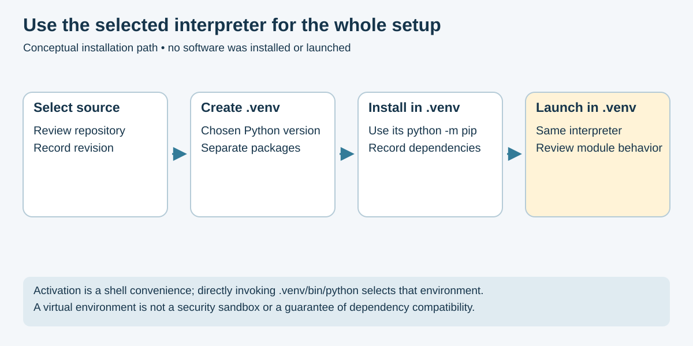
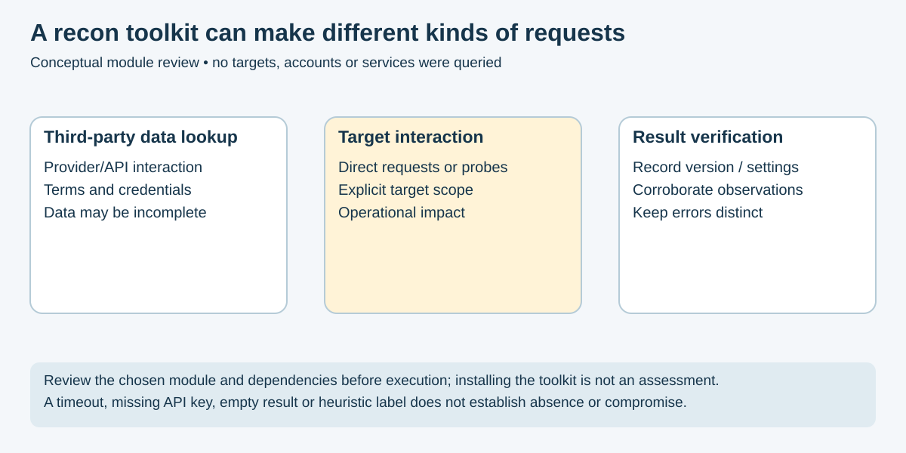

# Argus Recon Toolkit - Installation Guide

**Source and visual review:** November 17, 2026. No toolkit installation,
launch, target scan, API use or personal investigation was performed.

This guide covers the Python-based [Argus reconnaissance toolkit](https://github.com/divinelabio/Argus).
The older `jasonxtn/argus` link redirects there. At review, GitHub reported the
repository was not archived; its main commit was
[`f51c0442802f`](https://github.com/divinelabio/Argus/commit/f51c0442802f1a557220943c72fb2584c7c99fa4)
from December 10, 2025. That status does not establish ongoing maintenance,
software integrity or compatibility with a particular host.

The inspected [package metadata](https://github.com/divinelabio/Argus/blob/f51c0442802f1a557220943c72fb2584c7c99fa4/pyproject.toml) declares Python
**>=3.10**, not a requirement for Python 3.12+. Validate the interpreter and
dependency resolution for the revision you actually select.

## 🎯 Purpose

Provide a source-reviewed Debian/Ubuntu setup path using an isolated Python
package environment. This is a single-tool installation reference, not a
general OSINT methodology or a verified field-assessment procedure.

## ⚙️ Function

Separates repository selection, environment creation, dependency installation
and launch. Explains interpreter selection and the difference between
package isolation and a security sandbox.

## 🏆 Goal

Help a reader prepare a documented environment while distinguishing a
successful package install, a successful launch and valid assessment results.

## 📋 When to Use

- Preparing a new authorized research environment on Debian/Ubuntu.
- Diagnosing an externally managed Python installation or interpreter mismatch.
- Returning to an existing checkout without assuming its location or activation state.

## Prerequisites

Use a supported Debian/Ubuntu release and confirm the available Python version
against the selected upstream revision. A minimal starting package set is:

```bash
sudo apt update
sudo apt install git python3 python3-venv
python3 --version
```

Native build tools and development headers may be needed if a dependency
must compile from source. Install the packages required by the actual error
and host distribution; they do not guarantee a successful build.

## Step-by-Step Setup



*Figure 1 — Original conceptual environment-selection diagram based on [Python's venv documentation](https://docs.python.org/3/library/venv.html). It is not a tested installation record.*

### 1. Clone the Repository

Choose a working directory, then clone into the explicitly named directory:

```bash
git clone https://github.com/divinelabio/Argus.git argus
cd argus
git rev-parse HEAD
```

Review and record the selected revision and its dependency files. The examples
below run from that checkout. A later clone of `main` can contain different code
from the reviewed snapshot.

### 2. Create a Virtual Environment

```bash
python3 -m venv .venv
```

The [externally managed environments specification](https://packaging.python.org/en/latest/specifications/externally-managed-environments/)
protects marked interpreter installations from conflicting package-manager
changes. It does not require every Linux Python use to happen in a virtual
environment. A venv is the approach used here; do not work around the marker
with a system-wide forced pip install.

### 3. Activate the Environment

Activation is optional when using the environment's interpreter explicitly.
For Bash/Zsh convenience:

```bash
source .venv/bin/activate
```

Activation adjusts this shell's command search path; a prompt change alone is
not a compatibility test. Subsequent examples use `.venv/bin/python` so interpreter
selection remains explicit without relying on activation.

### 4. Upgrade Core Build Tools

Inspect the environment's pip first:

```bash
.venv/bin/python -m pip --version
```

If the chosen dependencies require newer packaging/build tools, update them
**inside this environment** and record the resulting versions:

```bash
.venv/bin/python -m pip install --upgrade pip setuptools wheel
```

This retrieves packages and may change dependency resolution; it is not a
reproducible lock or an unconditional requirement for every future release.

### 5. Install Dependencies

The inspected checkout has a broad [requirements file](https://github.com/divinelabio/Argus/blob/f51c0442802f1a557220943c72fb2584c7c99fa4/requirements.txt)
and a different dependency list in `pyproject.toml`. They are not interchangeable
lockfiles. This source-checkout path follows the requirements-file approach
documented upstream:

```bash
.venv/bin/python -m pip install -r requirements.txt
.venv/bin/python -m pip check
.venv/bin/python -m pip freeze > installed-packages.txt
```

Keep the revision, Python version, platform and resolved dependency record
together. [`pip check`](https://pip.pypa.io/en/stable/cli/pip_check/) checks installed dependency relationships, not full import
coverage, security or network-module functionality. Open version bounds can
resolve differently over time. [`pip freeze`](https://pip.pypa.io/en/stable/cli/pip_freeze/)
records installed packages; it does not calculate a lockfile or certify that
the same environment can be rebuilt on another platform.

## Running Argus

The inspected [module entry point](https://github.com/divinelabio/Argus/blob/f51c0442802f1a557220943c72fb2584c7c99fa4/argus/__main__.py) supports:

```bash
.venv/bin/python -m argus
```

Do not assume every module is passive because the toolkit is described as OSINT.
Review the selected module, destinations, credentials, authorization and
collection limits before an approved run. Starting a UI does not establish
that external providers or every module are available.



*Figure 2 — Original conceptual module-review model. The [upstream project](https://github.com/divinelabio/Argus/blob/f51c0442802f1a557220943c72fb2584c7c99fa4/README.md) includes both data lookups and direct network/web analysis; the diagram is not a record of any run or a claim that a module's results are correct.*

## Quick Start Summary

Return to the **actual** checkout path, not an assumed `~/argus` location:

```bash
# Replace this with the directory where you cloned the project.
cd /path/to/argus
.venv/bin/python -m argus
```

No activation is required for this explicit interpreter path. If the checkout
or environment moved, recreate and validate the environment rather than
assuming a copied venv is portable.

## Sources And Validation Limits

- [Canonical upstream repository](https://github.com/divinelabio/Argus) and the pinned source links above establish the inspected identity and code layout.
- [Python venv](https://docs.python.org/3/library/venv.html) explains activation, interpreter paths and environment limitations.
- [Externally managed environments](https://packaging.python.org/en/latest/specifications/externally-managed-environments/) explains the packaging boundary.

Commands are documentation examples reviewed against sources. They were not
executed in a clean Debian/Ubuntu installation, and no dependency or module
compatibility is certified. Protect any future API credentials and exports;
record failures and uncertain results separately from validated findings.

## Related Files

- [README.md](README.md) - OSINT section index
- [OSINT_TOOLS_CATALOG.md](OSINT_TOOLS_CATALOG.md) - Full tool catalog context
- [Playbook/README.md](Playbook/README.md) - Investigator playbook
- [Source verification](bellingcat-source-verification.md) - Corroboration and provenance limits
- [Legal terms](../LEGAL.md) - Scope and authorized use

