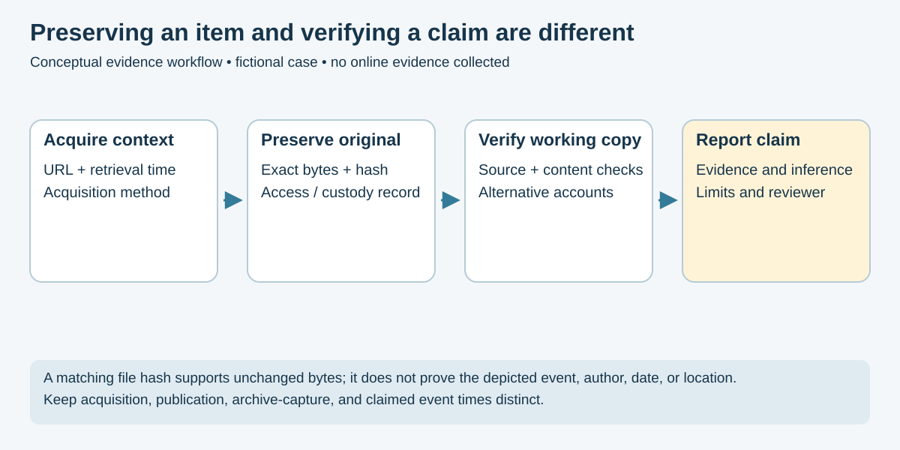
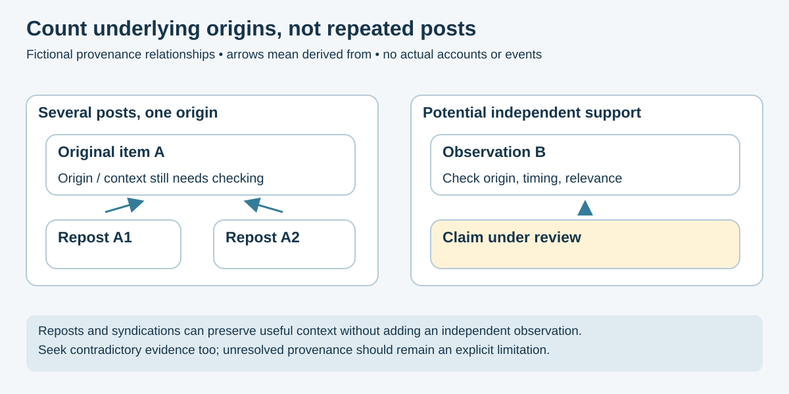

# Bellingcat Toolkit and OSINT Source Verification

_Last reviewed: 2026-11-17 (Bellingcat/tool reference and visual review; no live case collection)_

> [!CAUTION]
> Public availability does not authorize harassment, access-control bypass,
> unnecessary personal-data collection or exposing confidential sources.
> Apply [legal terms](../LEGAL.md) and source-protection guidance.

**Prerequisites:** [OSINT hub](README.md) · [Investigator playbook](Playbook/investigation_guide.md) · [OPSEC](../OPSEC/README.md).

## Source context
**Related verified-source directory:** [Awesome OSINT List curation](awesome-osint-list-curated.md) organizes mapping, satellite imagery, image/video provenance and public records; its third-party listings still require independent verification.

[Bellingcat's Online Investigation Toolkit](https://bellingcat.gitbook.io/toolkit) publishes research-tool descriptions; its [repository](https://github.com/bellingcat/toolkit) documents synchronization with GitBook. It can help find tools for page archives, visual verification, geolocation, historical records and media research. A directory listing is **not** an endorsement of the legality, reliability, privacy, continued availability or integrity of each third-party provider.

## A defensible verification workflow

*Figure 1 — Original conceptual workflow, not a collected case or Bellingcat's official process diagram. Context: [Bellingcat/GLAN's investigation methodology](https://www.bellingcat.com/app/uploads/2022/12/JA-Manual-for-PUBLICATION.pdf) distinguishes preservation and verification; [Auto Archiver's hash module](https://auto-archiver.readthedocs.io/en/latest/modules/autogen/enricher/hash_enricher.html) computes file-byte hashes.*

1. Define the question, authority, acceptable data and a minimization plan.
2. Separate research environment and accounts where appropriate. Do not rely on unknown [public proxies](../OPSEC/proxy-reference-froxy.md) to protect identities.
3. Record the located URL, UTC retrieval time, title, platform and claimed origin. Preserve the exact acquired file or capture separately from annotations; record its acquisition method and cryptographic hash. A platform download, screenshot and camera-original file are not interchangeable.
4. Trace underlying origins before counting corroboration. Reposts or syndications derived from one item do not become independent observations merely because several sites carry them.
5. Test contradictory explanations, image reuse and source context. Distinguish claimed event time, first located publication, archive capture and your retrieval time. Available metadata is a clue to verify; missing EXIF alone does not establish falsification.
6. Label observations versus inferences; explain confidence with supporting and contradictory evidence. Record unresolved provenance gaps without inventing a numeric probability.
7. Protect PII, precise addresses, raw account identifiers and source communications unless strictly necessary.
8. Record reviewer, archive reference, final citation, access permissions and deletion/legal-hold schedule.

| Evidence element | Required note |
| --- | --- |
| Located source / claimed origin | URL, attribution, earliest located publication and unresolved origin gaps |
| Retrieval | UTC timestamp, acquisition form, tool/version and failed or incomplete capture notes |
| Integrity | Hash algorithm/value, exact acquired file, preserved location and derived-copy history |
| Verification | Source relationships, independent observations, contradictions and inference rationale |
| Limitations | Authorship, timestamp, location or platform uncertainty |
| Protection | Sensitivity, access list, retention and approval |

### Integrity And Archive Limits

A matching cryptographic hash supports unchanged bytes relative to the recorded
reference. It does not by itself establish authorship, event truth, capture time
or location. Keep the capture context and verification record alongside the hash.
A perceptual similarity hash is a different test from byte-for-byte integrity.

An archive can be incomplete: missing media, dynamic content or gaps can affect
interpretation. Check that the relevant material was actually preserved, and
retain archive-capture time separately from publication time. Public archive
submission can disclose a URL or its content; choose storage and access controls
consistent with the case's sensitivity. See [Bellingcat's Wayback review](https://bellingcat.gitbook.io/toolkit/more/all-tools/internet-archive).

### Assess Independence Before Corroboration

*Figure 2 — Original fictional provenance graph. No real accounts or events are shown. It illustrates the source-tracing concerns discussed in [Bellingcat's bad-research practices guide](https://www.bellingcat.com/resources/2024/04/25/oshit-seven-deadly-sins-of-bad-open-source-research/).*

| Observation | Supported Interpretation | Additional Check |
|---|---|---|
| Several posts use the same image | Multiple publications exist | Trace reuse, edits and the earliest located source; do not assume several witnesses. |
| A reverse-image search finds an older copy | The copy appeared in a located earlier context | Verify dates, matching content and context; search results may omit other copies. |
| A reverse-image search finds nothing | No result was returned under those conditions | It does not prove originality or authenticity. |
| A separate item appears to agree | Potential corroboration | Establish its origin, relevance and independence; test alternative explanations. |

The diagrams are teaching aids, not a substitute for documented verification,
source protection or case-specific evidence requirements.

## Where it connects

[OSINT Tools Catalog](OSINT_TOOLS_CATALOG.md) provides tool choices;
[Public APIs catalog](../Documentation/security-public-api-catalog.md) covers structured sources; [Investigation Playbook](Playbook/README.md) covers cases; [Press/source protection](../OPSEC/press-freedom/README.md) covers more sensitive investigative work.

## Sources

- [Bellingcat Toolkit repository](https://github.com/bellingcat/toolkit) (GitBook content synchronized upstream).
- [Bellingcat research resources](https://www.bellingcat.com/resources/).
- [Bellingcat/GLAN investigation methodology](https://www.bellingcat.com/app/uploads/2022/12/JA-Manual-for-PUBLICATION.pdf) — context-specific preservation and verification practice, not a guarantee of evidentiary admissibility for this guide.
- [Bellingcat Auto Archiver](https://github.com/bellingcat/auto-archiver) — tool documentation; no installation, account creation or archive submission was performed.
- [OHCHR Berkeley Protocol](https://www.ohchr.org/en/publications/policy-and-methodological-publications/berkeley-protocol-digital-open-source) (open-source evidence practice).

This update supplies a procedure and citations, not scraping, new provider accounts or acquired case data.

---

[OSINT hub](README.md) · [Main guide](../README.md) · [Legal terms](../LEGAL.md)

