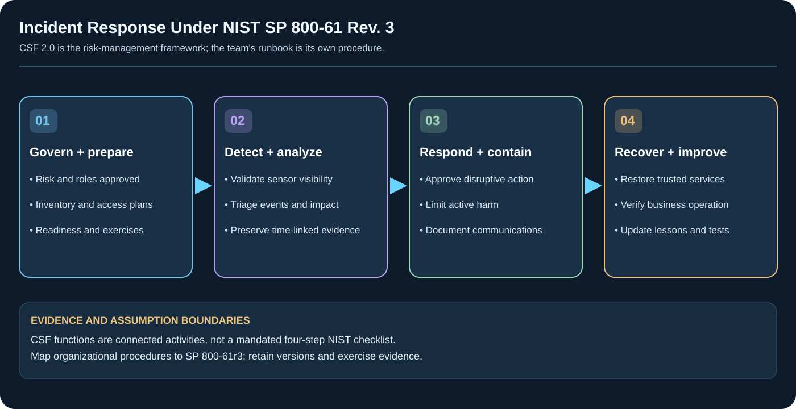

# Incident Response Playbook (Enhanced)

## 🎯 Purpose

Define repeatable **organization-specific** procedures for incident preparation, detection, analysis, containment, recovery and improvement. [NIST SP 800-61 Revision 3](https://csrc.nist.gov/pubs/sp/800/61/r3/final), finalized in April 2025, uses the [CSF 2.0](https://www.nist.gov/cyberframework) risk-management profile. This guide's operational step sequence is not a mandatory NIST phase model or proof of ISO/IEC 27035 conformance.



*Conceptual local procedure crosswalk; not a four-phase prescription from NIST.* The [official NIST SP 800-61 Rev. 3 publication](https://csrc.nist.gov/pubs/sp/800/61/r3/final) replaces Rev. 2 and integrates incident response into [CSF 2.0](https://www.nist.gov/cyberframework). Organizations must choose procedures, owners, tools and actual risk-based controls appropriate to their environment.

## ⚙️ Function

An expanded operational procedure aligned conceptually with [NIST SP 800-61r3](https://csrc.nist.gov/pubs/sp/800/61/r3/final) and CSF 2.0, with optional named enterprise tools. It retains local preparation, identification, containment, eradication, recovery and review tasks but does **not** claim that NIST requires these as a fixed phase count. Larger-team capabilities (24×7 SOC, CMDB, forensic workstations) are assumed examples, not guaranteed deployments.

## 🏆 Goal

Provide an auditable incident-response **starting template** with named owners, decisions, evidence and improvement checks. A template, software list or diagram does not by itself prove NIST/ISO compliance, insurance eligibility or response effectiveness.

## 📋 When to Use

- Mature SOCs with a defined toolchain who need the specific-tool version rather than the generic quick-reference
- Organizations that must demonstrate NIST SP 800-61 / ISO 27035 alignment for compliance, audit, or cyber insurance purposes
- Enterprise incidents spanning multiple asset classes (endpoints, cloud workloads, OT) requiring formal role coordination

### Scope:

Intended to be adapted to authorized on-prem, cloud and OT assets. Verify actual team coverage hours, sensors, asset scope, escalation owners and operational dependencies; do not assume 24×7 monitoring is deployed.

---

## 2. Roles & Responsibilities

| Role | Responsibilities |
|------|-----------------|
| **Incident Response Lead** | Coordinates IR per NIST SP 800-61; liaises with C-Suite, Legal, and PR. |
| **SOC Analyst I** | Monitors Splunk ES / QRadar / Elastic Security; performs initial triage & escalation. |
| **SOC Analyst II / Threat Hunter** | Deep-dive investigations with MITRE ATT&CK mapping; proactive hunting via Velociraptor / RedELK. |
| **Forensic Analyst** | Collects/analyzes artifacts with FTK Imager, Magnet RAM Capture, OSForensics. |
| **Malware Analyst** | Reverse-engineers binaries using Ghidra, IDA Pro; produces YARA rules & IOCs. |
| **Remediation Engineer** | Implements containment & remediation with Carbon Black EDR, Microsoft Defender. |
| **Communications Officer** | Manages notifications (in-house Legal counsel, PR agency, external regulators). |

---

## 3. Preparation

### 1. Asset Inventory
- CMDB (ServiceNow) tracking all servers, endpoints, applications, network segments, business owners.

### 2. Baseline & Logging
- **SIEM:** Splunk Enterprise Security, IBM QRadar or Elastic Security, with tested ingestion and retention periods selected from documented legal, policy, threat and recovery requirements. Ninety days is not a universal requirement.
- **EDR:** CrowdStrike Falcon, Microsoft Defender for Endpoint.
- **Network IDS/IPS:** Suricata and Zeek deployed on Security Onion or Corelight.

### 3. Tooling & Access
- Ensure IR team has privileged SSH/RDP, admin accounts on forensic workstations, evidence locker (Azure Blob/SharePoint), VPN jump boxes, and ticketing (ServiceNow/Jira Service Desk).

### Escalation Contacts (fill in before any incident)

| Stakeholder | Responsible owner | Email / channel | Verified phone |
|---|---|---|---|
| Incident lead | Assign by on-call rotation | `incident-lead@example.com` (placeholder) | Enter verified on-call number |
| Legal / privacy | Assign named counsel | `legal@example.com` (placeholder) | Enter verified counsel number |
| Communications | Assign authorized spokesperson | `communications@example.com` (placeholder) | Enter verified escalation number |
| IT operations | Assign responsible service owner | `operations@example.com` (placeholder) | Enter verified escalation number |
| Law enforcement / regulator | Determine approved liaison and jurisdiction | Use verified official reporting site or counsel | Verify directly through official channels |

**Do not use this table as a real contact directory.** The `example.com` entries are deliberately non-delivering documentation placeholders. Confirm the correct agency contact from its official website at the time of an incident; never rely on copied emails or telephone numbers in a public playbook. For US internet crime reporting, see [FBI IC3](https://www.ic3.gov/), subject to counsel and incident-reporting obligations.

### 4. Playbook Testing
- Quarterly tabletop exercises following NIST SP 800-84: phishing, ransomware, insider threat, DDoS scenarios.

---

## 4. Identification

### 4.1 Alert Triage

**Dashboard Prioritization:**
- Splunk ES risk-based alerts, QRadar Offense severity, Elastic Security DETECTION_ENGINE_RULE severity.
- **Example organizational SLA:** begin triage of High/Critical alerts
  within 15 minutes of receipt. Obtain approval for this target and define
  coverage hours, escalation paths, and how response time is measured.
  This is a proposed local service target, not a CIS-mandated deadline.
  For CIS Controls v8/v8.1, map incident-response procedures to
  **Control 17: Incident Response Management** and document the
  applicable safeguards.

**Common SIGs:**
- Windows Event 4625 spikes (failed logons)
- **Unexpected services or scheduled tasks:** investigate Windows
  Security Event 4697 for service installation and Event 4698 for
  scheduled-task creation, where supported and the relevant auditing
  is enabled. Correlate these with service/task configuration, executable
  paths, initiating accounts, and approved change records.
  Sysmon Event 1 records process creation; Event 7 records image loading.
  Use these as supporting telemetry, not as direct service/task
  registration events. Event 7 requires explicit configuration.
  Validate event generation and SIEM ingestion with benign lab tests.
- Outbound to known C2 IPs/domains (using MISP/AlienVault OTX feeds)

### 4.2 Initial Data Collection

**Endpoint:**
- `pslist`, `netstat -anob`, Autoruns, Sysinternals Procmon.
- Memory snapshot with FTK Imager or Magnet RAM Capture.

**Network:**
- **Packet captures:** export available PCAP from the organization's
  authorized packet-capture platform. Record the capture source,
  interface, time range, timezone, filters, and known collection gaps.
  Preserve the original capture and record its SHA-256 hash.
- **Zeek logs:** preserve the original logs separately. Use `zeek-cut`
  to extract fields from Zeek TSV logs, or a JSON-aware parser for JSON
  logs. `zeek-cut` does not export PCAP, and Zeek connection logs do not
  contain the original packet payloads.
- Query Suricata EVE JSON logs for matching `sid` or `threshold`.

---

## 5. Containment

### 5.1 Short-Term

**Isolate Host:**
- Use CrowdStrike Falcon quarantine or disable NIC via Microsoft Defender quarantine.

**Block IOCs:**
- Push Palo Alto Networks/Checkpoint firewall rules or EDR blocklists for malicious IPs/domains.

### 5.2 Long-Term

**Credentials:**
- Reset impacted AD accounts via Microsoft Entra ID, enforce Azure MFA.

**Patching:**
- Emergency patch management via WSUS/Intune or Red Hat Satellite for Linux.

---

## 6. Eradication

**Persistence Removal:**
- Remove malicious services, scheduled tasks, WMI filters; clean registry Run keys.

**Forensic Validation:**
- Re-scan with updated CrowdStrike/Defender signatures; verify absence of artifacts in `%ProgramData%`, `HKLM\Software\Microsoft\Windows\CurrentVersion\Run`.

---

## 7. Recovery

**System Restoration:**
- Restore from Veeam or Rubrik backups tagged "known-good."

**Integrity Check:**
- Verify executable hashes against internal repository (Artifactory) or VirusTotal.

**Functional Testing:**
- Confirm service availability (Nagios/Icinga), AD logon tests, and user acceptance.

**Monitoring Enhancement:**
- Update Splunk correlation searches or Elastic detection rules to cover observed TTPs.

---

## 8. Lessons Learned

1. **After-Action Review (AAR):**
   - Convene within 7 days of closure; follow ISO/IEC 27035-2 guidelines.

2. **Documentation:**
   - Record timeline, root cause, detection/respond gaps, and assigned remediation action items.

3. **Playbook Updates:**
   - Version control in Git; tag updates with incident ID.

4. **Training:**
   - SOC refresher on new TTPs-e.g., host-based hunting labs via RangeForce or Cyberbit.

---

## 9. Appendices

### A. Sample SIEM Queries

**Failed Logon Spike (Splunk ES):**

```splunk
index=wineventlog sourcetype=WinEventLog:Security EventCode=4625
| bin _time span=5m
| stats count by _time, user
| where count > 50
```

**DNS Beacon Detection (Elastic Security):**

```json
GET /logs-dns-*/_search
{
  "query": {
    "bool": {
      "must": [
        { "term": { "dns.question.name": "suspicious-domain.com" } }
      ]
    }
  }
}
```

### B. Evidence Collection Checklist

- ☐ Hostname, IP, OS version (via `systeminfo` / `uname -a`)
- ☐ Running processes & services (`tasklist` / `ps aux`)
- ☐ Network connections & firewall rules (`netstat -an`, `iptables -L`)
- ☐ Volatile data: memory dump, pagefile, swap
- ☐ Non-volatile data: event logs, Windows registry hives, application logs

---

## Security and Ethical Considerations ⚠️

**IMPORTANT**: These tools are for **authorized security testing only**. Unauthorized use is illegal.

* **Marauder Use:** Get **written permission** before testing any network. Only test networks you own or have explicit authorization to test.
* **Cracking Use:** All cracking attempts (Hashcat) must be done in an **isolated lab environment** against hashes you are authorized to possess.
* **Legal Compliance:** Strictly comply with all local laws and regulations.

**Legal Use Cases:**
* Penetration testing with client authorization.
* Testing your own home or lab network security.
* Security research in isolated lab environments.

---
## Related Files
- [README.md](README.md) - PlayBooks section index
