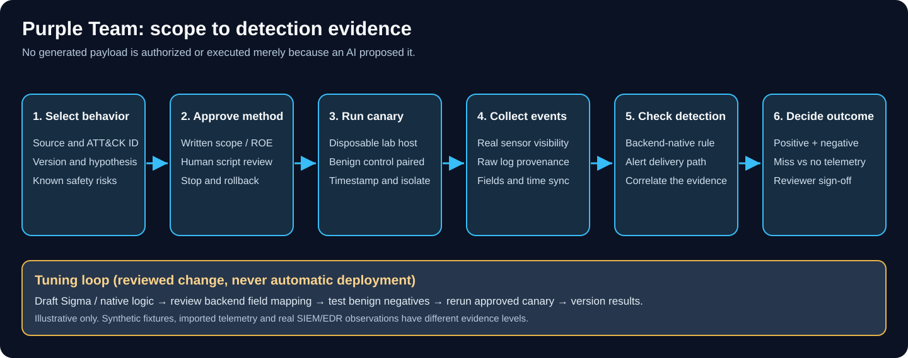
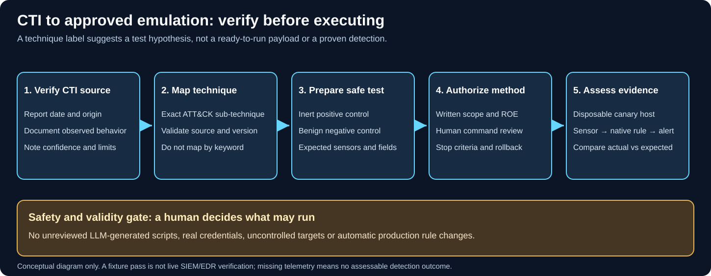

# Purple Team Playbook (Detailed)

**Repeatable detection lab:** [Atomic Red Team/Sigma/Wazuh validation guide](purple-team-detection-validation.md) defines safe test selection, positive/negative evidence and cleanup; [SIEM rule verification](../IncidentResponse/SIEM/detection-content-validation.md) covers platform-specific conversion, false positives and alert coverage.

## Purple Team Detection Lifecycle

*Conceptual workflow only.* Live emulation and vendor detections must be verified with the [controlled validation procedure](purple-team-detection-validation.md); no live results are implied.

## 🎯 Purpose

Bring Red-Team attack techniques and Blue-Team detections together in repeatable, measurable exercises-leveraging Python, PowerShell, Batch, and dedicated frameworks-to harden your environment against real adversaries.

## ⚙️ Function

A named-tool, enterprise-scale exercise framework: MITRE-mapped attack simulation (Atomic Red Team, Caldera, Metasploit), detection engineering (Sigma, YARA, OSQuery), hunting/visibility (Velociraptor, Falcon, Sysmon), network analysis (Zeek, Suricata), and formal exercise tracking/reporting (MITRE Engage, Jira, Splunk Phantom, TheHive). This is the **enterprise-tooled version** of `PurpleTeam_Simple.md` - same red/blue/purple collaboration model, but with the full toolchain and process workflow needed to run and report on exercises across an entire org.

## 🏆 Goal

Produce measurable, repeatable purple team exercises across the full attack lifecycle (initial access through cleanup) with defensible metrics and after-action reports suitable for tracking detection coverage improvement over time.

## 📋 When to Use

- Running formal, scheduled purple team exercises across an enterprise environment (not a single lab machine)
- Needing to report exercise outcomes and detection-coverage metrics to security leadership
- Coordinating exercises across multiple platforms (Windows, Linux, macOS, cloud) and control types (SIEM, EDR, network sensors, IAM, email gateways) simultaneously

### Scope:

Only explicitly approved Windows, Linux, macOS, cloud, application and network assets within a documented test window. Confirm actual SIEM/EDR/NDR coverage rather than assuming 24×7 monitoring. Exclude production-impacting techniques, external destinations, credentials and data unless the signed rules of engagement specifically permit them; prefer disposable targets and reversible, non-destructive tests.

---

## Key Tools & Frameworks

| Category | Tool / Framework | Purpose |
|----------|-----------------|---------|
| **Attack Simulation** | Atomic Red Team, Caldera, Metasploit | MITRE-mapped TTP emulation & orchestration |
| **Detection Engineering** | Sigma, YARA, OSQuery | Cross-platform rule/sig development |
| **Hunting & Visibility** | Velociraptor, CrowdStrike Falcon, Sysmon | Endpoint telemetry & proactive querying |
| **Network Analysis** | Zeek, Suricata, SecurityOnion | Packet capture, IDS/IPS, full-stack monitoring |
| **Collaboration & Tracking** | MITRE Engage, Jira, ServiceNow | Exercise planning, ticketing, and AAR tracking |
| **Lab Automation** | Docker, Vagrant, Ansible, Packer | Build reproducible test environments |
| **Reporting & Metrics** | Splunk SOAR (formerly Phantom), TheHive, Elastic dashboards | Draft reporting and evidence-linked metrics; verify installed version and permissions |

---

## Process Workflow

*Conceptual source-to-test gate, not an automatic payload generator or record of a completed attack.* CTI text, LLM suggestions and ATT&CK technique mappings are **inputs for review**, not executable instructions. Independently verify the [MITRE ATT&CK definitions](https://attack.mitre.org/techniques/) and preserve the source and version that justify a test.

### 1. Plan & Scope

Identify the specific risk or coverage gap; obtain written authorization, approved assets, test identities, time limits, prohibited actions, notification channels and emergency stop. Record the ATT&CK sub-technique and its version, the expected **observable** behavior, and the owner of each detection. Do not assume an ATT&CK label guarantees a matching test or that one successful test proves general coverage.

### 2. Verify Telemetry Before Emulation

Prepare an isolated VM or controlled canary. Verify agent health, logging policy, collector route, index, parser or decoder, clock synchronization, retention, and permission to inspect the target's events. Run a harmless synthetic event through the real data path before an active exercise. Capture a baseline plus a known benign-negative control.

### 3. Select & Review The Emulation

Prefer a non-destructive [Atomic Red Team](https://github.com/redcanaryco/atomic-red-team) test or a bounded simulation that emits the necessary telemetry without reproducing harmful payload effects. Pin the source commit and read prerequisites, cleanup steps, supported platforms, generated artifacts and side effects. Subject AI-generated commands to independent human review; they must never execute merely because a CTI parser suggested them.

### 4. Approve & Execute

An authorized operator verifies the environment, snapshot or rollback plan, exact command, network exposure, data sensitivity and monitoring window immediately before execution. Use an explicit stop mechanism. Keep client and lab data separate; never test a live third-party address or ingest an untrusted executable from a report.

### 5. Validate Evidence & Detection

Correlate test start time, host, user, raw source event, normalization, backend-native rule evaluation, alert and analyst receipt. Distinguish **no telemetry** from a **rule miss** and a **late alert**. Treat missing or duplicate supporting events as unassessable rather than a passing negative test. Confirm benign-negative behavior and test false positives with the same collection path.

### 6. Propose & Review Tuning

Draft Sigma or backend-native rule changes only after the failed gate is identified. Verify field mappings, thresholds, time windows, severity, exclusions and benign controls in the **actual** target backend. YARA file/memory matching is not interchangeable with network-session or SIEM event correlation. Production changes require a separate approval and tested rollback.

### 7. Restore & Report

Remove lab artifacts, revert snapshots when planned, verify sensor and rule state, and publish a source-linked report with test IDs, timestamps, versions, observed versus expected fields, benign controls, gaps and acceptance. Record whether results were synthetic fixture, imported unverified telemetry, or independently validated live-lab evidence.

### 8. Iterate Under A New Scope

Schedule subsequent exercises according to risk and approval, not automatically on every commit. Track the denominator of **actually executed and assessable** tests; report excluded, blocked and inconclusive tests separately. Detection timing is meaningful only if clocks and source timestamps are reliable.

## Example Playbook Entries

These are **test designs**, not completed exercises. The results below are acceptance criteria to evaluate only after an authorized lab run; no alerts, rules, SIEM configurations, or deployments are claimed to have been verified.

### PowerShell command-line telemetry — [T1059.001](https://attack.mitre.org/techniques/T1059/001/)

| Field | Reviewed Design |
|---|---|
| Hypothesis | A controlled PowerShell command line with an encoding-related switch should be visible to the configured process telemetry and may match reviewed detection logic. |
| Benign positive | Use a harmless, explicitly reviewed command with the relevant parameter on a disposable Windows host. |
| Required telemetry | Process-create records with full command line where policy allows, sensor configuration, timestamps, and applicable PowerShell operational logs. |
| Detection | Review a backend-native query for encoding-switch and context, not a string match treated as proof of an attack. |
| Benign negative | Known legitimate automation or administrative PowerShell use without the suspicious pattern. |
| Acceptance | Verify host event → ingestion → decoded fields → expected rule → delivered alert; record unexpected matches and telemetry gaps. |
| Result | **NOT TESTED.** Do not claim an alert fired without an actual evidence bundle. |

A command-line flag alone is not a malicious verdict. Consider process ancestry, signed/known automation, execution context and the actual output from your approved test.

### Windows Remote Management — [T1021.006](https://attack.mitre.org/techniques/T1021/006/)

| Field | Reviewed Design |
|---|---|
| Hypothesis | Approved PowerShell remoting via WinRM should create correlatable service, authentication and process/session telemetry. |
| Benign positive | A preauthorized remoting session between two disposable domain or workgroup lab systems, using least-privilege test accounts. |
| Required telemetry | WinRM operational logs, authentication events (such as 4624 where available), process events and relevant network observations. |
| Detection | Correlate approved source/target identities, remote session evidence, service usage, and any unusual follow-on execution; align with [MITRE DET0477](https://attack.mitre.org/detectionstrategies/DET0477/). |
| Benign negative | Normal authorized remote administration with documented source and change ticket. |
| Acceptance | Verify the **WinRM** path and differentiate an unusual remote session from ordinary administration. |
| Result | **NOT TESTED.** No assumed coverage or deployment. |

**Important correction:** PowerShell `Invoke-Command`, `New-PSSession` and Python `pywinrm` commonly exercise the **WinRM** path, not SMB administrative shares. They must not be used as the example execution method for T1021.002 without evidence that SMB was actually used.

### SMB/Windows Admin Shares — [T1021.002](https://attack.mitre.org/techniques/T1021/002/)

| Field | Reviewed Design |
|---|---|
| Hypothesis | An approved connection to a controlled Windows file share should produce detectable SMB/share access telemetry, but does **not by itself** establish lateral movement or code execution. |
| Benign positive | Have a lab identity access an owned, disposable test share; do not touch real `ADMIN$` or `C$` production shares. |
| Required telemetry | Server-side Security Event **5140** when File Share auditing is enabled; optionally **5145** when Detailed File Share auditing is configured; relevant logon/session and SMB network telemetry. |
| Detection | Correlate source, target, account, share name and follow-on behavior, following [MITRE DET0530](https://attack.mitre.org/detectionstrategies/DET0530/); avoid alerts based on 5140 alone. |
| Benign negative | Known authorized file-share access under the expected identity and change window. |
| Acceptance | Confirm an observed SMB connection and mapped share events. If the objective is lateral movement, require separate evidence of remote execution; share access alone is insufficient. |
| Result | **NOT TESTED.** Do not label share-access evidence a demonstrated lateral move. |

Microsoft defines [5140 as a network-share access event](https://learn.microsoft.com/en-us/previous-versions/windows/it-pro/windows-10/security/threat-protection/auditing/event-5140) and [5145 as a detailed access-check event](https://learn.microsoft.com/en-us/previous-versions/windows/it-pro/windows-10/security/threat-protection/auditing/event-5145). Availability depends on enabled policy and operating-system logging. YARA is suited to file and memory patterns and is **not** a native rule for detecting an SMB session opening.

## Advanced Enhancements

### CI & Controlled Lab Runs

On ordinary commits, run schema checks, safe synthetic positive/negative fixtures, rule syntax tests, documentation links and regression suites. **Never** make every source-code push automatically launch active exploitation, credential use or intrusive network emulation. Active exercises should be manually approved or separately scheduled with a pinned image, target allowlist, immutable test plan, independent operator and emergency stop.

### Threat Intelligence Feedback

Ingest vetted reports from MISP, OTX, vendor advisories and [MITRE ATT&CK](https://attack.mitre.org/). Extract a **behavioral hypothesis** with citation, report date and confidence; verify that the proposed ATT&CK mapping corresponds to that behavior. Translate it into an inert fixture or safe test plan rather than importing attacker executables or connecting to IOC infrastructure. A source indicator alone is not a license to scan or replay it.

### After-Action Review & Metrics

Produce a reviewed evidence bundle: source CTI version, scope and operator, test ID and implementation revision, host/agent health, raw/normalized telemetry, native rule and alert IDs, negative control, limitations, approval and follow-up owner. Separate tested technique coverage from full adversary coverage, and preserve both successful and failed cases. An AI-generated score must be traceable to those records, not invented from ATT&CK tags or rule counts.

## Collaboration & Governance

### Stakeholder Briefings:
Monthly "Purple Team Sync" with SOC, IR, Engineering, and Risk teams to review metrics and roadmap

### Policy Alignment:
Ensure tests reflect corporate security policies (CIS Benchmarks, NIST 800-53) and regulatory requirements (PCI-DSS, HIPAA)

### Knowledge Base:
Maintain a shared Confluence/Git repo of scripts, detection rules, exercise logs, and remediation guides

---

## Security & Ethical Considerations

A technique name, generated payload or public Atomic Red Team test is **not authorization**. Obtain written rules of engagement, review commands and their side effects, use disposable targets and synthetic credentials, and protect log exports from customer exposure. Require an approved operator, a defined time window, a reliable stop procedure and a rollback/readback plan before any active action. No automated source content may grant itself privileged tool access.

For verified results, use the [offline canary validator](../Documentation/CANARY-DETECTION-VALIDATOR.md), [SIEM detection-content validation](../IncidentResponse/SIEM/detection-content-validation.md) and [assessment findings lifecycle](assessment-findings-lifecycle.md). Neither a fixture-only test nor a diagram constitutes proof of live EDR/SIEM detection.

## Primary Verification Sources

| Source | Verified Distinction |
|---|---|
| [MITRE T1021.002](https://attack.mitre.org/techniques/T1021/002/) & [DET0530](https://attack.mitre.org/detectionstrategies/DET0530/) | SMB/Windows Admin Shares and multi-event detection context. |
| [MITRE T1021.006](https://attack.mitre.org/techniques/T1021/006/) & [DET0477](https://attack.mitre.org/detectionstrategies/DET0477/) | WinRM/PowerShell remoting is a distinct sub-technique and evidence chain. |
| [Microsoft File Share Audit](https://learn.microsoft.com/en-us/windows/security/threat-protection/auditing/audit-file-share) & [Detailed File Share Audit](https://learn.microsoft.com/windows/security/threat-protection/auditing/audit-detailed-file-share) | 5140 and 5145 require their respective audit policies and have different event granularity. |
| [YARA overview](https://docs.virustotal.com/docs/what-is-yara) | YARA's file/memory pattern focus; not a native SMB session event detector. |
| [Wazuh rule testing](https://documentation.wazuh.com/current/user-manual/ruleset/testing.html) | Testing parser/rule logic differs from verifying full collection and alert delivery. |

## Conclusion

This playbook describes **how to design and evaluate** Purple Team exercises. Its examples are unexecuted reference plans; the documented sensor evidence, benign controls, attribution and human acceptance—not generated text—determine whether a detection can be called validated.

## Related Files

- [PlayBooks Index](README.md) — Return to the playbook collection.
- [Purple Team Detection Validation](purple-team-detection-validation.md) — Narrow, reproducible experiment workflow.
- [Legal Notice](../LEGAL.md) — Authorization, scope and responsible use.
