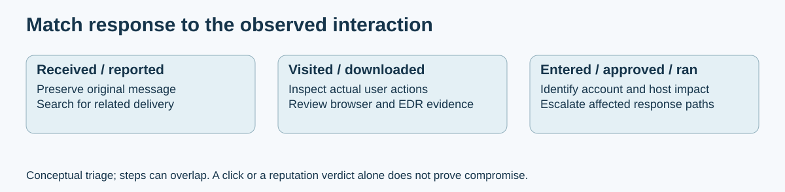
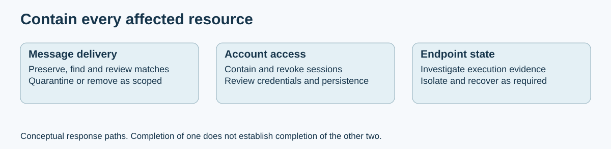

# 🎣 SOP: Phishing Email Analysis

_Last reviewed: 2026-11-17 (source review; no messages, endpoints, accounts or samples accessed)._

**Severity:** Medium to High
**Trigger:** User reports a suspicious email or SEG (Secure Email Gateway) alert.

## 🎯 Purpose
A short, tier-1-analyst-ready SOP for the single most common SOC ticket type: a user-reported or SEG-flagged phishing email. Designed to be followed start-to-finish in one sitting on a single email.

## ⚙️ Function
Three-stage procedure: (1) preserve the message and triage user interaction, (2) inspect URLs and attachments within an approved analysis environment, (3) contain confirmed exposure and record closure or escalation. Use the [Unauthorized Access playbook](unauth_access.md) when account compromise is suspected.

## 🏆 Goal
Contain potential compromise within minutes of a report landing, and produce a consistent, minimal evidence trail (headers, URL verdicts, attachment verdicts) for every phishing ticket regardless of which analyst handles it.

## 📋 When to Use
- A user reports a suspicious email via your reporting button/mailbox
- A SEG (Secure Email Gateway) alert fires on an inbound message
- As the entry point before escalating to `unauth_access.md` if the phish resulted in a successful login

---

## 1. 🛑 Triage & Containment
- **Preserve:** Save the original message and headers, message identifiers, recipient, report time and user account of what happened. Keep an access-controlled original before mailbox removal.
- **Triage:** Ask whether the user only received the message, visited a URL, entered credentials, approved MFA/consent, downloaded a file, or executed content. Record uncertainty.
- **Contain:** Stop further interaction. Follow endpoint response procedures promptly when execution or endpoint compromise is suspected; credential/session exposure also requires identity response. A click alone is not proof of malware execution, and disconnecting a laptop does not revoke a cloud session.
- **Headers:** Review receiver-generated authentication results and the trusted part of the `Received` chain. `Return-Path`, display names and `X-Originating-IP` can be absent, misleading or untrusted. SPF/DKIM/DMARC success does not establish message safety. See [RFC 8601](https://www.rfc-editor.org/rfc/rfc8601) and the [OSINT header-analysis procedure](../OSINT/OSINT_GUIDE.md#step-4-email-header-analysis).
- **Data handling:** Analyze locally first; external header analyzers receive uploaded message data.

*Original conceptual triage aid. Branches can overlap: a message may steal credentials and execute content. Use observed behavior and logs; a reputation label alone does not determine the response.*

## 2. 🔗 URL & Attachment Analysis
Use a dedicated, access-controlled analysis environment. Do not open suspicious content on the user's workstation, sign into real accounts, or assume a snapshot/VPN provides containment.

### URL Analysis

1. Extract and preserve the original destination and redirect context without clicking. Treat query strings as potentially sensitive tokens.
2. Search existing reputation or analysis records where policy permits. Record source and time; no detections is not a clean verdict.
3. Submit a new URL only when its disclosure and request effects are acceptable. [urlscan visibility](https://docs.urlscan.io/pages/visibility) distinguishes public, unlisted and private; **unlisted is shared with vetted Pro users**.
4. If dynamic browsing is needed, use a properly isolated lab and a scoped network plan. A scan can notify an attacker or consume a one-time link; never enter real credentials.

### Attachment Analysis

1. Preserve the original and calculate a **SHA-256** digest on an analysis copy:

   ~~~bash
   sha256sum invoice.pdf
   ~~~

2. Inspect type, metadata and static indicators with approved tools. Hash lookup and file upload are different disclosures; even a lookup shares a queried identifier.
3. Use an approved private sandbox when dynamic analysis is necessary. Do not automatically upload internal documents to public services. [VirusTotal explains that submissions and file contents may be shared](https://docs.virustotal.com/docs/how-it-works).
4. Record tool/version, report time, observed behavior, limitations and confidence. A sandbox run may miss environment-dependent behavior.

## 3. 🧹 Remediation
- **Remove delivery:** Search for related messages with a tested query, inspect matches, preserve required evidence, then quarantine/remove within the response procedure. In Microsoft 365, use the supported Defender/Purview workflow for the tenant's features and roles. [Microsoft's current search/delete guidance](https://learn.microsoft.com/en-us/purview/edisc-search-mailbox-data) requires scope validation and distinguishes PowerShell/Graph paths; a generic purge command is not a complete procedure.
- **Block precisely:** Use confirmed malicious indicators at the appropriate mail/web controls. Assess shared-domain and shared-hosting impact before broad blocks; record the reason and review date.
- **Secure exposed accounts:** For credential theft, suspicious consent/MFA activity or account takeover, follow [Microsoft's compromised-account response](https://learn.microsoft.com/en-us/defender-office-365/responding-to-a-compromised-email-account) and the [access investigation playbook](unauth_access.md). Contain access, reset exposed credentials from a trusted device, revoke affected sessions, inspect authentication methods, OAuth grants, forwarding/inbox rules and sign-in logs. Password reset alone may leave persistence or sessions.
- **Close or escalate:** Record recipients affected, user actions, indicators, evidence, containment results, residual uncertainty and owner. Receipt of a phish alone does not justify resetting every recipient's password.

*Original conceptual response map. Removing a message does not terminate a session; resetting a password does not clean an infected endpoint. Verify each affected path separately.*

---
*Part of the Incident Response & Log Aggregation Branch*
## Related Files

- [README.md](README.md) - PlayBooks section index
- [Unauthorized Access](unauth_access.md) - account investigation and containment
- [Digital Forensics](../IncidentResponse/Digital-Forensics/README.md) - evidence handling and escalation

[Section Index](README.md) | [Master Index](../README.md) | [Legal Notice](../LEGAL.md)
