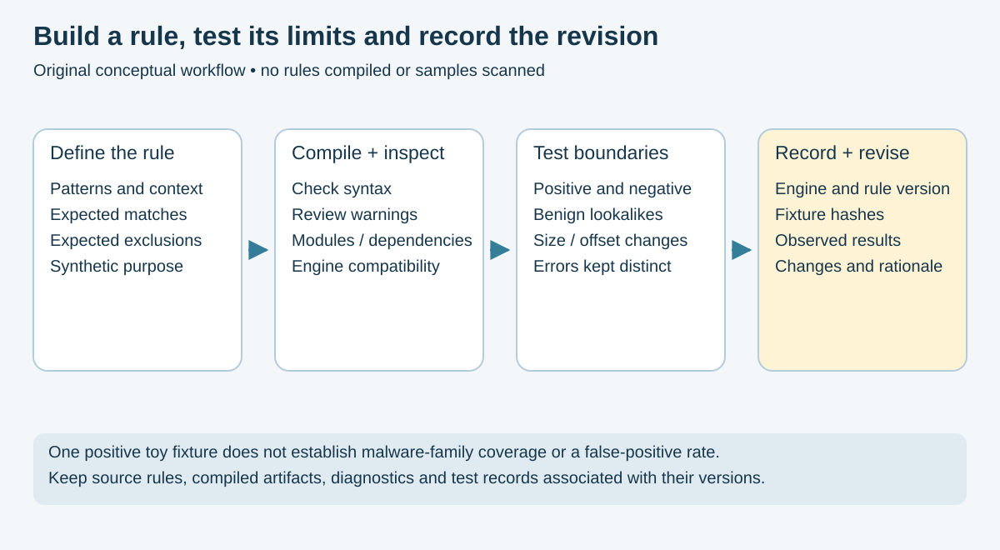
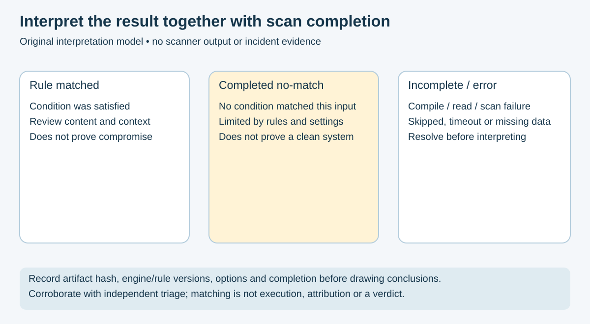

# YARA-X Rule Authoring and Malware Triage Lab

_Last reviewed: 2026-11-17 (source/docs and visual review; no binaries downloaded, rules compiled or samples scanned)_

> [!CAUTION]
> Handle malware, memory images and downloaded test samples inside an
> isolated, access-controlled research environment. Never execute live
> samples on business workstations or against client hosts without written
> authorization and an approved containment plan. See [legal terms](../LEGAL.md).

**Prerequisites:** [Reverse Engineering](README.md) · [REMnux](remnux-malware-analysis-guide.md) · [Digital Forensics](../IncidentResponse/Digital-Forensics/README.md).

## Project role

[VirusTotal YARA-X](https://github.com/VirusTotal/yara-x) is a newer YARA
implementation in Rust with its own version and compatibility considerations.
It is useful for learning artifact classification and testing detection rules;
it is not an antivirus replacement or proof that a matched binary is malware.

The [upstream comparison](https://virustotal.github.io/yara-x/docs/intro/yara-x-vs-yara/)
documents API incompatibilities and no direct process scanning in the described
YARA-X interface. Do not substitute a process ID for a file path or assume
classic YARA compiled rules/APIs are interchangeable.

Existing YARA rules from other projects (including
[signature-base](https://github.com/Neo23x0/signature-base)) should be checked
for license, condition syntax, dependencies, false positives and YARA-X
compatibility before use. Do not bulk-import unreviewed rules.

## Safe synthetic lab



*Figure 1 — Original conceptual rule lifecycle, based on the [rule anatomy](https://virustotal.github.io/yara-x/docs/writing_rules/anatomy-of-a-rule/), [conditions](https://virustotal.github.io/yara-x/docs/writing_rules/rule-conditions/) and [CLI reference](https://virustotal.github.io/yara-x/docs/cli/commands/). This is a plan for testing, not observed scanner output.*

1. Create a disposable, access-controlled lab with a writable scratch
   workspace, separate protected originals and no production shares.
   Isolation limits exposure; it does not guarantee safe parsing of arbitrary files.
2. Install a **pinned, verified** YARA-X release using its upstream
   installation documentation. Confirm current command syntax/CLI support.
3. Generate two synthetic text fixtures locally: one containing an
   invented test marker and another without it. No malware required.
4. Write an original rule requiring the marker and explicit synthetic
   header/size context. A text marker is not a real file-type validator.
   Test positive and negative fixtures separately.
5. Inspect compilation errors/warnings, then test benign lookalikes,
   changed markers, wrong headers and size boundaries. Document false
   positives and false negatives. A toy fixture does not establish malware coverage.
6. Record rule ID, author, revision, engine version, fixture hashes and
   expected output; preserve rules and test results in version control.
7. For genuine incident samples, preserve acquisition, hashes and
   chain-of-custody and perform independent triage rather than trusting
   a single signature result.

### Original toy rule and fixture plan

This intentionally narrow rule recognizes an invented lab record, not a malware
family. Save the rule as `pnwc_lab.yar` only in a reviewed synthetic workspace:

```yara
rule PNWC_Synthetic_Record_V1 : synthetic {
    meta:
        description = "Invented lab record only; no malware classification"
        revision = 1
    strings:
        $header = "PNWC_SYNTHETIC_LAB_V1" ascii
        $marker = "PNWC_TEST_MARKER_7B42" ascii
    condition:
        filesize < 4096 and $header at 0 and $marker
}
```

Prepare text fixtures according to this table. Expected results are predictions,
not measured results. Encoding, line endings and any leading byte-order mark
affect the actual bytes and offset checks.

| Synthetic fixture | Content/context | Expected result |
| --- | --- | --- |
| Positive | Header at byte 0, marker on a later line, total under 4096 bytes | Match |
| Negative | Same header, marker omitted | No match |
| Wrong context | Marker present, header absent or not at byte 0 | No match |
| Boundary | Valid header and marker, total exactly 4096 bytes | No match |
| Lookalike | Similar marker with one changed character, exact marker absent | No match |

The [current documented CLI](https://virustotal.github.io/yara-x/docs/cli/commands/)
is `yr`, with subcommands. Confirm the selected release's help before using
these source-reviewed examples; no commands were run for this guide:

```bash
yr --version
yr compile --help
yr scan --help

# Compile reviewed source; inspect all warnings as well as errors.
yr compile --output pnwc_lab.yarc pnwc_lab.yar

# Evaluate only locally prepared synthetic fixtures, separately.
yr scan --compiled-rules pnwc_lab.yarc positive.txt
yr scan --compiled-rules pnwc_lab.yarc negative.txt
```

Source rules and compiled rules are different inputs; `--compiled-rules`
selects the latter. Preserve engine version, options, diagnostics, each fixture's
hash and observed result. Keep errors, skipped files and incomplete/time-limited
scans distinct from a completed no-match result. Do not suppress warnings or
ignore unsupported modules to make a compatibility failure disappear.

## Detection-quality matrix

| Check | Desired result |
| --- | --- |
| Synthetic positive | Expected rule match |
| Synthetic negative | No match |
| Benign lookalike | No false positive or documented exception |
| Unsupported rule feature | Inspect errors/warnings and dependencies; document any intentionally ignored features |
| Untrusted sample | Static content inspection is intended; no execution of the target is required, and scanner/parser risk still needs containment |
| Report | Artifact hash, engine/rule revision, scan completion and qualified interpretation shown |



*Figure 2 — Original conceptual result-interpretation model. The [YARA-X comparison](https://virustotal.github.io/yara-x/docs/intro/yara-x-vs-yara/) and [rule compatibility notes](https://virustotal.github.io/yara-x/docs/writing_rules/differences-with-yara/) explain engine differences; neither compilation nor a match establishes maliciousness.*

A matching condition identifies content described by that rule; it does not
establish malicious intent, execution, compromise or attribution. No match
applies only to the actual input, engine, rules and completed scan settings.
Packed/encrypted content, uncollected memory and changed patterns can remain
outside that evidence. Correlate with
[Volatility](../IncidentResponse/Digital-Forensics/Memory/volatility_cheatsheet.md),
[Velociraptor triage](../IncidentResponse/Digital-Forensics/velociraptor-artifact-triage.md)
and incident timeline evidence.

## Sources

- [YARA-X](https://github.com/VirusTotal/yara-x) (BSD-3-Clause).
- [YARA-X documentation](https://virustotal.github.io/yara-x/) and [rule-level differences](https://virustotal.github.io/yara-x/docs/writing_rules/differences-with-yara/). Module availability, regex behavior and compiled-rule formats are compatibility questions to test, not assume.
- [signature-base](https://github.com/Neo23x0/signature-base) (review licensing before copying individual rule files).

**Integration status:** original educational diagrams, toy rule and source-reviewed
workflow only. No binaries downloaded, malware acquired, rules compiled or fixtures
scanned. The example's runtime behavior remains unverified; it is not a tested
malware detector.

---

[Reverse Engineering](README.md) · [Main README](../README.md) ·
[Legal terms](../LEGAL.md)
