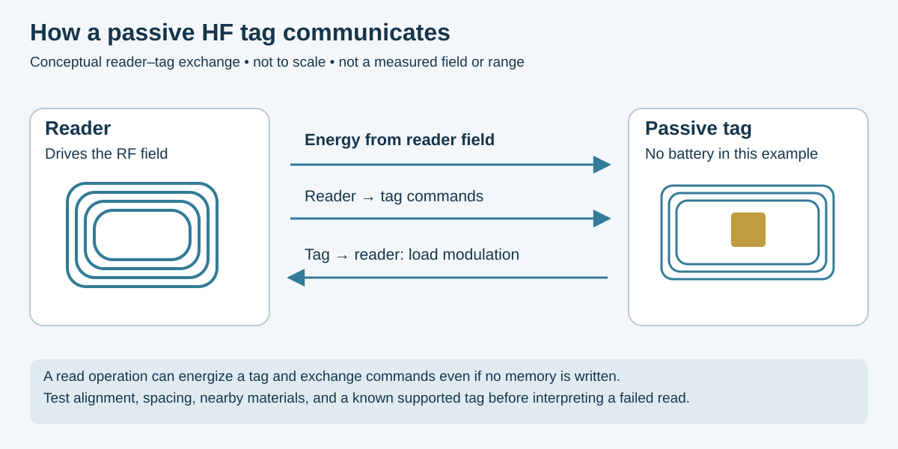
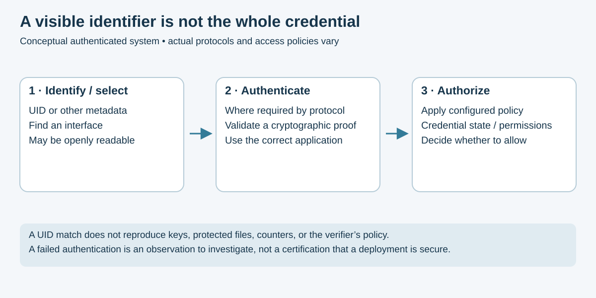
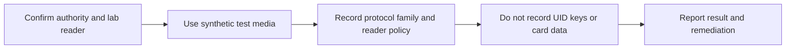
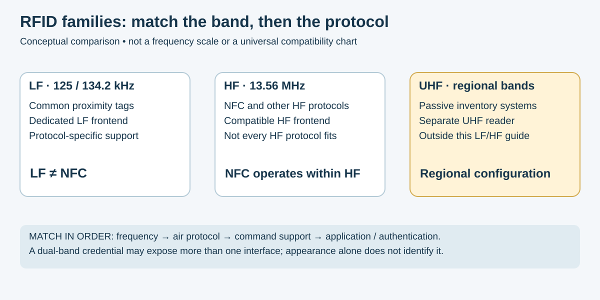
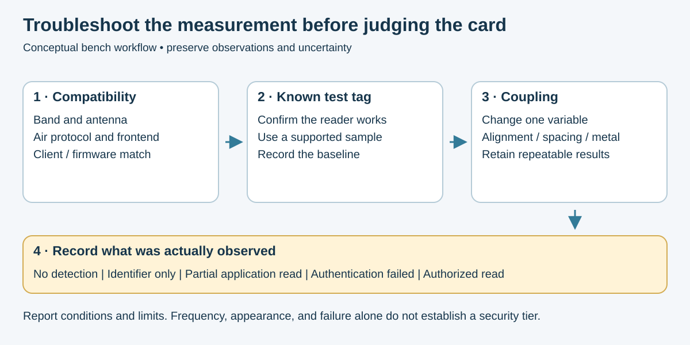
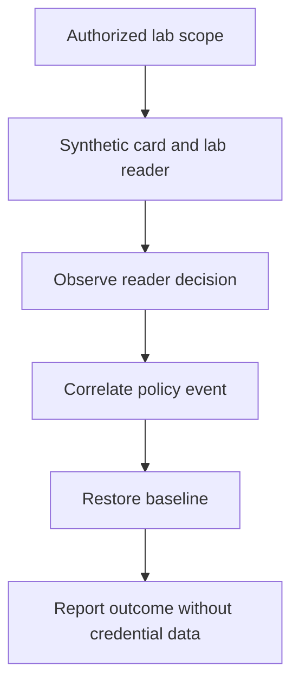

# 💳 RFID & NFC Access Control Exploration & Card Engineering Guide

<div align="center">

**Defensive LF/HF access-control reference for protocol families, synthetic test media, reader policy, and credential protection**

*Part of the [ULTIMATE CYBERSECURITY MASTER GUIDE](../README.md)*


</div>

---

## Firmware & Client Pairing For Current Platforms

| Resource | Role & Compatibility Boundary |
|---|---|
| [Proxmark3 RRG](https://github.com/RfidResearchGroup/proxmark3) | Match client and firmware release/build and exact hardware platform; generic/RDV4 configurations differ. |
| [ChameleonUltra](https://github.com/RfidResearchGroup/ChameleonUltra) | Use upstream-supported GUI/CLI update and identify Ultra versus Lite hardware; a web console alone is not a verified firmware updater. |
| [Bruce](../Documentation/bruce_firmware.md) | Reader functions require the documented PN532 or other compatible frontend; ESP32 alone is not an LF/HF reader. |
| [GhostESP Revival](../Documentation/ghostesp-revival.md) | NFC support depends on target/frontend and selected build; validate with owned test tags. |
| [ESP32 Bit Pirate](../HardwareHacking/esp32-bit-pirate.md) | Separate interface/tooling workflow with external reader requirements; verify voltage and protocol before connection. |

Use only synthetic test media in the workflows below. Do not put card dumps, identifiers, keys, or personal data in source control. A shared extension or UID match does not establish complete card emulation or permission to use a credential.

## 🎯 Purpose

Defensive reference for LF/HF/UHF fundamentals, credential design risks, supported reader capabilities, synthetic test procedures, privacy-safe logging, and access-control mitigations.

## ⚙️ Function

Explains LF/HF/UHF fundamentals, credential design risks, defensive reader assessment, device capability boundaries, result-only reporting, and mitigations. It contains no instructions for recovering credential secrets, writing clones, or emulating access credentials.

## 🏆 Goal

Help defenders assess access-control design with synthetic test media, report protocol-level observations without recording secret identifiers, and prioritize migration to authenticated credentials.

## 📋 When to Use

- Identifying an unknown proximity card by operating frequency and chipset
- Choosing compatible reader hardware for synthetic test media
- Reviewing fixed-identifier versus authenticated credential designs
- Recording a result-only lab policy review without credential secrets

---

## 📋 Table of Contents

- [Educational Foundations](#-1-educational-foundations)
- [Core Principles of RFID & NFC](#-2-core-principles-of-rfid--nfc)
- [Core RFID/NFC Protocol Concepts](#-3-core-rfidnfc-protocol-concepts)
- [Hardware Specific Operations & Flowcharts](#-4-hardware-specific-operations--flowcharts)
- [Entry-Level Proxmark3 Client Guide](#-5-entry-level-proxmark3-client-guide)
- [Dedicated Reader Chips: PN532 vs. EM4095/LF Front-Ends](#-6-dedicated-reader-chips-pn532-vs-em4095lf-front-ends)
- [Troubleshooting: Coupling, Detuning & Failed Reads](#-7-troubleshooting-coupling-detuning--failed-reads)
- [Credential Security Review](#-8-credential-security-review)
- [Master Card & Protocol Reference Matrix](#-9-master-card--protocol-reference-matrix)
- [Transponder Profiles Dictionary](#-10-transponder-profiles-dictionary)
- [Laboratory Result Log](#-11-laboratory-result-log)
- [Example Project: Synthetic Access-Control Policy Review](#-12-example-project-synthetic-access-control-policy-review)
- [⚠️ CRITICAL Security & Legal Warning](#️-critical-security--legal-warning)
- [Resources](#-resources)

---

### 🔴 CRITICAL WARNING

```
This guide is limited to synthetic test media and defensive reader-policy review. It does not provide credential recovery, cloning, or emulation procedures. Keep UIDs, raw IDs, card dumps, keys, payment data, and personal identifiers out of repository notes and screenshots.

Use device-specific vendor documentation for safe setup and compatibility details. Follow applicable access-control, privacy, payment, and computer-misuse rules; authorization and legal requirements depend on the activity, jurisdiction, and facts. The [18 U.S.C. § 1029](https://uscode.house.gov/us/usc/t18/s1029/) statute defines specific access-device offenses and does not make every act of reading card data a federal crime.
```

---

## 🎓 1. Educational Foundations

**The "Who, What, When, and Why" of RFID Analysis.**

### What Is It?

RFID (Radio Frequency Identification) analysis is the systematic reading, recording, and interpretation of the short-range electromagnetic exchanges between a reader and a passive transponder. In the Low-Frequency (LF) spectrum (125–134 kHz), credentials are mostly simple, unencrypted identifiers energized by inductive coupling and read from a few centimeters away. In the High-Frequency (HF) spectrum (13.56 MHz), transponders run structured, sometimes cryptographic protocols (ISO 14443, ISO 15693, FeliCa, NFC) that carry sectored memory, mutual authentication, and NDEF data.

### Who Uses It?

| Role | Application |
|------|-------------|
| **Access Control Engineers** | Validate credential provisioning, reader compatibility, and enrollment workflows against spec |
| **Security Auditors / Red Teams** | Evaluate whether a facility relies on cloneable fixed-ID cards or broken ciphers vulnerable to duplication |
| **Physical Penetration Testers** | Assess badge-cloning exposure and tailgating/credential-capture risk during authorized engagements |

### When Is It Conducted?

- **During Product R&D:** To verify custom readers and enrollment tools write and read credentials exactly as specified.
- **During Security Assessments:** To audit whether a badge population uses legacy fixed-ID or broken-cipher technology.
- **During Migration Planning:** When an organization moves from LF prox or MIFARE Classic to secure HF credentials (DESFire EV3, SEOS) and needs to inventory what is currently deployed.

### Why Is It Critical?

Credential security depends on the transponder, reader, key management, and authorization policy together. Unlike a password, a physical card is presented in the open and can be read at a distance by anyone with the right coil. Understanding how transponders are energized, addressed, authenticated, and parsed is the only path toward selecting and deploying access-control technology that actually resists duplication.

---

## 📡 2. Core Principles of RFID & NFC

<a id="nfc-passive-tag-coupling"></a>



*Figure 1 — Original conceptual diagram of a passive HF exchange, not a measured field map or range. Based on [NXP's PN532/C1 description](https://www.nxp.com/products/PN5321A3HN) and [NFC Forum's technology overview](https://nfc-forum.org/learn/NFC-technology/). Reading can involve RF transmission even when tag memory is not written.*

- **Inductive Coupling:** Passive transponders have no battery. The reader's antenna generates an alternating field that energizes the tag's coil; the tag replies by load-modulating (backscattering) that same field. Read range depends on coupling, antenna tuning, field strength, tag design, and nearby materials.
- **Two Distinct Bands:** LF (125–134 kHz) offers short range and good penetration of non-metallic materials with simple, mostly unencrypted protocols. HF (13.56 MHz) offers higher data rates, sectored memory, and cryptographic options, but shorter range and more sensitivity to detuning by metal and the human body.
- **Encoding & Modulation:** LF credentials typically use Manchester, Biphase, or PSK encoding on an ASK/OOK-modulated subcarrier. HF ISO 14443A uses Miller/Manchester coding with a 847.5 kHz subcarrier; ISO 15693 uses a longer-range "vicinity" scheme.
- **Security Categories:** Credentials generally fall into three tiers:
  - **Fixed ID (read-only):** The transponder returns the same static identifier every time (e.g., EM4100, HID Prox). Trivially cloneable.
  - **Broken Cipher:** A once-proprietary cryptographic scheme that has since been publicly defeated (e.g., MIFARE Classic Crypto1, legacy HID iCLASS). Recovery prerequisites and feasibility depend on the exact chip, implementation, available authentication data, and tool support.
  - **Strong Cipher:** Modern authenticated schemes using AES/3DES (e.g., MIFARE DESFire EV2/EV3, MIFARE Plus, SEOS). Security depends on correct protocol use, key provisioning, and the verifier; the chip name alone is not a deployment assessment.

---

## 🧩 3. Core RFID/NFC Protocol Concepts

<a id="rfid-identification-authentication-authorization"></a>



*Figure 2 — Original conceptual model. [NXP's UID application note](https://www.nxp.com/docs/en/application-note/AN10927.pdf) describes selection identifiers; the [NXP DESFire EV3 documentation](https://www.nxp.com/products/MF3DHx3) describes authentication and application access rights. The authorization box is an engineering model of the verifier, not a claim about a particular installed system.*

To thoroughly analyze contactless credentials, it is essential to understand the memory layouts and authentication models running on target transponders.

### Fixed-ID Transponders (e.g., EM4100, HID Prox)

Fixed-ID architectures broadcast a static identifier the instant they enter a reader's field. There is no memory to write, no key to present, and no challenge-response. Because the identifier never changes and there is no cryptographic verification, a compatible writable transponder may reproduce the identifier. Whether a reader accepts it depends on its supported format, enrollment, revocation state, and authorization policy. They dominate legacy building access and many older parking and elevator systems.

### Sector-Authenticated Transponders (e.g., MIFARE Classic / Crypto1)

MIFARE Classic divides memory into sectors protected by two 48-bit keys (A and B) and access-condition bits. Its proprietary Crypto1 cipher has publicly documented weaknesses that can undermine key confidentiality. Treat deployments that still rely on this technology as legacy; inventory use, restrict fallback modes, and plan migration. This guide does not provide key-recovery, dumping, or rewriting steps.

### Strongly-Authenticated Transponders (e.g., MIFARE DESFire, SEOS, iCLASS SE)

Modern credential families can support cryptographic authentication and application-specific access rights. Exact algorithms, key diversification, and readable metadata depend on the product and configuration; do not assume every listed family has an identical architecture. A visible UID or an openly readable file does not reproduce a protected application. Review the *deployment*: key provisioning and storage, application permissions, reader trust, and the backend authorization decision. A failed authentication attempt alone does not certify that these controls are correctly deployed.

---

## 🔨 4. Hardware Specific Operations & Flowcharts

### Hardware Capability Overview

These devices have varied read, write, sniff, and emulation capabilities. Listing a device is not an instruction to use those functions. This guide supports only non-sensitive identification on synthetic media and reader-policy review.

| Device | Broad capability | Safe use described here |
|--------|------------------|-------------------------|
| [Proxmark3 RDV4 / Easy](https://proxmark.com/) | LF/HF analysis; capabilities vary by firmware | Verify instrument and antenna status; use synthetic lab tags |
| [Flipper Zero](https://flipper.net/) | LF/HF accessory and firmware-dependent features | Review model/firmware and test only with synthetic media |
| [Chameleon Ultra](https://github.com/RfidResearchGroup/ChameleonUltra) | LF/HF test and emulation features | Use only vendor-provided synthetic test data and a lab reader |
| [PN532 + libnfc](https://github.com/nfc-tools/libnfc) | HF reader front-end | Identify test tags; do not dump or rewrite credentials |
| [iCopy-X](https://icopy-x.com/) | Automated LF/HF read/write features | Keep clone workflows out of production; use synthetic fixtures only |



### 📌 Proxmark3 (Reference Bench Tool)

Use only instrument-health checks and identification on synthetic tags. Do not use credential-dump, key-recovery, write, or emulation functions from third-party documentation as part of this repository's workflow.

### 📌 Flipper Zero (Standalone Portability)

Menu names and supported formats vary by firmware. Limit lab exercises to synthetic test media and record only the technology family and firmware version; do not export real card data.

### 📌 PN532 + libnfc (HF Reader)

The PN532 is an HF front-end. Keep tests to synthetic tags and non-sensitive reader behavior. Do not collect card UIDs, sector contents, keys, or other credential data.

### 📌 Chameleon Ultra (Test Fixture)

Because this device supports emulation, keep it disconnected from production readers. Use vendor test media and a reader owned by the lab; this guide does not provide credential-import or emulation steps.

### 📌 iCopy-X (Read/Write Device)

Automated read/write capability creates a high risk of copying physical credentials. Do not use it on issued cards. For defensive validation, use a synthetic test fixture and document only policy outcomes.

---

## 🛠️ 5. Entry-Level Proxmark3 Client Guide

For safe lab work, record the Proxmark3 model, firmware revision, host software version, antenna status, and synthetic test-tag family. Prefer vendor documentation for model-specific setup.

**Do not** run automated dump, key-recovery, write, clone, or emulation workflows against issued badges, payment media, transit cards, vehicle keys, passports, or other real credentials. This guide intentionally omits those commands.

| Review item | Record |
|---|---|
| Device and firmware | Model, hardware revision, firmware/build |
| Test fixture | Synthetic tag type supplied for the lab |
| Reader | Lab reader model and configuration |
| Observation | Supported protocol family and whether the expected reader policy event occurred |
| Data minimization | No UID, keys, block contents, or personal/account data in this repository |
| Cleanup | Restore the lab reader configuration and dispose of synthetic data per the test plan |

### Read-only result handling

When an approved lab tool displays an identifier, treat it as a credential: do not copy it into notes, screenshots, command histories, or repository issues. Use a random test label such as `TEST-TAG-01` and retain any restricted evidence only in the organization's approved evidence store.

---

## 🔌 6. Dedicated Reader Chips: PN532 vs. EM4095/LF Front-Ends

<a id="rfid-band-and-reader-map"></a>



*Figure 3 — Conceptual compatibility map. NFC operates at 13.56 MHz within HF; it does not cover LF or UHF RFID. Exact reader, antenna, firmware, and protocol support require verification.*

Reader front-ends differ by frequency band and protocol. Use manufacturer documentation and synthetic fixtures; do not collect or rewrite data from issued credentials.

### PN532 (13.56 MHz HF)

Supports selected ISO 14443 and NFC modes; actual support depends on the module, firmware, and library. Use a synthetic tag to check compatibility and record only the protocol family and observed reader policy.

### EM4095 / RDM6300 (125 kHz LF)

These front-ends support specific LF tag and reader configurations. Verify their data sheets and output formats. Use synthetic test tags; do not log identifiers from issued credentials or build covert access logging devices.

### Reader Front-End Matrix

| Feature | PN532 Module | EM4095 / RDM6300 Module |
| :--- | :--- | :--- |
| **Frequency** | 13.56 MHz (HF) | Typically 125 kHz (LF); confirm module specification |
| **Protocol support** | Module/library-dependent HF modes | Module-dependent LF tag formats |
| **Use in this guide** | Synthetic-tag compatibility and reader-policy review | Synthetic-tag compatibility and reader-policy review |
| **Credential data** | Do not dump, retain, or rewrite issued-card data | Do not log identifiers from issued cards |

---

## 🧯 7. Troubleshooting: Coupling, Detuning & Failed Reads

<a id="rfid-read-troubleshooting-evidence"></a>



*Figure 4 — Original conceptual troubleshooting workflow, informed by [Proxmark antenna guidance](https://github.com/Proxmark/proxmark3/wiki/Antennas) and the [RRG command reference](https://github.com/RfidResearchGroup/proxmark3/blob/master/doc/commands.md). It is not a tested sequence for every model; antenna measurements and expected values depend on hardware.*

When reading passive transponders, check hardware compatibility, coupling, antenna condition, and client configuration before concluding a card is unreadable. A failed read alone does not identify the cause.

### ⚠️ Weak Coupling / No Read

- **The Symptom:** `lf search` / `hf search` reports no card even though you are holding a valid credential.
- **The Cause:** The card is off-center, tilted, too far from the coil, or (for HF) sitting on a metal surface that spoils the field.
- **The Fix:** Lay the card flat and centered directly on the antenna. Remove the card from any metal surface or wallet, and re-run `hw tune` to confirm the antenna itself is healthy before blaming the card.

### ⚠️ Antenna Detuning (Low Tune Voltage)

- **The Symptom:** `hw tune` reports an LF or HF peak voltage well below the expected healthy range, and reads are intermittent.
- **The Cause:** A damaged, wrong, or poorly-seated antenna, nearby metal, or a coil resonating away from 125 kHz / 13.56 MHz.
- **The Fix:** Reseat the correct antenna, move away from metal and other coils, and confirm the tune peaks near 125 kHz (LF) and 13.56 MHz (HF). Only trust read results once the antenna tunes cleanly.

### ⚠️ Frequency Band Mismatch

- **The Symptom:** A card reads on one tool but not another, or returns nothing regardless of positioning.
- **The Cause:** Presenting an LF (125 kHz) card to an HF (13.56 MHz) reader/app or vice-versa - the two bands are physically incompatible.
- **The Fix:** Confirm the band before reading: try LF and HF searches in turn, and on multi-app tools (Flipper) select the matching `125 kHz RFID` vs `NFC` application. Dual-frequency cards contain two independent chips - read each on its own band.

### ⚠️ Authentication or Identification Failure

- **Observation:** A synthetic tag is not identified or the lab reader rejects it.
- **Possible causes:** Unsupported protocol, device/firmware mismatch, weak coupling, reader configuration, or incorrect test expectations.
- **Defensive handling:** Verify compatibility with vendor documentation and the known synthetic fixture. Record conditions and outcome; do not attempt key recovery or infer that a credential deployment is secure from one failed test.

---

## 💻 8. Credential Security Review

This section replaces key-recovery and cloning recipes with a defensive review of credential design and deployment.

| Design property | Review question | Defensive response |
|---|---|---|
| Static identifier | Does the reader authorize solely from a fixed identifier? | Migrate to authenticated credentials; enforce enrollment, revocation, and anti-passback policy where appropriate |
| Legacy cipher | Is a retired or broken cryptographic scheme still accepted? | Plan migration, monitor legacy-reader use, and restrict access during transition |
| Key management | Are keys shared across cards, sites, or customers? | Use per-credential diversification, protected key storage, rotation, and documented ownership |
| Reader configuration | Are fallback modes or legacy formats enabled? | Disable unused formats and review configuration changes |
| Lost/revoked cards | Does revocation propagate to every reader? | Test revocation using synthetic credentials and confirm expected event/deny behavior |
| Audit evidence | Are reader decisions and admin changes logged? | Centralize logs, restrict access, and retain according to policy |

A failed read or authentication does not prove a card family is secure. Report the instrument, firmware, lab fixture, reader configuration, conditions, and observed policy outcome without recording credential secrets.

---

## 🗂️ 9. Master Card & Protocol Reference Matrix

The table below serves as a laboratory lookup guide to identify an unknown credential based on its operating frequency and map it to the known transponder architecture.

| Credential Category | Target Device Example | Operating Frequency | Primary Transponder / Protocol |
| :--- | :--- | :--- | :--- |
| **Legacy Building Access** | EM4100/EM4102 Prox Fob | 125 kHz (LF) | EM Microelectronic - Read-Only Fixed ID |
| **Legacy Building Access** | HID ProxCard II / ProxKey | 125 kHz (LF) | HID Prox - Wiegand over FSK, Fixed ID |
| **Legacy Building Access** | Indala (Motorola) | 125 kHz (LF) | Indala - PSK, Fixed ID |
| **Legacy Building Access** | AWID | 125 kHz (LF) | AWID - FSK, Fixed ID |
| **Automotive Immobilizer** | Car Key Transponder | 125–134 kHz (LF) | HITAG2 / Megamos - Challenge-Response |
| **Writable Clone Blank** | T5577 / EM4305 | 125 kHz (LF) | Multi-protocol writable transponder |
| **Building Access (HF)** | MIFARE Classic 1K/4K | 13.56 MHz (HF) | ISO 14443A - Crypto1 (broken) |
| **Building Access (HF)** | HID iCLASS Legacy | 13.56 MHz (HF) | ISO 15693 / Picopass - Weak default keys |
| **Building Access (HF)** | HID iCLASS SE / SEOS | 13.56 MHz (HF) | Secure Element - AES (strong) |
| **Secure Building Access** | MIFARE DESFire EV2/EV3 | 13.56 MHz (HF) | ISO 14443A - AES/3DES (strong) |
| **Transit & Ticketing** | MIFARE Ultralight / EV1 | 13.56 MHz (HF) | ISO 14443A - No/limited crypto |
| **Transit (Asia)** | Sony FeliCa | 13.56 MHz (HF) | JIS X 6319-4 - FeliCa protocol |
| **NFC Tags / Smart Posters** | NTAG213/215/216 | 13.56 MHz (HF) | ISO 14443A - NDEF, no auth |
| **Contactless Payment** | EMV Credit/Debit Card | 13.56 MHz (HF) | ISO 14443 - EMV, cryptographic |
| **Asset / Inventory** | UHF Warehouse Tag | 860–960 MHz (UHF) | EPC Gen2 / ISO 18000-6C (out of LF/HF scope) |
| **Animal / Pet Microchip** | ISO Pet Chip | 134.2 kHz (LF) | ISO 11784/11785 - Read-Only Fixed ID |
| **Passport / eID** | ePassport (ICAO) | 13.56 MHz (HF) | ISO 14443 - BAC/PACE protected |

---

## 📖 10. Transponder Profiles Dictionary

Use this high-level dictionary to understand the protocol families in the reference matrix; it is not an operational credential analysis guide.

- **EM4100 / EM4102:** Legacy LF fixed-identifier technology. The common EM4100-compatible frame is 64 bits total, carrying a 40-bit identifier plus framing and parity bits; see the [EM4200 datasheet](https://www.emmicroelectronic.com/sites/default/files/products/datasheets/em4200_ds.pdf). Reader acceptance depends on format support, enrollment, revocation, and deployment policy.
- **HID Prox:** A legacy 125 kHz credential family that may encode a fixed facility/card value. Reader acceptance depends on format support, enrollment, revocation, and deployment policy.
- **Indala / AWID:** Legacy LF formats with static identifiers. Assess reader configuration, enrollment, and revocation rather than assuming a reader accepts any reproduced identifier.
- **HITAG2 / Megamos:** LF automotive immobilizer transponders using proprietary challenge-response crypto. Historically significant for the publicly-disclosed weaknesses that enabled key recovery - the reason modern vehicles moved to stronger schemes.
- **T5577 / EM4305:** Writable multi-protocol LF test transponders. Use synthetic fixtures only; do not reproduce an issued identifier.
- **MIFARE Classic (Crypto1):** A legacy HF design with publicly documented cryptographic weaknesses. Organizations should inventory where it remains enabled, restrict fallback use, plan migration, and monitor reader configuration.
- **MIFARE Ultralight / NTAG:** Low-cost HF chips with little or no cryptography. Ultralight is common in disposable transit tickets; NTAG carries NDEF for tap-to-launch and smart posters. Data is generally readable and, for NTAG, writable unless locked.
- **MIFARE DESFire (EV1/EV2/EV3):** Modern HF smartcards can use AES/3DES mutual authentication, isolated application files, and diversified keys. Security depends on correct deployment and key management.
- **HID iCLASS:** A 13.56 MHz family with multiple generations and security configurations. Distinguish legacy and modern variants, and verify the exact product and deployment rather than inferring security from the family name.
- **Sony FeliCa:** A fast HF protocol dominant in Japanese transit and payments. Uses its own command set and mutual authentication; analysis focuses on the service/block structure rather than a broken cipher.
- **EMV Contactless:** Payment credentials use transaction-specific cryptographic controls. This guide does not cover capturing or replaying payment data.

---

## 📝 11. Laboratory Result Log

Use this result-only template for a synthetic-card or reader-policy review. Do not record UIDs, raw IDs, keys, dumps, account numbers, or cardholder data in source control.

```markdown
# Access-Control Test Result: [TEST-ID]

## Test context
- Date/time (UTC):
- Operator:
- Authorization/ticket:
- Lab reader model and configuration:
- Reader firmware:
- Test fixture label (synthetic only):
- Tag family and instrument/firmware:

## Observation
- Expected policy outcome:
- Observed allow/deny/event outcome:
- Test conditions and repetitions:
- Relevant reader/endpoint log reference (restricted evidence store only):
- Unexpected behavior or service impact:

## Cleanup and follow-up
- Lab configuration restored:
- Synthetic fixture/data removed or retained per plan:
- Credential secrets copied to repository: No
- Finding owner and remediation:
```

---

## 🚪 12. Example Project: Synthetic Access-Control Policy Review

Use an administrator-approved lab reader and a synthetic test card supplied for the exercise. Do not use an issued employee, hotel, transit, payment, vehicle, or identity credential.

### Phase 1: Prepare

- [ ] Confirm written scope, lab reader ownership, stop conditions, and evidence handling.
- [ ] Record reader model, firmware, configuration baseline, and expected access policy.
- [ ] Use a synthetic fixture with no real account or facility identifier.

### Phase 2: Observe

- [ ] Record only the fixture label and broad protocol family.
- [ ] Present the fixture to the lab reader once per approved test case.
- [ ] Record allow/deny behavior and the corresponding reader event.
- [ ] Do not dump sectors, recover keys, copy identifiers, write blanks, or emulate a credential.

### Phase 3: Validate controls

- [ ] Confirm revocation and access-policy changes using the synthetic fixture.
- [ ] Check that reader logs contain the expected event and are centrally retained.
- [ ] Stop if the test reaches a production reader or reveals personal credential data.

### Phase 4: Restore and report

- [ ] Restore the documented reader baseline and remove synthetic test records as planned.
- [ ] Report protocol family, conditions, outcome, and remediation; exclude identifiers and secrets.



---

## ⚠️ CRITICAL Security & Legal Warning

### 🔴 ACCESS-CONTROL & PRIVACY WARNING

This guide is limited to synthetic test media and defensive reader-policy review. Do not read, dump, record, clone, or emulate issued access, payment, transit, vehicle, passport, or identity credentials. Keep identifiers, card data, keys, and personal data out of repository notes and screenshots.

Unauthorized credential use may violate applicable access-device, trespass, privacy, payment, workplace, or other rules depending on the conduct, authorization, jurisdiction, and facts. [18 U.S.C. § 1029](https://uscode.house.gov/us/usc/t18/s1029/) defines specific access-device offenses and does not make every act of reading card data a federal crime.

### Defensive Lab Checklist

```
☐ Is this an isolated lab with a synthetic test fixture?
☐ Is the reader owned by the lab and configured for this test?
☐ Are the expected allow/deny results and stop conditions documented?
☐ Are identifiers, keys, and personal data excluded from logs and screenshots?
☐ Is the reader baseline restored and test data handled under the plan?

If any answer is NO: stop and resolve the scope or handling issue first.
```

### Warranty and Scope

This guide is an educational reference, not a certification of device compatibility or legal advice. Reader behavior varies by hardware, firmware, protocol, and deployment. Follow vendor documentation and the applicable test plan. Report observed results with their limits; do not infer safety or exploitability from a single test.

---

## 📚 Resources

**Visual provenance:** Figures 1–4 are original static vector teaching diagrams. They contain no measured RF traces, captured credentials, or reproduced access-control results. Sources and limits appear beside each figure.

### Legal & Standards

- **ISO/IEC 14443**: [Proximity card standard (HF)](https://www.iso.org/standard/73596.html)
- **ISO/IEC 15693**: [Vicinity card standard (HF)](https://www.iso.org/standard/73602.html)
- **NIST SP 800-116**: [PIV in Physical Access Control](https://csrc.nist.gov/publications/detail/sp/800-116/rev-1/final)

### Learning RFID & NFC

- **Proxmark3 Iceman Wiki**: [RfidResearchGroup/proxmark3](https://github.com/RfidResearchGroup/proxmark3/wiki)
- **Proxmark Forum**: [RRG Proxmark3 GitHub & Documentation](https://github.com/RfidResearchGroup/proxmark3)
- **NFC / MIFARE background**: [nfc-tools.org](https://nfc-tools.org/)
- **Flipper Zero Docs**: [docs.flipper.net](https://docs.flipper.net/)

### Tooling

- **Proxmark3 (Iceman/RRG)**: [github.com/RfidResearchGroup/proxmark3](https://github.com/RfidResearchGroup/proxmark3)
- **libnfc**: [github.com/nfc-tools/libnfc](https://github.com/nfc-tools/libnfc) — consult upstream docs for supported hardware and safe lab use
- **Chameleon Ultra**: [github.com/RfidResearchGroup/ChameleonUltra](https://github.com/RfidResearchGroup/ChameleonUltra)
- **libnfc PN532 tools**: [github.com/nfc-tools/libnfc](https://github.com/nfc-tools/libnfc)

---

## 🔗 Quick Links

### Internal Links

- [🏠 Main Repository](../README.md)
- [🎯 START HERE Guide](../START_HERE.md)
- [💻 Cybersecurity Master Guide](../ultimate_cybersecurity_master_guide.md)
- [🔧 Hardware Hacking](../HardwareHacking/README.md)
- [📻 Sub-GHz RF Guide](subghz.md)
- [📚 Documentation](../Documentation/README.md)

---

## 📊 Repository Statistics

```
📁 Manual Sections: 12 (Theory, Hardware, Reader Interfaces, Security Review, Reference, Result Logging)
💳 Target Hardware: Proxmark3, Flipper Zero, Chameleon Ultra, PN532/libnfc, iCopy-X
📡 Spectrum Coverage: 125 kHz LF + 13.56 MHz HF (ISO 14443 / 15693 / FeliCa)
💻 Ecosystems: Proxmark3, libnfc, Flipper Zero, and lab readers (capability varies)
⚠️ Scope: Defensive review and synthetic test fixtures only
🔄 Last Updated: August 2026
👥 Maintained by: Pacific Northwest Computers (PNWC)
📝 Status: Active - Proceed with EXTREME CAUTION
```

---

<div align="center">

**⚠️ USE THESE RFID TOOLS RESPONSIBLY AND LEGALLY ⚠️**

*A credential is presented in the open, but cloning and using one is regulated by law.*

**Repository**: [ULTIMATE CYBERSECURITY MASTER GUIDE](https://github.com/Pnwcomputers/ULTIMATE-CYBERSECURITY-MASTER-GUIDE)

**Maintained by**: [Pacific Northwest Computers](https://github.com/Pnwcomputers)

</div>

---

## Related Files

- [subghz.md](subghz.md) - Sub-GHz RF guide: multi-band signal capture, protocol reversing, GNU Radio, replay analysis below 1 GHz
- [sdr.md](sdr.md) - Foundational SDR guide: GNU Radio, hardware, signal analysis, Wi-Fi/BT/cellular/GPS
- [sdr_hacking.md](sdr_hacking.md) - Advanced SDR hacking: SIGINT, protocol reversing, LoRa, TEMPEST, baseband exploitation
- [../Documentation/flipper_zero_guide.md](../Documentation/flipper_zero_guide.md) - Flipper Zero: LF/HF RFID reading and emulation on the same hardware
- [../HardwareHacking/README.md](../HardwareHacking/README.md) - Hardware hacking: bench techniques that complement transponder analysis
- [Unsaflok 2024 Case Study](../CaseStudies/hardware/unsaflok-3m-hotel-locks.md) - Three-million-door RFID/key-management disclosure; defensive context, not bypass instructions
- [Onity Hotel-Lock Research](../CaseStudies/hardware/onity-locks-2012.md) - Contrast service-port trust failure with RFID credential weaknesses

---

<div align="center">

🔴 **CLONING ACCESS CREDENTIALS CAN FACILITATE SERIOUS CRIMES** 🔴

🔴 **UNAUTHORIZED USE OF A CLONED CARD = A CRIME** 🔴

🔴 **NEVER TOUCH PAYMENT, PASSPORT, OR eID CHIPS YOU DO NOT OWN** 🔴

🔴 **WORK ONLY ON OWNED/AUTHORIZED CARDS AND BENCH READERS** 🔴

⭐ **Star this repo if you find it useful (and use it legally!)** ⭐

</div>
