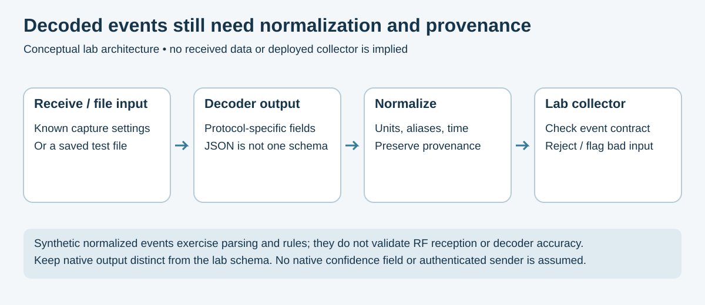
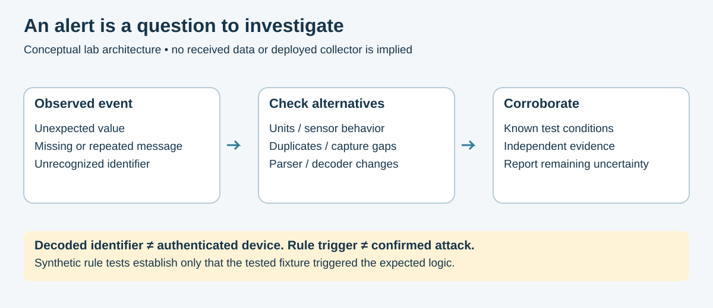

# rtl_433 Passive IoT Telemetry and Detection Lab

_Last reviewed: 2026-11-17 (source and visual review; no RF reception performed)_

> [!CAUTION]
> **Receive-only and authorized environment.** Check local laws, privacy
> expectations and organizational permission before capturing RF data. Do not
> intercept protected communications, rebroadcast, replay, jam or impersonate
> devices. Do not publish raw device identifiers, precise locations or logs
> tying traffic to individuals.

**Prerequisites:** [SDR index](README.md) · [Sub-GHz overview](subghz.md) ·
[Target Frequencies & Protocols](target_frequencies_protocols.md) ·
[SIEM integrations](../IncidentResponse/SIEM/README.md).

## Project role and hardware fit

[rtl_433](https://github.com/merbanan/rtl_433) is a receiver/decoder
for various unlicensed-band device signals; its name is historical and it
supports multiple regions/bands and SDR backends. Use a compatible,
receive-only RTL-SDR or supported SDR backend, with the antenna/band matched
to the environment. Always verify the installed build's options and the
country's permitted frequencies.

It can decode some wireless sensors and telemetry but cannot decode every
protocol or encrypted transmission. Observing RF telemetry is **not**
equivalent to authenticating the sender or confirming malicious activity.

## Controlled lab procedure

*Figure 1 — Original conceptual architecture. [Upstream input/output documentation](https://github.com/merbanan/rtl_433/blob/master/docs/STARTING.md) describes file inputs and output options. Normalization and collector validation are proposed lab components, not built-in proof of a consistent sensor schema.*

1. Inventory owned lab sensors and their make/model, channel/frequency and
   expected update intervals. Use known non-sensitive synthetic fixtures first.
2. In a separate research machine, install a pinned and verified release
   from [upstream](https://github.com/merbanan/rtl_433); document tuner,
   SDR backend, sample rate and firmware.
3. Test receiver health with known, permitted sensor transmissions. Avoid
   claiming an absent sensor is offline if it might be out of range,
   transmitting infrequently or using unsupported modulation.
4. Restrict capture to the appropriate band and time window. Retain only
   necessary metadata; strip addresses or identifiable sensor IDs in
   customer reports.
5. Where supported, emit local JSON events into a segregated lab collector
   with explicitly mapped observation time, sensor alias, decoder identity,
   measurement and units. Add these in the normalizer when absent; do not
   assume a native confidence score or common schema. Validate the contract
   before ingestion and retain rejected-event counts.
6. Create synthetic rule tests for implausible value changes, unexpected
   identifiers and message-rate anomalies. Include benign changes, duplicate
   transmissions, gaps, unit errors and malformed events. Synthetic normalized
   events test rules; decoder accuracy requires separately labeled RF or
   sample-file ground truth.
7. Compare with [Kismet](../Wardriving/kismet.md),
   [Snort](../IncidentResponse/IDS%26IPS/snort.md) or Wazuh where relevant,
   but do not assume shared 802.11 or Ethernet visibility. These sources
   observe different protocols and can produce independent false positives.

## Test data shape

*Figure 2 — Original reasoning aid. Anomaly rules do not authenticate sensors or confirm attacks. The alternatives are review questions, not results from a deployed detector.*

A *normalized illustration*, not guaranteed literal rtl_433 output:

~~~json
{
  "observed_at_utc": "2026-11-17T12:00:00Z",
  "sensor_alias": "lab-weather-01",
  "radio_band": "region-appropriate",
  "protocol": "verified-decoder-name",
  "measurement": {"temperature_c": 21.0},
  "provenance": {"source": "synthetic-fixture", "decoder_version": null},
  "assessment": "synthetic-example"
}
~~~

The real decoder output varies by hardware/protocol/version. Use the
[rtl_433 protocol and output documentation](https://github.com/merbanan/rtl_433)
before building parser contracts. Keep observation time separate from any sensor-provided time. A null decoder version in this fixture means no decoder was run; real captures must record it. JSON syntax validity alone does not verify units, timestamps, or provenance.

## Sources

- [rtl_433 source and docs](https://github.com/merbanan/rtl_433) (see upstream license).
- [SDR target list](target_frequencies_protocols.md) ·
  [NanoVNA impedance measurements](nanovna/README.md) ·
  [Wazuh integration](../IncidentResponse/SIEM/README.md).

**Status:** guide only. No RF data collected, service enabled, decoder
installed, radio transmissions or client monitoring performed.

---

[SDR index](README.md) · [Main guide](../README.md) ·
[Legal notice](../LEGAL.md)
