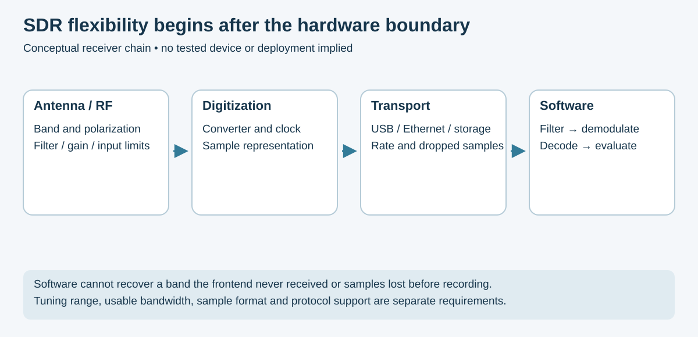
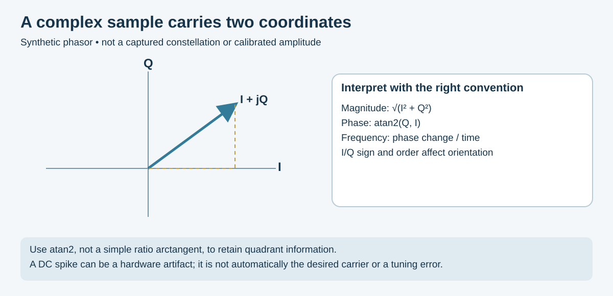
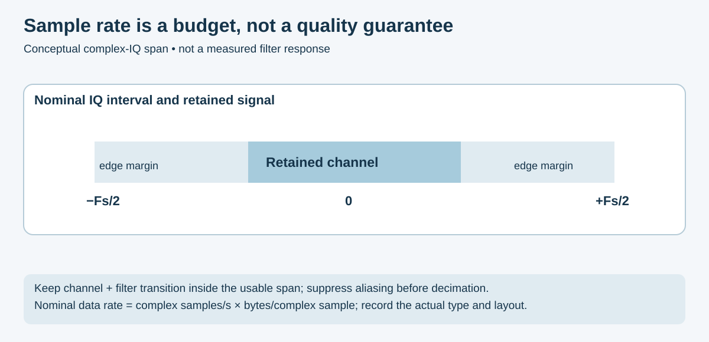
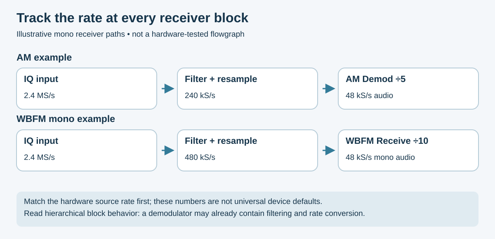
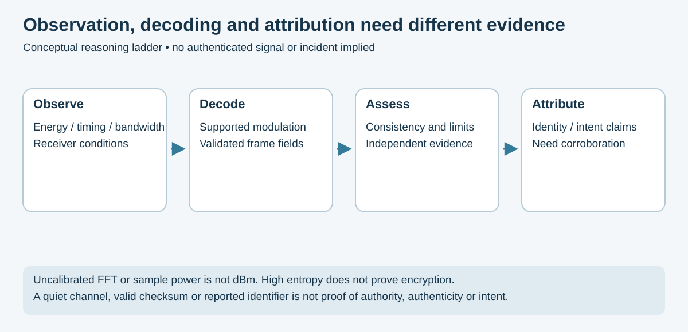

# Software Defined Radio (SDR)

## 🎯 Purpose
Foundational SDR guide covering theory and practice from first principles through advanced signal intelligence - IQ sampling, GNU Radio flowgraph design, hardware selection, antenna fundamentals, and application chapters on Wi-Fi, Bluetooth, cellular, GPS, and satellite signal analysis.

## ⚙️ Function
Organized in five parts: (I) Foundations; (II) GNU Radio; (III) signal processing; (IV) protocol applications; and (V) advanced techniques. Examples distinguish illustrative mathematics, offline analysis, source-reviewed workflows and hardware-dependent procedures.

## 🏆 Goal
Build the RF knowledge base needed to capture, decode, and analyze wireless signals across the spectrum - from 433MHz ISM band through cellular and satellite - for security research and authorized assessments.

## 📋 When to Use
- Starting SDR work: read Part I-II before touching hardware
- Analyzing a specific protocol (BLE advertisement, LoRa, APRS) - go to the relevant Part III chapter
- Setting up wideband monitoring for a red-team engagement - Part V
- Complement to bruce_firmware.md or flipper_zero_guide.md sub-GHz work requiring full spectrum analysis

> **Scope:** Software Defined Radio theory, practice, and applications - from building your first virtual receiver in GNU Radio through advanced signal intelligence, protocol reversing, wideband monitoring, and FPGA-accelerated DSP. Bridges foundational tutorials and advanced RF security applications including Wi-Fi, Bluetooth, cellular, GPS, and satellite systems.
>
> **Operating scope:** Use synthetic input, provided recordings, public broadcasts where permitted, or explicitly authorized lab systems. Reception, privacy, device ownership and RF operating authority are separate questions. An amateur license is not general permission to transmit arbitrary protocols. Follow [LEGAL.md](../LEGAL.md) and applicable rules for the actual equipment, band and jurisdiction.

---

**Review scope — November 17, 2026:** Original conceptual visuals and a source-based correction pass. Invalid generic recipes were replaced by bounded workflows; no hardware, RF capture, transmission, FPGA synthesis or isolation test is claimed.

## Table of Contents

- [Part I: Foundations](#part-i-foundations)
  - [Chapter 1: What is SDR?](#chapter-1-what-is-sdr)
  - [Chapter 2: IQ Sampling and the Complex Signal Model](#chapter-2-iq-sampling-and-the-complex-signal-model)
  - [Chapter 3: SDR Hardware](#chapter-3-sdr-hardware)
  - [Chapter 4: Antennas and RF Front End](#chapter-4-antennas-and-rf-front-end)
- [Part II: GNU Radio Companion](#part-ii-gnu-radio-companion)
  - [Chapter 5: GNU Radio Fundamentals](#chapter-5-gnu-radio-fundamentals)
  - [Chapter 6: Building an AM Receiver](#chapter-6-building-an-am-receiver)
  - [Chapter 7: Building an FM Receiver](#chapter-7-building-an-fm-receiver)
  - [Chapter 8: Building a Transmitter](#chapter-8-building-a-transmitter)
- [Part III: Signal Processing Deep Dive](#part-iii-signal-processing-deep-dive)
  - [Chapter 9: Filters and Gain Control](#chapter-9-filters-and-gain-control)
  - [Chapter 10: Modulation and Demodulation](#chapter-10-modulation-and-demodulation)
  - [Chapter 11: Digital Signal Processing in Python](#chapter-11-digital-signal-processing-in-python)
- [Part IV: Protocols and Applications](#part-iv-protocols-and-applications)
  - [Chapter 12: Trunked Radio and APRS](#chapter-12-trunked-radio-and-aprs)
  - [Chapter 13: Wi-Fi, Bluetooth, and Short-Range RF](#chapter-13-wi-fi-bluetooth-and-short-range-rf)
  - [Chapter 14: Cellular Communications](#chapter-14-cellular-communications)
  - [Chapter 15: GPS and Satellite Signals](#chapter-15-gps-and-satellite-signals)
- [Part V: Advanced Techniques](#part-v-advanced-techniques)
  - [Chapter 16: SIGINT and Signal Reversal](#chapter-16-sigint-and-signal-reversal)
  - [Chapter 17: Wideband Monitoring and High-Speed Converters](#chapter-17-wideband-monitoring-and-high-speed-converters)
  - [Chapter 18: FPGA and High-Speed DSP Acceleration](#chapter-18-fpga-and-high-speed-dsp-acceleration)
  - [Chapter 19: Cognitive Radio and Adaptive Waveforms](#chapter-19-cognitive-radio-and-adaptive-waveforms)
- [Appendix A: Frequency Reference](#appendix-a-frequency-reference)
- [Appendix B: Recommended Software Stack](#appendix-b-recommended-software-stack)

---

## Part I: Foundations

### Chapter 1: What is SDR?



*Original conceptual receiver diagram. Hardware limits must be checked separately; [HackRF's manual](https://hackrf.readthedocs.io/en/latest/hackrf_one.html) is one concrete example, not a specification for every SDR.*

#### The Traditional Radio Problem

A conventional radio receiver is a collection of discrete hardware components: tuned LC circuits for frequency selection, mixers for down-conversion, IF amplifiers, detectors, and audio stages. To receive a different frequency band or a different modulation type, you need different hardware - different capacitors, inductors, crystals, and filter networks.

This is expensive, inflexible, and fundamentally limiting. A police scanner that handles P25 digital trunking cannot be repurposed to decode ADS-B aircraft transponders without different hardware.

**SDR flips this model:** Move the analog-to-digital conversion as close to the antenna as possible, then do everything else - tuning, filtering, demodulation, decoding - in software running on a general-purpose computer. Software can change processing within the hardware's tuning, bandwidth, dynamic-range and interface limits.

```
Traditional Radio:
  Antenna → [Tuned Circuit] → [Mixer] → [IF Filter] → [Detector] → [Audio Amp] → Speaker
  (Hardware for each function; one radio = one purpose)

Software Defined Radio:
  Antenna → [LNA] → [Mixer + ADC] → USB/PCIe → [Computer: everything else in software]
  (Hardware only up to digitization; software flexibility remains limited by the RF frontend and data path)
```

#### What SDR Can Do

With appropriate hardware and software, a single SDR platform can function as:

- AM/FM broadcast receiver
- Aircraft transponder (ADS-B) decoder
- Weather satellite image receiver (NOAA APT, Meteor-M LRPT)
- Trunked public safety radio scanner
- GPS/GNSS receiver (with appropriate processing)
- Spectrum analyzer and signal monitor
- Digital modes receiver (FT8, WSPR, APRS, DMR, P25, TETRA)
- RF signal intelligence platform
- Cellular network monitor (passive)
- Bluetooth and ZigBee traffic analyzer
- Custom protocol decoder for proprietary/unknown signals

#### The SDR Signal Chain

```
RF Environment
     │
  [Antenna]          Converts electromagnetic wave to voltage
     │
  [Optional LNA]     Low-noise amplification before signal degradation
     │
  [Optional Filter]  Band-pass filter to reject out-of-band signals
     │
  [SDR Hardware]
    ├── [RF Tuner / Down-converter]    Shifts desired frequency to baseband
    ├── [ADC]                          Digitizes the analog signal
    └── [USB / PCIe interface]         Transfers samples to computer
     │
  [Computer - Software Domain]
    ├── [Sample buffer]                Raw IQ samples arrive here
    ├── [Digital down-conversion]      Fine frequency tuning in software
    ├── [Decimation / filtering]       Reduce sample rate; select bandwidth
    ├── [Demodulation]                 AM/FM/PM/digital demod
    ├── [Decoding]                     Protocol-specific processing
    └── [Output]                       Audio, data, display
```

---

### Chapter 2: IQ Sampling and the Complex Signal Model



*Original mathematical teaching schematic, not an RF capture. The adjacent-sample phase method is described in [GNU Radio's quadrature-demodulator reference](https://www.gnuradio.org/doc/doxygen/classgr_1_1analog_1_1quadrature__demod__cf.html).*

Understanding IQ (In-phase / Quadrature) sampling is the single most important conceptual foundation for SDR work. Everything in the software domain operates on IQ data.

#### Why Not Just Sample the RF Signal Directly?

Conventional first-Nyquist-zone sampling of a band extending to 100 MHz requires a real sample rate above 200 MS/s. Bandpass-sampling architectures can use other rates with suitable analog filtering; carrier frequency alone does not determine every valid sampling strategy. These sample rates are expensive and generate enormous data streams.

Instead, SDR hardware **down-converts** the desired signal to near-DC (baseband) before sampling. The RF tuner acts as a mixer, multiplying the incoming RF signal by a local oscillator (LO) at the desired center frequency. The result is a baseband signal whose frequency is the offset between the original signal and the LO.

#### The I and Q Components

When down-converting to baseband, you need to capture **two** quadrature components to preserve complete information about the original signal (both amplitude and phase):

```
I (In-phase):     Result of mixing RF with LO: cos(2π·f_LO·t)
Q (Quadrature):   Result of mixing RF with LO: sin(2π·f_LO·t) = cos(2π·f_LO·t - 90°)

Together: s(t) = I(t) + j·Q(t)  (complex baseband signal)
```

The key insight: **a complex (IQ) sample represents a rotating phasor in the complex plane.** The phasor's magnitude is signal amplitude; its angle is instantaneous phase; its rotation rate is instantaneous frequency offset from the LO.

```
       Q
       │
   s = I + jQ
       │ /
       │/ ← magnitude = √(I² + Q²) = amplitude
   ────┼────── I
       │  ← angle = atan2(Q, I) = phase
       │
```

#### Why IQ Matters for SDR Work

| Application | What IQ Tells You |
|-------------|-------------------|
| **AM demodulation** | Magnitude: `√(I² + Q²)` is the audio envelope |
| **FM demodulation** | Phase derivative: `d/dt[atan2(Q, I)]` is audio |
| **Phase modulation** | Phase angle directly encodes data |
| **QAM** | Both I and Q encode symbols in the constellation |
| **Frequency offset** | Signal offset from baseband center indicates frequency offset; a DC spike may instead be a receiver artifact |
| **Direction finding** | Phase difference between two antennas encodes angle of arrival |

#### IQ Imbalance

Phase sign and image orientation depend on the I/Q convention. Use known synthetic tones to validate a pipeline before inferring RF direction from a display.

Real hardware has imperfect IQ components. Small amplitude or phase mismatches between I and Q paths create a **mirror image** artifact in the spectrum - a weaker copy of every signal reflected around the center frequency. This is a common source of confusion for new SDR users.

```
Perfect IQ:           IQ with amplitude imbalance:
  [signal] [noise]      [signal] [noise] [mirror image]
   -1MHz    0    +1MHz   -1MHz    0    +1MHz
```

Correction: GNU Radio includes an IQ Balance block; RTL-SDR Blog's SDR# has automatic IQ correction.

#### Sampling Rate vs. Bandwidth



*Original conceptual interval, not a measured filter curve. See [HackRF's hardware-rate and filtering example](https://hackrf.readthedocs.io/en/latest/sampling_rate.html) for device-specific constraints.*

For complex IQ, the nominal unaliased frequency interval has width equal to the complex sample rate. Analog filters, transition bands, hardware response and dropped samples reduce the usable span:

```
Sample rate 2.4 MSa/s = 2.4 MHz bandwidth visible around center frequency
Sample rate 20 MSa/s = 20 MHz bandwidth (HackRF, USRP at modest rates)
```

Choose a rate and filter that retain the station's full occupied bandwidth plus transition margin; broadcast FM can require more than a narrow 100 kHz passband. The station appears as energy centered near 0 Hz in the baseband spectrum.

---

### Chapter 3: SDR Hardware

Select by tuning range, **usable instantaneous bandwidth**, input limits,
clocking and software support. Prices and bit depth alone do not establish
sensitivity or overload performance. Historical price and generic dynamic-range
tables have been removed because they were not comparable measurements.

#### Entry-Level: RTL-SDR Receivers

##### RTL-SDR Blog V3 (Recommended Entry Point)

The V3 is a receive-only design. Its HF direct-sampling mode uses the existing
antenna connector and the appropriate driver/mode; it is not a requirement to
modify every unit. The [manufacturer's V3 guide](https://www.rtl-sdr.com/rtl-sdr-blog-v-3-dongles-user-guide/) describes
approximately 500 kHz–28.8 MHz direct sampling and its image/filter limitations.
Check [V4 documentation](https://www.rtl-sdr.com/v4/) separately; its architecture
and driver requirements differ. Neither is a direct 2.4 GHz Wi-Fi receiver.

**Driver installation:** use the [manufacturer quick-start guide](https://www.rtl-sdr.com/rtl-sdr-quick-start-guide/),
match the actual device, and confirm dropped-sample behavior with your host.
Do not assume a maximum advertised rate is continuously reliable.

##### Nooelec NESDR Series

Model and tuner variants differ. Use the [manufacturer](https://www.nooelec.com/store/)
to verify the exact tuner, supported modes, connectors and converters.
Upconverters and downconverters require the correct frequency translation;
they do not add instantaneous bandwidth.

#### Mid-Range: Airspy

##### Airspy R2

The [R2 specifications](https://airspy.com/airspy-r2/) distinguish the ADC architecture from
the delivered IQ modes. Extra ADC bits do not guarantee that a strong input will
never overload another frontend stage.

##### Airspy HF+ Discovery

The [HF+ Discovery specifications](https://airspy.com/airspy-hf-discovery/) describe HF/VHF operation
and a narrower usable channel span than a wideband survey receiver. Do not treat
its quoted converter resolution as a direct cross-product dynamic-range test.

##### Airspy Accessories

Verify converter coverage, power, matching and frequency offsets for the exact
accessory; a receive antenna and an active converter are different components.

#### High Performance: HackRF One

[HackRF One](https://hackrf.readthedocs.io/en/latest/hackrf_one.html) is half-duplex: it receives or transmits, not both
simultaneously. Its specified tuning range is 1 MHz–6 GHz, with 8-bit IQ and
sample rates up to 20 MS/s. The same manual gives a **−5 dBm maximum input**
and frequency-dependent TX output, rather than one universal power figure.
Hardware support is not a certification of permitted RF operation.

[HackRF filter guidance](https://hackrf.readthedocs.io/en/latest/sampling_rate.html) discourages hardware rates below
8 MS/s; filter and decimate a working stream when a lower processing rate is
needed. Confirm host throughput. Use [documented gain steps](https://hackrf.readthedocs.io/en/latest/setting_gain.html)
and validate fresh captures instead of copying high-gain presets.

#### Research Grade: USRP and Others

USRP, LimeSDR, Pluto and RFSoC platforms have model-specific clocks, frontends,
converter rates and transport limits. Consult their vendor manuals rather than
equating converter rate with RF bandwidth or host transfer rate.

#### SDR Hardware Comparison Matrix

| Decision | Evidence To Check |
|---|---|
| Can it tune the signal? | Exact frontend range, converter path and antenna. |
| Can it capture the entire signal? | Usable bandwidth, filters, sample rate and interface throughput. |
| Can it tolerate the environment? | Maximum input, blockers, gain distribution and attenuation. |
| Can channels be compared coherently? | Shared clocks, phase calibration, timestamps and common trigger support. |
| Can software use it? | Supported driver/backend, firmware, format and tested host rate. |

---

### Chapter 4: Antennas and RF Front End

#### Antenna Fundamentals

An antenna converts electromagnetic waves to electrical signals (and vice versa for TX). **No SDR setup performs better than its antenna.** A suitable antenna can matter more than an upgrade to a receiver whose frontend is already adequate.

**Key antenna parameters:**

| Parameter | Description | Impact |
|-----------|-------------|--------|
| **Gain (dBi)** | Signal amplification relative to isotropic radiator | Directional gain redistributes response; receive performance also depends on pattern, loss and noise |
| **Bandwidth** | Frequency range meeting a specified match or performance criterion | Must cover target frequency |
| **Impedance** | Should match feed line (50 Ω for most SDR hardware) | Mismatch causes reflection loss (VSWR) |
| **Polarization** | Orientation of E-field (horizontal, vertical, circular) | Polarization mismatch introduces loss; linear/circular combinations require separate analysis |
| **Directionality** | Omnidirectional vs. directional | Omni for scanning; directional for DXing/targeting |

#### Quarter-Wave Monopole (Whip)

The simplest and most common antenna. Length = λ/4 at resonant frequency.

```
Frequency (MHz) → Wavelength (m) = 300 / freq → λ/4 length (cm) = 7500 / freq(MHz)

Examples:
  433 MHz → λ/4 = 17.3 cm
  915 MHz → λ/4 = 8.2 cm
  1090 MHz (ADS-B) → λ/4 = 6.9 cm
  2.4 GHz → λ/4 = 3.1 cm
```

Requires a ground plane (radials or metal surface) perpendicular to the element. Most RTL-SDR kits include a telescoping whip that can be adjusted to appropriate length.

#### Dipole

Two λ/4 elements in opposite directions. Does not require a ground plane. Total length = λ/2.

The **V-dipole** (elements in a V-shape, ~120° angle) provides good satellite signal reception at moderate elevation angles - recommended for NOAA and Meteor weather satellites.

#### Discone

Wideband omnidirectional. A cone-shaped ground element with a disc-shaped top. Operates from approximately 25 MHz to 1.3 GHz with usable gain across the entire range.

A candidate for wideband scanning when its actual design covers the band; it is not the best choice for every signal or site.

Check the actual antenna's measured coverage, mounting pattern and feed-line loss. A model name or advertised frequency span does not establish site performance.

#### Yagi-Uda

Highly directional, high-gain. A driven element plus multiple parasitic directors and a reflector.

- 3-element Yagi: ~7 dBd gain, ~60° beamwidth
- 10-element Yagi: ~12 dBd gain, ~25° beamwidth

Use for: satellite tracking, weak signal DXing, point-to-point microwave, signal direction-finding when combined with rotation.

#### Patch and Panel Antennas

Flat, moderate-gain directional antennas. Common for 1.2 GHz, 1.575 GHz (GPS L1), 2.4 GHz, and 5.8 GHz.

- **GPS patch antenna** - Right-hand circular polarized (RHCP); center-fed; typically 3–5 dBi gain; active (built-in LNA, requires bias tee power)
- **2.4 GHz panel** - Good for Wi-Fi monitoring; 10–15 dBi typical
- **L-band patch** - Iridium, GPS, weather satellite reception

#### Recommended Antenna Kit by Use Case

| Use Case | Selection Evidence |
|---|---|
| General scanning | Pattern and match over the actual bands, mounting and feed-line loss. |
| ADS-B | Antenna/filter path matched to 1090 MHz, or a separate 978 MHz UAT design where relevant. |
| Satellite recordings | Downlink frequency, polarization, pass geometry and current mission status. |
| HF/shortwave | Noise environment, antenna size, matching and possible strong-signal filtering. |
| Wi-Fi/2.4 GHz | Band-appropriate frontend; an RTL-SDR alone cannot receive this band. |
| Direction finding | Calibrated directional pattern or coherent array, not gain alone. |

---

#### RF Front End Components

**Low-Noise Amplifiers (LNA)**

An LNA can help overcome downstream noise and cable loss, but can also overload
in the presence of strong signals. Placement, filtering, bias voltage/current,
input limits and the complete noise budget matter. Product-specific gain and
noise-figure numbers must be read from the exact manufacturer's data sheet;
the previous mixed-product specification table was not a validated comparison.

---

**Bandpass Filters**

Filters reject out-of-band signals that would otherwise overload or desensitize the SDR. Essential in RF-dense environments.

| Filter | Band | Purpose |
|--------|------|---------|
| **FM broadcast notch filter** | Rejects 88–108 MHz | Prevents FM overload on wideband scans |
| **ADS-B bandpass (1090 MHz)** | Passes ~1080–1100 MHz | Rejects all other signals for clean ADS-B |
| **NOAA bandpass (137 MHz)** | Passes ~136–138 MHz | Weather satellite reception |
| **GPS bandpass (1575 MHz)** | Passes ~1570–1580 MHz | GPS signal isolation |
| **LTE/cellular notch** | Rejects 700 MHz–2.7 GHz (LTE) | Prevents cellular overload |
| **Cavity filters (custom)** | Narrow bandpass; project-specific | High Q; requires tuning |

**Coaxial Cable and Connectors**

Cable loss depends on the exact construction, length, frequency and connector
condition. Generic RG names do not specify one universal attenuation curve.
Use the cable manufacturer's data or measure insertion loss with a calibrated
setup; do not reuse the former approximate table as a design specification.

**Design check:** minimize unnecessary loss before the first low-noise stage,
while also protecting that stage against blockers and excessive input power.

---

## Part II: GNU Radio Companion

### Chapter 5: GNU Radio Fundamentals

#### What is GNU Radio?

GNU Radio is an open-source signal processing framework and visual programming environment. It provides:

- A library of signal processing blocks (sources, sinks, filters, modulators, demodulators, etc.)
- **GNU Radio Companion (GRC)** - a graphical flowgraph editor that connects blocks visually
- Python and C++ APIs for programmatic use
- Hardware abstraction (gr-osmosdr) supporting selected hardware through compatible drivers; other devices use UHD, SoapySDR or vendor-specific blocks

Everything in GNU Radio is a **flowgraph**: data (streams of complex or real samples) flows from source blocks through processing blocks to sink blocks.

#### Installation

```bash
# Ubuntu/Debian
sudo apt install gnuradio gqrx-sdr gr-osmosdr

# Arch Linux
sudo pacman -S gnuradio gnuradio-companion gr-osmosdr

# macOS (Homebrew)
brew install gnuradio

# Windows: use GNU Radio installer from gnuradio.org
# Or WSL2 with X11 forwarding

# Verify installation
gnuradio-config-info --version
python3 -c "from gnuradio import gr; print(gr.version())"

# Launch GRC
gnuradio-companion
```

#### The GRC Interface

```
┌──────────────────────────────────────────────────────────┐
│  Menu bar                                                │
├────────────────────────────────┬─────────────────────────┤
│                                │  Block library          │
│  Flowgraph canvas              │  (searchable)           │
│                                │                         │
│  [Block]──>[Block]──>[Block]   │  Sources                │
│                                │  Sinks                  │
│  [Block]──>[Block]             │  Filters                │
│                                │  Modulators             │
│                                │  Math operators         │
│                                │  Visualizations         │
│                                │  Instrumentation        │
│                                │  ...                    │
├────────────────────────────────┴─────────────────────────┤
│  Status bar / error messages                             │
└──────────────────────────────────────────────────────────┘
```

**Key concepts:**

- **Blocks** are connected by ports - output port → input port
- **Port colors** indicate data type: blue = complex, orange = float, yellow = short, purple = byte
- **Sample rate** flows through the graph; changes require decimation/interpolation blocks
- **Parameters** (variables) can be set at graph level and referenced by any block
- **QT GUI** blocks provide real-time visualization (spectrum, waterfall, time domain, constellation)

#### Essential Block Categories

| Category | Key Blocks | Purpose |
|----------|-----------|---------|
| **Sources** | osmocom Source, File Source, Signal Source | Inputs to the flowgraph |
| **Sinks** | Audio Sink, File Sink, QT GUI Sink | Outputs from the flowgraph |
| **Visualization** | QT GUI Frequency Sink, Waterfall Sink, Time Sink, Constellation Sink | Real-time display |
| **Filtering** | Low Pass Filter, High Pass Filter, Band Pass Filter, Rational Resampler | Signal shaping and rate change |
| **Math** | Multiply, Add, Complex to Mag, Complex to Arg | Mathematical operations on samples |
| **Modulators** | NBFM Receive, WBFM Receive, AM Demod, GMSK, PSK | Modulation/demodulation |
| **Synchronization** | Costas Loop, Symbol Sync, Clock Recovery MM | Carrier and timing recovery |
| **Gain** | AGC, Multiply Const | Amplitude control |

#### Your First Flowgraph: Spectrum Display

A minimal flowgraph to display what your SDR is receiving:

```
[osmocom Source] → [QT GUI Frequency Sink]
                 → [QT GUI Waterfall Sink]
```

**Block configuration:**

*osmocom Source:*
- Device Arguments: `rtlsdr=0` (for RTL-SDR) or `hackrf=0`
- Sample Rate: `samp_rate` (for example 2400000 for a validated RTL-SDR path; use hardware-appropriate settings for another device)
- Center Freq: `center_freq` (set variable, e.g., 100100000 for 100.1 MHz)
- Gain: 30 dB
- HackRF-specific gain: use supported IF/baseband steps; do not assume this RTL-SDR example's rate or gains apply to HackRF

*QT GUI Frequency Sink:*
- Sample Rate: `samp_rate`
- Center Frequency: `center_freq`
- Bandwidth: `samp_rate`

This produces a live spectrum display showing all signals within the SDR's current sample bandwidth.

---

### Chapter 6: Building an AM Receiver



*Original flowgraph schematic. The configured demodulator's audio decimation determines its output rate; [GNU Radio's WBFM Receive](https://wiki.gnuradio.org/index.php/WBFM_Receive) is mono, not a complete stereo decoder.*

#### How AM Works

Amplitude Modulation encodes audio by varying the carrier wave's amplitude:

```
Carrier:     sin(2π·f_c·t)
Audio:       m(t)  (normalized to -1 to +1 range)
AM signal:   [1 + m(t)] · sin(2π·f_c·t)
```

The audio signal appears as two sidebands (upper and lower) symmetrically around the carrier frequency. Demodulation recovers the audio by extracting the envelope (amplitude) of the received signal.

```
Spectrum of AM signal:
    carrier (f_c)
         │
    LSB  ↓  USB
  ──────│────── frequency
 f_c-BW f_c f_c+BW
```

#### AM Demodulation Methods

**Envelope detection (simple):**
`audio = √(I² + Q²)` - the magnitude of the complex baseband signal

**Synchronous AM demodulation:**
Multiplies received signal by a phase-locked copy of the carrier; more noise-resistant but requires carrier recovery.

#### AM Receiver Flowgraph

```
[osmocom Source] 
     │ (complex, 2.4 MSa/s)
     ▼
[Low Pass Filter]          ← Keep only AM station bandwidth (~10 kHz)
     │ (complex, 2.4 MSa/s)
     ▼
[Rational Resampler]       ← Decimate to 240 kSa/s (divide by 10)
     │ (complex, 240 kSa/s)
     ▼
[AGC]                      ← Automatic Gain Control for level normalization
     │ (complex, 240 kSa/s)
     ▼
[AM Demod]                 ← Audio Decimation = 5
     │ (float, 48 kSa/s)
     ▼
[Audio Sink]               ← Output to speakers
```

**Block parameters:**

*Low Pass Filter:*
- Decimation: 1 (keep sample rate; decimate in next block)
- Cutoff Freq: 5000 Hz (5 kHz = AM station half-bandwidth)
- Transition Width: 1000 Hz
- Window: Hamming

*Rational Resampler (first):*
- Interpolation: 1
- Decimation: 10

*AGC:*
- Rate: 1e-3
- Reference: 1.0
- Max Gain: 65536

*AM Demod:*
- Channel Rate: 240000
- Audio Decimation: 5 (final output at 48 kHz)
- Audio Pass: 5000 Hz
- Audio Stop: 5500 Hz

---

### Chapter 7: Building an FM Receiver

#### How FM Works

Frequency Modulation encodes audio by varying the instantaneous frequency of the carrier:

```
FM signal:   sin(2π·f_c·t + 2π·k_f·∫m(τ)dτ)
```

Where `k_f` is the frequency deviation constant. For wideband FM broadcast (WBFM), the maximum deviation is ±75 kHz. For narrowband FM (NBFM) used in voice communications, it's ±5 kHz or ±2.5 kHz.

**FM demodulation:** Extract instantaneous frequency from the baseband IQ signal:

```
Instantaneous phase: φ(t) = atan2(Q(t), I(t))
Instantaneous frequency: f(t) = (1/2π) · dφ/dt
```

In discrete form: `f_offset[n] = Fs/(2π) · angle(conj(s[n-1]) * s[n])` - the angle of the product of consecutive samples with one conjugated.

#### WBFM (Broadcast FM) Receiver Flowgraph

```
[osmocom Source]           ← 2.4 MSa/s, center on station
     │ (complex, 2.4 MSa/s)
     ▼
[Rational Resampler]       ← Decimate to 480 kSa/s
     │ (complex, 480 kSa/s)
     ▼
[WBFM Receive]             ← Mono FM demodulation + de-emphasis
     │ (float, 48 kSa/s)
     ▼
[Multiply Const]           ← Volume control (0.0 to 1.0)
     │ (float, 48 kSa/s)
     ▼
[Audio Sink]               ← Output mono audio to speakers
```

GNU Radio's [WBFM Receive](https://wiki.gnuradio.org/index.php/WBFM_Receive) is a mono demodulator with de-emphasis. Stereo requires a separate compatible stereo decoder. Choose the de-emphasis time constant for the actual broadcast standard.

**WBFM Receive parameters:**
- Quadrature Rate: 480000 (must equal input sample rate)
- Audio Decimation: 10 (480000/10 = 48000 output)

#### NBFM (Voice/Public Safety) Receiver Flowgraph

```
[osmocom Source]           ← 2.4 MSa/s
     │
     ▼
[Low Pass Filter]          ← Pass only desired channel (~15 kHz)
     │
     ▼
[Rational Resampler]       ← Decimate to 48 kSa/s
     │
     ▼
[NBFM Receive]             ← Narrowband FM demodulation
     │ (float, 48 kSa/s)
     ▼
[Simple Squelch]           ← Mute when no signal present
     │
     ▼
[Audio Sink]
```

**NBFM vs WBFM comparison:**

| Parameter | WBFM (Broadcast) | NBFM (Voice) |
|-----------|-----------------|-------------|
| Max deviation | ±75 kHz | ±5 kHz |
| Channel spacing | 200 kHz | 12.5 or 25 kHz |
| Audio quality | Hi-fi stereo | Voice bandwidth only |
| Required sample rate | >200 kSa/s | >15 kSa/s |

#### FM Subcarriers: RDS Decoding

Broadcast FM stations multiplex additional data on subcarriers above 19 kHz:
- **19 kHz:** Stereo pilot tone
- **38 kHz:** Stereo difference signal (L-R)
- **57 kHz:** RDS (Radio Data System) - station name, song title, traffic info

```
WBFM RDS Decoder flow (extending the WBFM receiver):

[After FM demodulation, before audio sink]
     │
     ├─→ [Audio path] → [Audio Sink]
     │
     └─→ [Band Pass Filter (54-60 kHz)]
              │
              ▼
         [Rational Resampler] → 19 kSa/s
              │
              ▼
         [PSK Demod] → [Differential Decoder] → [RDS Parser]
              │
              ▼
         [Message Debug / QT GUI]
```

`gr-rds` is the standard GNU Radio module for RDS decoding.

---

### Chapter 8: Building a Transmitter

Transmitter architecture is distinct from authority to radiate. A compliant test
requires the actual band, equipment, emissions, power and jurisdiction to be
reviewed; a license, ownership or shielding bag alone is not universal permission.

#### FM Transmitter Flowgraph

Conceptual ordering:

~~~text
Audio source → audio filtering → NBFM modulator → interpolation/filtering → RF sink
~~~

Keep the audio rate at the modulator's audio input; the modulator produces its
configured quadrature rate. Do not upsample audio to a different rate and leave
the modulator configured for the original rate. The final rate must match the
hardware sink. This is a block-order explanation, not a tested transmit recipe.

#### Signal Generator (Test Tone)

Validate a synthetic source into software displays or files first. A hardware
sink is a separate transmit path; output amplitude, DAC scaling, gain, filtering
and the conducted/contained test path require explicit review.

---

## Part III: Signal Processing Deep Dive

### Chapter 9: Filters and Gain Control

#### Filter Types and Applications

Filters are the most-used DSP building block in SDR work. Every signal extraction involves filtering to isolate the desired signal from noise and interference.

**Low-Pass Filter (LPF):** Passes frequencies below cutoff; rejects above.
- Use: Select a channel from a wideband capture; remove high-frequency noise; decimate preparation

**High-Pass Filter (HPF):** Passes frequencies above cutoff; rejects below.
- Use: Remove DC bias (offset at 0 Hz); remove low-frequency interference; AC-couple a signal path

**Band-Pass Filter (BPF):** Passes a range of frequencies; rejects above and below.
- Use: Isolate a specific signal from a crowded spectrum; match a specific protocol's bandwidth

**Band-Stop / Notch Filter:** Rejects a narrow frequency range; passes everything else.
- Use: Remove a strong interference source (e.g., FM broadcast) from a wideband scan

#### Window Functions

Finite impulse response (FIR) filters are built from a set of tap coefficients. The window function applied to those taps controls the tradeoff between stopband attenuation and transition band sharpness.

| Window | Stopband Attenuation | Transition Width | Use Case |
|--------|---------------------|-----------------|---------|
| **Rectangular** | 21 dB | Narrowest | Rarely used; high sidelobes |
| **Hamming** | 53 dB | Moderate | General purpose; good default |
| **Hann** | 44 dB | Moderate | Spectral analysis |
| **Blackman** | 74 dB | Wide | High attenuation needed |
| **Kaiser (β=8)** | 80 dB | Moderate | Flexible; tune β for tradeoff |
| **Blackman-Harris** | 92 dB | Widest | Maximum attenuation; wide transition |

In GNU Radio: the Low Pass Filter block accepts Window Type as a parameter. For most receive work, **Kaiser** or **Hamming** is appropriate.

#### Decimation and Interpolation

Decimation (reducing sample rate) and interpolation (increasing sample rate) are essential for managing computational load and matching interface requirements.

```python
# In GNU Radio: Rational Resampler block
# Decimation by 10: 2.4 MSa/s → 240 kSa/s
# Interpolation by 2, Decimation by 5: 2.4 MSa/s → 960 kSa/s

# In Python with SciPy:
from scipy.signal import decimate, resample_poly
import numpy as np

# Decimate by factor of 10 with anti-aliasing filter
decimated = decimate(iq_samples, q=10, ftype='fir', zero_phase=True)

# Rational resampling: multiply rate by (up/down)
resampled = resample_poly(iq_samples, up=1, down=10)
```

**Decimation rule:** Always apply a low-pass filter before decimation to avoid aliasing. GNU Radio's `rational_resampler` does this automatically. If decimating manually, apply an LPF with a passband and transition band that fit below `new_sample_rate / 2` first.

#### Automatic Gain Control (AGC)

AGC maintains a constant output signal level despite varying input amplitude. Essential for receivers that must handle signals of widely varying strength.

```python
# Simple AGC implementation concept
class SimpleAGC:
    def __init__(self, rate=1e-3, reference=1.0, max_gain=65536):
        self.gain = 1.0
        self.rate = rate
        self.reference = reference
        self.max_gain = max_gain
    
    def process(self, sample):
        output = sample * self.gain
        # Update gain: increase if output too low, decrease if too high
        error = self.reference - abs(output)
        self.gain += self.rate * error * abs(output)
        self.gain = min(max(self.gain, 0), self.max_gain)
        return output
```

In GNU Radio: `AGC` block for single-channel, `AGC2` for faster attack/slower decay (better for voice).

---

### Chapter 10: Modulation and Demodulation

#### Analog Modulations

| Mode | Demodulation | Typical Use |
|------|-------------|------------|
| **AM (DSB-LC)** | Envelope detector | Broadcast AM, aviation voice (VHF) |
| **DSB-SC** | Synchronous detection | Data links, SSB component |
| **SSB (USB/LSB)** | Product detector + BFO | Amateur HF voice, military |
| **WBFM** | FM discriminator | Broadcast FM |
| **NBFM** | FM discriminator | VHF/UHF voice communications |
| **CW (Morse)** | BFO + AM detect | Amateur radio Morse code ([Morse chart](../Cryptography/Classical/alphabets.md#signal-tactile-and-machine-alphabets)) |

#### Digital Modulations

| Mode | Type | Bits/Symbol | Typical Use |
|------|------|------------|------------|
| **OOK** | Amplitude | 1 | 433 MHz ISM devices, simple remotes |
| **ASK** | Amplitude | 1+ | RFID, simple data links |
| **FSK** | Frequency | 1 | APRS, POCSAG, AX.25 |
| **GFSK** | Frequency | 1 for binary GFSK | Bluetooth and selected proprietary links; 2.4 GHz IEEE 802.15.4 uses a different PHY |
| **BPSK** | Phase | 1 | GPS, satellite links |
| **QPSK** | Phase | 2 | Satellite, some LTE |
| **QAM-16** | Amp+Phase | 4 | Wi-Fi, LTE downlink |
| **QAM-64** | Amp+Phase | 6 | Wi-Fi (802.11ac+), cable TV |
| **OFDM** | Multi-carrier | Variable | Wi-Fi, LTE, DVB-T |

#### Building a BPSK Demodulator

BPSK uses two phases (0° and 180°) to encode binary data. A complete BPSK demodulator chain in GNU Radio:

```
[osmocom Source]
     │
     ▼
[Low Pass Filter]           ← Isolate the signal channel
     │
     ▼
[Costas Loop]               ← Carrier phase and frequency recovery
     │                         (tracks rotating phase; locks to carrier)
     ▼
[Symbol Sync]               ← Symbol timing recovery
     │                         (finds symbol boundaries)
     ▼
[Constellation Decoder]     ← Map complex symbols to bits (BPSK: 1 symbol = 1 bit)
     │
     ▼
[Differential Decoder]      ← Resolve 180° phase ambiguity
     │
     ▼
[Byte Output / Data]
```

**Costas Loop** is the key block: it tracks and removes the carrier frequency and phase offset, bringing the BPSK constellation to a fixed orientation (0° and 180°) within its acquisition/tracking limits. A differential decoder only resolves ambiguity if the transmitter uses the corresponding differential encoding.

---

### Chapter 11: Digital Signal Processing in Python

Working outside GNU Radio - Python with NumPy, SciPy, and PySDR enables flexible offline analysis of captured IQ files.

#### Reading and Processing IQ Files

```python
import numpy as np
import matplotlib.pyplot as plt
from scipy.signal import welch, butter, sosfilt
from scipy.fft import fft, fftfreq, fftshift

# RTL-SDR raw IQ file: interleaved uint8, range 0-255
def load_rtlsdr_iq(filename):
    raw = np.fromfile(filename, dtype=np.uint8)
    if raw.size % 2:
        raise ValueError('Incomplete interleaved I/Q pair')
    # Convert uint8 to float, center on 0
    samples = raw.astype(np.float32) - 127.5
    # Combine I and Q
    iq = samples[0::2] + 1j * samples[1::2]
    return iq / 127.5  # Normalize to ±1

# HackRF raw IQ: interleaved int8
def load_hackrf_iq(filename):
    raw = np.fromfile(filename, dtype=np.int8)
    if raw.size % 2:
        raise ValueError('Incomplete interleaved I/Q pair')
    iq = raw[0::2].astype(np.float32) + 1j * raw[1::2].astype(np.float32)
    return iq / 128.0

# GNU Radio IQ file: complex64 (numpy native)
def load_gnuradio_iq(filename):
    return np.fromfile(filename, dtype=np.complex64)
```

#### Spectrum Analysis

```python
def plot_spectrum(iq_samples, sample_rate, center_freq=0, title="Spectrum"):
    """Plot a windowed relative FFT magnitude; not calibrated PSD or dBm."""
    # FFT with frequency shift so DC is in center
    if len(iq_samples) == 0 or sample_rate <= 0:
        raise ValueError('Need samples and a positive sample rate')
    N = min(len(iq_samples), 8192)  # FFT size
    spectrum = fftshift(fft(iq_samples[:N] * np.hanning(N)))
    
    freqs = fftshift(fftfreq(N, 1/sample_rate)) + center_freq
    power_db = 20 * np.log10(np.abs(spectrum) / N + 1e-12)
    
    plt.figure(figsize=(12, 4))
    plt.plot(freqs / 1e6, power_db, linewidth=0.5)
    plt.xlabel('Frequency (MHz)')
    plt.ylabel('Relative FFT amplitude (dB; uncalibrated)')
    plt.title(title)
    plt.grid(True, alpha=0.3)
    plt.tight_layout()
    plt.show()

def plot_waterfall(iq_samples, sample_rate, fft_size=512, title="Waterfall"):
    """Plot spectrogram (time-frequency waterfall)"""
    if sample_rate <= 0 or fft_size < 2 or len(iq_samples) < fft_size:
        raise ValueError('Need a positive rate and at least one complete FFT frame')
    n_ffts = len(iq_samples) // fft_size
    waterfall = np.zeros((n_ffts, fft_size))
    
    for i in range(n_ffts):
        chunk = iq_samples[i*fft_size:(i+1)*fft_size]
        spectrum = fftshift(fft(chunk * np.hanning(fft_size)))
        waterfall[i] = 20 * np.log10(np.abs(spectrum) / fft_size + 1e-12)
    
    plt.figure(figsize=(12, 6))
    plt.imshow(waterfall, aspect='auto', cmap='plasma',
               extent=[-sample_rate/(2e6), sample_rate/(2e6), n_ffts/sample_rate*fft_size, 0])
    plt.xlabel('Frequency offset (MHz)')
    plt.ylabel('Time (s)')
    plt.title(title)
    plt.colorbar(label='Relative FFT amplitude (dB; uncalibrated)')
    plt.tight_layout()
    plt.show()
```

#### Manual FM Demodulation

The phase difference of adjacent complex samples is in radians per sample;
multiply by the sample rate divided by (2\pi) for frequency offset in hertz.
See [GNU Radio's quadrature demodulator](https://www.gnuradio.org/doc/doxygen/classgr_1_1analog_1_1quadrature__demod__cf.html).

A complete mono-audio path also needs channel filtering, appropriate deviation
scaling, de-emphasis, anti-alias filtering and exact output-rate conversion.
The previous short Python routine lacked channel/audio filtering and silently
rounded rate ratios; it was not a complete WBFM receiver. Use the rate-explicit
Chapter 7 flowgraph and test it with a known recording before hardware input.

---

## Part IV: Protocols and Applications

### Chapter 12: Trunked Radio and APRS

#### Trunked Radio Systems

Trunked radio systems dynamically assign radio channels from a pool rather than dedicating a channel per group. A **control channel** broadcasts assignments; radios tune to the assigned voice channel for each transmission.

**Common trunking systems:**

| System | Protocol | Frequencies | Notes |
|--------|---------|------------|-------|
| **Motorola Type II** | Proprietary | VHF/UHF | Most common public safety in US |
| **P25 Phase 1 (IMBE)** | APCO-25 | VHF/UHF/700/800 MHz | US public safety digital standard |
| **P25 Phase 2 (AMBE+2)** | APCO-25 | Same | Two-slot TDMA; more efficient |
| **DMR Tier III** | ETSI DMR | UHF/700 MHz | Commercial trunking; some public safety |
| **TETRA** | ETSI TETRA | 380–400 MHz (EU) | European public safety; encrypted |
| **NXDN** | Kenwood/Icom | UHF | Commercial; some public safety |

#### SDR-Trunk

Use the [sdrtrunk project](https://github.com/DSheirer/sdrtrunk) for supported
tuners, Java/runtime requirements, decoder capabilities and installation.
Do not assume every SDR driver or encrypted voice mode is supported. Database
import features can require a provider subscription; check current access terms.

#### Scanning Workflow with SDR

A frequency sweep or retuning loop observes different bands at different times.
Allow tuner settling, record coverage gaps and avoid labeling uncalibrated
sample magnitudes as dBm. The former broad-FFT peak threshold did not measure
power solely within a specified channel and has been removed.

Preserve channel configuration and timestamps. A signal's presence, system type,
content access and lawful collection scope require separate evidence.

---

#### APRS (Automatic Packet Reporting System)

APRS is a digital communications system for real-time position reporting, weather data, messaging, and telemetry. Operates primarily on **144.390 MHz** (North America), 144.800 MHz (Europe).

**Protocol stack:**
```
APRS application data
    └─→ AX.25 packet (amateur radio layer 2)
         └─→ AFSK 1200 baud (Bell 202: 1200 Hz = mark, 2200 Hz = space)
              └─→ NBFM audio on 144.390 MHz
```

#### Receiving APRS

[Dire Wolf](https://github.com/wb2osz/direwolf) provides documented sound-card,
file and stdin workflows. Match mono PCM rate/type and configuration to the
installed version; an SDR application's filename or pipe does not by itself
supply WAV framing.

#### APRS Data Types

APRS includes position, status, message, weather and telemetry formats.
Parsing must account for compressed versus uncompressed positions, timestamps,
symbol-table identifiers and invalid data. The former tiny regular expression
was not a complete APRS parser.

#### Plotting APRS Data

Use synthetic positions or explicitly authorized records for classroom maps.
Validate coordinates and provenance before plotting; protect identifiers and
locations. A map marker is not independent verification of a transmitter's
position or identity.

---

### Chapter 13: Wi-Fi, Bluetooth, and Short-Range RF

#### Wi-Fi (802.11) Monitoring

Wi-Fi uses multiple bands and PHYs; channel width and modulation depend on
generation, band and configuration. Not every 2.4 GHz frame is OFDM.

A standard RTL-SDR tuner does **not** directly tune 2.4 GHz. HackRF can survey
energy there, but a sweep is sequential and its limited instantaneous bandwidth
does not establish complete Wi-Fi-channel capture. Use a compatible monitor-mode
Wi-Fi adapter and the [Wireshark documentation](https://www.wireshark.org/docs/)
when packet evidence is required. Spectrum energy is not a decoded frame.

The old RTL-SDR 2.4 GHz channel-power script and uncalibrated dBm report were
invalid and have been removed.

---

#### Bluetooth Analysis

Classic Bluetooth and BLE have different channel structures and connection
tracking requirements. BLE advertising observation is distinct from following a
connection; hardware, PHY, firmware and capture format matter.

Use the [Ubertooth project documentation](https://github.com/greatscottgadgets/ubertooth)
or a supported BLE sniffer's vendor guide for exact options. The previous generic
commands mixed option meanings and were not validated against a release.
A 2.4 GHz-capable receiver is not automatically a full-band hopping sniffer.

---

#### ISM Band (433 MHz, 868 MHz, 915 MHz) Analysis

[rtl_433](https://github.com/merbanan/rtl_433) supports selected telemetry
protocols and multiple backends. Match the region, device and decoder; its name
does not mean it is limited to 433 MHz. Use the [dedicated receive-only lab](rtl433-passive-telemetry-lab.md).

~~~bash
# Source-reviewed examples; use the installed build's help before any capture.
rtl_433 -V
rtl_433 -R help
# For an already authorized 433.92 MHz lab source:
rtl_433 -f 433.92M -s 250000 -F json:lab-events.json
~~~

This is a compiled project; the previous `pip install rtl-433`, `-o` JSON
output option and `-R list` examples were not the documented invocation.
Decoder IDs and available outputs must be read from the installed version.
Do not enable network outputs or feed sharing as a side effect of a local lab.

---

### Chapter 14: Cellular Communications

Cellular observation requires explicit scope and a jurisdiction-specific review.
Broadcast system information, subscriber identifiers, protected traffic and
active base-station operation are different activities.

#### 2G GSM (Legacy, Research Value)

GSM deployments and bands vary by region. Historical `gr-gsm` examples are
not a current compatibility guarantee. Check [upstream](https://github.com/ptrkrysik/gr-gsm)
and the chosen distribution's package build rather than assuming every package
works with every GNU Radio release. Use provided recordings or an authorized
test network; no subscriber collection workflow is established here.

#### LTE / 4G (Modern)

Distinguish [srsRAN 4G](https://github.com/srsran/srsRAN_4G) from
[srsRAN Project](https://github.com/srsran/srsRAN_Project). Their components and
generation support differ. Public system information is not equivalent to
protected user data, and "mandatory encryption" is not a precise description of
every channel or configuration. The former generic `srsran_*` commands were
not verified installed binaries and have been removed.

#### ADS-B (Aircraft Transponders)

1090 MHz extended squitter is distinct from 978 MHz UAT. Use the appropriate
receiver and decoder for each. [dump1090-fa](https://github.com/flightaware/dump1090)
provides a supported 1090 MHz path; its modern web display uses separate web
serving components, not the former assumed built-in HTTP flag.

For offline parsing, select the message's actual type before requesting fields.
A single example message need not contain both callsign and altitude. Treat
reported position/identity as received claims, not authenticated truth. Do not
enable remote feed sharing without explicit authorization.

---

### Chapter 15: GPS and Satellite Signals

#### GNSS Reception with SDR

GNSS acquisition uses correlation and tracking of specified signal structures,
not ordinary audio demodulation. Signal bandwidth, sample representation,
antenna supply requirements and oscillator behavior must match the receiver
configuration. Antenna bias voltage/current must be checked before enabling it.

Use a complete, version-matched configuration from [GNSS-SDR](https://gnss-sdr.org/docs/).
The previous short configuration mixed incomplete settings and was not a
validated running receiver.

#### Weather Satellites: NOAA APT

**Historical example only:** NOAA-15, -18 and -19 were decommissioned in 2025;
they are not current live APT targets. See [NOAA's status record](https://ospo.noaa.gov/operations/poes/status.html).
Use archived recordings for an APT exercise.

The former `rtl_fm` command wrote raw PCM under a WAV suffix; a suffix does
not create a WAV header. A decoder requires the actual documented audio format,
rate and conditioning. Pass prediction and decoding are separate functions;
`gr-satellites` is not a universal scheduling service.

#### Meteor-M LRPT (Higher Quality)

Check current mission status and the exact satellite/downlink before receiving.
LRPT processing requires the appropriate complex-IQ/digital receiver chain;
recording an FM-demodulated audio stream is not a generic substitute.
Use the matching [SatDump documentation](https://docs.satdump.org/) and an
archived test recording before live reception.

---

## Part V: Advanced Techniques

### Chapter 16: SIGINT and Signal Reversal



*Original conceptual evidence model. It is an engineering interpretation guide, not an automated identification algorithm or a reproduced incident.*

#### Signal Identification Workflow

Identifying an unknown signal is a systematic process combining visual analysis, measurement, and database lookup.

```
Step 1: Visual identification (spectrum + waterfall)
  └─> Note: center frequency, bandwidth, modulation appearance,
             on/off timing, duty cycle, any visible structure

Step 2: Measurement
  └─> Bandwidth at -3 dB, -20 dB, -60 dB
  └─> Symbol rate (if digital)
  └─> Burst duration and repetition rate (if pulsed)
  └─> Polarization (H, V, or circular)

Step 3: Database lookup
  └─> Sigidwiki.com - community signal identification wiki with spectrograms
  └─> ACRN/RadioReference - frequency allocations
  └─> Priyom.org - numbers stations
  └─> EiBi/HFCC - shortwave broadcast schedules

Step 4: Demodulation probing
  └─> Try obvious demodulations: FM, AM, USB, LSB
  └─> Listen to audio output for patterns (tones, voice, digital sounds)
  └─> Look at constellation plot (QPSK? QAM? BPSK?)

Step 5: Symbol rate estimation
  └─> Autocorrelation of |IQ|² reveals symbol rate
  └─> Eye diagram analysis
  └─> Spectral analysis of demodulated signal
```

#### Symbol Rate Detection

```python
def estimate_symbol_rate(iq_samples, sample_rate):
    """
    Estimate symbol rate by finding peaks in the power spectral density
    of the squared magnitude (exploits AM-to-PM coupling in most modulations).
    """
    # Non-linear transform to expose symbol rate
    power = np.abs(iq_samples) ** 2
    
    # FFT of power signal
    N = len(power)
    spectrum = np.abs(np.fft.fft(power - np.mean(power)))
    freqs = np.fft.fftfreq(N, 1/sample_rate)
    
    # Find peaks (positive frequencies only)
    pos_mask = freqs > 0
    pos_freqs = freqs[pos_mask]
    pos_spectrum = spectrum[pos_mask]
    
    # Candidate periodic feature; not proof of symbol rate (harmonics/other structure may dominate)
    symbol_rate = None
    from scipy.signal import find_peaks
    peaks, props = find_peaks(pos_spectrum, height=np.max(pos_spectrum)*0.3)
    
    if len(peaks) > 0:
        symbol_rate = pos_freqs[peaks[0]]
        print(f"Estimated symbol rate: {symbol_rate:.1f} Hz ({symbol_rate/1000:.3f} kBaud)")
    
    return symbol_rate
```

#### Protocol Reverse Engineering

Once a signal is identified and demodulated to bits, reverse engineering the protocol structure:

```python
def analyze_bit_stream(bits, name="unknown"):
    """
    Basic protocol analysis of decoded bit stream.
    """
    # Convert to bytes
    # Ensure length is multiple of 8
    bits = bits[:len(bits)//8*8]
    if len(bits) == 0:
        raise ValueError('Need at least one complete byte')
    byte_array = np.packbits(bits)
    
    print(f"\n=== {name} Analysis ===")
    print(f"Bit count: {len(bits)}")
    print(f"Byte count: {len(byte_array)}")
    
    # Check for preamble (common patterns)
    hex_str = byte_array.tobytes().hex()
    print(f"First 32 bytes (hex): {hex_str[:64]}")
    
    # Look for sync words
    common_syncs = ['aaaa', 'ffff', '5555', 'd391', 'e6d0']
    for sync in common_syncs:
        if sync in hex_str:
            pos = hex_str.index(sync)
            print(f"Possible sync word '{sync}' found at byte position {pos//2}")
    
    # Entropy analysis (detect encrypted vs. plaintext regions)
    from scipy.stats import entropy
    byte_freqs = np.bincount(byte_array, minlength=256) / len(byte_array)
    byte_entropy = entropy(byte_freqs + 1e-12, base=2)
    print(f"Byte entropy: {byte_entropy:.2f} bits (high entropy does not prove encryption)")
    
    # Find repeated patterns
    for pattern_len in [2, 4, 8]:
        patterns = {}
        for i in range(0, len(byte_array) - pattern_len, pattern_len):
            pat = byte_array[i:i+pattern_len].tobytes().hex()
            patterns[pat] = patterns.get(pat, 0) + 1
        common = sorted(patterns.items(), key=lambda x: -x[1])[:3]
        print(f"\nTop {pattern_len}-byte patterns: {common}")
```

#### Replay Attack Analysis

A recording demonstrates received samples, not the receiving system's acceptance
policy. Static-looking and changing frames both need controlled interpretation.
See [Sub-GHz analysis](subghz.md) for the receive-only comparison exercise.

The former high-gain transmit command and 2 MS/s HackRF presets have been
removed. Any receiver-acceptance test needs a separately reviewed scope,
appropriate hardware rate, exact sample format, attenuation/containment and
recovery plan.

[URH](https://github.com/jopohl/urh) offers signal interpretation tools, but its
original repository is archived. Validate a pinned build against your inputs
rather than assuming current driver or OS support.

---

### Chapter 17: Wideband Monitoring and High-Speed Converters

#### Wideband Spectrum Monitoring

Simultaneous monitoring across wide frequency ranges requires either multiple SDRs or hardware capable of wide instantaneous bandwidth.

**Multi-SDR approach:**

```python
# Collect independent RTL-SDR streams; this does NOT synchronize their clocks
# Nominal spans can cover different bands; timing and frequency offsets remain
import rtlsdr
import threading
import numpy as np

class MultiSDRMonitor:
    def __init__(self, center_freqs, sample_rate=2.4e6):
        self.sdrs = []
        self.threads = []
        self.data = {f: None for f in center_freqs}
        
        for i, freq in enumerate(center_freqs):
            sdr = rtlsdr.RtlSdr(i)  # Device index
            sdr.center_freq = freq
            sdr.sample_rate = sample_rate
            sdr.gain = 40
            self.sdrs.append((sdr, freq))
    
    def capture_segment(self, sdr, freq, n_samples=1024*1024):
        samples = sdr.read_samples(n_samples)
        self.data[freq] = samples
    
    def capture_all(self):
        threads = []
        for sdr, freq in self.sdrs:
            t = threading.Thread(target=self.capture_segment, args=(sdr, freq))
            threads.append(t)
            t.start()
        for t in threads:
            t.join()
        return self.data
```

**HackRF Sweep for spectrum coverage:**

~~~bash
# Source-reviewed sequential scan, not simultaneous IQ or calibrated channel power.
hackrf_sweep -f 1:6000 -g 16 -l 16 -w 1000000 -1 > sweep.csv
~~~

#### High-Speed ADC Platforms

Compare specified analog input bandwidth, converter sample rate, digital
decimation, clocking, FPGA resources and host transport separately. A board's
ADC rate is not automatically its usable RF tuning range or host IQ bandwidth.
DIFI is a digital-IF transport standard, not a converter platform.

RFSoC/PYNQ APIs depend on the loaded hardware design and matching software.
The previous generic overlay properties were not a validated board API and have
been removed. Use the exact platform reference design and driver documentation.

#### Electronic Warfare (EW) Applications

SDR at scale forms the foundation of modern EW systems:

| EW Function | SDR Capability | Hardware Required |
|-------------|---------------|------------------|
| **ESM (Electronic Support Measures)** | Detect, identify, locate emitters | Wideband SDR array |
| **ECM (Electronic Countermeasures)** | Jamming, spoofing | High-power TX SDR |
| **ELINT** | Collect emitter parameters for intelligence | Wideband SDR + recording |
| **SIGINT** | Intercept communications | Multi-channel SDR |
| **Direction Finding** | Locate signal sources | Phase-coherent SDR array |

**TDOA (Time Difference of Arrival) localization:** The following is a geometric sketch, not a calibrated measurement pipeline. It assumes common coordinate units, synchronized arrival-time measurements and a suitable receiver geometry; check optimizer success and uncertainty before interpreting a result.

```python
def tdoa_localization(positions, timestamps, c=3e8):
    """
    Locate an emitter using TDOA from multiple receiver positions.
    positions: array of (x,y) receiver positions
    timestamps: array of signal arrival times at each receiver
    c: propagation speed (speed of light)
    """
    from scipy.optimize import minimize
    
    # Convert timestamps to time differences relative to first receiver
    tdoa = timestamps - timestamps[0]
    
    def residuals(source_pos):
        x, y = source_pos
        distances = [np.sqrt((x-px)**2 + (y-py)**2) 
                    for px, py in positions]
        predicted_tdoa = [(d - distances[0])/c for d in distances]
        return sum((p-m)**2 for p, m in zip(predicted_tdoa[1:], tdoa[1:]))
    
    # Initial guess: center of receiver array
    x0 = np.mean([p[0] for p in positions])
    y0 = np.mean([p[1] for p in positions])
    
    result = minimize(residuals, [x0, y0], method='Nelder-Mead')
    return result.x
```

---

### Chapter 18: FPGA and High-Speed DSP Acceleration

#### Why FPGAs for SDR?

General-purpose CPUs process data sequentially. FPGAs implement parallel logic - hundreds or thousands of operations in the same clock cycle. For real-time SDR at high sample rates, FPGA acceleration is often essential.

| DSP Task | CPU Limitation | FPGA Advantage |
|----------|---------------|---------------|
| FFT at 100 MSa/s | High CPU load; latency | Pipelined FFT with architecture-dependent latency and throughput |
| FIR filter (1000 taps) | Sequential; too slow | Parallel/pipelined MAC architecture, subject to resource and timing constraints |
| Matched filter | Cross-correlation; compute-intensive | Parallel correlator banks |
| Protocol decode | Real-time constraint hard to meet | Dedicated decode logic |
| Multi-channel processing | Single CPU overwhelmed | Per-channel parallel logic |

#### FPGA SDR Platforms

| Platform | FPGA | ADC | Software | Notes |
|----------|------|-----|---------|-------|
| **Red Pitaya** | Xilinx ZYNQ 7010 | 125 MSa/s / 14-bit | Open-source | $350; web-based DSP |
| **LimeSDR** | Altera Cyclone IV | 12-bit | Custom | Open-source hardware |
| **Pluto SDR** | Xilinx Zynq 7010 | 61.44 MSa/s / 12-bit | libiio + custom | Hackable; good value |
| **USRP X310** | Kintex-7 | 14-bit | UHD + RFNoC | Professional |
| **RFSoC ZCU111** | Zynq UltraScale+ | 4 GSa/s / 12-bit | PYNQ + custom | State of art |

#### GNU Radio with FPGA Acceleration (RFNoC)

[RFNoC](https://files.ettus.com/manual/page_rfnoc.html) uses supported USRP FPGA
images, UHD graph control and compatible host integration. It is not an arbitrary
`osmocom Source → RFNoC block` host-stream connection. Discover available blocks
and commands from the installed UHD release and loaded image; the former generic
graph and CLI were not a validated setup.

---

#### HLS (High-Level Synthesis) for Custom DSP Blocks

**Illustrative code only:** no synthesis, timing closure, fixed-point overflow or RF integration validation is claimed. Pragma placement and attainable initiation interval depend on the target toolchain.

Write C/C++ code; synthesize to FPGA logic:

```c
// Xilinx HLS: FIR filter for SDR application
#include "ap_fixed.h"
#include "hls_stream.h"

typedef ap_fixed<16,2> sample_t;    // 16-bit fixed point, 2 integer bits
typedef ap_fixed<32,4> acc_t;       // Accumulator

void fir_filter(
    hls::stream<sample_t> &in,
    hls::stream<sample_t> &out,
    const sample_t coeffs[64],      // 64-tap filter
    int N_taps
) {
    if (N_taps < 1 || N_taps > 64) return; // illustrative bound; no synthesis validation
    #pragma HLS PIPELINE II=1       // Process one sample per clock cycle
    #pragma HLS INTERFACE axis port=in
    #pragma HLS INTERFACE axis port=out
    
    static sample_t shift_reg[64];
    #pragma HLS ARRAY_PARTITION variable=shift_reg complete
    
    sample_t input = in.read();
    
    // Shift register
    for (int i = N_taps-1; i > 0; i--) {
        shift_reg[i] = shift_reg[i-1];
    }
    shift_reg[0] = input;
    
    // Multiply-accumulate
    acc_t acc = 0;
    for (int i = 0; i < N_taps; i++) {
        acc += coeffs[i] * shift_reg[i];
    }
    
    out.write((sample_t)acc);
}
```

---

### Chapter 19: Cognitive Radio and Adaptive Waveforms

#### What is Cognitive Radio?

A conceptual adaptive radio senses, analyzes and changes configured parameters.
Sensing a quiet band is not proof that a primary user is absent, nor operating
authority for a secondary transmission. A regulator-approved mechanism and
deployment-specific constraints remain necessary.

#### Spectrum Sensing

Energy detection reports a measurement relative to a defined scale and threshold.
Without calibration, normalized SDR sample power is not dBm. A broad-band
threshold does not identify a transmitter or prove the absence of weak,
intermittent or hidden users.

The former "cyclostationary" correlation code was not a validated spectral
correlation estimator. Use a published estimator with synthetic positive/negative
controls before making a detection claim.

#### Dynamic Spectrum Access (DSA)

Evaluate spectrum-access policy offline first. Detection probabilities, false
alarms, sensing gaps and channel-occupancy history must be assessed independently.
The previous endless-loop transmitter placeholder was not an operational DSA
implementation and has been removed.

#### Adaptive Modulation and Coding (AMC)

Modulation/coding thresholds depend on channel, receiver and target error rate;
there is no universal SNR lookup table. A difference between total received power
and a noise estimate is not automatically signal-only SNR. Calibrate the estimator
and validate error-rate behavior for the actual link.

---

## Appendix A: Frequency Reference

### Frequency Allocations by Band

This is a regional orientation table, not operating authority or a complete channel plan. Use the [maintained frequency reference](target_frequencies_protocols.md) and current regulator/product information for the actual region.

| Frequency | Band | Common Uses |
|-----------|------|------------|
| 530–1700 kHz | AM broadcast (MF) | Commercial AM radio |
| 1.8–2.0 MHz | 160m amateur | Amateur HF voice/CW |
| 3.5–4.0 MHz | 80m amateur | Amateur HF; regional comms |
| 7.0–7.3 MHz | 40m amateur | Amateur HF; international |
| 14.0–14.35 MHz | 20m amateur | Most active amateur HF band |
| 26.965–27.405 MHz | US CB channel centers | Region-specific channel/service rules |
| 28.0–29.7 MHz | 10m amateur | Amateur allocation; privileges vary |
| 29.7–50 MHz | VHF low | Land mobile; some broadcast |
| 88–108 MHz | FM broadcast | Commercial FM radio |
| 108–137 MHz | VHF air | Aviation navigation (VOR/ILS) |
| 118–136 MHz | VHF air voice | Aviation voice (AM) |
| 136–138 MHz | Historical / mission-specific satellite examples | Verify active mission and downlink; legacy NOAA APT satellites are retired |
| 144–148 MHz | 2m amateur | Most active VHF amateur band; APRS 144.390 |
| 156–174 MHz | VHF marine/land | Marine VHF (Ch. 16: 156.800); public safety |
| 222–225 MHz | 1.25m amateur | Less common amateur VHF |
| 433.050–434.790 MHz | ISM (EU/ROW) | Consumer devices; FSK sensors |
| 420–450 MHz | US 70cm amateur | GMRS/FRS use other channel assignments, not this amateur range |
| 450–512 MHz | UHF business | LMR public safety and commercial |
| 902–928 MHz | ISM (US) | US consumer devices; LoRa |
| 960–1215 MHz | UHF aeronautical | DME; TACAN |
| 1090 MHz | ADS-B | Aircraft transponders |
| 1176.45 MHz | GPS L5 | Modern GPS |
| 1227.6 MHz | GPS L2 | Military/precision GPS |
| 1525–1559 MHz | L-band sat | Inmarsat; mobile satellite |
| 1575.42 MHz | GPS L1 | GPS civilian |
| 1.7–1.9 GHz | DCS/PCS cellular | LTE Bands 2/4 |
| 2.4–2.4835 GHz | ISM | Wi-Fi 2.4 GHz; Bluetooth; ZigBee |
| 5.15–5.85 GHz | U-NII / ISM | Wi-Fi 5 GHz |

---

## Appendix B: Recommended Software Stack

### SDR Receiver Applications

| Software | Platform | Best For |
|----------|---------|---------|
| **SDR#** (SDRSharp) | Windows | General-purpose; excellent plugin ecosystem |
| **GQRX** | Linux/macOS | GNU Radio-based; clean UI; good for monitoring |
| **CubicSDR** | Cross-platform | Simple; good FM/voice monitoring |
| **SDR Console** | Windows | Advanced features; satellite tracking |
| **Airspy SDR#** | Windows | Optimized for Airspy hardware |
| **OpenWebRX** | Web (Linux) | Browser-based; multi-user; remote access |

### Specialized Decoders

| Software | Purpose |
|----------|---------|
| **dump1090-fa** | ADS-B aircraft transponders |
| **rtl_433** | ISM band sensors and devices |
| **direwolf** | APRS / AX.25 packet radio |
| **SDR-Trunk** | Trunked radio systems |
| **DSD+** | Digital voice (P25, DMR, D-STAR) |
| **WSJT-X** | Weak signal digital modes (FT8, WSPR, JT65) |
| **Fldigi** | 100+ analog and digital modes |
| **gr-satellites** | Amateur/CubeSat satellite telemetry |
| **SatDump** | Weather satellite imagery |
| **gnss-sdr** | GPS/GNSS signal processing |
| **kalibrate-rtl** | GSM frequency calibration |

### Signal Analysis

| Software | Purpose |
|----------|---------|
| **GNU Radio + GRC** | DSP flowgraph development |
| **inspectrum** | Visual binary signal analysis |
| **Universal Radio Hacker (URH)** | ISM protocol reversing |
| **Baudline** | High-resolution spectrum analysis |
| **SigDigger** | Signal analysis and demodulation |
| **PySDR** (textbook + library) | SDR learning with Python |

### Installation Script (Ubuntu/Debian)

Use the version-matched upstream installation guidance and distribution packages.
A single script cannot guarantee compatible GNU Radio, drivers, out-of-tree
modules and Python environments across releases. The previous installer mixed
unverified package names, global pip installation and incomplete source builds.

| Component | Primary Installation Reference |
|---|---|
| GNU Radio | [Official installation guidance](https://wiki.gnuradio.org/index.php/InstallingGR) |
| HackRF | [Official host software](https://hackrf.readthedocs.io/en/latest/installing_hackrf_software.html) |
| rtl_433 | [Upstream build instructions](https://github.com/merbanan/rtl_433/blob/master/docs/BUILDING.md) |
| gr-satellites | [Upstream project](https://github.com/daniestevez/gr-satellites) |
| SatDump | [Official documentation](https://docs.satdump.org/) |

Record versions, use a suitable isolated environment and verify device permissions
against the installed package rather than assuming a group change is always needed.

---

## Further Reading

**Books and Online Courses:**
- *PySDR: A Guide to SDR and DSP using Python* - pysdr.org (free online; highly recommended)
- *Software Defined Radio for Engineers* - Analog Devices (free PDF)
- *Understanding Digital Signal Processing* - Lyons (classic DSP textbook)
- *Hack the RF Spectrum* - DEF CON RF Village talks (YouTube)
- *The RTL-SDR Blog* - rtl-sdr.com (extensive tutorials and project guides)

**Communities:**
- /r/RTLSDR and /r/amateursatellites (Reddit)
- RadioReference.com (frequency database + forums)
- Sigidwiki.com (signal identification wiki)
- Sdr-radio.com (SDR Console + community)
- groups.io/g/HRDRX (HRD/digital modes)
- Discord: SDR++ server; GNU Radio server

**Hardware Sources:**
- rtl-sdr.com/store - RTL-SDR Blog hardware
- nooelec.com - Nooelec hardware and bundles
- greatscottgadgets.com - HackRF One (original)
- airspy.com - Airspy receivers
- analog.com/pluto - Pluto SDR

## Related Files
- [sdr_hacking.md](sdr_hacking.md) - Advanced guide: assumes sdr.md fundamentals; covers SIGINT, protocol reversing, baseband exploitation
- [README.md](README.md) - SDR section index with hardware comparison and tool ecosystem overview
- [../SpaceSecurity/](../SpaceSecurity/) - Satellite and space signal analysis - applies the SDR techniques from this guide
- [../Documentation/bruce_firmware.md](../Documentation/bruce_firmware.md) - Bruce firmware sub-GHz operations: the RF targets whose signals SDR can capture and replay-attack-test
- [../Documentation/flipper_zero_guide.md](../Documentation/flipper_zero_guide.md) - Flipper Zero sub-GHz: replay attacks that SDR can analyze and decode

---

*Document maintained as part of the ULTIMATE-CYBERSECURITY-MASTER-GUIDE. Source and visual review: November 17, 2026. No RF hardware, isolation, reception or transmission procedure was reproduced in this review. Operating authority depends on the actual equipment, band, mode and jurisdiction.*

---

[SDR Section Index](README.md) | [Master Index](../README.md) | [Legal Notice](../LEGAL.md)
