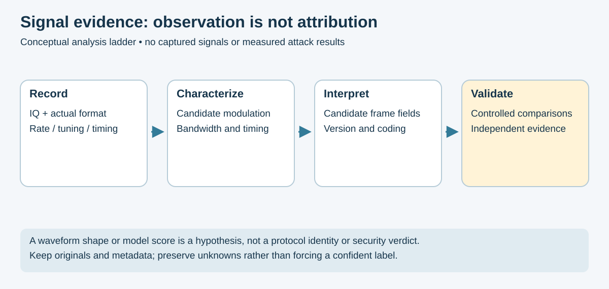
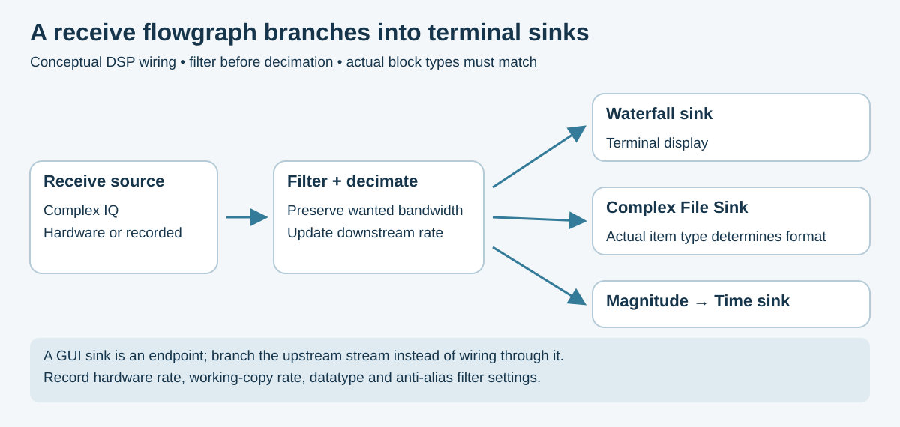
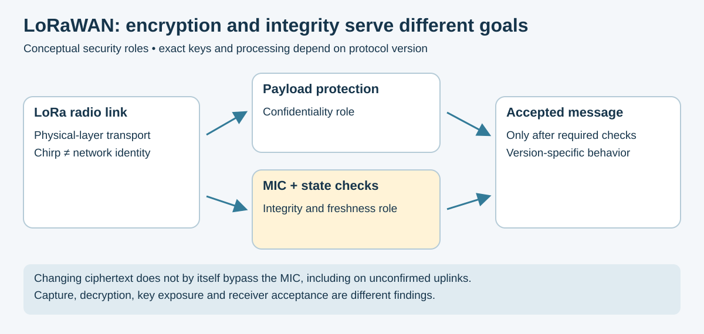
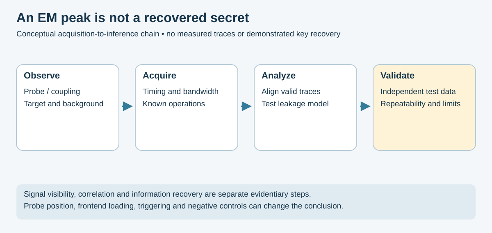

# SDR Hacking Advanced: Reversing and Exploiting Wireless Communications

## 🎯 Purpose
Advanced SDR security guide - extending sdr.md fundamentals with offensive techniques: SIGINT signal identification, GNU Radio flowgraph optimization, protocol reverse engineering with URH, LoRaWAN implementation review, TEMPEST EM side-channel, firmware vulnerability analysis, and custom RF baseband exploitation.

## ⚙️ Function
Organized in four parts: (1) SIGINT, GNU Radio mastery, signal reversing; (2) Wireless protocol vulnerabilities (LoRa, Zigbee, BLE, NRF24, GPS spoofing); (3) Advanced exploitation (baseband firmware analysis, RF fuzzing, Unicorn/Qiling emulation, MouseJack); (4) TEMPEST and EM side-channel attacks. Sections distinguish conceptual mechanisms, source references and lab prerequisites. Unvalidated executable sketches have been replaced with analysis guidance; no hardware reproduction is claimed.

## 🏆 Goal
Perform authorized RF security assessments against IoT, industrial, and wireless access control targets - capturing, reversing, and exploiting wireless protocols beyond what a basic SDR tutorial covers.

## 📋 When to Use
- Protocol reversing: unknown wireless signal on 433MHz, 915MHz, or 2.4GHz requires identification and decoding
- LoRaWAN/Zigbee/BLE security review with explicit protocol, version and provisioning evidence
- TEMPEST/EM side-channel work on a hardware target with RF emissions
- Advanced red-team: GPS spoofing, NRF24 MouseJack, or custom baseband exploitation

> **Review:** November 17, 2026. Source and visual review; no RF transmission, firmware emulation, side-channel acquisition or exploit reproduction performed.
>
> This guide tries to cover nearly every topic for SDR Hacking; from SIGINT identification techniques and GNU Radio flowgraph optimization through firmware vulnerability analysis, to custom RF baseband exploitation, LoRaWAN implementation review, TEMPEST, and EM side-channel attacks.
>
> **Prerequisites assumed:** Linux proficiency, basic SDR/GNU Radio familiarity, security fundamentals. This guide extends (does not replace) the General SDR.md section.
>
> **Legal notice:** All offensive techniques are presented for authorized security research, CTF competition, and defensive understanding only. Apply only against systems you own or have written authorization to test. RF operating authority depends on jurisdiction, equipment and emissions; device ownership or an amateur license is not blanket authorization for arbitrary transmissions. See [LEGAL.md](../LEGAL.md).

---

## Table of Contents

- [Part 1: SIGINT, GNU Radio Mastery, and Signal Reversing](#part-1-sigint-gnu-radio-mastery-and-signal-reversing)
  - [Chapter 1: Key Radio Concepts Review](#chapter-1-key-radio-concepts-review)
  - [Chapter 2: Devices - Spectrum Analyzers, SDRs, and Special RF Chips](#chapter-2-devices---spectrum-analyzers-sdrs-and-special-rf-chips)
  - [Chapter 3: SIGINT - Identifying Targeted Transmissions](#chapter-3-sigint---identifying-targeted-transmissions)
  - [Chapter 4: GNU Radio - Advanced Flowgraphs](#chapter-4-gnu-radio---advanced-flowgraphs)
  - [Chapter 5: SDR Tools and Fuzzing](#chapter-5-sdr-tools-and-fuzzing)
- [Part 2: Attacking Real Targets](#part-2-attacking-real-targets)
  - [Chapter 6: Reverse Engineering Remote Controls](#chapter-6-reverse-engineering-remote-controls)
  - [Chapter 7: Attacking Receivers](#chapter-7-attacking-receivers)
  - [Chapter 8: Reversing Custom Signals](#chapter-8-reversing-custom-signals)
  - [Chapter 9: Firmware Analysis with Ghidra](#chapter-9-firmware-analysis-with-ghidra)
  - [Chapter 10: Exploiting RF Baseband Vulnerabilities](#chapter-10-exploiting-rf-baseband-vulnerabilities)
  - [Chapter 11: Industrial Protocols and LoRa](#chapter-11-industrial-protocols-and-lora)
- [Bonus Topics](#bonus-topics)
  - [Chapter 12: TEMPEST](#chapter-12-tempest)
  - [Chapter 13: EM Side-Channel Attacks](#chapter-13-em-side-channel-attacks)
  - [Chapter 14: ZigBee](#chapter-14-zigbee)
  - [Chapter 15: Wi-Fi RF Security](#chapter-15-wi-fi-rf-security)

---

## Part 1: SIGINT, GNU Radio Mastery, and Signal Reversing

### Chapter 1: Key Radio Concepts Review

#### Wireless Connectivity - A Security Lens

The following four concerns are a useful analysis model, not an exhaustive protocol stack. Understanding which layer an attack targets is the foundation of wireless security assessment:

| Layer | What It Controls | Attack Examples |
|-------|-----------------|----------------|
| **Physical (RF)** | Frequency, power, modulation | Jamming, replay, signal injection |
| **Modulation** | How bits are encoded on carrier | Demodulation to recover data; symbol manipulation |
| **Encoding** | Bit-level framing and error correction | Manchester decode errors; CRC forgery |
| **Integrity & Encryption** | Data authentication and confidentiality | Key extraction, IV reuse, weak cipher attacks |

The training CTF methodology mirrors this: start at the RF layer, work up through modulation and encoding, reach the application data, then find and exploit the security weakness.

---

#### Modulation Review - Attack-Relevant Properties

| Modulation | Key Property | Security Implication |
|-----------|-------------|---------------------|
| **OOK/ASK** | On/off keying - simple amplitude shift | Modulation alone provides no authentication; replay acceptance is protocol-dependent |
| **FSK** | Two or more frequencies encode bits | Requires appropriate filtering, frequency and symbol synchronization |
| **GFSK** | Gaussian-filtered FSK | Used by Bluetooth and other radios; not the 2.4 GHz Zigbee O-QPSK PHY |
| **PSK/BPSK/QPSK** | Phase shifts encode symbols | More complex sync; common in satellite, GPS, digital voice |
| **QAM** | Combined amplitude + phase | Higher data rate; more sensitive to channel distortion |
| **OFDM** | Many subcarriers; parallel symbol streams | Wi-Fi, LTE; complex; hard to implement custom attacks |
| **DSSS** | Spread over wide bandwidth using PN code | GPS, 802.11b; PN code knowledge needed to decode |
| **FHSS** | Rapid frequency hopping | Bluetooth Classic; requires clock/offset to follow |

**Demodulation fingerprint:** Waterfalls and constellations provide candidate hypotheses. Receiver settings, filtering, interference and synchronization affect their appearance; confirm with signal processing and protocol evidence.

```
OOK:      Waterfall shows discrete blobs; no carrier when off
FSK:      Two parallel lines in waterfall at ±deviation
GFSK:     Same but with blurred transitions between tones
BPSK:     Single carrier; phase flips appear as spectrum broadening
QPSK:     Rotated square on constellation; 4 phase states
QAM-16:   4×4 grid on constellation
OFDM:     Flat-topped rectangular spectrum; many subcarriers visible
DSSS:     Noise-like; flat broad spectrum; looks like interference
```

---

#### Encoding Review

Line coding and framing are separate from modulation. NRZ-I polarity and Manchester
bit conventions depend on the protocol; do not label one mapping universal.
Manchester has a mid-bit transition, but simply grouping arbitrary samples into
pairs does not recover clock, phase or polarity. 10BASE-T uses Manchester;
differential Manchester is a distinct code. USB and 100BASE-TX should not be grouped
as one 4B5B example.

| Concern | Evidence needed |
|---|---|
| Bit timing | Estimated symbol period and a clock-alignment method. |
| Coding | Known test pattern, documented convention and invalid-symbol handling. |
| Framing | Preamble, synchronization and length rules across complete messages. |
| Data interpretation | Controlled input changes and independent documentation. |

The previous pair-only decoder was not a general encoding detector and is omitted.

#### Integrity and Encryption in Wireless Protocols

Wireless protocols differ in integrity and confidentiality protection. Assess the exact implementation rather than inferring security from a consumer or industrial label. Understanding what's actually being protected (and what isn't) is critical for attack planning.

**Common integrity mechanisms:**

| Mechanism | Strength | Common In | Attack |
|-----------|---------|-----------|--------|
| **None** | Zero | Simple remotes, sensors | Raw replay |
| **CRC-8/16/32** | Error detection only; no authentication | Many ISM devices | CRC is easily recalculated for modified data |
| **Rolling code (KeeLoq)** | Pseudo-random code sequence | Car keyfobs | MitM capture + resync attacks; KeeLoq cryptanalysis |
| **CMAC / HMAC** | Strong if key is protected | Modern IoT | Key extraction via side-channel or firmware |
| **AES-CCM / AES-GCM** | Strong | Zigbee and Bluetooth use cases; LoRaWAN has its own specified construction | IV/nonce reuse; key management failures |
| **Proprietary cipher** | Implementation-dependent | Industrial, custom | Reverse engineer cipher; evaluate independently; secrecy alone is not assurance |

---

### Chapter 2: Devices - Spectrum Analyzers, SDRs, and Special RF Chips

#### Spectrum and Signal Analyzers

Spectrum analyzers, SDR receivers and vector network analyzers answer different questions.
A VNA measures reflection/transmission against a calibrated reference; it is not a
spectrum receiver. Swept coverage, instantaneous capture bandwidth and resolution
bandwidth are different quantities. Prices and model-specific bandwidths are omitted
rather than treated as stable specifications.

| Instrument family | Measurement role | Boundary to verify |
|---|---|---|
| TinySA / swept spectrum analyzers | Survey power versus frequency | Actual model, input limits, sweep time and calibration. |
| NanoVNA | Antenna, cable and filter impedance / transfer measurements | Calibration plane and supported range; see [NanoVNA guide](./nanovna/README.md). |
| SDR receivers / streaming analyzers | Record a supported instantaneous span | Sample rate, analog filters, host throughput and dropped samples. |
| Laboratory spectrum / signal analyzers | Model-specific calibrated measurements | Option licenses, bandwidth definitions, detector settings and input limits. |

Begin with an instrument-appropriate baseline, record settings, and keep a sweep
distinct from simultaneous IQ recording.

#### Special RF Chips and Their Attack Surface

A radio chip does not establish a whole product's protocol or vulnerability.
Transceivers, SoCs and host-controlled frontends have different responsibilities.

| Family | Useful distinction |
|---|---|
| CC1101 / CC2500 / nRF24 | Packet-radio frontends; host firmware and exact configuration determine application security. |
| CC253x / EFR32 / nRF52 | Hardware and firmware combinations support different protocol stacks; check the selected part and build. |
| SX127x | LoRa-capable transceiver family; LoRaWAN state and keys are not properties of every LoRa waveform. |
| ESP8266 / ESP32 | Variant-specific Wi-Fi/Bluetooth capabilities; not every ESP32 family member supports the same radios. |

MouseJack is historical research against particular non-Bluetooth peripheral
implementations, not proof that every Enhanced ShockBurst device accepts arbitrary
keyboard input. Use the [original research](https://github.com/BastilleResearch/mousejack)
to establish the studied products and conditions; the former generic `mousejack`
CLI strings were not a validated procedure.

### Chapter 3: SIGINT - Identifying Targeted Transmissions



*Figure 1 — Original conceptual diagram. Metadata context follows [SigMF](https://sigmf.org/); the evidence ladder is an engineering interpretation, not a measured accuracy result.*

SIGINT (Signals Intelligence) in the SDR context means rapidly characterizing unknown signals in a dense RF environment - determining what you're looking at before investing in deep analysis.

#### The SIGINT Mindset

```
See it → Measure it → Name it → Decode it → Exploit it

Time budget:
  See/Measure: 30 seconds (spectrum + waterfall visual)
  Name:        2 minutes (database lookup + modulation ID)
  Decode:      5–30 minutes (tool selection + demod)
  Exploit:     Hours to days (depends on depth)
```

#### Rapid Signal Characterization

**Visual spectrum classification (30-second drill):**

```
Step 1: Look at bandwidth
  < 5 kHz     → Narrowband voice, CW, simple data
  5–25 kHz    → NBFM voice, basic digital
  25–200 kHz  → WBFM, wider digital protocols
  200 kHz–5 MHz → Multiple channels, spread spectrum, wideband digital
  > 5 MHz     → OFDM (Wi-Fi, LTE), UWB

Step 2: Look at spectral shape
  Sharp single peak → CW or unmodulated carrier
  Two-humped       → FSK (two tones visible)
  Flat-top         → OFDM or noise-like (DSSS)
  Raised cosine    → PSK/QAM (roll-off factor visible)
  Asymmetric       → SSB (one sideband only)

Step 3: Look at temporal behavior
  Continuous → Broadcast, beacons, control channels
  Bursty → Data packets, remote controls, sensors
  Periodic → Beacons, TDMA slots, clock signals
  Triggered → Sensors, alarm systems, access control
```

**Waterfall pattern library:**

| Pattern | Signal Type |
|---------|------------|
| Steady horizontal band | Continuous carrier or broadcast |
| Short vertical slashes | OOK bursts (keyfobs, sensors) |
| Paired parallel lines | FSK |
| Comb pattern (many vertical lines) | OFDM; 802.11 beacon |
| Diagonal drift | Doppler shift; moving transmitter |
| Regular rectangular blocks | TDMA (GSM, TETRA, DMR) |
| Wideband static-looking | FHSS or DSSS; need to zoom out |

---

#### SIGINT Tools and Libraries

**Inspectrum** - Primary tool for visual binary analysis:

For inspectrum, confirm the capture representation and sample rate before measuring pulse timing. Save the selected interval and analysis notes with an unmodified original recording.

**SigDigger** - Signal analyzer with demodulation:

For SigDigger, validate device/input support in the chosen build. Treat demodulated audio or decoded structure as an analysis result with recorded settings, not automatic signal attribution.

**Universal Radio Hacker (URH)** - The primary protocol reversing tool:

Use a version-matched [URH build and documentation](https://github.com/jopohl/urh). The upstream project is archived as of this review; internal Python APIs and installation commands are not a compatibility guarantee. Preserve input format, rate and alignment when comparing decoded fields.

**Baudline** - High-resolution spectral analysis:

For Baudline, use a supported input representation and document spectral scaling. A visible feature alone does not identify its protocol or provide calibrated RF power.

---

#### Machine and Deep Learning for Signal Identification

Automated signal classification using ML has become practical for SIGINT workflows.

**RadioML dataset and models:**

RadioML releases are research benchmarks with version-specific classes and impairment models; they are not a substitute for a representative deployment test. Published scores depend on the exact dataset, split, SNR, impairments and model. They are not a field-accuracy guarantee.

A classifier requires matched training labels, normalization, sample length and trained weights. Report held-out performance by SNR and capture domain, include an unknown/out-of-distribution outcome, and do not describe untrained logits as calibrated probabilities.

**gr-inspector** - GNU Radio module for automated signal detection and classification:

For gr-inspector, match the GNU Radio and module versions, then evaluate supported detector/classifier behavior on labeled recordings. Record misses and ambiguous classifications before applying it to an unknown signal.

**SigMF (Signal Metadata Format)** - Standardized format for annotating IQ captures:

Record sample datatype and rate in SigMF global metadata; record tuning/time at capture boundaries and labels/sample spans as annotations. Validate against the [SigMF schema](https://sigmf.org/); arbitrary `hw:` fields require a declared extension. Metadata describes the sample file and does not convert it.

---

#### Building a SIGINT Analysis Environment

Build the environment around a preserved sample file, its validated SigMF metadata, a reproducible tool/version inventory and a separate results directory. Test importing a known sample before interpreting an unknown recording.

---

### Chapter 4: GNU Radio - Advanced Flowgraphs



*Figure 2 — Original conceptual wiring diagram. Compare actual block interfaces and item types with the [GNU Radio source](https://github.com/gnuradio/gnuradio); this is not a tested flowgraph for a specific release.*

#### Building a Signal Analyzer Flowgraph

A multi-view analyzer can display time, frequency, constellation and envelope information. Shared input does not imply that every display is time-aligned or calibrated:

```
[osmocom Source]
      │ (complex, samp_rate)
      ├──────────────────────────────────────┐
      │                                      │
      ▼                                      ▼
[QT GUI Frequency Sink]           [Rational Resampler] → decimated
(Full spectrum view)                    │
                                        ▼
                               [QT GUI Waterfall Sink]
                               (terminal visualization)

Branch the resampler output separately:
  [Resampler] → [Complex to Mag²] → [QT GUI Time Sink]
                               (Power envelope vs time)
```

**Adding a variable center frequency slider:**

In GRC, add a QT GUI Range block:
- ID: `center_freq`
- Label: Center Frequency
- Default: 433920000
- Min/Max: constrain to the selected radio, frontend and antenna
- Step: 100000
- Widget: Counter + Slider

Connect to osmocom Source's `center_freq` parameter via the variable name. The slider updates the SDR tuning in real time.

#### Interfacing with Radio Channels - Channel Models

For testing demodulators and decoders against realistic impairments, GNU Radio's channel model blocks simulate real propagation:

```
[Signal Source] → [AWGN Channel] → [Selective Fading Channel] → [Demodulator]
```

**Channel model blocks:**

| Block | Simulates | Key Parameters |
|-------|----------|---------------|
| **AWGN** | Additive white Gaussian noise | Noise power from signal power / linear SNR |
| **Selective Fading** | Multipath; Rayleigh/Rician fading | Delay spread, Doppler, fading type |
| **Phase Noise** | Local oscillator phase noise | Phase noise PSD |
| **Frequency Offset** | Carrier frequency offset | ppm error |
| **Timing Error** | Clock offset between TX and RX | Parts-per-million drift |

For a complex signal with measured mean power (P_s), a target linear SNR implies noise power (P_n=P_s/SNR); independent I/Q Gaussian components each have variance (P_n/2). Keep normalization and units explicit, record random seeds, and distinguish this synthetic model from a measured RF channel.

#### Reversing Analog and Digital Communications in GNU Radio

**CTF-style analog reversing workflow:**

```
Scenario: You receive a mystery IQ file. No information provided.

Flowgraph 1: Visual identification
  [File Source (complex)] → [QT GUI Frequency Sink]
                          → [QT GUI Waterfall Sink]
  Observation: Signal bandwidth ~12 kHz; carrier visible; FM-like

Flowgraph 2: Try FM demodulation  
  [File Source] → [NBFM Receive] → [Audio Sink]
  Observation: Voice audio decoded - it's FM voice comms

Flowgraph 3: Extract and analyze content
  [File Source] → [NBFM Receive] → [File Sink (float)]
  Use a WAV sink or explicitly convert raw float audio, then analyze the resulting WAV for hidden data (sub-tones, DTMF, data beneath voice)
```

**CTF-style digital reversing workflow:**

```
Scenario: Captured burst signal; appears FSK; unknown protocol.

Step 1: Measure symbol rate
  [File Source] → [Complex to Mag²] → [QT GUI Frequency Sink]
  Power-spectrum features may suggest periodicity; they do not universally equal symbol rate

Step 2: Demodulate to bits
  [File Source] → [Quadrature Demod] → [Binary Slicer] → [File Sink (byte)]
  Alternatively: use inspectrum for visual bit extraction

Step 3: Identify encoding
  Import bits into URH → Analysis tab → auto-detect encoding

Step 4: Parse protocol
  Find preamble/sync; identify length fields; checksum position
```

#### Optimizing Flowgraphs for Performance

Real-time processing of high-sample-rate data challenges CPU performance. Optimization techniques:

**Use the right data types:**
- Process at complex (IQ) only as long as needed; switch to float after demodulation
- Byte streams for decoded bits; use `Pack K Bits` block to reduce data volume

**Minimize sample rate early:**

```
BAD:  [Source @ 2.4MSa/s] → [many blocks] → [Decimator at end]
GOOD: [Source @ 2.4MSa/s] → [Anti-alias filter + decimator] → [blocks at 240kSa/s]
```

**Multithreading in GNU Radio:**

Scheduler buffer limits are not a switch enabling parallel execution. Profile the actual GNU Radio release and flowgraph, then tune buffers and thread placement against measured throughput and latency. Do not treat `thread_safe_setters` as a general parallel-scheduler option.

**VOLK (Vector Optimized Library of Kernels):**

GNU Radio uses VOLK to automatically select SIMD-optimized implementations (SSE, AVX, NEON) for DSP operations. Run the alignment tool once per machine:

Use the installed VOLK documentation for kernel profiling. Profiling selects implementations for that machine; repeat after material software or hardware changes rather than assuming a permanent optimum.

---

### Chapter 5: SDR Tools and Fuzzing

#### Accelerating RE with Specialized Tools

**rtl_433 - protocol decoder:**

Use [rtl_433's upstream input/output documentation](https://github.com/merbanan/rtl_433) and the [receive-only lab](./rtl433-passive-telemetry-lab.md). The analyzer can report candidate pulse structure, while decoded JSON depends on enabled supported decoders. A fixed protocol count or silent output is not an identification guarantee.

**URH automation - scripting protocol analysis:**

An automation workflow must pin the installed URH version, identify its supported interface and verify results against known inputs. An internal Python method name copied from another build is not a stable API contract.

#### Dumb Fuzzing of Communications

Dumb fuzzing applies random mutations to known-good packets and transmits them to observe target behavior. Effective against parsers with no or weak input validation.

**Fuzzing architecture:**

```
[Capture baseline packet]
       │
       ▼
[Parse packet structure]
(identify fields: preamble, length, data, CRC)
       │
       ▼
[Mutation engine]
(bitflip, byte substitution, length corruption, field boundary)
       │
       ▼
[Transmit mutated packet] ← HackRF or compatible TX hardware
       │
       ▼
[Observe target behavior]
(Crash? Different response? Error message on UART?)
```

Before any hardware fuzzing, define an offline parser harness, mutation boundaries, target reset strategy and independent behavior observation. The diagram above is an architecture sketch, not a validated transmitter or crash-reproduction recipe.

**GNU Radio-based fuzzer flowgraph:**

```
[Python Source Block]     ← Generates mutated packet bytes from fuzzer
      │ (message)
      ▼
[Protocol Formatter]      ← Adds preamble, encoding, framing
      │
      ▼
[GFSK/OOK Modulator]      ← Modulate to RF
      │
      ▼
[osmocom Sink]             ← Transmit (HackRF)
```

---

## Part 2: Attacking Real Targets

### Chapter 6: Reverse Engineering Remote Controls

An owned disposable remote/receiver pair can support a controlled study, but operational remotes may have state and pairing dependencies. Begin with receive-only observations rather than using a production door as a test harness.

#### The Remote Control Attack Chain

```
1. CAPTURE: Record IQ during button press
2. IDENTIFY: Determine frequency, modulation, encoding
3. DECODE: Extract the bit pattern
4. ANALYZE: Understand the protocol structure  
5. FORGE: Create a valid packet (replay or constructed)
6. TRANSMIT: Send to target device (authorized testing)
```

#### Step-by-Step: Garage Door Opener RE

**Target characteristics:** Check the exact model, regional documentation and receiver configuration. Frequency and manufacture date alone do not establish fixed versus rolling-code behavior.

For an owned garage remote, compare complete aligned frames across labeled button events and receiver state. Repeated fields and changing fields are hypotheses; use the receive-only exercise in [the Sub-GHz guide](./subghz.md) before considering separately scoped acceptance testing.

**PWM (Pulse Width Modulation) decoding:**

A pulse-width decoder needs robust thresholding, matched rising/falling edges, frame-boundary handling, symbol tolerances and an explicit unknown state. The previous edge-index pairing could produce negative widths, and padding unknown bits into hex could silently corrupt evidence.

---

#### Fixed Code vs. Rolling Code

Static messages may be replayable if the receiver accepts repeated content without
freshness checks. Repeated captured bytes do not establish indefinite acceptance.
Rolling-code designs combine cryptographic validity with receiver state, but key
provisioning, synchronization and implementation remain part of the assessment.

Relay, capture-and-delay and cryptanalytic attacks are different mechanisms with
different prerequisites. Relaying extends communication; it is still an RF path,
not "no RF attack." A historical attack's required observations do not establish a
universal button-press count or manufacturer-key extraction method. See the
[Microchip HCS301 design description](https://ww1.microchip.com/downloads/en/devicedoc/21143c.pdf)
for one code-hopping implementation, not assurance about every deployed system.

A controlled study should report product revision, observed message behavior,
receiver acceptance and recovery conditions separately. This guide does not provide
a jamming/replay sequence or claim a reproduced bypass.

### Chapter 7: Attacking Receivers

Receiver-side processing can expose weaknesses in parsing, state handling and
authorization, but it need not process every RF event into an accepted message.
Filtering, synchronization and authentication form additional boundaries.

#### Jamming

Interference can deny availability. Continuous, swept, wideband and reactive energy
can have different effects; labels such as "easy" or "hard" detection are not
portable measurements. Evaluate receiver health with permitted, controlled lab
conditions and independent observations; do not treat unexplained packet loss as
proof of intentional jamming.

#### Signal Injection and Spoofing

A captured frame, a well-formed packet and an accepted command are different
findings. Test parser correctness offline first. RF acceptance testing needs a
separate authorized setup with verified containment and recovery. Modulation and
checksum reproduction do not automatically reproduce sender authentication.

### Chapter 8: Reversing Custom Signals

Custom signals (proprietary protocols from devices with no public documentation) require systematic reverse engineering.

#### The Unknown Signal Methodology

```
Phase 1: Physical characterization
  ├── Frequency (from FCC ID, spectrum measurement)
  ├── Bandwidth (-3 dB and -20 dB)
  ├── Modulation type (visual ID + ML classification)
  ├── Approximate symbol rate (power spectrum of |IQ|²)
  └── Temporal behavior (burst length, repetition rate, trigger)

Phase 2: Bit-level extraction  
  ├── Demodulate with appropriate modulation type
  ├── Find optimal bit rate (sweep rate, minimize errors)
  ├── Identify encoding (Manchester, NRZ, etc.)
  └── Extract raw bit stream for multiple captures

Phase 3: Protocol structure identification
  ├── Find preamble/sync word (constant across captures)
  ├── Find fields that change vs. fields that stay constant
  ├── Identify length fields (correlates with message length variation)
  ├── Find checksum/CRC (changes with data changes)
  └── Identify payload vs. header

Phase 4: Field semantics
  ├── Correlate numeric fields with physical button actions
  ├── Identify device ID / address fields (constant per device)
  ├── Find counter/rolling code fields (monotonically increasing)
  └── Decode any encoded sub-fields

Phase 5: Forgery
  ├── Construct a valid packet with chosen payload values
  ├── Verify CRC/checksum calculation
  └── Transmit and verify device response
```

#### Differential Analysis

Capture the same action multiple times; capture different actions; compare.

Compare aligned complete frames from controlled input changes. Constant and changing positions are observations, not proof of an identifier or counter; handle unequal lengths and missing data explicitly.

#### CRC Identification and Calculation

Finding the CRC algorithm used in a protocol:

Treat candidate CRC matches as hypotheses. Verify coverage, byte order, bit reflection, width, polynomial, initial state and final XOR on multiple independent frames. An empty corpus or one matching sample cannot identify a CRC; a CRC is not sender authentication.

---

### Chapter 9: Firmware Analysis with Ghidra

Once a target device is identified, analyzing its firmware is often the fastest path to finding exploitable vulnerabilities in the wireless stack.

#### Firmware Extraction

| Method | How | Best For |
|--------|-----|---------|
| **OTA update capture** | Intercept update traffic (HTTP/HTTPS, or RF OTA) | Devices with plaintext or reversible update formats |
| **UART/serial console** | Boot log often shows firmware addresses; `tftp`/`cat /proc/mtd` | Linux-based devices |
| **JTAG/SWD** | Read flash directly (see Hardware Hacking section) | Microcontrollers; ARM Cortex-M |
| **SPI flash dump** | `flashrom` or Bus Pirate reads external SPI NOR flash | Any device with external flash |
| **Vendor source** | GPL compliance disclosure; FCC test firmware | Linux-based products |
| **Binwalk extraction** | Decompress/carve firmware images | Combined images with multiple sections |

Select supported extraction and entropy options from the installed [Binwalk documentation](https://github.com/ReFirmLabs/binwalk). High entropy can reflect compression, encryption or other data; it does not prove encryption. Run extractors on a disposable analysis environment and preserve the original image.

#### Ghidra Setup for RF Firmware

Follow the Java and extension requirements bundled with the exact [Ghidra release](https://github.com/NationalSecurityAgency/ghidra/blob/master/GhidraDocs/GettingStarted.md). A string or library-call cross-reference is a starting point for data-flow review, not automatic taint analysis or proof of a vulnerability.

#### Analyzing RF Baseband Code in Ghidra

Receive paths can contain parsing, state handling and authorization weaknesses. A suspicious function call alone does not prove an exploitable vulnerability.

**Finding the RF receive handler:**

```
Strategy 1: String search
  Search → For Strings → "received", "packet", "frame", "CRC error"
  These strings often appear near the packet parsing code

Strategy 2: Cross-reference data structures
  Identify packet buffer location (often a fixed memory address or struct)
  Find all code that reads from or writes to that buffer

Strategy 3: Interrupt handler
  RF chips generate interrupts on packet receive
  Find interrupt vector table → follow IRQ handler → find packet dispatcher

Strategy 4: Known API patterns  
  If using a known RF chip (CC1101, nRF52, SX1276), find the chip's 
  receive callback function (documented in chip SDK)
  e.g., for CC1101: identify SPI command sequences from the exact data sheet rather than treating a single byte as a function signature to find radio control code
```

**Common vulnerability patterns in RF baseband code:**

Review length validation, buffer ownership, integer conversions and state transitions along an actual receive path. Demonstrate reachability and impact using a separately scoped harness rather than treating a suspicious copy operation as a confirmed vulnerability.

**Ghidra Scripting to find vulnerable patterns:**

A Ghidra script can locate candidate call sites or data references for manual review. Validate its processor/language assumptions and trace input lengths and control flow before reporting a reachable bug.

---

### Chapter 10: Exploiting RF Baseband Vulnerabilities

#### Exploit Development for RF Targets

Some parser flaws can be reached over a radio link; exploitability also depends on framing, authentication, reachability, memory protections and implementation. Static suspicion, a reproducible crash and controlled execution are distinct findings.

**Exploit delivery pipeline:**

```
[Vulnerability in baseband code]
       │
       ▼
[Craft malicious packet bytes]     ← Triggered by specific field values
       │
       ▼
[Apply correct encoding + framing] ← Preamble, sync, checksum
       │
       ▼
[Modulate to RF signal]            ← Match target's modulation/frequency
       │
       ▼
[Transmit to target]               ← Within range; single packet or multiple
       │
       ▼
[Trigger vulnerability]            ← e.g., buffer overflow in RX handler
       │
       ▼
[Achieve impact]                   ← Code execution, crash, authentication bypass
```

#### Stack Overflow via Malicious Packet - Walkthrough

The former overflow and ROP snippets assumed a fictional stack layout, gadget
addresses, executable-memory policy and packet checksum. Those assumptions do not
constitute a working exploit and are removed.

For an owned parser, document its input length, buffer capacity, integer arithmetic,
state transitions, error paths and memory protections. Prefer an offline harness
with explicit mappings and deterministic termination. An emulator fault may reflect
missing peripherals, mappings or callbacks rather than a target bug. Hardware impact
requires separate, scoped reproduction with a recovery plan.

No generic shellcode, return address or RF delivery recipe is provided here.

### Chapter 11: Industrial Protocols and LoRa

#### LoRa / LoRaWAN Overview

LoRa is a physical-layer modulation ecosystem; LoRaWAN defines networking and
security behavior above it. A detected chirp does not establish a LoRaWAN version,
application or compromise. CC1101 is not a LoRa demodulator.

Spreading factor is not itself the number of chips per symbol: in the usual LoRa
model the symbol spans (2^{SF}) chips. Symbol time depends on spreading factor and
bandwidth. Total airtime also depends on payload, coding, header, CRC and preamble
settings; the former two unqualified airtime figures are omitted. Longer airtime
generally consumes more duty-cycle budget, not less.

#### LoRaWAN Security Architecture



*Figure 3 — Original conceptual diagram informed by the [LoRaWAN 1.0.4 specification](https://lora-alliance.org/wp-content/uploads/2021/11/LoRaWAN-Link-Layer-Specification-v1.0.4.pdf). Use the deployed version; this does not demonstrate decryption or a MIC bypass.*

Use the exact specification version. The familiar `NwkSKey` / `AppSKey` model is
associated with LoRaWAN 1.0.x; 1.1 changes the network key structure. Session keys
are derived during activation rather than carried as plaintext session keys in a
join-accept. Headers are not all encrypted.

Encryption and message integrity are separate checks. Altering ciphertext does not
by itself bypass the message integrity code. This applies to unconfirmed uplinks too:
"unconfirmed" does not mean "unauthenticated." A 32-bit MIC is not an AES-key crack
and is not a weakness unique to Class B devices.

#### Join procedure (OTAA - Over-The-Air Activation)

Evaluate version-specific nonce, join/rejoin, counter persistence and reset behavior
against the actual server and device. Reusing an observed request does not imply that
the server accepts it, that keys become predictable, or that an attacker learns a
root key.

#### LoRa Signal Reception and Decoding

Use a compatible receiver and a version-matched, documented decoder. A network
server such as ChirpStack consumes supported gateway traffic; it is not an arbitrary
IQ decoder. The former pip package names and empty flowgraph sketches were not
verified installation or decoding procedures.

#### LoRaWAN Vulnerability Classes

Review key provisioning and storage, nonce/counter handling, reset behavior,
authorization and application logic. ABP activation does not imply that keys are
necessarily recoverable from firmware, and a hex-looking string is only a candidate,
not a verified secret. Root-key extraction, counter misuse and MIC verification
failure require different evidence.

Specification details: [LoRaWAN 1.0.4](https://lora-alliance.org/wp-content/uploads/2021/11/LoRaWAN-Link-Layer-Specification-v1.0.4.pdf), [LoRaWAN 1.1](https://lora-alliance.org/resource_hub/lorawan-specification-v1-1/). Primary context: [LoRa Alliance security guidance](https://lora-alliance.org/resource_hub/lorawan-is-secure-but-implementation-matters/).
No session-key recovery or bypass is demonstrated here.

#### Fuzzing with Unicorn/Qiling

[Unicorn](https://github.com/unicorn-engine/unicorn) and
[Qiling](https://github.com/qilingframework/qiling) can support controlled emulation,
but a complete harness needs architecture, memory maps, calling convention, valid
stack/return state, peripheral behavior, inputs and reset/termination rules.
Neither a search for zero-filled memory nor a catch-all exception handler reliably
identifies a target crash. Firmware with unmodeled hardware may not run faithfully.
The former sketches are omitted rather than presented as usable harnesses.

## Bonus Topics

### Chapter 12: TEMPEST

TEMPEST (a name associated with compromising-emanations research and controls) refers to the unintentional emission of electromagnetic signals from electronic equipment that can be captured and analyzed to reconstruct processed information.

#### The Core Concept

Every electronic circuit emits RF radiation as a byproduct of operation. Rapidly switching digital signals radiate according to their frequency content. A CPU, display controller or keyboard may produce observable emissions. Recoverability depends on signal leakage, coupling, bandwidth, noise, synchronization and the inference task; an RF peak does not establish recovered information.

```
Potential emission paths:
  Digital switching and signal activity
  → Frequency components shaped by currents, geometry and coupling
  → PCB traces, cables and power paths
  → Measurement depends on the complete setup

Attacker receives:
  Emissions on a wideband antenna near target
  → Down-converts to baseband
  → Applies signal processing to recover original signal
```

#### Classic TEMPEST: Van Eck Phreaking

Van Eck phreaking (named after Wim van Eck, 1985) is the reconstruction of a CRT or LCD display's contents from its electromagnetic emissions.

```
CRT/LCD controller → Video cable (unintentional antenna) → Radiates sync + pixel data
                                                           ↓
                                                    Nearby antenna + SDR
                                                           ↓
                                               Reconstruct video signal in software
```

**Modern implementation with SDR:**

The previous magnitude-and-reshape function did not recover synchronization, blanking, drift or color and was not a general display reconstruction algorithm. Compare the [TempestSDR implementation](https://github.com/martinmarinov/TempestSDR) and use only authorized captures with independently known test content.

#### TEMPEST Attack Surface Expansion

| Source | Emission | Recovery Technique |
|--------|---------|-------------------|
| **CRT/LCD display** | Video signal harmonics | Van Eck phreaking; TempestSDR |
| **Keyboard** | Keystroke timing via EM pulse | Correlate pulse timing with key timing |
| **CPU cache** | Power/EM correlates with computation | EM side-channel (see Chapter 13) |
| **Crypto accelerator** | Power varies with key data | Power/EM analysis |
| **LED status lights** | Optical emission of traffic data | Optical TEMPEST; optical side-channel studies |
| **Power line** | Conducted emission on AC power | Power line analysis |
| **USB cable** | Broadband emissions depending on interface generation and wiring | Device-specific measurement and inference |

#### TEMPEST Countermeasures

| Countermeasure | What It Addresses |
|----------------|------------------|
| **Faraday shielding** | Contains EM emissions within enclosure |
| **Tempest-rated equipment** | Designed to minimize unintentional emissions |
| **EMSEC filtering** | Power line and signal line filtering |
| **Physical separation** | Distance can reduce coupling; near-field and enclosure behavior require measurement |
| **Noise / masking countermeasures** | Require measured effectiveness and appropriate emissions authority |
| **Spread-spectrum clocking** | Spreads clock harmonics; reduces peak emission amplitude |

---

### Chapter 13: EM Side-Channel Attacks



*Figure 4 — Original conceptual evidence chain; no trace or recovered secret is depicted. Compare [NinjaLab's EUCLEAK research](https://ninjalab.io/eucleak/) for a specific physical side-channel demonstration, not a universal receiver recipe.*

EM side-channel analysis is related to compromising-emanations research but has a distinct inference goal: using a near-field probe placed close to the target IC to measure EM emissions that correlate with the data being processed.

Near-field probe placement is common, but neither these research areas nor attainable distances are defined by one universal separation. This is the intersection of hardware hacking (Chapter 3 of the Hardware Hacking section) and SDR/RF signal capture.

#### EM Probe Construction

Probe sensitivity, geometry, bandwidth, loading and position must match the target and acquisition setup. A simple loop is not sufficient for every measurement:

```
Probe-selection considerations:
  Target frequency content and bandwidth
  Probe transfer characteristics and loading
  Orientation, position and repeatability
  Frontend input limits and amplification
  Trigger alignment and negative controls
```

**Commercial probes:** Langer EMV probes (IC series) are purpose-built for near-field IC measurement. Riscure also produces EM probes for security research.

#### EM vs. Power Analysis

| Aspect | Power Analysis | EM Side-Channel |
|--------|---------------|----------------|
| **Access required** | Shunt resistor in VCC path | Near-field probe near IC |
| **Trace quality** | Setup- and target-dependent | Setup-, probe- and position-dependent |
| **Spatial selectivity** | Whole chip | Can target specific circuit regions |
| **Required access** | Depends on accessible supply path | May require opening an enclosure or preparing the target |
| **Multi-channel** | Single global supply | Different probes at different locations |

#### EM-DPA Workflow

The analysis methodology mirrors the power analysis DPA covered in the Hardware Hacking section, with an appropriate leakage model and synchronized EM traces:

A generic RTL-SDR read started in a Python thread does not establish deterministic trigger alignment. Define acquisition timing, bandwidth, gain, probe location, trace integrity and known inputs before making leakage claims. A default 100 MHz tuner setting is not DC coupling, and the strongest FFT bin need not be a cryptographic emission.

Use the [hardware side-channel guide](../HardwareHacking/Chapter4.md) for analysis principles. Acquisition, alignment, leakage models and validation must fit the physical measurement; starting a host thread does not provide a hardware-synchronized trigger.

---

### Chapter 14: ZigBee

Zigbee is based on IEEE 802.15.4. The common 2.4 GHz PHY uses O-QPSK with DSSS; regional and older PHY options differ. Check the actual product and security version.

#### ZigBee Attack Surface

Use a supported IEEE 802.15.4 capture interface and matching firmware; follow the
[KillerBee hardware and tool documentation](https://github.com/riverloopsec/killerbee).
YARD Stick One operates below 1 GHz and is not a 2.4 GHz Zigbee capture or injection
adapter. See [its manufacturer specifications](https://greatscottgadgets.com/yardstickone/).
Do not substitute a Bluetooth-focused tool merely because it also uses 2.4 GHz.

#### KillerBee Toolkit

Select installation and interface options for the exact supported release and board.
A packet capture, decryption with authorized keys, injection and receiver acceptance
are separate operations. The former generic serial-device commands were not
validated for a particular adapter or release.

#### ZigBee Key Management Weaknesses

The original text incorrectly implied a universal cleartext first-join key transfer.
Zigbee commissioning and trust-center behavior depend on version, security mode and
provisioning. A known or exposed transport key in a particular configuration is not
equivalent to every network transmitting its key in the clear. The unverified
hardcoded example key strings are removed. Review the actual commissioning settings,
key update policy and device behavior using an authorized test network.

### Chapter 15: Wi-Fi RF Security

Beyond standard 802.11 protocol attacks (WPA2 cracking, PMKID, evil twin - covered in other guide sections), the RF layer of Wi-Fi offers additional attack surfaces accessible via SDR and specialized hardware.

#### RF-Layer Wi-Fi Attacks

**Management frame injection:**

Management-frame behavior depends on the PHY, firmware, client and negotiated protections. Use supported capture tooling to inspect the actual exchange; this guide does not provide a validated injection sequence.

**OFDM pilot tone analysis:**

Legacy OFDM PHYs and later OFDM-based variants have defined pilot subcarriers; layouts and numerology differ. The legacy 64-point example is not universal. Pilot information consists of known reference tones at specified subcarrier positions. With suitable synchronization, it can support:

- **Device fingerprinting:** Slight frequency and phase offset patterns in pilot tones are hardware-specific
- **Channel estimation:** Reconstruct the multipath channel for signal processing
- **Carrier frequency offset (CFO) measurement:** CFO can vary with oscillator, temperature, receiver and time; it is not a unique identity

Pilot phase differences across frequency are affected by channel delay and sampling alignment. Carrier offset estimation needs an appropriate time-domain or inter-symbol model, synchronization and pilot polarity handling. The former spatial-phase-slope formula was not a valid general CFO estimator and is omitted.

**RSSI-based localization:**

RSSI-to-distance inversion is a calibrated propagation model, not a direct range measurement. Multipath, antenna patterns, unknown transmit power and obstacles can dominate the estimate. Report uncertainty and independently measured ground truth; an optimizer result alone does not establish location.

---

## Quick Reference

### Signal Identification Cheatsheet

These are candidate visual cues only. Bandwidth, display settings and channel effects can produce similar shapes across unrelated signals; no row identifies a protocol or security result by itself.

```
Bandwidth    Shape           Behavior      → Most Likely
─────────────────────────────────────────────────────────────
< 1 kHz      Narrow spike    Constant       CW carrier / beacon
1–5 kHz      Double-hump     Constant       FSK data (NRZ)
5–15 kHz     Single peak     Bursty         OOK/ASK (remotes, sensors)
10–25 kHz    Single peak     Constant       NBFM voice
~200 kHz     Raised cosine   Bursty         LoRa chirp (check for sweep)
200 kHz      Wide, flat      Constant       WBFM broadcast
1–2 MHz      Very wide flat  Bursty         Bluetooth (FHSS, look for hopping)
20 MHz       Flat rectangle  Bursty         Wi-Fi 802.11 channel
Any          Sloped chirp    Bursty         LoRa (frequency-swept bursts)
Wide flat    Noise-like      Constant       DSSS (GPS, 802.11b, etc.)
```

### Common Protocol Parameters

| Protocol | Frequency | Modulation | Symbol Rate | Key Tool |
|----------|-----------|-----------|------------|---------|
| LoRa regional example | Region- and device-dependent | CSS (chirp) | Bandwidth / SF-dependent | Compatible decoder; server is a separate layer |
| LoRaWAN | Regional channel plan | Uses supported LoRa PHY settings | Version-dependent | Compatible gateway and network server |
| Common 2.4 GHz Zigbee PHY | 2.405–2.480 GHz | O-QPSK / DSSS | 250 kbit/s data; 62.5 ksymbol/s | Supported 802.15.4 interface |
| 433 ISM OOK | 433.92 MHz | OOK | 1–10 kbps | rtl_433, URH |
| KeeLoq | 315/433 MHz | OOK | ~5 kbps | URH + custom |
| nRF24 family | Part- and region-dependent 2.4 GHz channels | GFSK | Exact-part dependent | Version-matched packet tooling |
| CC1101 configuration | Supported disjoint sub-GHz bands | Supported FSK/ASK/OOK families | Configuration-dependent | Compatible frontend tooling |

### Exploitation Framework Selection

| Scenario | Tool | Why |
|----------|------|-----|
| Unknown ISM signal | URH + inspectrum | Best for visual RE + bit extraction |
| Supported telemetry protocols | rtl_433 | Decoder-specific fields; unsupported signals may remain unidentified |
| Custom protocol fuzz | GNU Radio + Python fuzzer | Flexible; scriptable |
| Firmware RE | Ghidra + SVD-Loader | Best static analysis for embedded |
| LoRa stack attack | ChirpStack + gr-lora | Version-matched gateway/server context, not arbitrary IQ decoding |
| ZigBee attack | KillerBee | Purpose-built; mature |
| Offline parser testing | Version-matched emulator/harness | Peripheral and timing models may be incomplete |
| EM side-channel | RTL-SDR/SDR + near-field probe | Hardware and synchronization must match the leakage question |

---

## Further Reading

**Review boundaries:** The four figures are original static teaching diagrams. The review corrected modulation/encoding attribution, receiver/tool capabilities, LoRaWAN integrity and key-handling claims, source/sink wiring, metadata handling, and unsupported firmware/EM/ML formulas. Unvalidated executable sketches were replaced with explicit implementation boundaries. No hardware or exploit reproduction is claimed.

**Papers and Research:**
- Van Eck, W. (1985) - *Electromagnetic Radiation from Video Display Units: An Eavesdropping Risk* (original TEMPEST paper)
- Vuagnoux & Pasini (2009) - *Compromising Electromagnetic Emanations of Wired and Wireless Keyboards* (Usenix Security)
- Marinov, M. - TempestSDR GitHub repository (practical Van Eck implementation)
- Ronen et al. - *IoT Goes Nuclear: Creating a ZigBee Chain Reaction* (IEEE S&P 2017)
- Yang et al. - *LoRaWAN Replay Attack and Session Key Extraction*
- Robyns et al. - *Physical-Layer Fingerprinting of LoRa devices* (WiSec 2017)

**Tools referenced:**
- TempestSDR: github.com/martinmarinov/TempestSDR
- gr-lora: github.com/rpp0/gr-lora
- KillerBee: github.com/riverloopsec/killerbee
- URH: github.com/jopohl/urh
- MouseJack: github.com/BastilleResearch/mousejack
- YARD Stick One: greatscottgadgets.com/yardstickone
- Unicorn Engine: github.com/unicorn-engine/unicorn
- Qiling: github.com/qilingframework/qiling
- RadioML dataset: deepsig.ai/datasets
- SigMF: github.com/sigmf/SigMF

**Hardwear.io training:**
- Original course: *SDR Hacking Advanced: Reversing and Exploiting Wireless Communications* - Sébastien Dudek, hardwear.io
- Trainer profile: hardwear.io/trainer/sebastien-dudek

## Related Files
- [sdr.md](sdr.md) - Foundational SDR guide: required reading before this advanced guide
- [README.md](README.md) - SDR section index with hardware comparison table
- [../HardwareHacking/Chapter4.md](../HardwareHacking/Chapter4.md) - Power/EM side-channel theory: TEMPEST and EM analysis use the same fundamentals
- [../Documentation/bruce_firmware.md](../Documentation/bruce_firmware.md) - Bruce sub-GHz firmware targets are exactly the protocols this guide teaches how to reverse
- [../SpaceSecurity/](../SpaceSecurity/) - GPS spoofing and satellite analysis: advanced SDR applications covered here

---

*Independent repository study guide referencing advanced SDR training topics; not a verified reproduction of that curriculum. Maintained as part of the ULTIMATE-CYBERSECURITY-MASTER-GUIDE. All techniques are for authorized security research and CTF use only.*
