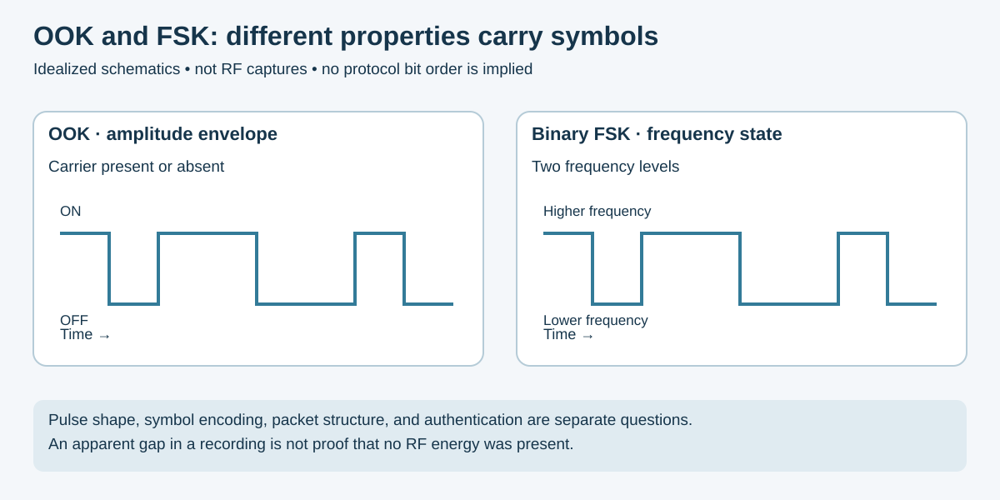
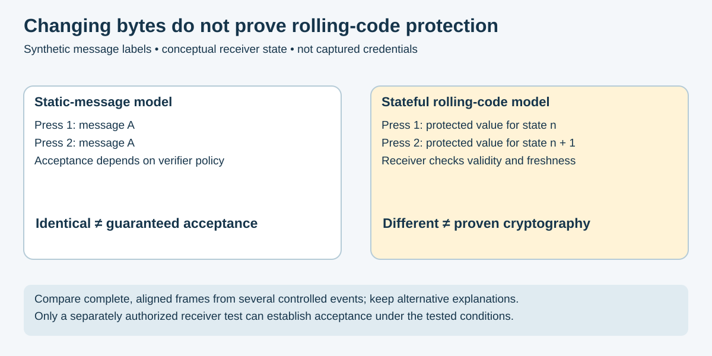
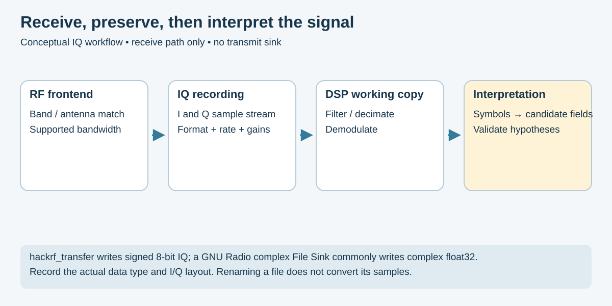
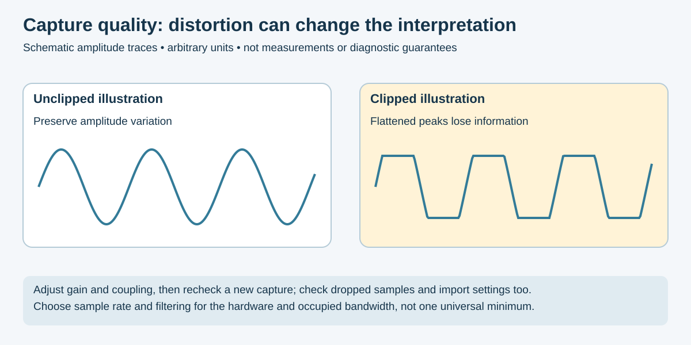
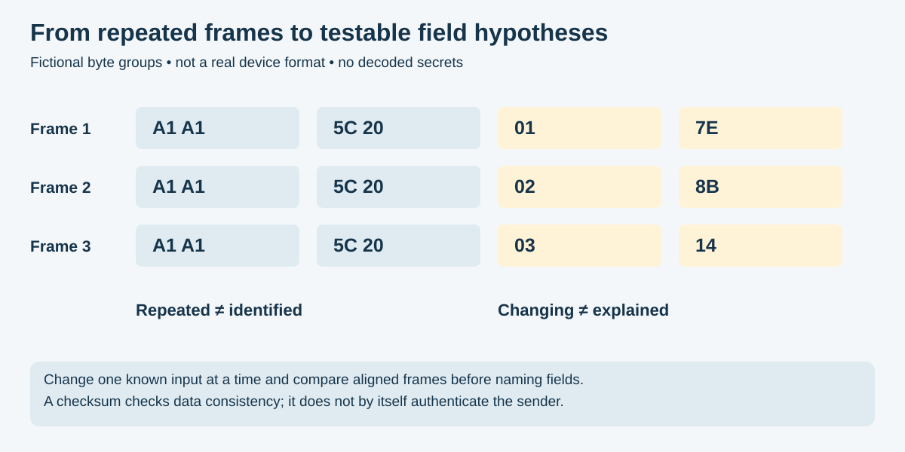

# 📻 SubGhz RF Exploration & Protocol Engineering Guide

<div align="center">

**Manual for multi-band signal capture, protocol reversing, and hardware security testing below 1 GHz and across the 2.4 GHz ISM bands**

*Part of the [ULTIMATE CYBERSECURITY MASTER GUIDE](../README.md)*


</div>

---

**Receive-only reference:** [rtl_433 passive telemetry](rtl433-passive-telemetry-lab.md) provides bounded, legal observation and synthetic SIEM events, not signal replay or transmission.

## Firmware Choices & Radio Boundaries

Select the radio frontend before selecting firmware. A controller firmware
cannot supply a missing band, modulation or IQ-sampling path. Use the dedicated
guide to establish a receiver baseline before any separately authorized transmit test.

| Resource | Role & Compatibility Boundary |
|---|---|
| [Evil Crow RF V2](./evil-crow-rf-v2.md) | Dual CC1101 plus NRF24L01 protocol tool; default and custom firmware need independent build/asset checks. |
| [Bruce](../Documentation/bruce_firmware.md) | External CC1101/NRF module workflow; verify board wiring and actual module. |
| [ESP32 Bit Pirate](../HardwareHacking/esp32-bit-pirate.md) | Multi-protocol S3 bench platform; RF modes require documented external hardware. |
| [HackRF / Mayhem](../PlayBooks/HackRFAuditPlayBook.md) | Separate half-duplex SDR/IQ ecosystem, not an ESP32 image or CC1101 replacement. |

## 🎯 Purpose

Comprehensive bench manual for SubGhz RF exploration - covering educational theory, multi-band signal capture procedures, laboratory logging documentation, software processing pipelines, and protocol architecture breakdowns for embedded, IoT, and access-control systems.

## ⚙️ Function

Walks through the full capture-to-analysis workflow across the major toolsets (Flipper Zero, HackRF One, RTL-SDR, ESP32 Marauder, Bruce firmware), then into GNU Radio flowgraph construction, transceiver chip selection (CC1101 vs. nRF24L01+), IQ troubleshooting, post-processing pipelines (URH, Wireshark, rtl_433), a master device/protocol reference matrix, a protocol profiles dictionary, and a standardized logging template.

## 🏆 Goal

Serve as the practical, repeatable reference for authorized RF security testing - taking a signal from unknown center frequency all the way to a documented, validated protocol breakdown, safely and legally.

## 📋 When to Use

- Identifying an unknown Sub-GHz or 2.4 GHz signal by center frequency and modulation
- Choosing the right capture hardware and modulation settings for a target device
- Reverse engineering a fixed-code vs. rolling-code protocol during an authorized assessment
- Documenting a reproducible capture session for a hardware security audit

---

## 📋 Table of Contents

- [Educational Foundations](#-1-educational-foundations)
- [Core Principles of Sub-GHz RF](#-2-core-principles-of-sub-ghz-rf)
- [Core Sub-GHz Protocol Concepts](#-3-core-sub-ghz-protocol-concepts)
- [Hardware Specific Operations & Flowcharts](#-4-hardware-specific-operations--flowcharts)
- [GNU Radio Flowgraph Guide (HackRF)](#-5-entry-level-gnu-radio-flowgraph-guide-hackrf)
- [Dedicated Hardware Chips: CC1101 vs. nRF24L01+](#-6-dedicated-hardware-chips-cc1101-vs-nrf24l01)
- [Troubleshooting: Clipping & Signal Distortion](#-7-troubleshooting-clipping--signal-distortion)
- [Post-Processing Pipeline](#-8-post-processing-pipeline)
- [Master Device & Protocol Reference Matrix](#-9-master-device--protocol-reference-matrix)
- [Protocol Profiles Dictionary](#-10-protocol-profiles-dictionary)
- [Laboratory Protocol Logging Template](#-11-laboratory-protocol-logging-template)
- [Example Project: Safe Garage Door Analysis](#-12-example-project-safe-garage-door-analysis)
- [⚠️ CRITICAL Security & Legal Warning](#️-critical-security--legal-warning)
- [Resources](#-resources)

---

### 🔴 CRITICAL WARNING

Work within explicit scope. Radio transmission, credential interactions and
private communications require applicable operating authority and permission.
Receive-only analysis does not automatically authorize collection of every signal.
See [operating boundaries](#️-critical-security--legal-warning) and [LEGAL.md](../LEGAL.md).

---

## 🎓 1. Educational Foundations

**The "Who, What, When, and Why" of RF Scanning.**

### What Is It?

Sub-GHz means frequencies below 1 GHz; this guide focuses on selected short-range device bands and includes a separate 2.4 GHz comparison. Devices may send bursts or continuous signals and may use fixed channels or frequency hopping. Frequency alone does not identify a protocol or its security.

### Who Uses It?

| Role | Application |
|------|-------------|
| **Embedded Engineers** | Debug wireless transceiver communications and ensure compliance with timing constraints |
| **Security Auditors** | Evaluate whether devices use unencrypted fixed-payload structures vulnerable to intercept or manipulation |
| **IoT Architects** | Measure environmental noise floors, optimize reception ranges, and check packet structures across mesh topologies |

### When Is It Conducted?

- **During Product R&D:** To verify custom hardware transmits strictly within regulatory bandwidth windows.
- **During Security Assessments:** To audit a facility's perimeter defense footprint against physical signal leakage.
- **During Spectrum Deconfliction:** When ambient radio noise or physical boundaries disrupt smart-grid sensors or internal communication networks.

### Why Is It Critical?

RF energy can extend beyond a physical boundary. Reception depends on the receiver, antenna, propagation, and waveform; receiving energy is distinct from decoding or decrypting content. A broadcast is not automatically public data or authorization to collect it. Review protocol authentication, key handling, and receiver policy as well as the radio link.

---

## 📡 2. Core Principles of Sub-GHz RF



*Figure 1 — Original symbolic teaching diagram, not sampled RF. Modulation is separate from coding and authentication. Context: [TI's supported modulation descriptions](https://www.ti.com/product/CC1101) and [GNU Radio frequency demodulation](https://wiki.gnuradio.org/index.php/Quadrature_Demod).*

- **Wavelength and propagation:** Lower frequencies have longer wavelengths. Range and penetration also depend on antennas, transmit power, materials, interference, and receiver sensitivity; a band alone does not guarantee range.
- **Power budget:** Battery life depends on duty cycle, radio configuration, retries, and the rest of the device. Sub-GHz operation is not inherently lower-energy for every application.
- **Modulation:** OOK changes carrier presence; FSK changes carrier frequency. Symbol encoding and packet structure are additional layers.
- **Security:** Static and stateful messages are useful comparison models, not an exhaustive taxonomy. Authentication, freshness checks, key provisioning, and implementation determine what a receiver accepts.

---

## 🧩 3. Core Sub-GHz Protocol Concepts



*Figure 2 — Original conceptual comparison informed by the [Microchip HCS301 data sheet](https://ww1.microchip.com/downloads/en/devicedoc/21143c.pdf). Message labels are synthetic. This illustrates a receiver-state principle, not a universal security result for code-hopping products.*

To thoroughly analyze wireless transmissions, it is essential to understand the underlying code architectures running on target chips.

### Fixed-Code Protocols (e.g., Princeton PT2262/PT2272)

Fixed-code architectures broadcast a static identifier bitstream every time the transmitter is triggered. A matching recording may be replayable when the receiver accepts a repeated message without freshness checks. Format, enrollment, command state, and receiver policy still matter; indefinite acceptance is not guaranteed. They are commonly found in low-security infrastructure like unencrypted wireless doorbells or older mains switches.

### Rolling-Code Protocols (e.g., Microchip KeeLoq)

Rolling-code protocols use cryptographic algorithms to secure transmissions. Every time a button is pressed, a non-linear encoder alters a portion of the packet payload and increments a synchronized sequence counter. The receiver decrypts the payload and verifies the counter before acting. A correctly implemented receiver rejects previously accepted or otherwise out-of-window values. Synchronization windows, key handling, and implementation differ; a changing payload alone does not prove this protection.

### Proprietary Broadcast Protocols (e.g., Somfy RTS)

Many industrial and consumer ecosystems deploy customized or proprietary wireless frameworks. A proprietary protocol can combine familiar modulation with custom framing and state. A checksum helps detect data errors but is not sender authentication. Infer field meanings from controlled comparisons and product documentation rather than branding or pulse shape alone.

---

## 🔨 4. Hardware Specific Operations & Flowcharts

### Hardware Capability Overview

| Device | Capabilities | Best For | Risk Level |
|--------|--------------|----------|------------|
| **[Flipper Zero](https://flipper.net/)** | Sub-GHz (Tx/Rx) | Field triage, protocol ID, fixed-code emulation | 🟡 MEDIUM |
| **[HackRF One](https://greatscottgadgets.com/hackrf/one/)** | Half-Duplex (Tx/Rx) | Wideband monitoring, custom signal creation | 🔴 HIGH |
| **[RTL-SDR (V3/V4)](https://www.rtl-sdr.com/)** | Receive Only (Rx) | Continuous logging, budget spectrum analysis | 🟢 LOW |
| **[ESP32 Marauder](https://github.com/justcallmekoko/ESP32Marauder)** | 2.4 GHz (Tx/Rx) | Localized Wi-Fi / BT triage, asset discovery | 🟡 MEDIUM |
| **[Bruce Firmware](https://github.com/pr3y/Bruce)** | Multi-band (Tx/Rx) | Consolidated screen-driven diagnostics | 🟡 MEDIUM |

---

### 📌 Flipper Zero (Standalone Portability)

**Best For:** Quick field triage, rapid protocol identification, and basic fixed-code emulation.

```text
                      [ START ]
                          |
            1. Open 'Frequency Analyzer'
                          |
            2. Transmit near Flipper Zero
                          |
             ---> [ Read Frequency ]
            |             |
            |       3. Exit to Sub-GHz Menu
            |             |
            |       4. Select 'Read' or 'Read RAW'
            |             |
            |       5. Set Config to Target Frequency
            |             |
            |       6. Capture Transmission
            |             |
            |             v
    (Signal Weak?) -- [ Evaluate Capture Quality ]
            |             |
           YES            | NO (Signal Clean)
            |             v
            |      [ Determine Code Security ]
            |             |
            |             +---> (Rolling Code) --> [ STOP: Do Not Emulate ]
            |             |
            +-------------+---> (Fixed Code)   --> [ Document observed code ]
```

#### Detailed Execution Steps

1. **Determine the Center Frequency:** Open `Sub-GHz` -> `Frequency Analyzer`. Position the authorized lab remote near the Flipper as described in its documentation and click the remote button. Note the strongest recurring frequency.
2. **Choose the Capture Mode:** Back out to the main Sub-GHz menu.
   - *Choose `Read`:* For standard commercial protocols (e.g., supported static-code protocols). The Flipper will attempt to decode the bytes live on screen.
   - *Choose `Read RAW`:* For compatible demodulated pulse recordings from unknown protocols; this is not general IQ capture or decryption.
3. **Configure Settings:** Click `Config` (Right arrow button) inside your chosen capture menu. Lock the frequency to your target measurement and select the most likely modulation (use a preset supported by the identified waveform; do not assume a universal default).
4. **Prepare the Lab:** Use the approved test setup for the documented device. A bag's shielding effectiveness must be verified; its presence alone is not isolation. Tap the record function on the Flipper, press the remote button once, and stop the recording immediately.
5. **Security Logic Check:** Inspect the file saved on the Flipper's SD card. A lock icon in the documented Read workflow indicates a rolling-code protocol whose save/playback is restricted. Record the result; a RAW recording does not establish replay acceptance. See [Flipper's reading guide](https://docs.flipper.net/zero/sub-ghz/read).

---

### 📌 HackRF One (Advanced Transceiver)

**Best For:** Receive-chain validation and complex-IQ recording within the hardware's supported range.

- **Spectrum view versus sweep:** A GUI spectrum view displays the current instantaneous span. A frequency sweep visits bands sequentially; it does not continuously record them all.
- **Receive-only example:** `hackrf_transfer -r capture.cs8 -f 433920000 -s 8000000` records signed 8-bit interleaved I/Q. Confirm local scope, storage, gain, and device settings first; no particular capture quality is guaranteed.
- **Processing:** Record the sample rate and format. Convert explicitly when a tool expects another representation; a filename extension does not perform conversion.
- **Transmit work:** Keep it separate from capture analysis. A filename-only playback command lacks the frequency, sample-rate, gain, and containment decisions needed for a reviewable test.

Sources: [HackRF tools](https://hackrf.readthedocs.io/en/latest/hackrf_tools.html), [sample-rate and filter guidance](https://hackrf.readthedocs.io/en/latest/sampling_rate.html). This example was source-reviewed, not run on hardware.

---

### 📌 Computer-Based RTL-SDR (Affordable Receiving)

**Best For:** Continuous background logging, budget spectrum analysis, and massive automated data gathering.

**Lab Procedures:**

- **Automated Data Harvesting:** Connect an RTL-SDR dongle to a dedicated machine or Raspberry Pi. Run `rtl_433` continuously with the `-F json` flag to pipe decoded sensor data straight into a spreadsheet or database.
- **Signal Triage:** Use a compatible receiver application to inspect an in-scope recording. An apparent on/off envelope suggests OOK but does not by itself confirm protocol, symbol timing or security.

---

### 📌 ESP32 Marauder (Protocol Specialist)

**Best For:** Supported Wi-Fi/Bluetooth observation on compatible ESP32 hardware; not a general IQ SDR.

#### Detailed Execution Steps

1. Identify the exact board and firmware build in the [upstream wiki](https://github.com/justcallmekoko/ESP32Marauder/wiki).
2. Select the documented receive/capture function for the authorized network and channel. Scan, selection, filtering, and saving behavior are build-specific.
3. Verify storage and actual capture link type before opening an export in Wireshark. Do not assume every Bluetooth observation can be saved as a full decoded packet capture.
4. Record the firmware, channel coverage, filters, and gaps with the evidence. The former generic CLI strings were not a validated procedure for a particular release.

---

### 📌 Bruce Firmware (Multi-Protocol Suite)

**Best For:** Supported radio/peripheral functions on an explicitly compatible board and firmware build.

#### Detailed Execution Steps

1. Check the [official device matrix and documentation](https://bruce.computer/), then the [repository's Bruce guide](../Documentation/bruce_firmware.md).
2. Verify the physical RF frontend, antenna, wiring, power, and selected pins against that board's documentation. ESP32 firmware alone cannot add a missing band.
3. Use the documented receive function and validate it with a known in-scope source. Menu labels, RSSI display, decoder support, and file export vary; no universal "Ready" status is assumed.
4. Record the board, modules, firmware and receive settings. Wi-Fi/BLE packet observation and CC1101 pulse capture are separate paths.

**Related compact RF guide:** [M5StickC Plus2 / HackStarterPack](../HardwareHacking/m5stickc-plus2-hackstarterpack.md).

---

## 🛠️ 5. Entry-Level GNU Radio Flowgraph Guide (HackRF)



*Figure 3 — Original conceptual receive pipeline. See [HackRF's sample format](https://hackrf.readthedocs.io/en/latest/hackrf_tools.html) and [GNU Radio File Sink documentation](https://wiki.gnuradio.org/index.php/File_Sink). The actual item type determines file representation; an extension alone does not.*

GNU Radio Companion (GRC) allows you to build custom visual processing blocks to interact with your HackRF. Below is the blueprint for a baseline **Sub-GHz OOK Signal Recorder Flowgraph**.

### Block Architecture Setup

Options and Variable blocks configure the flowgraph; they are not sample-stream stages. Branch the Source output to both the GUI and File Sink:

1. **Options Block:** Set `Id` to `sub_ghz_recorder`.
2. **Variable Block (`samp_rate`):** Set `Value` to `8000000` (8 MS/s hardware capture baseline; see [HackRF filter guidance](https://hackrf.readthedocs.io/en/latest/sampling_rate.html)).
3. **Variable Block (`center_freq`):** Set `Value` to `433920000` (433.92 MHz).
4. **Osmocom Source (Your HackRF):**
   - `Sample Rate (sps)`: `samp_rate`
   - `Ch0: Frequency (Hz)`: `center_freq`
   - `Ch0: RF Gain (dB)`: `0` (Keep low to prevent clipping)
   - `Ch0: IF Gain (dB)`: `16`
   - `Ch0: BB Gain (dB)`: `16`
5. **QT GUI Sink:** Connect the output of the *Osmocom Source* to this block to visually monitor your waterfall and spectrum analyzer while recording.
6. **File Sink:** Connect the output of the *Osmocom Source* here as well.
   - `File`: Choose a path (e.g., `/home/user/desktop/capture.iq`).
   - Choose buffering for measured host/storage throughput; unbuffered mode does not guarantee complete or instantly durable writes. Record the File Sink item type: a complex float32 stream differs from HackRF's signed-byte output.

### Running the Procedure

- Press the **Play** icon in GRC to start execution.
- Press your target transmitter button. You will see a spike appear in the QT GUI Sink.
- Click the **Stop** icon immediately after transmission to keep your output file size small and manageable.

```
💡 TIP: This receive-only graph uses an SDR SOURCE, not a transmit sink.
   For an offline wiring check, replace the hardware source with a synthetic
   source and verify output formats; this does not validate the RF hardware.
```

---

**Practical Flipper expansion setup and validation:** [External CC1101 receive-only comparison](../Documentation/flipper_zero_guide.md#lab-a--external-cc1101-internal-vs-external-comparison), [nRF24 owned-telemetry test](../Documentation/flipper_zero_guide.md#lab-b--nrf24-owned-24-ghz-telemetry--channel-awareness) and [PINGEQUA CC1101+nRF24 combined board](../Documentation/flipper_zero_guide.md#lab-c--pingequa-cc1101--nrf24-two-in-one-module). These sections document board power/SPI selection, antenna compatibility, negative controls and reporting; they do not turn nRF24 into Wi-Fi/BLE or expand CC1101's regulatory permissions.

## 🔌 6. Dedicated Hardware Chips: CC1101 vs. nRF24L01+

When building custom lab sniffers or low-power embedded modules, these physical transceiver breakouts serve distinct operational purposes.

### 📡 CC1101 (The Sub-GHz Agile Transceiver)

- **Multi-Frequency Sniffing:** Supports specified bands of 300–348, 387–464, and 779–928 MHz; matching network and antenna support can further constrain a module. It does not tune continuously across 300–928 MHz. [TI specifications](https://www.ti.com/product/CC1101).
- **Legacy Emulation:** Supports ASK, OOK, FSK, and GFSK modulation natively, allowing you to implement compatible modulation and timing for garage doors, wireless doorbells, and early IoT sensors.
- **Custom Sniffing Terminals:** Used by wiring a chip module to an Arduino or ESP32 using drivers like `SmartRC-CC1101-Driver-Lib` to spit raw timing pulses directly into a serial logging window.

### 📡 nRF24L01+ (The 2.4 GHz Protocol Specialist)

- **Proprietary 2.4 GHz Auditing:** Operates strictly in the 2.4 GHz ISM band. Used heavily to intercept and map packets from cheap commercial drones, RC toys, and custom micro-controller mesh systems.
- **Mousejacking Analysis:** Many early non-Bluetooth wireless peripherals route data over unencrypted nRF24-compatible structures. Custom lab builds using software like *Logitacker* force the nRF24 module into a quasi-promiscuous mode to evaluate peripheral data vulnerabilities.

### Hardware Transceiver Matrix

| Feature | CC1101 Module | nRF24L01+ Module |
| :--- | :--- | :--- |
| **Frequency Range** | 300–348, 387–464, 779–928 MHz | Programmable 2.4 GHz channels; not every supported setting is permitted regionally |
| **Modulation Support** | ASK, OOK, 2-FSK, GFSK, MSK | GFSK only |
| **Signal Penetration** | Depends on antenna, materials, power and link budget | Depends on antenna, materials, power and link budget |
| **Primary Lab Target** | Smart home sensors, key fobs, garage doors | Wireless mice/keyboards, cheap drones, RC toys |
| **Data Throughput** | Up to 600 kbps | Up to 2 Mbps |

---

## 🧯 7. Troubleshooting: Clipping & Signal Distortion



*Figure 4 — Original schematic with arbitrary units, not a measured capture. Compare actual recordings under controlled settings; waterfall color alone is not diagnostic. See [HackRF gain guidance](https://hackrf.readthedocs.io/en/latest/setting_gain.html).*

When capturing raw IQ data, check quality before demodulation. The checks below help investigate artifacts; they do not guarantee an error-free capture:

### ⚠️ Clipping (Signal Over-Saturation)

- **The Symptom:** The top and bottom of your signal waveforms look flattened or chopped off in URH, or the entire waterfall turns solid red/white.
- **The Cause:** Your receiver gains are set too high, or your transmitter is physically too close to your SDR antenna.
- **The Fix:** Reduce coupling or add suitable attenuation, then adjust gain in hardware-supported steps and compare a fresh recording. HackRF RF gain is on/off; RX IF uses 8 dB steps and baseband uses 2 dB steps. Display colors alone do not diagnose overload. See [gain controls](https://hackrf.readthedocs.io/en/latest/setting_gain.html).

### ⚠️ DC Offset (The Center Spike)

- **The Symptom:** A massive, permanent spike appears directly in the dead center of your waterfall display, masking nearby signals.
- **The Cause:** An inherent hardware artifact common to zero-IF SDR architectures like the HackRF and RTL-SDR.
- **The Fix:** Offset tuning can move a target away from a center-frequency artifact. Keep the entire occupied signal within the usable filtered capture bandwidth and translate/filter it in processing. A 400 kHz offset is only an example, not a guarantee that an artifact or distortion disappears.

### ⚠️ Under-Sampling / Alias Signals

- **The Symptom:** Signals appear mirrored or distorted, and parsing tools fail to calculate consistent data pulse widths.
- **The Cause:** Your sample rate is lower than the actual bandwidth of the target signal.
- **The Fix:** Choose rate and anti-alias filtering for the occupied bandwidth and frontend. HackRF discourages hardware rates below 8 MS/s; a filtered working copy can be decimated afterward. Mirrored features can also reflect IQ imbalance or import errors, so investigate rather than diagnose aliasing from appearance alone.

---

## 💻 8. Post-Processing Pipeline



*Figure 5 — Original synthetic frame comparison, not a product's packet format. [URH](https://github.com/jopohl/urh) provides signal/interpretation tools, but field names require evidence beyond visual similarity; neither changing bytes nor a checksum proves authentication.*

Choose processing from the actual data representation. IQ samples, demodulated pulse timings, packet captures, and decoded JSON are not interchangeable formats.

| Pipeline | Best For | Risk Level |
|----------|----------|------------|
| **[Universal Radio Hacker (URH)](https://github.com/jopohl/urh)** | Custom, proprietary, or unknown OOK/FSK payloads | 🟡 MEDIUM |
| **[Wireshark](https://www.wireshark.org/)** | 2.4 GHz 802.11 Wi-Fi, BLE beacons, Marauder `.pcap` exports | 🟢 LOW |
| **[rtl_433](https://github.com/merbanan/rtl_433)** | Decoding supported telemetry with validated input settings | 🟢 LOW |

### Pipeline 1: Universal Radio Hacker (Reverse Engineering Raw Sub-GHz)

**Maintenance note:** The [upstream repository](https://github.com/jopohl/urh) is archived as of this review. Validate the installed build and dependencies; these UI steps are illustrative, not a current compatibility guarantee.

**Best For:** Custom, proprietary, or unknown OOK/FSK payloads.

**Process Flow:**

1. **Import:** Select `File` -> `Open` -> Load the sample file with its actual type, sample rate, and I/Q order. Renaming `.cs8` to `.iq` does not convert it.
2. **Isolate:** Adjust the visual sliders to select a single, strong pulse burst. Trim out silent background noise.
3. **Demodulate:** Set the modulation type parameter (`ASK` or `FSK`). Adjust the bit length threshold until the waveform blocks map cleanly into uniform digital pulses.
4. **Interpret:** In the *Analysis* window, look for patterns across sequential captures. Group aligned frames to find repeated and changing regions. Treat identifier, command, counter, and checksum meanings as hypotheses until independently tested.

### Pipeline 2: Wireshark (Network Data Processing)

**Best For:** Automated parsing of 2.4 GHz 802.11 Wi-Fi, BLE beacon packets, or Marauder `.pcap` exports.

**Process Flow:**

1. **Import:** Drag and drop your `.pcap` file directly into the Wireshark UI.
2. **Filter:** Clean up background noise by applying strict display filter logic in the top navigation bar:
   - To view beacon frames: `wlan.fc.type_subtype == 0x08`
   - To view BLE advertising channels: `btle` (Bluetooth LE frames, when present in the capture)
3. **Inspect:** Expand the middle packet layer menu to extract the exact hexadecimal hardware MAC address, peripheral capabilities flags, and manufacturer data fields.

### Pipeline 3: rtl_433 CLI Tool (Instant Standard Decoding)

**Best For:** Decoding supported telemetry with validated input settings.

**Process Flow:**

1. **Verify:** Open a workstation command line console.
2. **Execute:** For an unsigned 8-bit IQ file actually captured at 250 kS/s, use this example; substitute the real capture rate and supported format:

   ```bash
   rtl_433 -r raw_capture.cu8 -s 250000
   ```

3. **Review:** For supported input formats and enabled protocol decoders, the utility may produce decoded fields. No output can mean incompatible import settings or an unsupported protocol; it is not proof of no signal. Record the input rate and format. See [upstream setup guidance](https://github.com/merbanan/rtl_433/blob/master/docs/STARTING.md).

---

## 🗂️ 9. Master Device & Protocol Reference Matrix

Use these as **candidate families**, not identification from frequency alone.
Exact channels and supported decoders depend on product, region and revision.
Consult the [frequency/protocol reference](./target_frequencies_protocols.md) and
manufacturer documentation before assigning a protocol name.

| Observed Device / Traffic | Candidate Family | What Still Needs Verification |
|---|---|---|
| Doorbell or switched outlet | Static pulse-coded or proprietary protocol | Model, complete frame timing, command state and receiver policy. |
| Vehicle remote or garage opener | Static, rolling-code or challenge-response implementation | Exact generation; brand, age and center frequency do not determine the scheme. |
| Tire sensor or weather station | Model-specific telemetry | Modulation, sensor fields, checksum and an applicable decoder. |
| Blinds or gate controller | Vendor-specific signaling | Preamble, synchronization, state handling and supported region. |
| Utility meter | Product-specific metering protocol | Authorized collection scope, exact model and data protection. |
| Passive inventory tag | UHF RFID | Compatible interrogator and regional configuration; not an ordinary active sensor burst. |
| LoRa-based device | LoRa physical layer; possibly LoRaWAN | A LoRa waveform does not establish LoRaWAN framing, keys or application meaning. |
| Z-Wave device | Regional Z-Wave product / generation | Supported channel plan and security mode; do not infer either from a generic band label. |
| 2.4 GHz peripheral or RC device | Vendor packet protocol, possibly Nordic-compatible | Matching radio and packet settings; not automatically Wi-Fi, BLE or nRF24. |

---

## 📖 10. Protocol Profiles Dictionary

- **Princeton / Holtek-style fixed code:** Legacy pulse-coded implementations can repeat static message content. Device-specific symbol encodings and receiver acceptance still require confirmation.
- **Microchip KeeLoq:** A code-hopping family. The [HCS301 data sheet](https://ww1.microchip.com/downloads/en/devicedoc/21143c.pdf) describes fixed and protected fields and receiver synchronization. This is not a blanket security assurance for every KeeLoq deployment.
- **Schrader TPMS:** A product family, not one universal packet format. Match an exact sensor to documented fields and a supported decoder.
- **Chamberlain Security+:** Product generations differ. Do not assume simultaneous transmission on two frequencies or infer the protocol from the brand alone.
- **Somfy RTS:** Distinguish vendor framing and state from modulation. An apparent changing field is not enough to identify its security meaning.
- **Honeywell / Ademco 5800:** Verify the exact device and decoder; message fields and supervision behavior are product-specific.
- **Itron ERT:** Metering implementations differ. Do not assume every device periodically broadcasts unencrypted readings with identical fields.
- **EPC Gen2 / ISO 18000-6C:** Passive UHF inventory is a reader–tag ecosystem. Tags can expose configurable memory and capabilities; the EPC is not necessarily immutable.
- **LoRaWAN:** A network protocol distinct from the LoRa physical layer. Application-payload encryption does not hide all frame metadata; security also depends on keys and implementation. See the [LoRa Alliance security overview](https://lora-alliance.org/resource_hub/lorawan-is-secure-but-implementation-matters/).
- **Z-Wave:** A regional radio/protocol ecosystem. Check the actual product generation, topology and configured security features.
- **Nordic Enhanced ShockBurst:** Hardware-supported packet handling used by the [nRF24 family](https://www.nordicsemi.com/Products/nRF24-series). Compatible frequency alone does not provide packet interoperability or encryption.

For supported telemetry examples, inspect the [rtl_433 decoder implementations](https://github.com/merbanan/rtl_433/tree/master/src/devices) rather than treating a product-category label as a decoded result.

---

## 📝 11. Laboratory Protocol Logging Template

To maintain reproducibility across hardware security audits, document every successful or unparsed capture session using the following standardized Markdown format. Copy the block below into a new file for each session:

````markdown
# RF SIGNAL CAPTURE MATRIX LOG: [LOG_ID_NUM]

## 1. Environment Metadata
- **Audit Date/Time:** YYYY-MM-DD HH:MM:SS UTC
- **Physical Location:** [e.g., Lab Bench 2 / Shielded Test Enclosure]
- **Operator ID:** [Initials / Badge Number]

## 2. Target Device Profiling
- **Device Manufacturer / Model:** [e.g., Acme Wireless Plug Gen 3]
- **FCC Identifier (if visible):** [FCC ID String]
- **Hardware Chipset (Internal):** [e.g., Texas Instruments CC1101 Breakout]
- **Observed / Hypothesized Properties:** [ ] Repeated fields  |  [ ] Changing fields  |  [ ] Authentication verified  |  [ ] Unknown
- **Associated Protocol Signature:** [e.g., Princeton PT2262 / KeeLoq / Somfy RTS]

## 3. Radio Frequency Parameters
- **Target Frequency:** ___________ MHz
- **Detected Bandwidth:** ___________ kHz
- **Estimated Modulation:** [ ] ASK/OOK  |  [ ] 2-FSK  |  [ ] GFSK  |  [ ] Other
- **Measured Base Pulse Width (us):** ___________

## 4. Hardware Capture Configuration
- **Receiver Tool Used:** [ ] Flipper Zero  |  [ ] HackRF One  |  [ ] RTL-SDR  |  [ ] Custom Board
- **Hardware Antenna Variant:** [e.g., Telescopic Tuned 433MHz Whip]
- **Software Center Frequency:** ___________ MHz (Offset applied: Yes/No)
- **Configured Sample Rate:** ___________ Msps
- **Sample Representation / I-Q Order:** ____________________
- **Capture Duration / Dropped-Sample Indicators:** ____________________
- **Software / Firmware Versions:** ____________________
- **Original File Hash / Working Copy:** ____________________
- **Receiver Attenuation/Gain Level:** IF Gain: ____ dB | BB Gain: ____ dB

## 5. Extracted Payload Intelligence
- **Output File Reference:** [path/to/capture_file.iq] or [path/to/flipper.sub]
- **Raw Hexadecimal Payloads (First 3 Samples):**
  1. 0x________________________________________________
  2. 0x________________________________________________
  3. 0x________________________________________________
- **Protocol Structure Breakdown:**
  - [PREAMBLE BITS]     -> ____________________
  - [CANDIDATE STATIC FIELD]  -> ____________________
  - [CANDIDATE CHANGING FIELD]   -> ____________________
  - [CHECKSUM/CRC]      -> ____________________

## 6. Structural Observations & Integrity Validation
[Document waveform visual clarity here. Note if clipping occurred, if DC offset
masked elements, or if pulse widths remained identical across sequential
transmission instances.]
````

---

## 🚪 12. Example Project: Safe Garage Door Analysis

This is a **receive-only comparison exercise** using an explicitly authorized test
remote and provided recordings or an approved lab setup. It is not a production
opener replay procedure. Do not assume a shielding bag provides adequate isolation.

### Phase 1: Pre-Lab Setup & Safety

- [ ] Record remote/receiver model, revision, documented frequency and scope.
- [ ] Keep the operational receiver outside the exercise; even ordinary remote presses may advance transmitter state.
- [ ] Use product documentation to identify the protocol; manufacture date, branding or DIP switches are clues, not a full security assessment.

### Phase 2: Signal Discovery

- [ ] Select a compatible receive path and antenna for the documented band.
- [ ] Observe a controlled event and a baseline; distinguish signal presence from a confirmed decoder result.

### Phase 3: Capturing the Transmission

- [ ] Preserve original recordings and settings, including format and sample rate.
- [ ] Collect several labeled events without replaying them. Inspect quality before comparing frames.
- [ ] Record modulation as a hypothesis until supported by demodulation and timing evidence.

### Phase 4: Analysis and Security Validation

- [ ] Align complete frames and identify repeated versus changing regions.
- [ ] Identical strings do not prove indefinite replay acceptance; different strings do not prove rolling-code cryptography.
- [ ] Report observations, uncertainty and documentation matches. Acceptance testing requires a separately scoped disposable receiver setup and product-specific recovery planning.
- [ ] Do not claim that replaying an expired packet necessarily desynchronizes every receiver; synchronization behavior is implementation-specific.

---

## ⚠️ CRITICAL Security & Legal Warning

### 🔴 FEDERAL REGULATORY WARNING

Use the [repository legal notice](../LEGAL.md) and the rules for the actual
jurisdiction and equipment. Device ownership is not RF operating authority.
In the United States, qualifying Part 15 operation can occur without an individual
license, subject to applicable requirements; an amateur license is not general
permission to transmit arbitrary device protocols. See [FCC guidance](https://docs.fcc.gov/public/attachments/DA-15-575A1_Rcd.pdf)
and [47 CFR 15.5](https://www.ecfr.gov/current/title-47/chapter-I/subchapter-A/part-15/subpart-A/section-15.5).

### Attack-Specific Legal Warnings

#### Signal Jamming

Do not conduct intentional interference against operational services. A shield,
dummy load, selected frequency, or firmware setting does not by itself establish
compliance or adequate isolation. Follow the applicable regulator's guidance.

#### Replay Attacks (Access Control)

Credential and access-control testing requires explicit system-owner scope as
well as an appropriate RF test setup. A successful capture does not authorize
entry, retransmission or collection of unrelated communications.

### 📖 Before Transmitting Any Signal

- Confirm equipment, band, power, emission conditions, and operating authority.
- Validate the complete containment or conducted test path; a dummy load must be appropriately connected and rated.
- Use disposable in-scope test equipment with a documented stop and recovery plan.
- Confirm capture/playback format and rate; inspect the full transmit path before enabling it.
- If those conditions are unresolved, use recorded or synthetic input for analysis.

### Warranty Disclaimer

The figures and revised examples were source-reviewed, not tested on RF hardware.
They do not certify capture quality, isolation, regulatory compliance or receiver
security. Record actual hardware, firmware, settings and observations for any lab
result.

---

## 📚 Resources

**Review scope — November 17, 2026:** Five original static vector figures and the surrounding guide were reviewed against upstream documentation. Incorrect continuous CC1101 coverage, HackRF rate/gain guidance, sample-format claims, generic firmware CLI instructions, guaranteed replay inferences and blanket licensing/penalty statements were corrected or replaced with bounded guidance. No radio, receiver acceptance, isolation, or firmware workflow was reproduced on hardware.

### Licensing & Legal

- **FCC / eCFR**: [Part 15 general operating conditions](https://www.ecfr.gov/current/title-47/chapter-I/subchapter-A/part-15/subpart-A/section-15.5)
- **ARRL**: [Amateur licensing information](https://www.arrl.org/getting-licensed) — relevant to amateur operation, not blanket authorization for device testing.

### Learning SDR & RF

- **Great Scott Gadgets SDR Course**: [HackRF Lessons](https://greatscottgadgets.com/sdr/)
- **GNU Radio Tutorials**: [Guided Tutorials](https://wiki.gnuradio.org/index.php/Guided_Tutorials)
- **RTL-SDR Blog**: [rtl-sdr.com](https://www.rtl-sdr.com/)
- **SigIDWiki**: [Signal Identification Guide](https://www.sigidwiki.com/) (waterfall references and audio samples)

### Tooling

- **Universal Radio Hacker (URH)**: [github.com/jopohl/urh](https://github.com/jopohl/urh)
- **rtl_433**: [github.com/merbanan/rtl_433](https://github.com/merbanan/rtl_433)
- **Inspectrum**: [github.com/miek/inspectrum](https://github.com/miek/inspectrum)
- **Bruce Firmware**: [github.com/pr3y/Bruce](https://github.com/pr3y/Bruce)

---

## 🔗 Quick Links

### Internal Links

- [🏠 Main Repository](../README.md)
- [🎯 START HERE Guide](../START_HERE.md)
- [💻 Cybersecurity Master Guide](../ultimate_cybersecurity_master_guide.md)
- [🔧 Hardware Hacking](../HardwareHacking/README.md)
- [🛰️ Space Security](../SpaceSecurity/README.md)
- [📚 Documentation](../Documentation/README.md)

---

## 📊 Repository Statistics

```
📁 Numbered Manual Sections: 12 (Theory, Hardware, Flowgraphs, Pipelines, Reference, Logging)
📻 Target Hardware: Flipper Zero, HackRF, RTL-SDR, ESP32 Marauder, Bruce (CC1101)
📡 Focus: Selected sub-GHz device bands + separate 2.4 GHz comparisons
💻 Ecosystems: GNU Radio, URH, Wireshark, rtl_433
⚠️ Risk Level: MEDIUM to HIGH (Transmission-capable procedures)
🔄 Source and Visual Review: November 17, 2026 (no hardware reproduction)
👥 Maintained by: Pacific Northwest Computers (PNWC)
📝 Status: Active - Proceed with EXTREME CAUTION
```

---

<div align="center">

**⚠️ USE THESE RF TOOLS RESPONSIBLY AND LEGALLY ⚠️**

*RF reach, data privacy, operating authority and device ownership are separate questions.*

**Repository**: [ULTIMATE CYBERSECURITY MASTER GUIDE](https://github.com/Pnwcomputers/ULTIMATE-CYBERSECURITY-MASTER-GUIDE)

**Maintained by**: [Pacific Northwest Computers](https://github.com/Pnwcomputers)

---

## Related Files

- [sdr.md](sdr.md) - Foundational SDR guide: GNU Radio, hardware, signal analysis, Wi-Fi/BT/cellular/GPS
- [sdr_hacking.md](sdr_hacking.md) - Advanced SDR hacking: SIGINT, protocol reversing, LoRa, TEMPEST, baseband exploitation
- [../Documentation/bruce_firmware.md](../Documentation/bruce_firmware.md) - Bruce firmware: sub-GHz CC1101 operations that complement full-spectrum SDR analysis
- [../Documentation/flipper_zero_guide.md](../Documentation/flipper_zero_guide.md) - Flipper Zero: sub-GHz replay attacks whose signals SDR can capture and analyze
- [../SpaceSecurity/](../SpaceSecurity/) - Space security: satellite communication analysis and GPS spoofing detection - an SDR application

---

🔴 **RADIO TRANSMISSION IS FEDERALLY REGULATED** 🔴

**Follow the rules for the actual jurisdiction, equipment and test setup.**

🔴 **NEVER INTERFERE WITH AVIATION OR EMERGENCY SERVICES** 🔴

🔴 **PROPER ISOLATION (DUMMY LOADS/FARADAY) MANDATORY** 🔴

---

⭐ **Star this repo if you find it useful (and use it legally!)** ⭐

</div>
