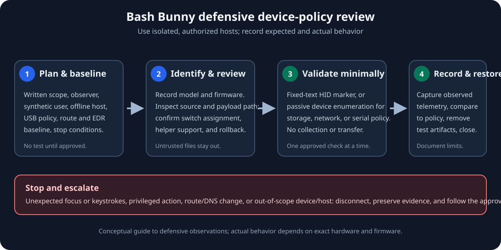

# Bash Bunny Payload Setup Guide

> **Defensive lab guide:** the repository payloads `cred_harv.txt`, `network_recon.txt`, `sys_prof.txt`, and `windows_exfil.txt` have been retired and replaced with inert notices. Do not use historical collection, credential, shell, or network examples from this guide on a live host. The fixed-text marker is the only keystroke payload; the other labs are observation-only device-policy checks in an isolated environment.


## 🎯 Purpose
Device setup and defensive USB-control review guide for the Hak5 Bash Bunny, with model and firmware boundaries, a fixed-text lab, telemetry collection, and safe rollback.

## ⚙️ Function
Covers device identification, arming mode, payload-file location, USB class observation, marker-only validation, and third-party source review. This guide does not provide credential collection, file exfiltration, network interception, or remote-command payloads.

## 🏆 Goal
Help defenders safely identify Bash Bunny devices, test a benign marker in an isolated lab, and document USB device-control behavior.

## 📋 When To Use
- Writing new Bash Bunny payloads for an authorized physical access engagement
- Setting up a Bash Bunny for the first time (arming mode, payload structure)
- Troubleshooting payload execution issues

## Overview
The Bash Bunny is a USB device with model- and firmware-specific behavior. Treat every imported payload as untrusted code. The repository’s hands-on workflow is marker-only and must run on a dedicated offline test machine with a blank editor focused.

## Initial Bash Bunny Setup

### First-time Configuration

1. **Connect Bash Bunny in Arming Mode**
   - Set switch to position closest to USB connector (Switch 3)
   - Plug into computer
   - Wait for LED to turn blue (solid)
   - Bash Bunny appears as USB storage device

2. **Update Firmware (Recommended)**
   - Download latest firmware: https://downloads.hak5.org/bunny
   - Copy firmware `.tar.gz` file to root of Bash Bunny
   - Safely eject
   - Replug - Bash Bunny will update (flashing LEDs)
   - Wait for completion (solid LED)

3. **File System Structure**
```
   /
   ├── payloads/
   │   ├── switch1/
   │   │   └── payload.txt
   │   ├── switch2/
   │   │   └── payload.txt
   │   └── library/          # Payload library
   ├── loot/                 # Data collection folder
   ├── tools/                # Additional tools/scripts
   ├── languages/            # Keyboard layouts
   └── version.txt           # Firmware version
```

## Payload Deployment

### Switch-based Operation

The Bash Bunny has a **3-position switch**:

- **Switch 3 (Closest to USB)**: Arming Mode
  - Access file system
  - Configure payloads
  - Update firmware
  
- **Switch 1**: Runs `/payloads/switch1/payload.txt`
- **Switch 2**: Runs `/payloads/switch2/payload.txt`

### Installing A Payload

1. **Set to Arming Mode** (Switch 3)
2. **Connect** to computer
3. **Navigate** to `/payloads/switch1/` or `/payloads/switch2/`
4. **Copy** your `payload.txt` to the desired switch folder
5. **Safely eject**
6. **Set switch** to position 1 or 2
7. **Plug into target** - payload executes automatically

## Historical Payload Syntax Is Not a Safe Example

Earlier versions of this guide contained host keystroke, file collection, USB networking, and scanning snippets. They have been removed because their host assumptions, paths, firmware compatibility, and effects were not verified. Do not reconstruct or run those examples from cached copies.

For a controlled validation, follow [Lab 1 — Non-destructive HID Marker](#lab-1--non-destructive-hid-marker). It types only a fixed phrase into a blank editor on an offline, disposable workstation. The lab records observed device and endpoint events without accessing accounts, files, or networks.

The Bunny’s Bash-based `payload.txt` format is device-specific and is not interchangeable with compiled Rubber Ducky `inject.bin` files. Consult the linked Hak5 documentation for current model-specific syntax; independently review source and firmware before any authorized deployment.

## Authorized Field Assessment Labs & Deployment Examples



*Figure — Conceptual policy-validation path; exact device behavior depends on hardware generation and firmware.*

This section turns the setup and device-identification notes above into **repeatable, isolated device-policy observations**. Compare the [USB Rubber Ducky compilation guide](../../Ducky/README.md) and [staged assessment blueprint](../../../PlayBooks/assessment-service-integration-map.md).

> [!IMPORTANT]
> Identify original Bash Bunny versus Mark II and record installed firmware. Bash Bunny payloads are Bash shell scripts containing Bash Bunny commands; USB Rubber Ducky compiled `inject.bin` payloads are not interchangeable with `payload.txt`. DuckyScript 3 syntax is not automatically supported. Refer to [Hak5's original payload development reference](https://github.com/hak5/bashbunny-wiki/blob/master/payload_development.md).

### Engagement Preparation

1. Obtain written authorization specifying client, permitted host IDs, USB classes (HID, storage, serial, USB networking), time window, data retention, stop conditions, and physical observer.
2. Use an offline/isolated lab workstation or disposable VM, a synthetic test user, and a blank text editor. Record USB baseline, device-control policy, active network adapters/routes, and EDR health before testing.
3. Backup existing device contents and verify switch assignment, firmware-specific helper support, keyboard layout, and the exact payload source. Never trust an unreviewed community payload.
4. Stop immediately if keystrokes reach an unexpected application, a privileged action occurs, a route/DNS setting changes unexpectedly, or an out-of-scope host enumerates the device.
5. Preserve expected **and** actual observations, not just successful outcomes.

### Lab 1 — Non-destructive HID Marker

**Goal:** validate HID acceptance and monitoring without opening commands or collecting data.

Stage this as `/payloads/switch1/payload.txt` in arming mode:

~~~bash
#!/bin/bash
# PNWC authorized HID test; focus a blank editor manually
LED SETUP
ATTACKMODE HID
sleep 3
LED ATTACK
QUACK STRING PNWC-BASH-BUNNY-LAB
QUACK ENTER
LED FINISH
~~~

1. On the dedicated target, open and focus a blank editor.
2. Safely eject in arming mode, disconnect, move the switch to position 1, and reconnect.
3. Verify only the exact marker was typed. Record USB insertion, HID class, and EDR/device-control alert, if any.
4. Remove the device, capture host logs, and document whether the behavior conformed to written USB/physical security policy.

**Interpretation:** this demonstrates keystroke input to a focused application, not elevated permissions, credential access, or a successful compromise. Repeat with the screen locked only if authorized; do not attempt lock bypass.

### Lab 2 — Removable Storage Policy

1. Capture the baseline removable-disk inventory and applicable allow/deny policy.
2. Stage `ATTACKMODE STORAGE` alone on a test switch; verify the exposed data partition and do not modify the Bunny's system partition.
3. Insert into the approved host. Observe Windows Device Manager and EDR or Linux `lsusb`, `lsblk`, and `journalctl -k`.
4. If policy permits, manually copy a **synthetic** file such as `PNWC-USB-STORAGE-TEST.txt` onto the approved exposed volume; never read/copy arbitrary client folders.
5. Record mount status, read/write restriction, detection and enforcement. Eject safely and remove the synthetic data according to the evidence policy.

### Lab 3 — USB Network Adapter/Route Policy

**Goal:** detect unexpected USB Ethernet interfaces, default routes or DNS changes.

1. Use an isolated host. On Windows, record `Get-NetAdapter`, `Get-NetRoute`, and `Get-DnsClientServerAddress`; on Linux, record `ip -br addr` and `ip route`.
2. Stage the model-appropriate `ATTACKMODE RNDIS_ETHERNET` for supported Windows environments or `ATTACKMODE ECM_ETHERNET` for supported Linux/macOS environments. **Support varies by host, OS and firmware.**
3. Do not enable network interception, forwarding, unauthorized DHCP/DNS services, or scanning. Insert once and record driver/interface enumeration, routing metrics, DNS and alerts.
4. Disconnect immediately if the default route unexpectedly changes; restore network state, compare to baseline, and report any policy mismatch.

### Lab 4 — Serial Device Enumeration

1. Record existing COM/serial interfaces using Device Manager or `ls /dev/ttyACM*` where appropriate.
2. Stage `ATTACKMODE SERIAL` alone. Insert the device and check driver installation, permissions, detection and port disappearance after removal.
3. Do not send commands to an external target or assume console parameters across device generations. Capture events and verify device-control policy.

### Lab 5 — Composite USB Device & Wazuh/EDR Correlation

1. In a disposable lab, define expected policy results for HID and storage independently.
2. Run the HID-only and storage-only labs above, then stage the firmware-documented composite `ATTACKMODE HID STORAGE`.
3. Observe per-interface enumeration. Run only the harmless text marker and synthetic storage-file check.
4. Export real host/EDR telemetry into the approved monitoring system; map the observed source fields to Wazuh alerts instead of inventing event IDs. Record allowed/blocked results.
5. Insert a legitimate keyboard as a **negative control** to evaluate false positives. Restore policies, disconnect, and verify no test device remains.

### Test Result Template

| Evidence Field | Required Record |
|---|---|
| Scope | Engagement ID, authorization, assets, operator, exact UTC times |
| Hardware | Bunny model, firmware, switch position, mode, USB IDs as observed |
| Payload | Source checksum, dependencies, approved test objective |
| Detection | Host logs, EDR/Wazuh source event, expected policy, actual result |
| Outcome | Verified observation versus inference, false-positive checks |
| Closure | Removal, network/policy restoration, synthetic data handling |

### Compatibility & Existing Example Caveats

- A Bash command executed **on the Bunny** does not magically run in the attached Windows host. Injected keystrokes execute in the foreground host application and its current user context.
- This guide no longer includes Windows/Linux data-transfer payloads. Any copied or third-party examples are untrusted and must not be treated as verified or safe.
- Earlier references to `ATTACKMODE ETHERNET` may be ambiguous for particular firmware. Use documented `RNDIS_ETHERNET` or `ECM_ETHERNET` when appropriate, and check observed enumeration rather than assuming networking works.
- Device control should consider legitimate keyboards, accessibility devices, docking stations and service peripherals before applying class restrictions.

## Retired Repository Payloads

The following bundled examples are inert retirement notices, not deployable payloads:

- `cred_harv.txt`
- `network_recon.txt`
- `sys_prof.txt`
- `windows_exfil.txt`

Any older copy or third-party library entry should be treated as untrusted. Do not copy whole payload collections to a client device. The audit and isolated marker workflow below explain how to inspect a pinned source revision and validate USB policy without collecting data or changing network settings.

## Official & Third-Party Payload Library: Controlled Installation

The [official Hak5 Bash Bunny payload library](https://github.com/hak5/bashbunny-payloads) contains Bash payload sources and bundled dependencies. Its original and Mark II hardware differ, and `payload.txt` is **interpreted on the Bunny**, not a compiled Ducky `inject.bin`. Consult the [cross-device Hak5 comparison](../../../HardwareHacking/README.md#hak5-payload-ecosystem-official--side-loaded-code) and the [Pager's event-driven payload format](../../../Wardriving/README.md#wifi-pineapple-pager--payloads-sideloading--defensive-labs).

### Side-Load One Reviewed, Harmless Payload

1. Clone or download a **pinned source commit** on an offline technician laptop. Inspect the payload script, `config.txt`, binaries, `requirements`, network endpoints, dependencies, switch behavior and file paths. Reject unapproved downloads, host scripts, credentials, persistence or data transfers.
2. Back up the Bunny's current arming-mode data. Inspect `/payloads/library/` if present; don't assume an arbitrary library example path exists or that built-in examples work unchanged on all firmware generations.
3. Test only the **fixed-text HID marker** in [Lab 1](#lab-1--non-destructive-hid-marker) first. Copy the reviewed `payload.txt` and its **required** assets into the correct `/payloads/switch1/` or `/payloads/switch2/` directory while in arming mode.
4. Safely eject, disconnect, select the intended switch, and attach to a **dedicated offline** workstation with a blank editor in focus. Log exact device enumeration, marker output, LED state and times.
5. Return to arming mode; remove only the test payload and restore the prior switch payload. Confirm no `ATTACKMODE` introduced unwanted USB NIC, storage or serial classes.
6. Record model, firmware, source commit, source hash and a reversible cleanup step.

### Review Gates For Community Payloads

| Finding | Policy |
|---|---|
| `QUACK` or host keystrokes | Check exact layout/focus and require benign offline tests before any privileged operation |
| USB Ethernet, DNS/DHCP/route edits | Separate network-change authorization; verify adapter type and rollback |
| Remote fetch or staged scripts | Demand offline source, exact hashes, no unreviewed `curl | sh` or live exfil endpoint |
| Client file collection | Separate sensitive-data consent; synthetic files by default |
| Persistent host change | Never part of a default survey; explicit risk/rollback approval |
| Firmware mismatch | Match Mark II/original hardware, required helpers and script interpreter |

**Example-safe library use:** avoid copying a whole payload category to a switch. Select **one** reviewed source version and verify return-to-baseline. A community payload being listed by Hak5 is not evidence it is safe, maintained or appropriate to use on a customer host.

## Curated GitHub Bash Bunny Payload Collections & Compatibility

_Reviewed November 11, 2026. GitHub stars are approximate observation-time popularity signals, **not** a verification of technical quality, safe behavior or current firmware support. Many Bash Bunny community collections are old; the **official repository is by far the largest purpose-built source**._

| GitHub Project | Approx. Stars | What It Contains | Maintenance, Compatibility & Selection |
|---|---:|---|---|
| [hak5/bashbunny-payloads](https://github.com/hak5/bashbunny-payloads) | **3,000** | **Official** Bash Bunny library, device helpers, Bash + Bunny DuckyScript and contributed payload categories | **Primary source.** Latest verified source push June 2026; examples are still AS-IS. Check original vs Mark II, firmware, tooling, host OS and every script before running. |
| [atomiczsec/My-Payloads](https://github.com/atomiczsec/My-Payloads) | 410 | Cross-device **Bash Bunny**, Rubber Ducky, Flipper and O.MG collection | **Archived historical resource**; last pushed 2024. Separate scripts by **actual target**. No claim of Mark II compatibility or secure dependencies. |
| [hak5/bashbunny-wiki](https://github.com/hak5/bashbunny-wiki) | 220 | Official legacy architecture/payload-development documentation, **not a payload collection** | Useful to explain `ATTACKMODE`, `QUACK` and setup concepts. Last source push in 2020: verify against current [Hak5 documentation](https://docs.hak5.org/bash-bunny/) and installed firmware. |
| [xillwillx/BashBunny](https://github.com/xillwillx/BashBunny) | 160 | Independent older Hak5 Bash Bunny payload examples | **Historical/legacy.** README says the author moved to GitLab; last GitHub code push 2020. Use only as a source to study after reviewing every path, dependency, script and transport. |
| [UberGuidoZ/OMG-Payloads](https://github.com/UberGuidoZ/OMG-Payloads) | 270 | Well-known O.MG cable/accessory examples, related USB HID scripting concepts | **Not a Bash Bunny payload library.** Distinct physical runtime and command set; use for concepts only, not direct `/payloads/switch1/payload.txt` installation. |
| [I-Am-Jakoby/Flipper-Zero-BadUSB](https://github.com/I-Am-Jakoby/Flipper-Zero-BadUSB) | **7,200** | Popular Flipper BadUSB payload scripts and remote-host automation | **Not native Bunny payloads**; several call external scripts/services or access sensitive data. Treat only as source-review examples, never as Mark II-ready scripts. |

**Selection decision:** for new client work, use the **official Hak5 library** and the existing [non-destructive Bunny field labs](#authorized-field-assessment-labs--deployment-examples). The other repositories are included to preserve historical techniques, compatibility research and provenance—not because they are equally maintained or safe. [Rubber Ducky's separately curated library](../../Ducky/README.md#curated-github-payload-projects--popularity-compatibility--trust) contains more current cross-HID examples. **Do not infer that large Flipper/O.MG collections are Bunny-compatible.**

### Community Payload Review Checklist & Bench Acceptance

1. Record the exact target (`Bash Bunny original` vs `Mark II`), current firmware, mounted **arming-mode** filesystem and payload switch. Source a pinned upstream commit, not the current tip of an unreviewed fork.
2. Inspect **`payload.txt`, configuration, helper binaries, Bash libraries, Python/PowerShell files and external scripts** before copying anything. A Bunny script runs as a Bash process **on the Bunny**; any `QUACK` host input operates only in the host's current user/application context.
3. Check all `ATTACKMODE` USB classes and network behaviors. Pay particular attention to `RNDIS_ETHERNET`/`ECM_ETHERNET`, potential route/DNS changes, scripts that wait for Windows dialogs, external network connections, privilege changes, storage mounts and host-file access.
4. Evaluate every requested file path, destination and host command against written scope. Do not use scripts that collect passwords, cookies, browser tokens or client files in a routine device-control test. Use **synthetic** files and a disposable test user instead.
5. Separate *source inspection*, *shell syntax checking*, *USB/OS compatibility validation* and *physical deployment*. Running `bash -n payload.txt` on a laptop checks Bash parsing only; Hak5-specific `LED`, `ATTACKMODE`, `QUACK` and helper commands are not validated by a generic shell.
6. As an approved safe first execution, stage only the [known benign HID marker](#lab-1--non-destructive-hid-marker) in a single switch position; keep the other switch reserved for recovery. Use an offline test machine with a blank editor focused.
7. Capture USB enumeration (VID/PID **as observed**, not guessed), EDR policy result, keyboard layout, LED states, timestamps and exact output. If an unexpected USB NIC appears, disconnect and compare routes/DNS with baseline.
8. Safely return to arming mode, restore the pre-test switch contents and remove synthetic data. Retain only redacted evidence/source hashes and documented authorization.

### Popularity Versus Real-World Deployment Quality

| Signal | Usefulness | Why It Isn't Enough |
|---|---|---|
| High star count | Finds sources widely known to other researchers | Does not mean the code was independently audited or tested on Mark II |
| Recent source push | Suggests someone maintained part of the repository | Can be documentation changes only; check relevant payload history |
| Official Hak5 organization | Strongest provenance for device-specific format | Hak5 explicitly provides community payloads AS-IS |
| Repository archived | Valuable for lineage and source analysis | No current maintenance or compatible dependencies implied |
| Many submitted payloads | Useful reference breadth | More scripts means more review, not more safe client capabilities |
| `payload.txt` file present | Expected shell-based Bunny source filename | Does not show the correct switch, USB mode, dependencies or target OS |

**Scope boundaries:** links to credential collection, staged shells or invasive networking functions are **references to source libraries**, not authorization to deploy them. For client deliverables, report reproducible benign findings and validated EDR/USB controls. Avoid downloading the entirety of every third-party repository to a customer device or running a batch of unreviewed community payloads.

## Best Practices

### 1. Led Feedback
Always use LED indicators to show payload status:
```bash
LED SETUP     # Starting
LED ATTACK    # Running
LED SPECIAL   # Optional step
LED FINISH    # Success
LED FAIL      # Error
```

### 2. Sync Data
Always sync before completion:
```bash
sync          # Flush data to storage
LED FINISH
```

### 3. Error Handling
```bash
if [ $? -eq 0 ]; then
    LED FINISH
else
    LED FAIL
fi
```

### 4. Timing
- Add appropriate delays for target OS
- Test on slowest expected hardware
- Allow extra time for USB recognition

### 5. Documentation
```bash
#!/bin/bash
#
# Title:         Clear payload name
# Description:   Detailed description
# Author:        Your name
# Version:       Version number
# Category:      Appropriate category
# Target:        Target OS/version
# Attackmodes:   Modes used
#
# LED Status:
# - Magenta: Setup
# - Yellow: Attack
# - Green: Complete
# - Red: Failure
```

## Security & Legal

### ⚠️ Legal Notice

**Authorized use only:**
- ✓ Personal systems you own
- ✓ Written permission from system owner
- ✓ Professional pentesting with contracts
- ✓ Educational labs with authorization

**Unauthorized computer access is illegal** under:
- Computer Fraud and Abuse Act (CFAA)
- Computer Misuse Act
- Similar laws worldwide

### Professional Use

1. **Obtain written authorization**
2. **Define scope clearly**
3. **Document all activities**
4. **Secure loot data appropriately**
5. **Follow responsible disclosure**

## Resources

- **Official Docs**: https://documentation.hak5.org/bash-bunny/
- **Forums**: https://forums.hak5.org/forum/94-bash-bunny/
- **Payload Library**: https://github.com/hak5/bashbunny-payloads
- **Downloads**: https://downloads.hak5.org/bunny
- **Wiki**: https://wiki.bashbunny.com/

## Quick Reference

Use the [non-destructive HID marker lab](#lab-1--non-destructive-hid-marker) for the only supported execution example in this guide. Verify the exact device model, firmware, switch position, expected USB classes, and rollback procedure before connecting it to the isolated test workstation.

The device’s LEDs and helper commands vary by firmware. Refer to the current official Hak5 documentation linked above; do not treat an old command cheat sheet as a compatibility or safety guarantee.

## Related Files
- [../../README.md](../../README.md) - Scripts section index
- [../bash_scripting_cheat-sheet.md](../bash_scripting_cheat-sheet.md) - Bash reference for payload writing
- [../../Ducky/README.md](../../Ducky/README.md) - USB Rubber Ducky: keyboard-only attack platform
- [../../../Documentation/LinuxCheatSheet.md](../../../Documentation/LinuxCheatSheet.md) - Linux commands used in payloads
- [../../../Mobile/mobile_pentest_sop.md](../../../Mobile/mobile_pentest_sop.md) - Mobile pentest SOP (DuckHunter HID on NetHunter uses BashBunny-compatible DuckyScript)
- [../../../Mobile/OnePlus_A6003/Nethunter_SOP.md](../../../Mobile/OnePlus_A6003/Nethunter_SOP.md) - NetHunter DuckHunter HID module SOP
