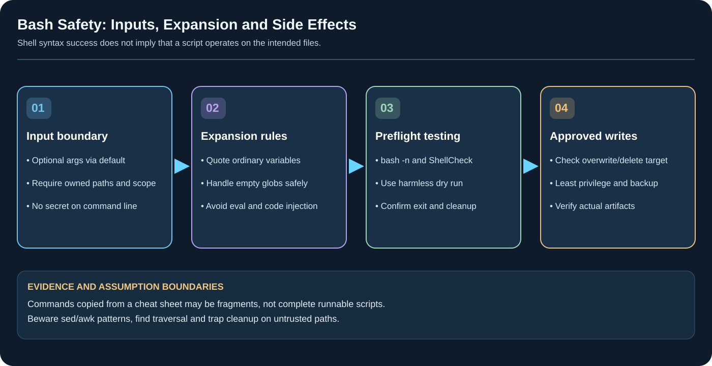

# Bash Scripting Cheat Sheet

**Reference index and audit status:** [Reviewed cheat sheets and references](../../Documentation/CHEATSHEET-REFERENCE-AUDIT-2026-10-31.md). For related copyable `find`, `grep`, `curl` and CLI diagnostics, see the [CLI Field Cheat Sheet](../../Documentation/devhints-cli-field-reference.md).

> [!IMPORTANT]
> **Reviewed October 31, 2026.** Bash snippets are examples, not production-hardened scripts. Run `bash -n script.sh` and `shellcheck script.sh`; quote expansions, validate input and protect credentials. Do **not** execute remote scripts directly from an unreviewed URL. Offensive lab snippets further down are **not** general-purpose admin commands. Start with the [Linux cheat sheet](../../Documentation/LinuxCheatSheet.md) or [security script pinning policy](../PINNING.md) when building installers.




*Conceptual safety gates.* The [GNU Bash Reference Manual](https://www.gnu.org/software/bash/manual/bash.html) documents positional parameters, filename expansion and quoting. Several examples in this cheat sheet are **syntax fragments** requiring variable definitions or surrounding script code. They must not be treated as a single runnable script; `bash -n` checks syntax, not safety or correctness.

## 🎯 Purpose
Bash scripting reference for security professionals - covering the patterns, syntax, and idioms commonly needed for writing security automation scripts, log parsing tools, and recon helpers.

## ⚙️ Function
Covers: execution and shebang patterns, variables and arrays, control flow, functions, string/file/numeric operations, process substitution, here-docs, error handling, and common one-liners for security tasks.

## 🏆 Goal
Provide a go-to reference that reduces lookup time when writing or debugging bash scripts for security automation, making common patterns immediately accessible.

## 📋 When to Use
- Writing a new security automation script in bash
- Debugging a failing bash script (checking syntax, traps, exit codes)
- Quick lookup for specific bash syntax (arrays, parameter expansion, conditionals)

## Basic Execution

```bash
#!/bin/bash                          # Shebang
bash script.sh                       # Execute script
chmod +x script.sh                   # Make executable
./script.sh                          # Run standalone
```

---

## Loops

### IF-ELSE-IF Statement
```bash
#!/bin/bash
USER_INPUT="${1:-}"  # Safe when no argument is supplied, including with set -u

if [[ -z "${USER_INPUT}" ]]; then
    echo "You must provide an argument!"
    exit 1
fi

if [[ -f "${USER_INPUT}" ]]; then
    echo "${USER_INPUT} is a file."
elif [[ -d "${USER_INPUT}" ]]; then
    echo "${USER_INPUT} is a directory."
else
    echo "${USER_INPUT} is not a file or directory."
fi
```

### Until Loop
```bash
#!/bin/bash
FILE="output.txt"

touch "${FILE}"
until [[ -s "${FILE}" ]]; do
    echo "${FILE} is empty..."
    sleep 2
done

echo "${FILE} has content!"
```

### While Loop
```bash
#!/bin/bash
SIGNAL_FILE="stoploop"

while [[ ! -f "${SIGNAL_FILE}" ]]; do
    echo "Waiting for ${SIGNAL_FILE}..."
    sleep 2
done

echo "File found! Exiting..."
```

### For Loop
```bash
# Range
for i in {1..10}; do
    echo "$i"
done

# Array iteration
for item in "${array[@]}"; do
    echo "$item"
done

# Files
for file in /path/*.txt; do
    [[ -f "${file}" ]] || continue  # Unmatched globs can remain literal
    echo "$file"
done
```

---

## User Input & Output

### Basic Input
```bash
#!/bin/bash

echo "What is your first name?"
read -r firstname

echo "What is your last name?"
read -r lastname

echo "Your name is ${firstname} ${lastname}"
```

### Silent Input (passwords)
```bash
read -sp "Enter password: " password
echo
```

### Prompt with Default
```bash
read -rp "Host [localhost]: " host
host=${host:-localhost}
```

---

## Variables

### Variable Assignment
```bash
VAR="value"
VAR="${1}"                           # From argument
VAR=$(command)                       # Command output
VAR="$(<file.txt)"                   # File content
```

### Local vs Global
```bash
#!/bin/bash

GLOBAL_VAR="accessible everywhere"

my_function() {
    local LOCAL_VAR="only in function"
    echo "${LOCAL_VAR}"
    echo "${GLOBAL_VAR}"
}

my_function
echo "${GLOBAL_VAR}"                 # Works
echo "${LOCAL_VAR}"                  # Empty
```

### Special Parameters

These are Bash expansions, **not** commands to type on their own:

| Expansion | Meaning |
|---|---|
| `$0` | Script name / invocation string |
| `$1`, `$2`, `$3` | Positional arguments; use `${1:-}` if absent is allowed under `set -u` |
| `$#` | Count of positional arguments |
| `"$@"` | Positional arguments, each preserved as its own word |
| `$?` | Exit status of the immediately preceding command |
| `$` | PID of the current shell process |
| `$!` | PID of the most recently started asynchronous command, when applicable |


---

## Comparisons

The following `if [[ ... ]]; then` statements are **individual condition headers**, not a complete executable program. Put the desired body and a matching `fi` after each condition; define the referenced variables first. Integer operators `-eq`, `-gt`, etc. are arithmetic comparisons, not string comparisons.

### Integer Comparison
```bash
if [[ "${VAR1}" -eq "${VAR2}" ]]; then    # Equal
if [[ "${VAR1}" -ne "${VAR2}" ]]; then    # Not equal
if [[ "${VAR1}" -gt "${VAR2}" ]]; then    # Greater than
if [[ "${VAR1}" -lt "${VAR2}" ]]; then    # Less than
if [[ "${VAR1}" -ge "${VAR2}" ]]; then    # Greater/equal
if [[ "${VAR1}" -le "${VAR2}" ]]; then    # Less/equal
```

### String Comparison
```bash
if [[ "${STR1}" == "${STR2}" ]]; then     # Equal
if [[ "${STR1}" != "${STR2}" ]]; then     # Not equal
if [[ -z "${STR}" ]]; then                # Empty string
if [[ -n "${STR}" ]]; then                # Not empty
if [[ "${STR}" =~ pattern ]]; then        # Regex match
```

### File Tests
```bash
if [[ -f "${FILE}" ]]; then               # File exists
if [[ -d "${DIR}" ]]; then                # Directory exists
if [[ -r "${FILE}" ]]; then               # Readable
if [[ -w "${FILE}" ]]; then               # Writable
if [[ -x "${FILE}" ]]; then               # Executable
if [[ -s "${FILE}" ]]; then               # File not empty
if [[ -L "${FILE}" ]]; then               # Symbolic link
```

---

## File Operations

### File Search
```bash
# Check if file exists
if [[ -f "${FILENAME}" ]]; then
    echo "${FILENAME} exists."
    exit 1
else
    touch "${FILENAME}"
fi
```

### Recursive File Search & Backup
This GNU/Linux example creates a unique temporary staging directory, preserves
relative paths, refuses to overwrite the archive, and removes only the temporary
directory it created. Review the source directory first because backup files
may contain sensitive data.

```bash
#!/usr/bin/env bash
set -euo pipefail

SOURCE_DIR="${1:-/var/log}"
ARCHIVE="${HOME}/files-$(date +%Y%m%d-%H%M%S).tar.gz"

if [[ ! -d "${SOURCE_DIR}" ]]; then
    printf 'Not a directory: %s\n' "${SOURCE_DIR}" >&2
    exit 1
fi
if [[ -e "${ARCHIVE}" ]]; then
    printf 'Refusing to overwrite: %s\n' "${ARCHIVE}" >&2
    exit 1
fi

STAGING_DIR="$(mktemp -d "${TMPDIR:-/tmp}/log-backup.XXXXXXXX")"
trap 'rm -rf -- "${STAGING_DIR}"' EXIT

while IFS= read -r -d '' file; do
    relative_path="${file#"${SOURCE_DIR%/}/"}"
    mkdir -p -- "${STAGING_DIR}/$(dirname -- "${relative_path}")"
    cp -- "${file}" "${STAGING_DIR}/${relative_path}"
done < <(find "${SOURCE_DIR}" -type f -readable -print0)

tar -czf "${ARCHIVE}" -C "${STAGING_DIR}" .
printf 'Archive created: %s\n' "${ARCHIVE}"
```

### File Operations
```bash
cat file.txt                         # Display contents
head -n 10 file.txt                  # First 10 lines
tail -n 10 file.txt                  # Last 10 lines
tail -f file.txt                     # Follow file (live)

cp source dest                       # Copy
mv old new                           # Move/rename
rm -- file                           # Delete one named file
# Recursive deletion is destructive: inspect and validate the exact path first.
rm -r -- directory

touch file.txt                       # Create empty file
echo "text" > file.txt               # Overwrite
echo "text" >> file.txt              # Append
```

---

## Functions

### Basic Function
```bash
my_function() {
    echo "Hello from function"
    echo "Arg 1: $1"
    echo "Arg 2: $2"
    return 0
}

my_function "first" "second"
```

### Function with Return Value
```bash
get_value() {
    echo "return_value"
}

result=$(get_value)
echo "${result}"
```

---

## Text Processing

### grep - Search Text
```bash
grep "pattern" file.txt              # Search for pattern
grep -i "pattern" file.txt           # Case-insensitive
grep -r "pattern" /path              # Recursive
grep -v "pattern" file.txt           # Invert match
grep -E "regex" file.txt             # Extended regex
```

### sed - Stream Editor
```bash
sed 's/old/new/' file.txt            # Replace first occurrence
sed 's/old/new/g' file.txt           # Replace all
sed -i 's/old/new/g' file.txt        # Edit in-place
sed -n '5,10p' file.txt              # Print lines 5-10
```

### awk - Text Processing
```bash
awk '{print $1}' file.txt            # Print first column
awk -F: '{print $1}' /etc/passwd     # Custom delimiter
awk '/pattern/ {print $0}' file.txt  # Pattern matching
```

### cut - Column Extraction
```bash
cut -d: -f1 /etc/passwd              # First field, colon delimiter
cut -c1-10 file.txt                  # Characters 1-10
```

---

## Network Operations

### cURL
```bash
curl https://example.com                           # GET request
curl -o file.html https://example.com              # Save to file
curl -s https://example.com                        # Silent mode
curl -w "%{http_code}" https://example.com         # Show HTTP code
curl -X POST -d "data=value" https://example.com   # POST request
curl -H "Header: value" https://example.com        # Custom header
curl -u user https://example.com                  # Prompts for secret; do not embed passwords in args/history
```

### wget
```bash
wget https://example.com/file.txt                  # Download file
wget -O output.txt https://example.com/file.txt    # Save as
wget -r https://example.com                        # Recursive download
wget --spider https://example.com                  # Check if exists
```

### netcat (nc)
Use netcat only for simple, authorized connectivity checks. Do not attach a shell
to a listener.

```bash
# Local lab: open a listener in one terminal, then connect from another.
nc -l 127.0.0.1 4444
printf 'test\\n' | nc 127.0.0.1 4444
```

### Network Info
```bash
ip addr show                         # Show IP addresses
ip route                             # Show routing table
ss -tulpn                            # Show listening ports
netstat -tulpn                       # Alternative
ping -c 4 192.168.1.1                # Ping 4 times
```

---

## Process Management

```bash
ps aux                               # List all processes
ps aux | grep process_name           # Find process
kill PID                             # Terminate process
kill -9 PID                          # Force kill
killall process_name                 # Kill by name

command &                            # Run in background
jobs                                 # List background jobs
fg %1                                # Bring job 1 to foreground
bg %1                                # Resume job 1 in background

nohup command &                      # Run immune to hangups
```

---

## System Information

```bash
whoami                               # Current user
id                                   # User/group IDs
hostname                             # System hostname
uname -a                             # System information
cat /etc/os-release                  # OS info

df -h                                # Disk usage
du -sh /path                         # Directory size
free -h                              # Memory usage
uptime                               # System uptime

which command                        # Locate binary
whereis command                      # Locate binary/man page
```

---

## Security Testing Patterns

Keep security testing within an explicitly authorized scope. For routine
connectivity troubleshooting, check a single service on a host you administer
and avoid collecting credentials or opening command interpreters.

```bash
#!/usr/bin/env bash
set -u

host="${1:-127.0.0.1}"
port="${2:-8080}"

if [[ "${host}" != "127.0.0.1" && "${host}" != "localhost" ]]; then
    printf 'This example is limited to loopback; use approved tools and scope for other hosts.\n' >&2
    exit 2
fi
if [[ ! "${port}" =~ ^[0-9]+$ ]] || (( port < 1 || port > 65535 )); then
    printf 'Port must be an integer from 1 to 65535.\n' >&2
    exit 2
fi

if timeout 2 bash -c ':</dev/tcp/"$1"/"$2"' _ "${host}" "${port}" 2>/dev/null; then
    printf 'A service accepted a TCP connection on %s:%s.\n' "${host}" "${port}"
else
    printf 'No TCP connection to %s:%s.\n' "${host}" "${port}"
fi
```

A successful connection only establishes that a TCP service responded; it does not
identify the service or establish that it is secure. For broader assessment,
define written scope, rate limits, test windows, data-handling rules, and stop
conditions first.

---

## Web Application Security Patterns

Do not expose an HTTP endpoint that accepts a command, passes it to a shell, or
renders a template with an execution hook. That design creates remote command
execution. Avoid debug mode in deployed Flask applications, and do not trust an
uploaded filename or client-supplied MIME type as proof that a file is safe.

For legitimate application features, use fixed server-side actions and validated
data. When a subprocess is genuinely needed, pass a fixed executable and an
argument list (not user-controlled shell text), allowlist accepted values, run
with least privilege, set timeouts, and avoid returning sensitive output to the
requester. Prefer avoiding subprocesses in web request handlers entirely.

A harmless Flask health endpoint can return fixed status without invoking system
commands:

```python
from flask import Flask, jsonify

app = Flask(__name__)

@app.get("/health")
def health():
    return jsonify(status="ok")

if __name__ == "__main__":
    # For local development only; use a production WSGI server when deployed.
    app.run(host="127.0.0.1", port=5000, debug=False)
```

For upload handling, generate a server-side filename, enforce size limits, check
content using appropriate libraries, store files outside the web root, and
authorize access to them. Do not build a shell command from a request parameter.

## Error Handling

```bash
# Exit on error
set -e

# Exit on undefined variable
set -u

# Exit on pipe failure
set -o pipefail

# Combine all
set -euo pipefail

# Trap errors
trap 'echo "Error on line $LINENO"' ERR

# Check command success
if command; then
    echo "Success"
else
    echo "Failed"
fi

# Redirect errors
command 2>/dev/null              # Discard errors
command 2>&1                     # Combine stdout/stderr
command > output.txt 2>&1        # Redirect both to file
```

---

## Arrays

```bash
# Define array
arr=("item1" "item2" "item3")

# Access elements
echo "${arr[0]}"                 # First element
echo "${arr[@]}"                 # All elements
echo "${#arr[@]}"                # Array length

# Add element
arr+=("item4")

# Loop through array
for item in "${arr[@]}"; do
    echo "${item}"
done

# Read file into array
mapfile -t lines < file.txt
```

---

## String Manipulation

```bash
# Length
${#string}

# Substring
${string:position:length}

# Replace
${string/pattern/replacement}      # First occurrence
${string//pattern/replacement}     # All occurrences

# Remove prefix/suffix
${string#pattern}                  # Remove shortest match from start
${string##pattern}                 # Remove longest match from start
${string%pattern}                  # Remove shortest match from end
${string%%pattern}                 # Remove longest match from end

# Case conversion
${string^^}                        # Uppercase
${string,,}                        # Lowercase
```

---

## One-Liners

```bash
# Find SUID files
find / -perm -4000 -type f 2>/dev/null

# Find writable directories
find / -writable -type d 2>/dev/null

# Find files modified in last 7 days
find /path -type f -mtime -7

# Check one local development port
timeout 1 bash -c ':</dev/tcp/127.0.0.1/8080' && echo "Open on localhost"

# Extract IPs from file
grep -oE '\b([0-9]{1,3}\.){3}[0-9]{1,3}\b' file.txt

# Generate wordlist
for i in {0000..9999}; do echo "$i"; done > wordlist.txt

# Base64 encode/decode
echo "text" | base64
echo "dGV4dAo=" | base64 -d

# URL encode
printf '%s' "text with spaces" | jq -sRr @uri

# Download only after verifying the HTTPS source and exact version.
# Then inspect and check its published signature/checksum BEFORE running.
# No examples here execute unknown network content directly.

# No backdoor accounts in general-purpose automation.
# Use approved account provisioning and least-privilege group assignments.
# Do not set a hard-coded password in a script or create unapproved accounts.
```

---

## Useful Tools

```bash
# Encode/Decode
base64                               # Base64 encoding
xxd                                  # Hex dump
md5sum / sha256sum                   # Hash files

# Network
nmap                                 # Network scanner
netcat / nc                          # Swiss army knife
socat                                # Advanced netcat
tcpdump                              # Packet capture
wireshark / tshark                   # Packet analysis

# Web
curl / wget                          # HTTP clients
nikto                                # Web scanner
dirb / gobuster                      # Directory brute force
sqlmap                               # SQL injection

# Password
hydra                                # Brute force tool
john                                 # Password cracker
hashcat                              # Hash cracker

# Enumeration
enum4linux                           # SMB enumeration
smbclient                            # SMB client
ldapsearch                           # LDAP queries
```

---

## Quick Tips

- Use `"${variable}"` to prevent unintended word splitting in ordinary command arguments (arrays and patterns have different rules)
- Use `[[` instead of `[` for better syntax
- Always quote variables: `"${var}"`
- Use `$()` instead of backticks for command substitution
- Test scripts with `bash -x script.sh` for debugging
- Use `shellcheck` to validate scripts
- Redirect errors to null: `2>/dev/null`
- Use `timeout` to prevent hanging commands
- Avoid logging secrets or personal data: `script.sh 2>&1 | tee output.log` can expose sensitive values; redact/limit logs and restrict access

---

## Security and Responsible Use

Examples that interact with systems should be run only within an approved scope. A general
authorization warning does not make every tool or technique appropriate: define permitted
targets, rate limits, timing, data handling, and stop conditions before testing. Use
purpose-built defensive tooling and a controlled lab for security education.

## Related Files
- [../README.md](../README.md) - Scripts section index
- [BashBunny/README.md](BashBunny/README.md) - Bash Bunny payloads written in bash
- [../../Documentation/LinuxCheatSheet.md](../../Documentation/LinuxCheatSheet.md) - Linux commands context
