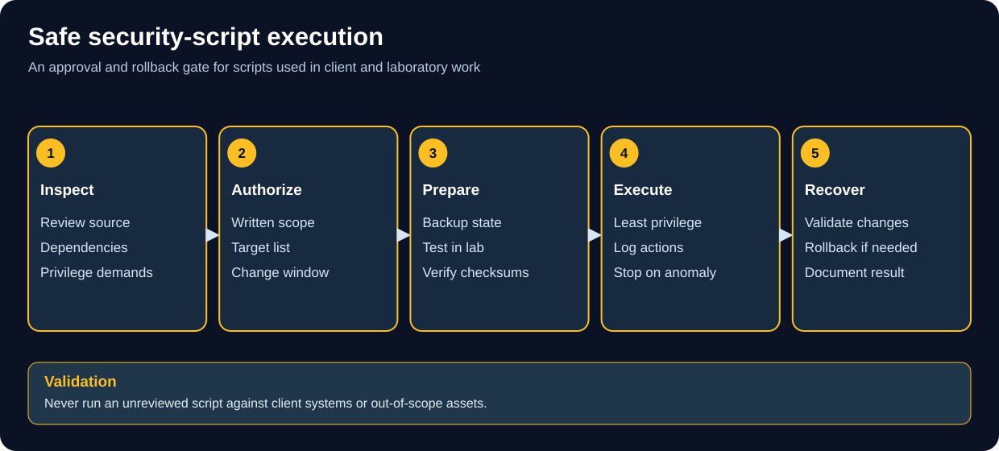

> **Runtime status:** The [historical collection](GO/README.md) includes Python 2 examples and an unfinished Go sketch. Listing a script here does not certify that it runs on a current system.

# 💻 Security Scripts & Tools
**Legacy script collection:** [Cypherpunk toolkit review](../Documentation/cypherpunk-pentesting-toolkit-review.md) provides safe source attribution and Python 2 → Python 3 modernization cautions. It does not add third-party executables or payloads.


**Documentation references:** [Curated technical docs](../Documentation/curated-technical-docs.md) links to GitHub Docs, Git tutorials, and Go by Example for script review and maintenance; prefer vendor docs for current syntax.

**Secret and dependency checks:** [OpenSSF Scorecard, Gitleaks, Syft and OSV supply-chain workflow](../ContainerSecurity/software-supply-chain-assessment.md) explains versioned inspection and evidence handling for the scripts collection; source code is not automatically safe because it is published.

| Resource | Description |
|---|---|
| [Bash Cheat Sheet](./Bash/bash_scripting_cheat-sheet.md) | Shell syntax and reusable patterns |
| [CLI Field Commands](../Documentation/devhints-cli-field-reference.md) | Everyday command-line reference |
| [Reviewed Reference Index](../Documentation/CHEATSHEET-REFERENCE-AUDIT-2026-10-31.md) | Cross-section cheat sheets |
| [Tool Pinning Policy](./PINNING.md) | Version and dependency controls |
| [Curated Rubber Ducky GitHub Projects](./Ducky/README.md#curated-github-payload-projects--popularity-compatibility--trust) | Popular official/community source libraries, GitHub popularity, firmware compatibility and code-review boundaries |
| [Curated Bash Bunny GitHub Projects](./Bash/BashBunny/README.md#curated-github-bash-bunny-payload-collections--compatibility) | Official/legacy repositories, archived-status checks, helper compatibility and lab review workflow |
| [Hak5 Payload Formats & Sideload Checks](../HardwareHacking/README.md#hak5-payload-ecosystem-official--side-loaded-code) | Cross-device Pager, Mark VII, Bash Bunny, Ducky, Shark Jack, Packet Squirrel and Key Croc runtime distinctions |
| [WiFi Pineapple Pager](../Wardriving/README.md#wifi-pineapple-pager--payloads-sideloading--defensive-labs) | User/Recon/Alert payloads, event handling, controlled installation and rollback |
| [Mark VII Campaign Examples](../Wardriving/README.md#optimized-mark-vii-setup--campaign-configuration) | Five monitored/restricted client wireless assessment runbooks |

Inspect provenance and source before running downloaded scripts.

> **Safer and retired examples:** `Python/app.py` and `Python/web_shell_inj.py`
> are loopback-only upload references with no command-execution route or template hook.
> `Bash/fake_sudo.sh` exits without prompting for or transmitting a password.
> `Bash/hulkscanner.sh` requires an explicit authorization flag and limits checks to
> ports 1–1024 on one IPv4 address. `Bash/nuclei_web_scanner.sh` requires interactive
> scope confirmation, an explicitly selected local template, and a 5-request-per-second
> cap; it prints findings locally and sends no email.
>
> The password-guessing examples `Bash/ssh_brute.sh`, `Python/ssh_brute.py`, and
> `Python/ssh_brutekey.py` are retired. Their earlier versions exposed guessed or
> valid credentials, guessed without a suitable rate/lockout bound, or bypassed SSH
> host-key verification.

<div align="center">

**Collection of security automation scripts, exploitation tools, and utility programs**

*Part of the [ULTIMATE CYBERSECURITY MASTER GUIDE](../README.md)*


</div>

---

**External script sourcing:** [Curated security GitHub collections](../Documentation/awesome-hacking-collections-integration.md) describe useful upstream projects; no linked payload is automatically vetted or installed.


## 📋 Table Of Contents

- [Overview](#-overview)
- [Script Categories](#️-script-categories)
- [Directory Structure](#-directory-structure)
- [How to Use These Scripts](#-how-to-use-these-scripts)
- [⚠️ CRITICAL Security & Legal Warning](#️-critical-security--legal-warning)
- [Contributing](#-contributing)
- [Resources](#-resources)

---

## 🎯 Purpose
The folder-level index for every automation script in the repository (Bash, C, Go, PowerShell, Python, SQL, YAML) - the only file that explains directory layout and legal warnings once, instead of repeating them in every language subfolder's own README.

## ⚙️ Function
Covers directory structure, script categories by language, usage instructions, the critical legal warning, contributing guidelines, and quick links/resources. Differs from [Scripts/Bash/BashBunny/README.md](Bash/BashBunny/README.md), [Scripts/Bash/bash_scripting_cheat-sheet.md](Bash/bash_scripting_cheat-sheet.md), and [Scripts/Ducky/README.md](Ducky/README.md), which document a specific script collection or reference topic rather than the folder as a whole. The published repository includes executable scripts in these directories; do not infer availability or safety from a partial local checkout. Review [legacy archive dispositions](GO/ARCHIVE-INVENTORY.md) separately.

## 🏆 Goal
A reader can find the right script for a task by category/language and understands the legal authorization requirement before running anything.

## 📋 When To Use
When looking for an existing script before writing a new one, or when unsure what legal/usage constraints apply to this folder's contents.

## 🎯 Overview

This directory contains **security automation scripts, penetration testing tools, and utility programs** written in multiple programming languages. These scripts are designed for authorized security testing, research, and educational purposes.

### ⚠️ Use and Scope

This collection includes read-only utilities, active scanners, and tools that can access or change systems. For active testing, use only targets and methods within your authority and documented scope. Written approval is useful evidence of scope, but the required form and legal rules depend on the engagement and jurisdiction.

The [CFAA statute](https://uscode.house.gov/us/usc/119-134/t18/s1030/) defines multiple offenses with different elements and penalties; not every unauthorized or out-of-policy use of a script is automatically a federal crime. See the [DOJ CFAA charging policy](https://www.justice.gov/jm/jm-9-48000-computer-fraud), which guides federal prosecutors. Other laws, contracts, privacy obligations and organizational rules may also apply.

---

## 📂 Directory Structure

### Programming Language Categories

```
Scripts/
├── Bash/           # Bash shell scripts
├── C/              # C programs and utilities
├── GO/             # Historical mixed-language collection; many Python 2 examples
├── PowerShell/     # PowerShell scripts (Windows)
├── Python/         # Python scripts and tools
├── SQL/            # SQL scripts and queries
└── YAML/           # YAML configuration files
```

---

## 🗂️ Script Categories

### 1. Bash Scripts

**Location**: `/Scripts/Bash/`

**Types of Scripts:**
- System administration automation
- Network reconnaissance tools
- Security auditing scripts
- Log analysis utilities
- Automated exploitation frameworks
- System enumeration tools

**Common Use Cases:**
- Linux/Unix system administration
- Automated security testing
- Log parsing and analysis
- System monitoring
- Security auditing

**Target Platforms:**
- Linux distributions
- Unix-based systems
- macOS
- WSL (Windows Subsystem for Linux)

---

### 2. C Programs

**Location**: `/Scripts/C/`

**Current Programs:**

| Program | Description | Purpose |
|---------|-------------|---------|
| **get_user.c** | User enumeration utility | System reconnaissance |
| **getuser.c** | User information retrieval | Privilege enumeration |
| **scanner.c** | Network or port scanner | Network reconnaissance |
| **system_sleep.c** | System sleep/suspend utility | System manipulation |
| **systemsleep.c** | System sleep implementation | Testing/manipulation |

**Characteristics:**
- Low-level system access
- High performance execution
- Direct system API calls
- Compiled executables
- Platform-specific implementations

**Security Considerations:**
```
⚠️ C programs have direct system access and can:
   • Access low-level system functions
   • Bypass security controls if misused
   • Cause system instability if buggy
   • Execute with elevated privileges
   • Directly manipulate memory and processes

MUST be compiled and tested in isolated environments before use.
```

---

### 3. Powershell Scripts

**Location**: `/Scripts/PowerShell/`

**Current Scripts:**

| Script | Description | Risk Level |
|--------|-------------|------------|
| **adlogin.ps1** | Active Directory login/authentication testing | 🔴 HIGH |
| **cred_hunt.ps1** | Credential hunting and discovery | 🔴 HIGH |
| **localbrute.ps1** | Local account brute force tool | 🔴 HIGH |
| **localbrute-extra-mini.ps1** | Compact local brute force variant | 🔴 HIGH |
| **port-scan-tcp.ps1** | TCP port scanning utility | 🟡 MEDIUM |
| **port-scan-tcp-compat.ps1** | Compatible TCP port scanner | 🟡 MEDIUM |
| **port-scan-udp.ps1** | UDP port scanning utility | 🟡 MEDIUM |
| **port_scanner.ps1** | General purpose port scanner | 🟡 MEDIUM |
| **rev_shell.ps1** | Reverse shell utility | 🔴 HIGH |
| **smblogin.ps1** | SMB authentication testing | 🔴 HIGH |
| **smblogin-extra-mini.ps1** | Compact SMB login tester | 🔴 HIGH |
| **system_enum.ps1** | System enumeration script | 🟡 MEDIUM |

**Capabilities:**
- Active Directory security testing
- Credential access and testing
- Network reconnaissance
- Windows system enumeration
- SMB/CIFS protocol testing
- Remote access establishment

| Resource | Description |
|---|---|
| [Active Directory Checklist](../Checklists/ActiveDirectory.md) | Directory service assessment |
| [Credential Access Checklist](../Checklists/Credential-Access.md) | Authorized credential testing boundaries |
| [Windows Privilege Escalation Checklist](../Checklists/Windows-Privilege-Escalation.md) | Windows privilege investigation |

**Security Considerations:**
```
⚠️ CRITICAL: These PowerShell scripts include:
   • Credential harvesting tools (ILLEGAL without authorization)
   • Brute force attack scripts (ILLEGAL without authorization)
   • Reverse shell utilities (ILLEGAL without authorization)
   • Authentication bypass techniques

Use these scripts only on systems and accounts within your authority and documented scope. Legal consequences depend on the conduct, applicable statute and facts; see the authorization guidance above.
```

---

### 4. Python Scripts

**Location**: `/Scripts/Python/`

**Current Scripts:**

#### Network & Reconnaissance
| Script | Description | Risk Level |
|--------|-------------|------------|
| **port_scan.py** | Port scanning utility | 🟡 MEDIUM |
| **port_scanner.py** | Network port scanner | 🟡 MEDIUM |
| **perm_scan.py** | Permission scanning tool | 🟡 MEDIUM |
| **perm_scan5.py** | Permission scanner v5 | 🟡 MEDIUM |
| **discover_network.py** | Network discovery tool | 🟡 MEDIUM |
| **network_attack.py** | Network attack framework | 🔴 HIGH |
| **proxy_test.py** | Proxy testing utility | 🟢 LOW |

#### Credential & Authentication
| Script | Description | Risk Level |
|--------|-------------|------------|
| **credit_sniff.py** | Credit card data sniffer | 🔴 HIGH |
| **password_check.py** | Password validation/testing | 🟡 MEDIUM |
| **cred_sniff.py** | Credential sniffing tool | 🔴 HIGH |
| **ftp_sniff.py** | FTP credential sniffer | 🔴 HIGH |

#### Bluetooth & Wireless
| Script | Description | Risk Level |
|--------|-------------|------------|
| **bt-find.py** | Bluetooth device discovery | 🟡 MEDIUM |
| **bt_scan.py** | Bluetooth scanning utility | 🟡 MEDIUM |
| **blue_bug.py** | Bluetooth exploitation tool | 🔴 HIGH |

#### Exploitation & Attack Tools
| Script | Description | Risk Level |
|--------|-------------|------------|
| **bsodshell.py** | Blue Screen of Death exploit | 🔴 HIGH |
| **conficker.py** | Conficker worm-related tool | 🔴 HIGH |
| **dll_inject.py** | DLL injection utility | 🔴 HIGH |
| **evil_batch.py** | Malicious batch generator | 🔴 HIGH |
| **find_ddos.py** | DDoS detection/analysis | 🟡 MEDIUM |
| **rev_shell.py** | Reverse shell utility | 🔴 HIGH |

#### Web & Application Security
| Script | Description | Risk Level |
|--------|-------------|------------|
| **webshell_check.py** | Webshell detection tool | 🟡 MEDIUM |
| **firefox_parser.py** | Firefox data parser | 🟡 MEDIUM |
| **imap_parser.py** | IMAP protocol parser | 🟡 MEDIUM |
| **link_parser.py** | Link extraction tool | 🟢 LOW |
| **print_cookies.py** | Cookie extraction utility | 🟡 MEDIUM |

#### Geolocation & Tracking
| Script | Description | Risk Level |
|--------|-------------|------------|
| **geo.py** | Geolocation utility | 🟢 LOW |
| **geo_paint.py** | Geolocation visualization | 🟢 LOW |
| **google_earth_pcap.py** | PCAP to Google Earth | 🟡 MEDIUM |
| **google_json.py** | Google JSON parser | 🟢 LOW |
| **google_jsonlist.py** | Google JSON list parser | 🟢 LOW |
| **google_sniff.py** | Google traffic sniffer | 🟡 MEDIUM |

#### Mobile Device
| Script | Description | Risk Level |
|--------|-------------|------------|
| **iphone_finder.py** | iPhone device discovery | 🟡 MEDIUM |
| **iphone_messages.py** | iPhone message extraction | 🔴 HIGH |

#### Specialized Tools
| Script | Description | Risk Level |
|--------|-------------|------------|
| **hotel_sniff.py** | Hotel network sniffer | 🔴 HIGH |
| **ics_find.py** | Industrial Control System finder | 🔴 HIGH |
| **kitten_test.py** | Testing utility | 🟢 LOW |
| **dup.py** | Duplicate file finder | 🟢 LOW |
| **dump_nmdbs.py** | Database dumping tool | 🔴 HIGH |
| **pdfs_paint.py** | PDF visualization | 🟢 LOW |
| **print_direction.py** | Direction printing utility | 🟢 LOW |

#### Supporting Files
| File | Description |
|------|-------------|
| **pass.txt** | Password list/dictionary |
| **passout.txt** | Password output file |
| **nnb-cities.txt** | Cities database |

**Python Script Characteristics:**
- Extensive network security tools
- Credential harvesting capabilities
- Exploitation frameworks
- Protocol analysis utilities
- Data exfiltration tools
- Reconnaissance utilities

**Security Considerations:**
```
⚠️ EXTREME CAUTION: Python scripts include:
   • Credential sniffers (credit_sniff.py, cred_sniff.py, ftp_sniff.py)
   • Network attack tools (network_attack.py)
   • Exploitation utilities (dll_inject.py, bsodshell.py)
   • Data exfiltration tools (iphone_messages.py, dump_nmdbs.py)
   • Reverse shells (rev_shell.py)
   • ICS/SCADA targeting tools (ics_find.py)

These tools can cause:
   ✗ Unauthorized access (federal crime)
   ✗ Data theft (federal and state crimes)
   ✗ Privacy violations (civil and criminal liability)
   ✗ Network disruption (federal crime)
   ✗ System compromise (federal crime)
   ✗ Critical infrastructure attacks (terrorism charges possible)

USING WITHOUT AUTHORIZATION = FEDERAL PRISON TIME
```

---

### 5. SQL Scripts

**Location**: `/Scripts/SQL/`

**Current Scripts:**

| Script | Description | Risk Level |
|--------|-------------|------------|
| **add_wordpress_admin.sql** | WordPress admin account creation | 🔴 HIGH |

**Purpose:**
- Database manipulation
- WordPress security testing
- Privilege escalation testing
- Database access testing

**Security Considerations:**
```
⚠️ WARNING: SQL Scripts for unauthorized database access
   • Creating admin accounts without authorization is ILLEGAL
   • Database manipulation without permission violates CFAA
   • Unauthorized privilege escalation is a federal crime

ONLY use on systems you own or have explicit written permission to test.
```

---

### 6. YAML Configuration Files

**Location**: `/Scripts/YAML/`

**Purpose:**
- Script configuration files
- Automation playbook definitions
- Tool settings and parameters
- Environment configurations

---

## 📖 How To Use These Scripts



*Do not run unreviewed or out-of-scope automation on client systems.*

### ⚠️ Before Running Any Script

```
MANDATORY CHECKLIST:

☐ Do I OWN the target system?
☐ Do I have WRITTEN authorization to test?
☐ Is the authorization CURRENT and VALID?
☐ Does authorization SPECIFICALLY cover these scripts/techniques?
☐ Have I verified the script won't cause harm?
☐ Do I have rollback/recovery procedures?
☐ Have I tested in an isolated environment first?
☐ Am I prepared to document all activities?
☐ Do I have emergency contacts ready?
☐ Have I reviewed applicable laws and policies?

If you answered NO to ANY question: DO NOT RUN THE SCRIPT
```

### For Security Professionals

```
Authorized Testing Workflow:

1. Authorization Phase:
   └─> Obtain written authorization
   └─> Verify scope includes script usage
   └─> Document authorization details
   └─> Prepare testing environment
   └─> Review scripts before execution

2. Preparation Phase:
   └─> Test scripts in isolated lab first
   └─> Understand exactly what each script does
   └─> Prepare monitoring and logging
   └─> Have rollback procedures ready
   └─> Coordinate with stakeholders

3. Execution Phase:
   └─> Follow authorized scope strictly
   └─> Document all commands and outputs
   └─> Monitor system impact continuously
   └─> Stop immediately if issues occur
   └─> Maintain communication with client

4. Post-Execution Phase:
   └─> Document findings thoroughly
   └─> Provide detailed activity logs
   └─> Recommend remediations
   └─> Secure/delete sensitive data
   └─> Archive documentation properly
```

### For Students & Learners

```
Safe Learning Environments ONLY:

✅ AUTHORIZED Learning:
   • Personal virtual machines YOU created
   • Home lab equipment YOU own
   • University/school labs WITH permission
   • Authorized CTF platforms (HackTheBox, TryHackMe)
   • Bug bounty programs WITHIN scope
   • Dedicated training environments

🚫 NEVER Test On:
   • School/work production systems
   • Your employer's network without written approval
   • Friends' or family members' systems
   • Public WiFi or networks
   • Cloud services without explicit permission
   • Any system you don't own or lack written authorization for
```

### Script Usage Guidelines

#### Powershell Scripts

```powershell
# EXAMPLE: Running in authorized test environment

# 1. Verify authorization
Get-Content authorization.txt

# 2. Set execution policy (if needed)
Set-ExecutionPolicy -Scope Process -ExecutionPolicy Bypass

# 3. Run script with appropriate parameters
.\script.ps1 -Target "authorized-target.local" -Output "results.txt"

# 4. Document results
Get-Content results.txt | Out-File -FilePath "assessment-report.txt" -Append
```

#### Python Scripts

```python
# EXAMPLE: Running network scanner in authorized environment

# 1. Verify you have authorization
# 2. Activate virtual environment (recommended)
python -m venv venv
source venv/bin/activate  # Linux/Mac
venv\Scripts\activate      # Windows

# 3. Install dependencies
pip install -r requirements.txt

# 4. Run script against authorized target only
python port_scanner.py --target 192.168.1.100 --output scan_results.txt

# 5. Document and secure results
```

#### Bash Scripts

```bash
# EXAMPLE: Running reconnaissance script

# 1. Review script contents first
cat script.sh

# 2. Make executable
chmod +x script.sh

# 3. Run with proper parameters
./script.sh --target authorized-system.local --output results.txt

# 4. Review and document results
cat results.txt
```

---

## ⚠️ Security, Authorization & Operational Risk

Scripts range from local utilities to active access, scanning, credential, remote-control and data-handling tools. A category or risk label in this index is a triage aid, not a legal classification or guarantee that a command is safe.

### Establish scope before active testing

For an engagement, record the approving authority, in-scope systems and accounts, allowed techniques, time window, data-handling limits, contacts, stop conditions and rollback plan. Confirm that the person granting permission can authorize the target and that the scope covers the specific method. Written approval is good practice; no single form is a universal legal requirement for every activity.

The [CFAA statute (18 U.S.C. § 1030)](https://uscode.house.gov/us/usc/119-134/t18/s1030/) contains several distinct offenses and penalty provisions. Application depends on statutory elements and facts. The [DOJ charging policy](https://www.justice.gov/jm/jm-9-48000-computer-fraud) is guidance for federal prosecutors, not a complete account of every federal, state, civil or international rule. Avoid relying on blanket claims such as “any unauthorized use is a federal crime” or one fixed prison term.

### Match precautions to the tool

| Tool class | Main operational concern | Safer practice |
|---|---|---|
| Port scanners and discovery tools | Unexpected traffic, alerts or service load | Set a narrow approved target list, rate and time window; stop on instability |
| Login or password testing | Account lockouts, alerts and access to real accounts | Use test accounts in a lab or an explicitly scoped engagement; agree on attempt limits |
| Credential capture or data collection | Exposure of real secrets, personal or regulated data | Use synthetic test data; collect the minimum approved data and protect/delete it under the plan |
| Remote shells or system changes | Persistence, outages or unintended host changes | Use isolated labs or a documented change/rollback procedure on specifically approved systems |
| ICS/SCADA tools | Physical process and safety effects | Do not probe live control systems without owner authorization, engineering review and a safety-approved test plan |

An authorized test can still cause outages or expose data. Use the [script execution workflow](../assets/diagrams/safe-script-execution.svg) to review inputs, target scope, expected effects, monitoring, rollback and output handling before execution.

### Practical checklist

**Before:** validate the target and scope, inspect the script and dependencies, test in an isolated lab where feasible, prepare monitoring and rollback, and identify an escalation contact.

**During:** use the minimum required privileges and activity, record timestamps and commands, monitor service health, and stop if scope is unclear, a control blocks the activity, or unexpected impact appears.

**After:** report results, protect captured data, remove temporary access or test artifacts as agreed, verify recovery, and retain only the records required by the engagement.

### Isolated practice

Use intentionally vulnerable local VMs, CTF environments or systems specifically provided for training. Keep test networks isolated where practical, snapshot targets, and avoid connecting practice tools to unrelated or public systems.
## 🤝 Contributing

### Contributing Scripts

We welcome contributions from security professionals, but all scripts must meet strict quality and ethical standards.

#### Contribution Guidelines

**To Submit Scripts:**
1. Fork the repository
2. Add scripts to appropriate language directory
3. Include comprehensive documentation
4. Add explicit legal warnings and usage requirements
5. Test thoroughly in isolated environment
6. Ensure code is clean, commented, and professional
7. Submit pull request with detailed description

**Script Quality Standards:**
- ✅ Well-documented with clear comments
- ✅ Professional code quality and style
- ✅ Error handling and input validation
- ✅ Explicit authorization checks/warnings
- ✅ Logging and output formatting
- ✅ Usage instructions included
- ✅ Legal warnings prominent in code
- ✅ No hardcoded credentials or targets

#### What We Accept

**✅ Welcome Contributions:**
- Security automation tools for authorized testing
- Defensive security scripts (detection, monitoring)
- Educational security demonstrations
- Vulnerability scanners with proper warnings
- Security analysis utilities
- Forensics and incident response tools
- CTF and training utilities

**🚫 Will NOT Accept:**
- Malware or trojans
- Scripts designed solely for malicious use
- Exploits without educational/defensive value
- Tools targeting specific organizations
- Scripts with hardcoded targets
- Obfuscated malicious code
- Scripts violating any laws

---

## 📚 Resources

### Safe Learning Platforms

**Authorized Testing Environments:**
- **HackTheBox**: https://www.hackthebox.com/
- **TryHackMe**: https://tryhackme.com/
- **PentesterLab**: https://pentesterlab.com/
- **VulnHub**: https://www.vulnhub.com/
- **OverTheWire**: https://overthewire.org/
- **DVWA**: Damn Vulnerable Web Application
- **Metasploitable**: Intentionally vulnerable VM

### Legal Resources

**Understanding Computer Crime Laws:**
- **CFAA Text**: 18 U.S.C. § 1030
- **DOJ Computer Crime Manual**: https://www.justice.gov/criminal-ccips
- **EFF Cybersecurity**: https://www.eff.org/
- **SANS Acceptable Use Policy**: https://www.sans.org/information-security-policy/

### Professional Development

**Certifications:**
- **OSCP**: Offensive Security Certified Professional
- **CEH**: Certified Ethical Hacker
- **GPEN**: GIAC Penetration Tester
- **GWAPT**: GIAC Web Application Penetration Tester
- **eWPT**: eLearnSecurity Web Penetration Tester

**Training Resources:**
- **Offensive Security**: https://www.offsec.com/
- **SANS Institute**: https://www.sans.org/
- **eLearnSecurity**: https://ine.com/security
- **Cybrary**: https://www.cybrary.it/
- **Pluralsight**: Security training paths

---

## 🔗 Quick Links

### Internal Links
- [🏠 Main Repository](../README.md)
- [🎯 START HERE Guide](../START_HERE.md)
- [💻 Cybersecurity Master Guide](../ultimate_cybersecurity_master_guide.md)
- [🔍 OSINT Resources](../OSINT/README.md)
- [✅ Security Checklists](../Checklists/README.md)
- [📚 Documentation](../Documentation/README.md)
- [🔒 OPSEC Guidelines](../OPSEC/README.md)
- [📄 PDF Library](../PDF/README.md)
- [📘 Playbooks](../PlayBooks/README.md)

### External Resources
- [Offensive Security](https://www.offsec.com/)
- [OWASP](https://owasp.org)
- [NIST Cybersecurity](https://www.nist.gov/cyberframework)
- [SANS Institute](https://www.sans.org/)

---

## 📊 Repository Statistics

```
📁 Script Directories: 7 language categories
💻 Languages: Bash, C, Go, PowerShell, Python, SQL, YAML
🔧 Script Count: 50+ security tools and utilities
⚠️ Risk Level: HIGH - Offensive security tools
🔄 Last Updated: November 2024
👥 Maintained by: Pacific Northwest Computers (PNWC)
📝 Status: Active - Use with EXTREME CAUTION
```

---

## 🎓 Critical Reminders

### Always Remember

```
1. AUTHORIZATION IS MANDATORY
   ✓ Written authorization required
   ✓ From person with authority to grant
   ✓ Explicitly covers scripts and scope
   ✓ Current and not expired

2. THESE ARE OFFENSIVE TOOLS
   ✓ Designed for penetration testing
   ✓ Can cause system damage
   ✓ Capable of unauthorized access
   ✓ Subject to strict legal regulations

3. LEGAL CONSEQUENCES ARE SEVERE
   ✓ Federal imprisonment (up to 20 years)
   ✓ Massive fines and restitution
   ✓ Civil lawsuits and liability
   ✓ Career-ending consequences

4. TEST SAFELY
   ✓ Use isolated lab environments
   ✓ Test on systems you own
   ✓ Never test production without approval
   ✓ Have rollback procedures ready

5. PROFESSIONAL STANDARDS
   ✓ Document everything
   ✓ Follow ethical guidelines
   ✓ Report responsibly
   ✓ Protect confidentiality
```

---

<div align="center">

**⚠️ USE THESE SCRIPTS RESPONSIBLY AND LEGALLY ⚠️**

*With great power comes great responsibility - and great legal liability.*

**Repository**: [ULTIMATE CYBERSECURITY MASTER GUIDE](https://github.com/Pnwcomputers/ULTIMATE-CYBERSECURITY-MASTER-GUIDE)

**Maintained by**: [Pacific Northwest Computers](https://github.com/Pnwcomputers)

---

🔴 **THESE ARE OFFENSIVE SECURITY TOOLS** 🔴

🔴 **UNAUTHORIZED USE = FEDERAL CRIME** 🔴

🔴 **UP TO 20 YEARS IMPRISONMENT** 🔴

🔴 **WRITTEN AUTHORIZATION MANDATORY** 🔴

---

⭐ **Star this repo if you find it useful (and use it legally!)** ⭐

</div>

## Related Files
- [../README.md](../README.md) - Main repo index
- [pnwc_install_tools.sh](pnwc_install_tools.sh) - Cross-distro tool installer (apt/pacman/dnf)
- [Bash/bash_scripting_cheat-sheet.md](Bash/bash_scripting_cheat-sheet.md) - Bash scripting reference
- [Bash/BashBunny/README.md](Bash/BashBunny/README.md) - Bash Bunny payload setup & five authorized field assessment labs
- [Ducky/README.md](Ducky/README.md) - USB Rubber Ducky compilation & six safe HID assessment exercises
- [WiFi Pineapple Mark VII](../Wardriving/README.md#wifi-pineapple-mark-vii--authorized-wireless-security-assessment) - complementary wireless Recon & WIDS exercises
- [../Documentation/blackarch.md](../Documentation/blackarch.md) - BlackArch tool installation context

### Python Environment Used By The Tool Installer

`pnwc_install_tools.sh` keeps pip-managed libraries and commands in
`/opt/pnwc-tools/venv`, separate from the system interpreter. After installation,
activate it for a new shell or invoke its binaries by absolute path:

```bash
source /opt/pnwc-tools/venv/bin/activate
```

On Arch-family systems, complete `sudo pacman -Syu` before starting the installer.
The installer asks you to confirm that step and does not refresh package metadata
separately. An unattended run without confirmation stops before installing tools.
