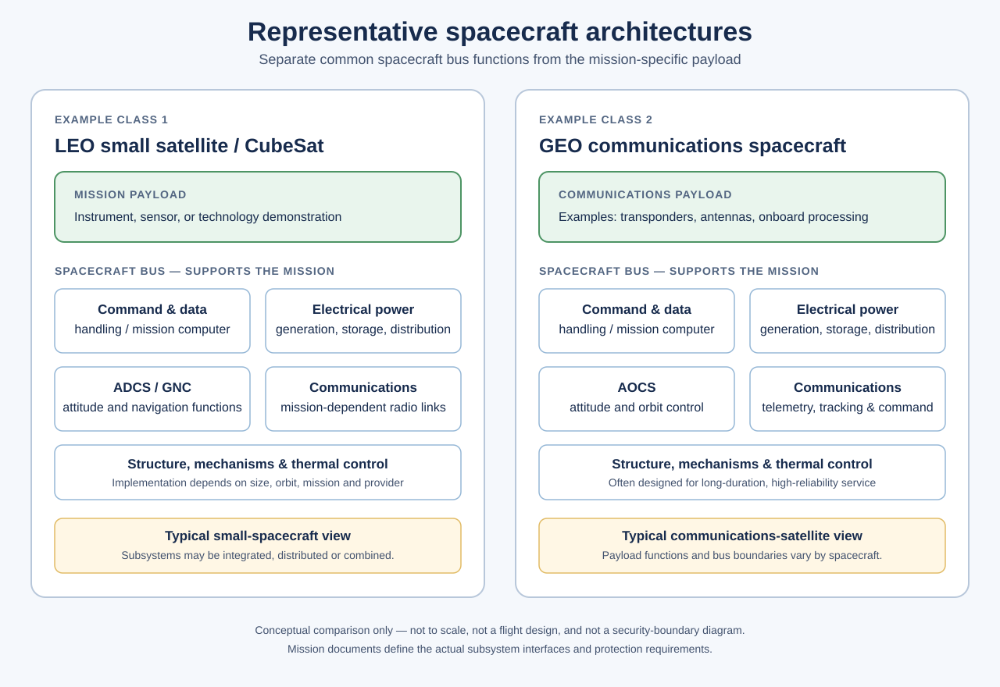

# 🏢 Appendix A: The Space Sector

## 🎯 Purpose
Reference appendices for the Space Security guide - covering industry overview (commercial, defense, NewSpace), regulatory and standards bodies (NIST SP 800-53, CCSDS, ITU), career paths in space security, and further reading resources.

## ⚙️ Function
Contains tabular industry overview (sector/key players/security relevance), regulatory bodies and applicable standards, space security career paths (ground segment security engineer, satellite systems pentester, RF security researcher), and curated resource lists.

## 🏆 Goal
Provide the background context, standards references, and resource pointers that complement the operational content in Parts I-IV - useful for scoping assessments, understanding regulatory constraints, and professional development.

## 📋 When to Use
- Identifying which standards apply to a client's space system (NIST, CCSDS, ITU)
- Career reference: understanding the space security job landscape
- Further reading for any space security topic covered in Parts I-IV

## Industry Overview

| Sector | Key Players | Security Relevance |
|--------|------------|-------------------|
| **Commercial FSS/MSS** | Intelsat, SES, Viasat, Hughes, Inmarsat | Large attack surface; widely used for critical comms |
| **Proliferated LEO** | SpaceX Starlink, Amazon Kuiper, OneWeb | Massive scale; new security models; high-value target |
| **Earth Observation** | Maxar, Planet, Airbus Defence | Intelligence value; imagery manipulation risk |
| **Launch Services** | SpaceX, ULA, Arianespace, Rocket Lab | Supply chain; ground systems |
| **Defense** | Northrop Grumman, L3Harris, Boeing Defense | High-assurance requirements; ITAR-controlled |
| **New Space / CubeSat** | Various; Spire, Swarm, Astro Digital | COTS hardware; limited security; growing attack surface |

### Regulatory and Standards Bodies

| Organization | Role |
|-------------|------|
| **ITU** | International frequency coordination and interference management |
| **FCC** | US licensing for earth stations, satellites, terminals |
| **FAA** | Aviation use of GNSS and SATCOM |
| **NIST** | SP 800-53 controls applicable to federal space systems |
| **CCSDS** | Protocol standards (also security recommendations - CCSDS 350.x series) |
| **CISA** | Space Systems Critical Infrastructure guidance |
| **DoD / NSA** | COMSEC requirements for national security space |

---

# 🔧 Appendix B: Space Systems

## Reference Architectures

### Representative Spacecraft Architectures

The figure contrasts typical **bus functions** with **mission payloads** in two broad spacecraft classes. It is a conceptual reference, not a design template: subsystem boundaries, redundancy, hardware, software, and communications vary by mission. A component's placement in the figure does not establish its security boundary or prove that a protection is present.



For the ground-to-space command and telemetry path, see [Part II](PartII.md). For the user segment and GNSS integrity checks, see [Part IV](PartIV.md).

### Key Protocols Reference

| Protocol | Layer | Use | Security Notes |
|----------|-------|-----|---------------|
| CCSDS TM | Data Link | Telemetry framing | Protection depends on the mission profile. CCSDS SDLS can provide authentication and/or confidentiality for supported TM frames; synchronization markers are framing, not authentication. |
| CCSDS TC | Data Link | Command framing | Use the mission-defined security profile. SDLS can protect supported TC frames; link authentication is not a substitute for application-level command authorization. |
| CCSDS Space Packet | Network | Packet routing | APID routing does not establish sender identity or command authorization; security services must be defined by the mission's surrounding layers. |
| CCSDS CFDP | Transport | File delivery | Class 2 uses acknowledged procedures. CFDP itself has no security mechanisms; required services must be provided by the protocol stack beneath it. |
| DVB-S2/S2X | Physical | Broadcast downlink | Conditional access systems (CAS) for pay-TV |
| AX.25 | Data Link | Amateur/CubeSat links | Do not infer command authenticity or confidentiality from link framing; use mission-specific protections and authorization. |
| IP over SATCOM | Network | Broadband terminals | Standard IP vulnerabilities apply |

### SDR Hardware Reference

| Device | Freq Range | TX | Typical Use |
|--------|-----------|-----|------------|
| RTL-SDR | 500 kHz – 1.75 GHz | No | Passive monitoring, GNSS monitoring |
| HackRF One | 1 MHz – 6 GHz | Yes | Full analysis; lab TX |
| USRP B210 | 70 MHz – 6 GHz | Yes | Research-grade wideband |
| Airspy HF+ | 9 kHz – 31 MHz / 60–260 MHz | No | HF, VHF precision |
| LimeSDR | 100 kHz – 3.8 GHz | Yes | Flexible; multi-channel |

---

## ⚠️ Security & Legal Disclaimer

### 🔴 CRITICAL: Authorized Use Only

```
⚠️ LEGAL AND ETHICAL USE ONLY ⚠️

This section contains attack techniques and methodologies for:

✅ AUTHORIZED USES:
   • Security assessments with explicit written authorization from spacecraft operators
   • Red team operations with organizational approval
   • Academic research in shielded RF enclosures or simulation environments
   • Blue team training and detection development
   • CTF competitions (DEFCON Aerospace Village, Hack-A-Sat)
   • Passive RF monitoring within legal boundaries

🚫 STRICTLY PROHIBITED:
   • Transmitting RF signals toward operational satellites without authorization
   • Unauthorized access to ground station or mission control systems
   • GNSS jamming or spoofing outside of shielded test environments
   • Intercepting protected satellite communications
   • Any activity violating CFAA, FCC regulations, ITAR/EAR, or ITU rules
   • Causing disruption to satellite services or critical infrastructure
```

### Legal Framework

| Law / Regulation | Scope |
|-----------------|-------|
| **CFAA (18 U.S.C. § 1030)** | Covers specified computer-related conduct. Elements and penalties depend on the subsection, conduct, and facts; consult the current statute and qualified counsel. |
| **FCC service rules (including Parts 25 and 97 where applicable)** | Licensing and operating requirements depend on the service and station; enforcement consequences depend on the rule and conduct. |
| **ITAR (22 CFR 120-130)** | Export control on satellite technology and related security tools |
| **ITU Radio Regulations** | International frequency coordination and harmful interference prohibition |
| **UK Computer Misuse Act** | Unauthorized access to space-related computer systems |
| **EU Cybercrime Directives** | Harmonized computer crime laws covering ground infrastructure |

### Warranty Disclaimer

```
These materials are provided "AS IS" without warranty of any kind.

THE AUTHORS AND CONTRIBUTORS:
• Make no guarantees about technique effectiveness or accuracy
• Are not responsible for damages from unauthorized use
• Are not liable for legal consequences of misuse
• Disclaim all liability for disruption to space systems or services

USERS SHOULD UNDERSTAND:
• Space-system testing can affect critical services; operational impact depends on the target and method
• RF operation must comply with the applicable service authorization and technical rules; license-by-rule and other exceptions exist
• Unauthorized operation or harmful interference may trigger regulatory action, with criminal consequences depending on the applicable statute and facts
• Export controls may apply to specific controlled items, software, technology or technical data
• Testing plans should define authority, scope, safety controls, stop conditions and data handling
```

---

## 📚 Resources

### Spacecraft Architecture and Link-Security References

- [NASA Small Spacecraft Technology State of the Art: Platforms](https://www.nasa.gov/smallsat-institute/sst-soa/platforms/) - spacecraft platform and bus concepts; architectures vary by mission.
- [NASA Small Spacecraft Avionics](https://www.nasa.gov/smallsat-institute/sst-soa/small-spacecraft-avionics/) - command, data handling, and subsystem interface patterns.
- [CCSDS 350.0-G-3, The Application of Security to CCSDS Protocols](https://ccsds.org/Pubs/350x0g3.pdf) - explains where link-layer and application-layer security services fit.
- [CCSDS 355.0-B-2, Space Data Link Security Protocol](https://ccsds.org/Pubs/355x0b2.pdf) - standardized authentication and confidentiality services for supported space data links.
- [CCSDS 727.0-B-5, CCSDS File Delivery Protocol](https://ccsds.org/Pubs/727x0b5e1.pdf) - states CFDP itself has no security mechanisms and requires the underlying stack to supply needed protection.

### Standards and Guidance

- CCSDS 350.0-G-3: *The Application of Security to CCSDS Protocols*
- CCSDS 351.0-M-1: *Security Architecture for Space Data Systems*
- NIST SP 800-53 Rev 5 - Control families applicable to space (SA, SI, SC, AU)
- NIST IR 8270: *An Overview of Cybersecurity for Commercial Satellite Operations*
- CISA: *Space Systems Critical Infrastructure Security and Resilience*
- Aerospace Corporation: *Defending Space Systems from Cyber Threats*

### Research and Presentations

- IOActive: *SATCOM Security* (2014, 2020 revisit)
- DEF CON Aerospace Village proceedings (annual)
- Hack-A-Sat CTF competition (annual - US Space Force / Air Force)
- Black Hat 2020 - Ruben Santamarta: Revisiting SATCOM Security

### Online Resources

- [MITRE ATT&CK for ICS](https://attack.mitre.org/matrices/ics/) - Relevant overlap for ground segment OT
- [SatNOGS Network](https://network.satnogs.org/) - Open-source global ground station network
- [Space-Track.org](https://www.space-track.org/) - TLE orbital element data
- [AMSAT](https://www.amsat.org/) - Amateur satellite frequencies and protocols

---

<div align="center">

**📖 Use These Techniques Responsibly: Authorization is MANDATORY**

*Space systems are critical infrastructure - treat them accordingly.*

**Repository**: [ULTIMATE CYBERSECURITY MASTER GUIDE](https://github.com/Pnwcomputers/ULTIMATE-CYBERSECURITY-MASTER-GUIDE)

**Maintained by**: [Pacific Northwest Computers](https://github.com/Pnwcomputers)

---

## Related Files
- [README.md](README.md) - SpaceSecurity section index
- [PartI.md](PartI.md) - Foundations: the operational content these appendices support

⚠️ **RF transmission toward satellites requires EXPLICIT WRITTEN AUTHORIZATION** ⚠️

⚠️ **Unauthorized access or transmission may violate applicable law and service rules; requirements depend on the system, spectrum, conduct, and jurisdiction; see [FCC Part 15](https://www.ecfr.gov/current/title-47/chapter-I/subchapter-A/part-15) and service-specific rules such as [47 CFR § 25.115](https://www.ecfr.gov/current/title-47/section-25.115).** ⚠️

⚠️ **ITAR/EAR export controls may apply to satellite security tools and techniques** ⚠️

⭐ **Star this repo if you find it useful!** ⭐

</div>
