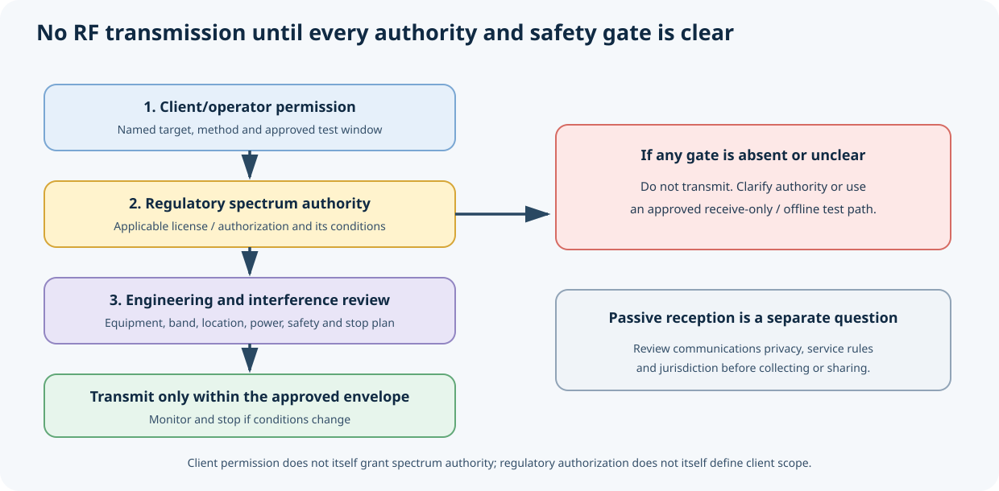

# 🌍 Part I: Foundations of Space Security

> [!CAUTION]
> **Authorized use only.** Space and radio systems may support critical services.
> Test only systems and transmissions within explicit written scope and applicable
> authorizations. Never create interference or transmit toward operational spacecraft.
> See [LEGAL.md](../LEGAL.md).

*Last reviewed: 2026-11-20.*

## 🎯 Purpose
Foundational overview of selected space-security topics: a common ground/space/user model, sourced historical cases, threat actor categories, attack surfaces, and security engineering principles.

## ⚙️ Function
Covers: space system segment definitions and interdependencies, attack surface per segment, historical incidents (Cosmos 954, Galaxy 15, Viasat KA-SAT), threat actor profiles (nation-states, cyber criminals, hacktivists), COTS-driven risk changes, and space-specific security engineering considerations.

## 🏆 Goal
Build the conceptual foundation needed to assess space-system properties and understand how mission-specific trust relationships and connectivity can carry risk across segments.

## 📋 When to Use
- Starting point for space security: read before any of the other Parts
- Threat modeling a space system: use the attack taxonomy and threat actor profiles here
- Scoping a space security assessment: understand which segments are in scope and their interdependencies

## Chapter 1: A Space Security Primer

#### Space System Segments

Space systems are no longer the exclusive domain of nation-states. Commercial off-the-shelf (COTS) hardware, open-source software stacks, and accessible launch services have lowered barriers dramatically. The result is a diverse and rapidly expanding attack surface spanning orbital altitudes, radio frequencies, ground infrastructure, and end-user hardware.

| Segment | Description | Examples |
|---------|-------------|---------|
| **Ground** | Earth-based infrastructure that commands and receives data from spacecraft | Mission control, ground stations, TT&C systems |
| **Space** | The spacecraft and payloads in orbit | Satellites, CubeSats, ISS modules |
| **User** | End-user equipment that receives satellite services | SATCOM terminals, GNSS receivers, VSATs |

The segments have distinct attack surfaces. Risk can cross between them where mission-specific trust, connectivity, and privileges create a path.

#### Key Terminology

| Term | Definition |
|------|-----------|
| **TT&C** | Telemetry, Tracking, and Command - the control link between ground and spacecraft |
| **LEOP** | Launch and Early Orbit Phase - a demanding operational phase whose risks depend on the mission |
| **GEO / MEO / LEO** | Geostationary / Medium Earth / Low Earth Orbit |
| **VSAT** | Very Small Aperture Terminal - compact satellite ground terminal |
| **Transponder** | Spacecraft payload that receives uplink and retransmits on downlink |
| **FHSS / DSSS** | Frequency-Hopping / Direct-Sequence Spread Spectrum - RF modulation schemes |
| **CCSDS** | Consultative Committee for Space Data Systems - a widely used family of space-data standards |

#### Why Space Security Matters Now

- Proliferated LEO constellations (including Starlink, OneWeb, and Amazon Kuiper) provide connectivity and other services whose criticality depends on the user and mission
- Military and government systems rely on commercial SATCOM for comms, ISR, and PNT
- GNSS is embedded in financial systems, power grids, cellular networks, and aviation
- Nation-state actors (Russia, China, Iran, North Korea) actively develop ASAT and cyber capabilities targeting space systems
- Long-lived spacecraft and ground systems may retain legacy design assumptions; age alone does not establish their security posture

---

### Chapter 2: The Threat Landscape

#### Threat Actor Categories

| Actor Type | Motivation | Capabilities | Examples |
|------------|-----------|-------------|---------|
| Nation-state | Strategic advantage, disruption, espionage | High - kinetic ASAT, jamming, spoofing, cyber intrusion | Russia (EU attribution for KA-SAT, 2022), China (2007 ASAT test) |
| Criminal / ransomware | Financial gain | Medium - targeting ground segment IT | Ransomware on satellite ground ops |
| Hacktivist | Political messaging | Low-Medium - jamming, defacement | Signal hijacking incidents |
| Researcher / red team | Disclosure, learning | Variable | DEFCON Aerospace Village CTFs |
| Insider threat | Sabotage, espionage | High (privileged access) | Undetected until damage occurs |

#### Attack Surface by Segment

**Ground Segment:**
- Mission control systems, which may combine enterprise IT and operational technology
- Ground station software and hardware interfaces
- TT&C uplink chains
- Network connectivity between ground nodes
- Supply chain for ground hardware/software

**Space Segment:**
- Onboard computer (OBC) firmware
- Flight software (FSW) - often C/C++, sometimes Ada or SPARK
- Communication subsystems
- Attitude and Orbit Control System (AOCS)
- Power management systems

**User Segment:**
- SATCOM terminal firmware and management interfaces
- GNSS receivers and timing systems
- VSAT modems and network equipment
- RF uplink/downlink paths

#### Historical Incidents

| Year | Incident | Segment | Impact |
|------|---------|---------|--------|
| 1999 | UK Skynet takeover claim (reported and denied; not independently substantiated) [review](https://css.ethz.ch/content/dam/ethz/special-interest/gess/cis/center-for-securities-studies/pdfs/Cyber-Reports-2021-01-Terra-Calling.pdf) | Ground/Space | No confirmed satellite takeover or C2 disruption |
| 2007–2008 | Landsat-7/Terra command-link interference reports [USCC report](https://www.uscc.gov/sites/default/files/annual_reports/annual_report_full_11.pdf) | Ground/Space | Short events described as apparently consistent with cyber activity; no completed satellite command takeover was reported |
| 2014 | NOAA IT-system cyberattack [Commerce OIG](https://www.oversight.gov/reports/audit/successful-cyber-attack-highlights-longstanding-deficiencies-noaas-it-security) | Ground | NOAA information systems were compromised; this is not evidence of spacecraft command compromise |
| 2015 | Turla used satellite internet downlinks to obscure C2 infrastructure [Kaspersky](https://www.kaspersky.com/blog/satellite-turla/15098/) | User/Network | Satellite internet was abused as a C2 concealment path; spacecraft were not reported compromised |
| 2022 | Viasat KA-SAT cyberattack (Russia attribution by EU and UK) [Viasat](https://www.viasat.com/perspectives/corporate/2022/ka-sat-network-cyber-attack-overview/) · [UK NCSC](https://www.ncsc.gov.uk/news/russia-behind-cyber-attack-with-europe-wide-impact-hour-before-ukraine-invasion) | Ground/User | Several thousand Ukraine customers and tens of thousands of other European users lost service; this was not a permanent bricking of all affected modems |
| 2022–2023 | Starlink jamming/interference attempts reported in Ukraine [U.S. military lessons-learned study](https://media.defense.gov/2026/Jan/12/2003855345/-1/-1/0/20260112_NAGL-HACKETT_RUSSIA-UKRAINEWAR2023_ONLINE_FINAL.PDF) | User | Reported terminal and service disruptions; scope, attribution, and effects varied by event |

#### Threat Modeling Space Systems

STRIDE adapted for space-specific contexts:

| STRIDE Category | Space System Example |
|-----------------|---------------------|
| **Spoofing** | Fake TT&C commands, GNSS signal spoofing |
| **Tampering** | FSW modification via uplink, ground system malware |
| **Repudiation** | Lack of command logging on legacy satellites |
| **Information Disclosure** | Unencrypted telemetry intercept |
| **Denial of Service** | RF jamming, uplink flooding, ground system ransomware |
| **Elevation of Privilege** | A command interface accepts actions beyond the caller's authorized role |

---

### Chapter 3: Security Testing

#### ⚠️ Legal and Regulatory Considerations

Space security testing may involve several separate legal and regulatory regimes. Scope depends on the system, service, equipment, frequency, data and jurisdiction:

- **Radio authority:** [47 U.S.C. § 301](https://uscode.house.gov/us/usc/t47/s301/) and FCC rules govern covered radio transmission. Some devices/services are authorized by rule; satellite earth/space station transmission commonly requires specific FCC authorization under [47 CFR § 25.102](https://www.ecfr.gov/current/title-47/section-25.102). Confirm current authority and license conditions for the exact equipment, band and operation before transmitting.
- **Interference:** [47 U.S.C. § 333](https://uscode.house.gov/us/usc/t47/s333/) prohibits willful or malicious interference to covered radio communications. Violations may lead to FCC enforcement; criminal consequences depend on the applicable statute and its elements.
- **Computer access:** [18 U.S.C. § 1030](https://uscode.house.gov/us/usc/119-134/t18/s1030/) covers defined offenses involving protected computers; legal elements and penalties are not uniform across all testing or access.
- **Export controls:** ITAR/EAR can apply to particular controlled items, software, technology or technical data, and to specified exports or releases. They do not automatically cover every space-related tool or technique; consult the responsible export-control authority for classification.
- **Contract requirements:** DoD/CMMC obligations apply where the contract, system and applicable requirements make them relevant; they are not a universal requirement for all space-security testing.

> **⚠️ Before any transmission:** obtain the operator’s authorization and independently confirm regulatory authority for the specific station/service, equipment, frequency, location, power and test window. Written scope is a useful engagement control, but it does not replace an FCC license or other required authorization. Passive reception also requires a separate review of applicable communications, privacy and service-specific rules.



*If any required gate is missing or unclear, do not transmit; use an approved receive-only or offline test path while authority is clarified.*

#### Testing Methodology

Space security assessments generally follow a segmented approach:

```
Reconnaissance
  └─> Passive RF collection (SDR monitoring, signal analysis)
  └─> OSINT on operator, ground station locations, frequencies
  └─> Protocol identification

Ground Segment Assessment
  └─> External network penetration testing
  └─> TT&C interface analysis (if in-scope)
  └─> Mission control application security review

RF / Link Layer Analysis
  └─> Signal capture and demodulation
  └─> Protocol reverse engineering
  └─> Encryption assessment

User Segment Testing
  └─> SATCOM terminal firmware analysis
  └─> Management interface exploitation
  └─> GNSS receiver spoofing/jamming assessment

Space Segment (Research/Lab Context)
  └─> Onboard software static analysis
  └─> Emulated FSW fuzzing
  └─> Hardware-in-the-loop testing
```

#### Tools Overview

| Tool | Purpose | Notes |
|------|---------|-------|
| **GNU Radio** | SDR signal processing framework | Core platform for RF analysis |
| **SDR# / GQRX** | SDR receiver GUI | Spectrum monitoring |
| **gr-satellites** | Satellite signal decoder | Supports dozens of amateur/CubeSat formats |
| [HackRF One](https://greatscottgadgets.com/hackrf/one/) | Half-duplex transceiver (1 MHz – 6 GHz; cannot transmit and receive simultaneously) | TX capability - use only in authorized lab context |
| **USRP** | High-performance SDR platform | Research-grade signal work |
| **SatDump** | Satellite data decoder | NOAA, Meteor, MetOp, etc. |
| **Wireshark** | Ground network traffic analysis | With custom CCSDS dissectors |
| **COSMOS** | Open-source mission control framework | FSW testing and simulation |
| **OpenSatCom** | SATCOM protocol research toolkit | Academic/research use |

---

<div align="center">

**📖 Use These Techniques Responsibly: Authorization is MANDATORY**

*Space systems are critical infrastructure - treat them accordingly.*

**Repository**: [ULTIMATE CYBERSECURITY MASTER GUIDE](https://github.com/Pnwcomputers/ULTIMATE-CYBERSECURITY-MASTER-GUIDE)

**Maintained by**: [Pacific Northwest Computers](https://github.com/Pnwcomputers)

---

## Related Files
- [PartII.md](PartII.md) - Ground segment attacks: next after establishing foundations here
- [README.md](README.md) - SpaceSecurity section index with regulatory and tool ecosystem overview
- [../SDR/sdr.md](../SDR/sdr.md) - SDR fundamentals: the hardware and techniques used to interact with satellite RF links

⚠️ **RF transmission toward satellites requires EXPLICIT WRITTEN AUTHORIZATION** ⚠️

⚠️ **Unauthorized access or transmission may violate applicable law and service rules; requirements depend on the system, spectrum, conduct, and jurisdiction; see [FCC Part 15](https://www.ecfr.gov/current/title-47/chapter-I/subchapter-A/part-15) and service-specific rules such as [47 CFR § 25.115](https://www.ecfr.gov/current/title-47/section-25.115).** ⚠️

⚠️ **ITAR/EAR export controls may apply to satellite security tools and techniques** ⚠️

⭐ **Star this repo if you find it useful!** ⭐

</div>
