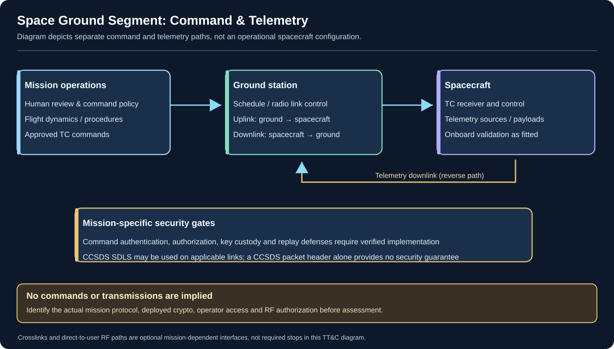
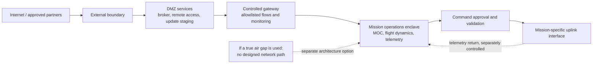
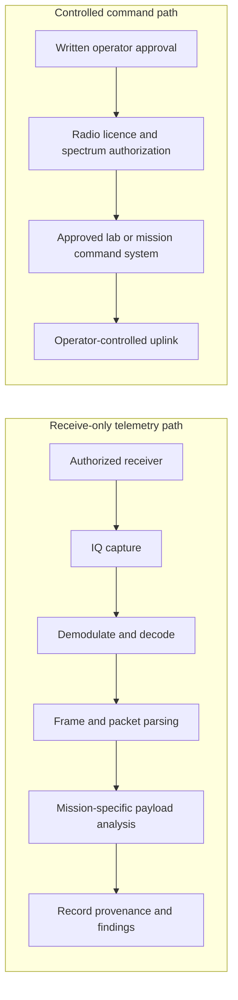

# 📡 Part II: The Ground Segment

> [!CAUTION]
> **Authorized use only.** The techniques below are for authorized security
> testing, education, and defensive research. Using them against systems you do
> not own or lack explicit written permission to test is illegal. See
> [LEGAL.md](../LEGAL.md).

## 🎯 Purpose
Ground segment attack and defense guide - covering uplink/downlink RF link architecture, TT&C (Telemetry, Tracking, and Commanding) attack vectors, mission control network security, ground station infrastructure vulnerabilities, and supply chain risks.

## ⚙️ Function
Covers: ground-space RF link architecture (uplink/downlink/crosslink), TT&C command injection and replay attacks, CCSDS frame structure and authentication weaknesses, ground station network lateral movement, mission control server hardening, and supply chain security for ground hardware.

## 🏆 Goal
Identify and assess vulnerabilities in the ground segment of a space system - the earth-based infrastructure that commands satellites and receives telemetry - without touching or transmitting to the satellite itself.

## 📋 When to Use
- Penetration testing a ground station or mission control network
- Assessing TT&C command authentication for a satellite operator
- Understanding how ground segment compromise enables satellite takeover
- Red-teaming space-adjacent infrastructure (ground networks, not orbital targets)

## Chapter 4: Ground-Space Communications

#### Link Architecture



*Conceptual space-system trust boundaries, not an RF link budget or a real command path.* [NASA's Small Spacecraft Ground Data Systems & Mission Operations reference](https://www.nasa.gov/smallsat-institute/sst-soa/ground-data-systems-and-mission-operations/) explains mission operations and ground segment roles. [CCSDS Space Data Link Security (SDLS)](https://ccsds.org/view/bluebooks/entry/3258/) defines optional authentication/confidentiality mechanisms for applicable data link protocols; their availability and actual deployment must be verified for the mission. Frame identifiers and sequence counts are not themselves cryptographic authorization.

Every satellite system relies on a chain of RF links between ground and spacecraft:

| Link | Direction | Purpose |
|------|-----------|---------|
| **Uplink** | Ground → Space | Commands, software uploads, data |
| **Downlink** | Space → Ground | Telemetry, payload data, status |
| **Crosslink / ISL** | Space → Space | Inter-satellite relay (proliferated LEO) |
| **User Link** | Space ↔ User terminal | End-user service delivery |

#### Frequency Bands

| Band | Frequency Range | Typical Use |
|------|----------------|------------|
| L-band | 1–2 GHz | Mobile SATCOM, GNSS |
| S-band | 2–4 GHz | TT&C for many LEO spacecraft |
| C-band | 4–8 GHz | Legacy FSS, broadcast |
| X-band | 8–12 GHz | Military, government |
| Ku-band | 12–18 GHz | Commercial FSS, VSAT |
| Ka-band | 26.5–40 GHz | HTS, broadband (Viasat, Starlink) |
| V-band | 40–75 GHz | Some high-throughput satellite links |
| W-band | 75–110 GHz | Emerging and experimental links |

*Band labels are conventional ranges; actual mission use depends on allocation, licensing, and system design. See [NASA's spectrum band designators](https://www.nasa.gov/general/what-are-the-spectrum-band-designators-and-bandwidths/).*

#### Signal Security Considerations

- **Unencrypted telemetry** - Many legacy satellites downlink telemetry in cleartext CCSDS frames, allowing passive monitoring of spacecraft health, mode, and configuration
- **Weak or missing command authentication** - Mission-specific designs may use inadequate key management, outdated authentication algorithms or incomplete access controls. Assess the actual deployed scheme rather than assuming all historical message authentication codes are easily broken.
- **RF observation and exposure** - Feasibility of receiving a link depends on coverage, antenna/gain, band, modulation, coding, encryption, propagation and permitted spectrum monitoring. Do not imply that any pointed antenna can decode a satellite link.
- **Replay risk** - Without authenticated anti-replay protection, a previously recorded message may be accepted in some designs. A counter alone does not guarantee replay resistance; its integrity, reset behavior, and acceptance window are critical.

#### CCSDS Protocol Stack

The Consultative Committee for Space Data Systems (CCSDS) publishes a widely used family of space-data standards:

```
┌─────────────────────────────┐
│    Mission-specific app      │  (mission data, health reports)
├─────────────────────────────┤
│     CCSDS CFDP / AOS        │  (file delivery, Advanced Orbiting Systems)
├─────────────────────────────┤
│    Space Packet Protocol    │  (packet framing, APID routing)
├─────────────────────────────┤
│   TM / TC Transfer Frames   │  (Telemetry / Telecommand frames)
├─────────────────────────────┤
│     Sync & Channel Coding   │  (ASM, LDPC, Reed-Solomon, turbo)
├─────────────────────────────┤
│         RF / Physical       │  (BPSK, QPSK, OQPSK, etc.)
└─────────────────────────────┘
```

Key CCSDS identifiers targeted during analysis:

| Field | Description | Security Relevance |
|-------|-------------|-------------------|
| **APID** | Application Process ID | Routes packets to subsystems; spoofing APIds targets specific spacecraft functions |
| **VCID** | Virtual Channel ID | Multiplexes data streams; may separate encrypted/unencrypted flows |
| **Spacecraft ID (SCID)** | Identifies the target spacecraft | Used to filter commands and telemetry |
| **Sequence Counter** | Protocol-specific sequence field used for ordering/continuity | May aid replay detection but does not authenticate a message; anti-replay depends on the actual security mechanism |

---

### Chapter 5: Mission Control Systems

#### Architecture

Mission control center (MCC) network layouts vary by mission. A demilitarized zone
(DMZ) is a controlled network segment between trust zones; it is **not** an air gap.
An air gap means there is no designed network connection across the boundary, though
people, removable media, maintenance paths, and shared dependencies still require
controls. The figure is a conceptual example, not a required topology.



*Conceptual only. A DMZ provides a controlled network boundary; it does not make connected systems air-gapped. Validate the actual mission's approved data paths and transfer controls. [CCSDS SDLS](https://ccsds.org/view/bluebooks/entry/3258/) is an optional data-link security mechanism; deployment, algorithms, and key management remain mission-specific.*

Common MCC components:

- **Mission Operations Center (MOC)** - Operator consoles, display systems, command generation
- **Flight Dynamics System (FDS)** - Orbit determination, maneuver planning
- **Telemetry Processing System** - Ingests raw frames, decommutates engineering data
- **Command Management System** - Command authorization, sequencing, uplink management
- **Data Archive** - Historical telemetry, products, mission records

#### Technology Stack Risks to Verify

The examples below are assessment prompts, not claims that every deployment has these weaknesses.

| Component | Example Technology | Risks to Verify |
|-----------|------------------|---------------|
| Operator workstations | Windows 10/11, Linux | Unpatched OS, legacy software dependencies |
| MCS applications | COSMOS, ITOS, GMAT, custom | Outdated frameworks, hardcoded credentials |
| Databases | Oracle, PostgreSQL, SQL Server | Weak authentication, excessive privileges |
| Network infrastructure | Cisco, Juniper | Default credentials, unpatched firmware |
| Remote access | VPN, RDP, TeamViewer | Weak MFA, exposed management interfaces |

#### Attack Vectors

- **IT-side intrusion → lateral movement to MCS network** - Most historically successful path (mirrors IT/OT targeting in ICS attacks)
- **Supply chain compromise** - Malicious updates to MCS software or ground station hardware
- **Remote access exploitation** - VPN credential compromise, MFA bypass
- **Insider threat** - Privileged operators with unrestricted command access
- **Removable media** - USB-introduced malware in air-gapped or semi-air-gapped environments

#### Historical Example: Viasat KA-SAT (2022)

The 2022 KA-SAT incident illustrates how compromised access to a ground-management network can disrupt user terminals:

1. CERT Polska identified a misconfigured VPN gateway as the access path into a Viasat internal network used to manage the KA-SAT customer network.
2. CERT Polska reports that commands sent to customer modems **probably** led them to download and run AcidRain; preserve that uncertainty when summarizing the technical chain.
3. The malware disrupted modem operation, causing service unavailability. Do not describe the event as proof that satellites were taken over or that all affected devices were permanently bricked.
4. The [EU attribution statement](https://www.eeas.europa.eu/delegations/ukraine/russian-cyber-operations-against-ukraine-declaration-high-representative-behalf_en) attributes the operation to Russia and describes outages affecting Ukrainian authorities, businesses, users, and EU member states.

**Lessons:** A management-plane compromise can have broad downstream service impact. The [CERT Polska incident analysis](https://cert.pl/en/uploads/docs/Report_CP_2022.pdf) describes the reported access path and qualifies the modem command chain; it also says public information did not establish an impact on Ukrainian military communications.

---

### Chapter 6: Exploiting Ground Segment Protocols

#### Passive Reconnaissance

Before any active testing, begin with receive-only analysis of signals you are
authorized to collect. A HackRF raw capture is interleaved signed 8-bit IQ; it
is not directly the complex64/raw-file input expected by gr-satellites. Convert
it to a supported two-channel IQ WAV or complex64 file using a reviewed tool
before decoding.

```bash
# Receive-only example. Confirm the frequency and collection authority first.
hackrf_transfer -r capture.iq -f 437500000 -s 2000000 -g 40 -l 32

# SatDump example for a signal and receiver supported by the installed build.
satdump live noaa_hrpt baseband --source airspy --samplerate 6e6 --frequency 1707e6

# Replace SATELLITE_NAME with a supported decoder, and CAPTURE.c64 with a
# converted complex64 IQ recording. --iq is a flag; it does not take a filename.
gr_satellites SATELLITE_NAME --rawfile /path/to/CAPTURE.c64 --samp_rate 2000000 --iq
```

#### CCSDS Frame Analysis

With captured IQ data, work down the protocol stack:

1. **Synchronization** - Find the CCSDS Attached Synchronization Marker (ASM): `0x1ACFFC1D`
2. **Frame delineation** - Transfer frame length is fixed per mission; determine from ASM spacing
3. **Header parsing** - Extract SCID, VCID, frame counter, data field status
4. **Reed-Solomon / LDPC decode** - Strip error correction coding
5. **Space Packet extraction** - Parse APID, sequence flags, packet length
6. **Application data** - Mission-specific; may require protocol documentation or reverse engineering



*Conceptual workflow. Receive and decode is separate from any command transmission. The command path requires explicit operator approval and applicable transmission authorization; this diagram is not an uplink procedure.*

Wireshark supports CCSDS with appropriate dissectors. Custom dissectors can be written in Lua for mission-specific protocols.

#### Command Path Security Review

> [!CAUTION]
> Any uplink testing requires written authorization from the satellite operator **and** all applicable radio licences, spectrum approvals, and regulatory permissions. Operator approval alone does not authorize radio transmission. This guide does not authorize or provide an operational uplink procedure.

For a defensive review, validate controls using approved documentation, configuration evidence, test records, and an isolated simulator where available. Do not send commands to a live spacecraft as part of this guide.

| Review area | Evidence to inspect | Safe validation boundary |
|--------------|--------------------|--------------------------|
| Command authorization | Role assignments, approval records, separation-of-duty configuration | Use owner-provided test accounts and synthetic commands in an approved simulator |
| Command integrity | Applicable CCSDS SDLS or mission-specific design, key custody, anti-replay policy | Review configuration and test vectors supplied by the operator |
| Command sequencing | Validation rules, limit checks, inhibit/interlock behavior | Exercise only in a non-flight environment with written scope |
| Uplink boundary | Approved routes, station authorization, logging and change control | Review diagrams and logs; no live RF transmission |
| Telemetry integrity | Source validation, time provenance, alerting and operator workflow | Compare approved synthetic cases against expected alarms |

#### Local Packet-Builder Example

The function below only builds bytes in memory. It is **not a fuzzer**, does not open a socket, and does not send data. Any parser fuzzing needs a separately approved target, bounded test plan, and isolated test system.

```python
def ccsds_space_packet(apid: int, data: bytes) -> bytes:
    """Build a minimal CCSDS Space Packet primary header and data field."""
    if not 0 <= apid <= 0x7FF:
        raise ValueError("APID must fit the 11-bit field")
    if not isinstance(data, bytes) or not 1 <= len(data) <= 0x10000:
        raise ValueError("data must contain 1 to 65536 bytes")

    # Version 0, telemetry packet, no secondary header.
    primary_header = apid.to_bytes(2, "big")
    # Standalone packet, sequence count zero.
    seq_field = ((0b11 << 14) | 0).to_bytes(2, "big")
    # CCSDS length stores (data-field byte count - 1).
    data_length = (len(data) - 1).to_bytes(2, "big")
    return primary_header + seq_field + data_length + data

```

---

### Chapter 7---

### Chapter 7: Hacking Ground Systems

#### Reconnaissance

OSINT sources for space ground infrastructure:

| Source | Information Available |
|--------|----------------------|
| Owner-provided asset register | Approved systems, locations, contacts, and test boundaries |
| Approved architecture and data-flow diagrams | Mission-specific trust zones and permitted paths |
| Vendor and standards documentation | Versions, security features, support status, and configuration requirements |
| Public records supplied or approved by the owner | Validate only in-scope facilities and licensing details; do not publish precise operational or access information |

#### Bounded Defensive Assessment Path

1. **Confirm written scope** - Record owner, named assets, allowed methods, time window, rate limits, emergency contacts, and stop conditions.
2. **Review exposure evidence** - Use owner-supplied inventories and bounded checks against explicitly listed assets only; do not search globally for mission-control systems.
3. **Verify access controls** - Review remote-access configuration and logs; if active validation is approved, use dedicated synthetic accounts and a canary path.
4. **Check segmentation** - Compare observed, approved test flows against the mission's documented allowlist. Do not attempt lateral movement into flight or command systems.
5. **Review privileged command safeguards** - Inspect roles, dual approvals, validation gates, audit trails, and recovery controls using records or a non-flight simulator.
6. **Report evidence and limits** - Separate observed facts from hypotheses, disclose tested scope and untested paths, and avoid publishing sensitive facility details.

#### Common Vulnerabilities in Mission Control Applications

- **Hardcoded credentials** in legacy MCS deployments (often installed once and never rotated)
- **Unencrypted internal protocols** - some MCS components communicate via unencrypted UDP/TCP internally
- **Weak authentication** on web-based display systems and dashboards
- **Outdated dependencies** in Java-based or Python-based MCS stacks
- **Insufficient input validation** in command parameter interfaces

#### Defense and Hardening

| Control | Implementation |
|---------|---------------|
| Network segmentation | Strict IT/OT separation; MCS on isolated VLAN with unidirectional data diodes where possible |
| MFA everywhere | Require phishing-resistant MFA (FIDO2/hardware token) for all MCS access |
| Command authentication | Use applicable CCSDS Space Data Link Security (SDLS) or a mission-specific authenticated telecommand design; verify deployment, algorithm choices, and key management |
| Privileged access management | PAM solution for operator accounts; no shared credentials |
| Patch management | Separate patching cadence for MCS vs. IT; test in lab before ops deployment |
| Monitoring | Behavioral analytics on command issuance patterns; anomaly alerting |
| Supply chain | Firmware integrity verification; signed software updates |

---

<div align="center">

**📖 Use These Techniques Responsibly: Authorization is MANDATORY**

*Space systems are critical infrastructure - treat them accordingly.*

**Repository**: [ULTIMATE CYBERSECURITY MASTER GUIDE](https://github.com/Pnwcomputers/ULTIMATE-CYBERSECURITY-MASTER-GUIDE)

**Maintained by**: [Pacific Northwest Computers](https://github.com/Pnwcomputers)

---

## Related Files
- [README.md](README.md) - SpaceSecurity section index
- [PartI.md](PartI.md) - Foundations: read before this Part
- [PartIII.md](PartIII.md) - Space segment: the satellite side of the link
- [../SDR/sdr_hacking.md](../SDR/sdr_hacking.md) - SDR advanced: CCSDS protocol reversing and satellite RF signal capture

⚠️ **RF transmission toward satellites requires EXPLICIT WRITTEN AUTHORIZATION** ⚠️

⚠️ **Unauthorized access or transmission may violate applicable law and service rules; requirements depend on the system, spectrum, conduct, and jurisdiction; see [FCC Part 15](https://www.ecfr.gov/current/title-47/chapter-I/subchapter-A/part-15) and service-specific rules such as [47 CFR § 25.115](https://www.ecfr.gov/current/title-47/section-25.115).** ⚠️

⚠️ **ITAR/EAR export controls may apply to satellite security tools and techniques** ⚠️

⭐ **Star this repo if you find it useful!** ⭐

</div>
