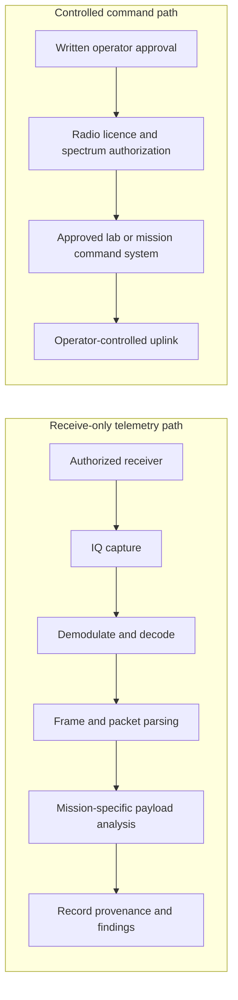

# 📡 Part II: The Ground Segment

## 🎯 Purpose
Ground segment attack and defense guide - covering uplink/downlink RF link architecture, TT&C (Telemetry, Tracking, and Commanding) attack vectors, mission control network security, ground station infrastructure vulnerabilities, and supply chain risks.

## ⚙️ Function
Covers: ground-space RF link architecture (uplink/downlink/crosslink), TT&C command injection and replay attacks, CCSDS frame structure and authentication weaknesses, ground station network lateral movement, mission control server hardening, and supply chain security for ground hardware.

## 🏆 Goal
Identify and assess vulnerabilities in the ground segment of a space system - the earth-based infrastructure that commands satellites and receives telemetry - without touching or transmitting to the satellite itself.

## 📋 When to Use
- Penetration testing a ground station or mission control network
- Assessing TT&C command authentication for a satellite operator
- Understanding how ground segment compromise enables satellite takeover
- Red-teaming space-adjacent infrastructure (ground networks, not orbital targets)

## Chapter 4: Ground-Space Communications

#### Link Architecture


*Conceptual space-system trust boundaries, not an RF link budget or a real command path.* [NASA's Small Spacecraft Ground Data Systems & Mission Operations reference](https://www.nasa.gov/smallsat-institute/sst-soa/ground-data-systems-and-mission-operations/) explains mission operations and ground segment roles. [CCSDS Space Data Link Security (SDLS)](https://ccsds.org/view/bluebooks/entry/3258/) defines optional authentication/confidentiality mechanisms for applicable data link protocols; their availability and actual deployment must be verified for the mission. Frame identifiers and sequence counts are not themselves cryptographic authorization.

Every satellite system relies on a chain of RF links between ground and spacecraft:

| Link | Direction | Purpose |
|------|-----------|---------|
| **Uplink** | Ground → Space | Commands, software uploads, data |
| **Downlink** | Space → Ground | Telemetry, payload data, status |
| **Crosslink / ISL** | Space → Space | Inter-satellite relay (proliferated LEO) |
| **User Link** | Space ↔ User terminal | End-user service delivery |

#### Frequency Bands

| Band | Frequency Range | Typical Use |
|------|----------------|------------|
| L-band | 1–2 GHz | Mobile SATCOM, GNSS |
| S-band | 2–4 GHz | TT&C for many LEO spacecraft |
| C-band | 4–8 GHz | Legacy FSS, broadcast |
| X-band | 8–12 GHz | Military, government |
| Ku-band | 12–18 GHz | Commercial FSS, VSAT |
| Ka-band | 26.5–40 GHz | HTS, broadband (Viasat, Starlink) |
| V/W-band | 40–75 GHz | Next-gen HTS |

#### Signal Security Considerations

- **Unencrypted telemetry** - Many legacy satellites downlink telemetry in cleartext CCSDS frames, allowing passive monitoring of spacecraft health, mode, and configuration
- **Weak or missing command authentication** - Mission-specific designs may use inadequate key management, outdated authentication algorithms or incomplete access controls. Assess the actual deployed scheme rather than assuming all historical message authentication codes are easily broken.
- **RF observation and exposure** - Feasibility of receiving a link depends on coverage, antenna/gain, band, modulation, coding, encryption, propagation and permitted spectrum monitoring. Do not imply that any pointed antenna can decode a satellite link.
- **Replay risk** - Without authenticated anti-replay protection, a previously recorded message may be accepted in some designs. A counter alone does not guarantee replay resistance; its integrity, reset and window handling are critical.ed

#### CCSDS Protocol Stack

The Consultative Committee for Space Data Systems defines the dominant protocol family:

```
┌─────────────────────────────┐
│    Mission-specific app      │  (mission data, health reports)
├─────────────────────────────┤
│     CCSDS CFDP / AOS        │  (file transfer, advanced orbiting)
├─────────────────────────────┤
│    Space Packet Protocol    │  (packet framing, APID routing)
├─────────────────────────────┤
│   TM / TC Transfer Frames   │  (Telemetry / Telecommand frames)
├─────────────────────────────┤
│     Sync & Channel Coding   │  (ASM, LDPC, Reed-Solomon, turbo)
├─────────────────────────────┤
│         RF / Physical       │  (BPSK, QPSK, OQPSK, etc.)
└─────────────────────────────┘
```

Key CCSDS identifiers targeted during analysis:

| Field | Description | Security Relevance |
|-------|-------------|-------------------|
| **APID** | Application Process ID | Routes packets to subsystems; spoofing APIds targets specific spacecraft functions |
| **VCID** | Virtual Channel ID | Multiplexes data streams; may separate encrypted/unencrypted flows |
| **Spacecraft ID (SCID)** | Identifies the target spacecraft | Used to filter commands and telemetry |
| **Sequence Counter** | Protocol-specific sequence field used for ordering/continuity | May aid replay detection but does not authenticate a message; anti-replay depends on the actual security mechanism |

---

### Chapter 5: Mission Control Systems

#### Architecture

Modern mission control centers (MCCs) blend IT and operational technology (OT) in ways that introduce significant attack surface:

```
External Networks / Internet
          │
     [Firewall/DMZ]
          │
    Corporate IT Network
          │
     [Air Gap / DMZ]
          │
   Mission Control LAN
    ┌────┴─────┐
    │          │
  MOC/SOC   Ground Station
  (Ops)     Network
```

Common MCC components:

- **Mission Operations Center (MOC)** - Operator consoles, display systems, command generation
- **Flight Dynamics System (FDS)** - Orbit determination, maneuver planning
- **Telemetry Processing System** - Ingests raw frames, decommutates engineering data
- **Command Management System** - Command authorization, sequencing, uplink management
- **Data Archive** - Historical telemetry, products, mission records

#### Technology Stack Vulnerabilities

| Component | Common Technology | Common Issues |
|-----------|------------------|---------------|
| Operator workstations | Windows 10/11, Linux | Unpatched OS, legacy software dependencies |
| MCS applications | COSMOS, ITOS, GMAT, custom | Outdated frameworks, hardcoded credentials |
| Databases | Oracle, PostgreSQL, SQL Server | Weak authentication, excessive privileges |
| Network infrastructure | Cisco, Juniper | Default credentials, unpatched firmware |
| Remote access | VPN, RDP, TeamViewer | Weak MFA, exposed management interfaces |

#### Attack Vectors

- **IT-side intrusion → lateral movement to MCS network** - Most historically successful path (mirrors IT/OT targeting in ICS attacks)
- **Supply chain compromise** - Malicious updates to MCS software or ground station hardware
- **Remote access exploitation** - VPN credential compromise, MFA bypass
- **Insider threat** - Privileged operators with unrestricted command access
- **Removable media** - USB-introduced malware in air-gapped or semi-air-gapped environments

#### Historical Example: Viasat KA-SAT (2022)

The 2022 attack on Viasat's KA-SAT service showed how access to a trusted ground-management segment can affect user terminals:

1. Attackers used a misconfigured VPN gateway to access the KA-SAT management network.
2. They issued legitimate management commands to affected modems.
3. The commands were used to deploy AcidRain, a wiper targeting modem software for the MIPS architecture.
4. Tens of thousands of end devices lost connectivity. CERT Polska's report notes that public information did not establish an impact on military communications.

**Lessons:** Ground-management access can have wide user-terminal impact. The [CERT Polska incident analysis](https://cert.pl/en/uploads/docs/Report_CP_2022.pdf) summarizes the reported access path, malware, and scope; the [EU attribution statement](https://www.eeas.europa.eu/delegations/ukraine/russian-cyber-operations-against-ukraine-declaration-high-representative-behalf_en) describes communication outages across Ukrainian authorities, businesses, users, and EU member states.

---

### Chapter 6: Exploiting Ground Segment Protocols

#### Passive Reconnaissance

Before any active testing, begin with receive-only analysis of signals you are
authorized to collect. A HackRF raw capture is interleaved signed 8-bit IQ; it
is not directly the complex64/raw-file input expected by gr-satellites. Convert
it to a supported two-channel IQ WAV or complex64 file using a reviewed tool
before decoding.

```bash
# Receive-only example. Confirm the frequency and collection authority first.
hackrf_transfer -r capture.iq -f 437500000 -s 2000000 -g 40 -l 32

# SatDump example for a signal and receiver supported by the installed build.
satdump live noaa_hrpt baseband --source airspy --samplerate 6e6 --frequency 1707e6

# Replace SATELLITE_NAME with a supported decoder, and CAPTURE.c64 with a
# converted complex64 IQ recording. --iq is a flag; it does not take a filename.
gr_satellites SATELLITE_NAME --rawfile /path/to/CAPTURE.c64 --samp_rate 2000000 --iq
```

#### CCSDS Frame Analysis

With captured IQ data, work down the protocol stack:

1. **Synchronization** - Find the CCSDS Attached Synchronization Marker (ASM): `0x1ACFFC1D`
2. **Frame delineation** - Transfer frame length is fixed per mission; determine from ASM spacing
3. **Header parsing** - Extract SCID, VCID, frame counter, data field status
4. **Reed-Solomon / LDPC decode** - Strip error correction coding
5. **Space Packet extraction** - Parse APID, sequence flags, packet length
6. **Application data** - Mission-specific; may require protocol documentation or reverse engineering



*Conceptual workflow. Receive and decode is separate from any command transmission. The command path requires explicit operator approval and applicable transmission authorization; this diagram is not an uplink procedure.*

Wireshark supports CCSDS with appropriate dissectors. Custom dissectors can be written in Lua for mission-specific protocols.

#### Command Injection Concepts

> [!CAUTION]
> Any uplink testing requires written authorization from the satellite operator **and** all applicable radio licences, spectrum approvals, and regulatory permissions. Operator approval alone does not authorize radio transmission. This guide does not authorize or provide an operational uplink procedure.

| Attack Vector | Method | Prerequisite |
|---------------|--------|-------------|
| MCS application exploitation | SQL injection, buffer overflow in command parser | MCS network access |
| Command file manipulation | Modify stored command sequences before uplink | File system access on MCS |
| Uplink interception + modification | MITM between MCS and modulator | Physical/logical access to RF chain |
| Replay of captured commands | Retransmit valid captured frames | Captured command traffic, weak sequence enforcement |
| Rogue ground station | Transmit on licensed frequency | Radio license, directional antenna, frequency/timing knowledge |

#### Protocol Fuzzing

Ground systems that parse telemetry or expose northbound APIs are candidates for fuzzing:

```python
# Conceptual fuzzer for CCSDS Space Packet parser
import boofuzz
import socket

def ccsds_space_packet(apid, data):
    """Build minimal CCSDS Space Packet"""
    version = 0b000
    type_bit = 0  # Telemetry
    sec_hdr = 0
    primary_header = ((version << 13) | (type_bit << 12) | 
                     (sec_hdr << 11) | apid).to_bytes(2, 'big')
    seq_flags = 0b11  # Standalone packet
    seq_count = 0
    seq_field = ((seq_flags << 14) | seq_count).to_bytes(2, 'big')
    data_length = (len(data) - 1).to_bytes(2, 'big')
    return primary_header + seq_field + data_length + data

# Fuzz the data field with boofuzz targeting a ground system parser
```

---

### Chapter 7: Hacking Ground Systems

#### Reconnaissance

OSINT sources for space ground infrastructure:

| Source | Information Available |
|--------|----------------------|
| FCC License Database (ULS) | US earth station licenses, frequencies, coordinates |
| ITU BR IFIC | International frequency notifications, earth station data |
| SatBeams / LyngSat | Transponder plans, EIRP maps |
| NORAD / Space-Track.org | TLE orbital elements for targeting geometry |
| LinkedIn / job postings | Technology stack inference (COSMOS, ITOS, specific SCADA) |
| Shodan / Censys | Internet-exposed ground system interfaces |
| Google Maps / satellite imagery | Physical ground station location confirmation |

#### Network Penetration Path

```
External Recon
    └─> Identify IP ranges (NOC, ground station, corporate)
    └─> Shodan: product:"COSMOS" OR product:"Kratos" OR banner:"Mission Control"
    └─> Certificate transparency for domain enumeration

Initial Access
    └─> VPN/SSL VPN exploitation (CVEs, credential stuffing)
    └─> Exposed RDP / Citrix
    └─> Phishing targeting operations staff

Lateral Movement
    └─> IT network → MCS DMZ → MCS LAN
    └─> Credential harvesting (Mimikatz, secretsdump)
    └─> Service account abuse (privileged for automation)

Mission Impact
    └─> Command system access
    └─> Telemetry manipulation / suppression
    └─> FSW upload capability
    └─> Modem/terminal management access (user segment impact)
```

#### Common Vulnerabilities in Mission Control Applications

- **Hardcoded credentials** in legacy MCS deployments (often installed once and never rotated)
- **Unencrypted internal protocols** - some MCS components communicate via unencrypted UDP/TCP internally
- **Weak authentication** on web-based display systems and dashboards
- **Outdated dependencies** in Java-based or Python-based MCS stacks
- **Insufficient input validation** in command parameter interfaces

#### Defense and Hardening

| Control | Implementation |
|---------|---------------|
| Network segmentation | Strict IT/OT separation; MCS on isolated VLAN with unidirectional data diodes where possible |
| MFA everywhere | Require phishing-resistant MFA (FIDO2/hardware token) for all MCS access |
| Command authentication | Implement CCSDS Telecommand Authentication (TCA) or equivalent |
| Privileged access management | PAM solution for operator accounts; no shared credentials |
| Patch management | Separate patching cadence for MCS vs. IT; test in lab before ops deployment |
| Monitoring | Behavioral analytics on command issuance patterns; anomaly alerting |
| Supply chain | Firmware integrity verification; signed software updates |

---

<div align="center">

**📖 Use These Techniques Responsibly: Authorization is MANDATORY**

*Space systems are critical infrastructure - treat them accordingly.*

**Repository**: [ULTIMATE CYBERSECURITY MASTER GUIDE](https://github.com/Pnwcomputers/ULTIMATE-CYBERSECURITY-MASTER-GUIDE)

**Maintained by**: [Pacific Northwest Computers](https://github.com/Pnwcomputers)

---

## Related Files
- [README.md](README.md) - SpaceSecurity section index
- [PartI.md](PartI.md) - Foundations: read before this Part
- [PartIII.md](PartIII.md) - Space segment: the satellite side of the link
- [../SDR/sdr_hacking.md](../SDR/sdr_hacking.md) - SDR advanced: CCSDS protocol reversing and satellite RF signal capture

⚠️ **RF transmission toward satellites requires EXPLICIT WRITTEN AUTHORIZATION** ⚠️

⚠️ **Unauthorized access or transmission may violate applicable law and service rules; requirements depend on the system, spectrum, conduct, and jurisdiction; see [FCC Part 15](https://www.ecfr.gov/current/title-47/chapter-I/subchapter-A/part-15) and service-specific rules such as [47 CFR § 25.115](https://www.ecfr.gov/current/title-47/section-25.115).** ⚠️

⚠️ **ITAR/EAR export controls may apply to satellite security tools and techniques** ⚠️

⭐ **Star this repo if you find it useful!** ⭐

</div>
