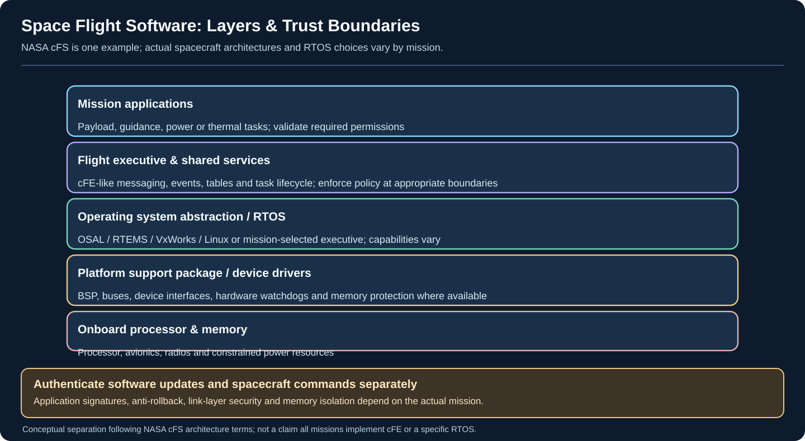
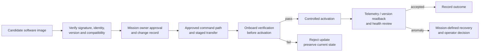

# 🚀 Part III: The Space Segment

> [!CAUTION]
> **Authorized use only.** The techniques below are for authorized security
> testing, education, and defensive research. Using them against systems you do
> not own or lack explicit written permission to test is illegal. See
> [LEGAL.md](../LEGAL.md).

## 🎯 Purpose
Space segment attack and defense guide - covering onboard computer (OBC) architecture, flight software (FSW) vulnerabilities, RTOS security (VxWorks, RTEMS, FreeRTOS), memory corruption in space-grade processors, and supply chain risks in COTS satellite components.

## ⚙️ Function
Covers: spacecraft software architecture layering (mission apps/FSW/RTOS/BSP), memory protection unit limitations, RTOS-specific vulnerabilities, FSW patching constraints (bandwidth-limited uplinks), SEU/radiation-induced fault injection, and CubeSat COTS hardware attack surface.

## 🏆 Goal
Understand the mission-specific constraints of space-segment software security, including update opportunities, processor and memory protections, and responses to single-event upsets (SEUs). Treat fault effects as reliability and security risks to investigate; do not assume an upset is exploitable without mission-specific evidence.

## 📋 When to Use
- Assessing a spacecraft FSW codebase for vulnerabilities before launch
- Understanding why space software security differs from terrestrial embedded systems
- Red-teaming a CubeSat or small satellite with COTS OBC hardware

## Chapter 8: Onboard Software

#### Spacecraft Software Architecture



*Architectural example, not an assertion that every spacecraft uses NASA cFS.* The [NASA cFS project](https://github.com/nasa/cFS) documents modular mission applications, the [core Flight Executive](https://github.com/nasa/cFE) and supported platform/OS abstractions. Every mission's code, RTOS, update mechanism, memory protection and deployed access controls require separate evidence.

#### RTOS Vulnerability Applicability

Published vulnerability records are examples to investigate, not evidence that a mission is affected. Applicability depends on the exact product and component version, enabled features, configuration, reachability, vendor patches, and the mission's software bill of materials.

| RTOS / component | Example issue to verify | Assessment note |
|------------------|-------------------------|-----------------|
| **VxWorks IPNET** | [CVE-2019-12255](https://nvd.nist.gov/vuln/detail/CVE-2019-12255), one of the URGENT/11 findings | Check the affected VxWorks/IPNET version and whether the vulnerable TCP component is present and reachable; the CVE does not apply to every VxWorks deployment. |
| **RTEMS** | Review the selected release, board support package (BSP), libraries, and build options | Project use or open-source availability does not establish a vulnerability or security maturity level. |
| **Amazon FreeRTOS Secure Sockets** | [CVE-2018-16528](https://docs.aws.amazon.com/freertos/latest/security-updates/security-updates.html) affected Amazon FreeRTOS through 1.3.1; AWS lists 1.3.2 as the minimum patched version | This is a legacy Secure Sockets issue, not a claim about the FreeRTOS kernel or all FreeRTOS-based products. Confirm the exact library and version. |
| **Linux** | Review the deployed kernel, selected drivers, support status, and update/rollback path | Do not infer patch status from the spacecraft context alone. |
| **INTEGRITY (Green Hills Software)** | Review the mission-specific product version, configuration, and vendor advisories | Public vulnerability visibility is not a measure of actual security. |

#### Flight Software Languages and Vulnerability Classes

Language choice alone does not determine assurance. Review the actual code, compiler/toolchain, libraries, build settings, memory protections, and verification evidence.

| Language | Review focus |
|----------|--------------|
| **C / C++** | Check memory and integer safety, ownership/lifetime rules, input validation, and unsafe library interfaces. |
| **Ada / SPARK** | Confirm the subset, contracts, proof scope, compiler, and build actually used; formal methods do not remove all system risks. |
| **Python** | Review parser/input boundaries, dependency provenance, and how ground tooling connects to mission systems. |
| **Rust** | Review `unsafe` blocks, FFI, panic behavior, dependencies, and target-specific runtime/toolchain assumptions. |

#### Software Upload Security

Flight-software and parameter uploads can have safety and availability impact. Review the mission's actual design rather than assuming a universal upload mechanism:

- **Integrity verification** - Confirm the image is authenticated before installation and that trust anchors are protected.
- **Authorization** - Confirm the operator role and approval chain for initiating an upload.
- **Compatibility and rollback** - Check compatibility gates and protection against unintended downgrade to a vulnerable or invalid image.
- **Recovery behavior** - Determine how interrupted or rejected updates preserve a known-good state, where the design supports rollback.
- **Evidence and readback** - Confirm logs, version reporting, and post-update health checks are independently reviewed.



*Conceptual review aid only; it does not describe a specific spacecraft or claim every mission supports rollback. Confirm verification, activation, recovery, and telemetry behavior in the mission's approved design and test evidence.*

---

### Chapter 9---

### Chapter 9: Spacecraft Hacking

> **Context:** Direct spacecraft hacking in the wild requires either compromise of the ground segment command chain or physical/RF proximity with a transmitter. The scenarios below apply to authorized research, CTF environments, and red team engagements with spacecraft operators.

#### Defensive Assessment Scenarios

**Scenario 1: Command-path assurance review**
- Review command authorization, input validation, safety inhibits, and audit trails in an operator-approved simulator or lab.
- Public protocol details or an unencrypted telemetry downlink do not establish command authority or missing authentication.
- Do not construct or transmit commands to an operational spacecraft.

**Scenario 2: Software-update assurance**
- Trace a synthetic update through signature verification, authorization, compatibility checks, activation, failure handling, and version readback.
- Use approved test images in a non-flight environment; document unsupported steps as unverified rather than attempting them against flight hardware.

**Scenario 3: Telemetry privacy and integrity review**
- Use owner-provided or public sample recordings and assess what fields reveal, whether integrity/provenance is available, and how analysts distinguish observation from inference.
- Do not infer operator staffing, mission intent, or exploitable spacecraft state from telemetry alone.

#### CubeSat Security Research

CubeSat security work should begin with the operator, mission owner, or a purpose-built simulator/CTF. Publicly listed frequencies, protocols, or telemetry do not grant authority to interact with command systems or submit data to community services.

The example below is receive-only and decodes a local recording. Check the installed version's help and [gr-satellites documentation](https://gr-satellites.readthedocs.io/en/latest/command_line.html) for supported input options. Before running it, check `~/.gr_satellites/config.ini`: the documented default is `submit_tlm = no`; keep submission disabled unless the owner has approved publication to a named service.

```bash
# Decode a local recording only; replace the placeholders with supported values.
gr_satellites SATELLITE_NAME --wavfile capture.wav
```

#### Hardening the Space Segment

| Control | Detail |
|---------|--------|
| **Command authentication** | Verify mission-specific cryptographic protection and key management, such as applicable CCSDS SDLS mechanisms; deployment must be established from evidence |
| **Replay protection** | Use authenticated sequence/nonce/window checks and durable state suited to mission reliability; a plain counter is not an authentication control |
| **Encryption in transit** | Where confidentiality is required, verify the mission-approved encryption design and key lifecycle; separately establish command authenticity and authorization |
| **Software signing** | Cryptographic signature verification before any FSW load/patch execution |
| **Watchdog timers** | Verify watchdog design, reset causes, and recovery behavior; a watchdog does not by itself contain a compromise |
| **Safe mode** | Verify anomaly criteria, command restrictions, recovery procedure, and mission-specific evidence; do not assume every anomaly is detected |
| **Memory protection** | MPU/MMU enforcement; non-executable data regions |
| **Radiation effects** | Review error detection/correction, redundancy, scrubbing, and recovery against mission-specific fault models; these controls do not alone establish exploitability |

---

<div align="center">

**📖 Use These Techniques Responsibly: Authorization is MANDATORY**

*Space systems are critical infrastructure - treat them accordingly.*

**Repository**: [ULTIMATE CYBERSECURITY MASTER GUIDE](https://github.com/Pnwcomputers/ULTIMATE-CYBERSECURITY-MASTER-GUIDE)

**Maintained by**: [Pacific Northwest Computers](https://github.com/Pnwcomputers)

---

## Related Files
- [README.md](README.md) - SpaceSecurity section index
- [PartII.md](PartII.md) - Ground segment: the uplink path to the FSW
- [PartIV.md](PartIV.md) - User segment: the downstream satellite services
- [../HardwareHacking/Chapter3.md](../HardwareHacking/Chapter3.md) - Fault injection: SEU/radiation fault injection has parallels to hardware glitching

⚠️ **RF transmission toward satellites requires EXPLICIT WRITTEN AUTHORIZATION** ⚠️

⚠️ **Unauthorized access or transmission may violate applicable law and service rules; requirements depend on the system, spectrum, conduct, and jurisdiction; see [FCC Part 15](https://www.ecfr.gov/current/title-47/chapter-I/subchapter-A/part-15) and service-specific rules such as [47 CFR § 25.115](https://www.ecfr.gov/current/title-47/section-25.115).** ⚠️

⚠️ **ITAR/EAR export controls may apply to satellite security tools and techniques** ⚠️

⭐ **Star this repo if you find it useful!** ⭐

</div>
