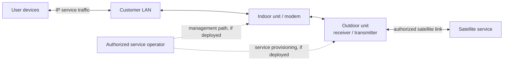
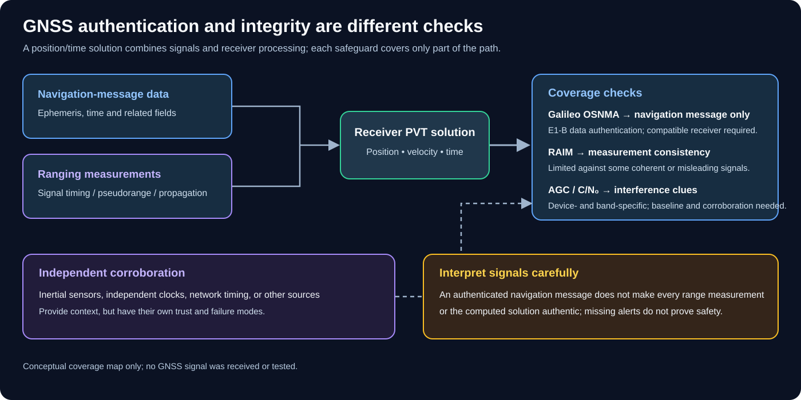

# 📺 Part IV: The User Segment

> [!CAUTION]
> **Authorized use only.** The techniques below are for authorized security
> testing, education, and defensive research. Using them against systems you do
> not own or lack explicit written permission to test is illegal. RF transmission
> requires separate operator and regulatory authority. See [LEGAL.md](../LEGAL.md).

## 🎯 Purpose
User-segment security guide covering satellite terminal architecture, management-plane risks, firmware/update assurance, and GNSS integrity and resilience.

## ⚙️ Function
Covers: outdoor/indoor unit boundaries, owner-authorized firmware review, management-plane controls, open-signal and navigation-message authentication distinctions, receiver integrity checks, and current safety guidance for GNSS interference.

## 🏆 Goal
Assess an authorized satellite-user installation for management access, firmware/update controls, and position-navigation-timing (PNT) integrity risks without assuming that public signal details or product type prove a weakness.

## 📋 When to Use
- Security assessment of a maritime, aviation, or enterprise SATCOM installation
- GNSS spoofing resilience testing in an authorized lab environment
- Understanding how the 2022 Viasat attack worked and how to defend against it
- CubeSat ground terminal security review

## Chapter 10: Attacking SATCOM Terminals

### Terminal Architecture



*Conceptual only. Actual equipment, control paths, and who operates them vary. A management path is separate from user traffic and may not use TR-069, SNMP, or a web interface in every deployment. The figure does not imply a vulnerability or authorize RF transmission.*

### Attack Surface

The examples below are review prompts, not claims that every modem exposes these services or has these weaknesses. Verify the exact model, firmware, configuration, and operator role.

| Component | Risk to verify | Evidence to review |
|-----------|----------------|-------------------|
| **Web management** | Remote reachability, authentication, role separation, transport protection | Owner-approved configuration, firmware/version, access logs, and documented network scope |
| **SNMP** | Whether it is enabled, which version/security model is used, and what data/actions are exposed | Configuration and a least-privilege design review; no default community-string assumption |
| **Remote provisioning** | Authorized management-server identities, update/provisioning approvals, and auditability | Operator architecture and signed/provenance-checked provisioning records |
| **Firmware/update path** | Image authenticity, integrity, compatibility, rollback and recovery behavior | Vendor documentation and owner-provided update test evidence |
| **Debug interfaces** | Whether UART/JTAG/test points are exposed on the exact deployed hardware | Approved teardown or lab evidence on a sacrificial unit; physical access and safety scope must be explicit |
| **RF interface** | Spectrum, operator authorization, and whether lab testing can remain conducted/shielded | Written scope and applicable radio approvals; no live service transmission as part of this guide |

### Terminal Firmware Analysis

> [!CAUTION]
> Firmware extraction and static inspection should use an owner-provided image
> in a disposable analysis environment. The QEMU example below executes untrusted
> code; `-L rootfs/` sets a loader root but is not a sandbox. Dynamic analysis
> requires a disposable isolated VM with no bridged network, shared folders,
> sensitive host mounts, or device passthrough. Prefer static analysis until that
> containment has been verified.

```bash
# Extract firmware from update file or NAND dump
binwalk -e firmware.bin

# Identify architecture and entry point
file rootfs/bin/busybox
strings rootfs/bin/satellite_daemon | grep -E "(password|key|token|secret)"

# Emulate with QEMU for dynamic analysis
qemu-mips-static -L rootfs/ rootfs/bin/satellite_daemon

# Check for hardcoded credentials
grep -r "admin\|root\|password\|default" rootfs/etc/ --include="*.conf"
```

### Terminal Risk Areas to Verify

These are assessment categories, not claims that a vendor, product family, or current device is vulnerable:

- **Account and role management** - Check whether accounts are unique, default setup credentials were changed, remote access is restricted, and administrative roles are limited.
- **Management services** - Verify which web, SNMP, remote-provisioning, or other management interfaces are enabled and reachable in the approved architecture.
- **Firmware provenance** - Confirm how authentic updates are obtained and verified, how version and downgrade policies work, and how recovery is handled.
- **Dependencies and support** - Match the exact firmware build and bundled components against vendor advisories and the [NVD](https://nvd.nist.gov/); a banner or product-family name alone does not establish exposure.
- **Physical interfaces** - Assess debug/test access only on a unit and site explicitly included in written scope.

### Evidence and Scope Notes

Historical conference demonstrations and advisories describe particular products, versions, configurations, and test conditions at the time. They do not establish that current hardware is vulnerable. A finding should name the exact model, firmware build, affected component, evidence, and owner-confirmed exposure; otherwise report it as a lead requiring verification.

---

### Chapter 11: Exploiting Global Navigation Satellite Systems

#### GNSS Overview

Global Navigation Satellite Systems (GNSS) broadcast open signals used for positioning, navigation, and timing (PNT). Signal families and capabilities vary across satellite generations; use the current interface specification for the exact constellation, service, signal, and receiver under review.

| System | Operator | Signal-reference note |
|--------|----------|-----------------------|
| GPS | United States | Current civil signal interface specifications cover L1, L2, and L5 families; available signals differ by satellite and service. |
| GLONASS | Russia | Signal plans and frequency channels are defined by the current GLONASS interface documents. |
| Galileo | European Union | E1/E5 signal families; OSNMA is available on compatible E1-B receivers. |
| BeiDou | China | BDS-2 and BDS-3 use multiple signal families; consult the current open-service signal specification. |
| NavIC | India | L5 and S-band services; L1 capability is being introduced on newer satellites, so verify current service and receiver support. |

*For current signal definitions, consult [GPS interface specifications](https://www.gps.gov/interface-control-documents-icds-interface-specifications-iss), [Galileo service references](https://www.gsc-europa.eu/), [BeiDou open-service specifications](https://www.beidou.gov.cn/), [ISRO NavIC service information](https://www.isro.gov.in/SatelliteNavigationServices.html), and the applicable GLONASS ICD. A band or published signal description does not by itself establish receiver compatibility or service availability.*

#### Signal Characteristics and Authentication

Signals arrive at a user's antenna at low power. Interference resilience depends on the signal, antenna, receiver design, installation, and local radio environment; avoid describing every receiver as “trivially” vulnerable.

- **Open civil signals** - GPS L1 C/A is an open civilian signal and does not encrypt its navigation data. Open signal structure, encryption, data authentication, and position-solution integrity are separate properties.
- **Navigation-message authentication** - Galileo OSNMA Initial Service has been operational since July 24, 2025. It authenticates supported E1-B navigation-message data on compatible receivers; it does not authenticate all ranging measurements or guarantee that the complete PNT solution is correct.
- **Receiver limitations** - A receive-only navigation signal cannot be challenged like an interactive authenticated session. Broadcast authentication can still provide evidence about message origin, subject to the receiver's implementation and service status.
- **Public specifications** - Published signal/code details help implement receivers; publication does not prove that a particular installation uses a vulnerable design.

Sources: [GPS signal interface specifications](https://www.gps.gov/interface-control-documents-icds-interface-specifications-iss), [Galileo OSNMA service](https://www.gsc-europa.eu/galileo/services/galileo-open-service-navigation-message-authentication-osnma), and [OSNMA Initial Service notice](https://www.gsc-europa.eu/sites/default/files/sites/all/files/Galileo-service-notice-20-v1.0.pdf).

#### Interference Threats and Defensive Review

**Jamming and unintentional interference**

Interference can prevent or degrade reception and affect navigation, timing, or dependent surveillance. It can be intentional or unintentional; symptoms alone do not identify a source or prove malicious activity.

- Review receiver-specific alarms and establish a normal baseline across bands and operating conditions.
- Corroborate anomalies using independent navigation sources, inertial sensors, trusted clocks, receiver logs, and operational reports.
- For aircraft and other safety-critical operations, use the operator's approved contingency procedures and current regulator/manufacturer guidance.
- Do not test jammers or transmit interference signals as part of this guide.

**Spoofing and misleading signals**

A receiver can produce incorrect PNT when it accepts inconsistent or counterfeit measurements. A map display, navigation message, or single integrity flag alone may not expose every error.

- Compare independent sensors and diverse navigation sources; investigate disagreements rather than assuming which sensor is correct.
- Review message-authentication support, antenna installation, receiver firmware, time-source dependencies, and alert handling.
- Evaluate detection logic only with recorded data, a receiver vendor's approved test mode, or a controlled simulator within an authorized lab plan.
- Do not create or transmit counterfeit navigation signals over the air.

#### Current Interference and Safety References

| Reference | What it supports |
|-----------|------------------|
| [EASA Safety Information Bulletin 2022-02, Revision 4 (July 3, 2026)](https://www.easa.europa.eu/en/newsroom-and-events/news/easa-updates-safety-information-bulletin-gnss-interference) | Current aviation procedures and training guidance for reported GNSS outages and alterations. |
| [EASA GNSS outages and alterations page](https://www.easa.europa.eu/en/domains/air-operations/global-navigation-satellite-system-outages-and-alterations) | Region-specific safety information, symptoms, and mitigations; the affected-region list is updated and date-sensitive. |
| [ICAO North Atlantic operations guidance](https://www.icao.int/sites/default/files/EURNAT/Documents/EUR%20and%20Nat%20Docs/NAT%20Documents/NAT%20Documents/NAT%20Doc%20007/NAT-Doc-007-EN-Edition-V.2026-1-Amd-0.pdf) | Operational guidance on GNSS interference, backup navigation, and aircraft surveillance limitations. |

*These references report patterns and operational effects; they do not identify a responsible actor for every event. Treat attribution as a separately sourced finding.*

#### GNSS Security Countermeasures

| Countermeasure | Description |
|----------------|-------------|
| **Galileo OSNMA** | Operational service authenticates E1-B navigation-message data on compatible receivers; it does not by itself authenticate ranging measurements or guarantee a position solution |
| **GPS civilian signal authentication research** | Chips-Message Robust Authentication (Chimera) is a research concept combining navigation-data and spreading-code authentication; do not infer operational deployment from the 2017 paper |
| **Multi-constellation / multi-frequency** | Adds signal diversity, but is not proof of authenticity |
| **Receiver Autonomous Integrity Monitoring (RAIM)** | Provides receiver integrity checks, but is only partially effective against some misleading signals; no alert does not prove signal authenticity |
| **Signal strength / AGC / C/N₀ monitoring** | Receiver- and band-specific changes can indicate interference; baseline and corroboration are required, and detection is incomplete |
| **IMU integration** | Inertial cross-checks can reveal some PVT inconsistencies; performance depends on the sensor and error growth |
| **Clock anomaly detection** | Time disagreements can be a clue; corroborate with independently trusted time because network time may also be wrong or spoofed |



*Conceptual coverage map. OSNMA authenticates Galileo navigation-message data on E1-B; RAIM checks consistency; AGC/C/N₀ are receiver-specific interference indicators. No single check proves that the complete navigation solution is authentic.*

Sources: [Galileo OSNMA service description](https://www.gsc-europa.eu/galileo/services/galileo-open-service-navigation-message-authentication-osnma), [OSNMA Service Definition Document](https://www.gsc-europa.eu/sites/default/files/sites/all/files/Galileo-OSNMA-SDD_v1.0.pdf), [Android GNSS spoof/jam detection limits](https://developer.android.com/develop/sensors-and-location/sensors/gnss-spoof-jam), [FAA RAIM advisory](https://www.faa.gov/air_traffic/publications/atpubs/aip_html/part2_enr_section_4.1.html), and [Chimera research paper](https://www.ion.org/publications/abstract.cfm?articleID=15206).

---

## Space Security References

- [Space Security Appendices](Appendices.md) - consolidated industry, protocol, SDR hardware, and legal references.
- [Part II: Ground Segment](PartII.md) - ground management and command authorization.
- [Part III: Space Segment](PartIII.md) - onboard software and update assurance.
- [GNSS signal specifications](https://www.gps.gov/interface-control-documents-icds-interface-specifications-iss) - current GPS signal references and interface documents.
- [EASA GNSS interference guidance](https://www.easa.europa.eu/en/domains/air-operations/global-navigation-satellite-system-outages-and-alterations) - current aviation mitigation and reporting guidance.


<div align="center">

**📖 Use These Techniques Responsibly: Authorization is MANDATORY**

## Related Files
- [README.md](README.md) - SpaceSecurity section index
- [PartI.md](PartI.md) - Foundations: threat actors and attack taxonomy for user segment threats
- [PartIII.md](PartIII.md) - Space segment: flight software vulnerabilities
- [../SDR/sdr_hacking.md](../SDR/sdr_hacking.md) - SDR hacking: GPS spoofing and SATCOM signal analysis tools and techniques

*Space systems may support critical services; potential impact depends on the mission and its dependencies.*

**Repository**: [ULTIMATE CYBERSECURITY MASTER GUIDE](https://github.com/Pnwcomputers/ULTIMATE-CYBERSECURITY-MASTER-GUIDE)

**Maintained by**: [Pacific Northwest Computers](https://github.com/Pnwcomputers)

---

⚠️ **RF transmission toward satellites requires EXPLICIT WRITTEN AUTHORIZATION** ⚠️

⚠️ **Access and RF-operation requirements depend on the conduct, system, service, spectrum, equipment, and jurisdiction. Check current rules with the applicable operator and regulator; [U.S. FCC rules](https://www.ecfr.gov/current/title-47) include multiple services, exceptions, and authorization paths.** ⚠️

⚠️ **Check whether a specific item, software, technology, or technical data is export-controlled before transfer; ITAR/EAR applicability depends on classification, destination, recipient, and activity.** ⚠️

⭐ **Star this repo if you find it useful!** ⭐

</div>
