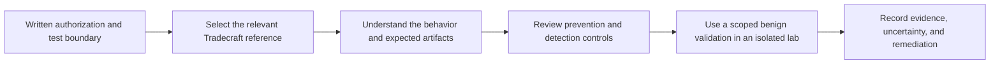

# 🗡️ Tradecraft
**Historical tradecraft and CTF perspective:** [Cypherpunk Symposium source review](../Documentation/cypherpunk-pentesting-toolkit-review.md) preserves educational context while excluding unverified exploitation and botnet tooling.

**Deep-dive tradecraft for red and blue teams: TTPs, detection logic, and countermeasures**

*Part of the [ULTIMATE CYBERSECURITY MASTER GUIDE](../README.md)*

---

Operational security tradecraft for red team, blue team, and purple team practitioners. Each file is a deep-dive reference covering methodology, tooling, TTPs, detection logic, and defensive countermeasures.

*Conceptual overview: every exercise begins with explicit scope and permission, uses controlled methods, and turns observable evidence into defensive improvements. Stop and reconfirm when the scope or conditions change.*

---

_Last reviewed: 2026-11-18 (MITRE ATT&CK Enterprise taxonomy and U.S. computer-crime references checked; legal consequences vary by jurisdiction)_

## 🎯 Purpose
The folder-level index for the eight specialized tradecraft guides that complement the master guides with deeper red-team, blue-team, and purple-team material.

## ⚙️ Function
Lists all eight Tradecraft guides, describes their topics, explains the shared dual-use structure, and links related folders. This index contains navigation and topic labels; use the linked guides for the technical content and [Checklists](../Checklists/) for quick-reference workflows.

## 🏆 Goal
A reader can find the right tradecraft file for a given ATT&CK tactic or technique and sees whether each reference focuses on defensive analysis or authorized lab assessment.

## 📋 When To Use
As the entry point into the Tradecraft/ folder, or when looking up which file covers a specific ATT&CK tactic.

## Contents

| File | Description |
|---|---|
| [pentoo-linux-guide.md](./pentoo-linux-guide.md) | Pentoo Linux Live/overlay deployment, Gentoo tool maintenance, authorized network/web/wireless assessments, evidence collection |
| [c2-frameworks.md](c2-frameworks.md) | Cobalt Strike, Sliver, and Havoc - defensive architecture review, detection engineering, and network/endpoint controls |
| [lolbins-lolbas.md](lolbins-lolbas.md) | Living off the land - Windows LOLBins for execution, download, lateral movement, persistence, and credential access |
| [osint-threat-intel.md](osint-threat-intel.md) | OSINT methodology, passive recon, DNS/infra enumeration, people intelligence, threat intel platforms, and operationalization |
| [network-detection.md](network-detection.md) | Packet capture, Zeek/Suricata analysis, C2 traffic detection, DNS tunneling, lateral movement, and network forensics |
| [active-directory.md](active-directory.md) | Active Directory attack-path concepts, detection, and hardening; use only in authorized isolated labs |
| [av-edr-evasion.md](av-edr-evasion.md) | Evasion behavior, telemetry, and defensive response |
| [evasion.md](evasion.md) | Companion evasion-engineering study notes; use alongside the AV/EDR guide |

---

### Defensive reading workflow

Use the technique descriptions to understand behavior; use the detection and hardening sections to guide response. Any active validation needs owner approval, a defined boundary, synthetic or benign fixtures, and a cleanup plan.

## Usage

These references have different scopes. Some explain offensive techniques at a high level for defensive analysis; others focus on detections, controls, and safe validation. Check each file's scope before using it. Sections are clearly labeled where applicable:

- **Technique context, where present** - Understand reported behaviors and artifacts
- **Detection & Hunting sections** - Sigma rules, KQL queries, event IDs, behavioral indicators
- **Defensive sections** - Hardening controls, configuration recommendations, monitoring priorities

---

## Guide Topics

ATT&CK is a living knowledge base. Its tactics and technique relationships change over time; verify labels against the [current MITRE ATT&CK Enterprise tactics](https://attack.mitre.org/tactics/enterprise/) before using them in a report. The index below uses broad subject labels rather than fixed tactic IDs.

| Guide | Main topic |
|---|---|
| [Pentoo Linux](./pentoo-linux-guide.md) | Authorized assessment platform setup and evidence handling |
| [C2 Frameworks](./c2-frameworks.md) | Command-and-control architecture, operations, and detection |
| [LOLBins / LOLBAS](./lolbins-lolbas.md) | Native-tool abuse patterns, monitoring, and hardening |
| [OSINT & Threat Intelligence](./osint-threat-intel.md) | Public-source research, verification, and intelligence handling |
| [Network Detection](./network-detection.md) | Traffic analysis, detection engineering, and forensics |
| [Active Directory](./active-directory.md) | Directory security, identity abuse patterns, detection, and hardening |
| [AV / EDR Evasion](./av-edr-evasion.md) | Defensive understanding of endpoint evasion behaviors and telemetry |
| [Evasion Engineering Notes](./evasion.md) | Defensive analysis of evasion concepts and detection limitations |
---

## Related Sections

- [`/Checklists`](../Checklists/) - Quick-reference attack checklists that pair with these deep dives
- [`/HardwareHacking`](../HardwareHacking/) - Physical and embedded device attacks
- [`/Scripts`](../Scripts/) - Offensive scripts, payloads, and automation tools
- [`/Documentation`](../Documentation/) - Tool references and field guides

---

**⚠️ USE THIS REPO RESPONSIBLY AND LEGALLY ⚠️**

*With great power comes great responsibility - and great legal liability.*

**Repository**: [ULTIMATE CYBERSECURITY MASTER GUIDE](https://github.com/Pnwcomputers/ULTIMATE-CYBERSECURITY-MASTER-GUIDE)

**Maintained by**: [Pacific Northwest Computers](https://github.com/Pnwcomputers)

🔴 **THESE ARE OFFENSIVE & DEFENSIVE SECURITY TACTICS** 🔴

**Use only with explicit authorization for the systems, methods, time window, and impact covered by the engagement. Unauthorized access may carry criminal or civil consequences; applicable law and penalties depend on jurisdiction and facts.** See the [repository legal terms](../LEGAL.md) and [18 U.S.C. § 1030](https://uscode.house.gov/us/usc/119-134/t18/s1030/). This is general information, not legal advice.

---

## Related Files
- [pentoo-linux-guide.md](./pentoo-linux-guide.md) - Gentoo/Pentoo platform setup and field test workflow
- [active-directory.md](active-directory.md) - AD attacks, Kerberos abuse, BloodHound, persistence
- [av-edr-evasion.md](av-edr-evasion.md) - AV/EDR defense: behavior indicators, detection engineering, and control validation
- [c2-frameworks.md](c2-frameworks.md) - Cobalt Strike, Sliver, and Havoc: defensive architecture and detection
- [lolbins-lolbas.md](lolbins-lolbas.md) - LOLBins/LOLBAs: living-off-the-land techniques
- [network-detection.md](network-detection.md) - Network traffic analysis and threat detection
- [osint-threat-intel.md](osint-threat-intel.md) - OSINT methodology and threat intelligence platforms
- [../Checklists/README.md](../Checklists/README.md) - Operational checklists that implement these techniques
