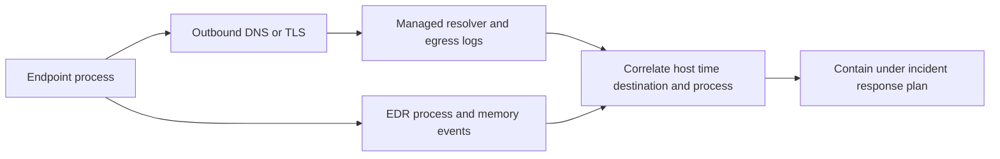

# C2 Frameworks - Deep Dive


> **Scope:** Cobalt Strike, Sliver, and Havoc - defensive architecture review, detection engineering, and network/endpoint controls. This guide does not include deployment, implant generation, listener setup, or command execution.

✅ **Quick-reference checklist:** [Command and Control](../Checklists/command-and-control.md)

---

## Table of Contents

1. [C2 Architecture Fundamentals](#c2-architecture-fundamentals)
2. [Cobalt Strike](#cobalt-strike)
3. [Sliver](#sliver)
4. [Havoc](#havoc)
5. [Malleable C2 & Traffic Shaping](#malleable-c2--traffic-shaping)
6. [Infrastructure OpSec](#infrastructure-opsec)
7. [Detection & Hunting](#detection--hunting)
8. [Defensive Countermeasures](#defensive-countermeasures)

---

## 🎯 Purpose
Defensive reference for recognizing common C2 architecture patterns and improving network and endpoint monitoring for Cobalt Strike, Sliver, and Havoc.

## ⚙️ Function
Covers C2 architecture, framework-specific behavioral artifacts, traffic analysis, infrastructure logging, and defensive countermeasures. Pair it with the defensive [Command & Control checklist](../Checklists/command-and-control.md) and [AV/EDR detection guide](av-edr-evasion.md).

## 🏆 Goal
A defender can map C2 components, correlate network and endpoint evidence, and identify controls that limit and detect unauthorized command channels.

## 📋 When to Use
When reviewing C2 alerts, assessing egress controls, or building detections and hunts.

## C2 Architecture Fundamentals

A Command and Control (C2) framework provides operators with a persistent channel to interact with compromised hosts. Core components:

```
[Operator] ──► [Team Server / Listener] ◄──► [Redirectors] ◄──► [Implant on Target]
```

**Key concepts:**

| Term | Description |
|---|---|
| Listener | Server-side component that receives beacon callbacks |
| Implant/Agent | Malicious payload running on the target |
| Redirector | Intermediate hop to obscure true C2 infrastructure |
| Profile | Configuration controlling beacon behavior and traffic appearance |
| Sleep/Jitter | Beacon callback interval ± random variance to evade timing-based detection |
| Stager | Small loader that fetches and executes the full payload |

**Protocol options across frameworks:**

- HTTP/HTTPS (most common, blends with web traffic)
- DNS (may traverse networks that permit DNS; resolver policy, DNS monitoring, and other controls can still detect or block it—there is no bypass guarantee)
- SMB (lateral movement within network, named pipes)
- TCP (raw, fast, noisier)
- WebSockets / gRPC (emerging, harder to inspect)

---

## Cobalt Strike

Cobalt Strike is a commercial adversary-simulation platform whose Beacon behavior is widely represented in threat research. For defense, focus on process lineage, memory-resident code, periodic network activity, protocol metadata, and unexpected outbound connections. This guide intentionally omits team-server setup and Beacon commands.

## Sliver

Sliver is an open-source adversary-simulation framework. Its transports and implant artifacts vary by version and configuration. Treat encrypted transport as observable network activity, not as proof of benignness or invisibility.

**Defensive review:** correlate DNS/TLS/HTTP metadata, destination reputation and first-seen time with process ancestry, signer, executable memory, and user activity. Pin threat-intelligence claims to specific versions and samples.

## Havoc

Havoc is an open-source framework with a team server, listeners, and endpoint components. For defense, identify unexpected listener exposure, unapproved services, process injection behaviors, and unusual certificate or domain combinations. Do not expose management interfaces to public networks.

## Malleable C2 & Traffic Shaping

Traffic may be configured to resemble common protocols, but traffic appearance alone is not a reliable detection or evasion verdict. Defenders should compare flow timing, byte counts, TLS certificate/SNI/JA3-like metadata where available, DNS history, destination age, and endpoint process activity against a host's baseline.

| Signal | Defensive use | Limitation |
|---|---|---|
| Repeated timing or low-variance beaconing | Prioritize a host for correlation | Legitimate agents can also be periodic |
| Rare or newly seen domains | Enrich with DNS and registration context | New domains can be legitimate |
| Unusual TLS or HTTP metadata | Compare against software inventory and known baselines | Metadata can be incomplete or shared |
| Process-to-network mismatch | Investigate a process with unexpected egress | Parent/child relationships vary by application |

## Infrastructure OpSec

For a defender, infrastructure analysis means mapping and restricting outbound paths:

- Log DNS queries and outbound flows at managed resolvers and gateways.
- Require proxy or egress gateway use where feasible; restrict direct outbound access by workload.
- Inventory approved remote administration and monitoring services to reduce false positives.
- Alert on new listeners, reverse proxies, port-forwarding services, and unexpected public management interfaces.
- Preserve DNS, TLS, firewall, and endpoint evidence before blocking an indicator.



## Detection & Hunting

### Network-Based Detections

```yaml
# Sigma rule: Suspicious beacon jitter pattern
title: C2 Beacon Regular Interval Callback
logsource:
    category: network
detection:
    selection:
        dst_port:
            - 80
            - 443
    condition: selection
    timeframe: 1h
    aggregate: count() > 10 AND stddev(interval) < 5  # Low jitter = beacon
```

**Key network IOCs:**

- Regular callback intervals (low standard deviation in connection timing)
- Small consistent POST sizes (beacon check-in)
- HTTP responses with high entropy content
- Connections to newly registered domains (< 30 days old)
- Beacons to IP addresses (no domain) over 443
- DNS beacons: high volume TXT/NULL queries to single domain

### Host-Based Detections

```powershell
# Hunt for common CS injection patterns
Get-Process | Where-Object {
    $_.MainWindowTitle -eq "" -and
    $_.Modules.Count -lt 5 -and
    $_.WorkingSet -gt 10MB
}

# Detect fork-and-run (CS default behavior)
# Look for short-lived child processes spawned by beacon's spawnto
Get-WinEvent -LogName Security -FilterXPath "*[System[EventID=4688]]" |
    Where-Object { $_.Properties[5].Value -match "WerFault|rundll32|gpupdate" }
```

**YARA rule for Cobalt Strike Beacon:**

```yara
rule CobaltStrike_Beacon_Generic {
    meta:
        description = "Detects common CS Beacon artifacts"
    strings:
        $s1 = "%s (admin)" ascii
        $s2 = "beacon.dll" ascii nocase
        $s3 = { 68 65 61 70 61 70 69 }  // "heapapi"
        $mz = { 4D 5A }
    condition:
        $mz at 0 and 2 of ($s*)
}
```

### Sliver-Specific Detections

- mTLS sessions: Look for certificate pinning failures in proxy logs
- Implant binary: Go binaries have identifiable section layouts (`.gopclntab`)
- Default canary domain callbacks during sandbox analysis

### Havoc-Specific Detections

- Demon implant default user-agent strings
- Indirect syscall patterns in memory (gadget chains in non-standard modules)
- Sleep obfuscation: encrypted RX memory regions that flip permissions

---

## Defensive Countermeasures

### Network Controls

```bash
# Block known C2 IOC feeds
# Integrate with: Emerging Threats, Abuse.ch, MISP, OpenCTI

# DNS RPZ (Response Policy Zone) to block C2 domains
# In BIND/Unbound, load RPZ feed from threat intel provider

# Egress filtering - whitelist approach
iptables -P OUTPUT DROP
iptables -A OUTPUT -m state --state ESTABLISHED,RELATED -j ACCEPT
iptables -A OUTPUT -d <approved_proxy_IP> -p tcp --dport 3128 -j ACCEPT
```

### Endpoint Controls

- **EDR tuning:** Alert on `CreateRemoteThread`, `VirtualAllocEx`, `WriteProcessMemory` API calls from non-standard processes
- **AMSI/ETW:** Ensure AMSI and ETW providers are not disabled (common evasion step)
- **LOLBin monitoring:** Alert on unusual parent-child process relationships (e.g., Word spawning PowerShell)
- **Memory scanning:** Use tools like PE-sieve, Moneta, or Volatility to detect injected implants

### Detection Engineering Priorities

| Priority | Detection | Coverage |
|---|---|---|
| High | Fork-and-run process spawning | CS default behavior |
| High | In-memory .NET assembly execution | execute-assembly |
| High | LSASS access from non-standard processes | Credential dumping |
| Medium | Regular interval outbound connections | Beacon heartbeat |
| Medium | DNS TXT record volume spikes | DNS C2 |
| Low | Go binary section signatures | Sliver implants |

---

## References

- [Cobalt Strike Documentation](https://hstechdocs.helpsystems.com/manuals/cobaltstrike/current/userguide/)
- [Sliver Wiki](https://github.com/BishopFox/sliver/wiki)
- [Havoc Framework](https://github.com/HavocFramework/Havoc)
- [Malleable C2 Profiles](https://github.com/rsmudge/Malleable-C2-Profiles)
- [MITRE ATT&CK: C2](https://attack.mitre.org/tactics/TA0011/)
- [C2 Matrix](https://howto.thec2matrix.com/)

## Related Files
- [README.md](README.md) - Tradecraft section index
- [active-directory.md](active-directory.md) - Post-exploitation via C2 in AD environments
- [av-edr-evasion.md](av-edr-evasion.md) - Evasion techniques for C2 payload delivery
- [network-detection.md](network-detection.md) - Detecting C2 traffic at the network layer
- [../Checklists/command-and-control.md](../Checklists/command-and-control.md) - C2 technique checklist
- [../Mobile/mobile_pentest_sop.md](../Mobile/mobile_pentest_sop.md) - Mobile pentest SOP (Metasploit post-exploitation from NetHunter device)
