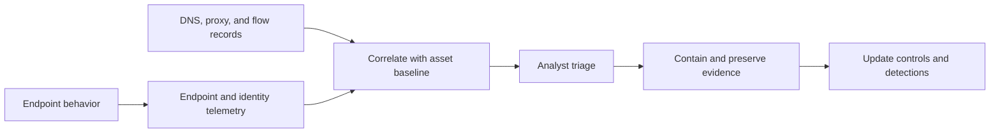

# Evasion Engineering — Defensive Analysis

> This guide explains evasion behaviors so defenders can recognize, investigate, and reduce them. It does not provide payload loaders, bypass code, injection procedures, or commands for disabling security controls. Behavior and telemetry vary by operating system, product, version, and configuration; no single signal proves malicious activity.

## Table of Contents

- [Part I — Foundations & Mindset](#part-i--foundations--mindset)
- [Part II — Windows Internals for Evasion](#part-ii--windows-internals-for-evasion)
- [Part III — Static Evasion](#part-iii--static-evasion)
- [Part IV — Dynamic & Behavioral Evasion](#part-iv--dynamic--behavioral-evasion)
- [Part V — EDR Evasion](#part-v--edr-evasion)
- [Part VI — Process Injection](#part-vi--process-injection)
- [Part VII — Memory Evasion](#part-vii--memory-evasion)
- [Part VIII — Network & C2 Evasion](#part-viii--network--c2-evasion)
- [Part IX — Living Off the Land](#part-ix--living-off-the-land)
- [Part X — Building Custom Tools](#part-x--building-custom-tools)
- [Quick Reference Cheat Sheet](#quick-reference-cheat-sheet)

## Part I — Foundations & Mindset

### Chapter 1 — Introduction to Evasion Engineering

Evasion describes attempts to avoid, delay, or confuse security controls. These behaviors can be detected through multiple independent sources, but detection is never guaranteed. Defenders should use layered prevention, endpoint telemetry, identity signals, network monitoring, and tested incident response. Evaluate controls against documented behaviors and known blind spots without assuming that any single product or technique always succeeds.

## Part II — Windows Internals for Evasion

### Chapter 2 — Windows Architecture & The Execution Environment

Windows execution involves user-mode applications, operating-system services, kernel components, and security products. Monitoring coverage differs across systems and configurations. Build an asset-specific view of which telemetry sources are enabled, retained, and centrally forwarded. Protect the management plane and avoid treating a missing event as proof that an action did not occur.

### Chapter 3 — The PE File Format

Portable Executable metadata can help analysts understand a file's architecture, imports, sections, signatures, and build characteristics. Static properties are context, not verdicts: benign software can be packed or unusual, and malicious software can appear ordinary. Preserve the original sample, compute a controlled hash, inspect it with approved offline tools, and record tool versions and limitations.

### Chapter 4 — Windows API & Syscalls

Applications use documented APIs and operating-system interfaces to request work. The specific path can vary by build and implementation. Defenders should correlate process behavior, memory changes, image loads, call-stack or kernel telemetry where available, and resulting system effects. A particular interface path should not be treated as a reliable bypass or a universal detection signature.

## Part III — Static Evasion

### Chapter 5 — Signature-Based Detection & Bypassing It

File signatures and reputation are useful but incomplete. Indicators defenders can review include unexpected packing, unusual entropy, mismatched file metadata, invalid or unexpected signatures, and unexplained changes across builds. Validate findings against trusted release artifacts and software provenance. Do not label a file malicious from entropy or obfuscation alone.

### Chapter 6 — Building Custom Loaders

A loader is software that prepares or starts another component. From a defender's perspective, investigate unusual memory allocation and protection changes, executable content without a corresponding trusted file, unexpected network retrieval, and suspicious parent-child process relationships. Prefer application control, constrained scripting, egress filtering, and endpoint monitoring. Do not construct or deploy loaders as part of this guide.

## Part IV — Dynamic & Behavioral Evasion

### Chapter 7 — Anti-Analysis & Sandbox Evasion

Some software delays or changes behavior when it detects an analysis environment. Defenders can compare observations across time, host configurations, and telemetry sources, and use isolated analysis environments with realistic but synthetic system context. Sandbox results are evidence with limits; no behavior in one run does not establish that a file is safe.

### Chapter 8 — Anti-Debugging Techniques

Debugging interference and environment checks may appear in legitimate software, protectors, or malicious programs. Analysts should document the observed behavior, compare it with signed vendor releases, and correlate it with other evidence. Use approved, isolated analysis systems; do not disable endpoint protections on production devices to make analysis easier.

## Part V — EDR Evasion

### Chapter 9 — How EDRs Work (Userland Hooking)

Endpoint products combine different sensors and enforcement layers. Some products use user-mode instrumentation, but implementations differ; it is not accurate to assume every product injects a DLL into every process. Review vendor documentation and confirm actual coverage with supported health checks, event telemetry, and controlled benign test events.

### Chapter 10 — Unhooking ntdll

Changes to security-related module memory or instrumentation may be suspicious, but are not conclusive on their own. Compare loaded modules and memory to a trusted baseline, correlate with process ancestry and subsequent behavior, and consider legitimate patching or compatibility software. Do not assume that changing an in-memory component defeats a product's other monitoring layers.

### Chapter 11 — Direct & Indirect Syscalls

System-call paths vary across operating-system versions and security products. An unusual call path may be one investigative clue, but it does not guarantee that monitoring is bypassed. Correlate lower-level telemetry with memory, process, file, identity, and network events; document platform-specific coverage gaps.

### Chapter 12 — AMSI & ETW Bypass

Antimalware scanning and event tracing provide different kinds of visibility. Attempts to disable, patch, or interfere with these controls may create configuration, memory, service, or event-provider anomalies. Protect logging policy, forward records to a separately administered collector, alert on unexpected changes, and preserve evidence if coverage disappears.

## Part VI — Process Injection

### Chapter 13 — Classic Injection Techniques

Process injection is a broad category describing code or data placed into another process context. Defenders can investigate cross-process memory operations, unusual executable memory, thread creation, image inconsistencies, and suspicious source-to-target process relationships. These signals require context and vary by tooling; do not rely on a single event.

### Chapter 14 — Advanced Injection Techniques

More complex process-manipulation behavior can complicate attribution, but still produces effects that may be visible to endpoint, kernel, memory, or behavioral sensors. Review process lineage, memory permissions, thread state, loaded modules, and subsequent network or file activity. Use vendor-supported telemetry and controlled test fixtures to validate alert quality.

## Part VII — Memory Evasion

### Chapter 15 — Evading Memory Scanners

Memory inspection can miss short-lived or transformed content, and can also produce false positives. Improve coverage with repeated or event-triggered collection, memory-protection and allocation telemetry, process behavior correlation, and trusted baselines. Preserve volatile evidence according to incident-response policy and record collection limitations.

## Part VIII — Network & C2 Evasion

### Chapter 16 — Command & Control Communication Evasion

Command-and-control traffic may blend into common protocols or use changing infrastructure. Defenders should baseline expected destinations and applications, review periodicity and uncommon client behavior, correlate endpoint and DNS/TLS telemetry, and apply egress controls. Encrypted traffic limits content visibility; metadata is useful but not definitive. Avoid fixed assumptions about ports, domains, or beacon intervals.

## Part IX — Living Off the Land

### Chapter 17 — LOLBins & Trusted Binary Abuse

Legitimate operating-system utilities can be misused, so a trusted signature alone does not establish benign intent. Review unusual command lines, script hosts, parent processes, destination URLs, downloaded files, and changes to scheduled or management tasks. Apply application control and least privilege, and correlate activity with approved administrative workflows. This guide intentionally omits download, execution, persistence, and concealment commands.

## Part X — Building Custom Tools

### Chapter 18 — Custom Tool Development Philosophy

Build defensive tooling to collect only necessary data, use documented interfaces, handle errors safely, protect secrets, and emit auditable logs. Test against synthetic fixtures and known benign examples. Review dependencies and permissions, and keep collection and retention limits explicit. Do not create stealth, bypass, credential-harvesting, or payload-delivery tools from this guide.

## Quick Reference Cheat Sheet

### Evasion Decision Tree

1. Confirm the alert and identify the affected asset and time range.
2. Preserve relevant endpoint, identity, and network evidence.
3. Establish a trusted baseline and check for approved administrative activity.
4. Correlate multiple independent signals; record alternative explanations and uncertainty.
5. Contain according to the incident plan and notify the system owner.
6. Restore from a known-good state, rotate affected credentials, and track remediation.

### Investigation Sources

- Endpoint process, image-load, memory, and control-health telemetry
- Identity-provider sign-ins, privilege changes, and authentication alerts
- DNS, proxy, firewall, and network-flow records
- Application-control, script, and operating-system audit events
- Change-management records and trusted software-release metadata

### Operational Limits

Detection behavior depends on product, policy, operating-system version, and sensor health. Verify coverage with vendor-supported documentation and authorized benign tests. Preserve logs centrally and alert on unexpected loss of visibility. Never clear audit records as cleanup.

## See also

- [AV/EDR Evasion — Detection & Defense](av-edr-evasion.md)
- [Network Detection](network-detection.md)
- [Incident Response](../IncidentResponse/README.md)
- [Active Directory Security](active-directory.md)
