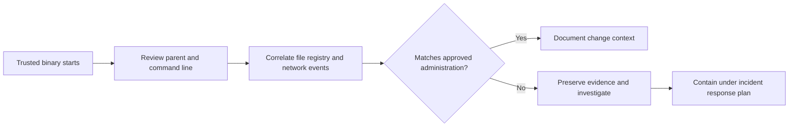

# Living Off the Land - LOLBins, LOLBAs, LOLScripts

> [!CAUTION]
> **Defensive scope:** This guide describes signals and controls for investigating LOLBin abuse. Use routine administrative tools only under delegated authority and change policy; active testing requires an owner-approved scope. Legal consequences depend on conduct, authorization, and applicable rules. See [LEGAL.md](../LEGAL.md).

> **Scope:** Defensive triage and detection for abuse of legitimate Windows binaries, libraries, and scripts. This guide does not provide copy-ready payload execution, transfer, credential dumping, or persistence commands.

✅ **Quick-reference checklists:** [AppLocker Bypass](../Checklists/AppLocker.md) · [Environment Breakout](../Checklists/Environment-Breakout-Checklist.md)

---

## Table of Contents

1. [What is LOLB?](#what-is-lolb)
2. [Execution Techniques](#execution-techniques)
3. [Download & Transfer](#download--transfer)
4. [Lateral Movement](#lateral-movement)
5. [Persistence via LOLBins](#persistence-via-lolbins)
6. [Credential Harvesting](#credential-harvesting)
7. [Reconnaissance LOLBins](#reconnaissance-lolbins)
8. [LOLDrivers](#loldrivers)
9. [Detection & Hunting](#detection--hunting)
10. [Defensive Controls](#defensive-controls)

---

## 🎯 Purpose
Defensive overview of how legitimate Windows binaries can be abused, what telemetry may reveal that abuse, and which application controls reduce risk.

## ⚙️ Function
Covers LOLBin behavior categories, defensive telemetry, LOLDrivers, hunting ideas, and application-control mitigations. Pair with the [application-control checklist](../Checklists/AppLocker.md) and [AV/EDR detection guide](av-edr-evasion.md).

## 🏆 Goal
A defender can recognize abnormal use of trusted binaries and correlate process, file, registry, network, and identity evidence.

## 📋 When to Use
When triaging suspicious signed binaries, reviewing application-control coverage, or building detection logic.

## What is LOLB?

Living Off the Land Binaries and Scripts (LOLBins/LOLBAs) are legitimate or commonly available system utilities that can be abused for unintended purposes. Some are Microsoft-signed; verify the exact file, signer, version, and path.

**Why they're effective:**
- Already present on every Windows system
- Signed by Microsoft - trusted by most AV/allowlisting solutions
- Whitelisted in many environments
- Blend into normal administrative activity

**Resources:**
- [LOLBAS Project](https://lolbas-project.github.io/) - comprehensive catalog
- [GTFOBins](https://gtfobins.org/) - Linux equivalents

---

## Execution Techniques

| Binary family | Defensive signal | Investigation focus |
|---|---|---|
| certutil, bitsadmin, PowerShell | Unexpected outbound transfer or decode activity | Parent process, URL/domain, destination path, user, and change context |
| mshta, rundll32, regsvr32 | Scriptlet/HTML/COM activity from unusual parents or locations | Command-line metadata, loaded modules, signer, network connection, and application-control decision |
| msiexec, installutil, cmstp | Installer or .NET utility launched by an unusual process | Package origin, signature, installer logs, child processes, and policy result |
| wmic, pcalua, forfiles, csc/vbc | Scripting or process creation outside normal admin workflows | Parent/child chain, target host, script/compiler inputs, and account context |

These signed tools are not automatically trusted for every action. For example, regsvr32 has historically been abused to load scriptlets, but success depends on operating-system version and current application-control policy; do not describe it as a reliable AppLocker bypass.

## Download & Transfer

Look for utilities that create files from remote or encoded content. Correlate process creation with proxy/DNS logs, file creation, signature, prevalence, and subsequent execution. A download event alone does not prove maliciousness.

**Evidence to preserve:** process tree, full command line where policy permits, DNS/TLS/proxy record, file hash and signer, destination path, and relevant change ticket. Avoid opening or executing recovered files during initial triage.

## Lateral Movement

Unexpected remote service creation, administrative share access, WMI/WinRM activity, or remote process creation can indicate lateral movement. Validate the source account, destination asset, time window, management tool, and approved change record. Do not treat an admin tool's presence alone as malicious.

## Persistence via LOLBins

Review unexpected scheduled tasks, Run-key changes, service registrations, WMI subscriptions, and startup-folder writes. Compare creator identity, file signer, path, and change history against the approved baseline. Preserve task/service metadata before containment.

## Credential Harvesting

Unexpected access to LSASS, registry hives, credential stores, or volume-shadow data can indicate credential theft. Review EDR telemetry and privileges, protect domain-controller backups, enable credential protections, rotate affected secrets, and preserve evidence under the incident plan. This guide does not include dump or extraction commands.

## Reconnaissance LOLBins

Host inventory, domain queries, share enumeration, and network discovery may be part of legitimate administration or suspicious activity. Compare command origin and rate with known management tools, account roles, and approved assessment scope. Correlate with authentication and endpoint telemetry.


## LOLDrivers

Vulnerable signed drivers can be used to execute code in kernel mode (BYOVD - Bring Your Own Vulnerable Driver).

**Common BYOVD Targets:**

| Driver | Vulnerability |
|---|---|
| gdrv.sys (Gigabyte) | Arbitrary kernel memory R/W |
| RTCore64.sys (MSI Afterburner) | Arbitrary kernel memory R/W |
| dbutil_2_3.sys (Dell) | Arbitrary kernel memory R/W |
| iqvw64e.sys (Intel) | Arbitrary kernel memory R/W |

**Usage pattern:**
1. Drop vulnerable signed driver to disk
2. Load driver via `sc.exe create` or `NtLoadDriver`
3. Communicate via IOCTL to perform privileged operations (disable EDR kernel callbacks, patch DSE)
4. Unload driver

**Resources:**
- [LOLDrivers Project](https://www.loldrivers.io/)
- [KDMapper](https://github.com/TheCruZ/kdmapper) - unsigned driver mapper using vulnerable driver

---

## Detection & Hunting

### High-Priority Process Relationships to Alert On

| Parent | Child | Suspicion |
|---|---|---|
| winword.exe / excel.exe | cmd.exe, powershell.exe, wscript.exe | Macro execution |
| mshta.exe | powershell.exe, cmd.exe | HTA payload |
| wmic.exe | cmd.exe, powershell.exe | WMIC execution |
| regsvr32.exe | (network connection) | Squiblydoo |
| svchost.exe | cmd.exe (unusual params) | Service abuse |
| explorer.exe | installutil.exe, cmstp.exe | LOLBin execution |

### Sigma Rules

```yaml
title: Suspicious certutil Usage
logsource:
    category: process_creation
    product: windows
detection:
    selection:
        Image|endswith: '\certutil.exe'
        CommandLine|contains:
            - '-urlcache'
            - '-decode'
            - '-encode'
            - 'http'
    condition: selection
level: high

---

title: Regsvr32 Network Connection
logsource:
    category: network_connection
    product: windows
detection:
    selection:
        Image|endswith: '\regsvr32.exe'
        Initiated: 'true'
    condition: selection
level: high

---

title: LSASS Dump via comsvcs.dll
logsource:
    category: process_creation
    product: windows
detection:
    selection:
        Image|endswith: '\rundll32.exe'
        CommandLine|contains:
            - 'comsvcs'
            - 'MiniDump'
    condition: selection
level: critical
```

### PowerShell / Sysmon Event IDs

| Event ID | Source | Description |
|---|---|---|
| 4688 | Security | Process creation (enable command line logging) |
| 4103/4104 | PowerShell | Script block logging |
| 1 | Sysmon | Process creation with full command line |
| 3 | Sysmon | Network connection |
| 7 | Sysmon | Image loaded |
| 8 | Sysmon | CreateRemoteThread |
| 10 | Sysmon | ProcessAccess (LSASS access) |
| 11 | Sysmon | FileCreate |
| 12/13 | Sysmon | Registry create/modify |

### Hunting Queries (Defender for Endpoint / KQL)

```kusto
// Hunt for LSASS access by non-standard processes
DeviceEvents
| where ActionType == "LsassProcessAccess"
| where InitiatingProcessFileName !in ("MsMpEng.exe", "svchost.exe", "taskmgr.exe", "lsass.exe")
| project Timestamp, DeviceName, InitiatingProcessFileName, InitiatingProcessCommandLine

// Hunt for LOLBin download activity
DeviceNetworkEvents
| where InitiatingProcessFileName in~ ("certutil.exe", "bitsadmin.exe", "mshta.exe", "regsvr32.exe")
| where RemotePort in (80, 443, 8080, 8443)
| project Timestamp, DeviceName, InitiatingProcessFileName, RemoteUrl
```

---

## Defensive Controls

### Application Control (WDAC / AppLocker)

Create and test WDAC/AppLocker policies through your organization's managed policy workflow. Start in audit mode, pilot on representative devices, review compatibility, and document a signed rollback path before enforcement. A policy rule should target the risky behavior and context rather than broadly blocking a system binary.

### Restrict With Managed Policy

Do not change execute permissions on binaries under `C:\Windows\System32` with ad hoc ACLs. Such changes can break system components and may be difficult to reverse safely. Use centrally managed application-control policy in audit mode, review allowed administrative workflows, pilot the policy, and retain a tested rollback.

### PowerShell Hardening

```powershell
# Enable Script Block Logging
Set-ItemProperty -Path "HKLM:\SOFTWARE\Policies\Microsoft\Windows\PowerShell\ScriptBlockLogging" `
    -Name "EnableScriptBlockLogging" -Value 1

# Enable Constrained Language Mode
[System.Environment]::SetEnvironmentVariable('__PSLockdownPolicy', '4', 'Machine')

# Disable PowerShell v2 (removes AMSI bypass vector)
Disable-WindowsOptionalFeature -Online -FeatureName "MicrosoftWindowsPowerShellV2Root" -NoRestart
```

### ASR Rules (Attack Surface Reduction)

```powershell
# Block Office from creating child processes
Add-MpPreference -AttackSurfaceReductionRules_Ids "d4f940ab-401b-4efc-aadc-ad5f3c50688a" `
    -AttackSurfaceReductionRules_Actions Enabled

# Block JS/VBS from launching downloaded executable content
Add-MpPreference -AttackSurfaceReductionRules_Ids "3b576869-a4ec-4529-8536-b80a7769e899" `
    -AttackSurfaceReductionRules_Actions Enabled

# Block process creations originating from PSExec and WMI commands
Add-MpPreference -AttackSurfaceReductionRules_Ids "d1e49aac-8f56-4280-b9ba-993a6d77406c" `
    -AttackSurfaceReductionRules_Actions Enabled
```

---

## References

- [LOLBAS Project](https://lolbas-project.github.io/)
- [LOLDrivers](https://www.loldrivers.io/)
- [MITRE ATT&CK: Signed Binary Proxy Execution (T1218)](https://attack.mitre.org/techniques/T1218/)
- [Sigma Rules Repository](https://github.com/SigmaHQ/sigma)
- [Sysmon Configuration](https://github.com/SwiftOnSecurity/sysmon-config)
- [WDAC Policy Wizard](https://webapp-wdac-wizard.azurewebsites.net/)

## Related Files
- [README.md](README.md) - Tradecraft section index
- [av-edr-evasion.md](av-edr-evasion.md) - LOLBins as a component of broader evasion strategy
- [active-directory.md](active-directory.md) - LOLBins used in AD lateral movement
- [../Checklists/Defense-Evasion.md](../Checklists/Defense-Evasion.md) - Defense evasion checklist including LOLBin techniques
- [../Checklists/AppLocker.md](../Checklists/AppLocker.md) - AppLocker bypass checklist (complementary to this file)
