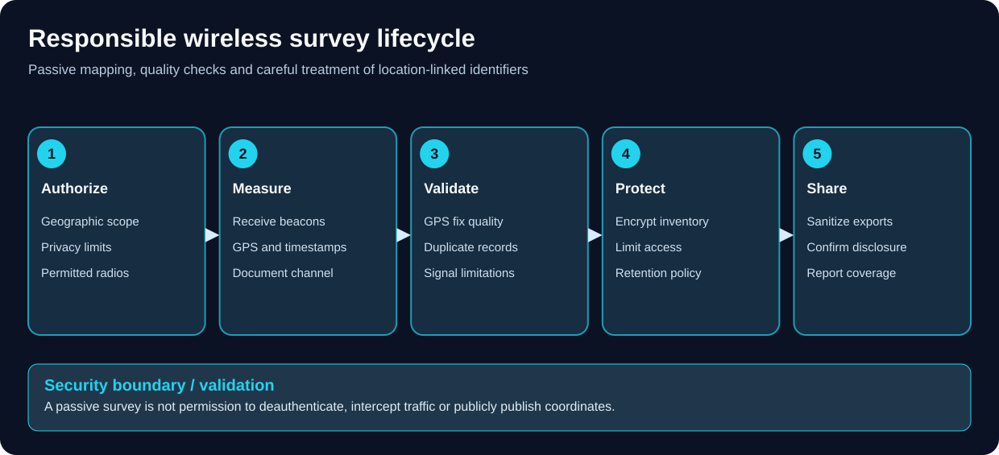

<a id="wardriving-and-wireless-surveying"></a>
# Wardriving & Wireless Surveying

_Last reviewed: 2026-10-22_

> [!CAUTION]
> **Authorized surveying only.** Define the permitted area, types of collection, device owners, disclosure rules and any transmit-capable features *before* starting. Passive reception is not a blanket permission for active interference, interception or publishing location data. Read the [repository legal notice](../LEGAL.md).

## Expanded Device & Firmware Coverage

| Resource | Description / Boundary |
|---|---|
| [Additional Survey Firmware](./additional-survey-firmware.md) | PORKCHOP, wardriver.uk Rev3 and historical wardriver3000. |
| [Biscuit Firmware Routes](./biscuit.md#current-firmware-distribution--recovery) | Vendor browser, raw release and product-specific desktop recovery paths. |

## Additional Dedicated Survey Guides

| Resource | Role & Compatibility Boundary |
|---|---|
| [C5 Wardriver](./esp32-c5-wardriver.md) | Official installer, board-specific power/wiring, Normal/Node/Core roles and SD log checks. |
| [Piglet](./piglet.md) | XIAO/T-Dongle builds, standalone versus node logs and opt-in upload configuration. |

## Firmware Catalog & Installers

| Resource | Description |
|---|---|
| [ESP32 & Related Firmware Catalog](../Documentation/esp32-security-firmware-catalog.md) | Primary upstream projects, supported targets, use-cases & dated activity notes |
| [Firmware Web Flashers](../Documentation/firmware-web-flashers.md) | Dedicated installers plus a separate multi-device/multi-firmware reference |

## Purpose

Wardriving is the systematic observation and mapping of wireless infrastructure while moving (by foot, bicycle, vehicle or another safe route). A typical *wireless inventory* records access point identifiers, frequency/channel, received signal strength, observed security configuration, time and optional Global Navigation Satellite System (GNSS) coordinates. Bluetooth Low Energy (BLE) and cellular observations require source-specific capabilities.

This section focuses on **repeatable, minimally invasive Wi-Fi/BLE inventories**, GPS quality, hardware/firmware compatibility, log integrity, and authorized sharing. It does **not** require connecting to detected networks or attempting to access them.

## Start Here
**Pocket platform companion:** [M5StickC Plus2 starter-pack integration](../HardwareHacking/m5stickc-plus2-hackstarterpack.md) for Wi-Fi/BLE observation and external-GNSS requirements. This is not an onboard-GPS logger.


1. Learn [field planning, safe operation and verification](./field-workflow.md).
2. Select a platform by its **radio hardware, firmware, GPS source, controller and log location**—these are not interchangeable.
3. Follow exactly one [platform guide](#platform-guides).
4. Validate results against your own/authorized test AP and a known location before collecting in the field.
5. Read [data handling, privacy and WiGLE exports](./data-handling.md) before uploading or publishing.

## Platform Guides

| Guide | Controller / interface | Radio and positioning model | Primary record / transfer |
| --- | --- | --- | --- |
| [SigRoam + Scout Lite](./sigroam-scout-lite.md) | Flipper Zero app (FAP) + Scout Lite scanner | ESP32-C5, 2.4/5 GHz, Scout Lite onboard GNSS | Scout Lite microSD WiGLE CSV; optional SigRoam after-stop upload with **dedicated scanner firmware** |
| [ESP32 Marauder](../Documentation/WiFiMarauder_Guide.md#dedicated-standalone-marauder-deployment-playbook) · [GPS/WiGLE](./esp32-marauder.md) · [Flipper companion](../Documentation/flipper_zero_guide.md#flipper-marauder-companion-deployment-labs) | Board screen/CLI or Flipper companion | Hardware-dependent ESP32; GPS and 5 GHz **not universal** | Target-dependent SD or Flipper logging; separate Marauder upload actions |
| [Biscuit Ecosystem Labs](./biscuit.md#ecosystem-assessment-labs--deployment-examples) | Biscuit Manager phone app | ESP32-C5 variants; phone GPS in standard workflow | App session/map/export; firmware/hardware dependent |
| [AWOK Dual C5 + Biscuit](./awok-dual-c5-biscuit.md) | Dual-C5 board + phone app and/or Flipper | Two ESP32-C5 radios; select firmware **per USB port** | Biscuit Manager for Biscuit-side observations; other side independent |
| [Wardrive Go](./wardrive-go.md) | Android/iOS app | Phone scanning capabilities; optional RocketGod iosESP Wi-Fi boards | App-local sessions/exports, deliberate upload |
| [Kismet](./kismet.md) | Linux host, browser UI or remote sources | Compatible capture interfaces and GPS source (often gpsd) | KismetDB / optional WiGLE CSV / PCAP-NG according to mode |

**The Flipper Zero itself does not contain a Wi-Fi scanning radio.** It needs suitable external wireless hardware. ESP32-C5 can scan 2.4 and 5 GHz, but a *single* C5 Wi-Fi radio does not observe both bands simultaneously.

**Additional stationary/portable sensors:** [OUI-SPY Unified Blue](../Documentation/microcontroller_wifi_testing.md#oui-spy-unified-blue--authorized-detection-labs) supports specialized receive-focused Wi-Fi/BLE detection (some management modes transmit AP beacons); [Bruce firmware](../Documentation/bruce_firmware.md#exercise-b7--repeatable-bruce-board-qualification) covers board-specific radio labs; and [RaspyJack](../Homelab/workflows/self-hosted_network_attacks.md#raspyjack--raspberry-pi-portable-assessment-workflow) is a Pi/Linux lab platform. None is a drop-in replacement for a GPS-validated wardrive logger.

**Companion research platforms:** [Evil-M5](../Documentation/evil_m5.md#evil-m5-firmware-qualification--authorized-deployment-labs) provides M5Stack observation exercises; [LAB5 MonsterC5 / JanOS](../Documentation/microcontroller_wifi_testing.md#lab5-c5-monster--projectzero-janos-field-assessment) adds a separate ESP32-C5 radio and Cardputer/Tab5/Flipper controllers. JanOS's `/lab/wardrives/` storage, optional auto-upload and GNSS requirements **are not** Marauder/Biscuit/SigRoam defaults. Use original GPS and data-handling checks before public export.

## Additional Starred Field-survey Platforms

These are **alternatives**, not interchangeable firmware images or extra steps required by the six workflows above:

- [ESP32 DualBand Wardriver guide](./esp32-c5-wardriver.md) — a dedicated ESP32-C5 wardriving project worth evaluating for a compact dual-band-capable survey build. Verify the exact board, GNSS source, logging format and release requirements; dual-band support does not imply simultaneous scanning.
- [Piglet Wardriver guide](./piglet.md) — GPS-tagged Wi-Fi inventory with SD-card WiGLE-format CSV and a local web interface. A useful comparison when an ESP32 and local log review are preferable to a Flipper-driven workflow.
- [OUI Master Database](https://github.com/Ringmast4r/OUI-Master-Database) — optional **post-collection** manufacturer enrichment for MAC addresses observed in a permitted survey. OUI matches are estimates, not proof of a device maker or identity; randomized and locally administered MACs may not resolve.

Keep the [field workflow](./field-workflow.md) and [data-handling rules](./data-handling.md) in force regardless of platform. Do not activate transmit, deauthentication, credential-collection or captive-portal functions during a passive survey.

## WiFi Pineapple Mark VII — Authorized Wireless Security Assessment

This expands the existing wireless inventory and survey workflows to include the Hak5 **WiFi Pineapple Mark VII** for client-approved wireless security validation. It is a complementary assessment platform, **not a substitute** for a GPS-focused wardriving logger or continuous Kismet/nzyme WIDS. For detailed roaming surveys and data hygiene, follow the [field workflow](./field-workflow.md) and [data handling](./data-handling.md).

**Hardware boundary:** Hak5 lists the Mark VII with three role-based radios and native **2.4 GHz** capability; **5 GHz requires a compatible external 802.11ac adapter/module**. This is different from the WiFi Pineapple Enterprise and Pager. Confirm model, power, firmware, supported adapter and scan settings before deploying. Sources: [Hak5 WiFi Pineapple product specifications](https://shop.hak5.org/products/wifi-pineapple), [Mark VII firmware 2.0 notes](https://shop.hak5.org/pages/wifi-pineapple-mark-vii-2-0), [Mark VII features](https://shop.hak5.org/pages/wifi-pineapple-mark-vii-features).

### Authorization & RF Safety

1. Get written client permission for location, assets, SSIDs/BSSIDs, channels/bands, monitoring duration, expected impact, allowed active features, log contents, and stop contact.
2. Obtain the controller's authorized AP list and deployment map. An SSID alone is not unique, and a detected BSSID is **not automatically in scope**.
3. Record hardware revision, installed firmware, regional regulatory settings, power supply, external radio and management interface configuration.
4. Use a dedicated administrative password and restrict the management UI. Backup configuration; obtain updates only through official Hak5 distribution and verify integrity as documented.
5. Start with limited Recon observations. Confirm whether the specific scan action performs active probing or transmits; do not assume that every UI activity labelled Recon is passive.
6. Treat PineAP, access-point impersonation, association manipulation, deauthentication, handshake capture and other active features as **separate authorization gates**. Do not activate on live or adjacent third-party networks without explicit legal and operational approval. Avoid collecting credentials or personal traffic.

### Setup, Connectivity & Baseline

1. Power the Mark VII using the device's specified power arrangement and connect to its supported local management interface. Follow the **current Mark VII** initialization wizard, not Enterprise/Pager directions.
2. Set a strong admin credential, confirm management isolation, select the correct regulatory country and record the firmware build.
3. Verify clock/time synchronization. Choose the expected Recon radio and approved channel/band scope; an absent or unsupported 5 GHz adapter means **no valid 5 GHz coverage claim**.
4. Before scanning, record the approved SSID/BSSID list, site map, test ID, exact UTC start time and operator.
5. Run a brief baseline Recon scan using the firmware's supported workflow. Inspect observed SSID, BSSID, channel, frequency/band, advertised security and signal where available.
6. Export a report or save screenshots using the firmware's supported UI. Record whether the saved result is an actual export, screenshot or manually transcribed log rather than assuming a universal API/export format.

### Exercise 1 — Authorized AP Inventory (Beginner)

**Objective:** compare detected wireless infrastructure with the controller's intended configuration.

1. Select a permitted office/lab area and scan duration, with transmit features disabled unless separately authorized.
2. Run a short Recon survey, capturing timestamp, SSID, BSSID, channel, band, observed encryption indicators and signal.
3. Compare each BSSID to the approved controller inventory, accounting for multi-BSSID APs, mesh/repeaters and guest networks.
4. Mark unmatched devices **unverified** until owner, controller and physical-location evidence establishes whether they are rogue.
5. Confirm scope exclusions and redact neighboring networks from client-facing reports.

**Deliverable:** verified AP inventory, exceptions with independent evidence, and observed coverage limitations.

### Exercise 2 — WPA2/WPA3 Advertisements & Configuration (Beginner)

1. Configure two **client-owned** lab SSIDs with known WPA2-Personal and WPA3-Personal settings, if supported by the separate lab AP.
2. Survey each with the Pineapple. Record which advertised AKM/cipher/security indicators the firmware actually displays.
3. Compare results against the AP/controller's administrative configuration. Check whether WPA2/WPA3 transition mode exists and whether a guest/open network is deliberate.
4. Do **not** infer that a network is fully secure from a beacon or a UI badge; controller settings, authenticated client tests and patch state require separate verification.
5. Report actionable configuration differences and compatibility impact.

### Exercise 3 — Dedicated Rogue AP Detection Drill (Intermediate)

1. Obtain explicit approval to broadcast a **unique test SSID**, e.g. `PNWC-ROGUE-TRAINING-01`, from a separate controlled lab AP; do not copy the client's production SSID or lure unrelated clients.
2. Record the test AP's BSSID, channel, power and planned start/end times.
3. Turn on the test AP, observe it in Pineapple Recon, and simultaneously monitor with the existing [Kismet/Wazuh IDS lab](../IncidentResponse/IDS%26IPS/kismet-wazuh-wireless-lab.md) or [nzyme/Wazuh workflow](../IncidentResponse/IDS%26IPS/nzyme-wazuh-integration.md).
4. Compare detection and SIEM alert timestamps, sensor identity, AP inventory matching, classification and false positives.
5. Turn off the test AP and verify both the inventory and alert lifecycle. If the rule does not fire, diagnose sensor visibility and parsing before declaring the network unprotected.

### Exercise 4 — Coverage & Channel Survey (Intermediate)

1. Choose repeatable survey points, antenna orientation, height and scan intervals inside approved property boundaries.
2. At each point, record observed BSSIDs/channels and signal indicators, including whether the needed bands were actually scanned.
3. Compare repeated measurements with placement/coverage expectations and a dedicated survey tool if throughput, roaming or spectrum analysis is required.
4. Distinguish received signal indicators from measured throughput, noise floor, and actual RF interference. Do not claim a passive AP inventory is a full site survey.

### Exercise 5 — Client Isolation Verification (Intermediate)

1. On a **dedicated test SSID**, connect two client-owned laptops and configure the AP's client isolation control.
2. Test approved peer-to-peer reachability directly from these clients before and after enabling isolation; use only designated test IPs.
3. Use the Pineapple to document the wireless environment and identify the SSID/BSSID under test. The isolation verdict should come from the clients and AP/controller logs, **not just an advertisement**.
4. Restore the original AP configuration and attach before/after results to the assessment.

### Exercise 6 — WIDS, Alert Triage & SIEM Regression (Advanced)

1. Ensure Kismet or nzyme sensors and Wazuh ingestion are already operational. Establish real source log fields and synced clocks.
2. Create the unique synthetic test AP from Exercise 3. Collect baseline and test-period events.
3. Correlate `test_id`, sensor, BSSID, channel, SSID, first/last seen, Wazuh alert IDs **from actual logged events** and analyst disposition.
4. Compare positive detection and negative-control behavior (an authorized AP with a similar name). Measure whether a rule produces meaningful alerts without excessive noise.
5. Remove the test AP, archive limited evidence and update the client's detection playbook.

### Active PineAP Features — Separate Go/No-Go Review

Hak5 documents PineAP and rogue access point capabilities; their availability varies with firmware. For **any** active AP impersonation or client-interaction test, require a separately signed scenario defining exact lab devices, approved SSIDs/BSSIDs, permitted radio settings, management oversight, known collateral impact, stop triggers and rollback. The baseline exercises above do **not** require PineAP impersonation, WPA key collection, credential capture, client disruption or third-party packet interception.

### Troubleshooting & Verification

| Observation | Next Check |
|---|---|
| Missing 5 GHz APs | External compatible adapter present, radio selected, actual band/channel support |
| Recon returns little data | Scan duration, antenna, permitted channel set, channel hopping, power |
| Multiple BSSIDs for one SSID | Controller inventory, multi-radio/multi-BSSID and mesh configurations |
| Unknown AP flagged as rogue | Verify physical/controller ownership; adjacent APs may be out of scope |
| No Wazuh alert | Verify independent WIDS sensor saw the event, parser fields, rule and clock |
| Management or update issue | Mark VII-specific firmware docs, local management connectivity, supply stability |

### Evidence & Client Report Template

| Field | Example Content |
|---|---|
| Authorization | Case ID, client, permitted site, device scope, RF exclusions |
| Device & Firmware | Mark VII model, firmware build, external adapter, regulatory domain |
| Survey | Exact UTC times, scan settings, observed channel/band, test location |
| Observation | Redacted BSSID/SSID, advertised security, actual controller verification |
| Detection | Independent Kismet/nzyme event and SIEM correlation |
| Outcome | Observed versus inferred, out-of-scope exclusions, confidence |
| Closeout | Active test SSID disabled, settings restored, evidence access/retention |

## Selecting A Workflow

| Your primary objective | Start with |
| --- | --- |
| Flipper-first GPS-tagged inventory on Scout Lite | [SigRoam](./sigroam-scout-lite.md) |
| Keep factory firmware and use a broad wireless toolkit | [Marauder](./esp32-marauder.md) |
| Phone map, BLE and a Biscuit device or DIY C5 | [Biscuit](./biscuit.md) |
| Split two C5 chips into distinct firmware roles | [AWOK Dual C5 / Biscuit](./awok-dual-c5-biscuit.md) |
| Smartphone-centric collection / iosESP expansion | [Wardrive Go](./wardrive-go.md) |
| Linux-based professional survey, heterogeneous adapters and auditable source logs | [Kismet](./kismet.md) |

## Collection Principles



*Wireless location identifiers can be sensitive; assess collection and disclosure separately.*

- **Observe, don't interfere.** Avoid deauthentication, impersonation, beacon injection, credential collection or capture of third-party data as part of an ordinary wardrive.
- **Fix GPS first.** A row without a trustworthy fix cannot reliably support a spatial inventory; a low satellite count or sudden coordinate jump should be annotated.
- **Beware limitations.** Channel hopping misses brief transmissions; apparent unique-device counts vary by MAC randomization and deduplication; RSSI is not calibrated distance.
- **Separate stored records from display counters.** Compare counts and sample rows in the final CSV or database.
- **Respect versions.** A Flipper `.fap` is not ESP32 scanner firmware; a firmware image for one C5 board/port is not automatically correct for another.
- **Protect data.** BSSID + timestamp + coordinates can reveal sensitive sites or movements. A WiGLE upload is a separate disclosure decision.

## Suggested Documentation Layout

```text
Wardriving/
├── README.md
├── field-workflow.md
├── data-handling.md
├── sigroam-scout-lite.md
├── esp32-marauder.md
├── biscuit.md
├── awok-dual-c5-biscuit.md
├── wardrive-go.md
└── kismet.md
```

## Related Repository Areas

- [ESP32-S3 DIY honeypots](../IncidentResponse/HoneyPot/esp32-s3-honeypots.md): ShadowSentry/HoneyMire service decoys are separate from passive wardriving inventory; no automatic RF attack attribution.

- [Kismet + Wazuh Wireless IDS Lab](../IncidentResponse/IDS%26IPS/kismet-wazuh-wireless-lab.md): stationary authorized wireless attack monitoring and centralized SIEM correlation, not passive GPS inventory.

- [Wireshark master filters and field cheat sheet](../Documentation/wireshark-master-filters.md): post-capture analysis of authorized packet traces; raw 802.11 management frames require an appropriate radio and fixed-channel collection.
- [Wi-Fi Deauthentication & Disassociation Analysis](../Documentation/wifi-deauthentication-detection.md): a **separate, authorized wireless intrusion-monitoring workflow** for interpreting disconnect frames and distinguishing spoofing from normal management traffic; unlike passive AP inventory, it needs an 802.11-capable sensor and corroborating logs.
- [SDR and RF](../SDR/README.md): radio fundamentals, spectrum measurements and antenna diagnostics—not a substitute for Wi-Fi MAC-layer logging.
- [Flipper Zero](../Documentation/flipper_zero_guide.md) and [hardware hacking](../HardwareHacking/README.md): UART, GPIO, power and device compatibility.
- [OPSEC](../OPSEC/README.md): identity, access controls and location-data minimization.
- [Network Audit Playbook](../PlayBooks/NetworkAuditPlayBook.md): define assessment scope and reporting.
- [Incident response](../IncidentResponse/README.md): contextualize rogue AP findings; a new SSID is not by itself proof of maliciousness.

<a id="project-and-format-references"></a>
## Project & Format References

- [SigRoam](https://github.com/pingequalab/sigroam-wardriving) / [Scout Lite](https://github.com/pingequalab/scout-lite)
- [ESP32 Marauder](https://github.com/justcallmekoko/ESP32Marauder)
- [Biscuit DIY](https://biscuitshop.us/pages/diy-biscuits) / [AWOK Dual C5](https://awokdynamics.com/products/dual-c5-mini)
- [Wardrive Go for Android](https://play.google.com/store/apps/details?id=com.rocketgod.wardrive) / [iOS](https://apps.apple.com/us/app/wardrive-go/id6783390938)
- [Kismet wardrive mode](https://www.kismetwireless.net/docs/readme/configuring/wardrive/) / [WiGLE](https://wigle.net/)

_Core platform guides last verified on 2026-10-22; additional upstream repository references checked on 2026-10-26. Specific releases and UI labels can change. No hardware tests are claimed by these documents._

---

**Radio/packet source lists:** [PCAP Tools](https://github.com/caesar0301/awesome-pcaptools) and [the cross-domain index](../Documentation/awesome-hacking-collections-integration.md) complement controlled surveys; PCAP analysis alone does not authorize live RF operations.


[Master Index](../README.md) | [Start Here](../START_HERE.md) | [Legal Notice](../LEGAL.md)
