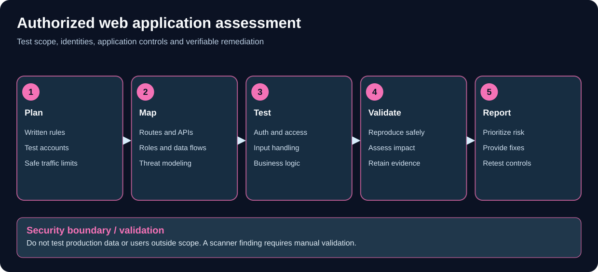

# 🕸️ Web Application Security

**Methodology, OWASP Top 10, and tooling for authorized web application security assessment**

*Part of the [ULTIMATE CYBERSECURITY MASTER GUIDE](../README.md)*

---

**Payment-page scope & third-party checkout:** [PCI DSS 4.0.1 Scoping & Segmentation](../Compliance/pci-dss-scoping.md#merchant-checkout--saq-eligibility--avoid-common-shortcuts) distinguishes hosted redirects, processor iframes, merchant-managed scripts, required ASV scanning where applicable, and PCI compliance-assessment boundaries.

**Related application security references:** [OWASP Cheat Sheet Series](https://github.com/OWASP/CheatSheetSeries), [awesome-appsec](https://github.com/paragonie/awesome-appsec) and [the PNWC source map](../Documentation/awesome-hacking-collections-integration.md).

**Historical testing examples:** [Cypherpunk toolkit curation](../Documentation/cypherpunk-pentesting-toolkit-review.md) links archived SQLi, browser, and HTTP exercises for context; use current OWASP testing standards for assessments.

**Owned API labs:** [Developer documentation index](../Documentation/curated-technical-docs.md) links to [FastAPI](https://fastapi.tiangolo.com/) and [Django](https://docs.djangoproject.com/) docs. Pair framework-specific implementation details with [OWASP API Security](https://owasp.org/API-Security/).

**API inventory and safe testing references:** [Curated Security API Catalog](../Documentation/security-public-api-catalog.md) includes APIs.guru, Postman Echo, GitGuardian and disclosure-management services. Use synthetic data and written scope; public OpenAPI specifications do not confer testing authorization.

**Assessment standards and approved automation:** [OWASP ASVS/WSTG mapping and Nuclei template review](owasp-assessment-and-nuclei.md) adds versioned verification requirements, test evidence and safe scanner selection; follow the [client findings lifecycle](../PlayBooks/assessment-findings-lifecycle.md) for remediation and retesting.

## 🎯 Purpose
Dedicated home for web application security - the OWASP Top 10, a repeatable
assessment methodology, and the tooling (Burp Suite, API/GraphQL testing) used to
find and fix web vulnerabilities during authorized engagements.

## ⚙️ Function
Indexes the Web Application Security section: an OWASP Top 10 deep-dive (2025
final edition, mapped to the superseded 2021 edition) and a full web application penetration testing
methodology covering reconnaissance, mapping, the Burp Suite workflow, injection
and access-control testing, business-logic flaws, and API/GraphQL testing - each
paired with defensive guidance.

## 🏆 Goal
Give practitioners a single canonical web-AppSec reference: understand each risk
class, test for it methodically, and remediate it - rather than the web content
being scattered across the master guides.

## 📋 When To Use
- Scoping or executing an authorized web application penetration test
- Looking up a specific OWASP Top 10 category (how it works, how to test, how to fix)
- Building a repeatable methodology / Burp workflow for web assessments
- Reviewing a web app or API defensively against the current OWASP risks

---

## 📋 Table Of Contents

- [Overview](#-overview)
- [Folder Contents](#-folder-contents)
- [Testing Approach](#-testing-approach)
- [Security & Legal Disclaimer](#-security--legal-disclaimer)
- [Related Sections](#-related-sections)
- [Resources](#-resources)

---

## 🎯 Overview

Web applications are the most exposed part of most organizations' attack surface,
and web AppSec is one of the most frequently referenced topics across this
repository - but it previously had no dedicated home. This section consolidates
it: what the current risks are, how to test for them, and how to defend.

The material is **dual-use** - every risk class pairs the offensive perspective
(how it is found and exploited) with the defensive one (how to prevent and detect
it), mirroring the [Tradecraft](../Tradecraft/) convention.

---

## 📂 Folder Contents

| File | Description | Status |
|------|-------------|--------|
| **[owasp-top-10.md](./owasp-top-10.md)** | OWASP Top 10:2025 final-edition deep-dive - each category with exploitation, testing, and defense, plus a 2021→2025 mapping | ✅ Complete |
| **[methodology.md](./methodology.md)** | Web app pentest methodology: recon, mapping, Burp Suite workflow, injection/access-control/business-logic testing, API & GraphQL testing, reporting | ✅ Complete |
| **[owasp-assessment-and-nuclei.md](./owasp-assessment-and-nuclei.md)** | Versioned ASVS requirements, WSTG test methods, reviewed Nuclei templates, evidence and retesting workflow | ✅ Reference |

---

## 🧭 Testing Approach

*Use written rules of engagement and validate scanner findings.*

A web assessment generally proceeds in phases (detailed in
[methodology.md](./methodology.md)):

1. **Recon & mapping** - enumerate content, endpoints, technologies, and roles.
2. **Configuration & deployment** - TLS, headers, exposed files, default creds.
3. **Authentication & session** - login flaws, session handling, MFA, JWT.
4. **Authorization** - horizontal/vertical access control (the #1 risk class).
5. **Input handling** - injection (SQLi, command, template), XSS, deserialization.
6. **Business logic** - abuse of legitimate functionality and workflows.
7. **APIs** - REST and GraphQL-specific testing.
8. **Reporting** - reproducible findings mapped to OWASP / CWE with remediation.

---

## ⚠️ Security & Legal Disclaimer

> [!CAUTION]
> **Authorized use only.** The techniques here are for authorized penetration
> testing, education, and defensive research. Testing without authorization may
> violate applicable laws, contracts, or policies; the legal analysis depends on
> jurisdiction and facts. Obtain written permission, follow the signed scope and
> rules of engagement, and see [LEGAL.md](../LEGAL.md).

---

## 🔗 Related Sections

- [`/Tradecraft`](../Tradecraft/) - Offensive/defensive deep-dives (AD, C2, evasion) that pair with web AppSec
- [`/Checklists`](../Checklists/) - Quick-reference assessment checklists
- [`/OSINT`](../OSINT/) - Reconnaissance that precedes a web assessment
- [`/Scripts`](../Scripts/) - Automation and payload references
- [`ultimate_cybersecurity_master_guide.md`](../ultimate_cybersecurity_master_guide.md) - Web Application Reconnaissance / Vulnerabilities (summary sections)
- [`advanced_techniques_part2.md`](../advanced_techniques_part2.md) - Advanced Web Application Attacks

---

## 📚 Resources

- [OWASP Top 10:2025](https://top10.owasp.org/) - current awareness document for broad risk prioritization; it is not a comprehensive test plan or compliance standard.
- [OWASP Web Security Testing Guide (WSTG) v4.2](https://wstg.owasp.org/v4.2/) - versioned practical test scenarios; adapt them to scope and threat model, and do not treat the guide as a rigid checklist or compliance standard.
- [OWASP Application Security Verification Standard (ASVS)](https://owasp.org/www-project-application-security-verification-standard/) - verifiable security requirements
- [OWASP Cheat Sheet Series](https://cheatsheetseries.owasp.org/) - concise defensive guidance per topic
- [PortSwigger Web Security Academy](https://portswigger.net/web-security) - free, hands-on labs
- [MITRE CWE](https://cwe.mitre.org/) - weakness taxonomy referenced by findings

---

**⚠️ USE THIS REPO RESPONSIBLY AND LEGALLY ⚠️**

**Repository**: [ULTIMATE CYBERSECURITY MASTER GUIDE](https://github.com/Pnwcomputers/ULTIMATE-CYBERSECURITY-MASTER-GUIDE)

**Maintained by**: [Pacific Northwest Computers](https://github.com/Pnwcomputers)

---

## Related Files
- [owasp-top-10.md](owasp-top-10.md) - OWASP Top 10:2025 deep-dive with testing and defense
- [methodology.md](methodology.md) - Web application penetration testing methodology
- [owasp-assessment-and-nuclei.md](owasp-assessment-and-nuclei.md) - ASVS/WSTG mapping and safe Nuclei review
- [../GLOSSARY.md](../GLOSSARY.md) - Acronyms and terms (OWASP, CWE, SSRF, XSS…)
- [../LEGAL.md](../LEGAL.md) - Legal notice and authorized-use terms
