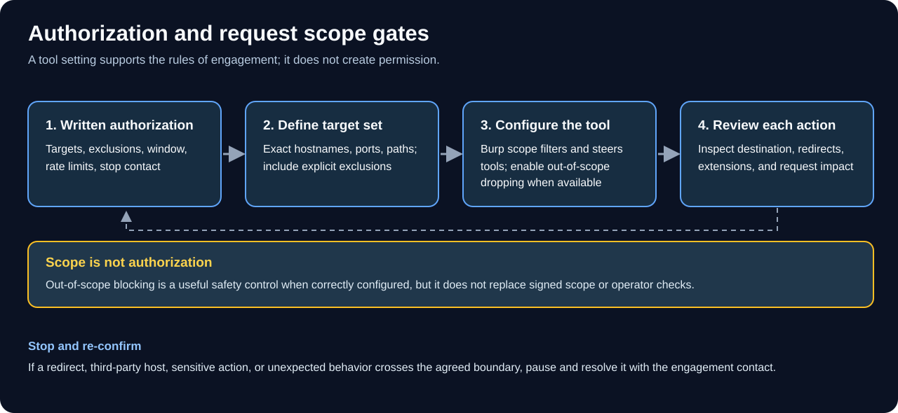
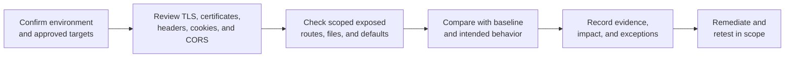
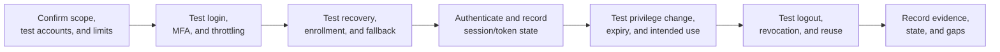
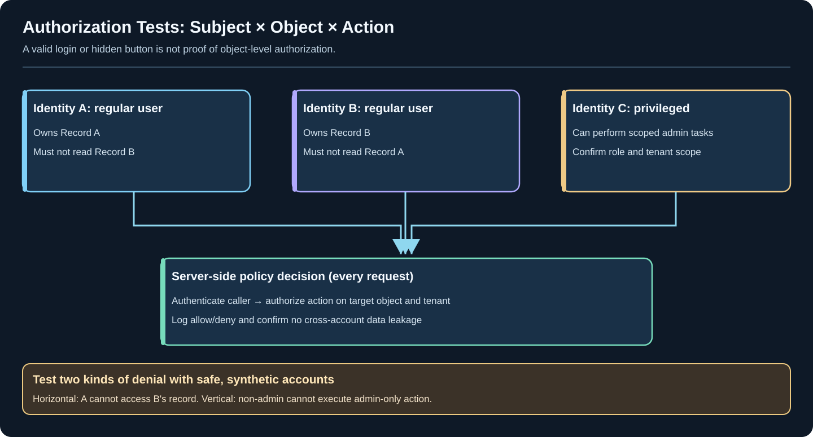
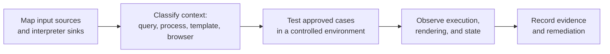
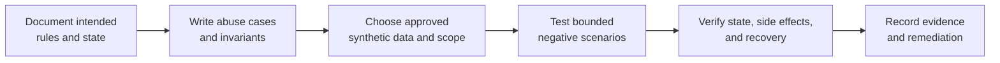
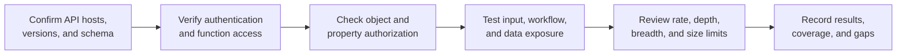
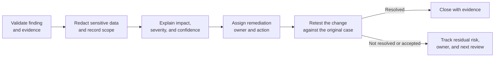

# 🧭 Web Application Penetration Testing Methodology

> [!CAUTION]
> **Authorized use only.** This methodology is for authorized penetration testing,
> education, and defensive research. Only test applications you own or have
> **explicit written permission** and a signed scope to assess. See
> [LEGAL.md](../LEGAL.md).

**Standards and reporting companion:** [OWASP ASVS 5.0.0, WSTG scenarios and reviewed Nuclei templates](owasp-assessment-and-nuclei.md) provide versioned controls and source provenance for the testing phases below; [findings workflow](../PlayBooks/assessment-findings-lifecycle.md) tracks verification and retests.

## 🎯 Purpose
A repeatable, phase-by-phase methodology for authorized web application assessments -
from scoping through reporting - aligned with the OWASP Web Security Testing Guide.

## ⚙️ Function
Covers pre-engagement scoping, reconnaissance and mapping, a practical Burp Suite
workflow, configuration/authentication/authorization/input/business-logic testing,
API and GraphQL testing, and reporting. Complements the
[OWASP Top 10 deep-dive](owasp-top-10.md), which details the individual risk classes.

## 🏆 Goal
Enable a tester to run a consistent, thorough web assessment that maps findings to
OWASP/CWE with reproducible evidence and actionable remediation.

## 📋 When to Use
- Executing an authorized web application or API penetration test
- Standardizing a team's web testing workflow and tooling
- Preparing a scoped methodology for a client engagement

---

## 📋 Table of Contents

- [Phase 0: Scoping & Rules of Engagement](#phase-0-scoping--rules-of-engagement)
- [Phase 1: Reconnaissance & Mapping](#phase-1-reconnaissance--mapping)
- [Phase 2: Burp Suite Workflow](#phase-2-burp-suite-workflow)
- [Phase 3: Configuration & Deployment Testing](#phase-3-configuration--deployment-testing)
- [Phase 4: Authentication & Session Testing](#phase-4-authentication--session-testing)
- [Phase 5: Authorization Testing](#phase-5-authorization-testing)
- [Phase 6: Input & Injection Testing](#phase-6-input--injection-testing)
- [Phase 7: Business Logic Testing](#phase-7-business-logic-testing)
- [Phase 8: API & GraphQL Testing](#phase-8-api--graphql-testing)
- [Phase 9: Reporting](#phase-9-reporting)
- [Tooling Reference](#-tooling-reference)
- [Resources](#-resources)

---

## Phase 0: Scoping & Rules of Engagement

Before any traffic is sent:

- Confirm **written authorization**, in-scope hosts/domains, and excluded targets.
- Agree testing windows, rate limits, and whether destructive tests (e.g. DoS,
  mass data modification) are permitted (usually **not**).
- Identify test accounts (ideally two per role for access-control testing).
- Establish an emergency contact and a stop condition.
- Record everything - scope defines what is legal to touch. See
  [LEGAL.md](../LEGAL.md) and the [OSINT Playbook](../OSINT/Playbook/README.md)
  for engagement-documentation patterns.

---

## Phase 1: Reconnaissance & Mapping

Build a complete picture of the application before testing it.

- **Passive:** technology fingerprinting (Wappalyzer, response headers), subdomain
  and content discovery, JS review for endpoints and secrets. See
  [OSINT/scripts/Domain_IP_Recon.md](../OSINT/scripts/Domain_IP_Recon.md).
- **Active:** spider/crawl the app, enumerate directories and parameters
  (`ffuf`, `feroxbuster`), map every role's reachable functionality.
- **Output:** an endpoint/parameter inventory and a per-role functionality map -
  the input to every later phase.

```bash
# Content discovery (authorized scope only)
ffuf -u https://TARGET/FUZZ -w wordlist.txt -mc 200,204,301,302,401,403
feroxbuster -u https://TARGET -w wordlist.txt

# Passive tech/endpoint hints
curl -sI https://TARGET            # headers: server, framework, security headers
```

---

## Phase 2: Burp Suite Workflow

Burp Suite (Community or Professional) is the core interception proxy.

1. **Proxy setup:** route the browser through Burp; install Burp's CA cert for TLS.
2. **Target scope:** define the approved hosts and paths, and configure each tool to operate only on the intended targets. Scope filters and steers Burp tools; it does not grant authorization or necessarily block every out-of-scope request. Where your Burp version and project settings provide it, enable **Drop all out-of-scope requests**, and still review destinations, redirects, extensions, and manual requests against the signed rules of engagement. See [PortSwigger's scope guide](https://portswigger.net/burp/documentation/desktop/tools/target/scope) and [out-of-scope request handling settings](https://portswigger.net/burp/documentation/desktop/settings/project/scope).
3. **Crawl & map:** browse the app to populate the site map; review every request.
4. **Repeater:** manually manipulate individual requests to probe behavior.
5. **Intruder:** automate payload injection (fuzzing, brute force) within scope.
6. **Decoder / Comparer:** encode/decode data and diff responses.
7. **Extensions (BApp Store):** *Autorize*/*Auth Analyzer* (access control),
   *Logger++*, *JWT Editor*, *Param Miner*, *Active Scan++*.
8. **Scanner (Pro):** automated scanning to complement - not replace - manual testing.



*Conceptual workflow: configure scope as an operational safeguard, while written authorization and review of each action remain the controlling boundaries.*

> [!TIP]
> Automated scanners find the easy issues; access-control and business-logic flaws
> almost always require manual testing with two accounts and an understanding of the
> app's intent.

---

## Phase 3: Configuration & Deployment Testing

Maps to [A02 Security Misconfiguration](owasp-top-10.md#a02-security-misconfiguration)
and [A04 Cryptographic Failures](owasp-top-10.md#a04-cryptographic-failures).
Assess effective settings in the approved environment against its requirements;
a missing or permissive-looking header alone does not establish impact.



- **TLS and browser controls:** verify HTTPS behavior, certificate chain and
  hostname validation, and relevant HSTS behavior. Review CSP,
  `X-Content-Type-Options`, `Referrer-Policy`, framing controls, and cookie
  `Secure`, `HttpOnly`, and `SameSite` attributes in context. Check the
  actual value, duplicates, placement, and browser behavior where relevant.
- **CORS:** use a controlled test origin and the approved browser/application
  context to determine whether an untrusted origin can read sensitive responses,
  including when credentials are involved. Review preflight behavior and
  allowlisted origins, methods, and headers. CORS governs browser access to
  responses; it is not server-side authorization, and an `Origin` value can be
  spoofed by non-browser clients.
- **Exposure and defaults:** within approved hosts and paths, check specifically
  scoped files, backups, debug/sample routes, admin surfaces, and default
  credentials using approved test accounts. Do not broaden discovery beyond the
  signed scope or retrieve sensitive files merely to prove exposure.
- **Evidence:** record the environment, request/response or configuration
  observation, applicable baseline, demonstrated impact, and remediation. See
  the [OWASP WSTG browser security controls](https://owasp.org/www-project-web-security-testing-guide/latest/4-Web_Application_Security_Testing/02-Configuration_and_Deployment_Management/14-Additional_Browser_Security_Controls/)
  and [CORS testing guidance](https://owasp.org/www-project-web-security-testing-guide/latest/4-Web_Application_Security_Testing/11-Client-side/07-Cross_Origin_Resource_Sharing/).

---

## Phase 4: Authentication & Session Testing

Maps to [A07 Authentication Failures](owasp-top-10.md#a07-authentication-failures).
Use preapproved synthetic accounts and the agreed rate limits; do not run
credential-stuffing or high-volume guessing against real users or production.



- **Credential controls:** check default and weak-password rejection, breached
  password checks where applicable, account-enumeration behavior, and rate limits
  or progressive delays. Verify protections do not create an easy denial-of-service
  path through blanket account lockout.
- **MFA and recovery:** test enrollment, step-up, recovery, and fallback routes
  for bypasses and unintended differences in assurance. Use the agreed synthetic
  accounts and recovery channels.
- **Session lifecycle:** check that session identifiers rotate after
  authentication and privilege changes; inspect cookie protections; and verify
  idle/absolute expiration, logout, revocation, and reuse behavior.
- **Tokens:** use test tokens to confirm the server validates signature and
  configured algorithm, issuer, audience, lifetime, and required scopes or claims
  for the token's intended use. Test invalid or altered tokens only in the
  approved environment; decoding a JWT is not validation.
- **Evidence:** record the request path, test identity/role, expected and observed
  result, and whether the session or token remains usable afterward. See the
  [OWASP Authentication Cheat Sheet](https://cheatsheetseries.owasp.org/cheatsheets/Authentication_Cheat_Sheet.html)
  and [Session Management Cheat Sheet](https://cheatsheetseries.owasp.org/cheatsheets/Session_Management_Cheat_Sheet.html).

---

## Phase 5: Authorization Testing



*Conceptual testing matrix for preapproved synthetic accounts.* [OWASP WSTG authorization testing](https://wstg.owasp.org/latest/4-Web_Application_Security_Testing/05-Authorization/02-Bypassing_Authorization_Schema/) covers horizontal and vertical privilege checks. [OWASP API1:2023](https://api-security.owasp.org/editions/2023/en/0xa1-broken-object-level-authorization/) addresses object-level authorization. See [A01 Broken Access Control](owasp-top-10.md#a01-broken-access-control) for the control model.

Test only the identities, objects, actions, endpoints, and rate limits in the
written scope. Use known test fixtures rather than broad identifier enumeration.

- **Horizontal and tenant boundaries:** use two authorized accounts to verify
  each can access only its own known test objects; check relevant cross-tenant
  boundaries with approved fixtures.
- **Vertical and function access:** request privileged routes and actions directly
  using a lower-privileged test identity. Do not treat hidden links or UI state as
  authorization.
- **Object and property access:** for approved objects, test read, update, delete,
  export, and sensitive-field operations where applicable. Vary HTTP methods and
  request properties only within scope; client-supplied roles or ownership fields
  must not confer permission.
- **Evidence:** for denied reads and writes, capture the response and verify the
  underlying test-object state did not change. Record identity, action, object,
  expected policy, observed result, and coverage gaps. Burp *Autorize* or
  *Auth Analyzer* can help replay requests, but automated results require manual
  verification.

---

## Phase 6: Input & Injection Testing

Maps to [A05 Injection](owasp-top-10.md#a05-injection). Work from the endpoint
inventory and approved data set; use representative, context-specific tests
rather than indiscriminate fuzzing.



- **Coverage:** prioritize inputs that reach SQL/NoSQL queries, operating-system
  processes, templates or directory services, HTML/JavaScript output, and file
  handling. Include reflected, stored, and DOM-based browser paths where
  applicable.
- **Validation:** parameterize query values and verify dynamic query structure
  is constrained; test process invocation using safe, non-impacting cases; and
  verify browser output is safe for its rendering context. Treat input validation
  as business-rule enforcement, not a universal replacement for interpreter-
  specific controls. For uploads, review type/content handling, storage location,
  access controls, and path construction using benign test files.
- **Automation:** tools such as Burp Scanner or SQLMap may help identify
  candidates, but active testing must match the written scope, environment,
  request-rate limits, test data, and impact controls. Confirm findings manually
  and review resulting state. Do not use data extraction, shell, file-write, or
  other intrusive capabilities unless they are separately authorized and
  necessary.
- **Evidence:** preserve the exact test case, affected context, response or
  rendering, resulting state, and remediation. For stored content, use synthetic
  data and confirm removal/cleanup as part of the test plan. See the
  [OWASP Injection Prevention Cheat Sheet](https://cheatsheetseries.owasp.org/cheatsheets/Injection_Prevention_Cheat_Sheet.html),
  [SQL Injection Prevention](https://cheatsheetseries.owasp.org/cheatsheets/SQL_Injection_Prevention_Cheat_Sheet.html),
  and [XSS Prevention](https://cheatsheetseries.owasp.org/cheatsheets/Cross_Site_Scripting_Prevention_Cheat_Sheet.html).

---

## Phase 7: Business Logic Testing

Maps to [A06 Insecure Design](owasp-top-10.md#a06-insecure-design). These
application-specific flaws abuse legitimate functions and require understanding
the intended policy and state transitions.



Use a staging or sandbox environment with synthetic accounts and records wherever
possible. Do not trigger real payments, fulfillment, messages, or other external
side effects unless the rules of engagement explicitly authorize and contain
them.

- **Workflow and state:** try approved skip-step, replay, out-of-order, or
  duplicate-request cases. Verify the server enforces prerequisites and that
  repeated requests do not cause unintended state transitions.
- **Business values and limits:** with test values, check server-side handling of
  quantities, prices, discounts, limits, ownership, and state-dependent fields.
  Do not alter real orders, account balances, or customer records.
- **Automation and concurrency:** review anti-automation on sensitive workflows
  and test bounded limits using test identities. Conduct concurrent state-change
  checks only where the environment, test records, and rules of engagement make
  the effects reversible and safe.
- **Evidence:** define expected invariants before testing, then verify persisted
  state and downstream effects, including cleanup or rollback. Record the
  synthetic identity, test case, expected and observed transition, external
  effects, and residual risk. See the [OWASP WSTG business-logic testing
  guidance](https://owasp.org/www-project-web-security-testing-guide/latest/4-Web_Application_Security_Testing/10-Business_Logic/01-Business_Logic_Data_Validation/).

---

## Phase 8: API & GraphQL Testing

Use the approved API inventory, specification, and test identities; API routes and
schemas are in scope only when the rules of engagement include them.



- **REST and HTTP APIs:** compare deployed routes with the approved OpenAPI
  inventory; test authentication, function-level access, object-level access,
  property-level read/write permissions, mass assignment, input handling, and
  sensitive data exposure with designated test identities and records. A
  published API specification does not grant permission to test every listed
  host or operation.
- **GraphQL:** review schema visibility and query/mutation behavior. Test
  authorization at relevant resolver, object, and property boundaries;
  introspection availability alone is not proof of a vulnerability. In a
  controlled environment, assess query depth, breadth/aliases, batching,
  pagination, and resource-cost controls using bounded requests. Verify errors
  do not disclose sensitive implementation details.
- **Resource and workflow limits:** test rate, request-size, and operation limits
  without generating denial-of-service load. Check sensitive business flows for
  abuse only with approved synthetic data and reversible effects.
- **Evidence and tools:** use an approved intercepting proxy or API client to
  capture exact requests and responses, identity, route/version, expected access,
  actual outcome, and resulting state. Confirm automated findings manually.
  Map coverage to the [OWASP API Security Top 10:2023](https://api-security.owasp.org/editions/2023/en/0x11-t10/)
  and [GraphQL security guidance](https://graphql.org/learn/security/).

---

### Starred references for authorized web/API assessments

- [GraphQLmap](https://github.com/swisskyrepo/GraphQLmap) — scriptable GraphQL endpoint exploration and field testing for the approved target scope; use test accounts, non-destructive queries, and rate limits.
- [PayloadsAllTheThings](https://github.com/swisskyrepo/PayloadsAllTheThings) and [HackTricks](https://github.com/HackTricks-wiki/hacktricks) — technique references for planning test cases and finding corresponding mitigations. These contain potentially disruptive examples; **review and adapt**, rather than copying or executing them against production services.

See the API/GraphQL phase above, and record authorization, inputs, impact and reproduction requirements before conducting tests.

## Phase 9: Reporting



- **Finding record:** include a concise title, affected application/version and
  endpoint, preconditions, reproducible steps, observed behavior, impact,
  evidence, confidence, and actionable remediation. Distinguish directly
  observed facts from inferred consequences.
- **Evidence handling:** use designated test identities and synthetic data where
  possible. Redact tokens, credentials, personal data, and unrelated customer
  content; store any necessary unredacted evidence only through the approved
  secure evidence process. Preserve enough context to reproduce the result
  without exposing secrets.
- **Severity and mapping:** explain severity using the engagement's agreed
  methodology. If using CVSS, identify the version and relevant vector; treat the
  score as one input alongside business context and exploitability. Map to
  applicable [OWASP Top 10](owasp-top-10.md) categories and CWE IDs, and label
  uncertainty, exclusions, and coverage limitations.
- **Report and follow-up:** separate confirmed vulnerabilities from observations
  and recommendations. Provide an executive summary and prioritized actions
  with owners and target dates. Retest the original case after remediation and
  record the result; track accepted residual risk with an owner and review date.
  See the repository's [assessment findings lifecycle](../PlayBooks/assessment-findings-lifecycle.md).

---

## 🛠️ Tooling Reference

| Tool | Role |
|------|------|
| [Burp Suite](https://portswigger.net/burp) | Interception proxy, repeater, intruder, scanner |
| [OWASP ZAP](https://www.zaproxy.org/) | Open-source proxy/scanner alternative |
| [ffuf](https://github.com/ffuf/ffuf) / [feroxbuster](https://github.com/epi052/feroxbuster) | Content & parameter discovery |
| [sqlmap](https://sqlmap.org/) | SQL injection confirmation/exploitation |
| [nuclei](https://github.com/projectdiscovery/nuclei) | Template-based vulnerability scanning |
| [Postman](https://www.postman.com/) | API request crafting |
| [jwt_tool](https://github.com/ticarpi/jwt_tool) | JWT analysis and attacks |

---

## 📚 Resources

- [OWASP Web Security Testing Guide](https://owasp.org/www-project-web-security-testing-guide/) - the definitive methodology
- [OWASP API Security Top 10](https://owasp.org/API-Security/) - API-specific risks
- [OWASP ASVS](https://owasp.org/www-project-application-security-verification-standard/) - verification requirements
- [PortSwigger Web Security Academy](https://portswigger.net/web-security) - hands-on labs

---

## Related Files
- [README.md](README.md) - Web Application Security section index
- [owasp-top-10.md](owasp-top-10.md) - the risk classes this methodology tests for
- [../OSINT/scripts/Domain_IP_Recon.md](../OSINT/scripts/Domain_IP_Recon.md) - recon that feeds Phase 1
- [../IncidentResponse/SIEM/README.md](../IncidentResponse/SIEM/README.md) - the defensive/detection side

---

[Section Index](README.md) | [Master Index](../README.md) | [Legal Notice](../LEGAL.md)
