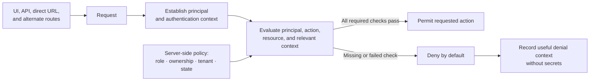
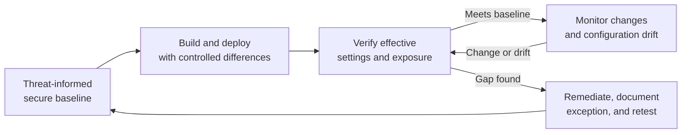
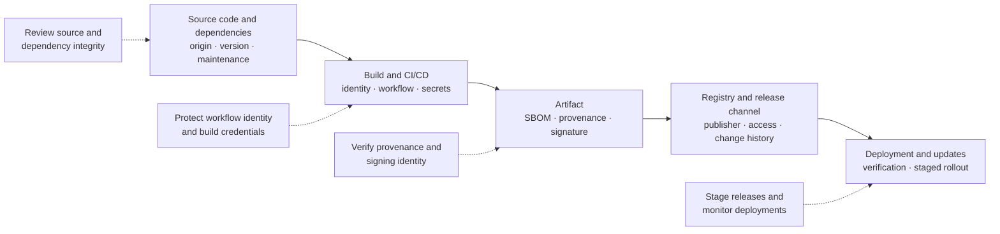
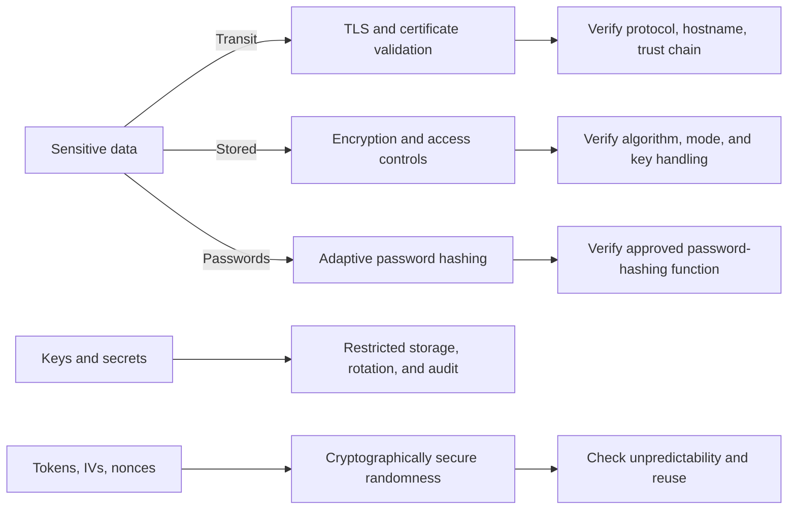
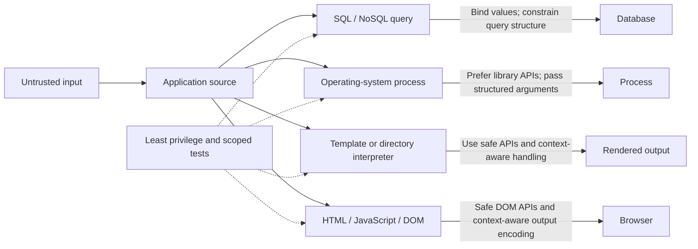
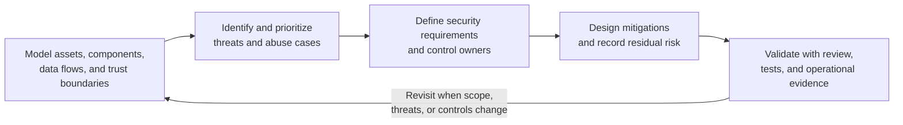
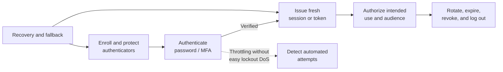
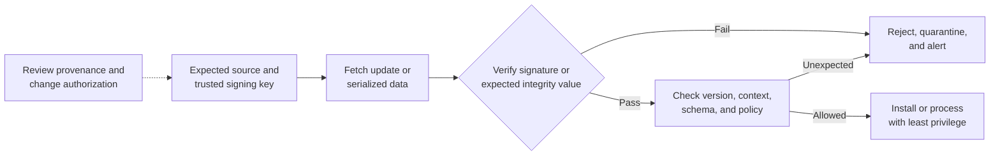
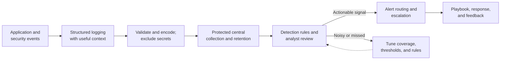
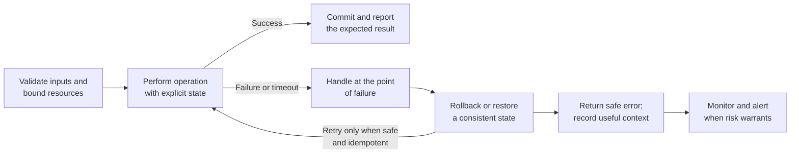

# 🔟 OWASP Top 10 - Deep Dive

> [!CAUTION]
> **Authorized use only.** The exploitation techniques below are for authorized
> testing, education, and defensive research. Testing without authorization may violate applicable laws, contracts, or policies;
> the legal analysis depends on jurisdiction and facts. Obtain written authorization
> and follow the approved scope. See [LEGAL.md](../LEGAL.md) and consult qualified
> counsel for legal questions.

## 🎯 Purpose
A working reference for the OWASP Top 10 web application risks - each category
covering what it is, how it is exploited, how to test for it, and how to defend
against it.

## ⚙️ Function
Walks all ten categories of the **OWASP Top 10:2025 final edition**, with a
mapping back to the stable **2021** list. Each entry pairs offensive testing notes
with defensive controls and links to the relevant OWASP Cheat Sheet.

## 🏆 Goal
Let a reader look up any Top 10 category and immediately know how it manifests,
how to test for it in an authorized engagement, and what remediation to recommend.

## 📋 When to Use
- Testing a web application against a specific risk class
- Writing a finding and needing the OWASP/CWE mapping plus remediation guidance
- Reviewing an application or design defensively against the current risk list

---

## 📋 Table of Contents

- [Version Note: 2025 Final vs 2021](#-version-note-2025-final-vs-2021)
- [A01: Broken Access Control](#a01-broken-access-control)
- [A02: Security Misconfiguration](#a02-security-misconfiguration)
- [A03: Software Supply Chain Failures](#a03-software-supply-chain-failures)
- [A04: Cryptographic Failures](#a04-cryptographic-failures)
- [A05: Injection](#a05-injection)
- [A06: Insecure Design](#a06-insecure-design)
- [A07: Authentication Failures](#a07-authentication-failures)
- [A08: Software or Data Integrity Failures](#a08-software-or-data-integrity-failures)
- [A09: Security Logging and Alerting Failures](#a09-security-logging-and-alerting-failures)
- [A10: Mishandling of Exceptional Conditions](#a10-mishandling-of-exceptional-conditions)
- [2021 to 2025 Mapping](#2021-to-2025-mapping)
- [Resources](#-resources)

---

## 🗓️ Version Note: 2025 Final vs 2021

The **OWASP Top 10:2025 is the current final edition**; OWASP marks the 2021 edition as **superseded**. This guide follows the 2025 ordering and category names and preserves a [2021→2025 mapping](#2021-to-2025-mapping) for older reports and crosswalks. Check the [official OWASP Top 10 repository](https://github.com/OWASP/Top10) and [2025 introduction](https://top10.owasp.org/2025/0x00_2025-Introduction/) for the current publication.

Key changes include:

- **A03: Software Supply Chain Failures** expands 2021's "Vulnerable and Outdated Components" to cover risks across software dependencies, build systems and distribution infrastructure.
- **SSRF**, formerly 2021 A10, is incorporated into 2025 **A01: Broken Access Control**.
- **A10: Mishandling of Exceptional Conditions** is new and includes error handling, logic errors, and fail-open behavior.

*This summarizes selected structural changes; use the crosswalk below for category-by-category mapping.*

---

## A01: Broken Access Control

The application fails to enforce what an authenticated or unauthenticated
principal is allowed to do. The risk spans access to functions and individual
objects or properties, including cross-user and cross-tenant boundaries.

*Authorization must be enforced at the server-side decision point for each
request and each protected object or action.*

- **How it fails:** a user-controlled identifier selects another user's record
  without an ownership check (object-level/IDOR); a regular user reaches a
  privileged function; hidden UI controls are treated as a security boundary;
  a property can be read or changed outside the caller's permission; or tenant,
  workflow-state, cross-origin, or server-side request restrictions are missing.
  Altering a role or identity claim must never grant access unless the server
  validates the authentication context and independently authorizes the action.
- **How to assess:** use authorized test identities with different roles and
  separate private objects. Compare allowed and denied requests across UI, API,
  direct routes, object properties, and workflow states; include cross-tenant
  cases where applicable. Verify server-side checks still apply when a known
  identifier is supplied. For denial responses, inspect the resulting data state
  as well: an error response alone does not prove that no unauthorized change
  occurred. Test server-side request destinations and cross-origin behavior only
  where they are part of the approved scope.
- **How to defend:** deny by default and authorize server-side on every request,
  checking the principal, requested action, specific resource, and relevant
  ownership, tenant, and state constraints. Centralize or consistently reuse
  policy logic while enforcing checks at each access path. Limit sensitive
  properties and operations to explicit permissions. Treat opaque or
  unpredictable identifiers as defense in depth, never as authorization.
  Constrain server-side request destinations and browser cross-origin behavior
  with controls appropriate to those risks. Log authorization failures with
  investigation context while excluding credentials and unnecessary sensitive
  data.
- **Validation:** confirm users can perform permitted actions on their own
  objects but cannot read, modify, delete, export, or invoke functions outside
  their permissions, even when identifiers and routes are known. Exercise
  role, tenant, ownership, and workflow boundaries. Confirm denied requests
  leave data unchanged and that alternate API or direct-request paths enforce
  the same policy.
- **CWE examples:** CWE-284 (improper access control), CWE-639 (authorization
  bypass through user-controlled key), CWE-862 (missing authorization), and
  CWE-863 (incorrect authorization). The 2025 category maps to many additional
  weaknesses, including SSRF and path traversal. **Reference:** [OWASP A01:2025](https://top10.owasp.org/2025/A01_2025-Broken_Access_Control/)
  and the [Authorization Cheat Sheet](https://cheatsheetseries.owasp.org/cheatsheets/Authorization_Cheat_Sheet.html).

---

## A02: Security Misconfiguration

Security misconfiguration is an insecure setting or deployment choice anywhere
in the application stack, platform, or cloud service. Risk depends on the
feature, exposure, data, and surrounding controls; a setting should be evaluated
against a documented baseline and its actual behavior.

*Review effective configuration in the deployed environment, not just source
defaults or a template that may be overridden.*

- **How it fails:** unnecessary services, sample applications, admin surfaces,
  or accounts remain exposed; default credentials or excessive permissions are
  retained; production errors reveal internals; a framework, cloud service, or
  server uses insecure defaults; or security directives and cross-origin rules
  do not match the application's trust model. Misconfiguration can also expose
  files or directories that were intended to remain private.
- **How to assess:** compare deployed components and effective settings with an
  approved hardening baseline; inventory exposed ports, routes, admin functions,
  sample/debug features, accounts, permissions, and accessible files. Review
  error behavior and relevant browser directives, including CSP and HSTS where
  appropriate. For CORS, inspect both the response headers and the browser
  access they permit in the application's credential and origin context; a
  permissive-looking header alone does not establish impact. Check each
  environment for intentional, controlled differences and configuration drift.
- **How to defend:** maintain a repeatable, versioned hardening baseline; remove
  unused features and sample content; disable or secure administrative access;
  eliminate default credentials; apply least privilege; and keep error details
  out of user-facing production responses. Configure security headers and
  cross-origin policies for the application’s requirements, then automate
  verification of effective settings and alert on drift. Keep environments
  consistent in security posture while managing environment-specific credentials
  and explicit exceptions.
- **Validation:** verify exposed paths, accounts, services, permissions, errors,
  and browser-facing directives against the baseline after deployment and
  material changes. Confirm remediation in the running environment and track
  exceptions to an owner and review date; do not infer safety from a clean
  template or a single header scan.
- **CWE examples:** CWE-16 (configuration), CWE-611 (improper restriction of
  XML external entity reference), and CWE-548 (exposure through directory
  listing); the OWASP category maps to additional weaknesses. **References:**
  [OWASP A02:2025](https://top10.owasp.org/2025/A02_2025-Security_Misconfiguration/)
  and the [OWASP Secure Headers Project](https://owasp.org/www-project-secure-headers/).

---

## A03: Software Supply Chain Failures

Expanded in 2025 beyond vulnerable and outdated components to failures across
dependencies, developer tools, build systems, artifact repositories, and software
distribution.

The diagram summarizes trust boundaries and review points; it is not a claim that
any single control makes a software release trustworthy.

- **How it is exploited:** known-vulnerable or unmaintained components,
  typosquatted or compromised packages, unauthorized changes to build workflows,
  compromised build credentials, unverified artifacts, or a compromised update
  channel. These are different failure modes; a vulnerability scan alone will not
  detect every malicious or unauthorized change.
- **How to test:** inventory direct and transitive dependencies and compare them
  with vulnerability and maintenance information; review dependency source and
  integrity metadata; examine who can change build definitions, runners, secrets,
  release approvals, and artifact repositories; verify that release signatures
  and provenance meet the organization's trust policy.
- **How to defend:** maintain an SBOM with defined scope and generation point;
  remove unused dependencies; pin versions and validate integrity data; restrict
  and monitor code, build, and publishing permissions; generate and verify
  artifact signatures and build provenance; apply risk-based updates and staged
  rollouts. An SBOM is an inventory, not proof of integrity. A valid signature
  establishes that bytes match a signing identity, not that the source or artifact
  is benign. Protect the signing and build identities and define which issuers and
  build processes are trusted.
- **CWE:** CWE-1104, CWE-1357. **Cheat sheet:** [Vulnerable Dependency Management](https://cheatsheetseries.owasp.org/cheatsheets/Vulnerable_Dependency_Management_Cheat_Sheet.html).

For category scope, see [OWASP A03:2025](https://top10.owasp.org/2025/A03_2025-Software_Supply_Chain_Failures/). For broader development practices, see the [NIST Secure Software Development Framework](https://csrc.nist.gov/pubs/sp/800/218/final).
---

## A04: Cryptographic Failures

Cryptographic failures expose sensitive data or undermine trust because encryption
is absent, incorrectly configured, weakened, or used with poorly protected keys,
secrets, certificates, or random values. Assess data in transit and at rest, plus
cryptography used for authentication, integrity, and key derivation.

*Review map: identify the protected data and trust boundary, then verify the
cryptographic control and its configuration at the point where it is used.*

- **How it fails:** sensitive traffic is sent without properly enforced TLS;
  certificates or trust chains are not validated; outdated protocols, weak
  algorithms, or insecure modes are accepted; encryption keys are hard-coded,
  exposed, reused, or poorly managed; random tokens or nonces are predictable or
  reused; or passwords are stored with fast general-purpose hashes instead of an
  adaptive password-hashing scheme. Examples such as MD5 and SHA-1 require context:
  they are unsuitable for new collision-resistant designs and password storage,
  while legacy compatibility use must be assessed against the specific protocol
  and threat model.
- **How to assess:** map sensitive data flows and storage locations; inspect
  effective TLS configuration and certificate/hostname validation; identify
  cryptographic algorithms, modes, key sizes, and downgrade paths; review key
  storage, access, rotation, and exposure in source/configuration; verify that
  security-sensitive randomness comes from the platform CSPRNG and that IV/nonce
  requirements are met; review password-hashing choices and migration settings.
  Use authorized configuration review and safe test environments; a scanner or
  source search alone cannot establish that every cryptographic use is safe.
- **How to defend:** use maintained platform libraries and protocol defaults;
  enforce HTTPS and a current TLS configuration; use authenticated encryption
  where appropriate and follow algorithm-specific nonce requirements; keep keys
  out of source control and restrict, monitor, and rotate access through a
  managed key service; use a CSPRNG for secrets and security tokens; store
  passwords with a purpose-built adaptive password-hashing function such as
  Argon2id, bcrypt, or scrypt, following current implementation guidance. Do not
  invent cryptographic primitives or reuse keys across purposes.
- **Validation:** confirm each sensitive flow is protected end to end and rejects
  invalid certificates; verify deployed configuration rather than relying only
  on source defaults; confirm key material is not exposed to unauthorized
  identities and that rotation/revocation procedures work; test token and nonce
  generation for the implementation's stated guarantees; and verify stored
  passwords cannot be recovered as plaintext and use an approved password-hashing
  scheme. Record exceptions, legacy dependencies, and compensating controls.
- **CWE examples:** CWE-327 (risky cryptographic algorithm), CWE-331
  (insufficient entropy), and CWE-338 (cryptographically weak PRNG); the OWASP
  category maps to additional weaknesses. **References:** [OWASP A04:2025](https://top10.owasp.org/2025/A04_2025-Cryptographic_Failures/),
  [Cryptographic Storage Cheat Sheet](https://cheatsheetseries.owasp.org/cheatsheets/Cryptographic_Storage_Cheat_Sheet.html),
  [Transport Layer Security Cheat Sheet](https://cheatsheetseries.owasp.org/cheatsheets/Transport_Layer_Security_Cheat_Sheet.html),
  and [Password Storage Cheat Sheet](https://cheatsheetseries.owasp.org/cheatsheets/Password_Storage_Cheat_Sheet.html).

---

## A05: Injection

Injection occurs when untrusted data changes how an interpreter parses or executes
a command. The relevant boundary may be a database query, operating-system process,
directory service, server-side template engine, or browser DOM. Cross-site scripting
(XSS) is the browser-side case; server-side request forgery (SSRF) is categorized
under A01 in the 2025 list.

*The defense depends on the interpreter and output context: keep data separate
from executable syntax, then verify the boundary in authorized tests.*

- **How it fails:** an application concatenates attacker-controlled data into
  executable syntax or uses an unsafe interpreter API. Outcomes can include
  altered database queries, unintended process or argument selection, template or
  directory query manipulation, or script execution in a user's browser. The
  impact depends on the interpreter, privileges, and data the application can
  reach.
- **How to assess:** trace untrusted sources (requests, stored values, and
  third-party data) to interpreter sinks. In an approved test environment, test
  representative query, process, template, directory, and browser contexts using
  scope-specific safe cases; verify the actual behavior and resulting state.
  For browser risks, cover reflected, stored, and DOM-based paths and the relevant
  HTML, attribute, URL, CSS, or JavaScript context. Automated scanners and
  payload fuzzing can help find candidates, but do not prove that all paths are
  safe; avoid broad fuzzing against production unless explicitly authorized.
- **How to defend:** for SQL and supported NoSQL APIs, use parameterized or
  structured queries and keep query structure fixed. Validate dynamic identifiers
  such as column names against a strict allowlist because ordinary value binding
  may not parameterize them. Avoid direct operating-system command execution when
  a language library can perform the task; if a process is necessary, use a
  structured API with separate executable and arguments, validate each argument,
  and run it with least privilege. Use safe template and directory APIs. For XSS,
  prefer safe framework/DOM APIs and encode output for its exact context; sanitize
  only when accepting intentionally limited HTML. A Content Security Policy is
  defense in depth, not a replacement for safe rendering. Input validation helps
  enforce business rules but is not a general substitute for interpreter-specific
  defenses.
- **Validation:** demonstrate that representative hostile and malformed inputs
  remain data, cannot alter query or process structure, and cannot execute in the
  browser; confirm authorization boundaries and resulting state remain intact.
  Review error handling and logs without exposing secrets. Record tested paths,
  contexts, exclusions, and residual risk.
- **CWE examples:** CWE-89 (SQL injection), CWE-78 (OS command injection), CWE-79
  (cross-site scripting), and CWE-94 (code injection); this is not a complete
  mapping. **References:** [OWASP A05:2025](https://top10.owasp.org/2025/A05_2025-Injection/),
  [SQL Injection Prevention](https://cheatsheetseries.owasp.org/cheatsheets/SQL_Injection_Prevention_Cheat_Sheet.html),
  [OS Command Injection Defense](https://cheatsheetseries.owasp.org/cheatsheets/OS_Command_Injection_Defense_Cheat_Sheet.html),
  [Injection Prevention](https://cheatsheetseries.owasp.org/cheatsheets/Injection_Prevention_Cheat_Sheet.html),
  and [XSS Prevention](https://cheatsheetseries.owasp.org/cheatsheets/Cross_Site_Scripting_Prevention_Cheat_Sheet.html).

---

## A06: Insecure Design

Insecure design is a missing or ineffective security control in requirements,
architecture, or business logic. It is different from an implementation defect:
a well-designed control can still be implemented incorrectly, while a design
flaw requires changing the requirement or design so the needed control exists.

*Use the threat model to turn plausible misuse into explicit requirements and
verification evidence; choose a level of detail that fits the system and change.*

- **How it fails:** workflows allow an unintended outcome because requirements
  omit a needed constraint or abuse case. Examples include a reset flow that
  permits unbounded guessing, business logic that allows actions out of order,
  or a multi-tenant design that does not establish tenant isolation. These are
  design risks to investigate, not proof that a feature is vulnerable.
- **How to assess:** select the feature, system boundary, and security objectives;
  map important assets, components, data flows, stores, external entities, and
  trust boundaries; then consider relevant threats and misuse cases. Ask what
  happens when users repeat, race, skip, or reorder valid actions, and when an
  actor crosses a role or tenant boundary. Rank threats by business impact and
  likelihood, map each to a requirement or documented risk decision, and verify
  the resulting control through design review, tests, or operational evidence.
  Threat modeling is a structured aid, not a guarantee that every threat has
  been found.
- **How to defend:** define security and privacy requirements before
  implementation; use proven patterns and platform controls; make limits,
  authorization, tenant boundaries, and state transitions explicit; assign
  owners to mitigations; and revisit the model when architecture, data flows,
  threats, or dependencies change. Record accepted residual risk with an owner
  and review point. No single threat-modeling method is required for every
  project.
- **Validation:** translate each selected threat into a testable acceptance
  criterion. Exercise abuse and negative cases as well as intended use, including
  boundary conditions and concurrent actions where applicable. Confirm that the
  implemented control prevents the unintended state change and that monitoring
  or recovery processes cover residual risks.
- **CWE examples:** CWE-73, CWE-602, and CWE-657 are examples rather than a
  complete mapping. **References:** [OWASP A06:2025](https://top10.owasp.org/2025/A06_2025-Insecure_Design/)
  and the [OWASP Threat Modeling Cheat Sheet](https://cheatsheetseries.owasp.org/cheatsheets/Threat_Modeling_Cheat_Sheet.html).

---

## A07: Authentication Failures

Authentication failures let an invalid or incorrect identity be accepted, or let
a valid user's authentication state be captured, misused, or left active. This
includes credential checks, account recovery, multi-factor authentication (MFA),
and session or token lifecycle.

*Review the complete identity lifecycle, including recovery and fallback paths,
not just the primary login screen.*

- **How it fails:** automated credential attacks are not appropriately limited;
  default, weak, or known-compromised credentials are accepted; account recovery
  or registration reveals whether an account exists or can be taken over; MFA is
  absent or has a weak fallback; session identifiers are exposed or reused after
  authentication; logout, timeout, or revocation does not invalidate the session;
  or a token is accepted outside its intended issuer, audience, or scope.
- **How to assess:** in an authorized test environment, review credential and
  recovery flows for enumeration, rate controls, MFA enrollment and fallback,
  and breached-password defenses. Test session rotation after authentication,
  cookie protections, idle and absolute expiry, logout and revocation behavior.
  For tokens, verify signature and configured algorithm, issuer, audience,
  expiration, and required scopes or claims as appropriate to the token design.
  Check both user-facing and API paths. Do not test against real user accounts
  without explicit scope and safeguards.
- **How to defend:** use a well-maintained identity and session framework where
  practical; prohibit default credentials and check new or changed passwords
  against weak or breached-password lists. Enable MFA for sensitive access.
  Apply rate limits or progressive delays and monitor automated attempts without
  relying on blanket account lockout that an attacker could use to deny service.
  Use consistent recovery responses and securely bound, expiring recovery
  tokens. Generate a new unpredictable server-side session identifier after
  authentication or privilege changes; keep it in a `Secure`, `HttpOnly`,
  appropriately `SameSite` cookie; expire and revoke sessions on logout and
  according to risk. Validate each token for its intended use, issuer, audience,
  signature, lifetime, and scope using maintained libraries.
- **Validation:** confirm representative invalid credentials and recovery attempts
  are handled consistently; MFA cannot be bypassed through fallback routes;
  sessions rotate when identity or privilege changes and stop working after
  logout/revocation; and tokens outside their intended context are rejected.
  Review rate-limit behavior for both attacker resistance and account
  availability. Record scope, expected behavior, and residual exceptions.
- **CWE examples:** CWE-287 (improper authentication), CWE-384 (session fixation),
  and CWE-613 (insufficient session expiration); the category maps to additional
  weaknesses. **References:** [OWASP A07:2025](https://top10.owasp.org/2025/A07_2025-Authentication_Failures/),
  [Authentication Cheat Sheet](https://cheatsheetseries.owasp.org/cheatsheets/Authentication_Cheat_Sheet.html),
  and [Session Management Cheat Sheet](https://cheatsheetseries.owasp.org/cheatsheets/Session_Management_Cheat_Sheet.html).

---

## A08: Software or Data Integrity Failures

A08 covers cases where software, updates, or important data cross a trust boundary
and are accepted without adequate integrity or origin verification. A03 addresses
broader software supply-chain risk; this subsection focuses on the controls that
verify and constrain what the application or deployment actually consumes.

*Integrity checks establish that content matches an expected source or value; they
do not by themselves establish that the content is benign, current, or appropriate
for the receiving context.*

- **How it fails:** an updater installs content without validating a trusted
  signature or equivalent integrity control; a deployment consumes an artifact
  from an unexpected source; a browser loads mutable third-party code without
  integrity controls; or attacker-controlled serialized data is deserialized into
  executable or privileged objects. Incorrectly trusted webhook events,
  configuration, or state-changing messages can create similar risks.
- **How to assess:** trace software and data from acquisition through validation
  to use. Review update and deployment verification, trusted key distribution,
  failure handling, version and rollback checks, permissions, and change review.
  Identify deserialization or dynamic object binding of untrusted data and verify
  that unsafe types or behaviors are not accepted. In a non-production test,
  confirm invalid, altered, unexpected, or stale artifacts are rejected and
  failure does not silently fall back to an unverified source. For third-party
  browser scripts, check whether Subresource Integrity is appropriate and
  configured for the pinned resource.
- **How to defend:** verify signatures or authenticated integrity values against
  keys and sources established through a separate trusted process; validate
  version, freshness, and deployment policy to prevent rollback or replay;
  fail closed when verification fails; and separate signing, approval, build, and
  deployment permissions. Prefer data-only formats with strict schemas and
  explicit type handling over native deserialization of untrusted input. Use
  Subresource Integrity where supported and suitable for externally hosted
  scripts. Keep runtimes and processors least-privileged. A valid signature
  proves a cryptographic relationship to a key and signed bytes; it does not
  prove that the signer or content is safe.
- **Validation:** show that expected, unmodified content is accepted only after
  its trust checks pass, while altered, untrusted, stale, or malformed content is
  rejected and logged. Verify key rotation and revocation procedures, rollback
  controls, and recovery behavior. Record the validation policy, trusted key
  sources, excluded paths, and residual risk.
- **CWE examples:** CWE-502 (deserialization of untrusted data), CWE-345
  (insufficient verification of data authenticity), and CWE-829 (functionality
  from an untrusted control sphere); this is not an exhaustive mapping.
  **References:** [OWASP A08:2025](https://top10.owasp.org/2025/A08_2025-Software_or_Data_Integrity_Failures/),
  [Deserialization Cheat Sheet](https://cheatsheetseries.owasp.org/cheatsheets/Deserialization_Cheat_Sheet.html),
  and [Subresource Integrity](https://www.w3.org/TR/SRI/).

---

## A09: Security Logging and Alerting Failures

Insufficient security logging, monitoring, or alerting delays detection and
response. A usable control must carry relevant events through collection,
protection, detection, delivery, and an owned response process.

*Test the complete detection path: a logged event alone does not prove that an
actionable alert reaches someone who can respond.*

- **How it fails:** security-relevant outcomes are missing or inconsistent;
  warnings and errors lack useful context; logs can be altered or deleted without
  detection; untrusted values can forge or corrupt log records; sensitive data is
  copied into logs; or monitoring, alert routing, and response procedures are
  absent, noisy, stale, or unowned.
- **How to assess:** choose events tied to the application's risks, such as
  authentication and authorization failures, high-impact changes, or security
  control failures. Confirm they are recorded consistently with enough context
  for investigation but without secrets or unnecessary personal data. Trace sample
  events from application output into collection, detection, alert delivery, and
  the responsible response process. In a controlled environment, verify expected
  alerts and test how false positives, missed events, and delivery failures are
  handled. Check access controls, integrity protection, backup, and retention
  against response and privacy requirements.
- **How to defend:** define risk-based event coverage and a structured format;
  validate and encode untrusted fields to prevent log injection; minimize or
  redact credentials, tokens, and sensitive data; restrict access and protect
  integrity and availability of collected logs; and centralize them where needed
  for correlation and response. Assign owners to detections and escalation
  procedures, tune thresholds to actionable signals, and retest them when the
  application or threat model changes. Align retention with incident-response,
  privacy, and organizational requirements.
- **Validation:** generate representative security events in a test environment
  and confirm their fields, redaction, transport, retention, and integrity.
  Confirm a detection rule creates the intended alert, delivery reaches the
  assigned owner, and a current playbook describes the response. Track gaps and
  false positives to closure.
- **CWE examples:** CWE-778 (insufficient logging), CWE-223 (omission of security
  relevant information), CWE-117 (improper output neutralization for logs), and
  CWE-532 (sensitive information in log files). **References:**
  [OWASP A09:2025](https://top10.owasp.org/2025/A09_2025-Security_Logging_and_Alerting_Failures/),
  [Logging Cheat Sheet](https://cheatsheetseries.owasp.org/cheatsheets/Logging_Cheat_Sheet.html),
  and the [Incident Response SIEM guide](../IncidentResponse/SIEM/README.md).

---

## A10: Mishandling of Exceptional Conditions

New in the 2025 list, A10 covers failures to prevent, detect, or respond safely
to unusual conditions such as invalid or missing input, resource exhaustion,
dependency timeouts, permission errors, partial transactions, and concurrent
state changes.

*The safe response depends on the operation: deny or fail closed for security
decisions, preserve transaction consistency for state changes, and use explicit
safe-degradation behavior for availability where appropriate.*

- **How it fails:** exceptional input or environment states leave the application
  in an unknown or inconsistent state; a missing privilege or dependency result
  is treated as success; partial updates are not rolled back; retries repeat a
  non-idempotent operation; race conditions bypass a check; or error responses
  expose sensitive implementation details.
- **How to assess:** identify critical operations and their expected state
  transitions. In a controlled environment, exercise malformed or missing input,
  permission and dependency failures, timeouts, resource limits, partial
  transaction failures, and concurrent requests. Verify the decision made at the
  point of failure, the resulting data state, retry behavior, user-visible error,
  and relevant logs. Check that security-sensitive decisions do not become
  permissive when a dependency or policy check fails.
- **How to defend:** validate required inputs and bound resource use; handle
  expected failures close to where they occur and provide a global fallback for
  unexpected errors. Define explicit state and transaction boundaries; roll back
  incomplete changes or use compensating actions where atomic rollback is not
  possible. Retry only operations designed to be idempotent, with limits and
  backoff. Fail closed for authorization and other security decisions, while
  designing any availability fallback explicitly and safely. Return a concise
  error that does not reveal internals, and log appropriate diagnostic context
  without secrets; alert on repeated or high-risk patterns.
- **Validation:** verify each important operation either completes fully or
  leaves a documented consistent state after failure; no partial unauthorized
  action persists; repeated requests do not duplicate effects; and error messages,
  logs, metrics, and alerts give responders useful but appropriately limited
  information. Include race and timeout cases in regression coverage.
- **CWE examples:** CWE-755 (improper handling of exceptional conditions),
  CWE-209 (sensitive information in error messages), and CWE-362 (race
  condition); the category maps to additional weaknesses. **References:**
  [OWASP A10:2025](https://top10.owasp.org/2025/A10_2025-Mishandling_of_Exceptional_Conditions/)
  and the [OWASP Error Handling Cheat Sheet](https://cheatsheetseries.owasp.org/cheatsheets/Error_Handling_Cheat_Sheet.html).

---

## 2021 to 2025 Mapping

| 2021 | 2025 |
|------|------|
| A01 Broken Access Control | A01 Broken Access Control |
| A02 Cryptographic Failures | A04 Cryptographic Failures |
| A03 Injection | A05 Injection |
| A04 Insecure Design | A06 Insecure Design |
| A05 Security Misconfiguration | A02 Security Misconfiguration |
| A06 Vulnerable and Outdated Components | A03 Software Supply Chain Failures (expanded) |
| A07 Identification and Authentication Failures | A07 Authentication Failures |
| A08 Software and Data Integrity Failures | A08 Software or Data Integrity Failures |
| A09 Security Logging and Monitoring Failures | A09 Security Logging and Alerting Failures |
| A10 Server-Side Request Forgery (SSRF) | folded into A01 / server-side request areas |
| *(new in 2025)* | A10 Mishandling of Exceptional Conditions |

---

## 📚 Resources

- [OWASP Top 10](https://owasp.org/Top10/) - authoritative source (check current edition)
- [OWASP Web Security Testing Guide](https://owasp.org/www-project-web-security-testing-guide/) - how to test each category
- [OWASP Cheat Sheet Series](https://cheatsheetseries.owasp.org/) - defensive guidance per topic
- [MITRE CWE](https://cwe.mitre.org/) - weakness identifiers used above
- [PortSwigger Web Security Academy](https://portswigger.net/web-security) - hands-on labs per vulnerability class

---

## Related Files
- [README.md](README.md) - Web Application Security section index
- [methodology.md](methodology.md) - the assessment workflow that applies these categories
- [../GLOSSARY.md](../GLOSSARY.md) - Acronyms (OWASP, CWE, SSRF, XSS, SSTI…)
