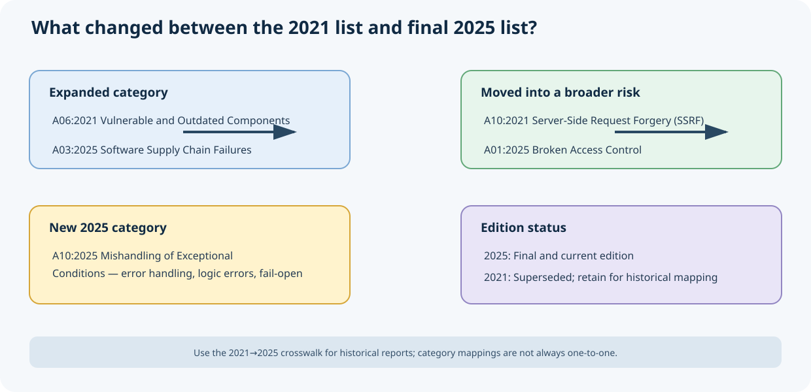
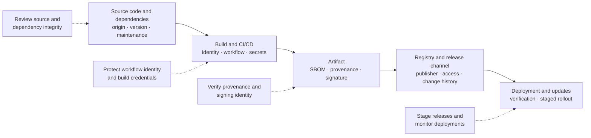
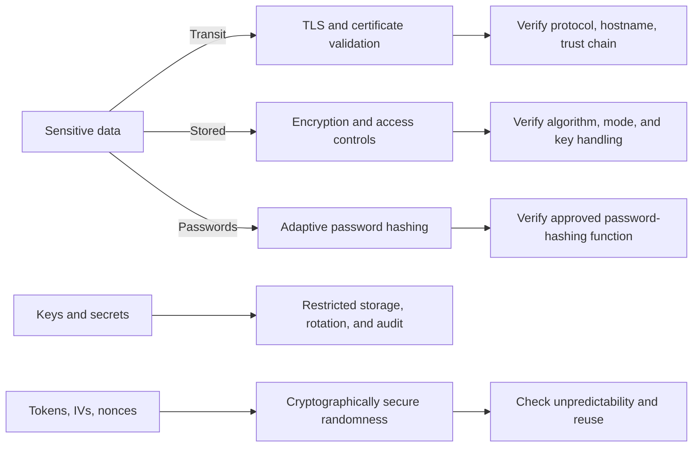
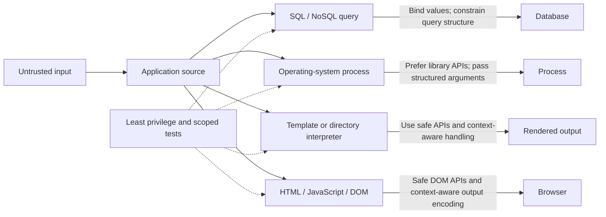
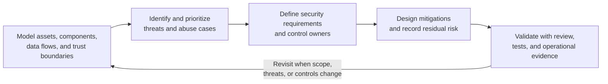

# 🔟 OWASP Top 10 - Deep Dive

> [!CAUTION]
> **Authorized use only.** The exploitation techniques below are for authorized
> testing, education, and defensive research. Testing without authorization may violate applicable laws, contracts, or policies;
> the legal analysis depends on jurisdiction and facts. Obtain written authorization
> and follow the approved scope. See [LEGAL.md](../LEGAL.md) and consult qualified
> counsel for legal questions.

## 🎯 Purpose
A working reference for the OWASP Top 10 web application risks - each category
covering what it is, how it is exploited, how to test for it, and how to defend
against it.

## ⚙️ Function
Walks all ten categories of the **OWASP Top 10:2025 final edition**, with a
mapping back to the stable **2021** list. Each entry pairs offensive testing notes
with defensive controls and links to the relevant OWASP Cheat Sheet.

## 🏆 Goal
Let a reader look up any Top 10 category and immediately know how it manifests,
how to test for it in an authorized engagement, and what remediation to recommend.

## 📋 When to Use
- Testing a web application against a specific risk class
- Writing a finding and needing the OWASP/CWE mapping plus remediation guidance
- Reviewing an application or design defensively against the current risk list

---

## 📋 Table of Contents

- [Version Note: 2025 Final vs 2021](#-version-note-2025-final-vs-2021)
- [A01: Broken Access Control](#a01-broken-access-control)
- [A02: Security Misconfiguration](#a02-security-misconfiguration)
- [A03: Software Supply Chain Failures](#a03-software-supply-chain-failures)
- [A04: Cryptographic Failures](#a04-cryptographic-failures)
- [A05: Injection](#a05-injection)
- [A06: Insecure Design](#a06-insecure-design)
- [A07: Authentication Failures](#a07-authentication-failures)
- [A08: Software or Data Integrity Failures](#a08-software-or-data-integrity-failures)
- [A09: Security Logging and Alerting Failures](#a09-security-logging-and-alerting-failures)
- [A10: Mishandling of Exceptional Conditions](#a10-mishandling-of-exceptional-conditions)
- [2021 to 2025 Mapping](#2021-to-2025-mapping)
- [Resources](#-resources)

---

## 🗓️ Version Note: 2025 Final vs 2021

The **OWASP Top 10:2025 is the current final edition**; OWASP marks the 2021 edition as **superseded**. This guide follows the 2025 ordering and category names and preserves a [2021→2025 mapping](#2021-to-2025-mapping) for older reports and crosswalks. Check the [official OWASP Top 10 repository](https://github.com/OWASP/Top10) and [2025 introduction](https://top10.owasp.org/2025/0x00_2025-Introduction/) for the current publication.

Key changes include:

- **A03: Software Supply Chain Failures** expands 2021's "Vulnerable and Outdated Components" to cover risks across software dependencies, build systems and distribution infrastructure.
- **SSRF**, formerly 2021 A10, is incorporated into 2025 **A01: Broken Access Control**.
- **A10: Mishandling of Exceptional Conditions** is new and includes error handling, logic errors, and fail-open behavior.

*This summarizes selected structural changes; use the crosswalk below for category-by-category mapping.*

---

## A01: Broken Access Control

The most prevalent risk in both 2021 and 2025. The application fails to enforce
what an authenticated user is allowed to do.

- **How it is exploited:** changing an identifier to access another user's data
  (IDOR / horizontal), reaching admin functionality as a normal user (vertical),
  forced browsing to unlinked endpoints, or tampering with a JWT/cookie role claim.
- **How to test:** with two accounts of different privilege, replay each request
  as the other (Burp's *Autorize*/*Auth Analyzer* extensions help); enumerate
  object IDs; request admin routes directly; verify server-side enforcement rather
  than hidden-in-the-UI controls.
- **How to defend:** deny access by default and enforce authorization
  **server-side on every request**. Verify that the authenticated principal
  is permitted to perform the requested action on the specific object,
  including applicable ownership, role, and tenant-boundary checks.
  Use opaque or unpredictable identifiers only as **defense in depth**,
  never as a substitute for authorization. Centralize access-control
  logic and log authorization failures without recording credentials
  or unnecessary sensitive data.
- **Validation:** in an authorized test environment, create two ordinary
  users with separate private objects. Confirm that each user can perform
  permitted actions on their own objects but cannot read, modify, delete,
  or export the other user's private objects, even when the identifier
  is known. Also test administrative functions with an ordinary account
  and cross-tenant access where applicable. Verify both the response and
  resulting data state; an error response alone does not prove that an
  unauthorized change was prevented.
- **CWE:** CWE-284, CWE-639, CWE-862. **Cheat sheet:** [Authorization](https://cheatsheetseries.owasp.org/cheatsheets/Authorization_Cheat_Sheet.html).

---

## A02: Security Misconfiguration

Insecure defaults, incomplete hardening, verbose errors, and unnecessary features.

- **How it is exploited:** default/administrative credentials, exposed admin
  consoles or `.git`/backup files, missing security headers, directory listing,
  overly permissive CORS, verbose stack traces revealing internals.
- **How to test:** enumerate exposed paths and files; review response headers
  (CSP, HSTS, `X-Content-Type-Options`); check CORS with a rogue `Origin`; probe
  default credentials on any admin surface; diff against a hardening baseline.
- **How to defend:** a repeatable hardening process; remove unused features and
  sample apps; set security headers; suppress verbose errors in production; keep
  environments consistent; automate configuration checks.
- **CWE:** CWE-16, CWE-548. **Cheat sheet:** [OWASP Secure Headers](https://owasp.org/www-project-secure-headers/).

---

## A03: Software Supply Chain Failures

Expanded in 2025 beyond vulnerable and outdated components to failures across
dependencies, developer tools, build systems, artifact repositories, and software
distribution.

The diagram summarizes trust boundaries and review points; it is not a claim that
any single control makes a software release trustworthy.

- **How it is exploited:** known-vulnerable or unmaintained components,
  typosquatted or compromised packages, unauthorized changes to build workflows,
  compromised build credentials, unverified artifacts, or a compromised update
  channel. These are different failure modes; a vulnerability scan alone will not
  detect every malicious or unauthorized change.
- **How to test:** inventory direct and transitive dependencies and compare them
  with vulnerability and maintenance information; review dependency source and
  integrity metadata; examine who can change build definitions, runners, secrets,
  release approvals, and artifact repositories; verify that release signatures
  and provenance meet the organization's trust policy.
- **How to defend:** maintain an SBOM with defined scope and generation point;
  remove unused dependencies; pin versions and validate integrity data; restrict
  and monitor code, build, and publishing permissions; generate and verify
  artifact signatures and build provenance; apply risk-based updates and staged
  rollouts. An SBOM is an inventory, not proof of integrity. A valid signature
  establishes that bytes match a signing identity, not that the source or artifact
  is benign. Protect the signing and build identities and define which issuers and
  build processes are trusted.
- **CWE:** CWE-1104, CWE-1357. **Cheat sheet:** [Vulnerable Dependency Management](https://cheatsheetseries.owasp.org/cheatsheets/Vulnerable_Dependency_Management_Cheat_Sheet.html).

For category scope, see [OWASP A03:2025](https://top10.owasp.org/2025/A03_2025-Software_Supply_Chain_Failures/). For broader development practices, see the [NIST Secure Software Development Framework](https://csrc.nist.gov/pubs/sp/800/218/final).
---

## A04: Cryptographic Failures

Cryptographic failures expose sensitive data or undermine trust because encryption
is absent, incorrectly configured, weakened, or used with poorly protected keys,
secrets, certificates, or random values. Assess data in transit and at rest, plus
cryptography used for authentication, integrity, and key derivation.

*Review map: identify the protected data and trust boundary, then verify the
cryptographic control and its configuration at the point where it is used.*

- **How it fails:** sensitive traffic is sent without properly enforced TLS;
  certificates or trust chains are not validated; outdated protocols, weak
  algorithms, or insecure modes are accepted; encryption keys are hard-coded,
  exposed, reused, or poorly managed; random tokens or nonces are predictable or
  reused; or passwords are stored with fast general-purpose hashes instead of an
  adaptive password-hashing scheme. Examples such as MD5 and SHA-1 require context:
  they are unsuitable for new collision-resistant designs and password storage,
  while legacy compatibility use must be assessed against the specific protocol
  and threat model.
- **How to assess:** map sensitive data flows and storage locations; inspect
  effective TLS configuration and certificate/hostname validation; identify
  cryptographic algorithms, modes, key sizes, and downgrade paths; review key
  storage, access, rotation, and exposure in source/configuration; verify that
  security-sensitive randomness comes from the platform CSPRNG and that IV/nonce
  requirements are met; review password-hashing choices and migration settings.
  Use authorized configuration review and safe test environments; a scanner or
  source search alone cannot establish that every cryptographic use is safe.
- **How to defend:** use maintained platform libraries and protocol defaults;
  enforce HTTPS and a current TLS configuration; use authenticated encryption
  where appropriate and follow algorithm-specific nonce requirements; keep keys
  out of source control and restrict, monitor, and rotate access through a
  managed key service; use a CSPRNG for secrets and security tokens; store
  passwords with a purpose-built adaptive password-hashing function such as
  Argon2id, bcrypt, or scrypt, following current implementation guidance. Do not
  invent cryptographic primitives or reuse keys across purposes.
- **Validation:** confirm each sensitive flow is protected end to end and rejects
  invalid certificates; verify deployed configuration rather than relying only
  on source defaults; confirm key material is not exposed to unauthorized
  identities and that rotation/revocation procedures work; test token and nonce
  generation for the implementation's stated guarantees; and verify stored
  passwords cannot be recovered as plaintext and use an approved password-hashing
  scheme. Record exceptions, legacy dependencies, and compensating controls.
- **CWE examples:** CWE-327 (risky cryptographic algorithm), CWE-331
  (insufficient entropy), and CWE-338 (cryptographically weak PRNG); the OWASP
  category maps to additional weaknesses. **References:** [OWASP A04:2025](https://top10.owasp.org/2025/A04_2025-Cryptographic_Failures/),
  [Cryptographic Storage Cheat Sheet](https://cheatsheetseries.owasp.org/cheatsheets/Cryptographic_Storage_Cheat_Sheet.html),
  [Transport Layer Security Cheat Sheet](https://cheatsheetseries.owasp.org/cheatsheets/Transport_Layer_Security_Cheat_Sheet.html),
  and [Password Storage Cheat Sheet](https://cheatsheetseries.owasp.org/cheatsheets/Password_Storage_Cheat_Sheet.html).

---

## A05: Injection

Injection occurs when untrusted data changes how an interpreter parses or executes
a command. The relevant boundary may be a database query, operating-system process,
directory service, server-side template engine, or browser DOM. Cross-site scripting
(XSS) is the browser-side case; server-side request forgery (SSRF) is categorized
under A01 in the 2025 list.

*The defense depends on the interpreter and output context: keep data separate
from executable syntax, then verify the boundary in authorized tests.*

- **How it fails:** an application concatenates attacker-controlled data into
  executable syntax or uses an unsafe interpreter API. Outcomes can include
  altered database queries, unintended process or argument selection, template or
  directory query manipulation, or script execution in a user's browser. The
  impact depends on the interpreter, privileges, and data the application can
  reach.
- **How to assess:** trace untrusted sources (requests, stored values, and
  third-party data) to interpreter sinks. In an approved test environment, test
  representative query, process, template, directory, and browser contexts using
  scope-specific safe cases; verify the actual behavior and resulting state.
  For browser risks, cover reflected, stored, and DOM-based paths and the relevant
  HTML, attribute, URL, CSS, or JavaScript context. Automated scanners and
  payload fuzzing can help find candidates, but do not prove that all paths are
  safe; avoid broad fuzzing against production unless explicitly authorized.
- **How to defend:** for SQL and supported NoSQL APIs, use parameterized or
  structured queries and keep query structure fixed. Validate dynamic identifiers
  such as column names against a strict allowlist because ordinary value binding
  may not parameterize them. Avoid direct operating-system command execution when
  a language library can perform the task; if a process is necessary, use a
  structured API with separate executable and arguments, validate each argument,
  and run it with least privilege. Use safe template and directory APIs. For XSS,
  prefer safe framework/DOM APIs and encode output for its exact context; sanitize
  only when accepting intentionally limited HTML. A Content Security Policy is
  defense in depth, not a replacement for safe rendering. Input validation helps
  enforce business rules but is not a general substitute for interpreter-specific
  defenses.
- **Validation:** demonstrate that representative hostile and malformed inputs
  remain data, cannot alter query or process structure, and cannot execute in the
  browser; confirm authorization boundaries and resulting state remain intact.
  Review error handling and logs without exposing secrets. Record tested paths,
  contexts, exclusions, and residual risk.
- **CWE examples:** CWE-89 (SQL injection), CWE-78 (OS command injection), CWE-79
  (cross-site scripting), and CWE-94 (code injection); this is not a complete
  mapping. **References:** [OWASP A05:2025](https://top10.owasp.org/2025/A05_2025-Injection/),
  [SQL Injection Prevention](https://cheatsheetseries.owasp.org/cheatsheets/SQL_Injection_Prevention_Cheat_Sheet.html),
  [OS Command Injection Defense](https://cheatsheetseries.owasp.org/cheatsheets/OS_Command_Injection_Defense_Cheat_Sheet.html),
  [Injection Prevention](https://cheatsheetseries.owasp.org/cheatsheets/Injection_Prevention_Cheat_Sheet.html),
  and [XSS Prevention](https://cheatsheetseries.owasp.org/cheatsheets/Cross_Site_Scripting_Prevention_Cheat_Sheet.html).

---

## A06: Insecure Design

Insecure design is a missing or ineffective security control in requirements,
architecture, or business logic. It is different from an implementation defect:
a well-designed control can still be implemented incorrectly, while a design
flaw requires changing the requirement or design so the needed control exists.

*Use the threat model to turn plausible misuse into explicit requirements and
verification evidence; choose a level of detail that fits the system and change.*

- **How it fails:** workflows allow an unintended outcome because requirements
  omit a needed constraint or abuse case. Examples include a reset flow that
  permits unbounded guessing, business logic that allows actions out of order,
  or a multi-tenant design that does not establish tenant isolation. These are
  design risks to investigate, not proof that a feature is vulnerable.
- **How to assess:** select the feature, system boundary, and security objectives;
  map important assets, components, data flows, stores, external entities, and
  trust boundaries; then consider relevant threats and misuse cases. Ask what
  happens when users repeat, race, skip, or reorder valid actions, and when an
  actor crosses a role or tenant boundary. Rank threats by business impact and
  likelihood, map each to a requirement or documented risk decision, and verify
  the resulting control through design review, tests, or operational evidence.
  Threat modeling is a structured aid, not a guarantee that every threat has
  been found.
- **How to defend:** define security and privacy requirements before
  implementation; use proven patterns and platform controls; make limits,
  authorization, tenant boundaries, and state transitions explicit; assign
  owners to mitigations; and revisit the model when architecture, data flows,
  threats, or dependencies change. Record accepted residual risk with an owner
  and review point. No single threat-modeling method is required for every
  project.
- **Validation:** translate each selected threat into a testable acceptance
  criterion. Exercise abuse and negative cases as well as intended use, including
  boundary conditions and concurrent actions where applicable. Confirm that the
  implemented control prevents the unintended state change and that monitoring
  or recovery processes cover residual risks.
- **CWE examples:** CWE-73, CWE-602, and CWE-657 are examples rather than a
  complete mapping. **References:** [OWASP A06:2025](https://top10.owasp.org/2025/A06_2025-Insecure_Design/)
  and the [OWASP Threat Modeling Cheat Sheet](https://cheatsheetseries.owasp.org/cheatsheets/Threat_Modeling_Cheat_Sheet.html).

---

## A07: Authentication Failures

Weaknesses in confirming identity and managing sessions.

- **How it is exploited:** credential stuffing and brute force (no lockout/rate
  limit), weak password policies, session fixation, exposed or non-expiring session
  tokens, flawed MFA, and weak JWT handling (`alg:none`, weak secret, no expiry).
- **How to test:** probe login for lockout/rate limiting; test session lifecycle
  (fixation, invalidation on logout, rotation); inspect JWTs (algorithm, signature,
  expiry, claims); test password reset and MFA bypasses.
- **How to defend:** rate limiting and lockout; MFA; strong password storage
  (Argon2/bcrypt) and breached-password checks; secure, `HttpOnly`, `SameSite`
  session cookies with rotation and expiry; validate JWT `alg` and signature server-side.
- **CWE:** CWE-287, CWE-384, CWE-613. **Cheat sheet:** [Authentication](https://cheatsheetseries.owasp.org/cheatsheets/Authentication_Cheat_Sheet.html).

---

## A08: Software or Data Integrity Failures

Code or data trusted without verifying integrity - including insecure
deserialization and unverified updates.

- **How it is exploited:** insecure deserialization leading to RCE, unsigned or
  unverified auto-updates, CI/CD that trusts untrusted input, or client-side
  integrity assumptions (no Subresource Integrity on third-party scripts).
- **How to test:** identify serialized objects crossing trust boundaries; test
  deserialization with known gadget chains (in scope); check update mechanisms for
  signature verification; look for missing SRI on external resources.
- **How to defend:** avoid native deserialization of untrusted data (use data-only
  formats with schema validation); sign and verify updates and artifacts; enforce
  integrity in CI/CD; use Subresource Integrity for third-party scripts.
- **CWE:** CWE-502, CWE-345, CWE-829. **Cheat sheet:** [Deserialization](https://cheatsheetseries.owasp.org/cheatsheets/Deserialization_Cheat_Sheet.html).

---

## A09: Security Logging and Alerting Failures

Insufficient logging, monitoring, and alerting - which lets attacks proceed
undetected. (2021: "Logging and Monitoring Failures".)

- **How it is exploited:** not a direct exploit but an amplifier - failed logins,
  access-control denials, and input-validation failures go unlogged, so intrusions
  are neither detected nor investigable.
- **How to test:** verify security-relevant events are logged (authn/authz
  failures, high-value actions); confirm logs are tamper-resistant and shipped off
  host; check that alerts actually fire on suspicious patterns.
- **How to defend:** log security events with enough context; centralize logs to a
  [SIEM](../IncidentResponse/SIEM/README.md); protect log integrity; define and
  test alerting; align retention with response needs.
- **CWE:** CWE-778, CWE-223. **Cheat sheet:** [Logging](https://cheatsheetseries.owasp.org/cheatsheets/Logging_Cheat_Sheet.html).

---

## A10: Mishandling of Exceptional Conditions

New in 2025: error-handling and edge-case logic that fails insecurely.

- **How it is exploited:** fail-open logic (an error path that grants access),
  inconsistent state after a partial failure, information disclosure through error
  messages, or race conditions in exceptional paths.
- **How to test:** force error and edge conditions (malformed input, timeouts,
  concurrent requests); observe whether failures fail **open** or closed; check
  error responses for leaked internals; test race conditions on state-changing ops.
- **How to defend:** fail closed by default; handle errors explicitly and
  uniformly; avoid leaking internals in messages; make state changes atomic; test
  exceptional paths as first-class scenarios.
- **CWE:** CWE-755, CWE-209, CWE-362. **Cheat sheet:** [Error Handling](https://cheatsheetseries.owasp.org/cheatsheets/Error_Handling_Cheat_Sheet.html).

---

## 2021 to 2025 Mapping

| 2021 | 2025 |
|------|------|
| A01 Broken Access Control | A01 Broken Access Control |
| A02 Cryptographic Failures | A04 Cryptographic Failures |
| A03 Injection | A05 Injection |
| A04 Insecure Design | A06 Insecure Design |
| A05 Security Misconfiguration | A02 Security Misconfiguration |
| A06 Vulnerable and Outdated Components | A03 Software Supply Chain Failures (expanded) |
| A07 Identification and Authentication Failures | A07 Authentication Failures |
| A08 Software and Data Integrity Failures | A08 Software or Data Integrity Failures |
| A09 Security Logging and Monitoring Failures | A09 Security Logging and Alerting Failures |
| A10 Server-Side Request Forgery (SSRF) | folded into A01 / server-side request areas |
| *(new in 2025)* | A10 Mishandling of Exceptional Conditions |

---

## 📚 Resources

- [OWASP Top 10](https://owasp.org/Top10/) - authoritative source (check current edition)
- [OWASP Web Security Testing Guide](https://owasp.org/www-project-web-security-testing-guide/) - how to test each category
- [OWASP Cheat Sheet Series](https://cheatsheetseries.owasp.org/) - defensive guidance per topic
- [MITRE CWE](https://cwe.mitre.org/) - weakness identifiers used above
- [PortSwigger Web Security Academy](https://portswigger.net/web-security) - hands-on labs per vulnerability class

---

## Related Files
- [README.md](README.md) - Web Application Security section index
- [methodology.md](methodology.md) - the assessment workflow that applies these categories
- [../GLOSSARY.md](../GLOSSARY.md) - Acronyms (OWASP, CWE, SSRF, XSS, SSTI…)
