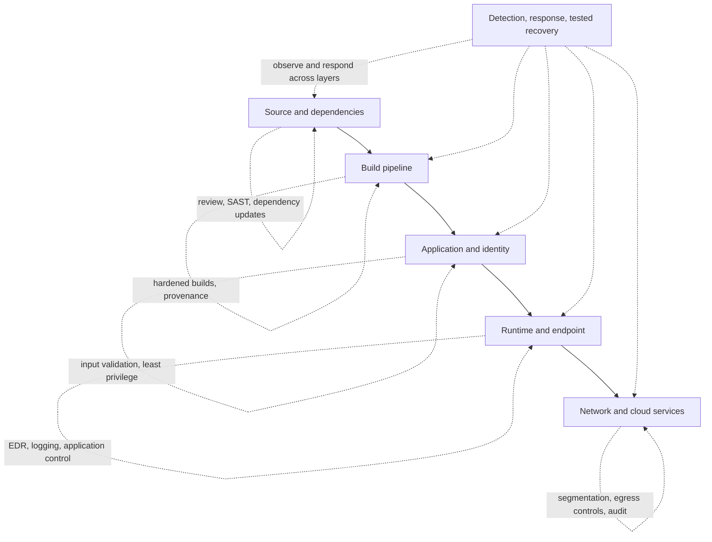

# Advanced Cybersecurity Techniques: Memory, Identity, Mobile, and Web Defense

> This guide presents defensive concepts for security engineering, code review, and
> incident response. It does not provide exploit payloads, credential theft
> procedures, or evasion recipes. Perform validation only on systems you own or
> are explicitly authorized to assess. See [LEGAL.md](LEGAL.md).

## Purpose

Advanced security topics are easier to reason about when defenders connect the
weakness, the trust boundary it crosses, and the controls that can prevent or
detect it. This guide covers memory safety, mobile applications, identity
systems, endpoint monitoring, and web application design from that perspective.

## Contents

- [Security layers at a glance](#security-layers-at-a-glance)
- [Memory safety and secure builds](#memory-safety-and-secure-builds)
- [Mobile application security](#mobile-application-security)
- [Identity and credential protection](#identity-and-credential-protection)
- [Endpoint monitoring and resilience](#endpoint-monitoring-and-resilience)
- [Web application security](#web-application-security)
- [Safe validation and response](#safe-validation-and-response)
- [References](#references)

## Security Layers at a Glance

A single control rarely prevents every failure. Use layered checks from source
code and build configuration through runtime identity, network boundaries, and
incident response.

The objective is to reduce the chance that one defect becomes a system-wide
incident, and to preserve enough telemetry to understand what happened.

## Memory Safety and Secure Builds

Memory corruption can result from incorrect bounds handling, lifetime errors,
integer conversions, or unsafe interfaces. Modern platform mitigations reduce
some consequences but do not replace correct code and testing.

**Defensive practices**

- Prefer memory-safe languages for new components when practical.
- In C and C++, use bounded APIs, explicit ownership, compiler warnings, code
  review, and tests that exercise boundary conditions.
- Use supported compiler hardening options and verify the effective build
  configuration for the target platform. GCC documents options such as
  `-fhardened`, stack protection, and sanitizers; available options vary by
  compiler version and target.
- Run sanitizers and fuzzers in development and CI, using non-production test
  data.
- Track security fixes in compilers, runtimes, libraries, and operating systems.

A mitigation checklist for release review includes ASLR/PIE, non-executable
memory, stack protection, control-flow protections where supported, dependency
updates, and crash reporting that avoids exposing sensitive data. These controls
make exploitation harder but cannot prove that a program is free of memory bugs.

See the [GCC instrumentation and hardening options](https://gcc.gnu.org/onlinedocs/gcc/Instrumentation-Options.html).

## Mobile Application Security

Mobile apps run in environments where local data, network connections, and
inter-app interfaces need explicit protection. Review the app and its backend
together.

- Keep authentication and authorization decisions on the server; a client-side
  flag or hidden screen is not an authorization boundary.
- Store tokens and sensitive values in platform-protected storage, limit their
  lifetime, and avoid logging secrets or personal data.
- Use platform TLS validation. Certificate pinning can be a supplementary control
  for defined threat models, but it does not replace correct TLS validation,
  backend authorization, or incident response.
- Review exported activities, services, receivers, URL handlers, and deep links.
  Require appropriate permissions and validate all data received across app
  boundaries.
- Treat WebView content and JavaScript bridges as a security boundary; load only
  trusted content and expose the smallest required interface.
- Test release builds and backend authorization with approved test accounts and
  synthetic data.

Android's official [security checklist](https://developer.android.com/privacy-and-security/security-tips)
covers secure platform APIs and application configuration.

## Identity and Credential Protection

Credential attacks exploit weak secrets, excessive directory privileges,
unprotected tokens, or poor monitoring. Focus reviews on permissions and
observable changes rather than attempting credential theft.

- Prefer managed service identities where supported. For other service accounts,
  use long unique secrets, controlled rotation, and narrowly scoped permissions.
- Require Kerberos pre-authentication unless a documented exception is necessary,
  and review accounts with service principal names and their secret-management
  practices.
- Restrict directory replication rights to the identities and systems that need
  them; alert on permission changes and unusual replication activity.
- Reduce local administrator membership, protect privileged sessions, and use
  phishing-resistant MFA for administrative access where available.
- Monitor privileged group changes, unusual ticket requests, authentication
  failures, credential access alerts, and new persistence mechanisms.
- Keep recovery procedures for suspected domain credential exposure documented
  and rehearsed. Changes to high-impact keys or service accounts need careful
  sequencing to avoid disrupting authentication.

Microsoft Defender for Identity describes [identity alerts](https://learn.microsoft.com/en-us/defender-for-identity/alerts-xdr)
and [security posture assessments](https://learn.microsoft.com/en-us/defender-for-identity/security-posture-assessments/accounts)
that can help teams review Kerberos and directory permissions.

## Endpoint Monitoring and Resilience

Endpoint defenses are strongest when prevention, telemetry, and recovery work
together.

- Keep endpoint sensors healthy and tamper protection enabled where available.
- Limit who can install software, create services, change security settings, or
  run administrative scripting tools.
- Use application control or allowlisting for high-risk systems and workloads.
- Correlate process ancestry, executable reputation/signing, persistence changes,
  memory alerts, DNS activity, and outbound connections.
- Protect backup systems and credentials from the same administrative boundary as
  production endpoints; test recovery regularly.
- Investigate gaps in sensor coverage as an operational risk, not as evidence
  that no malicious activity occurred.

Use vendor-provided benign test artifacts and isolated training environments to
validate detections. Do not deploy live payloads or attempt to bypass security
controls on production systems.

## Web Application Security

### Template and command execution

Treat templates as code. Keep templates under source control, pass untrusted
values as data, and never let a request select a file path or supply template
source. Do not put shell execution behind an HTTP endpoint. See the [OWASP
Server-Side Template Injection Prevention Cheat Sheet](https://cheatsheetseries.owasp.org/cheatsheets/Server_Side_Template_Injection_Prevention_Cheat_Sheet.html).

### XML, database, and API inputs

- Disable external entity resolution in XML parsers unless a documented feature
  requires it and the parser is safely configured.
- Use parameterized database operations; validate types, lengths, and allowed
  values before building database queries.
- For NoSQL systems, construct query objects from validated fields rather than
  accepting query operators or raw filter objects from clients.
- Enforce object-level authorization for every GraphQL field, resolver, and
  batch operation. Limit query depth, complexity, and response size.
- Return generic errors to users and keep sensitive diagnostic details in access-
  controlled logs.

OWASP's [Injection Prevention Cheat Sheet](https://cheatsheetseries.owasp.org/cheatsheets/Injection_Prevention_Cheat_Sheet.html)
and [NoSQL Security Cheat Sheet](https://cheatsheetseries.owasp.org/cheatsheets/NoSQL_Security_Cheat_Sheet.html)
provide additional prevention guidance.

## Safe Validation and Response

1. Define the authorized applications, accounts, data, test window, and stop
   conditions before validation.
2. Prefer code review, configuration inspection, static analysis, dependency
   checks, and vendor-supported assessment features.
3. Use isolated, resettable labs and synthetic accounts for dynamic tests that
   could alter data, execute code, or affect authentication.
4. Confirm that security events are logged and that responders can correlate
   identity, endpoint, application, and network activity.
5. Stop if a test reaches an out-of-scope system or exposes real credentials or
   personal data.
6. Preserve relevant evidence, rotate exposed secrets through an approved process,
   and document corrective actions.

## References

- [GCC instrumentation and hardening options](https://gcc.gnu.org/onlinedocs/gcc/Instrumentation-Options.html)
- [Android security checklist](https://developer.android.com/privacy-and-security/security-tips)
- [Microsoft Defender for Identity alerts](https://learn.microsoft.com/en-us/defender-for-identity/alerts-xdr)
- [Microsoft Defender for Identity account security posture assessments](https://learn.microsoft.com/en-us/defender-for-identity/security-posture-assessments/accounts)
- [OWASP SSTI prevention](https://cheatsheetseries.owasp.org/cheatsheets/Server_Side_Template_Injection_Prevention_Cheat_Sheet.html)
- [OWASP injection prevention](https://cheatsheetseries.owasp.org/cheatsheets/Injection_Prevention_Cheat_Sheet.html)
- [OWASP NoSQL security](https://cheatsheetseries.owasp.org/cheatsheets/NoSQL_Security_Cheat_Sheet.html)

## Related Files

- [Web Application Security](WebAppSecurity/README.md)
- [Endpoint and EDR evasion defense](Tradecraft/av-edr-evasion.md)
- [Master guide](ULTIMATE-CYBERSECURITY-MASTER-GUIDE.md)
- [Repository index](README.md)
- [Role navigation](START_HERE.md)
- [Legal and responsible-use notice](LEGAL.md)
