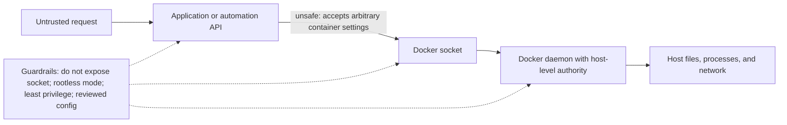

# Advanced Cybersecurity Techniques: Defensive Supplement

> This guide explains how to recognize and reduce risk from advanced attack
> techniques. Use security tools only in an authorized, isolated lab or within a
> documented assessment scope. The material here is defensive guidance, not an
> operational exploit or payload cookbook. See [LEGAL.md](LEGAL.md).

## Purpose

This supplement connects common offensive technique names to the control failures,
telemetry, and response actions defenders need to understand. Its emphasis is
detection and prevention across endpoints, containers, cloud identities, Active
Directory, networks, and web applications.

## Contents

- [Container boundary and Docker daemon risk](#container-boundary-and-docker-daemon-risk)
- [Detection and response reference](#detection-and-response-reference)
- [Metasploit and remote administration tools](#metasploit-and-remote-administration-tools)
- [Cloud identity and storage](#cloud-identity-and-storage)
- [Active Directory identity abuse](#active-directory-identity-abuse)
- [Payload and endpoint defense](#payload-and-endpoint-defense)
- [Network and web application controls](#network-and-web-application-controls)
- [Safe validation workflow](#safe-validation-workflow)
- [Primary references](#primary-references)

## Container Boundary and Docker Daemon Risk

A container is an isolation boundary managed by the host kernel and Docker daemon.
A service that accepts untrusted input and can control the daemon may let that
input affect host resources. Treat access to the Docker socket as privileged
administrative access.

The diagram shows a trust boundary, not a recipe for crossing it. Docker's
documentation explains the daemon's attack surface and the consequences of
granting control of the daemon. Reduce exposure by:

- Keeping the daemon socket out of application containers and untrusted build jobs.
- Limiting Docker administration to trusted operators and tightly scoped automation.
- Using rootless mode where it fits the deployment and validating the remaining
  privileges.
- Avoiding privileged containers, unnecessary host mounts, host PID/network
  namespaces, and excess Linux capabilities.
- Reviewing container configuration and images before deployment.

A container alert should prompt responders to preserve host and daemon logs,
identify the requesting workload and identity, review mounts and capabilities,
and investigate host-level changes.

## Detection and Response Reference

| Technique family | Defensive signals to investigate | Risk-reducing controls |
|---|---|---|
| Remote administration or post-exploitation tooling | Unexpected process trees, new services, unusual outbound connections, memory or file activity inconsistent with the workload | Restrict admin tools, monitor execution and egress, maintain endpoint response coverage |
| Network pivoting | New proxy listeners, connections between normally isolated segments, unexpected tunnel processes | Segment networks, restrict forwarding, alert on new listeners, inventory approved tunnels |
| Cloud privilege changes | New credentials, policy or role changes, unusual API sequences, access from unfamiliar principals | Temporary credentials, least privilege, change alerts, review trust relationships and unused access |
| Container boundary pressure | New privileged workloads, daemon socket mounts, host filesystem mounts, unexpected namespace or capability settings | Admission policy, reviewed deployment manifests, rootless mode when suitable, restricted daemon access |
| Credential access in Active Directory | Unusual service-ticket requests, replication-rights use, privileged group changes, abnormal directory queries | Managed service accounts where appropriate, strong unique secrets, constrain replication rights, audit sensitive changes |
| Payload execution | Unusual interpreters, unsigned binaries, script engines spawning network tools, persistence changes | Application control, endpoint monitoring, patching, least privilege, tested recovery |
| DNS or web-based data transfer | High-volume or high-entropy DNS names, uncommon destinations, unusual request sizes or timing | Egress filtering, resolver logging, domain allowlists where practical, proxy and endpoint correlation |
| Web application command execution | Request values reflected in process arguments, web worker spawning shells, unexpected file writes | Avoid shell execution from request data, validate inputs, least-privileged service identity, file and process monitoring |

These signals are investigation leads, not proof of compromise. Correlate identity,
host, network, and cloud audit events with the known change window and application
behavior.

## Metasploit and Remote Administration Tools

Security frameworks can generate legitimate test activity as well as behavior
that resembles intrusion. Before a controlled assessment, agree on the systems,
accounts, time window, permitted modules, data-handling rules, and stop conditions.

Defenders should:

- Record the framework version, operator identity, source systems, and approved
  test window.
- Monitor process creation, service installation, authentication events, and
  outbound connections on systems in scope.
- Preserve relevant endpoint, firewall, identity, and application logs.
- Revoke temporary test access and verify cleanup after the exercise.
- Separate test artifacts from production credentials and customer data.

Avoid interpreting an alert solely by a tool name. Confirm the process lineage,
user, parent process, destination, and corresponding authorization record.

## Cloud Identity and Storage

Cloud security review should focus on effective permissions and exposure rather
than attempting privilege escalation. Use read-only inventory where possible and
keep changes in a separate test account.

Review:

- Whether users and workloads use short-lived credentials and only the permissions
  needed for their task.
- Whether trust policies, permission boundaries, and resource policies allow
  unexpected principals or cross-account access.
- Whether public access settings match the data classification and business need.
- Whether audit logs capture identity, resource-policy, credential, and network
  changes.
- Whether unused users, roles, access keys, and permissions are removed through a
  reviewed change process.

AWS recommends least-privilege policies and provides IAM Access Analyzer features
for policy validation and access review. See [AWS IAM policy guidance](https://docs.aws.amazon.com/IAM/latest/UserGuide/access_policies.html)
and [IAM security best practices](https://docs.aws.amazon.com/IAM/latest/UserGuide/best-practices.html).

## Active Directory Identity Abuse

Credential and directory attacks often abuse excessive privileges, weak service
account secrets, or poorly monitored directory operations. Defenders can reduce
risk by:

- Giving replication rights only to the identities that require them and
  alerting on changes to those rights.
- Using managed service accounts where supported; otherwise use long, unique
  secrets and rotation appropriate to the service.
- Reviewing privileged groups, delegation settings, service principal names, and
  stale accounts.
- Collecting domain-controller security events and correlating identity queries,
  service-ticket activity, replication operations, and privileged changes.
- Protecting domain controllers and responding quickly to suspected credential
  exposure.

Microsoft Defender for Identity documents alerts related to possible Kerberoasting
and directory replication activity. Treat such alerts as investigation leads and
validate them against the organization's audit configuration and change records:
[Defender for Identity alerts](https://learn.microsoft.com/en-us/defender-for-identity/alerts-xdr).

## Payload and Endpoint Defense

Payload generators, loaders, and memory-resident execution can evade controls when
organizations rely on a single signature or allow overly broad scripting access.
Defensive priorities include:

- Keep endpoint protection and operating systems current; confirm sensors report
  healthy status.
- Restrict script interpreters and software installation to roles that need them.
- Monitor process ancestry, command-line patterns, unsigned binaries, persistence
  locations, and unexpected memory/network behavior.
- Retain a reliable software inventory and use application control where practical.
- Protect backups and test restoration so response is not limited to detection.

Use harmless vendor-provided test files or purpose-built training labs to validate
controls. Do not generate or deploy live payloads on production systems.

## Network and Web Application Controls

For network boundaries, document permitted flows, restrict unnecessary outbound
connections, and alert on new tunnels, listeners, or traffic to unusual destinations.
DNS monitoring is more useful when resolver logs can be correlated with endpoint
and identity data.

For web applications:

- Do not pass request data to a shell or expose general-purpose command execution.
- Use parameterized database operations and context-aware output encoding.
- Validate uploads using server-generated names, size limits, content inspection,
  and storage outside executable web paths.
- Keep debug features disabled in deployed applications and protect administrative
  routes with strong authentication and authorization.
- Log security-relevant actions without storing passwords, tokens, or unnecessary
  personal data.

## Safe Validation Workflow

1. Write down the authorized scope, systems, identities, time window, and stop rules.
2. Prefer configuration review, read-only inventory, and vendor-supported
   validation features.
3. Use an isolated lab for any test that could alter files, identities, services,
   network routes, or cloud resources.
4. Record expected events and confirm that logging, alerting, and response paths
   work.
5. Stop if activity reaches an out-of-scope system or creates unexpected impact.
6. Remove temporary access, preserve relevant evidence, and record lessons learned.

## Primary References

- [Docker Engine security](https://docs.docker.com/engine/security/)
- [Protect the Docker daemon socket](https://docs.docker.com/engine/security/protect-access/)
- [AWS IAM policies and least privilege](https://docs.aws.amazon.com/IAM/latest/UserGuide/access_policies.html)
- [AWS IAM security best practices](https://docs.aws.amazon.com/IAM/latest/UserGuide/best-practices.html)
- [Microsoft Defender for Identity alerts](https://learn.microsoft.com/en-us/defender-for-identity/alerts-xdr)

## Related Files

- [README.md](README.md) — repository index
- [advanced_techniques_part2.md](advanced_techniques_part2.md) — exploit-development concepts; use isolated training environments
- [Tradecraft/active-directory.md](Tradecraft/active-directory.md) — Active Directory security
- [Tradecraft/c2-frameworks.md](Tradecraft/c2-frameworks.md) — command-and-control detection and defense
- [LEGAL.md](LEGAL.md) — legal and responsible-use notice
