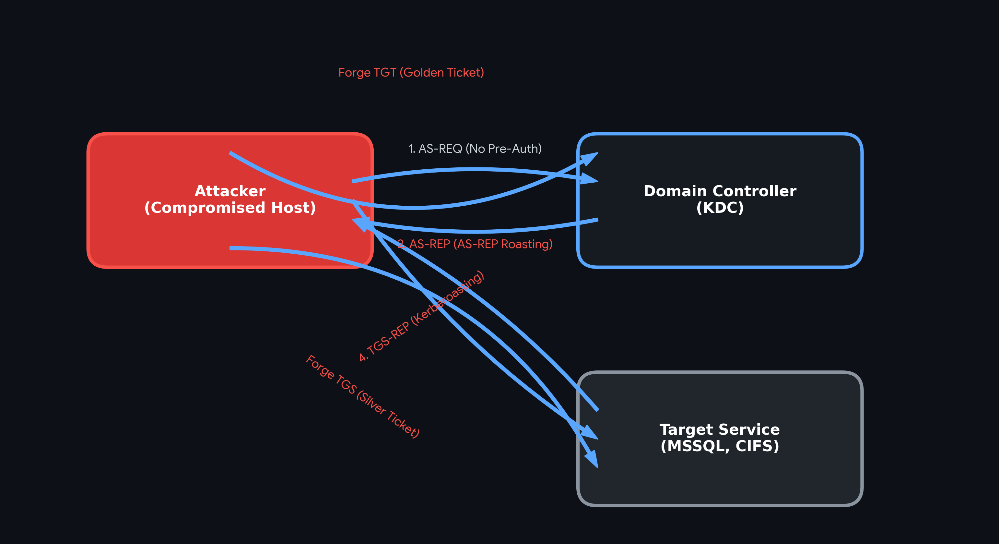
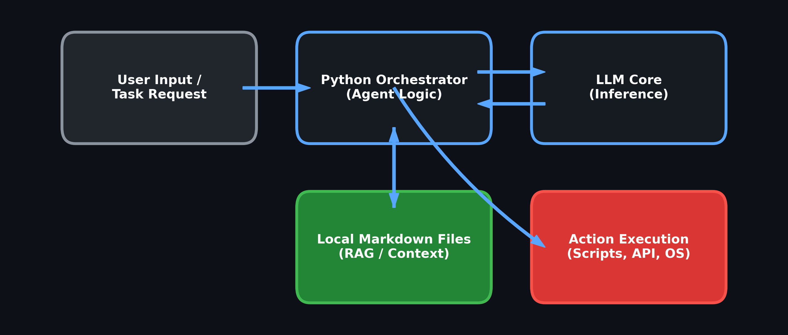
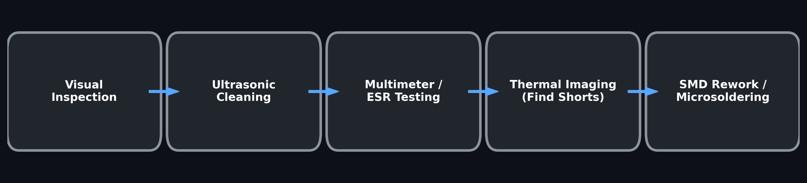
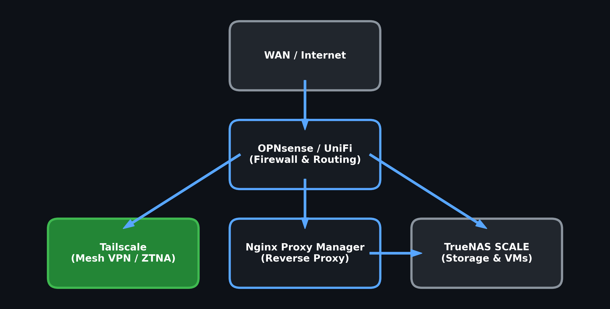
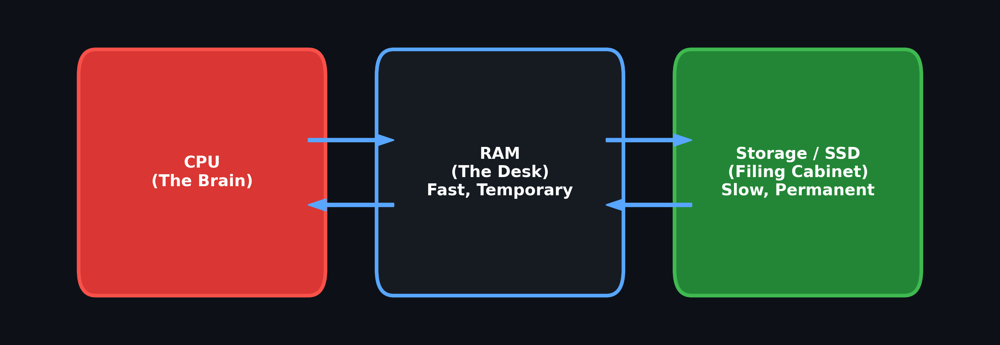

# Visual Reference Notes and Original Captions

_Technical captions corrected: 2026-11-18. Source-verified Kerberos terminology and conservative hardware safety procedures; no live testing performed._

These legacy notes explain five illustrations now embedded in their relevant chapters. For complete image usage, including newly added FIDO2, encryption, and journalist-security diagrams, see the [Diagram and Image Asset Index](./README.md).

**Accuracy note:** These are conceptual illustrations, not evidence of a tested PNWC deployment. Kerberos details follow the linked MITRE ATT&CK technique definitions; board-level procedures require the actual device schematic, electrical limits and safety documentation.

## Active Directory Kerberos Attacks

Understanding the Kerberos authentication flow is critical for both attacking and defending Active Directory environments. The diagram above maps out the primary points of exploitation within the Ticket Granting Ticket (TGT) and Ticket Granting Service (TGS) exchanges:
* **AS-REP Roasting ([ATT&CK T1558.004](https://attack.mitre.org/techniques/T1558/004/)):** When an account does not require Kerberos pre-authentication, an unauthenticated requester may obtain an AS-REP containing an encrypted portion derived from that account's long-term key. The password or NT hash is **not transmitted** in plaintext; the returned ciphertext can support offline password guessing. Disable unnecessary pre-authentication exemptions and protect accounts with strong, unique passwords.
* **Kerberoasting ([ATT&CK T1558.003](https://attack.mitre.org/techniques/T1558/003/)):** A user with appropriate domain access can request a service ticket for a registered Service Principal Name (SPN). The service ticket contains a portion encrypted with a key derived from the service account's secret. An attacker can attempt offline guesses against that ciphertext; the ticket **does not reveal the password hash directly**. Modern AES ticket types and gMSAs or sufficiently strong random service secrets reduce exposure.
* **Golden & Silver Tickets ([ATT&CK T1558.001](https://attack.mitre.org/techniques/T1558/001/) / [T1558.002](https://attack.mitre.org/techniques/T1558/002/)):** Compromise of the domain's `krbtgt` signing/encryption key material can enable forged TGTs. Compromise of a service account's key material can enable forged service tickets. Forgery capabilities depend on key versions, service configuration, validation, and other controls; neither type should be presented as universal, undetectable domain compromise.

---

## File-System-First AI Agent Architecture

This framework relies on a local, file-system-first approach to manage agent state and context memory. Rather than relying entirely on ephemeral LLM context windows, the architecture utilizes standard Python execution and Markdown files.
* **Python Orchestrator:** Acts as the central logic loop, receiving user input and determining the necessary sequence of actions.
* **Local Markdown Files (RAG):** Context, previous interactions, and system instructions are written to and read from local `.md` files. This allows the agent to maintain persistent memory and retrieve specific operational data across sessions.
* **LLM Inference & Tool Authorization:** The orchestrator supplies scoped context to the model and treats generated instructions as **untrusted proposals**. Schema checks, permission allowlists, sandbox boundaries, explicit approval for side effects and audited tool calls must intervene before any script, API mutation or OS-level command. A Markdown file or retrieved document must never grant itself execution authority.

---

## Board-Level Diagnostic Workflow

When diagnosing component-level motherboard faults, use the following **decision-dependent** workflow. Do not assume every board requires chemical cleaning, powered injection or heat. Disconnect power and batteries, check vendor service instructions, and document the original condition before making changes:
1. **Visual Inspection:** Check for obvious physical damage, burnt components, liquid ingress, or blown capacitors.
2. **Contamination Assessment:** If liquid damage is present, isolate power and choose an appropriate cleaning process for the **disassembled, compatible** assembly. Ultrasonic cleaning is not universally safe for microphones, displays, connectors, battery packs or assembled electronics and should not precede documentation or required corrosion assessment.
3. **Unpowered Electrical Checks:** Check suspicious rails for shorts and abnormal resistance against a schematic, boardview or comparable known-good board where available. ESR or other component testing is relevant only for appropriate component types and test conditions.
4. **Controlled Power & Thermal Diagnosis:** Only when the circuit and safe limits are understood, consider a **current-limited, correctly polarized** bench supply with a target-appropriate voltage ceiling. Never blindly inject power into a battery rail, data pin or unknown short; monitor current and temperature while documenting the measurement.
5. **Confirmed Repair & Verification:** Rework only a diagnosed faulty component with suitable equipment and ESD/thermal protections. Inspect for collateral damage, confirm isolation and basic rail behavior, and rerun functional checks before declaring success.

---

## Network Security Architecture

This homelab and operational network topology is designed around compartmentalization, utilizing strict firewall rules and Zero Trust Network Access (ZTNA).
* **OPNsense / UniFi Edge:** The figure is an **example architecture**, not confirmation of a deployed stack. A routing firewall (OPNsense or suitably configured UniFi gateway) can enforce VLAN and WAN policy **only where traffic traverses that firewall**. Check inter-VLAN routes, switch management, management-plane access, and exceptions rather than assuming isolation.
* **Tailscale (Mesh VPN):** Provides secure, encrypted access to internal resources from external locations without exposing standard listening ports to the public internet.
* **Nginx Proxy Manager:** Handles internal reverse proxying and SSL certificate management, cleanly routing authorized traffic to the correct backend services.
* **TrueNAS SCALE:** Can serve as a central storage platform; supported applications and virtualization features depend on the installed release and deployment design. A storage system is not automatically isolated simply because a router, VLAN or proxy exists elsewhere in the diagram.

---

## Hardware Fundamentals: CPU, RAM, and Storage

When diagnosing slow computer performance, it is helpful to visualize the hardware as a physical workspace:
* **The Brain (CPU):** The processor does the actual "thinking" and calculating. It is incredibly fast but cannot store information on its own.
* **The Desk (RAM):** Memory is your active workspace. It is fast and temporary. If you have a small desk (low RAM), you can only work on a few documents at once before things slow down and you have to swap items out. When the power goes off, the desk is cleared.
* **The Filing Cabinet (Storage/SSD):** This is where everything is permanently saved. It is much slower to access than the desk, but it holds all your files, photos, and the operating system even when the computer is turned off.
