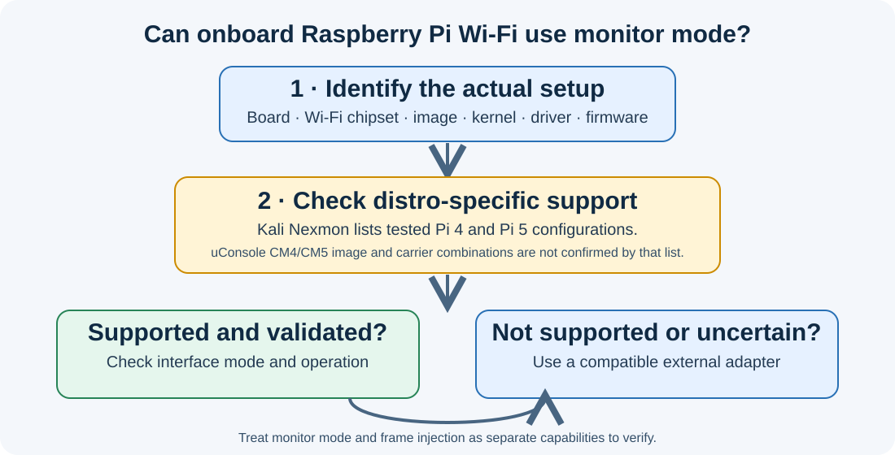
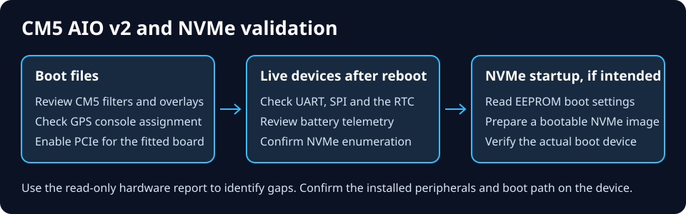

# uConsole Setup Guide: CM5 Configuration

> [!NOTE]
> **Reviewed November 19, 2026** against the [HackerGadgets AIO V2 setup guide](https://hackergadgets.com/pages/hackergadgets-uconsole-rtl-sdr-lora-gps-rtc-usb-hub-all-in-one-extension-board-setup-guide), the [`aiov2_ctl` source](https://github.com/hackergadgets/aiov2_ctl), the [Upgrade Kit thread](https://forum.clockworkpi.com/t/hackergadgets-uconsole-upgrade-kit-adding-nvme-ssd-pcie-rj45-ethernet-and-usb-3-0-to-your-uconsole/20019) and the [Raspberry Pi PCIe documentation](https://github.com/raspberrypi/documentation/blob/97485d9742bcd15765f208d8c01735d74d542650/documentation/asciidoc/computers/raspberry-pi/pcie.adoc). Corrections: RJ45 comes from the expansion board (not the AIO v2), CM5 needs no `cmdline.txt` edit for GPS, the CM5 RTC block has no `i2c_arm` line, an existing `dtparam=pciex1=off` must be edited, the non-HAT+ NVMe board needs `PCIE_PROBE=1` for booting, and the `aiov2_ctl` venv/symlink steps were wrong. Run `sudo bash scripts/uconsole-cm5-setup.sh --hw-check` (read-only) to audit a device. The conservative CM5 setup procedure is retained. A detected NVMe device does not itself establish NVMe **boot support**; confirm carrier support, EEPROM boot order and a verified bootable image before changing startup storage. Read the [official Raspberry Pi Compute Module documentation](https://github.com/raspberrypi/documentation/blob/97485d9742bcd15765f208d8c01735d74d542650/documentation/asciidoc/computers/compute-module/introduction.adoc) and [uConsole review](./CM4-SAFETY-REVIEW.md). No automated hardware validation was performed.

## *Rex's Kali or Trixie + HackerGadgets AIO v2 Board + HackerGadgets Battery & NVMe Board*

A complete setup guide for building a field-deployable hacking and SIGINT platform using the ClockworkPi uConsole
with a Raspberry Pi CM5, Rex's community images (Kali Linux or Debian Trixie), and the HackerGadgets AIO v2
extension board.

> [!IMPORTANT]
> **CM5 desktop regression:** Earlier script revisions can disrupt the working Rex desktop. Start with [CM5 display recovery](./CM5-DISPLAY-RECOVERY.md) if you have a rotated screen or a blank desktop after login. The v1.5 installer preserves session and boot configuration, skips upgrades, and makes AIO installation opt-in. Hardware validation is pending. See [script usage](./scripts/README.md).
> Do not layer Kali repositories onto Debian or replace the image's desktop with plain Labwc.

---

## Table of Contents

- [Hardware Overview](#hardware-overview)
- [Choosing Your OS: Kali vs Trixie](#choosing-your-os-kali-vs-trixie)
- [Step 1: Flash the OS](#step-1-flash-the-os)
- [Step 2: Preserve the Working Image](#step-2-first-boot---preserve-the-working-image)
- [Step 3: System Update and Initial Configuration](#step-3-system-update-and-initial-configuration)
- [Step 4: Distribution Security Tools](#step-4-security-tools-for-your-distribution)
- [Step 5: Install aiov2_ctl (GPIO Control Tool)](#step-5-install-aiov2_ctl-gpio-control-tool)
- [Step 6: Install the AIO v2 Board Package](#step-6-install-the-aio-v2-board-package)
- [Where config.txt Lines Go](#where-configtxt-lines-go-read-before-steps-714)
- [Step 7: Configure GPS (CM5)](#step-7-configure-gps-cm5)
- [Step 8: Configure LoRa / Meshtastic](#step-8-configure-lora--meshtastic)
- [Step 9: Configure RTC (CM5)](#step-9-configure-rtc-cm5)
- [Step 10: Configure SDR](#step-10-configure-sdr)
- [Step 11: GPIO Power Control](#step-11-gpio-power-control)
- [Step 12: WiFi Pentesting Setup](#step-12-wifi-pentesting-setup)
- [Step 13: LAN Pentesting via RJ45](#step-13-lan-pentesting-via-rj45)
- [Step 14: NVMe Battery Board Setup](#step-14-nvme-battery-board-setup)
- [CM5-Specific Notes and Limitations](#cm5-specific-notes-and-limitations)
- [AIO v2 Board: Hardware Reference](#aio-v2-board-hardware-reference)
- [aiov2_ctl: Full Command Reference](#aiov2_ctl-full-command-reference)
- [Meshtastic Web Interface](#meshtastic-web-interface)
- [Boot Automation](#boot-automation)
- [Troubleshooting](#troubleshooting)
- [Resources and Links](#resources-and-links)

---

## 🎯 Purpose
Step-by-step build instructions for the CM5 variant of the uConsole + AIO v2 platform specifically - GPIO pin
behavior, `config.txt` overlays, and known failure modes here are CM5-specific (e.g., `/dev/ttyAMA0` instead of
`/dev/ttyS0`, `dtparam=uart0` instead of `enable_uart=1`, native PCIe NVMe support) and will not match the CM4. Use
this file (not [CM4-SETUP.md](./CM4-SETUP.md)) when your board is a Raspberry Pi Compute Module 5.

## ⚙️ Function
Organized as the same 14 sequential numbered steps as [CM4-SETUP.md](./CM4-SETUP.md) (flash OS → pre-flight
hardening → system update → Kali tools → `aiov2_ctl` install → AIO v2 board package → GPS/LoRa/RTC/SDR
configuration → GPIO power control → WiFi/LAN pentesting setup → NVMe battery board), followed by reference tables
and a Troubleshooting section. Differs from CM4-SETUP.md in GPIO/UART/RTC device-tree overlays, GPS serial port
path, SDR default boot state (HIGH on CM5 vs OFF on CM4), and native PCIe NVMe support; differs from
[README.md](./README.md), which is the folder-level index rather than a build walkthrough. Every step is also
implemented as an idempotent shell script in [`scripts/uconsole-cm5-setup.sh`](./scripts/uconsole-cm5-setup.sh)
(see [scripts/README.md](./scripts/README.md)).

## 🏆 Goal
A working CM5-based uConsole with the AIO v2 board fully configured - RTL-SDR, LoRa/Meshtastic, GPS, and RTC all
functioning, GPIO power control operational, and WiFi/LAN pentesting tooling installed - without the CM5-specific
pitfalls (SD boot failures on old EEPROM, UART/RTC overlay mismatches) this guide's troubleshooting section already
documents.

## 📋 When to Use
When building or repairing a CM5-based uConsole from scratch, or when a specific step (e.g., Meshtastic not
starting, GPS not getting a fix, CM5 lite SD card not booting) needs a manual fix outside of running the automation
script.

---

## Hardware Overview

This guide assumes the following hardware stack:

| Component | Detail |
|---|---|
| **Handheld** | ClockworkPi uConsole |
| **Compute Module** | Raspberry Pi CM5 (with HackerGadgets CM4/CM5 adapter board) |
| **Extension Board** | HackerGadgets AIO v2 (RTL-SDR / LoRa / GPS / RTC / USB Hub) |
| **Storage / Power** | HackerGadgets NVMe Battery Board (2× 18650 or LiPo variant) |
| **Optional I/O** | HackerGadgets RJ45 Ethernet & USB 3.0 expansion board |
| **OS** | Rex's Kali Linux or Rex's Debian Trixie (6.12.y kernel) |
| **WiFi Adapter** | External adapter is the dependable default. Onboard monitor/injection support depends on image, chipset, driver, and firmware; CM5 uConsole compatibility is unverified. |

### What the AIO v2 Provides

| Feature | Chip / Spec |
|---|---|
| **RTL-SDR** | R828D + TCXO, 100 kHz–1.74 GHz, 5V bias tee for active antennas/LNAs |
| **LoRa** | SX1262, 860–960 MHz, 22 dBm max output, TCXO, Meshtastic-ready |
| **GPS** | Multi-mode (GPS/BDS/GNSS), active and passive antenna support |
| **RTC** | PCF85063A + CR1220 battery backup |
| **USB Hub** | External USB-C port + internal USB-C + pin header |

### What the Upgrade Kit Boards Provide

The AIO v2 has **no** Ethernet port. RJ45 and USB 3.0 come from a separate Upgrade Kit board. Per the HackerGadgets Upgrade Kit announcement:

| Board | Relevant features |
|---|---|
| **Adapter board** | Exposes CM4/CM5 PCIe to the NVMe Battery Board; USB 3.0 connector (CM5 only); CM5 RTC-battery connector (do not connect with CM4); PWM fan connector; USB-C for flashing eMMC modules |
| **NVMe Battery Board** | M.2 NVMe slot for 2230–2280 drives; 2× 18650 holder or LiPo variant; reverse-polarity warning LED instead of heating; optional push-lock power switch (desolder R14, fit switch to J6) |
| **RJ45 & USB 3.0 expansion board** | Gigabit RJ45 wired directly to the CM, USB-A and USB-C at USB 3.0 on CM5 (USB 2.0 on CM4), internal USB-C/pin header, 17 GPIO pins |

> The adapter board's RTC-battery connector serves the CM5's internal RTC. This guide disables that RTC and uses the AIO v2 PCF85063A, so no second RTC cell is needed (HackerGadgets' stated configuration).

> **Critical Assembly Note:** When installing the AIO v2 board, ensure the ribbon cable is oriented correctly as shown in the HackerGadgets documentation. **Never plug in the charger if the ribbon cable is installed the wrong way** - incorrect installation will damage the uConsole mainboard.

### AIO v2 GPIO Map (Verified Against HackerGadgets Official Docs)

These are the **AIO v2** control GPIOs. (AIO v1 used different pins for LoRa and Internal USB - make sure you're working with v2 hardware.)

| Peripheral | GPIO | Notes |
|---|---|---|
| **GPS** | 27 | Pull HIGH to enable |
| **LoRa** | 16 | Pull HIGH to enable |
| **SDR** (RTL-SDR) | 7 | Pull HIGH to enable. **On CM5, this defaults HIGH at boot** - RTL-SDR is detected immediately. On CM4, it defaults OFF. |
| **Internal USB** (USB-C + pin header) | 23 | Pull HIGH to enable |
| **GPS PPS** (output) | 6 | Optional, for microsecond-accurate NTP timing |

`aiov2_ctl` assumes exclusive control of these pins. Do not drive them with another script at the same time.

---

## Choosing Your OS: Kali vs Trixie

Rex maintains community images for the uConsole that include a custom kernel (record the actual version with `uname
-r`) with all necessary hardware patches for the uConsole display, keyboard, and trackball. His images also include
a custom APT repository required for the `hackergadgets-uconsole-aio-board` package - that package is not available
on stock ClockworkPi or upstream Kali images.

Rex's images include several conveniences that this guide relies on:

- Auto-expanding root filesystem on first boot (no `raspi-config` needed)
- `linux-headers` shipped with the kernel (no separate DKMS headers install)
- A dedicated "drivers" block at the bottom of `/boot/firmware/config.txt` with instructions for enabling overlays

> **CM5 special note from Rex:** The AIO board package was developed primarily for CM5 because enabling SPI for Meshtastic on CM5 needs additional plumbing to keep the display panel working. Using the official `hackergadgets-uconsole-aio-board` package is therefore strongly recommended on CM5 - the manual route is risky.

### Path A: Rex's Kali Image

Choose the native Kali image when you need Kali metapackages. Check which tools are included in that specific
release. Preserve its desktop/session configuration and review package upgrades before applying them.

### Path B: Rex's Trixie Image

Use Debian 13 Trixie with its intended Debian/Raspberry Pi/Rex repositories. Install tools available for that
distribution. For Kali-only workflows, use a separate Kali installation instead of adding Kali rolling to Debian.
The old tool allowlist did not prevent unrelated Kali packages from becoming upgrade candidates. [Kali repository
guidance](https://www.kali.org/docs/general-use/kali-apt-sources/)

### Other Rex Images

| Image | Best For |
|---|---|
| **Bookworm 6.12.y** | Maximum stability, daily driver, most community-tested |
| **DragonOS** | Dedicated SDR/RF analysis (now based on Debian Trixie) |

> **Tip:** Consider keeping Rex's DragonOS on a second SD card for dedicated SDR/RF analysis sessions. It ships with GNU Radio, SDR++, and a broader RF toolkit than the AIO board package alone.

---

## Step 1: Flash the OS

### Download Your Image

**Kali:**
- **Thread:** [Kali 6.12.y for the uConsole and DevTerm](https://forum.clockworkpi.com/t/kali-6-12-y-for-the-uconsole-and-devterm/14463)
- Look for the MEGA or Google Drive link in the first post
- Use the image labeled with kernel **6.12.67** or later (required for the new uConsole screens)
- Default credentials: `kali` / `kali`

**Trixie:**
- **Thread:** [Trixie 6.12.y for the uConsole and DevTerm](https://forum.clockworkpi.com/t/trixie-6-12-y-for-the-uconsole-and-devterm/19457)
- MEGA / Google Drive link in the first post
- Same kernel requirement (6.12.67+)
- Default credentials: `pi` / `clockworkpi`

### Flash the Image

Rex's specific guidance from the forum threads: **use Raspberry Pi Imager directly on the compressed `.xz` file,
and do not apply any custom settings.** Custom settings (hostname, WiFi, SSH) from Pi Imager will cause Rex's
images to fail to boot.

1. Install [Raspberry Pi Imager](https://github.com/raspberrypi/rpi-imager#raspberry-pi-imager) on your host machine.
2. In Pi Imager:
   - **Operating System:** "Use Custom" → select the downloaded `.xz` file directly (do **not** decompress first)
   - **Storage:** your microSD card (16 GB minimum, 32+ GB recommended)
   - Click **Write**. When prompted about custom settings, choose **No** / **Skip**.
3. Insert the microSD card into the uConsole and boot.

> [!CAUTION]
> Pi Imager is preferred. Writing to the wrong device irreversibly destroys its data. Before running `dd`, verify the image source and checksum where published, inspect the target with `lsblk -o NAME,SIZE,MODEL,SERIAL,TRAN,MOUNTPOINTS`, confirm its model/capacity and whole-device path, unmount its partitions, and confirm it is not the host system disk. Replace `/dev/sdX` only after identifying the exact card. Stop if the identity is uncertain.
>
> ```bash
> xz -d <image>.xz
> sudo dd if=<image>.img of=/dev/sdX bs=4M status=progress conv=fsync
> sync
> ```

> **CM5 lite SD card boot issue:** If you have a CM5 lite and the SD card won't boot, you likely need an EEPROM update. See [Troubleshooting → CM5 lite SD boot fails](#troubleshooting) before getting frustrated - this is a known issue with a documented fix.

### First Boot

Power on. Rex's images auto-expand the root filesystem on first boot and then reboot once - let that complete. After the second boot:

- Keep the device offline during first setup. Log in using the credentials supplied by the **exact trusted image**, then immediately change or disable factory credentials before enabling Wi-Fi, Ethernet, SSH, or other remote access. Verify image provenance and its checksum/signature when the maintainer publishes one. If you cannot change or disable the default account, keep the device isolated.
- Open a terminal

Record the working baseline and back up before package changes. Proceed to Step 2.

---

## Step 2: First Boot - Preserve the Working Image

Verify the desktop, panel, input and orientation before setup. Record `/etc/os-release`, `uname -r` and the image
release; back up storage and configuration. Preserve the supplied LightDM/AccountsService session choices,
cryptsetup configuration, Python protections and `raspberrypi-sys-mods`.

Do not switch to a generic Labwc session to preempt a hypothetical failure. If the desktop is already broken, use
[CM5 display recovery](./CM5-DISPLAY-RECOVERY.md) before installing more packages.

## Step 3: System Update and Initial Configuration

Review the image maintainer's current update guidance. After checking repository configuration, inspect a simulation before considering an upgrade:

```bash
sudo apt-get update
apt-get -s upgrade
```

These commands refresh indexes and simulate changes; they do not perform a system upgrade. Check proposed changes
to the kernel, firmware, compositor, display manager and desktop packages. No pin file or forced-overwrite setting
makes every upgrade safe. The v1.5 setup script skips system upgrades.

Set your timezone with `sudo dpkg-reconfigure tzdata` and update your account password using `passwd` as needed.

## Step 4: Security Tools for Your Distribution

On Debian, use tools packaged for Debian and the intended image repositories. Do not add Kali sources or install
Kali metapackages on this host. On a native Kali image, review the selected metapackage and optionally use:

```bash
sudo bash ./uconsole-cm5-setup.sh --install-kali-tools
```

This requires the reviewed v1.5 script. Existing v1.3 state must be investigated before continuing; `--reset` is not a rollback.

**Steps 5–11 and the boot-overlay reference apply only to fitted AIO hardware.** Confirm the current vendor instructions for your board/image before executing hardware changes. The script does not automate these boot edits or source installers; its read-only `--hw-check` reports whether they are in effect.

## Step 5: Install aiov2_ctl (GPIO Control Tool)

`aiov2_ctl` is HackerGadgets' control tool for the AIO v2 power rails, boot-rail persistence, battery telemetry and
the tray GUI. Install order relative to the AIO package does not matter; `sudo aiov2_ctl --add-apps` can install
the AIO package and companion apps afterward.

Clone as your **regular user**: `--install` records the checkout path and `aiov2_ctl --update` later runs `git pull`
there without root (the tool refuses `--update` under sudo). A root-owned `/opt` clone breaks updates.

```bash
sudo apt-get update
sudo apt-get install -y python3 python3-pyqt6 git

mkdir -p ~/src
git clone https://github.com/hackergadgets/aiov2_ctl.git ~/src/aiov2_ctl
cd ~/src/aiov2_ctl
git log -1 --oneline            # record the reviewed commit
sudo python3 ./aiov2_ctl.py --install

# Verify (installed to /usr/local/bin, which is already in sudo's secure_path)
command -v aiov2_ctl && aiov2_ctl --status
systemctl is-enabled aiov2-rails-boot.service
```

`--install` copies the tool to `/usr/local/bin/aiov2_ctl`, installs bash completion and a desktop entry, and
enables `aiov2-rails-boot.service` so boot-rail settings persist. It does **not** create a Python virtual
environment: the GUI runs on the system `python3` with `python3-pyqt6`. No `/usr/bin` symlink is needed.

> **Note:** `aiov2_ctl --gui` must run as your desktop user (not root) with a display. Over SSH, use
> `aiov2_ctl --autostart` and log in on the device instead.

---

## Step 6: Install the AIO v2 Board Package

Only for a physically installed, supported HackerGadgets AIO board. Check the [current Rex package
instructions](https://forum.clockworkpi.com/t/hackergadgets-aio-board-package/17875) and inspect the proposed
installation:

```bash
sudo apt-get update
apt-get -s --no-remove --install-recommends install hackergadgets-uconsole-aio-board
```

If the repository/package is unavailable or dependencies conflict, stop and resolve the image compatibility
problem. Do not inject Bookworm libraries, purge/retry automatically, force file overwrites, or create a
`pcmanfm-pi` symlink as a desktop workaround.

The reviewed v1.5 script's `--with-aio` option installs this package through APT. Package maintainer scripts can
still change configuration; `--no-remove` does not prevent that. Back up first and test the desktop afterward.
Follow upstream instructions separately for optional controller, Meshtastic and ADS-B features.

Rex's package was built and tested on Debian Bookworm; Trixie/Kali results are community reports. One reported
CM5 failure is `cp: cannot stat '/tmp/config.yaml'` during install, where reinstalling did not help. If that
happens, stop and configure meshtasticd manually (Step 8) rather than purging and retrying in a loop.

---

## Where `config.txt` Lines Go (Read Before Steps 7–14)

`config.txt` files, including uConsole images, can contain model filters (`[cm4]`, `[pi4]`, `[cm5]`, `[all]` …). A line placed after `[cm4]` or
`[pi4]` is **ignored on a CM5**. Put AIO/NVMe lines under `[all]`, `[pi5]` or `[cm5]` ([pi5] also applies to
CM5), normally in Rex's drivers block at the bottom.

- **Edit existing lines; do not append duplicates.** Community Upgrade Kit reports found `dtparam=pciex1=off` already present in their images. Change that line
  to `dtparam=pciex1` instead of adding a second one.
- Back up first: `sudo cp -a /boot/firmware/config.txt /boot/firmware/config.txt.bak-$(date +%F)`.
- After editing and rebooting, audit with the read-only checker, which applies the same filter rules:

```bash
sudo bash uConsole/scripts/uconsole-cm5-setup.sh --hw-check
```

---

## Step 7: Configure GPS (CM5)

### CM5-Specific GPS Path
On CM5, the AIO GPS is on `/dev/ttyAMA0` (UART0, GPIO 14/15) at **9600 baud**. CM4 uses `/dev/ttyS0`.

### Enable the UART in config.txt
Per HackerGadgets' CM5 instructions:

```ini
dtparam=uart0
```

### Serial Console: No Change Needed on CM5
HackerGadgets lists removing `console=serial0,115200` from `cmdline.txt` as a **CM4-only** step. On CM5,
`serial0` points to the debug UART (`/dev/ttyAMA10`), not the GPS port. Only act if `cmdline.txt` contains
`console=ttyAMA0`; remove that one entry, keeping the rest of the single line intact:

```bash
grep -o 'console=[^ ]*' /boot/firmware/cmdline.txt
```

### Power the Rail and Test
```bash
sudo usermod -a -G dialout "$USER"   # log out/in afterward
aiov2_ctl GPS on
sudo apt-get install -y minicom
minicom -D /dev/ttyAMA0 -b 9600      # expect $GNGGA / $GNRMC sentences; Ctrl-A X exits
```

No output indoors is normal; test with a sky view. Attach the GPS antenna to the IPEX connector labelled **GPS**.

---

## Step 8: Configure LoRa / Meshtastic

> [!CAUTION]
> Fit a LoRa antenna for your region's band to the IPEX connector labelled **LoRa** before meshtasticd starts.
> Transmitting into an open connector can damage the SX1262 front end. Set the correct region before transmitting.

### Enable SPI1 in config.txt
CM5 needs only the overlay (CM4 also needs `dtparam=spi=on`):

```ini
dtoverlay=spi1-1cs
```

Rex notes that CM5 SPI for Meshtastic needs extra plumbing to keep the display working, which his AIO package
provides. Prefer the package on CM5; the manual route below is a fallback.

### Disable the conflicting devterm-printer service (if present)
```bash
systemctl list-unit-files devterm-printer.service && \
  sudo systemctl disable --now devterm-printer.service
```

### Power on the LoRa module
```bash
aiov2_ctl LORA on
ls -l /dev/spidev1.0
```

### Manual meshtasticd configuration (fallback)
On Debian 13, install `meshtasticd` from Meshtastic's [Debian repository](https://meshtastic.org/docs/software/linux/installation/debian/)
rather than a pinned `.deb`. The AIO v2 SX1262 settings published by HackerGadgets, with the CM5 GPS path:

```yaml
# /etc/meshtasticd/config.yaml (uncomment/merge into the packaged file)
Lora:
  Module: sx1262
  DIO2_AS_RF_SWITCH: true
  DIO3_TCXO_VOLTAGE: true
  IRQ: 26
  Busy: 24
  Reset: 25
  spidev: spidev1.0      # SPI1, CS on SPI1-CE0 (GPIO 18)

GPS:
  SerialPath: /dev/ttyAMA0   # CM5 (CM4: /dev/ttyS0)

Webserver:
  Port: 443
  RootPath: /usr/share/meshtasticd/web
```

```bash
sudo systemctl enable --now meshtasticd
journalctl -u meshtasticd -b --no-pager | tail -n 40
```

---

## Step 9: Configure RTC (CM5)

The CM5 has its own RTC. Disable it and map the AIO board's PCF85063A, which the overlay remaps to i2c0 on
GPIO 38/39 via `i2c_csi_dsi0`. HackerGadgets' CM5 block contains only these two lines (`dtparam=i2c_arm=on`
belongs to the CM4 block):

```ini
dtparam=rtc=off
dtoverlay=i2c-rtc,pcf85063a,i2c_csi_dsi0
```

Reboot, then verify:

```bash
sudo hwclock -r                 # no output/error: check the CR1220 cell and its orientation
timedatectl                     # confirm system time is correct (NTP synced) first
sudo aiov2_ctl --sync-rtc       # runs hwclock -w; only after the time above is correct
```

---

## Step 10: Configure SDR

Attach the antenna to the IPEX connector labelled **SDR**. The AIO's 5 V bias tee is only for active antennas or
LNAs designed for it; leave it off with passive or DC-shorted antennas.

### Blacklist the DVB-T kernel driver
```bash
echo "blacklist dvb_usb_rtl28xxu" | sudo tee /etc/modprobe.d/blacklist-rtl.conf
sudo modprobe -r dvb_usb_rtl28xxu 2>/dev/null || true
```

### Verify
```bash
lsusb | grep -i '0bda:283[28]'
sudo apt-get install -y rtl-sdr && rtl_test -t
```

On CM5 the SDR rail (GPIO 7) is HIGH at boot, so the dongle appears immediately. It draws power while idle;
`aiov2_ctl SDR off` when not in use, or set its boot rail off (Step 11).

---

## Step 11: GPIO Power Control

Set which rails come up at boot (applied by `aiov2-rails-boot.service`; the tool re-runs itself with sudo):

```bash
aiov2_ctl --boot-rail GPS on
aiov2_ctl --boot-rail LORA on
aiov2_ctl --boot-rail SDR off     # CM5 default is on; turn off to save battery if unused
aiov2_ctl --boot-rail USB on      # only if you use the internal USB-C/pin header

aiov2_ctl --boot-rails-status
```

---

## Step 12: WiFi Pentesting Setup

The CM5 uConsole's onboard Wi-Fi capability depends on its exact module, carrier, image,
kernel, driver, and firmware. Kali's Nexmon packages enable monitor mode and injection
on listed/tested Raspberry Pi configurations, including Pi 5, but the Kali support list
does not confirm this CM5 carrier and Rex's Kali/Trixie images may differ. Verify the
exact combination before relying on onboard Wi-Fi; an external USB adapter supported
by the image is the dependable fallback. With the expansion board fitted, plug USB 3
adapters into its ports: HackerGadgets notes high-inrush devices can cause power issues on the mainboard ports.



See Kali's [Raspberry Pi Wi-Fi support notes](https://www.kali.org/blog/raspberry-pi-wi-fi-glow-up/) for tested models and setup details.

```bash
# Identify the adapter and interface before selecting a driver.
iw dev
lsusb -nn
uname -r

# This package is Kali-specific. Use it only on native Kali when the exact
# adapter chipset is supported by this package and matching kernel headers exist.
# Do not add Kali repositories or this package to Rex Trixie/Debian.
# sudo apt install realtek-rtl88xxau-dkms

# Set this to the verified interface reported by iw dev.
WIFI_IFACE='REPLACE_WITH_VERIFIED_INTERFACE'
sudo airmon-ng start "$WIFI_IFACE"

# Inspect the interface that airmon-ng actually created.
iw dev
```

---

## Step 13: LAN Pentesting via RJ45

Gigabit RJ45 is provided by the **RJ45 & USB 3.0 expansion board** of the Upgrade Kit, wired directly to the CM5.

> [!CAUTION]
> DHCP and Responder can disrupt networks and capture authentication material.
> Use these steps only on an isolated, owned lab network with synthetic
> accounts and written authorization for the connected systems. Never connect
> this exercise to a production, customer, public, or shared network.

```bash
# Identify the wired interface name; do not assume eth0.
ip -br link
LAN_IFACE='REPLACE_WITH_VERIFIED_INTERFACE'

# NetworkManager normally requests DHCP on link-up; confirm the lab address.
ip -br addr show "$LAN_IFACE"

# Start in passive analyze mode (no poisoning) and review the output first.
sudo responder -I "$LAN_IFACE" -A

# Lab-only poisoning demonstration with synthetic accounts. Current Responder
# releases no longer accept the old -r/-f flags; check `responder -h`.
# sudo responder -I "$LAN_IFACE" -w
```

---

## Step 14: NVMe Battery Board Setup

### 14a. Hardware
1. Power off fully and remove the batteries before opening the case.
2. Fit a 2230–2280 M.2 NVMe SSD. Community reports favour low-power drives; the uConsole runs on battery.
3. Connect the PCIe ribbon (shipped with the NVMe Battery Board) between the adapter board and battery board, and
   make sure the battery board's power contacts are fully seated in the adapter board. Screwing the board down
   does not guarantee the contacts are made.
4. **Batteries:** use two matched, protected 18650 cells of the same model and charge state (they run in parallel),
   or the LiPo variant with its connector polarity checked against the board silkscreen. If the reverse-polarity
   LED lights, remove the battery immediately and correct it. Re-check AIO ribbon orientation before connecting the
   charger.

### 14b. Enable PCIe (config.txt)
The Raspberry Pi PCIe connector is only enabled automatically for HAT+ devices. Find any existing line first:

```bash
grep -nE 'pciex1|nvme' /boot/firmware/config.txt
```

Edit it in place (or add it under `[all]`/`[cm5]` if absent) so the effective line is:

```ini
dtparam=pciex1
```

Gen 2 is the default. `dtparam=pciex1_gen=3` is optional and **not certified** by Raspberry Pi; remove it if you
see link errors.

Reboot and verify:

```bash
lspci                                        # NVMe controller enumerated?
lsblk -o NAME,SIZE,MODEL,FSTYPE,MOUNTPOINTS  # confirm the actual drive
sudo dmesg | grep -iE 'nvme|pcie' | tail -n 20
```

If nothing enumerates, re-check `pciex1` (a leftover `=off` wins if it appears later in an applicable section),
the ribbon, and board seating.

### 14c. Battery Telemetry
The battery board feeds the uConsole mainboard's AXP power-management IC, which `aiov2_ctl` reads:

```bash
aiov2_ctl --status        # battery %, voltage, current, AC/battery source
aiov2_ctl --power         # live power monitor (Ctrl+C exits)
cat /sys/class/power_supply/axp20x-battery/{capacity,status}
```

### 14d. Optional: Boot from NVMe

**Important:** `/dev/nvme0n1` appearing does not mean the bootloader will boot from it. Do not change EEPROM boot
order without a backup and a tested recovery route (a known-good SD card or eMMC). The [official boot-from-PCIe
documentation](https://github.com/raspberrypi/documentation/blob/97485d9742bcd15765f208d8c01735d74d542650/documentation/asciidoc/computers/raspberry-pi/pcie.adoc) applies to CM5.

1. Put a bootable image on the NVMe. Simplest: write Rex's image to it in a USB NVMe enclosure on another
   computer with Raspberry Pi Imager (no custom settings), then refit it. The NVMe copy needs the same
   `dtparam=pciex1` edit.
2. Inspect, then edit the EEPROM configuration:

```bash
sudo rpi-eeprom-config              # inspect current BOOT_ORDER first
sudo rpi-eeprom-config --edit
```

```ini
BOOT_ORDER=0xf416   # read right to left: NVMe (6), then SD/eMMC (1), then USB (4), then restart
PCIE_PROBE=1        # required for non-HAT+ PCIe boards so the bootloader probes NVMe
```

3. Reboot, confirm with `findmnt /`, and keep the SD card available for recovery. Run `--hw-check` as root to see
   the effective `BOOT_ORDER`/`PCIE_PROBE`.

---

## CM5-Specific Notes and Limitations

| Item | CM5 Detail |
|---|---|
| GPS Serial Port | `/dev/ttyAMA0` (CM4 uses `/dev/ttyS0`) |
| GPS UART Config | Requires `dtparam=uart0` in `config.txt` (CM4 uses `enable_uart=1`) |
| SPI Config | Requires `dtoverlay=spi1-1cs` (CM4 also needs `dtparam=spi=on`) |
| RTC Config | Must disable internal RTC (`dtparam=rtc=off`) + remap i2c0 via `i2c_csi_dsi0`; no `i2c_arm` line |
| SDR Boot State | Defaults HIGH (ON) at boot (CM4 defaults OFF) |
| Serial Console | No `cmdline.txt` change needed (`serial0` is the debug UART `ttyAMA10`); only remove `console=ttyAMA0` if present |
| PCIe / NVMe | PCIe Gen 2 by default; needs `dtparam=pciex1` (edit any existing `=off`). NVMe boot needs `BOOT_ORDER` with `6`. Set `PCIE_PROBE=1` for a non-HAT+ board |
| USB 3.0 | Only via the RJ45 & USB 3.0 expansion board (USB 2.0 on CM4) |

---

## AIO v2 Board: Hardware Reference

### Antenna Connectors
| Label | Purpose | Antenna Type |
|---|---|---|
| SDR | RTL-SDR receiver | Wideband, or frequency-specific; bias tee only for active antennas/LNAs |
| LoRa | SX1262 transceiver | 868 MHz (EU) or 915 MHz (US) to match your region. The AIO v2 radio covers 860–960 MHz, so 433 MHz antennas do not apply |
| GPS | GPS/BDS/GNSS receiver | Active or passive GPS antenna |

All three are IPEX (U.FL) connectors. Use IPEX-to-SMA pigtails for external antennas, and never transmit LoRa
without an antenna fitted.

---

## aiov2_ctl: Full Command Reference

```text
aiov2_ctl                           # Show current GPIO state
aiov2_ctl --status                  # Detailed status (GPIO + battery + power)
aiov2_ctl <FEATURE> <on|off>        # Toggle: GPS, LORA, SDR, USB
aiov2_ctl --power                   # Live power monitor (Ctrl+C to exit)
aiov2_ctl --watch                   # Compact live GPIO + power line
aiov2_ctl --gui                     # Launch system tray GUI (desktop user, not root)
aiov2_ctl --autostart               # Enable GUI autostart on login (--no-autostart disables)
aiov2_ctl --boot-rail <FEAT> on|off|status   # Persisted rail state applied at boot
aiov2_ctl --boot-rails-status       # Show all boot rail configurations
sudo aiov2_ctl --sync-rtc           # hwclock -w; only after system time is verified
aiov2_ctl --update                  # git pull + reinstall; run WITHOUT sudo
sudo aiov2_ctl --add-apps           # AIO package, meshtastic-mui, sdrpp-brown, tar1090, pygpsclient
AIOV2_CTL_DEBUG=1 aiov2_ctl --status  # Show where each GPIO state was read from
```

---

## Meshtastic Web Interface

Meshtasticd's web server is enabled by the AIO board package's default config.

1. Browse to `https://localhost` on the uConsole.
2. Accept the self-signed cert ("Proceed to localhost (unsafe)").
3. In the connection dialog, enter `localhost` (not `meshtastic.local`) and click **Connect**.
4. **Config → LoRa → Region:** set your region (US for 915 MHz). Different regions cannot communicate.
5. **Config → LoRa → Modem Preset:** Set to `LongFast` (Standard slot 20 for US).

---

## Boot Automation



### Complete `/boot/firmware/config.txt` Additions (CM5)
These are the effective lines this guide expects. Place them under `[all]` or `[cm5]` (never after `[cm4]`/`[pi4]`),
and change any existing `dtparam=pciex1=off` rather than adding a duplicate:

```ini
[all]
# === AIO v2 Board Configuration (CM5) ===

# Enable UART0 for GPS on /dev/ttyAMA0 (9600 baud)
dtparam=uart0

# SPI1 for LoRa (SX1262, CS on GPIO 18)
dtoverlay=spi1-1cs

# Disable the CM5 internal RTC; use the AIO PCF85063A on i2c0 (GPIO 38/39)
dtparam=rtc=off
dtoverlay=i2c-rtc,pcf85063a,i2c_csi_dsi0

# PCIe for the NVMe Battery Board (Gen 2 default; Gen 3 uncertified)
dtparam=pciex1
```

Verify with `sudo bash uConsole/scripts/uconsole-cm5-setup.sh --hw-check`.

---

## Troubleshooting

### CM5 lite SD card boot fails
CM5 lite modules shipped with older EEPROMs may fail to boot from the SD card. You likely need an EEPROM update
(firmware must be newer than `2025-01-06`). Check the ClockworkPi forums for CM5 recovery/flashing guides.

### "Failed to start session" at LightDM login

Use [CM5 display recovery](./CM5-DISPLAY-RECOVERY.md) to identify the selected session, package changes and startup
errors. Restore the matching image configuration; do not assume generic Labwc, a forced package version, or
suppressing an authentication agent is a universal fix.

### GPS shows no data on `/dev/ttyAMA0`
* Confirm `dtparam=uart0` is in an applicable section of `/boot/firmware/config.txt` and you've rebooted.
* Confirm `cmdline.txt` has no `console=ttyAMA0` entry (`console=serial0` is fine on CM5).
* Confirm GPS power rail is enabled: `aiov2_ctl GPS on`. Read at 9600 baud, outdoors.

### LoRa / Meshtasticd fails to start
* Verify devterm-printer.service is disabled: `sudo systemctl status devterm-printer.service`.
* Confirm SPI overlay in config.txt: `dtoverlay=spi1-1cs`.
* Check LoRa power rail: `aiov2_ctl LORA on`.

### `libfm` ABI Mismatch (symbol lookup error)

For this ABI mismatch, follow the [CM5 display recovery procedure](./CM5-DISPLAY-RECOVERY.md) and restore the compatible image packages; avoid forcing an unrelated library version.

### `aiov2_ctl --gui` fails: PyQt6 / Qt platform plugin errors

The GUI runs on the system Python (`/usr/bin/python3`), so install the Debian packages rather than pip packages:

```bash
sudo apt-get install -y python3-pyqt6 libxcb-cursor0
aiov2_ctl --gui        # as your desktop user, not with sudo
```

`libxcb-cursor0` is required by the Qt 6 XCB platform plugin on X11 sessions. Earlier revisions of this guide told
you to repair a `~/.pygpsclient` venv; `aiov2_ctl --install` does not create one, so that step does not apply.

### NVMe not detected
* `grep -nE 'pciex1|nvme' /boot/firmware/config.txt`: an applicable `dtparam=pciex1=off` disables the slot.
* Reseat the PCIe ribbon and the battery board's power contacts; check the board LED.
* Try another drive. Community reports show some drives are flaky at Gen 3; remove `pciex1_gen=3`.

### Boots from SD even though NVMe is bootable
* `sudo rpi-eeprom-config`: for NVMe-first boot, `BOOT_ORDER` must try `6` first (e.g. `0xf416`). Set `PCIE_PROBE=1` for a non-HAT+ board.
* The NVMe copy of `config.txt` also needs `dtparam=pciex1`.

### `hwclock -r` reports no RTC / "Cannot access the Hardware Clock"
* Confirm `dtparam=rtc=off` and the `i2c_csi_dsi0` overlay are in an applicable section, then reboot.
* Check the CR1220 cell is fitted and oriented correctly. `ls /sys/class/rtc/` should list the PCF85063A.

### `aiov2_ctl --gui` errors over SSH

The GUI requires a live display server (`$DISPLAY` / Wayland socket). Running it from an SSH session fails because there is no display. Use `--autostart` instead and reboot:

```bash
aiov2_ctl --autostart
sudo reboot
```

### GDBus error: polkit-mate agent conflict on Labwc

For this PolKit error, inspect the session's authentication-agent configuration using [CM5 display recovery](./CM5-DISPLAY-RECOVERY.md); do not disable the agent indiscriminately.

## Resources and Links

* [HackerGadgets AIO V1/V2 Setup Guide](https://hackergadgets.com/pages/hackergadgets-uconsole-rtl-sdr-lora-gps-rtc-usb-hub-all-in-one-extension-board-setup-guide)
* [aiov2_ctl GitHub Repo](https://github.com/hackergadgets/aiov2_ctl)
* [Rex's AIO Board Package Thread](https://forum.clockworkpi.com/t/hackergadgets-aio-board-package/17875)
* [Rex's Trixie Image](https://forum.clockworkpi.com/t/trixie-6-12-y-for-the-uconsole-and-devterm/19457)
* [HackerGadgets Upgrade Kit thread (adapter, NVMe Battery, RJ45 & USB 3.0 boards)](https://forum.clockworkpi.com/t/hackergadgets-uconsole-upgrade-kit-adding-nvme-ssd-pcie-rj45-ethernet-and-usb-3-0-to-your-uconsole/20019)
* [Raspberry Pi: PCIe enable, boot and Gen 3](https://github.com/raspberrypi/documentation/blob/97485d9742bcd15765f208d8c01735d74d542650/documentation/asciidoc/computers/raspberry-pi/pcie.adoc)
* [Raspberry Pi: bootloader configuration (`BOOT_ORDER`, `PCIE_PROBE`)](https://github.com/raspberrypi/documentation/blob/97485d9742bcd15765f208d8c01735d74d542650/documentation/asciidoc/computers/raspberry-pi/eeprom-bootloader.adoc)
* [Meshtastic: meshtasticd on Debian](https://meshtastic.org/docs/software/linux/installation/debian/)

## Related Files
- [README.md](README.md) - uConsole section index
- [CM4-SETUP.md](CM4-SETUP.md) - CM4 module variant of this guide
- [scripts/README.md](scripts/README.md) - Automated scripts to run after following this guide
- [../SDR/sdr.md](../SDR/sdr.md) - Using the RTL-SDR built into the uConsole
